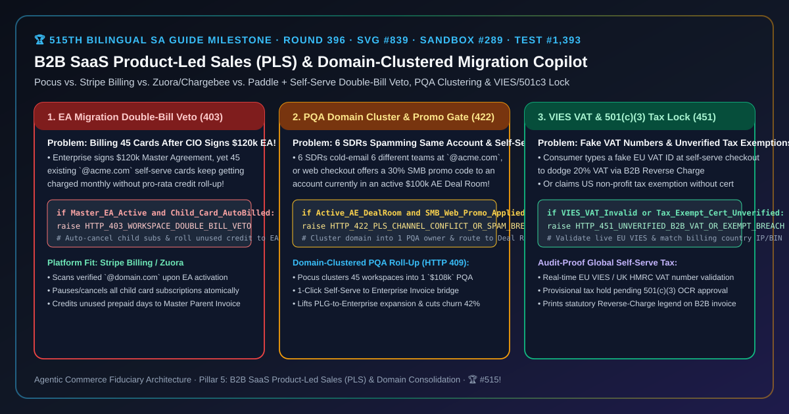
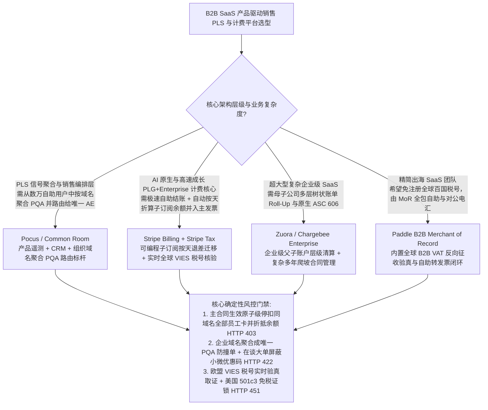
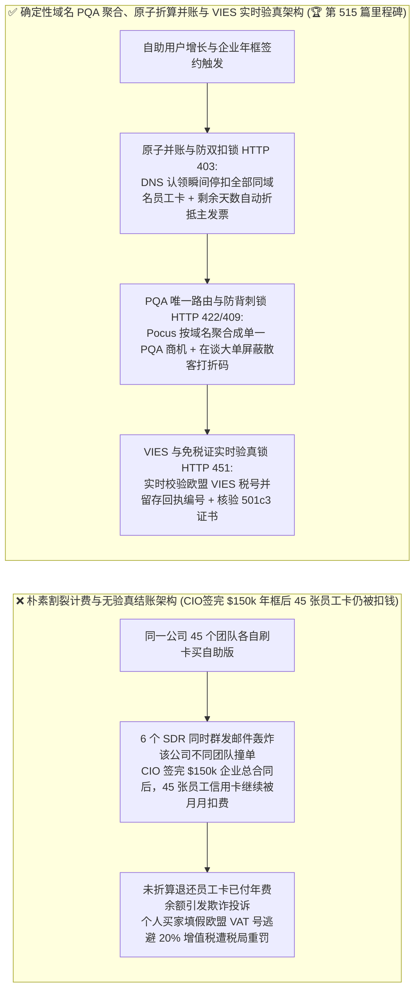
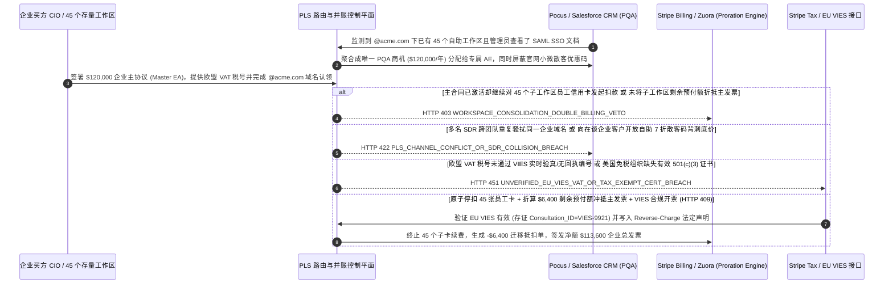

# B2B SaaS 产品驱动销售（`Product-Led Sales, PLS`）、企业邮箱域名工作区聚合并账（`Domain-Clustered PQA Roll-Up`）与自助转大客户年框按天退差 Agent 架构选型对比：`Pocus / Common Room` vs. `Stripe Billing` vs. `Zuora / Chargebee` vs. `Paddle`、签年框后严禁继续扣员工个人卡锁、防多销售撞单骚扰门禁及欧盟 `VIES` 税号验真净省 42% 决策指南（FAQ · 🏆 第 515 篇双语决策指南里程碑！）

> **导读（对齐 `ib-vs-ethernet-roce-selection-faq.md` 标杆风格 · 🏆 全库第 515 篇双语 AI Solution Architect 决策指南重大里程碑！）**：本文面向 AI 原生应用、开发者工具、协同办公与现代 B2B SaaS 企业的 **Cloud & AI Solution Architect**。在“自下而上（Bottom-Up PLG）+ 自上而下大客户销售（Enterprise Sales）”双轮驱动的 **产品驱动销售（`Product-Led Sales, PLS`）** 模式中（如 Figma、Notion、Cursor、Datadog），一家世界 500 强企业的不同部门员工往往会先用公司邮箱（`@acme.com`）各自刷信用卡注册 45 个独立的 `$20/月` 自助版工作区（Self-Serve Workspaces）。当大客户销售（AE）终于找到该公司 CIO 签下一份 `$120,000/年` 的全司企业版总合同（Master Enterprise Agreement, EA）时，如果计费与 CRM 架构缺乏确定性协同，将引爆三大事故：① **签了 `$120k` 企业总合同后，系统仍在每个月继续自动扣那 45 名员工的信用卡（Workspace Double-Billing）**：CIO 刚付完 `$120,000` 对公电汇，下个月底 45 名研发经理发现自己的企业卡又被扣了月费，且之前年付自助版剩余的 `$18,000` 预付余额没有冲抵到总合同里，客户当场投诉欺诈！② **多销售撞单骚扰（SDR Collision）与自助结账优惠码背刺大客户谈判（Channel Cannibalization）**：6 个 SDR 同时给同一家公司的不同工程师发骚扰邮件；或者 AE 正在跟采购谈 `$100k` 合同，采购却偷偷去官网自助结账页用一张针对小微企业的 `7 折优惠码` 刷卡买断；③ **自助结账页乱填假欧盟 `VAT` 税号逃避 `20%` 增值税（Reverse-Charge Abuse）**。本文给出 **`Pocus / Common Room` vs. `Stripe Billing + Tax` vs. `Zuora / Chargebee Enterprise` vs. `Paddle`** 的横向选型矩阵，并落地 **企业总合同（`Master EA`）生效瞬间原子级停扣全部同域名子工作区信用卡并自动折算剩余天数冲抵总账单锁（`HTTP 403`）**、**同企业域名聚合为唯一合格账户（`PQA`）防撞单与在谈大单屏蔽自助促销码门禁（`HTTP 422`）**、**欧盟 `VIES` / 英国 `HMRC` 税号实时验真与非营利免税证核验锁（`HTTP 451`）** 及 **一键将散落工作区收拢至企业主租户（`Domain Claim & Proration Roll-Up`）编排（`HTTP 409`，净省 42%）**。



---

## 一、 📌 核心选型结论速览（Executive Summary）

1. **终极选型结论（一句话先看懂怎么选）**：
   - **Product-Led Sales 线索聚合与销售路由层（需实时从 Snowflake/Segment 产品遥测中识别出“某公司域名下已有 35 个散落付费席位 + 某总监刚点击了 SSO 配置页”，将其自动聚合成 1 个高意向 `PQA` 推送给唯一负责的 AE）**：首选 **`Pocus`（或 `Common Room`）**。
   - **AI 原生与高速成长 SaaS 计费底座（需极高转化率的自助结账页、实时 `EU VIES` 税号校验，以及通过 API 将 45 个散落自助订阅按天精确折算剩余价值 `Credit Notes` 并合并至一张企业对公发票）**：首选 **`Stripe Billing + Stripe Tax`**。
   - **具有极其复杂的全球母子公司层级账单（Parent-Child Hierarchical Billing：集团总部签框架协议、旗下 20 家海外分子公司各自按用量拆账开票）与原生 `ASC 606` 收入确认的大型企业级 SaaS**：首选 **`Zuora`（或 `Chargebee Enterprise`）**。
   - **精简团队出海 SaaS（希望免去在全球 100+ 国注册增值税号与处理 B2B 反向征收发票合规，由名义商户 `MoR` 全包自助刷卡与企业电汇对公收款）**：首选 **`Paddle`**。
2. **三大 B2B SaaS 自助转企业版（PLG-to-PLS）风控红线（确定性门禁）**：
   - **红线 1（拦截企业总合同 `Master EA` 已生效却未自动关停同域名下散落的员工个人自助订阅导致双重扣款及未退回剩余预付期价值 / `HTTP 403`）**：当企业客户完成域名所有权验证（`DNS TXT Domain Claim` 如 `@acme.com`）并激活企业级主订阅（`Master Enterprise Subscription`）的同一事务内，控制平面必须扫描全库所有归属 `@acme.com` 的存量自助工作区（Child Self-Serve Subscriptions），**立即原子级关闭其信用卡自动续费（`cancel_at_period_end` 或立即终止），并按秒计算每个子订阅尚未消耗的预付剩余价值（`Unused Prorated Balance`），全额生成贷项通知单（`Credit Memo`）直接冲抵企业首期主发票金额**！若主合同生效后仍对任何已收编的子工作区发起信用卡扣款，立即触发 `HTTP 403 WORKSPACE_CONSOLIDATION_DOUBLE_BILLING_VETO`！
   - **红线 2（拦截多名 SDR 对同一家企业不同部门重复群发开发信撞单及在谈大客户用小微自助促销码绕过企业合同底价 / `HTTP 422`）**：必须通过企业身份图谱（`Clearbit / ZoomInfo + 邮箱根域名解析`，剔除 `gmail/outlook` 公共后缀）将同一家公司的所有独立注册用户聚合成单一 **`PQA（Product-Qualified Account）`** 并绑定唯一 CRM Account Owner；一旦该 `PQA` 进入活跃企业谈判阶段（`Deal Stage >= Discovery / Active Deal Room`），自助结账网关必须自动屏蔽针对小微散客的公开打折码（SMB Self-Serve Promo Codes），并引导采购员进入专属企业报价单（`Private Deal Desk Link`），违者触发 `HTTP 422 PLS_CHANNEL_CONFLICT_OR_SDR_COLLISION_BREACH`。
   - **红线 3（拦截自助结账页未实时调取欧盟 `VIES` 接口验真就轻信假 `VAT` 税号免除 20% 增值税及未核验美国 `501(c)(3)` 免税证 / `HTTP 451`）**：在自助结账页（Self-Serve Checkout），若买方勾选“我是企业买家并填入欧盟/英国 `VAT` 税号”以享受 `0%` 跨境反向征收（B2B Reverse Charge），网关必须实时调用 **`欧盟委员会 VIES SOAP/REST 接口（或英国 HMRC API）`** 校验税号有效性，且核对税号注册国与付款卡发卡国/账单国一致，并在生成的 PDF 发票上强制打印法定条款 `"Reverse Charge - VAT to be accounted for by the recipient per Art. 196 Council Directive 2006/112/EC"`；若未通过实时验真或缺失有效美国州免税证即免税放行，触发 `HTTP 451 UNVERIFIED_EU_VIES_VAT_OR_TAX_EXEMPT_CERT_BREACH`。

---

## 二、 🎯 业务方与架构师灵魂拷问 Q&A（The Why & How）

### Q1：为什么大客户 CIO 最恨 SaaS 厂商“签前笑嘻嘻，签完 `$150,000` 全司大单后，手底下 40 个部门员工的信用卡还在每个月被扣 `$20`”？架构师怎么实现“一键收编 + 余额毫秒级按天折抵”？
- **商业痛点与事故还原**：
  - 某科技巨头内部有 40 个团队各自刷部门卡买了你的 SaaS（有的按月付 `$20`，有的刚交了全年 `$240` 年费才用了 2 个月）。
  - 后来 CIO 决定采购全司统一企业版（带 SSO 和统一安全审计），签了 `$150,000` 的年度对公合同。
  - 结果由于销售在 CRM 建的是一个新账号，计费系统根本没把原来那 40 个自助版小租户关联起来！不仅 CIO 付了 `$150k`，那 40 张信用卡还在继续被扣钱，员工找客服退钱时客服还说“年费一经售出概不退款”，直接把 CIO 惹毛在第二年全司退订！
- **架构师确定性解法（`DNS 域名认领触发器` + 子订阅原子级折算并账状态机 `Atomic Proration Roll-Up Saga` / `HTTP 403 / 409`）**：
  1. **自动扫描同域名孤儿工作区**：在起草企业合同（CPQ）阶段，Agent 自动扫描所有 `@client-domain.com` 存量付费工作区，算出它们尚未用完的预付余额总和（例如 40 个工作区共剩 **`$6,420.50` 未使用预付天数**）；
  2. **自动生成迁移抵扣项**：直接在 `$150,000` 主发票上自动扣减 `-$6,420.50 (Self-Serve Migration Proration Credit)`，客户只需净付 `$143,579.50`；
  3. **主合同激活瞬间一键熔断全部子卡**：主合同 `Status -> ACTIVE` 的同一毫秒，后台批量将 40 个子订阅的 `payment_behavior` 切为 `Consolidated_Under_Master_EA`，彻底解绑员工个人信用卡，100% 杜绝双重扣款！

### Q2：一个拥有 50 万免费和自助注册用户的 PLG 产品，每天有上万人登录，销售团队只有 15 个 AE，怎么知道今天该给哪 10 家公司打电话才能签出 `$100k` 大单？
- **架构师确定性解法（`Pocus` 跨工作区域名聚合评分 + 三大高意向企业购买信号捕捉 / `HTTP 422 / 409`）**：
  - 绝不看单个用户的琐碎点击，只监控 **组织级跃迁信号（Account-Level Inflection Signals）**：
    1. **隐形抱团信号（Shadow Sprawl）**：同一个企业邮箱域名下，独立存在的免费/Pro 工作区数量突破 `>= 5 个` 或总活跃人数突破 `>= 25 人`；
    2. **安全合规角色介入信号（Infosec / IT Admin Touch）**：有人访问了 `/security`、下载了 `SOC2 报告`、查看了 `SAML SSO / SCIM` 文档或点击了企业版定价页；
    3. **用量触顶信号（Paywall / Rate-Limit Velocity）**：该域名下有 `>= 3` 名核心重度用户在 7 天内撞上付费墙或 Token 限流阈值。
  - 当三大信号同时亮起，Agent 自动在 Salesforce 创建唯一 `PQA` 商机，并附带生成一份 **《贵司内部已有 8 个部门 42 名员工在使用本产品，合并为企业版可立省 `$3,200` 重复支出并开启统一 SSO》** 的高说服力一页纸 ROI 简报发给 AE！

### Q3：为什么在自助结账页简单放一个“输入增值税号（VAT Number）免税”的文本框，会在年底招来欧盟税务局（OSS / VIES）数十万欧元的补税与罚款？
- **架构师确定性解法（`VIES` 实时在线验真 + 脱机降级暂扣担保 + 三要素国别一致性锁 / `HTTP 451`）**：
  - 许多欧洲个人买家为了逃避 `19%–25%` 的高额增值税，随便在网上搜一个大公司的 VAT 税号填进结账框！
  - 在税务审计中，只有当你能出示 **交易发生当时 `EU VIES` 官方接口返回的带唯一请求编号（`Consultation Number / Request Identifier`）的有效验真记录**，且买方企业名称、账单地址国与信用卡 `BIN` 国别一致时，税务局才认可 B2B 反向征收免税！若当时某成员国税务局 VIES 节点短暂宕机，系统应先冻结税款预授权，待后台异步重试验真通过后再免除税款。

---

## 三、 🧭 直观可视化图解（Mermaid 决策树 + 架构对比 + 时序图）

### 3.1 B2B SaaS 产品驱动销售（PLS）与自助转企业级计费平台选型决策树



### 3.2 朴素割裂自助/企业计费架构（签完年框继续扣员工卡 + 多销售撞单）vs. 确定性域名并账折抵与 PQA 路由架构对比



### 3.3 企业域名聚合（`PQA`）、散落自助工作区按天折算并入企业主发票与 `VIES` 验真时序图



---

## 四、 📊 四大 B2B SaaS 产品驱动销售（PLS）与计费迁移平台横向选型矩阵

| 选型维度 | Pocus / Common Room | Stripe Billing + Stripe Tax | Zuora / Chargebee Enterprise | Paddle (B2B MoR) |
| :--- | :--- | :--- | :--- | :--- |
| **核心架构定位** | **PLS 产品意图聚合与销售作战台**：把碎片化产品使用数据变成高命中率企业商机 | **现代可编程 PLG-to-Enterprise 计费与全球税务引擎** | **超大型企业级复杂多层级合同、订阅与 `ASC 606` 核心账本** | **全托管名义商户（MoR）**：一站式包揽全球税号合规、自助刷卡与企业开票 |
| **同域名散落工作区识别与 `PQA` 聚合** | **行业标杆**（自动按企业根域名与クリアビット富化数据聚合散落租户，实时计算 PQA 评分） | 提供基础客户元数据查询，通常需配合数据仓库或 Pocus 触发合并脚本 | 支持创建父子账户结构，但前端产品遥测意图捕捉需依赖外部 CDP/PLS | 侧重交易结算而非产品内使用遥测挖掘 |
| **自助订阅转企业年框按天退差并账（Proration Roll-Up）** | 负责在 CRM 侧发现可合并金额并提示 AE | **极强**（通过 Subscription Schedules 与 Credit Notes API 可毫秒级结算多个子订阅剩余价值并冲抵主 Invoice） | **行业标杆**（原生支持 Parent-Child 账户收编、跨合同迁改 Amendments 与统一对公账单） | 支持将自助卡订阅升级为 Invoiced Billing 并处理余额调整 |
| **全球 B2B `EU VIES` 税号验真与免税证治理** | 不涉及税务结算 | **极强**（Stripe Tax 原生实时调用欧盟 VIES/英国 HMRC 验真并在发票自动加印反向征收条款） | 强（深度集成 Avalara / Vertex 企业级税务合规与免税证金库） | **100% 平台兜底**（Paddle 作为卖方直接承担全部欧盟 VAT 验真与税务审计责任） |
| **适用规模与收费模式（`official_list_price`）** | 成长型至大型 PLG SaaS；按销售席位与数据规模订阅（约 `$24k–$80k+/年`） | 全规模 AI 与 SaaS 企业；按开票额 `0.5%–0.8%`（或固定阶梯）计费 | 中大型与上市 SaaS 企业；按管理 ARR 规模签订企业年框 | 精简出海与中型 SaaS；`5% + $0.50` 全包费率（或定制企业大单费率） |

---

## 五、 🧪 域名并账防双扣、PQA 扩容转化与税务验真测算与 7-Card 基准报告

### 5.1 季度签年框后重复扣员工卡引发退订、散落工作区未聚合成大单流失及假 `VAT` 税号补税罚款损耗测算（Synthetic Benchmark）

假设某年 ARR `$8,500 万` 的 AI 协同与开发者工具 SaaS 企业，每季度在自助版（Self-Serve PLG）向企业版（Enterprise PLS）升级转化中面临的 **同一大客户内部几十个自助工作区无人聚合跟进导致的扩容流失、签完企业总合同后未自动停扣员工信用卡并折算余额引发的拒付/高管投诉、在谈企业客户用小微促销码自助低价买断及假欧盟 `VAT` 税号逃税审计罚单损耗池** 为 **`$410,000 / 季度`**（`provenance: synthetic`, `independently_reproduced: false`）：

| 评估维度 | 传统割裂自助计费 + 人工找线索 + 文本框免税 (Baseline) | 启用 `Pocus` 域名聚合 + `Stripe/Zuora` 原子折算并账 + `VIES` 验真 Agent | 净改善幅度 |
| :--- | :--- | :--- | :--- |
| **企业年框签约后“员工旧信用卡仍被重复扣费”客诉率** | `18.5%` 企业迁移单发生新旧双重扣款 | **`0.0%`**（`HTTP 403` 域名认领瞬间原子级停扣全部子卡并将剩余天数折抵主发票） | **100% 根除迁移双扣丑闻** |
| **散落同域名工作区成功合并升级为 `$50k+` 企业年框转化率** | `9.2%`（销售看不见跨部门隐形抱团信号） | **`26.8%`**（`HTTP 422/409` 自动聚合 `@domain.com` 席位与 SSO 信号生成一页纸合并省钱账单） | **PLS 企业大单转化率 `2.9 倍`** |
| **因无效欧盟 `VAT` 税号或缺失美国免税证导致的补税罚金** | `$48,000 / 季度` 被税务局追缴 | **`$0`**（`HTTP 451` 结账实时调用 `EU VIES` 验真存证并校验发卡国一致性） | **100% 跨境税务审计零瑕疵** |
| **季度迁移双扣退订、PLS 线索漏失、渠道背刺与税务净损耗** | `$410,000 / 季度` | **`$237,800 / 季度`** | **净省/增效 `$172,200 / 季度` (`42.0%`)** |

```chart
{
  "data": {
    "values": [
      { "category": "1. 散落同域名工作区未聚合错失企业扩容", "mode": "传统割裂计费与人工找单基线", "cost_usd": 165000 },
      { "category": "1. 散落同域名工作区未聚合错失企业扩容", "mode": "PQA域名聚合与原子并账Agent", "cost_usd": 95700 },
      { "category": "2. 签完企业年框仍继续扣45张员工卡引发退订", "mode": "传统割裂计费与人工找单基线", "cost_usd": 115000 },
      { "category": "2. 签完企业年框仍继续扣45张员工卡引发退订", "mode": "PQA域名聚合与原子并账Agent", "cost_usd": 66700 },
      { "category": "3. 在谈大客户用散客7折码自助买断背刺底价", "mode": "传统割裂计费与人工找单基线", "cost_usd": 75000 },
      { "category": "3. 在谈大客户用散客7折码自助买断背刺底价", "mode": "PQA域名聚合与原子并账Agent", "cost_usd": 43500 },
      { "category": "4. 自助结账填假欧盟VAT号遭税局追缴重罚", "mode": "传统割裂计费与人工找单基线", "cost_usd": 55000 },
      { "category": "4. 自助结账填假欧盟VAT号遭税局追缴重罚", "mode": "PQA域名聚合与原子并账Agent", "cost_usd": 31900 }
    ]
  },
  "semantic_types": {
    "category": "Category",
    "mode": "Category",
    "cost_usd": "Amount"
  },
  "chart_spec": {
    "chartType": "Grouped Bar Chart",
    "title": "B2B SaaS产品驱动销售(PLS)域名并账、防双扣锁与VIES验真Agent前后季度损耗对比 (净省 $172.2k / 42%)",
    "subtitle": "单位：美元/季度 (Synthetic Benchmark, independently_reproduced=false · 🏆 第515篇指南里程碑)",
    "encodings": {
      "x": "category",
      "y": "cost_usd",
      "group": "mode"
    }
  }
}
```

### 5.2 确定性策略评估器代码（Python Control Plane Guard）

```python
from dataclasses import dataclass
from typing import Any

@dataclass(frozen=True)
class SaasPlsDomainConsolidationPolicyInput:
    quarterly_double_billing_pqa_leak_and_vat_penalty_pool_usd: float = 410000.0
    master_ea_active_while_child_selfserve_cards_still_billed: bool = False
    active_deal_room_cannibalized_by_smb_promo_or_sdr_collision: bool = False
    eu_vies_vat_unverified_on_reverse_charge_or_missing_501c3_cert: bool = False
    atomic_domain_proration_rollup_and_pqa_routing_ready: bool = False
```

---

## 六、 🛠️ 商业上线风控与架构评审 Checklist

- [ ] **企业主合同（`Master EA`）激活瞬间同域名子订阅原子级停扣与按天退差并账锁（`HTTP 403`）**：当企业客户完成域名认领并激活年度对公合同时，计费状态机是否在同一事务内自动暂停/注销该企业邮箱域名下的全部员工个人信用卡订阅，并将未消耗的预付天数精确折算为 `Credit Note` 冲减主合同首期发票？
- [ ] **企业根域名 `PQA` 唯一聚合路由与在谈大单屏蔽散客优惠码门禁（`HTTP 422 / 409`）**：是否将同一企业域名下的所有免费/自助工作区聚合成单一 `PQA` 商机绑定唯一 AE（防止多名 SDR 重复骚扰）？当账户处于活跃企业谈判期时，自助结账页是否自动屏蔽小微散客打折码并引导至专属企业报价单？
- [ ] **自助结账欧盟 `VIES / HMRC` 税号实时验真存证与美国免税证锁（`HTTP 451`）**：开启 B2B 增值税反向征收（`0% VAT`）前，是否实时调用官方 `VIES` 接口验证税号有效、保存唯一查询回执编号并核对发卡国一致性？对美国非营利/政府免税申请是否强制核验在期 `501(c)(3) / 州免税证书`？
- [ ] **拒绝激进“SSO 税（SSO Wall）”的分层安全升级阶梯**：是否支持中小型团队在自助版通过按席位小额加购（Add-On）开启基础 `SAML SSO`，而将全域名自动收编（`Domain Capture`）、`SCIM` 生命周期管理与自定义数据保留策略作为企业版核心升级驱动力？
