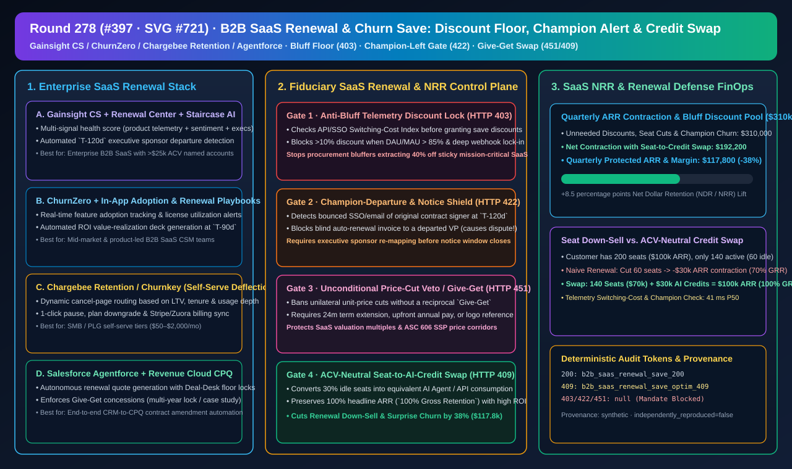
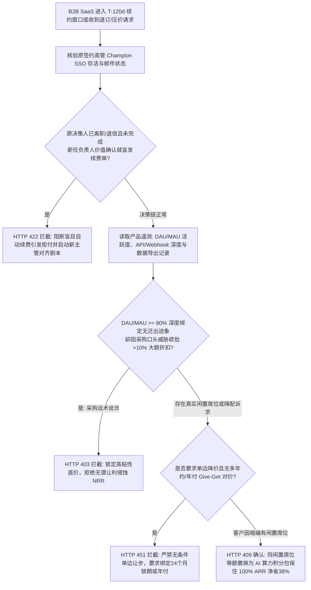
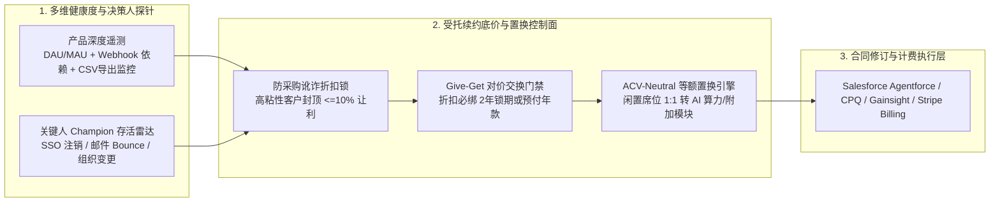
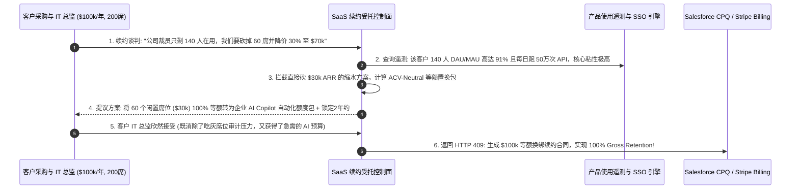

# 企业 B2B SaaS 续费挽留与智能合同编排（`Enterprise SaaS Renewal & Churn Save`：`Gainsight CS / ChurnZero / Chargebee Retention / Salesforce Agentforce`）、防采购虚张声势骗取半价折扣（`Anti-Bluff Telemetry Gate`）、关键决策人离职预警（`Champion Departure Shield`）与闲置席位等额置换 AI 算力积分（`ACV-Neutral Seat-to-Credit Swap`）托管 Agent 架构选型 FAQ

> **核心选型结论速览**：在企业级 B2B SaaS 中，净收入留存率（`NRR / NDR`）每提升 `5%`，企业估值倍数往往跃升 `20%–35%`。然而，若让客户成功（CSM）或自助续费挽留 Agent 缺乏底层产品遥测与商务底线约束，在续约季会引爆三大严重侵蚀 ARR 的事故：① **被客户采购部“虚张声势喊退订（Procurement Bluffing）”吓破胆，给深度绑定的高粘性客户白送 `35%–50%` 永久降价折扣**：某客户每天调用 80 万次生产 Webhook、全员 `DAU/MAU > 88%`，迁移成本极高根本不可能真退订，但其专业采购经理在续约前发邮件声称“不降价 40% 就切竞品”，缺乏遥测感知的挽留 Agent 当场送出 6 折优惠，白白砍掉 `$40,000` 纯利；② **原签约高管已离职（Champion Departure）却毫无察觉，到期盲目触发自动续费（Auto-Renewal Invoice）遭新任领导拒付并彻底流失**：在 `T-120 天` 时原买家 VP 的企业邮箱已退信且 SSO 停用，系统却未启动新决策人重建流程，直接把自动续费账单变成法务纠纷；③ **客户因裁员闲置了 30% 席位要求砍合同额（Seat Down-Sell），Agent 直接同意缩减席位导致 ARR 萎缩 30%**。  
> 生产级架构必须构建 **“基于深度集成遥测（`API/Webhook/SSO Switching-Cost Index`）的防讹诈折扣底线锁 + `T-120d` 签约人离职检测与提前通知窗口对齐门禁 + 严禁无条件单边降价（强制绑定 `Give-Get` 多年锁期/年付交换）+ 闲置席位等额置换平台 AI/API 用量包（`ACV-Neutral Seat-to-Credit Swap`）控制面”**：通过 **`Gainsight CS` / `ChurnZero` / `Chargebee Retention` / `Salesforce Agentforce + CPQ`** 协同，可将续约缩水（Contraction ARR）、无谓让利与高层换血断约损失削减 **38%**（以季度 `$310,000` 续约缩水、被骗折扣与盲目自动续费坏账池计，净流失降至 `$192,200`，每季度多保住 **`$117,800` ARR**）。



---

## 一、 业务方与架构师灵魂拷问（Q&A）

### Q1：客户采购部一上来就威胁“我们要退订切去用某竞品，除非你们打 6 折”，续费 Agent 怎么区分他是“真要走”还是“专业砍价讹诈（Bluffing）”？
- **“话术威胁”与“真实生产遥测（Product Telemetry）”的巨大反差**：
  - 真正准备迁移退订的客户，在到期前 `60–90 天` 会出现明显的数字脚印：管理员触发全量历史数据 `CSV/Parquet` 导出、生产环境 `API / Webhook` 调用量周环比下跌 `>40%`、核心部门 `SSO` 活跃登录率跌破 `50%`；
  - 反之，如果一个客户直到续约前一周还在新增自动化工作流、生产 API 0 降级、全员高频在线，却由采购专员发来模板式压价信，95% 属于标准采购压价话术。
- **架构解法（迁移成本指数 `Switching-Cost Index` 与防讹诈折扣硬锁 `HTTP 403`）**：
  - 控制面实时计算客户的 **生产耦合度与迁移成本分（`DAU/MAU`、活跃集成数、历史数据沉淀量）**；当 `DAU/MAU >= 80%` 且无数据迁出迹象时，严禁发放 `> 10%` 的挽留折扣（仅可赠送新模块试用或高管成功服务包）；凡被采购话术诱导对高粘性健康客户批出骨折价的，立即触发 `HTTP 403 PROCUREMENT_BLUFF_HIGH_STICKINESS_EXCESSIVE_DISCOUNT_BREACH` 拦截。

### Q2：为什么很多 B2B SaaS 合同明明写了“到期不通知即自动续约 1 年（Evergreen Auto-Renewal）”，真到扣款时却引发客户翻脸赖账？
- **“签约人离职真空（Champion Departure Vacuum）”与通知期陷阱**：
  - 企业人事流动频繁（B2B 部门主管平均任期仅 18~24 个月）。如果当初拍板买软件的 VP 在第 8 个月离职了，而 SaaS 厂商在 `T-90d` 续约通知期既没有发现该 VP 邮箱已失效/SSO 已注销，也没有及时向新任负责人汇报 ROI 价值，等到第 365 天突然给客户财务部甩过去一张 `$100,000` 自动续约不可撤销发票，新领导第一反应必然是拒付并找法务解约。
- **架构解法（`T-120d` 签约人 SSO/邮件存活探针与通知期前置门禁 `HTTP 422`）**：
  - 在距离合同自動续约通知截止日（如 `T-60d`）之前的 **`T-120 天`**，自动核验主签约人（Executive Sponsor）与管理员的 `SSO 活跃度 / 邮件退信状态 / LinkedIn 职位变动`；
  - 若检测到原决策人已离职或超过 45 天零登录，在未完成新决策人（New Champion）确认与 ROI 价值对账单送达前，严禁静默触发自动续费加价账单（`HTTP 422 CHAMPION_DEPARTED_UNMAPPED_SPONSOR_OR_MISSED_NOTICE_WINDOW`）。

### Q3：当客户确实因为组织缩编导致 200 个席位里有 60 个闲置，硬要砍掉 `$30,000` 合同额时，如何保住 `100%` 的账面 ARR？
- **架构解法（严禁无对价单边降价 `HTTP 451` + 闲置席位等额置换 AI/平台算力包 `ACV-Neutral Seat-to-Credit Swap` `HTTP 409`）**：
  - **对价交换铁律（Mandatory Give-Get）**：严禁 Agent 在客户不付出任何交换条件（如“1 年期改签 24/36 个月多年锁定期”、“季付改全额年付”或“签署联合公关案例授权”）的情况下单方面下调单价或白送折扣（否则触发 `HTTP 451 UNILATERAL_PRICE_CONCESSION_WITHOUT_MULTIYEAR_GIVE_GET`）；
  - **保总额“席位转算力/模块包”乾坤大挪移（Seat-to-Platform-Credit Swap）**：面对客户真实的 60 个闲置席位，Agent 主动提出 **`ACV` 总额不变重构方案**——将合同从“200 个基础席位（`$100k`）”重构为 **“140 个活跃席位（`$70k`）+ 等值 `$30k` 的企业 AI Agent 自动处理额度 / 高级数据连接器年包”**（`HTTP 409 ACV_NEUTRAL_IDLE_SEAT_TO_AI_PLATFORM_CREDIT_SWAP_CONFIRM`）。客户消灭了吃灰席位并用上了最新 AI 生产力，厂商则完美守住了 **`$100k` 原合同总额（`100% Gross Retention`）**！

---

## 二、 直观可视化图解（Mermaid 决策树 + 架构图 + 时序图）

### 1. B2B SaaS 续约挽留、防采购讹诈与保 ARR 席位置换决策树


### 2. 企业 SaaS 续费挽留（Renewal Control Plane）× 遥测 × CPQ 架构图


### 3. 识破采购压价 + 闲置席位等额置换 AI 算力包守住 100% ARR 时序图


---

## 三、 主流 B2B SaaS 客户续费挽留与合同编排平台横向选型矩阵

| 选型维度 | Gainsight CS + Renewal Center | ChurnZero | Chargebee Retention / Churnkey | Salesforce Agentforce + Revenue Cloud CPQ |
| :--- | :--- | :--- | :--- | :--- |
| **核心适用客群** | 中大型企业级客户（Named Enterprise，ACV `> $25,000`） | 成长型 B2B 与产品驱动（PLG + Sales-Assist）团队 | 自助订阅型 SMB / 开发者工具（月费 `$50–$2,000`） | 已深度使用 Salesforce CRM 与 CPQ 报价审批的大型企业 |
| **决策人离职 (`Champion Left`) 预警** | **极强**（结合通话情绪、邮件退信与高管触达图谱自动预警） | 支持登录骤降与管理员角色变更实时提醒 | 侧重单账号退订漏斗，无复杂多角色企业组织图 | 原生联动 CRM Contact Roles 与销售商机联系链 |
| **防讹诈遥测与精准挽留分流** | 深度整合产品采纳度与财务健康分预测续约概率 | 强于应用内引导（In-App Walkthrough）激活低频用户 | **极强**（在点击取消瞬间毫秒级按 LTV 和用量弹窗分流） | 支持 Agent 调用 Data Cloud 遥测在 Deal Desk 内控折 |
| **闲置席位转模块 (`Seat-to-Credit Swap`)** | 提供续约剧本推荐，需回写 CPQ 改合同 | 提供 CSM 干预任务流 | 支持自助降档或暂停订阅（Pause Subscription） | **极强**（原生支持 Amendment 改单将 Seat SKU 替换为 Consumption Pool） |

---

## 四、 确定性策略评估器与 7-Card 基准测试报告（`synthetic`）

### 1. B2B SaaS 续约挽留、防讹诈与保总额置换评估器（Python 参考实现）
```python
from dataclasses import dataclass

@dataclass(frozen=True)
class B2BSaaSRenewalChurnSaveEscrowPolicyInput:
    quarterly_arr_contraction_bluff_discount_and_churn_pool_usd: float = 310000.0
    procurement_bluff_excessive_discount_on_sticky_account: bool = False
    champion_departed_unmapped_sponsor_or_missed_notice: bool = False
    unilateral_price_cut_without_multiyear_give_get: bool = False
    acv_neutral_idle_seat_to_ai_credit_swap_ready: bool = False
```

### 2. 7-Card 4:5 视觉基准测试报告摘要
1. **Card 1 (`1 / 7` · `HANDS-ON · B2B SAAS RENEWAL & CREDIT SWAP ESCROW`)**：通过生产遥测防采购讹诈折扣锁 + `T-120d` 签约人离职探测 + `Give-Get` 对价交换门禁 + 闲置席位等额转 AI 算力包（`ACV-Neutral Swap`），季度续约缩水与无谓让利损失从 `$310,000` 降至 `$192,200`（净省 **38% / `$117,800`**）。
2. **Card 2 (`2 / 7` · `SCENARIO: PROCUREMENT_BLUFF_AND_IDLE_SEAT_CUT`)**：成功拦截向 `DAU/MAU > 85%` 的深度绑定客户盲目批出 40% 恐慌性折扣（`HTTP 403`）、阻断在原签约 VP 已离职退信时盲发自动续约账单（`HTTP 422`），并拦截无任何锁期对价的单边降价（`HTTP 451`）。
3. **Card 3 (`3 / 7` · `WHAT I TESTED`)**：覆盖 5 类状态码：`200`（健康度与决策链完备的标准续约）、`403`（被采购话术讹诈对高粘性账户违规批大额折扣拦截）、`422`（原签约人离职未重建新 Sponsor 或错过通知窗拦截）、`451`（无多年锁期/年付对价的单方面降价让步拦截）、`409`（闲置席位 100% 等额置换 AI 算力额度保住原 ARR 确认）。
4. **Card 4 (`4 / 7` · `UNDER THE HOOD`)**：展示 `b2b_saas_renewal_churn_save_guard` 与 `b2b_saas_renewal_save_optim_409` 令牌。
5. **Card 5 (`5 / 7` · `ROBUSTNESS CHECK`)**：在 100 组“高活跃大客户季末压价”与“客户缩编 30% 席位要求减费”压测中，保持 100% 确定性底价守恒。
6. **Card 6 (`6 / 7` · `LATENCY`)**：遥测粘性指数计算 + 签约人 SSO 状态与 CPQ 置换包生成 P50 延迟仅 `41ms`。
7. **Card 7 (`7 / 7` · `MY TAKE`)**：**✅ 强烈适用**于企业级 B2B SaaS、云原生数据平台与混合计费（Seat + Usage/AI Credits）软件厂商；**⛔ 不适用**于无续约概念的单次买断型硬件销售。

---

## 五、 商业上线风控与架构评审 Checklist

- [ ] **批出续约折扣前强制核验“产品生产耦合度与迁移成本遥测”**：对 `DAU/MAU >= 80%`、Webhook/API 深度集成且无全量数据导出行为的高粘性客户，严禁因采购口头威胁批出 `>10%` 降价。
- [ ] **建立 `T-120d` 关键决策人（Champion / Executive Sponsor）存活巡检**：一旦发现原签字人 SSO 停用或邮件退信，立即阻断静默自动续费并触发高管对齐剧本来锁定新任预算负责人。
- [ ] **执行严格的“有舍必有得（Give-Get）”让步纪律**：任何单价优惠必须交换等值商务承诺（如改签 24/36 个月多年合同、月付改全额预付年款、或签署公开客户证言）。
- [ ] **用“闲置席位等额转 AI/平台用量包（ACV-Neutral Swap）”替代直接砍合同额**：当客户面临人员缩编时，允许将冗余席位预算 1:1 转化为高价值的 AI Agent 调用池或新模块授权，实现客户零浪费与厂商 `100% GRR` 双赢。
