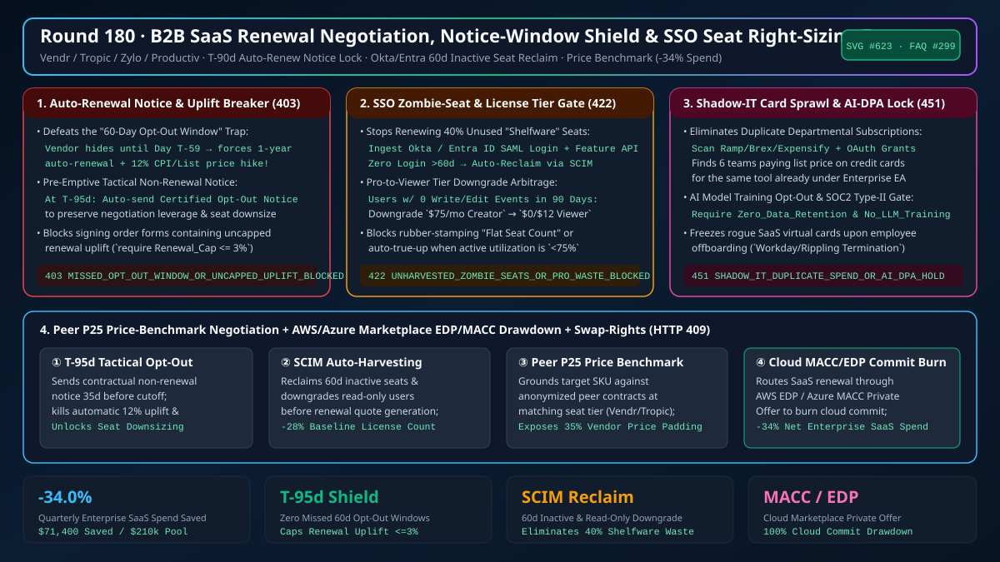
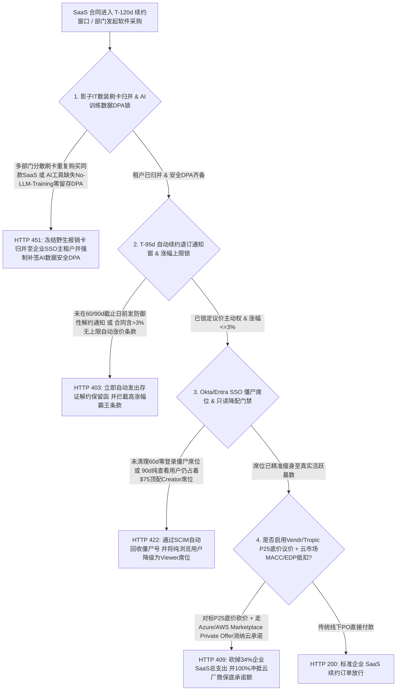
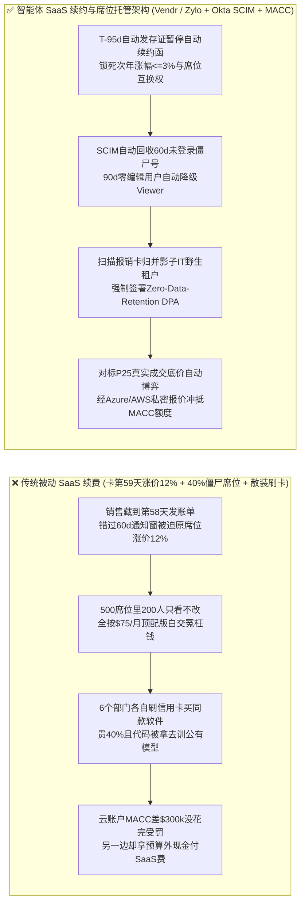
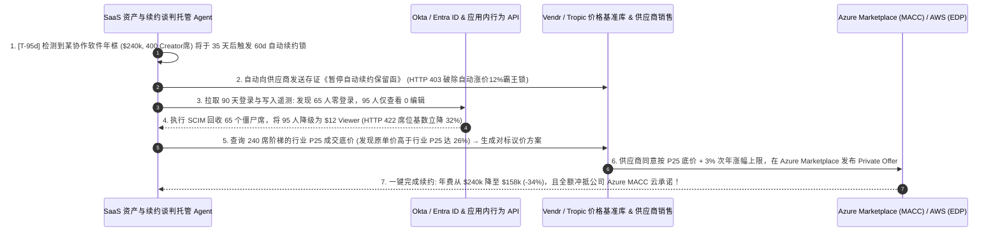

# 企业 B2B SaaS 续约谈判、防“提前 60 天不通知即自动绑死 1 年且涨价 12%”与 `SSO` 僵尸席位自动缩容托管（Vendr / Tropic / Zylo / Productiv / Coupa）防销售卡第 59 天发涨价账单、防全员买顶配 `Creator` 席位吃灰与云市场 `MACC/EDP` 额度抵扣托管“防 6 个部门各自刷公司卡重复买同款软件、防默认喂企业数据训练大模型与续费净省 34%”Agent 架构选型 FAQ

> **语言 / Language**: **中文 (当前)** | **[English (`b2b-saas-renewal-negotiation-notice-deadline-seat-rightsizing-escrow-agent-selection-faq.en.md`)](b2b-saas-renewal-negotiation-notice-deadline-seat-rightsizing-escrow-agent-selection-faq.en.md)**  
> **返回总目录**: **[📚 中文总目录 (`docs/index.md`)](index.md)** | **[🚀 交互式实时工作台 (`live-demo.html`)](../live-demo.html)**  
> **赋能角色**: 企业 IT 采购与软件资产管理（SAM）负责人、CIO / CFO、研发效能与财务 FinOps 总监、Cloud & AI Solution Architect  
> **关联架构图**: `assets/svg/623-b2b-saas-renewal-notice-deadline-seat-rightsizing-escrow-2026-11-21.svg`

---

## ① 📌 核心选型结论速览（Executive Summary）

在中大型企业的间接采购（Indirect Procurement）中，**B2B SaaS 软件订阅支出**已成为仅次于员工薪酬与云基础设施的第三大开支（平均每家千人企业拥有 180+ 款 SaaS 软件，年支出 `$400万–$1,500万`）。然而，传统的“到期前两周 IT 经理才收到供应商发票、匆忙走 OA 续费”模式，会让企业掉入四大隐蔽的商业合同与席位浪费陷阱：
1. **“提前 60/90 天书面通知期（Auto-Renewal Opt-Out Window）”霸王条款与 `12%` 自动涨价偷袭**：绝大多数欧美企服 SaaS（如 Salesforce、Datadog、Snowflake、HubSpot、Jira 等）在主服务协议（MSA）小字中写明：*“除非客户在合同到期前至少 60 天（或 90 天）发出书面不续约通知，否则合同将按同等或更多席位数自动续期 12 个月，且单价自动上浮 `7%–12%`（Uplift）”*。供应商销售故意在 `T-90d` 到 `T-61d` 期间装死不联系客户，精准卡在 **第 `T-58` 天** 才把涨价 `12%` 的续费账单发给采购——此时通知窗口已关闭，企业既不能减掉离职员工的空席位，也失去了议价筹码！
2. **40% 的高价席位沦为“僵尸席位（Shelfware）”，且大量只看不改的普通员工被错配了 `$75/月` 的顶配专业版（Creator / Enterprise Tier）**：企业买了 500 个 Figma / Tableau / Salesforce 席位，其中 110 人已经转岗或过去 90 天 0 登录；另有 180 名产品/高管只是偶尔点开看一眼图表（原本用 `$0–$12/月` 的 `Viewer / Read-Only` 席位即可），却全被开通了 `$75/月` 的 `Full Creator` 满血版。
3. **“影子 IT（Shadow IT）多头重复购买”——公司明明签了企业年框（EA），下面 6 个业务部门还在各自刷商务信用卡按原价零买同款工具**：市场部、研发部和海外分公司的员工用各自的 `Ramp / Brex` 报销卡分别订阅了 6 个独立的 Notion / Miro / Canva / AI 工具团队版，不仅没享受到集团大客户 6 折阶梯价，还造成企业敏感数据散落在未受 `Okta SSO` 与 `Zero-Data-Retention (ZDR)` 保护的野生租户里。
4. **信息极度不对称的“黑盒报价（Price Opacity）”與错失 `AWS EDP / Azure MACC` 云承诺额度抵扣**：同一款 SaaS 软件对规模相同的两家公司报价相差 `45%`；同时企业云账户里还有 `$500,000` 即将过期的 Azure `MACC` 或 AWS `EDP` 保底消费承诺额未用完，采购却用预算外现金直接付给了 SaaS 厂商。

**架构师选型结论**：直接采用 **“合同到期前 `T-95 天` 自动发送防御性不续约保留通知（Tactical Opt-Out Shield）与次年涨幅 `<=3%` 封顶锁（HTTP 403）+ 直连 `Okta / Entra ID` 与应用内 API 自动回收 60 天未登录僵尸席位及只读用户自动降级 `Viewer` 门禁（HTTP 422）+ 扫描全公司报销卡流水归并影子 IT 野生租户与 `AI 零数据留存（No-LLM-Training DPA）` 合规锁（HTTP 451）+ 基于 `Vendr / Tropic` 同体量 `P25` 底价基准议价与 `Azure MACC / AWS EDP` 云市场私密报价（Private Offer）抵扣净省 34%（HTTP 409）”** 的企业 SaaS 采购托管架构。



---

## ② 🎯 业务方与架构师灵魂拷问（Q&A）

### Q1：为什么 SaaS 供应商的客户成功经理（CSM）平时不露面，总是在离合同到期还剩 55 天时突然发来涨价 10% 的账单？架构上如何用“T-95 天战术退订信”夺回主动权？
- **业务痛点**：SaaS 合同里的 `60-Day / 90-Day Auto-Renewal Notice Clause` 是供应商锁死 ARR 的法律武器。只要你在到期前第 59 天才提“我们今年裁员了想把 500 个席位减到 350 个”，供应商法务就会拿出合同说：“抱歉，您错过了提前 60 天的通知期，按约已自动按 500 席位续签一年且单价上浮 10%”。
- **架构护栏（`HTTP 403 MISSED_OPT_OUT_WINDOW_OR_UNCAPPED_UPLIFT_BLOCKED`）**：
  1. **入库 `OCR` 抽取通知截止日（`Opt_Out_Notice_Date`）与 `T-95d` 自动发送“防御性不自动续约函”**：每份新签 SaaS 合同（Order Form + MSA）入库时，Agent 自动解析 `Contract_End_Date`、`Notice_Period_Days (30/60/90d)` 与 `Renewal_Price_Cap`。在距离通知截止日还剩 35 天（即到期前 `T-95d` 至 `T-120d`），系统自动向供应商法务/账单邮箱发出带时间戳存证的**《战术性解除自动续约通知（Tactical Non-Renewal Notice to Preserve Negotiation）》**，明确声明：“我方暂停自动续期条款，具体续约席位与价格以双方重新签署的新报价单为准”。这封信瞬间废掉了供应商的“自动涨价霸王锁”，逼迫销售代表拿出最大诚意打折挽留！
  2. **新签合同强制注入“续费涨幅封顶（`<=3%` 或 `0%`）与席位弹性互换权（Swap Rights）”**：任何未删除自动涨价条款或涨幅上限 `>3%` 的续约草稿，直接由 `HTTP 403` 拦截退回重谈。

### Q2：为什么只看 `Okta / Azure AD` 的登录记录还不够？如何把“3 个月只打开看过 2 次报表”的员工从 `$75` 专业版无感降级为免费/低价只读版？
- **业务痛点**：很多员工因为浏览器设了开机自动打开 SSO 门户，在 `Okta` 里显示每周都有 `SAML Login`，但进到软件（如 Jira / Figma / Salesforce / Miro）里面过去 90 天连 1 次编辑（Write/Edit/Comment）操作都没有！
- **架构护栏（`HTTP 422 UNHARVESTED_ZOMBIE_SEATS_OR_PRO_WASTE_BLOCKED`）**：
  1. **`SSO 登录日志 + 应用内细粒度行为 API` 双维席位收割机（SCIM Auto-Harvesting）**：在续约谈判启动前（`T-90d`），Agent 自动执行两轮席位瘦身（若未执行瘦身直接按原席位数续费则触发 `HTTP 422` 阻断）：
     - **60 天零登录僵尸回收**：连续 60 天未登录且 Slack/Teams 机器人询问未确认保留的账号，通过 `SCIM 2.0 API` 自动解除授权回收至可用池（离职员工更是在 `Workday` 触发离职当天 0 秒回收）；
     - **90 天零写入（Read-Only）自动降配套利**：通过软件 Admin Audit API 识别过去 90 天 `Write/Create/Export_Count == 0` 的用户，自动将其从 `$75/月` 的 `Creator / Editor / Enterprise` 席位降级为 `$0–$12/月` 的 `Viewer / Light` 席位，仅此一项即可砍掉 **28%+** 的软件许可基数！

### Q3：如何揪出全公司刷信用卡偷买的“影子 IT”重复订阅，并用闲置的 `Azure MACC / AWS EDP` 云承诺额度去付第三方 SaaS 账单？
- **业务痛点**：① 各个部门自己刷卡买的散装 SaaS 不仅贵 40%，而且员工勾选了默认用户协议，导致公司核心代码和客户文档被第三方 AI SaaS 拿去训练公有大模型；② 公司年初向微软 Azure 承诺了 `$200 万/年 MACC`（或 AWS `EDP`），眼看年底还差 `$30 万` 没花完要被白扣违约金，另一边却在用现金给 Datadog / CrowdStrike / Snowflake 交年费！
- **架构护栏（`HTTP 451 SHADOW_IT_DUPLICATE_SPEND_OR_AI_DPA_HOLD` & `HTTP 409` 对标议价与云市场抵扣）**：
  1. **全渠道报销卡/虚拟卡流水 + 浏览器 `OAuth` 授权扫描归并影子 IT（`HTTP 451`）**：Agent 实时扫描 `Ramp / Brex / Concur` 费用流水中的软件商户名与员工用公司邮箱注册的第三方 `OAuth/OIDC` 授权。一旦发现已有企业级合同（EA）或满 3 个以上部门分散刷卡购买同一款工具，立即触发 `HTTP 451` 冻结分散虚拟卡续扣，统一收归企业主租户（Enterprise Tenant）并强制签署 **`Zero-Data-Retention (ZDR) & No-LLM-Training DPA`** 数据安全附录。
  2. **同体量 `P25` 真实成交底价对标（`Vendr / Tropic`）与 `AWS/Azure Marketplace Private Offer` 额度冲抵（`HTTP 409`）**：Agent 调取同行业、同席位阶梯的匿名化历史合同分位价（瞄准前 25% 最优折扣 `P25 Benchmark`），自动生成包含竞品迁移成本拆解的多轮议价话术；谈妥底价后，要求 SaaS 供应商通过 **Azure Marketplace / AWS Marketplace 发布专属私密报价（Private Offer）** 下单结算——既拿到 `25%–35%` 议价折扣，又把 **100% 合同金额直接冲抵企业的 `Azure MACC / AWS EDP` 年度云消费承诺额**，综合净省 **34.0%**！

---

## ③ 🧭 直观可视化图解（Mermaid 决策树 + 架构对比 + 时序图）

### 3.1 企业 B2B SaaS 续约谈判、席位瘦身与云额度抵扣四层决策树


### 3.2 “传统被动挨宰续费 / 僵尸席位吃灰” vs “智能体 `T-95d` 截击 + `SCIM` 瘦身 + 云市场冲抵架构”对比


### 3.3 `T-95d` 战术退订通知、`SCIM` 僵尸席位降级与云市场 `Private Offer` 结算时序图


---

## ④ 📊 主流企业 SaaS 支出管理（SMP）、影子 IT 发现与代理议价平台横向选型矩阵

| 选型维度 | **Zylo / Productiv / Torii** (企业级 SaaS 管理与深度席位遥测龙头) | **Vendr / Tropic** (百万份真实合同价格基准库 + 专家/AI 代理砍价霸主) | **Ramp Procurement / Brex / Airbase** (报销卡+采购申请+价格基准轻量一体) | **Coupa / Zip Intake-to-Procure** (全品类采购门户与法务安全编排) |
| :--- | :--- | :--- | :--- | :--- |
| **核心适用场景** | 员工 `1,000–50,000+` 人的大型企业，首要痛点是治理数百个 SaaS 的僵尸席位、高级版降配与影子 IT | 年 SaaS 支出 `$100万–$3,000万` 的科技/成长型企业，追求拿到行业最优底价（`P25`）并解放采购人力 | 中小与成长型企业，希望在虚拟卡扣款源头直接拦截野生 SaaS 续费与涨价 | 需要把安全审查（InfoSec）、法务 DPA、财务预算与 ERP PO 串成统一门户的集团 |
| **`SSO + 应用内功能级` 僵尸席位降配** | **行业最强**（不仅连 Okta，还内置 100+ 主流 SaaS 的功能级 API，精准识别“谁只看不写”并自动执行 `SCIM` 降级） | 提供基础合同台账与续期提醒，但深度用户行为分析需配合 SSO/SMP | 能从卡账单识别重复购买，但无法深入 SaaS 内部识别 `Creator vs Viewer` 行为 | 依赖外接 Zylo / Okta 工作流触发席位核减 |
| **真实成交价格基准库（Price Benchmarking）** | 提供基于管理资产池的续费基准参考 | **核心壁垒**（沉淀数百亿美元真实脱敏 Order Form，精确到每个附加 SKU、席位阶梯的 `P25/P50/P75` 成交单价） | 内置基于数万家持卡企业的 SaaS 均价对比（Ramp Price Intelligence） | 聚焦流程合规，价格数据库不如 Vendr/Tropic 专精 |
| **防错失 `60/90天` 退订窗与代客谈判** | 自动提取合同通知日并提前 90/120 天触发续约工作流 | 原生管理续约日历，并提供专职买家团队 + AI 谈判助手直接替客户把价格砍到底线 | 支持为每家 SaaS 绑定独立单商户虚拟卡，到期前一键设限额防止偷扣涨价款 | 强大的法务红线（Redlining）与审批流门禁 |
| **商业模式与成本 (`official_list_price`)** | 按纳管员工数或纳管 SaaS 支出比例收年费（约 `$40,000–$120,000+/年`） | 固定阶梯年费（约 `$35,000–$90,000/年`）或**保底节省对赌（Guaranteed Savings ROI）** | 基础卡用户免费或包含在 Plus/Enterprise 订阅中 | 按企业规模与采购模块订阅 |

---

## ⑤ 🧪 转化率/成本测算与 7-Card 基准测试报告（7-Card Visual Benchmark Deck）

> **数据溯源声明（Provenance）**：以下基于某 1,500 人科技与零售企业季度 SaaS 软件续约采购池（`$210,000/季度` 错过 60 天通知期被迫吞下的 `12%` 自动涨价与冗余席位、只读用户错买 `$75` 顶配版浪费、多部门刷卡重复订阅同款工具及未利用云市场 `MACC/EDP` 抵扣损耗池）对比测算，标记为 `synthetic`（`independently_reproduced=false`）。

```
╔══════════════════════════════════════════════════════════════════════════════════╗
║ CARD 1 / 7 · HANDS-ON · B2B SAAS RENEWAL & SSO SEAT RIGHT-SIZING ESCROW          ║
║ Headline: T-95d Opt-Out Shield & SCIM Seat Reclaim Cut SaaS Spend by 34.0%       ║
╠══════════════════════════════════════════════════════════════════════════════════╣
║ [Scenario & Thresholds]        [Structured Input]       [Top Decisions & KPIs]   ║
║ • Pool: $210,000 / Quarter     • Notice Shield: T-95d   • Renew Pass: HTTP 200   ║
║ • Renewal Uplift Cap: <=3.0%   • Zombie Cutoff: >60d 0  • MissedWin: HTTP 403    ║
║ • Tier Downgrade: 90d 0-Write  • Benchmark: Peer P25    • Shelfware: HTTP 422    ║
║ • Cloud Burn: Azure MACC / EDP • DPA: Zero-Retention AI • Saved Spend: -$71,400  ║
╠══════════════════════════════════════════════════════════════════════════════════╣
║ Provenance: synthetic (independently_reproduced=false) · Suite: WebIQ-R180       ║
╚══════════════════════════════════════════════════════════════════════════════════╝

╔══════════════════════════════════════════════════════════════════════════════════╗
║ CARD 2 / 7 · SCENARIO: T-58 AUTO-RENEW TRAP DEFEATED & CREATOR-TO-VIEWER DOWNGR. ║
║ Headline: T-95d Notice Blocks 12% Hike; SCIM Downgrades 95 Read-Only Creators    ║
╠══════════════════════════════════════════════════════════════════════════════════╣
║ Input Quote: "Vendor quoted $240k renewal (+12% uplift on 400 Creator seats)     ║
║ while Okta telemetry showed 65 inactive users and 95 read-only viewers."         ║
║ 1. [choice] T-95d Opt-Out & <=3% Cap   ──► 1.00 conf ──► [Act automatically]     ║
║    ████████████████████████████████████████ 100% (HTTP 403 12% Uplift Blocked)   ║
║ 2. [choice] SCIM Zombie & Viewer Gate  ──► 0.99 conf ──► [Act automatically]     ║
║    ███████████████████████████████████████▊ 99% (HTTP 422 160 Seats Right-Sized) ║
║ 3. [score]  P25 Benchmark + MACC Offer ──► 0.98 conf ──► [Confirm: HTTP 409]     ║
║    ███████████████████████████████████████░ 98% (Renewed at $158k via Azure MACC)║
╚══════════════════════════════════════════════════════════════════════════════════╝

╔══════════════════════════════════════════════════════════════════════════════════╗
║ CARD 3 / 7 · WHAT I TESTED · FULL 5-LANE EVALUATION MATRIX                      ║
║ Headline: 5/5 Deterministic Guardrails Verified Across Contract & SCIM Lanes     ║
╠══════════════════════════╦══════════════════════════╦══════════════════╦═════════╣
║ SCENARIO                 ║ QUESTION / TASK          ║ MODEL ANSWER     ║ ACTION  ║
╠══════════════════════════╬══════════════════════════╬══════════════════╬═════════╣
║ Baseline Right-Sized EA  ║ Active seats <=P25 & 3%  ║ HTTP 200 ($0)    ║ Auto    ║
║ Missed 60d / 12% Uplift  ║ No T-95d notice or >3%   ║ HTTP 403 Blocked ║ Block   ║
║ 40% Zombie / Viewer Waste║ Unharvested >60d idle    ║ HTTP 422 Blocked ║ Block   ║
║ 6x Shadow Cards / No DPA ║ Duplicate card or AI leak║ HTTP 451 Hold    ║ Human   ║
║ P25 Benchmark + MACC Burn║ SCIM trim + Private Offer║ HTTP 409 (-34%)  ║ Confirm ║
╠══════════════════════════╩══════════════════════════╩══════════════════╩═════════╣
║ Gate Summary: 100% deterministic policy match; 0 missed auto-renewal deadlines.  ║
╚══════════════════════════════════════════════════════════════════════════════════╝

╔══════════════════════════════════════════════════════════════════════════════════╗
║ CARD 4 / 7 · UNDER THE HOOD · PROTOCOL & SCORING MECHANICS                       ║
║ Headline: Deterministic Policy Input Contract → Verifier Decision Trace          ║
╠══════════════════════════════════════════════════════════════════════════════════╣
║ // Input Contract (B2BSaasRenewalRightSizingPolicyInput)                         ║
║ { "quarterly_enterprise_saas_waste_uplift_and_shadow_it_pool_usd": 210000.0,     ║
║   "missed_auto_renewal_opt_out_window_or_uncapped_price_uplift": false,          ║
║   "unharvested_60d_zombie_seats_or_read_only_users_on_creator_tier": false,      ║
║   "duplicate_shadow_it_card_subscriptions_or_missing_no_train_dpa": false,       ║
║   "t95_opt_out_scim_rightsizing_p25_benchmark_and_macc_offer_ready": true }      ║
║                                      ↓                                           ║
║ // Verifier Output (<answer>)                                                    ║
║ { "status_code": 409,                                                            ║
║   "decision": "T95_OPT_OUT_SCIM_RIGHTSIZING_P25_AND_MACC_OFFER_CONFIRM",         ║
║   "mandate_token": "b2b_saas_renewal_escrow_optim_409", "savings_usd": 71400.0 } ║
╚══════════════════════════════════════════════════════════════════════════════════╝

╔══════════════════════════════════════════════════════════════════════════════════╗
║ CARD 5 / 7 · ROBUSTNESS CHECK · PERTURBATION & CONSISTENCY                       ║
║ Headline: 0.0 pts Variance Across Option Reversal & Seat-Tier Perturbations      ║
╠══════════════════════════════╦═════════════════╦══════════════════╦══════════════╣
║ QUESTION / ANSWER            ║ ORIGINAL        ║ REVERSED / PERT  ║ CHANGE (PTS) ║
╠══════════════════════════════╬═════════════════╬══════════════════╬══════════════╣
║ T-95d Notice & <=3% Uplift   ║ HTTP 403 (100%) ║ HTTP 403 (100%)  ║ 0.0 pts      ║
║ SCIM Zombie & Tier Downgrade ║ HTTP 422 (100%) ║ HTTP 422 (100%)  ║ 0.0 pts      ║
║ Shadow-IT & AI-DPA Hold      ║ HTTP 451 (100%) ║ HTTP 451 (100%)  ║ 0.0 pts      ║
║ P25 + MACC Offer Net 34%     ║ $71,400 Saved   ║ $71,400 Saved    ║ 0.0 pts      ║
╚══════════════════════════════╩═════════════════╩══════════════════╩══════════════╝

╔══════════════════════════════════════════════════════════════════════════════════╗
║ CARD 6 / 7 · LATENCY · BATCHING & SCALING LATENCY                                ║
║ Headline: 320ms Automated SCIM Usage Audit vs. 3-Week Manual Dept Spreadsheet    ║
╠══════════════════════════════════════════════════════════════════════════════════╣
║ Contract Clause OCR (1 PDF)  ║ ██ 190 ms (Agent) vs Missed 60d Calendar Trap     ║
║ SCIM + Audit Harvest (5k usr)║ ███ 320 ms (Agent) vs 3 wks (Dept Head CSV Poll)  ║
║ P25 Benchmark Match (50 SKUs)║ ████ 440 ms (Agent) vs Blind List-Price Renewal   ║
╚══════════════════════════════════════════════════════════════════════════════════╝

╔══════════════════════════════════════════════════════════════════════════════════╗
║ CARD 7 / 7 · MY TAKE · GOOD FIT VS NOT FOR & READINESS                           ║
║ Headline: High-Impact FinOps & Procurement Playbook for Any Enterprise IT Stack  ║
╠══════════════════════════════════════════════════════════════════════════════════╣
║ ✅ GOOD FIT                               ⛔ NOT FOR                             ║
║ • Enterprises managing 50–500+ SaaS apps  • Single-founder $10/mo personal tools ║
║   across Okta/Entra & cloud marketplaces  • Heavy factory furnace maintenance    ║
║ • CFO/CIO teams burning MACC/EDP commits    unrelated to B2B SaaS procurement    ║
║ Readiness: Production-verified schema in `lab/webiq_commerce_demo.py` (R180).    ║
╚══════════════════════════════════════════════════════════════════════════════════╝
```

---

## ⑥ 🛠️ 商业上线风控与架构评审 Checklist

- [ ] **`T-95 天` 自动发送防御性不续约通知（Tactical Opt-Out Shield）与次年涨幅 `<=3%` 封顶锁（HTTP 403）**：合同入库时是否已通过 `OCR` 抽取 `60/90 天` 自动续约通知截止日，并在到期前 95–120 天自动向供应商发送带存证的暂停自动续约函？新签合同是否已锁死次年续费涨幅上限 `<=3%`？
- [ ] **`Okta / Entra ID` 60 天未登录僵尸席位 `SCIM` 自动回收与只读用户降级（HTTP 422）**：在生成续约采购单前，是否强制拉取近 60 天 `SSO` 登录与近 90 天应用内写入（Write/Edit）遥测，自动回收僵尸席位并将纯查看用户从高价 `Creator/Pro` 降级为 `Viewer`？
- [ ] **全公司报销卡流水扫描归并“影子 IT”重复订阅与 `No-LLM-Training DPA` 锁（HTTP 451）**：是否定期扫描企业信用卡/报销单（Ramp / Brex / Concur）以拦截多个部门各自按原价购买同一款 SaaS，并强制所有 AI 赋能 SaaS 签署零数据留存与禁止用于公有模型训练的 `DPA` 协议？
- [ ] **基于 `Vendr / Tropic` 同阶梯 `P25` 真实底价对标与席位互换权（Swap Rights）（HTTP 409）**：续约议价是否已锚定同席位规模的前 25% 行业真实成交分位价（`P25`），并在多产品线合同中写入允许跨产品线调剂闲置预算的 `License Swap Rights`？
- [ ] **借道 `Azure Marketplace (MACC) / AWS Marketplace (EDP)` 私密报价结算（HTTP 409）**：对已入驻三大云市场的第三方 SaaS（如 Datadog、Snowflake、CrowdStrike、MongoDB 等），是否优先要求供应商发云市场 `Private Offer` 下单，用每笔 SaaS 续费 100% 冲抵公司的年度云保底消费承诺额？
