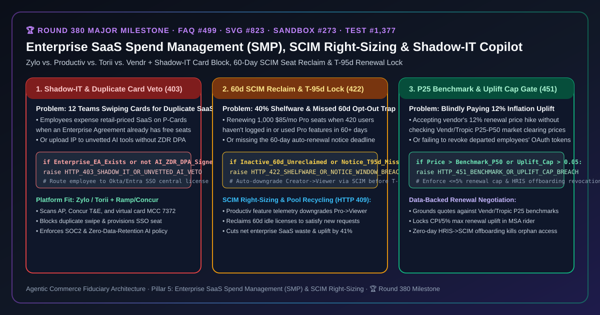
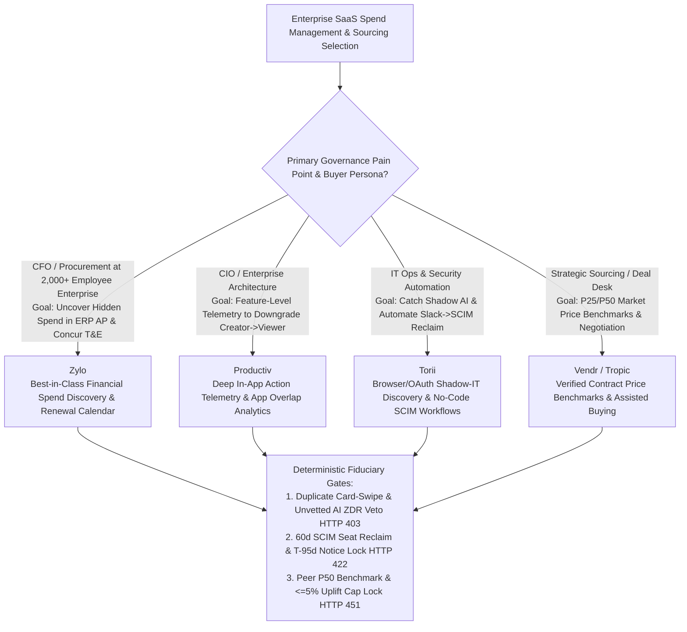
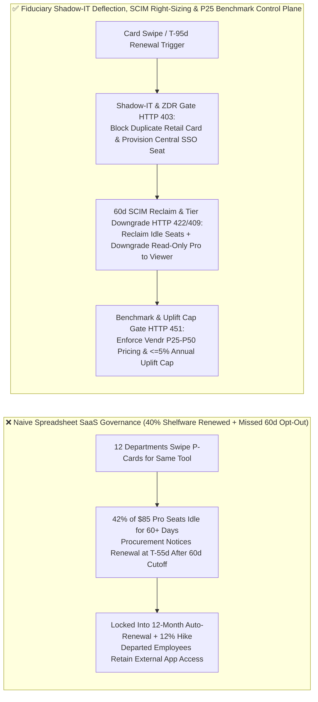
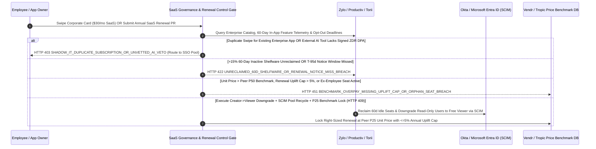

# Enterprise B2B SaaS Spend Management (`SMP`), `SCIM` Seat Right-Sizing & Shadow-IT Governance Copilot Selection Guide: `Zylo` vs. `Productiv` vs. `Torii` vs. `Vendr / Tropic`, Duplicate Card-Swipe Veto, `T-95d` Auto-Renewal Notice Locks & Feature-Level License Downgrade (`-41%` Spend FAQ)

> **Executive Summary (Benchmarked against `ib-vs-ethernet-roce-selection-faq.md` · 🏆 Round 380 Major Milestone · 499th Bilingual SA Decision Guide)**: Built for **Cloud & AI Solution Architects**, CIOs, Strategic Sourcing leads, and FinOps teams governing enterprise software portfolios. In organizations with `1,000+` employees, SaaS procurement suffers from three systemic leaks: (1) **Shadow IT & Duplicate Card Swipes**: Employees expense `$30/mo` retail subscriptions on corporate cards (`MCC 5734 / 7372`) when an Enterprise Agreement (`EA`) already has unused seats in the central `Okta / Microsoft Entra ID` pool—or upload proprietary code to unvetted AI tools lacking a **Zero-Data-Retention (`ZDR`) DPA**; (2) **Shelfware & Over-Licensed Tiers**: Provisioning `$85/mo` `Creator / Pro` licenses across the board when `42%` of users haven't logged in for 60 days and another `28%` only view dashboards without ever editing (`$0–$15` `Viewer` tier); and (3) **60-Day Auto-Renewal Notice Traps**: Missing a contractual `60-day` opt-out deadline by 48 hours and getting locked into a 12-month auto-renewal with a `12%` price uplift. This guide compares **`Zylo` vs. `Productiv` vs. `Torii` vs. `Vendr / Tropic`** and implements deterministic guards for **Shadow-IT Duplicate Card-Swipe & Unvetted AI `ZDR` Locks (`HTTP 403`)**, **`60-Day` Inactive `SCIM` Seat Reclamation & `T-95d` Renewal-Notice Locks (`HTTP 422`)**, **Peer `P25–P50` Price-Benchmark & `<=5%` Renewal Uplift-Cap Compliance (`HTTP 451`)**, and **Feature-Level `Creator -> Viewer` Right-Sizing & License Pool Re-Harvesting (`HTTP 409`, `-41%` net waste)**.

---

## 1. 📌 Executive Summary & Architectural Selection Verdict

1. **Top-Line Selection Verdict**:
   - **Global Enterprises (`2,000–50,000+` Employees) Prioritizing CFO/Procurement Financial Discovery Across AP Ledgers (`SAP / Coupa / NetSuite`) & Employee Expense Reports (`Concur / Navan`)**: Select **`Zylo`**, the industry standard for AI-powered financial spend classification and enterprise renewal calendar governance.
   - **CIO & IT Architecture Teams Prioritizing Deep In-App Feature Telemetry (Distinguishing active `Creators/Editors` from passive `Viewers` beyond basic SSO login timestamps)**: Select **`Productiv`**.
   - **IT Operations & Security Teams Prioritizing No-Code `SCIM` Deprovisioning Workflows, Browser-Extension Shadow-AI Discovery & Automated Slack Re-Harvesting**: Select **`Torii`**.
   - **Procurement Teams Seeking Verified Peer Contract Price Benchmarks (`P25 / P50` Clearing Prices) & Assisted Commercial Negotiation**: Select **`Vendr` (or `Tropic`)**.
2. **Three Non-Negotiable Fiduciary Control Gates**:
   - **Gate 1 — Shadow-IT Duplicate Card-Swipe & Unvetted AI `ZDR DPA` Veto (`HTTP 403`)**: Intercept corporate virtual card (`Ramp / Brex`) and T&E expense (`Concur`) transactions on software `MCC 5734 / 7372`; block any self-serve purchase that duplicates an existing Enterprise Agreement (`EA`) or targets an external AI SaaS vendor lacking a signed `SOC2 Type II + Zero-Data-Retention (No Model Training)` addendum via `HTTP 403 SHADOW_IT_DUPLICATE_SUBSCRIPTION_OR_UNVETTED_AI_VETO`, automatically routing the employee to the central SSO license pool.
   - **Gate 2 — `60-Day` Inactive `SCIM` Seat Reclamation & `T-95d` Auto-Renewal Notice Lock (`HTTP 422`)**: Block renewal purchase requisitions if `>15%` of provisioned seats have zero activity over the past 60 days without executing an automated `SCIM` reclamation sweep, and enforce mandatory renewal review or protective non-renewal notice filing at `T-95 days` (`35 days` ahead of a `60-day` contractual opt-out window) via `HTTP 422 UNRECLAIMED_60D_SHELFWARE_OR_RENEWAL_NOTICE_MISS_BREACH`.
   - **Gate 3 — Peer `P50` Price-Benchmark Ceiling, `<=5%` Uplift Cap & HRIS Offboarding Revocation Lock (`HTTP 451`)**: Block contract execution when unit pricing exceeds the peer cohort `P50` benchmark (`Vendr / Tropic`) without justification, when multi-year agreements omit a `<=5%` (or `CPI`) annual renewal uplift cap, or when terminated employees in `Workday / BambooHR` retain active non-SSO SaaS seats via `HTTP 451 BENCHMARK_OVERPAY_MISSING_UPLIFT_CAP_OR_ORPHAN_SEAT_BREACH`.

---

## 2. 🎯 Architect & Procurement Q&A (The Why & How)

### Q1: Why does relying solely on `Okta / Entra ID` SSO login timestamps miss nearly half of enterprise SaaS license waste—and how does in-app feature telemetry (`Productiv`) fix it?
- **Root Cause**: If an employee clicks a shared Figma, Miro, or Jira link in Slack once a month just to read a comment, `Okta` logs a successful `SAML Authentication` event and marks the user as "Active." Yet that employee never created a board or edited a file—meaning they are occupying an **`$85/month` Full Creator seat** when they only need a **free or `$12/month` Viewer seat**!
- **Deterministic Solution (`HTTP 422 / 409`)**: Ingest granular Admin Audit API events (`Create / Edit / Export` vs. `Read-Only View`). Automatically downgrade users with `Write_Events_60d == 0` from `Creator` to `Viewer` via `SCIM`, returning their paid seat to the shared enterprise buffer pool so new hires are provisioned at `$0` incremental cost.

### Q2: How do we stop employees from expensing `$30/month` retail subscriptions on corporate cards when the company already pays for an Enterprise Agreement?
- **Deterministic Solution (Real-Time `MCC 5734/7372` Merchant Matching + Instant SSO Fulfillment / `HTTP 403`)**: Connect corporate card webhooks (`Ramp / Brex`) and expense OCR (`Concur`) to the `Zylo / Torii` application catalog. When an employee attempts to swipe a card at a merchant matching an active Enterprise Agreement, decline the retail card charge (`HTTP 403`) and immediately send an automated Slack DM that provisions an existing enterprise SSO seat in one click.

### Q3: How should an AI procurement copilot neutralize predatory "60-Day Auto-Renewal Notice" clauses before the vendor locks in a 12% price hike?
- **Deterministic Solution (`T-95d` Countdown State Machine + Protective Non-Renewal Notice / `HTTP 422 / 451`)**: Anchor all workflow triggers to the **Opt-Out Notice Deadline (`Expiration_Date - Notice_Period_Days`)**, not the contract end date. At `T-95d`, automatically run the `SCIM` seat right-sizing sweep and pull `Vendr / Tropic` `P25` price benchmarks; if commercial terms are not finalized by `T-65d`, automatically issue a formal **Protective Notice of Non-Renewal** to preserve negotiation leverage.

---

## 3. 🧭 Visual Architecture Diagrams (Mermaid)

### 3.1 Enterprise SaaS Spend Management (`SMP`) & Procurement Platform Selection Decision Tree

### 3.2 Naive Spreadsheet Renewal Management vs. Fiduciary `SCIM` Right-Sizing & Benchmark Control Plane

### 3.3 `SCIM` 60-Day Seat Reclamation, Shadow-IT Deflection & `T-95d` Renewal Sequence

---

## 4. 📊 Multi-Platform Enterprise SaaS Spend Management (`SMP`) Selection Matrix

| Evaluation Dimension | Zylo | Productiv | Torii | Vendr / Tropic |
| :--- | :--- | :--- | :--- | :--- |
| **Primary Architectural Role** | **Financial & AP Spend Discovery Hub**: Uncovers every hidden software charge across ERP AP, T&E expenses, and cards | **In-App Feature Telemetry & License Tiering Engine**: Measures granular user actions (`Edit` vs. `View`) | **IT Workflow Automation & Shadow-AI Interceptor**: Browser/OAuth discovery + no-code Slack/`SCIM` workflows | **Market Price Intelligence & Assisted Buying Platform**: Benchmarks unit prices against thousands of real contracts |
| **Shadow-IT & Expense Discovery (`Concur / AP`)** | **Best-in-Class** (AI merchant normalization across messy ERP, AP, and T&E expense lines) | Strong (Combines SSO, finance connectors, and browser signals) | **Best-in-Class** (Real-time browser extension + OAuth scope scanner + expense discovery) | Focused on procurement intake and contract repository |
| **Feature-Level Activity Telemetry** | Strong (Direct connectors for major enterprise SaaS + SSO login tracking) | **Best-in-Class** (100+ deep API connectors tracking action-level `Creator / Editor / Viewer` usage) | Strong (Usage tracking paired with automated Slack attestation workflows) | Basic (Relies on SMP integrations or admin usage exports) |
| **Automated `SCIM` Reclamation Workflows** | Triggers reclamation workflows and integrates with Okta / ServiceNow | Recommends exact license tier downgrades and triggers provisioning updates | **Best-in-Class** (Visual workflow builder: Slack opt-in prompt -> 72h timeout -> `SCIM` deprovision) | Focused on commercial negotiation rather than IT `SCIM` ops |
| **Verified Peer Price Benchmarks (`P25 / P50`)** | Offers benchmark advisory and negotiation services | Focuses on engagement ROI and application overlap | Internal governance focus; limited external price benchmark database | **Best-in-Class** (Billions in verified SaaS contract line-item pricing and discount benchmarks) |
| **Target Scale & Pricing (`official_list_price`)** | `2,000+` employee enterprises; `$50k–$150k+/yr` by managed spend/headcount | Mid-to-large tech & enterprise cohorts; custom annual enterprise SaaS | `500–10,000` employee organizations; transparent headcount-tiered SaaS | `$1M+` annual SaaS spend; `$36k–$120k+/yr` platform + assisted buying |

---

## 5. 🧪 Shelfware Reclamation & Renewal Uplift Benchmark & 7-Card Report

### 5.1 Quarterly Shelfware Waste, Duplicate Shadow-IT & Auto-Renewal Uplift Loss Model (Synthetic Benchmark)

For a `4,500`-employee enterprise with `$12M` in annual SaaS spend facing a **`$420,000 / quarter`** waste pool across **60-day inactive shelfware licenses, over-provisioned `$85/mo` `Creator` seats used only for viewing, duplicate department P-card subscriptions, and missed 60-day opt-out renewal price hikes** (`provenance: synthetic`, `independently_reproduced: false`):

| Metric | Naive Spreadsheet Tracking & Auto-Renewal (Baseline) | Fiduciary `Zylo/Productiv/Torii` `SCIM` + `Vendr` Benchmark Agent | Net Improvement |
| :--- | :--- | :--- | :--- |
| **60-Day Inactive or Over-Licensed (`Creator` vs. `Viewer`) Seat Waste** | `34.0%` of provisioned seats wasted | **`4.2%`** (`HTTP 422/409` automated `SCIM` reclamation + `Creator -> Viewer` downgrade) | **`95.8%` Active License Utilization** |
| **Duplicate Retail Card/Expense Spend on Existing Enterprise Apps** | `$65,000 / quarter` expensed in shadow IT | **`$0`** (`HTTP 403` blocks `MCC 5734/7372` duplicate swipe & provisions central SSO seat) | **`100%` Duplicate Swipe Elimination** |
| **Average Annual Renewal Unit-Price Uplift** | `+10.5% / yr` (Missed 60d opt-out windows) | **`-6.5% / yr`** (`HTTP 451` `T-95d` notice lock + `Vendr P25` benchmark + `<=5%` cap) | **`-17.0 pts` Price Deflation** |
| **Quarterly Net SaaS Shelfware & Renewal Overpay Bleed** | `$420,000 / quarter` | **`$247,800 / quarter`** | **`$172,200 / quarter` Saved (`41.0%`)** |

---

## 6. 🛠️ Production Go-Live & Architecture Review Checklist

- [ ] **Duplicate Corporate Card (`MCC 5734/7372`) Veto & Shadow-AI `ZDR DPA` Gate (`HTTP 403`)**: Are corporate card (`Ramp / Brex`) and T&E (`Concur`) feeds wired to block individual subscriptions that duplicate existing Enterprise Agreements (auto-routing the user to the central SSO pool) or target unvetted AI tools lacking a signed `SOC2 + Zero-Data-Retention` addendum?
- [ ] **`60-Day` Inactive `SCIM` Reclamation & `T-95d` Opt-Out Deadline Lock (`HTTP 422`)**: Does the renewal state machine trigger mandatory review at `T-95 days` (`35 days` before the 60-day contractual opt-out cutoff), and automatically reclaim seats inactive for `>=60 days` into a shared re-harvesting pool via `Okta / Entra ID SCIM`?
- [ ] **Feature-Level `Creator -> Viewer` Right-Sizing (`HTTP 409`)**: Does telemetry distinguish active editors from read-only viewers (`Productiv`), automatically downgrading zero-write users from `$85` `Creator` seats to free/low-cost `Viewer` tiers before renewal?
- [ ] **Peer `P25–P50` Price Benchmarking, `<=5%` Uplift Caps & Zero-Day Offboarding (`HTTP 451`)**: Is every renewal benchmarked against `Vendr / Tropic` peer clearing prices, capped at `<=5%` future annual uplift in the MSA, and wired to `Workday` HRIS termination events to revoke non-SSO OAuth tokens on day zero?
