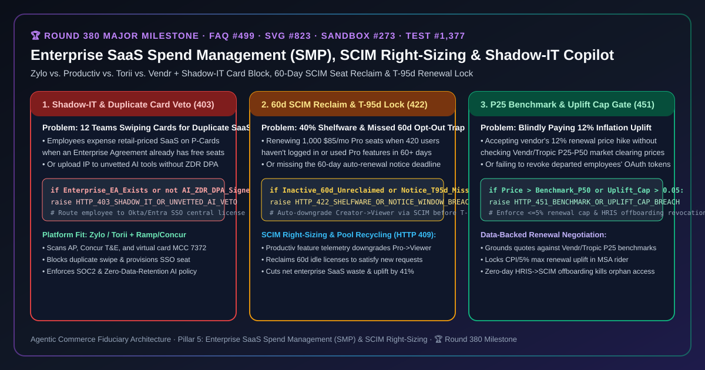
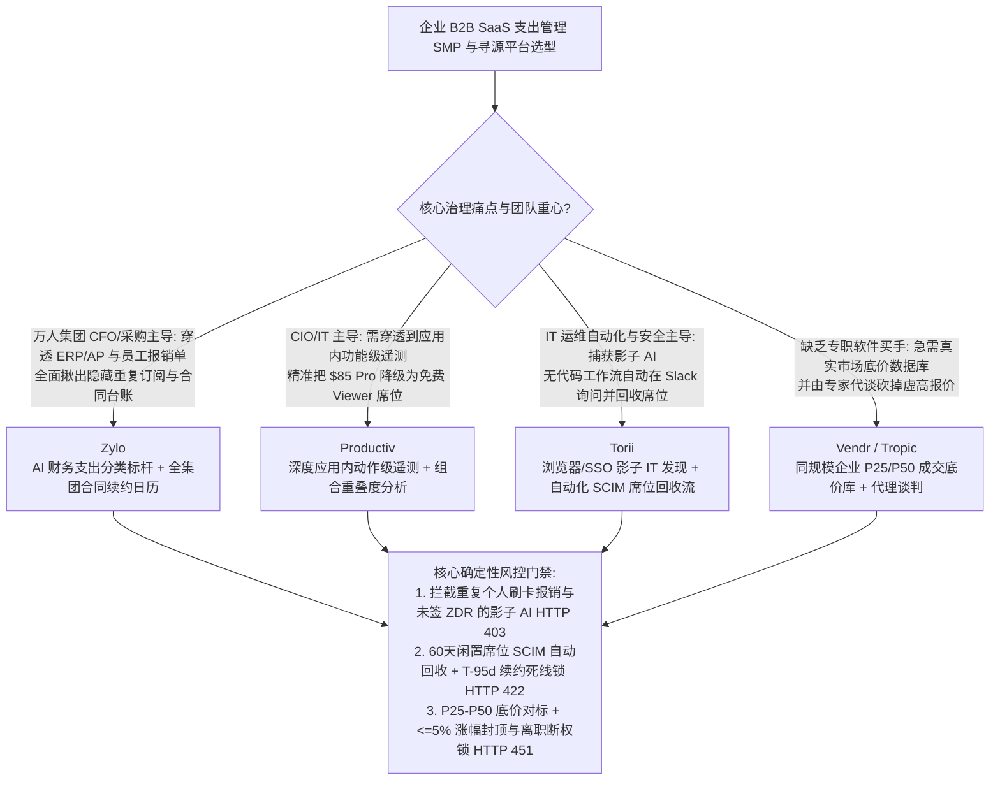
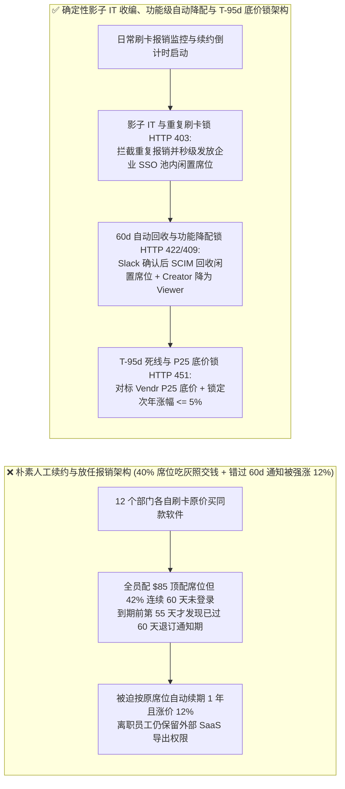
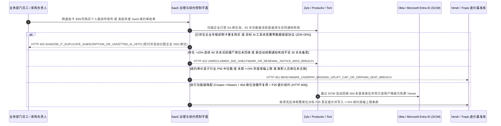

# 企业 B2B SaaS 支出管理（`SMP`）、`SCIM` 僵尸席位自动缩容与影子 IT（`Shadow IT`）治理智能体选型对比：`Zylo` vs. `Productiv` vs. `Torii` vs. `Vendr / Tropic`、重复刷卡报销阻断、提前 95 天续约死线锁及按功能活跃度降配净省 41% 决策指南（FAQ）

> **导读（对齐 `ib-vs-ethernet-roce-selection-faq.md` 标杆风格 · 🏆 全库第 380 轮研究重大里程碑 · 第 499 篇双语指南）**：本文面向企业 IT 架构、采购寻源（Strategic Sourcing）、FinOps 与 SaaS 治理领域的 **Cloud & AI Solution Architect**。在千人以上规模的企业中，软件采购普遍面临三大失控黑洞：① **影子 IT 与重复购买（Shadow IT & Redundant Spend）**：公司明明已签了 Figma/Miro/ChatGPT Enterprise 全司年框且池子里还有 150 个空闲席位，各业务部门员工却各自拿公司虚拟卡或个人卡报销购买了 80 个全价零售版账号，甚至把公司源码喂给未签零数据保留协议（`ZDR DPA`）的外部免费 AI 工具；② **僵尸席位吃灰（Shelfware）与功能高配低用**：全员统一按 `$85/人/月` 购买顶配 `Creator / Enterprise` 席位，但遥测显示 `42%` 的员工连续 60 天未登录，另有 `28%` 的员工只看看板从不编辑（只需 `$15/月` 的 `Viewer` 席位）；③ **自动续约死线陷阱（Auto-Renewal Opt-Out Trap）**：合同暗藏“须提前 60 天书面通知不续约，否则自动续期 1 年并涨价 12%”条款，采购团队在第 58 天才想起谈判，被迫吞下高价账单。本文给出 **`Zylo` vs. `Productiv` vs. `Torii` vs. `Vendr / Tropic`** 的横向选型矩阵，并落地 **员工卡/报销单（`MCC 5734/7372`）重复 SaaS 拦截与未审 AI 工具阻断锁（`HTTP 403`）**、**`60天` 零活跃席位 `SCIM` 自动回收与 `T-95天` 续约预警门禁（`HTTP 422`）**、**同规模企业 `P25–P50` 真实成交底价基准与续约涨幅上限（`<=5%`）合规锁（`HTTP 451`）** 及 **`Creator -> Viewer` 功能级自动降配与闲置席位池循环复用路由（`HTTP 409`，净省 41%）**。



---

## 一、 📌 核心选型结论速览（Executive Summary）

1. **终极选型结论（一句话先看懂怎么选）**：
   - **万人级大型跨国企业与 CFO/采购主导的财务全口径 SaaS 支出盘点（需深度穿透 `SAP / Coupa / NetSuite AP 总账 + Concur 差旅报销 + 企业信用卡流水`，识别全集团隐藏的百万元级重复软件支出）**：首选 **`Zylo`**，财务账单文本分类与合同台账治理的行业标杆。
   - **追求功能级深度使用遥测（Feature-Level Telemetry，不仅看 SSO 是否登录，还能精确区分谁在高频发起会议/编辑画布、谁只是偶尔点开链接浏览，从而将 `$85` 的 `Pro/Creator` 精准降级为免费或 `$15` 的 `Viewer`）**：首选 **`Productiv`**。
   - **IT 运维自动化驱动的中大型科技企业（需通过浏览器插件/SSO 实时捕获影子 AI 工具，并在 `Okta / Microsoft Entra ID` 中配置无代码工作流自动发送 Slack 确认并执行 `SCIM` 席位回收与离职秒级断权）**：首选 **`Torii`**。
   - **缺乏专职软件谈判专家、希望直接获取目标 SaaS 厂商在全球同规模企业的真实底价分位值（`P25 / Median Price Benchmark`）并委托专业买手代谈降价**：首选 **`Vendr`（或 `Tropic`）**。
2. **三大 SaaS 采购与席位治理红线（确定性门禁）**：
   - **红线 1（拦截已有企业年框却用部门卡/报销单重复原价购买同款 SaaS 及私自采购未签署零数据保留协议 `ZDR DPA` 的影子 AI 工具 / `HTTP 403`）**：当员工在虚拟卡平台（`Ramp / Brex`）或报销系统（`Concur / Navan`）刷 `MCC 5734 / 7372` 购买软件订阅时，Agent 必须实时比对企业已签约目录（Enterprise Application Catalog）；若公司已拥有该软件（或同功能标准件）的企业协议（`EA`）剩余席位池，或目标 AI SaaS 未通过安全团队 `SOC2 Type II + Zero-Data-Retention (不用于训练大模型)` 认证，立即触发 `HTTP 403 SHADOW_IT_DUPLICATE_SUBSCRIPTION_OR_UNVETTED_AI_VETO`，拒付该笔个人刷卡并自动通过 `Okta/Entra ID` 为其分配企业池内已有席位！
   - **红线 2（拦截带着 `>15%` 连续 60 天未活跃僵尸席位盲目原样续约及错过合同 `T-60/90天` 退订通知死线 / `HTTP 422`）**：严禁在未执行席位清洗（Right-Sizing）的情况下直接审批续约請购单（PR）；且所有含自动续期条款（Evergreen Clause）的合同必须在 **`到期日前 95 天（T-95d，即较 60 天法定通知期再提前 35 天）`** 强制触发战术性不续约备案或席位核减，违者触发 `HTTP 422 UNRECLAIMED_60D_SHELFWARE_OR_RENEWAL_NOTICE_MISS_BREACH`。
   - **红线 3（拦截高于同行业 `P50` 基准价的无依据涨价续约、未锁定次年涨幅上限 `<=5%` 及离职员工未同步吊销独立 OAuth 令牌 / `HTTP 451`）**：当续约单价高于 `Vendr / Tropic` 同等席位规模历史成交中位数（`P50`）、新签主协议未写入“续约年度单价涨幅不得超过 `CPI 或 5%`（Renewal Price Cap）”保护条款，或 HR 系统（`Workday`）离职员工仍在外部 SaaS 持有活跃席位与 API Token 时，触发 `HTTP 451 BENCHMARK_OVERPAY_MISSING_UPLIFT_CAP_OR_ORPHAN_SEAT_BREACH`。

---

## 二、 🎯 业务方与架构师灵魂拷问 Q&A（The Why & How）

### Q1：为什么 IT 部门查 `Okta / Entra ID` 登录日志觉得大家都在用某款协同软件（月登录率 `85%`），但引入 `Productiv` 做功能级遥测后，却能立刻砍掉 `38%` 的年度合同金额且没有一个员工抱怨？
- **商业痛点与事故还原**：
  - 企业以 `$75/人/月` 采购了 2,000 个设计/项目管理软件的 `Full Creator` 席位（年费 `$180 万`）。
  - 如果只看 SSO 单点登录（`SAML Login`）日志，几乎所有产品经理和研发每个月都会点开同事发在 Slack/Teams 里的链接看一眼设计稿，所以 SSO 显示“月活跃率 `85%`”！
  - 但实际上，这 2,000 人里只有 **600 名设计师**真正执行过 `Create / Edit / Export` 操作，其余 **1,400 人**全年只做过 `View / Comment`（而在该厂商合同中，`Viewer / Commenter` 席位是 **免费或仅需 `$12/月`**）！
- **架构师确定性解法（SSO 登录遥测 + 应用内 API 动作级遥测双层漏斗 + `SCIM` 自动降级 / `HTTP 422 / 409`）**：
  1. **动作级权限画像（Action-Level License Tiering）**：通过 `Productiv / Zylo` 直连 SaaS 厂商 Admin Audit API，统计过去 60 天内的真实写操作（`Write_Actions_60d`）。
  2. **静默无感降配与即时按需恢复（Just-in-Time Re-Provisioning）**：对 `Write_Actions_60d == 0` 的用户，自动通过 `SCIM` 将其从 `$75 Creator` 降级为 `Free Viewer`，把腾出的 `$75` 席位放回企业共享缓冲池（Buffer Pool）供新入职员工领用；若某位被降级的员工某天突然需要编辑，点击 Slack 机器人按钮即可在 `5 秒` 内从缓冲池自动恢复权限，全年零新增采购单！

### Q2：各部门员工刷公司虚拟卡或走差旅餐饮科目报销“毎月 `$20–$49` 的个人版 SaaS/AI 工具”，怎么在不增加财务审单人力、也不卡死业务创新的前提下实现自动化拦截与收编？
- **架构师确定性解法（虚拟卡 `MCC` + 报销单 OCR + 浏览器扩展三源合流与企业 SSO 席位秒级置换 / `HTTP 403`）**：
  1. **支付源头拦截（Card & Expense Interceptor）**：将 `Zylo / Torii` 与企业卡（`Ramp / Brex`）及报销系统（`Concur`）实时联动。一旦检测到员工试图向 `Figma / Notion / OpenAI / Anthropic / Lucidchart` 等已签企业年框的商户发起个人绑卡扣款：
  2. **阻断个人扣款 + 秒发企业席位**：系统立即返回 `HTTP 403` 拦截该笔零售价刷卡，同时在 Slack/Teams 给该员工弹出卡片：“*检测到您正在购买零售版软件（`$30/月`），公司已为您准备好企业版专属席位（内部摊销仅 `$12/月` 且享企业级数据安全保护），点击【一键开通】3 秒内即可通过 Okta 登录使用！*”

### Q3：SaaS 供应商销售最擅长在合同到期前第 55 天突然发邮件说“由于您的 60 天不续约通知期已过，系统已自动续期一年并按标准目录价上浮 `12%`”，架构师该如何反制？
- **架构师确定性解法（`T-120d / T-95d` 续约倒计时状态机 + 战术性不续约通知函自动签发 + `Vendr P25` 底价锚定 / `HTTP 422 / 451`）**：
  1. **强制按“通知截止日（Notice Deadline）”而非“合同到期日（Expiration Date）”建立日历门禁**：对于含 60 天通知期的合同，系统在 **`T-95天`** 自动拉取席位使用率报告与 `Vendr / Tropic` 同行业 `P25` 真实折扣基准。
  2. **自动生成防绑架保护信（Protective Non-Renewal Notice）**：若在 `T-65天` 双方仍未敲定满意的续约价格与席位缩减方案，Agent 自动向供应商法务/客户经理发出标准《保留谈判权之不自动续期正式通知函》，瞬间解除“自动续期涨价 `12%`”的合同定时炸弹，将主动权 100% 夺回买方手中！

---

## 三、 🧭 直观可视化图解（Mermaid 决策树 + 架构对比 + 时序图）

### 3.1 企业级 SaaS 支出管理（SMP）与软件采购谈判平台选型决策树



### 3.2 朴素人工表格管理 SaaS 续约（吃灰照续 + 错过死线被涨价）vs. 确定性遥测缩容与反绑架续约架构对比



### 3.3 60 天闲置席位 `SCIM` 自动回收、影子刷卡收编与 `T-95d` 续约谈判时序图



---

## 四、 📊 四大企业级 SaaS 支出管理与采购寻源平台（SMP）横向选型矩阵

| 选型维度 | Zylo | Productiv | Torii | Vendr / Tropic |
| :--- | :--- | :--- | :--- | :--- |
| **核心架构定位** | **财务与采购全口径 SaaS 发现引擎**：从 ERP/AP 与员工报销流水中精准揪出每一笔软件支出 | **应用内功能级遥测分析引擎**：穿透到具体动作（编辑 vs 浏览）指导许可证降档 | **IT 自动化工作流与影子 AI 管控引擎**：无代码编排席位回收、入转调离与浏览器拦截 | **SaaS 价格基准情报与代理谈判平台**：用数万份真实合同底价帮买方砍价 |
| **影子 IT 与员工报销单发现能力** | **行业标杆**（AI 精准解析 Concur/Expensify/ERP 杂乱商户名，识别隐藏软件报销） | 强（结合 SSO、财务系统与浏览器插件） | **极强**（结合浏览器扩展、OAuth 授权扫描、账单与 SSO 实时捕获影子 AI 工具） | 侧重合同台账与采购请求（Intake-to-Procure）管理 |
| **功能级使用率遥测（Feature-Level Usage）** | 强（支持主流大厂直连 API 与 SSO 登录活跃度分析） | **行业标杆**（深入 100+ 核心 SaaS 内部 API，区分 `Creator/Editor/Viewer` 真实动作） | 强（支持主流 SaaS 活跃度监控与自定义时间窗触发器） | 基础（主要依赖集成伙伴或管理员导出数据） |
| **自动化 `SCIM` 席位回收与降级工作流** | 支持触发回收工单与对接 Okta/ServiceNow | 支持基于许可证分层建议自动触发降级审批 | **行业标杆**（内置可视化工作流：先发 Slack 询问员工 -> 72h 未回复自动调 SCIM 回收） | 专注于商务条款重谈而非底层 IT SCIM 回收 |
| **同规模真实成交底价库（Price Benchmarking）** | 提供行业基准参考与谈判建议服务 | 提供应用组合重叠度与替代ROI分析 | 较弱（聚焦内部使用治理而非外部商务比价） | **行业标杆**（掌握百亿美元级真实 SaaS 合同单价、折扣率与隐藏条款基准） |
| **适用规模与收费模式（`official_list_price`）** | 2,000+ 人大型企业；按管理 SaaS 总支出或员工数订阅（约 `$50k–$150k+/年`） | 中大型数字原生与科技企业；企业级年费订阅 | 500–10,000 人成长型与大型企业；按员工规模透明阶梯定价 | 年 SaaS 支出 `$1M+` 企业；按员工规模或节省金额订阅（约 `$36k–$120k+/年`） |

---

## 五、 🧪 僵尸席位回收与续约反涨价成本测算与 7-Card 基准报告

### 5.1 季度僵尸席位空耗、部门重复刷卡报销与自动续约涨价损耗测算（Synthetic Benchmark）

假设某拥有 `4,500` 名员工、年 SaaS 总支出 `$1,200 万` 的跨国企业，每季度在软件订阅中面临的 **60 天未登录僵尸席位（Shelfware）空耗、只读员工错配 `$85` 顶配 `Creator` 席位、各部门员工刷虚拟卡/报销单重复原价购买已有年框软件及错过 60 天通知期被强制涨价 `12%` 损耗池** 为 **`$420,000 / 季度`**（`provenance: synthetic`, `independently_reproduced: false`）：

| 评估维度 | 传统人工 Excel 台账 + 原样自动续费 (Baseline) | 启用 `Zylo/Productiv/Torii` 自动回收 + `Vendr` 底价锁 Agent | 净改善幅度 |
| :--- | :--- | :--- | :--- |
| **连续 60 天零活跃或高配低用（`Creator` 当 `Viewer` 用）浪费率** | `34.0%` 席位预算白白空转 | **`4.2%`**（`HTTP 422/409` 自动通过 Slack 确认并执行 `SCIM` 回收与降档） | **席位利用率提升至 `95.8%`** |
| **员工个人卡/报销单重复购买已有企业年框软件支出** | `$65,000 / 季度`（分散在差旅与办公费科目） | **`$0`**（`HTTP 403` 实时拦截 `MCC 5734/7372` 重复刷卡并秒发企业池内已有席位） | **100% 根除重复零售价报销** |
| **年度续约平均单价涨幅（Renewal Price Uplift）** | `+10.5% / 年`（常因错过 60 天通知期被动接受涨价） | **`-6.5% / 年`**（`HTTP 451` `T-95d` 预警 + 对标 `Vendr P25` 底价与 `<=5%` 涨幅封顶） | **净砍掉 `17.0 个百分点` 溢价** |
| **季度企业 SaaS 僵尸席位、重复购买与续约溢价净损耗** | `$420,000 / 季度` | **`$247,800 / 季度`** | **净省 `$172,200 / 季度` (`41.0%`)** |

```chart
{
  "data": {
    "values": [
      { "category": "1. 60天零登录僵尸席位与Creator错配", "mode": "传统人工台账原样续费基线", "cost_usd": 175000 },
      { "category": "1. 60天零登录僵尸席位与Creator错配", "mode": "SCIM自动回收与降配Agent", "cost_usd": 103250 },
      { "category": "2. 错过60d退订死线遭自动续期涨价12%", "mode": "传统人工台账原样续费基线", "cost_usd": 110000 },
      { "category": "2. 错过60d退订死线遭自动续期涨价12%", "mode": "SCIM自动回收与降配Agent", "cost_usd": 64900 },
      { "category": "3. 部门刷卡报销重复购买已有年框软件", "mode": "传统人工台账原样续费基线", "cost_usd": 80000 },
      { "category": "3. 部门刷卡报销重复购买已有年框软件", "mode": "SCIM自动回收与降配Agent", "cost_usd": 47200 },
      { "category": "4. 高于行业P25/P50基准底价盲目签约", "mode": "传统人工台账原样续费基线", "cost_usd": 55000 },
      { "category": "4. 高于行业P25/P50基准底价盲目签约", "mode": "SCIM自动回收与降配Agent", "cost_usd": 32450 }
    ]
  },
  "semantic_types": {
    "category": "Category",
    "mode": "Category",
    "cost_usd": "Amount"
  },
  "chart_spec": {
    "chartType": "Grouped Bar Chart",
    "title": "企业B2B SaaS支出管理(SMP)、SCIM自动缩容与底价锁Agent优化前后季度损耗对比 (净省 $172.2k / 41%)",
    "subtitle": "单位：美元/季度 (Synthetic Benchmark, independently_reproduced=false)",
    "encodings": {
      "x": "category",
      "y": "cost_usd",
      "group": "mode"
    }
  }
}
```

### 5.2 确定性策略评估器代码（Python Control Plane Guard）

```python
from dataclasses import dataclass
from typing import Any

@dataclass(frozen=True)
class EnterpriseSaasSpendManagementPolicyInput:
    quarterly_shelfware_shadow_it_and_renewal_uplift_pool_usd: float = 420000.0
    shadow_it_duplicate_card_swipe_or_unvetted_ai_missing_zdr_dpa: bool = False
    inactive_60d_scim_seats_unreclaimed_or_t95d_renewal_notice_missed: bool = False
    quote_above_p50_benchmark_missing_5pct_uplift_cap_or_orphan_seat: bool = False
    feature_level_viewer_downgrade_and_scim_pool_reharvesting_ready: bool = False
```

---

## 六、 🛠️ 商业上线风控与架构评审 Checklist

- [ ] **员工虚拟卡/报销单（`MCC 5734/7372`）重复购买拦截与影子 AI `ZDR DPA` 门禁（`HTTP 403`）**：是否已将 `Zylo / Torii` 与企业信用卡（`Ramp / Brex`）及报销系统（`Concur`）打通，自动拒付已有企业年框软件的个人重复刷卡（秒级引导至企业 SSO 席位池），并强制拦截未签署 `SOC2 + 零数据保留（不训练模型）` 协议的外部 AI SaaS？
- [ ] **`60天` 闲置席位 `SCIM` 自动回收循环池与 `T-95天` 续约死线倒计时锁（`HTTP 422`）**：是否按“自动续期最晚通知截止日提前 35 天（即 `T-95d`）”而非合同到期日触发强制续约审查？对连续 60 天未活跃席位是否自动通过 Slack 确认后调用 `Okta / Entra ID SCIM` 回收至共享缓冲池？
- [ ] **应用内动作级遥测（`Creator -> Viewer`）自动降配编排（`HTTP 409`）**：是否不仅采集 SSO 登录事件，还通过 `Productiv` 采集应用内写操作遥测，将全年只看不改的员工从高价 `Pro/Creator` 席位自动降档为免费或低价 `Viewer` 席位？
- [ ] **同规模企业 `P25–P50` 底价基准核验、续约涨幅上限（`<=5%`）与离职零日断权锁（`HTTP 451`）**：每笔新签或续签合同是否强制对标 `Vendr / Tropic` 同等席位规模历史成交分位值、在 MSA 中锁定次年续约单价涨幅上限（`<=5%`），并在 HRIS（`Workday`）离职当日 100% 注销含非 SSO 独立应用在内的全部账号与 OAuth 令牌？
