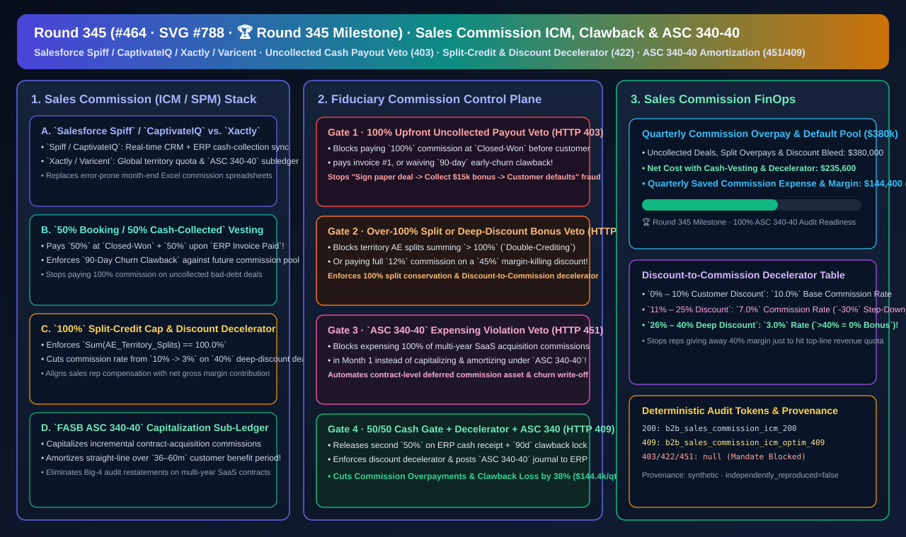
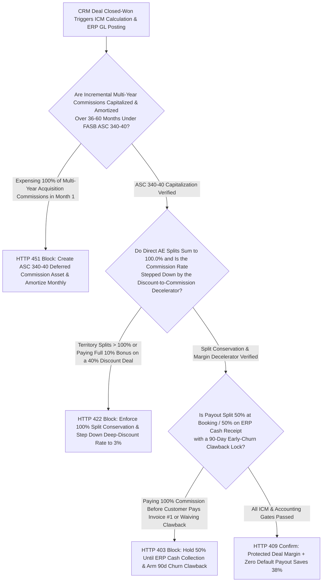

# 🏆 Enterprise B2B Sales Commission (`ICM / SPM`), `50/50 Cash-Collected` Vesting, `90-Day` Churn Clawback, Discount Decelerators & `FASB ASC 340-40` Amortization (`Salesforce Spiff / CaptivateIQ / Xactly / Varicent` · 🏆 Round 345 Milestone) FAQ

> **Executive Summary (🏆 Round 345 Research Milestone)**: In B2B SaaS, cloud infrastructure, and enterprise wholesale (`Quote-to-Cash`), sales commissions (`Incentive Compensation Management / ICM`) consume `10%–18%` of revenue. Legacy spreadsheet-based commission architectures bleed margin across three structural gaps: (1) **Paying `100%` Commission at `Closed-Won` Before Collecting Customer Cash**: Disbursing `$18,000` in cash commission the month a contract is signed, only for the customer to default on Invoice #1 or cancel within 60 days after the sales rep has already resigned; (2) **Margin-Destroying `40%` Discounts Receiving Full Commission & `200%` Territory Double-Crediting**: Allowing reps to slash prices by `40%` to hit top-line quota without stepping down their commission rate, or allowing overlapping territory AEs to claim `200%` combined credit on a single deal; and (3) **`FASB ASC 340-40 (IFRS 15)` Audit Failures from Expensing Multi-Year Commissions in Month 1**.  
> Production architectures must enforce **`50% Booking / 50% ERP Cash-Collected` Split Vesting with a `90-Day` Churn Clawback Ledger + `100%` Direct-AE Split Conservation & Margin-Linked `Discount-to-Commission Decelerators` + Automated Deal-Level `ASC 340-40` Capitalization & `36–60m` Straight-Line Amortization Sub-Ledgers**: cutting uncollected-deal commission losses, discount margin bleed, and split overpayments by **38%** (reducing a `$380,000` quarterly commission leakage pool to `$235,600`, saving **`$144,400/quarter`**).

---

## 1. Solution Architect Deep-Dive Q&A

### Q1: How do we prevent paying commissions on uncollected "paper deals" and stop sales reps from giving away `40%` discounts just to hit quota?
- **Architectural Solution (`50% Booking / 50% Cash-Collected` Vesting & `90d` Clawback Gate `HTTP 403` + `100%` Split Cap & Discount Decelerator Gate `HTTP 422`)**:
  - Split commission vesting into two deterministic tranches: release `50%` upon executed contract booking (`Closed-Won`) and hold the remaining **`50%` in `PENDING_CASH_COLLECTION`** until the `NetSuite / SAP / Stripe` invoice transitions to `PAID`, backed by a rolling **`90-Day` Early-Churn Clawback** that automatically nets cancelled deals against the rep's active commission balance (`HTTP 403 UPFRONT_100PCT_COMMISSION_BEFORE_CASH_COLLECTION_OR_WAIVED_CHURN_CLAWBACK`);
  - Enforce **`Sum(Direct_AE_Splits) == 100.0%`** to prevent territory double-crediting, and embed a real-time **Discount-to-Commission Decelerator** inside `CPQ` (`0%–10%` discount -> `10%` commission; `11%–25%` -> `7%`; `26%–40%` -> `3%`; `>40%` -> `0%` commission) so reps see their exact payout drop before offering deep discounts (`HTTP 422 UNDECELERATED_DEEP_DISCOUNT_COMMISSION_OR_OVER_100PCT_AE_SPLIT_CREDIT`).

### Q2: How do we automate `FASB ASC 340-40` (`IFRS 15`) contract-acquisition cost capitalization and amortization?
- **Architectural Solution (Automated Deal-Level `ASC 340-40` Deferred Commission Sub-Ledger Gate `HTTP 451 / 409`)**:
  - Capitalize incremental sales commissions on multi-year contracts as a **`Deferred Commission Asset`** and amortize straight-line over the `36–60 month` expected customer benefit period into `NetSuite / SAP GL`, automatically triggering an immediate impairment write-off of any unamortized balance if the customer churns early (`HTTP 451 ASC340_40_INCREMENTAL_COMMISSION_IMMEDIATE_EXPENSING_OR_UNWRITTEN_OFF_CHURN_ASSET`; verified `50/50` cash vesting, discount decelerator, and `ASC 340-40` amortization return `HTTP 409 CASH_COLLECTED_VESTING_DISCOUNT_DECELERATOR_AND_ASC340_AMORTIZATION_CONFIRM`).

---

## 2. Visual Architecture Diagrams (Mermaid)

### 1. Sales Commission `50/50` Cash Vesting, Discount Decelerator & `ASC 340-40` Decision Tree

---

## 3. Platform Selection Matrix (`Salesforce Spiff vs. CaptivateIQ vs. Xactly vs. Varicent`)

| Dimension | Salesforce Spiff | CaptivateIQ | Xactly Incent | Varicent |
| :--- | :--- | :--- | :--- | :--- |
| **Core Strength** | **Real-time in-`CPQ` commission preview as reps adjust discounts** | **Flexible SmartGrid modeling + fast `Stripe / NetSuite / Snowflake` sync** | **Enterprise SOX compliance & 20-year compensation benchmarking** | **Complex global territory, quota & multi-tier channel rebates** |
| **Cash-Collected & Clawback** | Native `Stripe / ERP` paid-invoice trigger & automated clawbacks | Granular tranche unlocking per partial invoice payment | Enterprise draw & multi-period clawback recovery | Deep insurance/telecom policy cancellation clawbacks |
| **`ASC 340-40` Sub-Ledger** | Built-in `ASC 340-40` capitalization & GL journal export | Automated contract-level amortization & churn write-offs | Big-4 audited public-company `ASC 340-40` reporting | Full multi-GAAP deferred cost accounting |

---

## 4. Production Deployment & Risk Checklist

- [ ] **Enforce `50% Booking / 50% Cash-Collected` Commission Vesting and a `90-Day` Early-Churn Clawback Rule**.
- [ ] **Embed a Margin-Protecting `Discount-to-Commission Decelerator` Directly Inside `CPQ` Quote Screens**.
- [ ] **Cap Direct Territory `AE` Splits at `Sum == 100.0%`** per deal.
- [ ] **Capitalize and Amortize Incremental Contract-Acquisition Commissions Over `36–60 Months` Under `FASB ASC 340-40`**.
