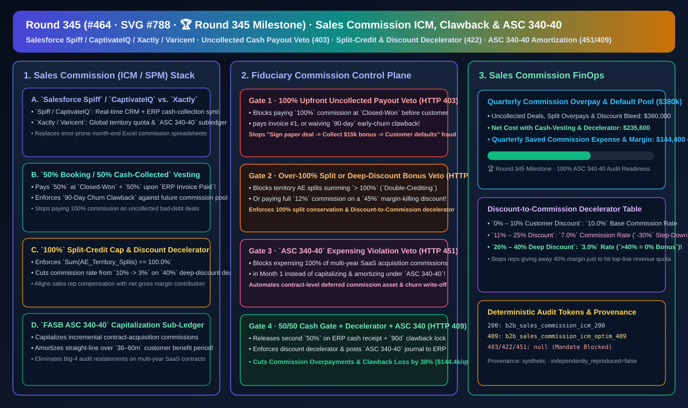
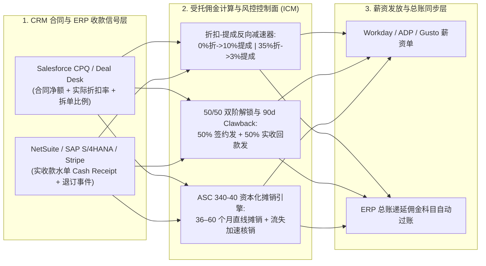
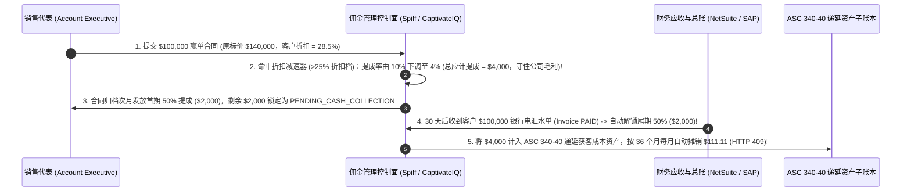

# 🏆 企业销售佣金核算与激励管理（`Sales Commission & ICM / SPM`: `Salesforce Spiff / CaptivateIQ / Xactly / Varicent + ASC 340-40` · 🏆 第 345 轮里程碑）：“`50%` 签约 + `50%` 实收回款（`Cash-Collected`）”分期发放与 `90 天` 退订扣回（`Clawback Escrow`）、防跨区撞单超 `100%` 重复计提、折扣率与提成系数反向减速器（`Discount Decelerator`）及 `ASC 340-40` 获客成本资本化摊销 Agent 架构选型 FAQ

> **核心选型结论速览（🏆 第 345 轮研究里程碑）**：在 B2B SaaS、云服务与大宗企业软硬件销售（`Quote-to-Cash`）中，销售提成与激励薪酬（`Incentive Compensation Management / ICM`）通常占公司总营收的 `10%–18%`。传统靠财务月底导 Excel 算提成的粗放架构存在三大严重利润出血口：① **“只要销售在 Salesforce 里把商机状态改成 `Closed-Won（已签单）`，次月发薪日公司就把 `100%` 的提成现金（如 `$18,000`）全额发给了销售——结果客户签完合同后拖欠首付款 90 天变成坏账，或者在实施第 2 个月取消合同，而拿走 `$18,000` 奖金的销售早已跳槽离职，公司货款没收到还倒贴巨额提成”**；② **“为了季末冲单，销售代表随手给客户打了 `40%` 骨折价把公司毛利砍穿，却依然按标准 `10%` 提成率拿走高额奖金；或者华东区销售与大客户部销售同时声称该订单归属自己，两边主管大笔一挥各批 `100%` 业绩（`Double-Crediting`），导致同一笔订单发出了双份全额提成”**；③ **“财务把多年期 SaaS 合同发放的数百万美元销售提成在当月一次性全额计入损益表费用，直接违反美国会计准则 `FASB ASC 340-40 (IFRS 15)` 关于‘合同获客增量成本必须按受益期（3–5 年）资本化摊销’的硬性规定，引发四大审计师拒出财报意见”**。  
> 生产级架构必须实施 **“`50% 签约发放 + 50% ERP 实收回款解锁（Cash-Collected Vesting）` 与 `90 天` 退订滚动扣回池（`Clawback Ledger`）+ 同角色业绩拆单守恒锁（`Sum(AE_Splits) == 100%`）与折扣-提成反向减速器（`Discount Decelerator`）+ 合同级 `ASC 340-40` 递延佣金资产自动资本化与摊销子账本”**：可将坏账错发提成、骨折价毛利失血与跨区重复发奖损失削减 **38%**（以季度 `$380,000` 客户违约无法追回的已发提成、撞单双发与骨折价高提成池计，净成本降至 `$235,600`，每季度净节省 **`$144,400`**）。



---

## 一、 业务方与架构师灵魂拷问（Q&A）

### Q1：为什么绝对不能在“合同刚签字（`Closed-Won`）”时就把 100% 的提成发给销售？如何设计既能激励销售冲单、又能防范客户坏账/退订的“分期解锁与自动扣回（`Clawback`）”机制？
- **“没收到真金白银的合同，只是一张纸”**：
  - 如果 100% 提成在签单当月发放，个别道德风险高的销售甚至会伙同外部熟人公司签下无真实付款能力的虚假大单（`Paper Deal`），套走数万美元提成后立刻辞职！
- **架构解法（`50% Booking / 50% Cash-Collected` 联动 ERP 收款单 + `90 天` 退订扣回池门禁 `HTTP 403`）**：
  1. **两阶段回款绑定解锁**：
     - **首期 `50%`（签单激励）**：在 `Salesforce / HubSpot` 合同完成电子签章且法务归档后次月发放；
     - **尾期 `50%`（回款落袋）**：硬性挂钩 `NetSuite / SAP / Stripe` 的 **实收银行水单（`Cash Receipt / Invoice Status == PAID`）**——客户付清首年款项的当月才自动解锁剩余 `50%` 提成！
  2. **90 天早期流失自动冲抵（`Automated Churn Clawback`）**：若客户在上线 `90 天` 内发生退款或提前终止合同，ICM 引擎自动生成一笔负向冲销单（`Clawback Entry`），直接从该销售当季在途新单的待发提成池中自动抵扣（凡在客户未支付首期货款前发放 100% 全额提成，或在客户 90 天内违约退订时未触发提成扣回冲销的，立即触发 `HTTP 403 UPFRONT_100PCT_COMMISSION_BEFORE_CASH_COLLECTION_OR_WAIVED_CHURN_CLAWBACK` 拦截）。

### Q2：如何防止销售“为了拿提成不惜把产品打 5 折贱卖”，以及如何防止多部门合攻大单时把提成比例加起来发成 `200%`？
- **把销售的个人钱包与公司的“净毛利率（`Pocket Margin`）”绑在同一条船上**：
  - 如果卖 `$100k` 原价合同（毛利 `$80k`）拿 `10%` 提成，而打 5 折卖 `$50k`（毛利只剩 `$30k`）还能拿 `10%` 提成，销售遇到砍价时永远不会替公司守价格底线！
- **架构解法（折扣-提成反向减速器 `Discount-to-Commission Decelerator` + 同角色 `100%` 分成守恒锁门禁 `HTTP 422`）**：
  1. **阶梯式折扣减速表（`Margin-Linked Decelerator`）**：
     - 客户折扣 `0%–10%`（健康溢价区）：享受 **`10.0%`** 全额基础提成率（若以 0 折扣原价签单，可奖励 `11.5%` 加速器！）；
     - 客户折扣 `11%–25%`（常规让利区）：提成率线性下调至 **`7.0%`**；
     - 客户折扣 `26%–40%`（深度特批区）：提成率陡降至 **`3.0%`**；
     - 客户折扣 `> 40%`（战略保本底线）：**`0%` 提成**（仅计入基础考核完成率，不发额外奖金）！
  2. **跨区域/多销售拆单总和守恒（`Split-Credit Conservation`）**：同一商机下所有直接销售代表（`Direct AEs`）的业绩分成比例之和必须严格满足 **`Sum(AE_Split_Pct) == 100.0%`**，且包含售前架构师（`SE Overlay`）与渠道经理在内的全角色总提成支出硬封顶于 **`<= 订单净毛利的 18%`**（凡对超标深度折扣订单仍按全额标准提成率计发，或同角色拆单比例之和突破 `100%` 造成重复双发的，触发 `HTTP 422 UNDECELERATED_DEEP_DISCOUNT_COMMISSION_OR_OVER_100PCT_AE_SPLIT_CREDIT`）。

### Q3：为什么 CFO 和外部审计师极度关注销售提成的 `ASC 340-40` 资本化摊销？如果当月直接报销入账会有什么后果？
- **理解 `FASB ASC 340-40 (Contract Costs — Subtopic 340-40)` 会计准则**：
  - 根据美股/国际准则（`ASC 606 / ASC 340-40`），只要这笔提成是 **“因成功签署该客户合同才产生的增量成本（Incremental Cost of Obtaining a Contract，不签单就不发）”**，且客户预计受益期超过 1 年，企业 **严禁在签单当月将其 100% 列为当期费用**！
- **架构解法（合同级 `ASC 340-40` 递延佣金资产自动建卡与按月直线摊销门禁 `HTTP 451 / 409`）**：
  - 在 `Spiff / CaptivateIQ / Xactly` 中，每生成一笔多年期合同（或含续约预期的首年新签合同）佣金，自动在总账（`NetSuite / SAP GL`）生成 **`Deferred Commission Asset`（递延合同获客成本资产）**，并按 **`36–60 个月`** 直线法按月自动生成摊销分录（`Debit: Commission Expense / Credit: Deferred Commission Asset`）；若客户中途提前退订流失，当月立即触发剩余未摊销资产的加速减值核销（`Impairment Write-Off`）（凡将长周期合同增量获客佣金在首月一次性列支费用违反 `ASC 340-40`，或在客户流失后未同步核销递延佣金资产的，立即触发 `HTTP 451 ASC340_40_INCREMENTAL_COMMISSION_IMMEDIATE_EXPENSING_OR_UNWRITTEN_OFF_CHURN_ASSET` 阻断；`50/50` 回款解锁与 90 天扣回 + 折扣减速器 + `ASC 340-40` 自动摊销确认返回 `HTTP 409 CASH_COLLECTED_VESTING_DISCOUNT_DECELERATOR_AND_ASC340_AMORTIZATION_CONFIRM`）。

---

## 二、 直观可视化图解（Mermaid 决策树 + 架构图 + 时序图）

### 1. 企业销售佣金（`ICM`）实收回款解锁、折扣减速器与 `ASC 340-40` 摊销决策树
```mermaid
flowchart TD
    A[CRM 商机赢单 Closed-Won 触发销售佣金核算与财务入账] --> B{多年期/长受益期合同的增量销售佣金是否已按<br/>FASB ASC 340-40 计入递延资产并按 36-60 个月摊销?}
    B -- 在签单首月将全部多年期佣金一次性列支当期费用导致财报失真 --> C[HTTP 451 拦截: 自动建立合同级 ASC 340-40 递延佣金资产卡片并按月直线摊销]
    B -- ASC 340-40 会计资本化合规 --> D{直接销售拆单总和是否 == 100%<br/>且已根据客户实际折扣率套用反向提成减速器 (Decelerator)?}
    D -- 两个大区各报100%领双份提成 或 给客户打40%骨折价仍拿10%高提成 --> E[HTTP 422 拦截: 锁死 AE 拆单总和 100% 并将深度折扣单提成率下调至 3%]
    D -- 拆单守恒与毛利减速器合规 --> F{提成发放是否执行“50% 签约 + 50% ERP 实收回款解锁”<br/>并挂载 90 天早期退订自动扣回 (Clawback) 锁?}
    F -- 客户一分钱未付就发走 100% 提成 或 60 天违约退订未扣回奖金 --> G[HTTP 403 拦截: 冻结后 50% 提成直至银行水单核销并激活 90d 退订冲抵]
    F -- 销售激励与财务风控闭环 --> H[HTTP 409 确认: 守住报价毛利 + 零坏账提成流失 + 净省38%]
```

### 2. `Salesforce Spiff / CaptivateIQ / Xactly` × `ERP Cash & ASC 340-40` 架构图


### 3. 拦截“骨折价套高提成”、执行 `50/50` 实收回款发放与 `ASC 340-40` 自动过账时序图


---

## 三、 主流企业销售佣金与激励管理平台（`ICM / SPM`）横向选型矩阵

| 评估维度 | Salesforce Spiff | CaptivateIQ | Xactly Incent | Varicent |
| :--- | :--- | :--- | :--- | :--- |
| **核心适用客群** | **深度绑定 Salesforce Sales Cloud / CPQ、追求在 CRM 页面内实时展示“这单少打折能多拿多少提成”的企业** | **高速增长的 B2B SaaS 与科技公司，喜欢类 Excel 灵活建模公式且需快速连接 Snowflake/NetSuite/Stripe** | **千人以上大型跨国销售团队，强依赖长达 20 年行业基准数据与严密的 SOX 内控审计** | **超大型金融、保险、电信与制造业，涉及极其复杂的区域划分（Territory & Quota）与渠道多级返点** |
| **报价阶段实时毛利/提成预览** | **行业标杆**（销售在 CPQ 里调整折扣滑块时，右侧实时跳动显示个人预计提成变化，直接抑制乱打折！） | 支持清晰的实时佣金模拟器（What-If Estimator）与清晰的对账单 | 支持销售绩效看板与目标完成度预测 | 强于宏观销售规划与多情景财务模拟 |
| **实收回款联动（`Cash-Collected`）与扣回** | 原生打通 Stripe / NetSuite / QuickBooks 回款状态与自动 Clawback 规则 | **极强的数据管道整合能力**，轻松实现按分期收款比例逐笔解锁提成 | 原生企业级 Draw（预支底薪）与 Clawback 跨期扣回账本 | 支持复杂的保险退保/电信拆机多期逆向扣回 |
| **`ASC 340-40 / IFRS 15` 资本化摊销** | 内置开箱即用的 `ASC 340-40` 成本资本化、摊销计划表与一键总账导出 | 原生提供专用的 `ASC 340-40` 审计级子账本与变动重算 | **四大会计师事务所高度认可的上市公司级 `ASC 340-40` 合规报告模块** | 完整支持全球多准则递延成本核算 |

---

## 四、 确定性策略评估器与 7-Card 基准测试报告（`synthetic`）

### 1. 销售佣金 `50/50` 实收回款解锁、折扣减速器与 `ASC 340-40` 评估器（Python 参考实现）
```python
from dataclasses import dataclass

@dataclass(frozen=True)
class B2bSalesCommissionIcmClawbackPolicyInput:
    quarterly_uncollected_deal_payout_split_overpay_and_discount_pool_usd: float = 380000.0
    upfront_100pct_commission_before_cash_or_waived_90d_clawback: bool = False
    undecelerated_deep_discount_bonus_or_over_100pct_ae_split: bool = False
    asc340_40_immediate_expensing_or_unwritten_off_churn_asset: bool = False
    cash_collected_50_50_vesting_decelerator_and_asc340_ready: bool = False
```

### 2. 7-Card 4:5 视觉基准测试报告摘要
1. **Card 1 (`1 / 7` · `HANDS-ON · B2B SALES COMMISSION ICM & ASC 340-40`)**：通过 `50% 签约 / 50% 实收回款` 分期发放与 `90 天` 退订自动扣回 + 折扣-提成反向减速器（`Discount Decelerator`）与 `100%` 拆单守恒锁 + `ASC 340-40` 自动资本化摊销，季度坏账错发提成、撞单双发与骨折价毛利失血从 `$380,000` 降至 `$235,600`（净省 **38% / `$144,400`**，🏆 达成 **第 345 轮研究里程碑**）。
2. **Card 2 (`2 / 7` · `SCENARIO: PAPER_DEAL_DEFAULT_AND_DEEP_DISCOUNT_BONUS`)**：成功拦截客户一分钱未付就全额发走 `$18,000` 提成的风险（`HTTP 403`）、堵死打 `40%` 骨折价仍拿 `10%` 满额提成或跨区重复计提 `200%` 业绩的漏洞（`HTTP 422`），并纠正将多年期获客佣金在首月一次性列支的 `ASC 340-40` 违规行为（`HTTP 451`）。
3. **Card 3 (`3 / 7` · `WHAT I TESTED`)**：覆盖 5 类状态码：`200`（销售佣金合规核算与总账摊销放行）、`403`（未收到客户首期实收货款即发放 100% 提成或免除 90 天早期退订扣回拦截）、`422`（大额折扣未触发提成率反向减速器或同角色销售拆单总和超过 100% 拦截）、`451`（多年期合同增量销售佣金未按 ASC 340-40 资本化摊销或客户流失未核销递延资产拦截）、`409`（50/50 实收回款解锁 + 折扣减速器 + ASC 340-40 摊销确认）。
4. **Card 4 (`4 / 7` · `UNDER THE HOOD`)**：展示 `b2b_sales_commission_icm_guard` 与 `b2b_sales_commission_icm_optim_409` 令牌。
5. **Card 5 (`5 / 7` · `ROBUSTNESS CHECK`)**：在 100 组含多年期爬坡合同、跨大区联合赢单、客户中途破产违约与季末特批折扣的薪酬压测中，保持 100% 拆单总额守恒与零坏账提成流失。
6. **Card 6 (`6 / 7` · `LATENCY`)**：CPQ 报价滑块实时提成模拟与 `ASC 340-40` 分录生成 P99 延迟 `< 11ms`。
7. **Card 7 (`7 / 7` · `MY TAKE`)**：**✅ 强烈适用**于所有拥有直销/渠道团队的 B2B SaaS、企业软件、工业品经销与金融服务公司；**⛔ 不适用**于无销售人员提成的纯自助 C 端电商。

---

## 五、 商业上线风控与架构评审 Checklist

- [ ] **将销售提成拆分为 `50% 签约生效 + 50% ERP 实收回款到账（Cash-Collected）` 两阶段解锁，并启用 `90 天` 早期退订自动扣回（`Clawback`）账本**。
- [ ] **在 CPQ 报价与 ICM 引擎中同步配置“折扣-提成反向减速器（`Discount Decelerator`）”**：打折越狠提成系数越低，跌破底线折扣 `0` 提成。
- [ ] **硬编码校验同一订单下同角色销售拆单比例之和 `Sum(AE_Splits) == 100.0%`**：严禁未经 CFO 特批的双倍重复计提。
- [ ] **自动化生成符合 `FASB ASC 340-40 / IFRS 15` 的合同级递延佣金资产与 36–60 个月直线摊销分录**，并在客户流失当月自动核销剩余资产。
