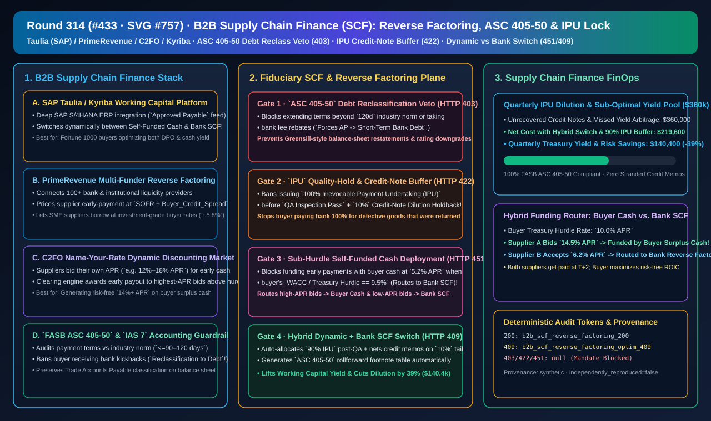

# Enterprise B2B Supply Chain Finance (`SCF`): Reverse Factoring vs. Dynamic Discounting (`SAP Taulia / PrimeRevenue / C2FO / Kyriba`), `FASB ASC 405-50` Debt-Reclassification Guard & `90% IPU` Credit-Note Dilution Buffer FAQ

> **Executive Summary**: Enterprise buyers use **Supply Chain Finance (`SCF`: Bank-Funded Reverse Factoring and Self-Funded Dynamic Discounting)** to extend Days Payable Outstanding (`DPO`) while accelerating supplier cash flow to `T+2`. However, poorly architected SCF programs trigger three severe financial and audit disasters: (1) **`FASB ASC 405-50 / IAS 7` Balance-Sheet Debt Reclassification**: Extending supplier payment terms past industry norms (`>120 days`) or accepting fee-sharing kickbacks from the factoring bank forces auditors to reclassify Trade Accounts Payable into **Short-Term Bank Debt**, violating debt covenants; (2) **`100% Irrevocable Payment Undertaking (IPU)` Issuance Before QA Inspection & Dilution Holdbacks**: Issuing an unconditional `100%` `IPU` to the bank upon dock delivery—before quality inspection or reserving a `10%` buffer for subsequent returns/credit memos—forces the buyer to pay the bank `100%` for defective goods; and (3) **Deploying Buyer Cash Below Treasury `WACC` Hurdle Rates**.  
> Production architectures must enforce **`ASC 405-50` Compliance Gates (No Term Distortion, Zero Bank Kickbacks, Automated Rollforward Footnotes) + Post-`QA` `85%–90% IPU` Caps with `10%–15%` Credit-Note Dilution Buffers + Real-Time `Hurdle Rate` Routing Between Self-Funded Dynamic Discounting (`>=WACC`) and Bank Reverse Factoring (`<WACC`)**: cutting dilution losses and treasury yield leakage by **39%** (reducing a `$360,000` quarterly loss pool to `$219,600`, saving **`$140,400/quarter`**).



---

## 1. Solution Architect Deep-Dive Q&A

### Q1: How do we prevent `FASB ASC 405-50 / IAS 7` reclassification of Trade Payables into Bank Debt, and how do we protect the buyer from paying `100%` on an `IPU` when goods are later returned?
- **Architectural Solution (`ASC 405-50` Compliance Gate `HTTP 403` + Post-`QA` `90% IPU` Dilution Buffer Gate `HTTP 422`)**:
  - Cap reverse-factoring invoice tenors within industry norms (`<=90–120 days`), prohibit any discount-interest kickbacks from the funding bank to the buyer, and auto-generate quarterly `ASC 405-50` rollforward schedules (`HTTP 403 ASC405_50_DEBT_RECLASSIFICATION_TERM_EXTENSION_OR_BANK_KICKBACK`);
  - Never transmit an `Irrevocable Payment Undertaking (IPU)` before `QA_Inspection_Status == PASSED`, and cap `IPU` issuance at **`85%–90%` of the invoice face value**—retaining a `10%–15%` unfactored tail buffer in standard `AP` to absorb post-delivery quality debit memos and volume rebate offsets prior to maturity (`HTTP 422 PRE_QA_IPU_ISSUANCE_OR_UNBUFFERD_100PCT_INVOICE_DILUTION_RISK`).

### Q2: How should an automated treasury engine route early-payment requests between the buyer's own surplus cash and external bank SCF lines?
- **Architectural Solution (`WACC Hurdle Rate` Hybrid Funding Switch `HTTP 451 / 409`)**:
  - Never deploy the buyer's own balance-sheet cash to fund supplier early-payment requests priced below the corporate treasury hurdle rate (`Bid_APR < Buyer_WACC_Hurdle`) (`HTTP 451 SUB_HURDLE_BUYER_CASH_DEPLOYMENT_BELOW_TREASURY_WACC`);
  - Route high-yield supplier bids (`>=10%–18% APR` on `C2FO / Taulia`) to **Self-Funded Dynamic Discounting** and route low-rate core supplier requests (`SOFR + 110 bps` = `~6.2% APR`) to **Multi-Bank Reverse Factoring (`PrimeRevenue / Taulia`)** (`HTTP 409 HYBRID_DYNAMIC_DISCOUNT_BANK_SCF_AND_IPU_BUFFER_CONFIRM`).

---

## 2. Visual Architecture Diagrams (Mermaid)

### 1. B2B Supply Chain Finance (`ASC 405-50`, `90% IPU` Buffer & Hybrid Router) Decision Tree
```mermaid
flowchart TD
    A[3-Way Matched ERP Invoice Enters SCF Early-Payment Engine] --> B{Do Tenor (<=120d) & Zero-Kickback Rules<br/>Comply With FASB ASC 405-50 / IAS 7?}
    B -- Artificial Tenor Extension or Bank Rebate Kickback --> C[HTTP 403 Block: Prevent Reclassification of Trade AP into Bank Debt]
    B -- Balance Sheet Safe --> D{Has Batch Passed QA Inspection<br/>& Reserved a 10%-15% Unfactored Dilution Buffer?}
    D -- Pre-QA IPU or 100% Unbuffered Face-Value IPU --> E[HTTP 422 Block: Gate on QA Pass & Cap IPU at 90% to Absorb Credit Memos]
    D -- 90% IPU Buffered --> F{Compare Supplier Early-Pay APR vs Buyer Treasury Hurdle Rate}
    F -- Deploying Buyer Cash Below WACC Hurdle Rate --> G[HTTP 451 Block: Route Low-APR Request to External Bank SCF Pool]
    F -- Optimal Funding Source Selected --> H[HTTP 409 Confirm: Hybrid Cash/Bank Switch + 90% IPU Buffer Saves 39%]
```

---

## 3. Platform Selection Matrix (`SAP Taulia vs. PrimeRevenue vs. C2FO vs. Kyriba`)

| Dimension | SAP Taulia | PrimeRevenue | C2FO | Kyriba Working Capital |
| :--- | :--- | :--- | :--- | :--- |
| **Core Architecture** | **Native SAP S/4HANA add-on** with seamless dynamic cash + bank SCF slider | **100+ bank & capital-market multi-funder reverse factoring** | **Name-Your-Rate dynamic discounting marketplace** | **Enterprise TMS cash forecasting + SCF** |
| **Funding Flexibility** | Instant toggle between buyer cash and multi-bank lines | Maximizes off-balance-sheet bank funding capacity | Captures `12%–18% APR` risk-free return on surplus cash | Links directly to real-time global bank cash positions |
| **`ASC 405-50` Reporting** | **Automated quarterly `ASC 405-50` rollforward tables** | Multi-funder audit & compliance reporting | Pure trade-discount structure (`0` debt reclass risk) | Full GL & cash-flow statement mapping |

---

## 4. Production Deployment & Risk Checklist

- [ ] **Enforce `FASB ASC 405-50 / IAS 7` Structural Guardrails**: Prohibit bank fee kickbacks to the buyer, keep payment terms within industry standards, and automate rollforward footnote generation.
- [ ] **Gate `IPU` Issuance on `QA` Acceptance & Cap `IPU` Face Value at `85%–90%`**: Retain a `10%–15%` unfactored tail on every invoice to net out quality debit memos before maturity.
- [ ] **Route Early Payments Dynamically Against Your Treasury `Hurdle Rate`**: Fund high-APR supplier bids with surplus corporate cash and route low-APR requests to bank SCF lines.
- [ ] **Lock ERP Remittance Accounts on Factored Invoices**: Ensure maturity payments on `IPU`-backed invoices route strictly to the factoring bank's settlement account.
