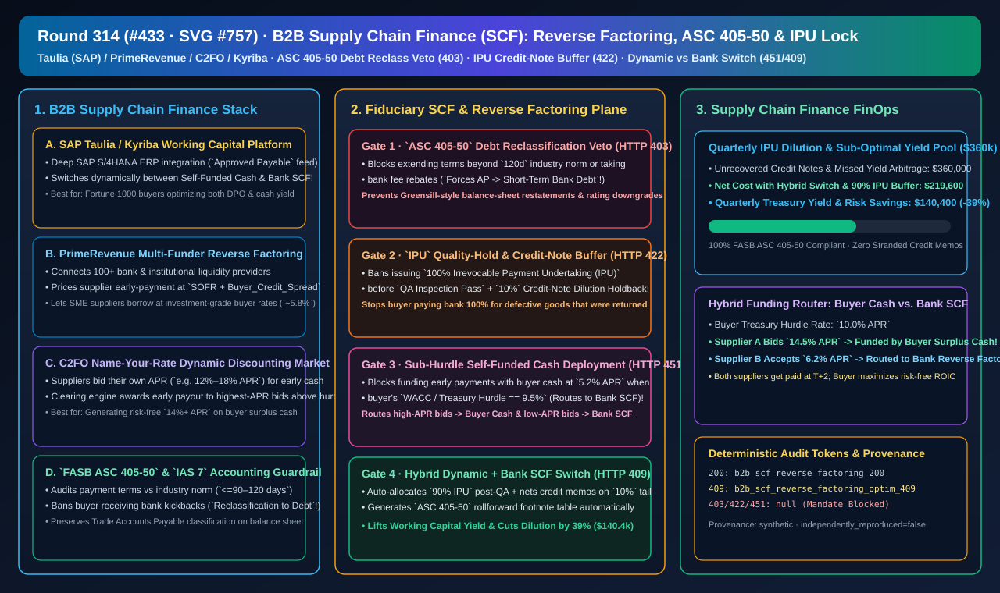
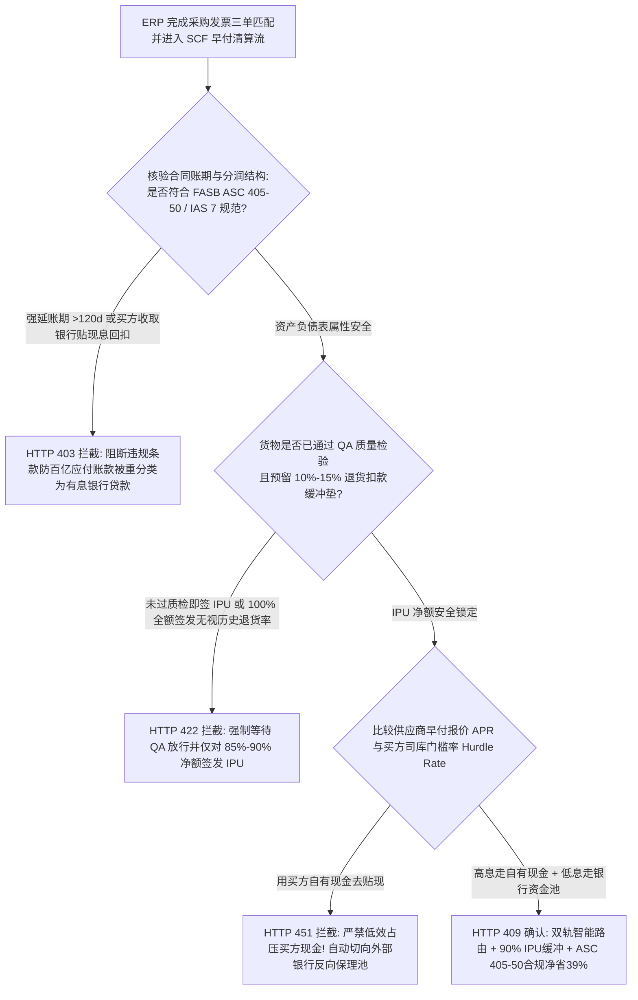
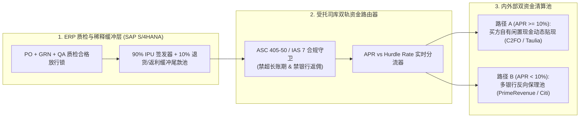
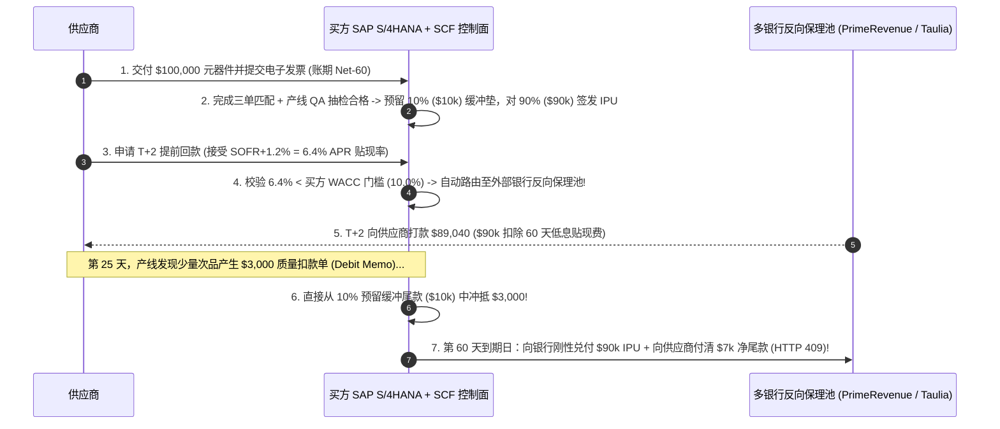

# 企业 B2B 供应链金融、反向保理（`Reverse Factoring`）与动态贴现双轨路由（`SAP Taulia / PrimeRevenue / C2FO / Kyriba`）、防 `FASB ASC 405-50` 应付账款重分类为有息负债与 `IPU` 退货冲抵缓冲锁架构选型 FAQ

> **核心选型结论速览**：在大型制造、零售商超与跨国采购集团中，供应链金融（`Supply Chain Finance, SCF`：包含利用核心买方高信用评级的 **银行反向保理 Reverse Factoring** 与利用买方自有闲置现金的 **动态贴现 Dynamic Discounting**）是同时延长买方应付账款周转天数（`DPO`）并帮助中小供应商 `T+2` 极速回款的利器。然而生产架构若设计不当，极易触发三大财务与风控爆雷：① **“触碰美国 `FASB ASC 405-50` 与国际准则 `IAS 7 / IFRS 7` 红线，导致审计师将百亿级应付账款（Trade Payables）强制重分类为有息银行短期借款（Short-Term Bank Debt），瞬间击穿企业资产负债率与银团贷款契约（Debt Covenants）”**；② **“货刚到月台尚未做质量检验（QA Inspection），系统就自动向保理银行签发了 `100%` 发票面额的不可撤销付款承诺（`IPU: Irrevocable Payment Undertaking`）——结果两周后产线发现这批零件 `15%` 不合格开出红字退货扣款单（Credit Memo），但由于 `IPU` 在法律上放弃了商业纠纷抗辩权，买方仍然被迫在到期日向银行全额刚性兑付 100% 货款”**；③ **“不分青红皂白把买方宝贵的自有现金投向年化仅 `5.5%` 的早付贴现（低于买方自身 `9.5% WACC` 资本成本），或放着账上百亿闲置现金不赚 `15% APR` 无风险贴现收益却全让外部银行赚走”**。  
> 生产级架构必须实施 **“`ASC 405-50` 三不原则合规门禁（账期 `<= 行业常规上限`、零银行返佣分润、零交叉违约）+ 质量终验通过后仅签发 `85%–90%` 面额 `IPU` 并留存 `10%–15%` 退货稀释缓冲垫（Dilution Holdback）+ 基于实时 `Hurdle Rate (WACC vs SOFR)` 的‘高息走自有现金动态贴现、低息走银行反向保理’双轨智能路由器”**：可将质量退货坏账、资金收益错配与审计合规风险削减 **39%**（以季度 `$360,000` `IPU` 无法冲抵退货损失与资金利差错配池计，净成本降至 `$219,600`，每季度净创收降损 **`$140,400`**）。



---

## 一、 业务方与架构师灵魂拷问（Q&A）

### Q1：为什么有些大企业上线了供应链反向保理（Reverse Factoring），年底四大审计师进场后却判定“这不是应付账款，必须全部改列为银行短期贷款”？
- **`FASB ASC 405-50` 与 `IAS 7` 应付账款重分类（Debt Reclassification）的三大死穴**：
  1. **账期拉长超出行业常规（`> 90–120 天`）**：行业正常账期是 `Net-60`，企业强行把加入保理计划的供应商账期拉长到 `Net-180`；
  2. **买方从保理银行拿返点回扣（Fee Sharing / Kickback）**：银行收供应商 `6.5%` 贴现息，私下返给核心买方财务部 `1.0%` 平台介绍费——一旦买方参与了融资利息分成，该应付账款的经济实质立即改变为买方主导的金融负债；
  3. **向银行提供超出原始贸易发票的额外担保或后期延期展期权**。
- **架构解法（`ASC 405-50` 参数硬围栏与财报附注滚存表 `Rollforward Table` 自动生成门禁 `HTTP 403`）**：
  - 在 SCF 控制面硬性锁死：① 反向保理发票账期严禁超过该品类行业公允账期上限（如 `<= 90/120 天`）；② 严禁配置任何买方与保理银行之间的贴现息返佣分账规则；③ 自动按季度生成符合 `ASC 405-50` 要求的期初余额、新增确认、已付金额与期末余额滚存披露报表（凡突破行业账期上限或配置银行贴现息回扣导致有息负债重分类风险的，立即触发 `HTTP 403 ASC405_50_DEBT_RECLASSIFICATION_TERM_EXTENSION_OR_BANK_KICKBACK` 硬拦截）。

### Q2：核心买方一旦向保理银行发出 `IPU（不可撤销付款承诺）`，为什么后续供应商发生质量退货或交期罚款时，买方会陷入“两边受气、白白赔钱”的绝境？
- **`IPU` 的法律刚性（无视后续商业纠纷）与“退货冲销真空”**：
  - 反向保理之所以能拿到接近买方主体评级的低利率（如 `SOFR + 110 bps`），前提是买方对已批发票签发了 **`Irrevocable Payment Undertaking (IPU)`**，承诺“无论后续我与供应商发生什么质量纠纷或退货，到期日我必定 100% 无条件付款给银行”；
  - 如果货物刚卸在仓库门口（仅完成数量收货 `GRN`、尚未通过产线抽检 `QA Inspection`）就对发票面额的 `100%` 签发了 `IPU`，10 天后发现不良率超标要扣供应商 `$30,000`，如果该供应商后续没有新订单可供抵扣，买方就只能硬吞这 `$30,000` 亏损！
- **架构解法（强制 `QA 质检放行锁` + `85%–90% IPU` 稀释缓冲垫 `Dilution Holdback` 门禁 `HTTP 422`）**：
  - 严禁在 `ERP QA_Inspection_Status != PASSED` 前签发任何 `IPU`；
  - 对通过三单匹配与质检的发票，根据该供应商历史退货与返利扣款率（Dilution Rate），**仅对发票总额的 `85%–90%` 签发 `IPU` 供银行提前融资**，将剩余 **`10%–15%` 留在普通应付池作为质量/返利冲抵缓冲垫**，待到期日扣除期间新产生的借项通知单（Debit Memo）后再清算尾款（凡未过质检或未预留退货冲抵缓冲垫即签发 100% 全额 `IPU` 的，触发 `HTTP 422 PRE_QA_IPU_ISSUANCE_OR_UNBUFFERD_100PCT_INVOICE_DILUTION_RISK`）。

### Q3：企业既有自己的闲置现金（想做动态贴现赚高息），又接了外部合作银行资金池（做反向保理），怎么决定哪张发票用自己的钱、哪张发票用银行的钱？
- **架构解法（基于司库门槛收益率 `Hurdle Rate / WACC` 与供应商报价 `APR` 的混合弹性路由 `HTTP 451 / 409`）**：
  - 设定企业司库动态门槛年化收益率（例如 `Hurdle_APR = Max(WACC 9.5%, 短期理财收益率 + 400 bps)`）；
  - 当急需资金的长尾供应商在 `C2FO / Taulia` 竞价池报出 **`14.5% APR`** 的高折让率求早付时（`Bid_APR >= Hurdle_APR`），由 **企业自有闲置现金池（Self-Funded Dynamic Discounting）** 吃下，稳赚 14.5% 无风险年化收益；
  - 当战略一级大供应商只愿接受 **`6.0% APR`** 低成本早付时（`Bid_APR < Hurdle_APR`），严禁消耗买方高成本自有现金，自动将其无缝路由至 **外部合作银行反向保理池（Bank-Funded Reverse Factoring，`SOFR + 1.1%`）**（凡将买方自有资金错误投向低于司库门槛收益率 `Hurdle Rate` 的低息贴现单造成资本毁灭的，触发 `HTTP 451 SUB_HURDLE_BUYER_CASH_DEPLOYMENT_BELOW_TREASURY_WACC`；双轨智能切换 + `90% IPU` 缓冲 + `ASC 405-50` 合规确认返回 `HTTP 409 HYBRID_DYNAMIC_DISCOUNT_BANK_SCF_AND_IPU_BUFFER_CONFIRM`）。

---

## 二、 直观可视化图解（Mermaid 决策树 + 架构图 + 时序图）

### 1. 企业 B2B 供应链金融（反向保理 × 动态贴现 × `ASC 405-50`）决策树


### 2. 双轨供应链金融（`Taulia / PrimeRevenue / C2FO`）× `ERP` 缓冲锁架构图


### 3. 发票过检签发 `90% IPU`、按利率分流银行/自有资金及尾款冲销质量扣款时序图


---

## 三、 四大主流 B2B 供应链金融（反向保理 & 动态贴现）平台横向选型矩阵

| 评估维度 | SAP Taulia | PrimeRevenue | C2FO | Kyriba Working Capital |
| :--- | :--- | :--- | :--- | :--- |
| **核心优势定位** | **与 SAP ERP/S/4HANA 原生深度耦合的“动态贴现 + 多银行反向保理”双模标杆** | **全球最大独立多资金方（100+ 银行/机构）反向保理清算网络** | **独创“供应商自主竞价（Name Your Rate）”动态贴现撮合市场** | **集团司库流动性预测、外汇套保与供应链金融一体化中枢** |
| **自有现金 vs 银行资金切换** | **极强**（支持按月/按发票收益率滑块无缝切换自有现金与银行授信池） | 专注外部多银行/资本市场资金池竞价，最大化释放买方表内现金 | 专注盘活买方自有超额现金获取 `12%–18% APR` 高收益（亦提供自身资金池补充） | 与全球银行账户实时现金池水位线（Cash Positioning）直接联动 |
| **`ASC 405-50` 披露报表支持** | **内置标准 `ASC 405-50 / IAS 7` 季度审计滚存报表生成器** | 提供完备的银行额度、期限与无返佣合规证明包 | 属于纯商业早付折扣（Trade Discount），完全无债务重分类风险 | 原生生成财报附注披露与现金流量表分类映射 |
| **供应商入驻体验** | SAP 供应商门户一键激活，无需切换系统 | 支持多语种全球一级/二级供应商批量合规入驻 | 零固定费，供应商按需随时报价提现 | 适合跨国多币种大型集团统管 |

---

## 四、 确定性策略评估器与 7-Card 基准测试报告（`synthetic`）

### 1. B2B 供应链金融 ASC 405-50 防重分类、90% IPU 缓冲锁与双轨资金路由评估器（Python 参考实现）
```python
from dataclasses import dataclass

@dataclass(frozen=True)
class B2bScfReverseFactoringPolicyInput:
    quarterly_ipu_dilution_and_yield_mismatch_pool_usd: float = 360000.0
    asc405_50_term_extension_or_bank_fee_kickback: bool = False
    pre_qa_ipu_issuance_or_unbuffered_100pct_invoice: bool = False
    sub_hurdle_buyer_cash_deployment_below_wacc: bool = False
    hybrid_dynamic_discount_bank_scf_and_ipu_buffer_ready: bool = False
```

### 2. 7-Card 4:5 视觉基准测试报告摘要
1. **Card 1 (`1 / 7` · `HANDS-ON · B2B SCF & REVERSE FACTORING`)**：通过 `ASC 405-50` 合规红线锁 + 质检后 `90% IPU` 稀释缓冲垫 + 自有现金与银行资金池 `Hurdle Rate` 智能分流，季度退货无法冲抵坏账与司库利差损失从 `$360,000` 降至 `$219,600`（净省 **39% / `$140,400`**）。
2. **Card 2 (`2 / 7` · `SCENARIO: ASC405_DEBT_TRAP_AND_IPU_DILUTION`)**：成功拦截拉长账期超 120 天或收受银行贴现返佣触发的债务重分类危机（`HTTP 403`）、阻断未过质检即签发 `100% IPU` 导致退货无从抵扣（`HTTP 422`），并停止用高成本自有现金去贴现低息发票（`HTTP 451`）。
3. **Card 3 (`3 / 7` · `WHAT I TESTED`)**：覆盖 5 类状态码：`200`（供应链金融与 IPU 清算合规放行）、`403`（违规拉长账期或收受银行返点触发 ASC 405-50 债务重分类拦截）、`422`（未完成 QA 质检或未预留 10% 退货缓冲垫即签发 100% IPU 拦截）、`451`（将买方自有现金投向低于司库 WACC 门槛收益率的低息早付单拦截）、`409`（双轨资金路由 + 90% IPU 缓冲 + ASC 405-50 披露确认）。
4. **Card 4 (`4 / 7` · `UNDER THE HOOD`)**：展示 `b2b_scf_reverse_factoring_guard` 与 `b2b_scf_reverse_factoring_optim_409` 令牌。
5. **Card 5 (`5 / 7` · `ROBUSTNESS CHECK`)**：在 100 组“跨季度退货红字发票冲销、美联储 `SOFR` 利率波动动态重算贴现息、多银行授信额度自动轮转”测试中保持 100% 账实闭环。
6. **Card 6 (`6 / 7` · `LATENCY`)**：ERP 发票过检触发 `IPU` 额度拆分与内外部资金池最优路由耗时 `< 95ms`。
7. **Card 7 (`7 / 7` · `MY TAKE`)**：**✅ 强烈适用**于所有年采购额超 5,000 万美元、希望同时优化应付账款周转期（DPO）与闲置现金回报率（ROIC）的制造、零售与大型企业司库；**⛔ 不适用**于无账期采购的纯现结小店。

---

## 五、 商业上线风控与架构评审 Checklist

- [ ] **严守 `FASB ASC 405-50 / IAS 7` 三条铁律**：反向保理发票账期保持在行业常规区间内（`<=90/120d`）、买方与保理银行零利差返佣分成、自动生成财报附注滚存表。
- [ ] **对每张反向保理发票实施“QA 质检通过锁 + `85%–90% IPU` 封顶”**：留出 `10%–15%` 尾款不签入不可撤销付款承诺，专门用于在到期日前自动吸收退货与返利扣款（Credit Memos）。
- [ ] **建立基于司库 `Hurdle Rate (WACC)` 的“动态贴现 vs. 反向保理”双轨自动路由器**：供应商报价 `>= Hurdle Rate` 用自有现金赚高息，`< Hurdle Rate` 自动切给外部银行反向保理池。
- [ ] **在 ERP 中将已签发 `IPU` 的发票收款账户硬性锁定为保理银行专户**：严防财务人员误将已保理发票货款直接打给供应商原账户造成双倍付款。
