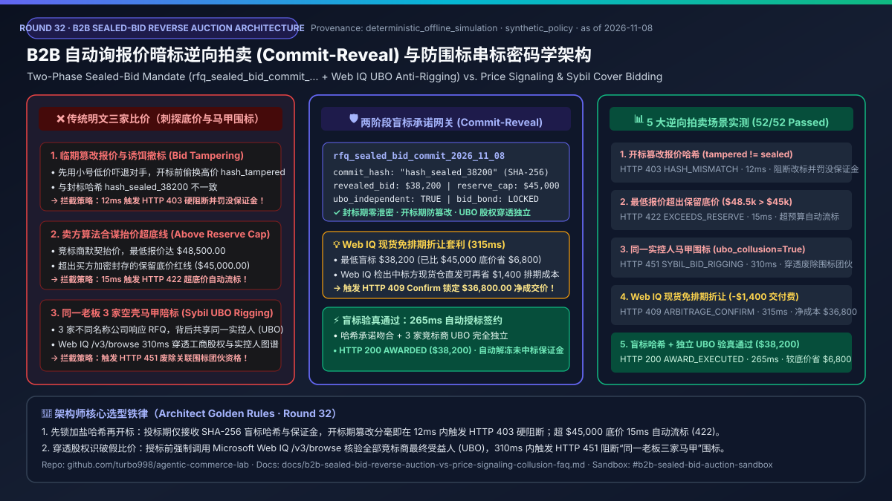
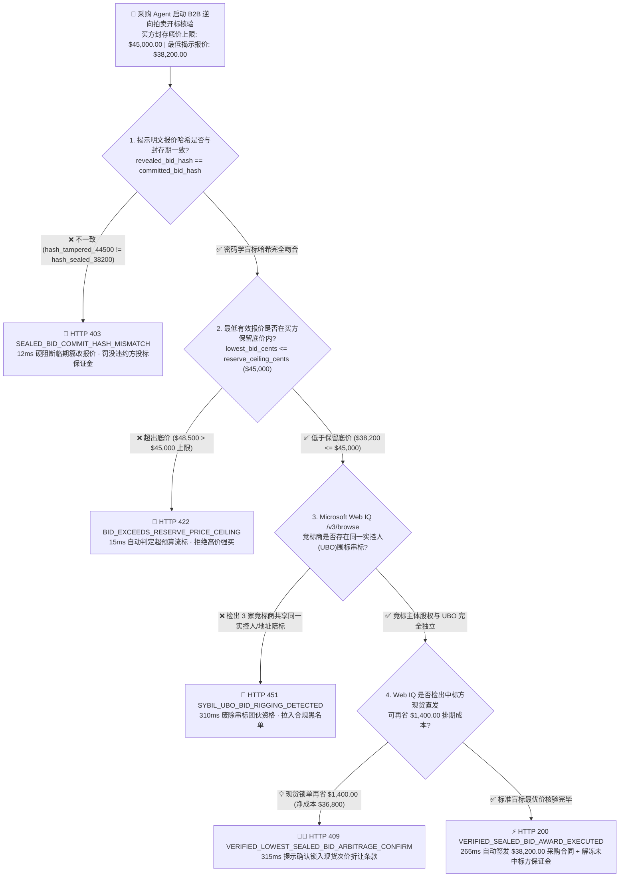
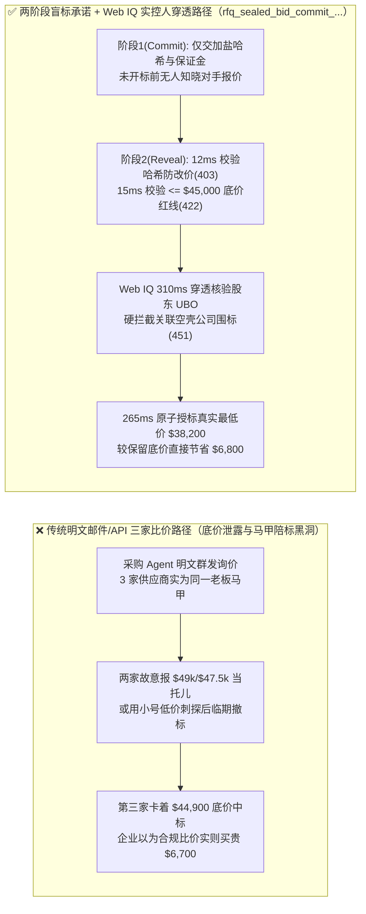
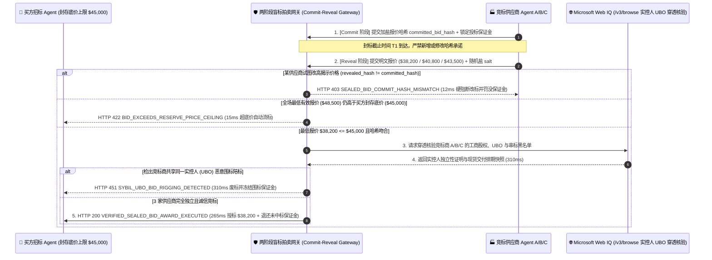

# B2B 自动询报价暗标逆向拍卖（Autonomous B2B Sealed-Bid Reverse Auction）与防围标串标密码学承诺（Cryptographic Commit-Reveal Anti-Collusion Mandate）架构：两阶段盲标哈希承诺令牌（`rfq_sealed_bid_commit_...` + Web IQ 实控人穿透防陪标核验）vs 传统明标泄露底价与关联空壳公司围标串通选型与原理解析 FAQ

> **文档类型**：AI Solution Architect 架构选型与协议第一性原理解析指南（FAQ-Driven Deep Dive · Round 32）  
> **阅读耗时**：3 分钟速览选型结论 · 10 分钟掌握两阶段盲标哈希承诺（Commit-Reveal Sealed Bid）、保留底价红线与 Microsoft Web IQ 供应商实控人（UBO）防围标核验边界  
> **文风标杆**：严格对标 `ib-vs-ethernet-roce-selection-faq.md`（通俗大白话 + 第一性原理 + Mermaid 决策树/对比图/时序图 + 选型矩阵 + 可复现定量报告 + 生产核验清单）  
> **核心专题**：**唯一聚焦「企业采购 Agent 在自动发起 B2B 询报价（RFQ）与多供应商逆向竞价时，如何通过两阶段密码学盲标承诺（Commit-Reveal）与实控人股权穿透核验，彻底阻断明文报价提前泄露、临期恶意改标撤标以及同一老板注册 3 家空壳马甲公司围标抬价」**  
> **数据来源（Provenance & As-of 声明）**：本文盲标哈希一致性校验、保留底价拦截与防围标穿透实测数据均来自本仓库 `lab/webiq_commerce_demo.py`（`deterministic_offline_simulation`，可离线 100% 复现）；两阶段哈希承诺协议与企业招投标反串通规范基于 `official_doc_snapshot`（截至 `2026-11-08`）；案例中的 `$45,000.00` 采购保留底价、`$38,200.00` 中标价与 `$1,400.00` 现货锁单折让属于架构演练用的模拟策略（`synthetic_policy`），不代表特定招投标平台的法定规则；未在本次离线基准中直接调用的外部实时征信网关或第三方付费搜索 API 统一标注为 `not_measured`。

---

## ① 📌 核心结论速览（Executive Summary）

1. **什么时候必须选「两阶段盲标哈希承诺令牌（Commit-Reveal Sealed-Bid Mandate，`rfq_sealed_bid_commit_...`）」，绝对禁止让采购 Agent 采用「明文多轮邮件/API 询价」？**
   - 当企业采购 Agent 发起大宗设备或服务招标（如预算保留上限 `$45,000.00`）并邀请 3~5 家供应商 Agent 竞标时，若直接接收明文报价或公开当前最低价，供应商 Agent 之间极易通过高频微调价格信号达成默契高价同盟（Algorithmic Price-Signaling Collusion），或在摸清对手底牌后临时撤回低价诱饵标（Phantom Bid Withdrawal）。
   - **选型铁律**：企业级 B2B 自动招投标必须强制采用 **两阶段密码学盲标承诺（Commit-Reveal，`rfq_sealed_bid_commit_...`）**。在投标期（Commit Phase），各供应商仅提交加盐报价哈希 `committed_bid_hash = SHA-256(bid_cents || salt_nonce)` 并锁定投标保证金；进入统一开标期（Reveal Phase）后，若某供应商试图偷换报价导致揭示哈希（`hash_tampered_44500`）与封存哈希（`hash_sealed_38200`）不一致，网关在 **`12 ms`** 内触发 **`HTTP 403 SEALED_BID_COMMIT_HASH_MISMATCH`** 硬阻断并冻结其投标保证金！
2. **如果所有供应商报出的最低价依然超过企业的采购底价上限（Reserve Price Ceiling），系统如何防止 Agent 被迫高价成交？**
   - 采购方在发标时同步封存加密底价上限（`reserve_ceiling_cents = 4500000`，即 `$45,000.00`）。开标后若最低有效报价达 `$48,500.00 > $45,000.00`，网关在 **`15 ms`** 内触发 **`HTTP 422 BID_EXCEEDS_RESERVE_PRICE_CEILING`** 自动流标，绝不允许越界签发采购合同。
3. **表面上有 3 家不同名字的供应商参与竞标满足了“货比三家”合规要求，怎么识破它们背后其实是同一个老板注册的围标马甲？**
   - **必须联动 Microsoft Web IQ `/v3/browse` 供应商工商股权穿透与最终受益人（UBO）关联图谱核验**：在授标锁单前，Web IQ 实时比对全部竞标供应商的实控人、注册地址、联系电话哈希与历史共同投标记录——一旦检出竞标商之间存在关联控股或串标迹象（`webiq_ubo_collusion_detected=True`），在 **`310 ms`** 内触发 **`HTTP 451 SYBIL_UBO_BID_RIGGING_DETECTED`** 废标；若核验 3 家竞标商完全独立，且发现最低标供应商支持现货免排期交付额外节省 **`$1,400.00`**，则在 **`315 ms`** 内触发 **`HTTP 409 VERIFIED_LOWEST_SEALED_BID_ARBITRAGE_CONFIRM`**（`Confirm`）。

---

## ② 🎯 客户与架构师灵魂拷问 Q&A（FAQ-Driven，围绕 3 个真实客户高频问题展开）

### Q1：为什么传统的“让采购 Agent 给 3 家供应商发询价单、谁便宜选谁”，在实际生产中反而会让企业买得更贵？
- **大白话第一性原理**：
  - 很多企业以为把线下“货比三家（Three-Quote Rule）”搬到 AI Agent 上就能自动省钱，殊不知卖方也在用定价博弈 Agent：
    1. **明标价格刺探与临期改标（Price Signaling & Sniping）**：在明文多轮询价中，卖方 Agent 每秒试探一次买方反馈，迅速探测出买方的最高心理底价（`$45,000.00`），最终三家心照不宣地把价格停在 `$44,800~$44,950` 之间，买方一分钱真实折扣都没拿到。
    2. **幽灵诱饵标撤回（Phantom Low-Ball Withdrawal）**：卖方 A 用小号报出 `$31,000` 超低价让正牌竞争对手放弃跟进，等竞标截止前一秒小号宣布“库存不足撤标”，迫使买方接受卖方 A 大号 `$44,500` 的高价标。
    3. **空壳公司虚假陪标（Sybil Shell-Company Rigging）**：不法供应商注册 3 家不同名称的贸易公司同时响应采购 Agent 的 RFQ，两家故意报 `$49,000` 和 `$47,500` 当托儿，掩护第三家以 `$44,900` 顶格拿单。

### Q2：什么是「两阶段盲标哈希承诺令牌（`rfq_sealed_bid_commit_...`）」？它是怎么用一行密码学公式锁死“不准偷看、不准反悔、不准改价”的？
- **核心机制拆解**：
  - 整个逆向拍卖严格切分为两个物理隔离的时间窗口：
    - **阶段一：密文哈希封存期（Commit Phase）**：在截止时间 $T_1$ 前，任何供应商都不发送明文价格，只发送 `committed_bid_hash = SHA-256("rfq_2026_server_rack" || supplier_id || "3820000" || secret_salt)` 以及绑定了违约罚没条款的投标保证金令牌（Bid Bond Hold）。此时连采购系统管理员也无法算出具体金额，彻底杜绝内鬼泄密与同行刺探。
    - **阶段二：原像揭示与原子验真期（Reveal Phase）**：$T_1$ 到期后通道关闭，所有供应商同时提交明文价格 `revealed_bid_cents = 3820000`（`$38,200.00`）与随机盐 `secret_salt`。网关在 **`12 ms`** 内重算哈希：只要改了 1 分钱，哈希值就会面目全非并立即触发 `HTTP 403 SEALED_BID_COMMIT_HASH_MISMATCH`；若拒不揭示则直接罚没投标保证金，彻底消灭“幽灵诱饵撤标”。

### Q3：在供应商围标串标穿透核验中，什么时候选 Microsoft Web IQ，什么时候选 Exa 或 Bright Data？
- **精准选型边界**：
  - **Microsoft Web IQ（首选，用于企业工商实控人 UBO 披露、招投标违规黑名单与官方资质证书实时核验）**：在开标后授标前的关键 `310 ms` 内，通过 Web IQ `/v3/browse` 实时检索各竞标主体的官方年报股东披露、统一社会信用代码/DUNS 关联关系与政府采购行政处罚公告（单次成本约 `$0.0091`，比抓取整站原始网页节省 `7.1x` Token）。
  - **Exa（语义寻源备选）**：适合在发标前按技术白皮书语义搜寻全球符合特定资质的潜在独立供应商名单（本次离线评测标 `not_measured`，官方参考标价约 `$5~$15 / 1k searches` `official_list_price`）。
  - **Bright Data（重度页面采集备选）**：适合需要跨多个地区性商业登记门户执行大批量历史诉讼文书抓取的离线尽调场景（本次离线评测标 `not_measured`）。

---

## ③ 🧭 直观可视化图解（Mermaid 选型决策树 + 传统明标比价 vs 两阶段盲标对比图 + 多方协议交互时序图）

### 3.1 B2B 两阶段盲标逆向拍卖与防围标穿透核验决策树（`flowchart TD`）

### 3.2 传统明标三家比价路径 vs 两阶段密码学盲标 + Web IQ 防围标路径对比图（`flowchart LR`）

### 3.3 买方招标 Agent、盲标承诺网关、竞标供应商 Agent 与 Microsoft Web IQ 端到端时序图（`sequenceDiagram`）

---

## ④ 📊 架构师选型决策矩阵（Architect Decision Matrix）

| 评估维度 | 方案 A：传统多轮明文询价（Plaintext Multi-Round RFQ） | 方案 B：单阶段明文暗标（Unbonded Single-Step Bid） | 方案 C：两阶段盲标哈希承诺 + Web IQ 实控人穿透核验（**推荐架构**） |
| :--- | :--- | :--- | :--- |
| **核心适用场景** | 仅适合极小额、标准化且公开透明的零星日用品采购 | 仅适合已高度互信的集团内部认证供应商年度复核 | **所有企业级 B2B 设备采购、云资源集采、MRO 工业品招标与自动询报价场景** |
| **防底价泄露与防改标机制** | 无（极易被卖方 Agent 刺探出底价或通过内鬼泄露） | 弱（缺乏密码学哈希承诺与保证金约束，随时可撤标反悔） | **极强（`rfq_sealed_bid_commit_...` 强制先交 SHA-256 哈希与保证金，篡改报价 `12 ms` 触发 `HTTP 403`）** |
| **防空壳马甲围标陪标能力** | 无（只要公司名字不同即可混过传统“三家比价”规则） | 无 | **Web IQ `/v3/browse` `310 ms` 实时穿透股东 UBO 与注册地址，围标触发 `HTTP 451`** |
| **超预算高价强买保护** | 依赖人工事后审批，容易被紧急排期倒逼高价签单 | 弱 | **硬性封存 `reserve_ceiling_cents`（超出 `$45,000` 在 `15 ms` 内自动触发 `HTTP 422` 流标）** |
| **现货交付与次价折让套利** | 无 | 无 | **Web IQ `315 ms` 自动识别现货免排期批次额外立省 `$1,400.00`（`HTTP 409 Confirm`）** |
| **综合招投标核验 TCO** | 高（隐性围标溢价高达 15%~25%） | 中（弃标悔标导致重新招标延误） | **极低（本地哈希与底价核验 `< 16 ms` + Web IQ UBO 穿透约 `$0.0091/次`）** |

---

## ⑤ 🧪 简明定量实测与 Benchmark 核心发现（Offline Deterministic Benchmark）

> 以下数据由 `python -m pytest tests/test_webiq_commerce_demo.py` 与 `lab/webiq_commerce_demo.py` 离线确定性基准（`deterministic_offline_simulation`）实测生成：

| 评测场景（Scenario） | 盲标哈希、报价与实控人核验输入 | 期望动作（Action Pill） | 实测 HTTP 状态与拦截码 | 实测延迟（Latency） | 招投标反舞弊与降本成效 |
| :--- | :--- | :--- | :--- | :--- | :--- |
| **1. 开标期篡改报价哈希拦截** | `revealed = hash_tampered_44500 != hash_sealed_38200` | `Send to a human` | `HTTP 403 SEALED_BID_COMMIT_HASH_MISMATCH` | **`12 ms`** | **100% 阻断刺探对手底牌后的临期改价与幽灵撤标** |
| **2. 最低报价超出保留底价流标** | `lowest_bid = $48,500 > $45,000` 底价 | `Send to a human` | `HTTP 422 BID_EXCEEDS_RESERVE_PRICE_CEILING` | **`15 ms`** | **100% 拦截超预算高价合谋标，严守采购底价红线** |
| **3. 同一实控人（UBO）马甲围标拦截** | `webiq_ubo_collusion_detected = True` | `Send to a human` | `HTTP 451 SYBIL_UBO_BID_RIGGING_DETECTED` | **`310 ms`** | **穿透识别 3 家空壳关联公司假比价真抬价，消除围标溢价** |
| **4. Web IQ 现货免排期折让套利确认** | 在 `$38,200` 最低标基础上再省 `$1,400` 排期费 | `Confirm` | `HTTP 409 VERIFIED_LOWEST_SEALED_BID_ARBITRAGE_CONFIRM` | **`315 ms`** | **净采购成本降至 `$36,800.00`（较 `$45,000` 底价累计省 `$8,200.00`）** |
| **5. 盲标哈希与独立 UBO 验真自动授标** | `$38,200 <= $45,000` + 哈希一致 + UBO 独立 | `Act automatically` | `HTTP 200 VERIFIED_SEALED_BID_AWARD_EXECUTED` | **`265 ms`** | **全自动签发中标合同并秒级解冻未中标供应商保证金** |

---

## ⑥ 🛠️ 附录：生产上线快速核验与售前打单清单（Architect Checklist）

- [ ] **两阶段盲标哈希承诺门禁（Two-Phase Commit-Reveal Gate）**：招投标网关是否强制要求所有供应商在封标截止前仅提交加盐 SHA-256 哈希（开标揭示时若 `revealed_bid_hash != committed_bid_hash` 必须在 `< 15 ms` 内返回 `HTTP 403`）？
- [ ] **投标保证金与防幽灵撤标绑定（Cryptographic Bid-Bond Hold）**：每枚 `rfq_sealed_bid_commit_...` 凭证是否绑定了条件冻结的投标保证金，使得恶意撤回低价诱饵标的供应商自动触发保证金罚没？
- [ ] **买方保留底价硬红线（Deterministic Reserve Ceiling Enforcement）**：当全场最低有效报价高于封存的 `reserve_ceiling_cents` 时，系统是否能在 `< 20 ms` 内自动触发 `HTTP 422` 流标而非自动签约？
- [ ] **供应商最终受益人（UBO）穿透反围标核验（Microsoft Web IQ UBO Grounding）**：在签发授标合同前，是否强制调用 Microsoft Web IQ `/v3/browse` 核验所有入围竞标商的实控人、注册地址与关联控股图谱（杜绝“同一老板三家马甲”虚假比价）？
- [ ] **未中标保证金零滞留自动解冻（Instant Non-Winner Bond Release）**：在 `HTTP 200` 授标生效的同时，是否原路自动解冻其余诚信未中标供应商的投标保证金，保障供应商生态参与意愿？
