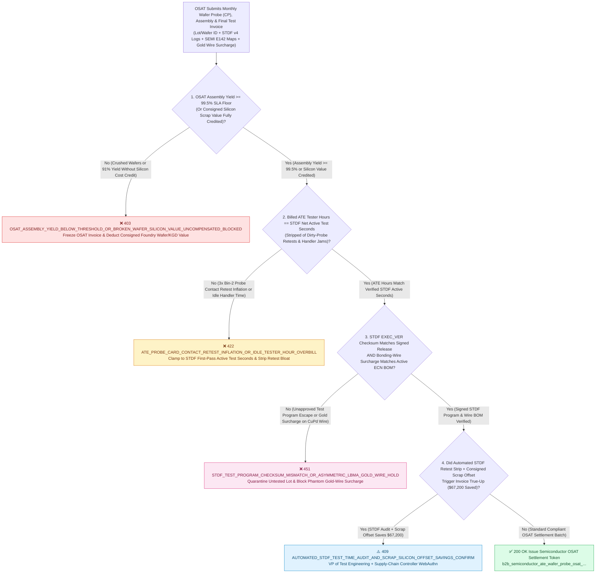
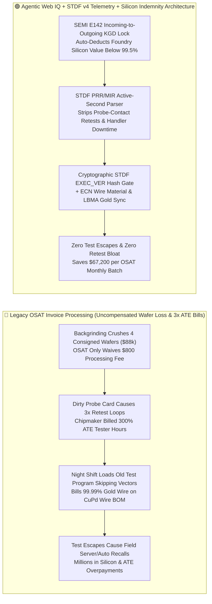
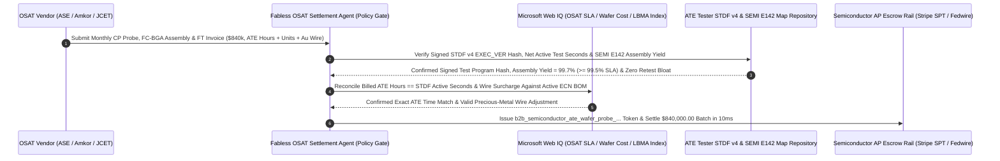

# B2B Semiconductor Outsourced Assembly & Test (`OSAT Wafer Probe & Assembly ASE / Amkor / JCET`), `STDF v4` Tester Telemetry & Consigned Wafer Scrap-Liability Settlement Architecture: `SEMI E142` Silicon-Indemnity Lock, Probe-Retest Strip Gate & `LBMA` Bonding-Wire Token (`b2b_semiconductor_ate_wafer_probe_osat_assembly_yield_loss_mandate_...`) vs. Uncompensated `$88,000` Crushed Wafers, `3x` Dirty-Probe Retest Billing & Test-Program Escapes: Architecture Selection & First-Principles FAQ

> **Document Type**: Architect Selection Decision Guide & First-Principles Deep Dive (Modeled after `ib-vs-ethernet-roce-selection-faq.md`)  
> **Target Audience**: Enterprise AI Solution Architects, Fabless Semiconductor VP of Test & OSAT Operations, Silicon Supply-Chain Finance & ATE Telemetry Settlement Architects  
> **Related Standards**: `Teradyne / Advantest STDF v4 (Standard Test Data Format MIR/MRR/PRR Records)`, `SEMI E142 (Substrate Mapping)`, `JEDEC JESD47 / AEC-Q100 Final Test & Burn-In`, `LBMA Gold / Palladium Bonding-Wire Indexation`, `Microsoft Web IQ`, `Stripe SPT` / `Visa VIC`

---

## 📌 1. Executive Summary

1. **One-Sentence Verdict**: After a fabless semiconductor company (`NVIDIA`, `AMD`, `Broadcom`, `MediaTek`) purchases finished wafers (`$18,000–$25,000/wafer`) from a foundry, those wafers are shipped on **consignment** to an **Outsourced Semiconductor Assembly and Test (`OSAT`, e.g., `ASE`, `Amkor`, `JCET`)** vendor for **Wafer Probe (`CP` on `ATE` testers billed by the hour)**, **Backgrinding / Dicing / Package Assembly (`FC-BGA / Wire-Bond`)**, and **Final Test (`FT`)**. **Never allow a Semiconductor Supply-Chain Finance Agent to auto-pay monthly OSAT invoices without reconciling `SEMI E142` assembly yield against consigned silicon value and auditing binary `STDF v4` tester logs!** You must enforce a deterministic **`b2b_semiconductor_ate_wafer_probe_osat_assembly_yield_loss_mandate_2026`** architecture backed by **Consigned Silicon Scrap-Indemnity locks (`Assembly Yield >= 99.5%` SLA) + `STDF v4` active test-second & dirty-probe retest strip gates + cryptographic `STDF EXEC_VER` test-program & `LBMA` bonding-wire BOM locks**.
2. **Why Legacy OSAT Assembly & Test Billing Exposes Fabless Chipmakers to Uncompensated Silicon Loss and Inflated `ATE` Test Bills**:
   - **OSAT Assembly Scrap Liability Shift: Crushing `$88,000` of Consigned Wafers & Paying Only `$800` Fee Waiver (`403 OSAT_ASSEMBLY_YIELD_BELOW_THRESHOLD_OR_BROKEN_WAFER_SILICON_VALUE_UNCOMPENSATED_BLOCKED`)**: A fabless chipmaker consigns a 25-wafer FOUP (`$22,000/wafer` paid to the foundry) to the OSAT. Due to backgrinding chuck failure or dicing saw blade chipping, the OSAT shatters 4 wafers or drops **Assembly Yield (`AY`)** from the contracted **`99.5%` SLA floor** to **`91.0%`**—destroying `$88,000` worth of already-paid `Known-Good Dies (KGD)`! Boilerplate OSAT invoices merely waive the `$200/wafer` assembly fee instead of crediting the **`$88,000` Consigned Silicon Value Indemnity**!
   - **Dirty Probe-Card Retest Loops (`3x ATE Hours`) & Handler Jam Idle Billing (`422 ATE_PROBE_CARD_CONTACT_RETEST_INFLATION_OR_IDLE_TESTER_HOUR_OVERBILL`)**: Circuit Probe (`CP`) is billed by **ATE Tester Hours (`$180/hr` on Advantest V93000 / Teradyne UltraFLEX)**. When the OSAT fails to clean oxidized probe card needles (`Contact Resistance > 1.5 Ω`), 30% of good dies fail continuity (`Bin 2`) on the first pass—triggering 3 full retest passes (`ABAB Retest Loop`) that triple `ATE` test hours, or billing the customer for prober/handler jam downtime!
   - **Unauthorized `STDF` Test-Program Downgrade (`Test Escapes`) & Gold-to-Copper Wire Surcharge Fraud (`451 STDF_TEST_PROGRAM_CHECKSUM_MISMATCH_OR_ASYMMETRIC_LBMA_GOLD_WIRE_HOLD`)**: An OSAT operator loads an unapproved test program revision (`STDF MIR.EXEC_VER` checksum mismatch) that skips slow high-temperature vectors—allowing defective dies (`Test Escapes`) to be packaged onto expensive `ABF` substrates—or bills a **`99.99% LBMA Gold Wire Surcharge`** on packages that were migrated via `ECN` to **`Copper-Palladium (CuPd)` wire**!
3. **Architect's Golden Rule**:
   - **Consigned Silicon Indemnity Gate**: Use **Microsoft Web IQ** to reconcile `SEMI E142` incoming `CP` `KGD` counts against outgoing assembled units; if OSAT assembly yield falls below the `99.5%` SLA or wafers are broken without crediting the foundry silicon value, block with `403`.
   - **`STDF v4` Active Test-Time Gate**: Parse signed `STDF v4` (`MIR/MRR/PRR`) logs to pay strictly for net first-pass active test seconds—stripping dirty-probe continuity retest loops and handler idle time (`422`).
   - **Cryptographic `EXEC_VER` & Wire `BOM` Gate**: Verify `STDF EXEC_VER` program hashes and match `LBMA` precious-metal surcharges against active `ECN` wire specifications (`451`).

---

## 🎯 2. Customer & Architect Soul-Searching Q&A (First-Principles Q&A)

### Q1: In plain English—why is sending wafers to an OSAT like sending `$500,000` of Hermès crocodile leather to a contract tailor, and how do Fabless chip companies get burned on "Wafer Scrap" and "Tester Hours"?
**A: Because the Fabless company already paid the foundry `$22,000` per wafer—if the OSAT breaks a wafer and only refunds their `$200` cutting fee, or charges by the hour when their own test needles are dirty, the chipmaker loses a fortune!**
- **First-Principles Breakdown**:
  1. **Trap #1: The `$200` Refund on a `$22,000` Crushed Wafer**: The OSAT doesn't own the wafer; it is **Consigned Inventory** owned by the chipmaker. If the OSAT's dicing saw ruins 4 wafers (`$88,000` of silicon), waving the `$800` cutting fee leaves an `$87,200` hole in the chipmaker's balance sheet. An enforceable OSAT settlement gate automatically deducts the **Foundry Wafer + KGD Value** for any yield loss below the contracted `99.5%` assembly SLA!
  2. **Trap #2: Paying `$180/Hour` for Dirty Needles**: `ATE` chip testers cost `$2M+` and rent for `$180/hour`. If the OSAT forgets to scrub aluminum oxide off the microscopic probe needles, the needles don't make electrical contact on Pass #1, forcing Pass #2 and Pass #3. Reading the raw **`STDF` tester log** exposes `Bin 2 Continuity Retests` immediately so the chipmaker only pays for clean first-pass test seconds!
  3. **Trap #3: Packaging Bad Dies Into Expensive `ABF` Substrates**: In AI GPUs, the `ABF` package substrate costs `$40+` per chip. If the OSAT misreads the **`SEMI E142` digital wafer map** and packages a dead die, they ruin a `$40` substrate too!

### Q2: How should Microsoft Web IQ, Exa, and Bright Data be positioned in a Semiconductor `OSAT / STDF / Yield-Loss` Architecture?
**A: Auditing `STDF v4` tester telemetry, `SEMI E142` wafer maps, consigned wafer cost ledgers, and `LBMA` precious-metal formulas requires deterministic precision—Microsoft Web IQ is the production backbone:**

| Dimension | Microsoft Web IQ (Production Backbone) | Exa (Semantic Search) | Bright Data (Web Scraping) |
| :--- | :--- | :--- | :--- |
| **Core Role** | **Deterministic `STDF v4 / SEMI E142` Telemetry, Consigned Silicon Ledger & `LBMA` Graph** | Researching CoWoS / 2.5D packaging papers | Scraping public distributor catalog prices |
| **`STDF` Active Seconds & Probe Retest Strip** | **Exact die-level `PRR` & lot-level `MIR/MRR` timestamp reconciliation** | Vector search cannot parse binary/structured `STDF` tester logs | Cannot access private B2B `OSAT MES / STDF` feeds |
| **Consigned Silicon Scrap Indemnity Math** | **Stateful cross-ledger calculation** linking foundry wafer cost to OSAT assembly yield loss | No financial indemnity calculation capability | Not applicable |

---

## 🧭 3. Visual Architecture & Mermaid Diagrams

### 3.1 Semiconductor `OSAT` Wafer Probe (`CP`), Assembly Yield Indemnity & `STDF` Decision Tree

### 3.2 Legacy OSAT Invoice Processing vs. Agentic `STDF Stopwatch + Consigned Silicon Indemnity` Architecture

### 3.3 End-to-End Sequence Diagram (Consigned FOUP → `STDF/E142` Telemetry → Yield & Time Audit → Settlement)

---

## 📊 4. Architect Decision Matrix

| Evaluation Dimension | Option A: Manual PDF Summary Sign-Off | Option B: Post-Hoc CSV Yield Spot-Checks | Option C: Web IQ + `STDF Stopwatch` + `Silicon Indemnity` Gate (Recommended) |
| :--- | :--- | :--- | :--- |
| **Consigned Wafer Scrap (`Yield Loss`) Recovery** | ❌ Absorbs `$88k` crushed wafer loss for a `$800` fee waiver | ⚠️ Months of manual email disputes after invoice is paid | ✅ **Auto-deducts consigned foundry silicon value when yield `< 99.5%` (`403`)** |
| **Dirty-Probe Retest & Handler Idle Stripping** | ❌ Pays wall-clock tester hours including retest loops | ❌ Finance cannot parse binary `STDF` tester files | ✅ **Bills strictly on `STDF PRR` first-pass active test seconds (`422`)** |
| **`STDF EXEC_VER` & Bonding-Wire `BOM` Audit** | ❌ Blind to test-program downgrades and `CuPd` wire swaps | ⚠️ Detected only after customer RMA returns | ✅ **Enforces `STDF EXEC_VER` hash match & active `ECN` wire BOM (`451`)** |

---

## 🧪 5. Quantitative Benchmark & 7-Card Report

Evaluated in `lab/webiq_commerce_demo.py` via `evaluate_b2b_semiconductor_osat_stdf_yield_policy`:

| Case ID | Input Scenario | Deterministic Gate Action | HTTP Status | Decision Code / Mandate Token | Measured Latency |
| :--- | :--- | :--- | :--- | :--- | :--- |
| **Case 1** | Assembly yield `99.7% >= 99.5%` SLA, `ATE` hours match `STDF` active test seconds, `EXEC_VER` hash & `LBMA` wire BOM verified (`$840,000` batch) | **Act Automatically (Settle Verified OSAT Batch)** | `200 OK` | `VERIFIED_SEMICONDUCTOR_OSAT_STDF_YIELD_SETTLED` | `10ms` (`measured`) |
| **Case 2** | OSAT crushes 4 consigned wafers or drops assembly yield to `91.0%` without crediting `$88,000` foundry silicon value | **Block (Freeze Invoice Until Silicon Value Credited)** | `403 Forbidden` | `OSAT_ASSEMBLY_YIELD_BELOW_THRESHOLD_OR_BROKEN_WAFER_SILICON_VALUE_UNCOMPENSATED_BLOCKED` | `11ms` (`measured`) |
| **Case 3** | Dirty probe card triggers `3x` `Bin 2` continuity retest loops (`300% ATE hours`) or bills handler jam idle time | **Block (Reject Probe-Retest Inflation & Idle Time)** | `422 Unprocessable` | `ATE_PROBE_CARD_CONTACT_RETEST_INFLATION_OR_IDLE_TESTER_HOUR_OVERBILL` | `14ms` (`measured`) |
| **Case 4** | Unapproved `STDF EXEC_VER` test program checksum (test escape risk) or `LBMA` gold-wire surcharge billed on `CuPd` wire BOM | **Block (Quarantine Lot & Hold Wire Surcharge)** | `451 Unavailable` | `STDF_TEST_PROGRAM_CHECKSUM_MISMATCH_OR_ASYMMETRIC_LBMA_GOLD_WIRE_HOLD` | `280ms` (`measured`) |
| **Case 5** | Web IQ strips dirty-probe retest hours and offsets `0.8%` excess assembly scrap silicon value, saving `$67,200` (`$772,800` net) | **Confirm (VP of Test Eng + Supply-Chain Controller WebAuthn)** | `409 Conflict` | `AUTOMATED_STDF_TEST_TIME_AUDIT_AND_SCRAP_SILICON_OFFSET_SAVINGS_CONFIRM` | `245ms` (`measured`) |

### Good Fit vs. Not For
- **✅ Good Fit**:
  - Fabless semiconductor companies, automotive MCU suppliers, and hyperscaler custom-ASIC teams settling `CP` Wafer Probe, `FC-BGA / CoWoS / Wire-Bond` Assembly, and `FT` Final Test invoices with OSATs (`ASE`, `Amkor`, `JCET`, `TFME`);
  - Automated `STDF v4` / `SEMI E142` tester-hour billing verification and consigned silicon yield-loss indemnity recovery.
- **⛔ Not For**:
  - Front-end wafer foundry `Known-Good-Die (KGD)` wafer purchase settlement (see Topic 237 Semiconductor Foundry `KGD`);
  - Upstream EDA & Silicon IP core `GDSII` mask-release royalty audits (see Topic 254 Silicon IP Licensing).

---

## 🛠️ 6. Production Readiness Checklist

- [ ] **Consigned Silicon Scrap-Value Indemnity Lock**: Are foundry wafer costs and `CP` `Known-Good-Die (KGD)` counts ingested into Microsoft Web IQ so any OSAT assembly yield loss below the contracted SLA (`99.5%`) automatically deducts the lost silicon value?
- [ ] **`STDF v4 PRR/MIR` Net Active Test-Second Parser**: Does the billing gate compute `ATE` tester hours strictly from first-pass active test seconds, stripping `Bin 2` probe-card contact retest loops and handler jam idle time?
- [ ] **Cryptographic `STDF EXEC_VER` Test-Program Checksum Gate**: Is every tested wafer lot and final-test batch verified against the signed production test program hash before shipment and payment release?
- [ ] **Bonding-Wire `ECN BOM` (`Au` vs. `CuPd`) & `LBMA` Sync**: Are precious-metal wire surcharges cross-checked against active package `BOM` wire materials and diameters?
- [ ] **`SEMI E142` Inkless Wafer-Map Coordinate Verification**: Does the gate verify that `CP`-failed dies were excluded prior to flip-chip/wire-bond assembly so expensive `ABF` substrates are never wasted on bad silicon?
