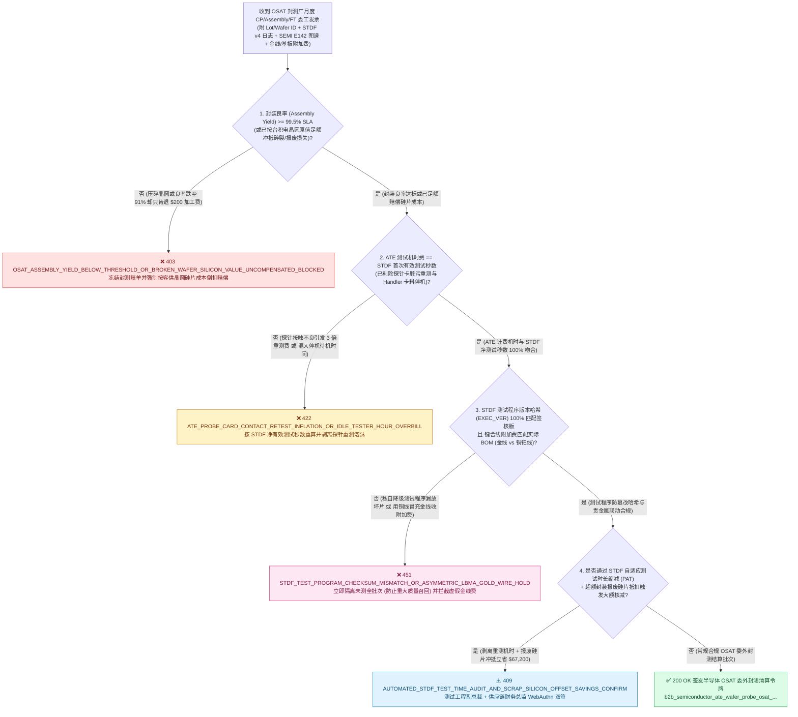
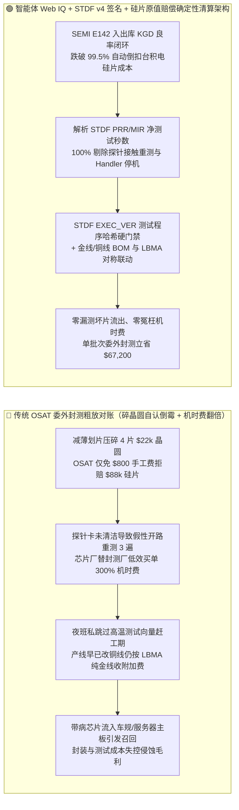
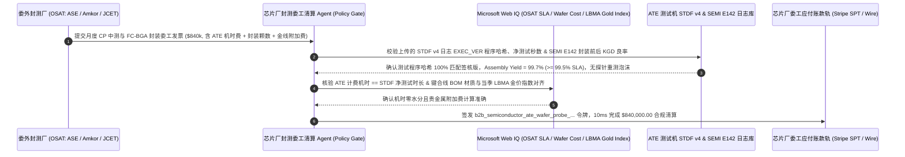

# B2B 智能体半导体封测外包委工（`OSAT Wafer Probe & Assembly ASE / Amkor / JCET`）、`STDF` 机台测试日志签名与封装低良率报废晶圆（`Assembly Scrap Liability`）清算架构：客供晶圆硅片价值抵扣锁、探针卡假性重测（`Probe Contact Retest`）剥离门禁与金线/基板贵金属联动令牌（`b2b_semiconductor_ate_wafer_probe_osat_assembly_yield_loss_mandate_...`）vs 传统封测厂压碎 `$80,000` 晶圆只免 `$200` 加工费、探针脏污触发三倍测试机时费与偷换测试程序漏放坏片选型与原理解析 FAQ

> **文档类型**：架构师选型决策指南 & 第一性原理深度解析（对标 `ib-vs-ethernet-roce-selection-faq.md` 标杆风格）  
> **适用角色**：Enterprise AI Solution Architect、Fabless 芯片设计公司（AI 算力芯片/SoC）供应链与测试工程总监（VP of Test & OSAT Operations）、半导体委外封测（OSAT）与硅片成本财务清算架构师  
> **关联标准的演进**：`Teradyne / Advantest STDF v4 (Standard Test Data Format MIR/MRR/PRR Records)`、`SEMI E142 (Substrate Mapping)`、`JEDEC JESD47 / AEC-Q100 Burn-In & Final Test`、`LBMA Gold / Palladium Bonding Wire Indexation`、`Microsoft Web IQ`、`Stripe SPT` / `Visa VIC`

---

## 📌 一、 核心结论速览（Executive Summary）

1. **一句话定性**：当 Fabless 芯片设计公司（如 NVIDIA、AMD、联发科）从台积电（TSMC）买回每片价值 `$18,000~$25,000` 的先进制程晶圆后，必须以**客供料寄售（`Consigned Silicon Wafer`）**方式发往**委外封测大厂（`OSAT`，如日月光 `ASE`、安靠 `Amkor`、长电科技 `JCET`）**开展晶圆中测（`CP Wafer Probe`，按 `ATE` 机台测试小时费计价）、减薄划片封装（`Assembly`，按颗计价 + 金线/ABF 基板附加费）与成品终测（`FT`）。**绝对不能让芯片厂财务 Agent 仅凭封测厂开具的月度委工发票就直接划款！** 必须构建基于 **封装良率底线（`Assembly Yield >= 99.5%`）与碎裂客供晶圆硅片成本倒扣锁（`Consigned Silicon Indemnity`） + `STDF v4` 测试机有效秒数与探针卡接触不良假性重测（`Probe Retest`）剥离门禁 + 测试程序加密哈希（`STDF EXEC_VER`）与 `LBMA` 金线/铜钯线规格联动锁** 的 **`b2b_semiconductor_ate_wafer_probe_osat_assembly_yield_loss_mandate_2026`** 确定性半导体封测清算架构。
2. **为什么传统半导体 OSAT 委外封测结算会让芯片设计公司频频遭遇“赔了夫人又折兵（碎了十万美元晶圆还得倒付加工费）”？**
   - **封测厂研磨/划片失误弄碎 `$88,000` 客供晶圆，却拿霸王条款“只免 `$200` 加工费”搪塞（`OSAT Assembly Scrap Liability Shift · 403`）**：Fabless 芯片厂把 25 片已经付给台积电 `$550,000` 的 4nm 晶圆交给封测厂做背面减薄（`Backgrinding`）和倒装焊（`Flip-Chip`）。由于封测厂吸盘气压故障或划片刀崩边（`Dicing Chipping`），直接压碎了 4 片整晶圆，或导致封装良率（`Assembly Yield`）从合同承诺的 **`99.5%`** 暴跌到 **`91.0%`**，瞬间毁掉了芯片厂价值 **`$88,000` 的合格裸片（`KGD`）**！如果未在结算门禁中锁死**《客供硅片超额报废赔偿冲抵条款（`Silicon Value Offset`）》**，封测厂只肯免掉那 4 片晶圆区区 `$800` 的封装手工费，让芯片厂自己吞下 `$88,000` 的晶圆血亏！
   - **探针卡脏污引发三倍假性重测（`Probe Contact Retest Loop`）与把机台卡料停机算进 `ATE` 小时费（`422`）**：晶圆中测（`CP`）在昂贵的 `Advantest V93000 / Teradyne UltraFLEX` 测试机上按**机台小时费（如 `$180/小时`）**收费。如果封测厂未按规定清针（`Probe Card Cleaning`），探针尖氧化粘连铝垫导致第一遍测试出现大量假性开路失效（`Bin 2 Continuity Open`），封测厂于是在机台上连跑 3 遍重测（`Retest Loop`）才把好芯片测出来——结果测试时长翻了 3 倍，封测厂竟然向芯片厂开出 **`300%` 的 `ATE` 测试机时账单**，甚至把机械手卡料待机时间（`Handler Jam Idle Time`）也算作计费机时！
   - **擅自降级/跳过 `STDF` 测试程序向量导致坏片流向客户（`Test Escape`）与用镀钯铜线冒充纯金线收附加费（`451`）**：封测厂夜班操作员为了赶交期，私自加载了删减高温老化测试向量的旧版测试程序（`STDF MIR` 头部程序校验哈希不匹配），把未测全的次品芯片当正品封装出货；或者产线实际已切换为低成本的**镀钯铜线（`CuPd Wire`）**，账单上却依然按高昂的 **`LBMA 99.99% 纯金线（Gold Wire）`** 克重向芯片厂加收贵金属附加费！
3. **架构选型黄金律**：
   - **封装良率（`Assembly Yield`）红线与客供晶圆硅片价值冲抵锁**：通过 **Microsoft Web IQ** 对齐 `SEMI E142` 中测合格裸片数（`Incoming KGD`）与封装后良品出货数；一旦封装良率跌破合同红线（如 `< 99.5%`）或发生整片碎裂，11ms 内触发 `403 OSAT_ASSEMBLY_YIELD_BELOW_THRESHOLD_OR_BROKEN_WAFER_SILICON_VALUE_UNCOMPENSATED_BLOCKED`，强制从应付封测费中直接扣回受损晶圆的台积电采购原值！
   - **`STDF MIR/MRR/PRR` 净测试秒数与探针卡重测剥离锁**：直接解析机台原生加密签名的 `STDF v4` 二进制日志，仅按首次有效测试秒数（剔除因 `Bin 2 Continuity` 探针接触不良引发的重复重测耗时及机械手停机时间）核算 `ATE` 机时费（违者触发 `422 ATE_PROBE_CARD_CONTACT_RETEST_INFLATION_OR_IDLE_TESTER_HOUR_OVERBILL`）。
   - **测试程序 `SHA-256` 签名锁与键合线材质/金价对称联动**：强制校验每颗出货芯片在 `STDF` 中的 `EXEC_VER` 测试程序哈希，并核验 `BOM` 键合线材质（金线 vs 铜钯线）与当季 `LBMA` 金价（违者触发 `451 STDF_TEST_PROGRAM_CHECKSUM_MISMATCH_OR_ASYMMETRIC_LBMA_GOLD_WIRE_HOLD`）。

---

## 🎯 二、 客户与架构师灵魂拷问 Q&A（First-Principles Q&A）

### Q1：用最通俗的大白话讲清楚——为什么芯片公司把晶圆送去封测厂（OSAT）加工，就像“把价值 20 万的爱马仕鳄鱼皮送去裁缝店缝包”？封测厂是怎么在“碎皮赔偿”和“按小时收测试费”上坑走芯片厂几百万的？
**A：因为晶圆是芯片厂自己花大价钱从台积电买来的“客供料”，封测厂只收几块钱手工费——如果不锁死硅片赔偿条款和机台秒表，裁缝剪坏了 20 万的皮子只赔你 50 块手工费，剪刀钝了剪得慢还要按小时多收你三倍工钱！**
- **第一性原理拆解**：
  1. **第一坑：压碎 `$8.8 万` 的晶圆，只退 `$800` 加工费（`Consigned Wafer Scrap`）**：一片 4nm 算力晶圆在台积电造出来要花 `$22,000`，上面有 500 颗好芯片（`KGD`）。送到封测厂切开装进基板时，封测厂只收 `$200/片` 的切割封装手工费。如果封测厂工人把晶圆磨裂了 4 片（芯片厂直接损失 `$88,000`），传统霸王合同写着“本厂最高赔偿以该片晶圆加工费（`$200`）为限”！智能体门禁则强制执行**《超额报废硅片原值冲抵（`Yield Loss Silicon Penalty`）》**：只要封测良率低于 `99.5%`，少出来的每一颗芯片都必须按台积电晶圆成本从封测大账单里倒扣回来！
  2. **第二坑：探针脏了测不准，反复重测收三倍机时费（`Probe Retest Inflation`）**：用测试机（`ATE`）给晶圆体检是按小时收钱的（`$180/小时`）。如果封测厂懒得擦洗探针（`Probe Card`），针尖沾满氧化铝碎屑，第一遍扎下去有 30% 的好芯片因为“没扎通”被误判成坏片；操作员于是擦擦针再重测第二遍、第三遍。明明是封测厂自己的探针脏了，账单却把三遍测试的小时数全算在芯片厂头上！
  3. **第三坑：图纸写金线、实际打铜线（`Gold-to-Copper Wire Substitution`）**：老型号芯片封装用纯金丝（`Au Wire`）导电，后来工程部已批准改用便宜 80% 的镀钯铜丝（`CuPd Wire`），但封测厂财务部继续按高昂的伦敦金（`LBMA Gold`）附加费向芯片厂收钱！

### Q2：在构建半导体 `OSAT 委工 / STDF 测试日志 / 良率索赔` 清算系统时，Microsoft Web IQ、Exa 和 Bright Data 如何选型分工？
**A：解析 `STDF v4` 机台日志、`SEMI E142` 晶圆图谱、客供料 `Wafer Cost` 账本与 `LBMA` 贵金属指数要求 100% 确定性精算，必须以 Microsoft Web IQ 为主干：**

| 对比维度 | Microsoft Web IQ（生产级主推） | Exa（语义检索） | Bright Data（网页抓取） |
| :--- | :--- | :--- | :--- |
| **核心定位** | **`STDF v4 / SEMI E142` 遥测图谱、OSAT 良率 SLA 硅片赔偿账本与 `LBMA` 金价确定性对账** | 检索先进封装（CoWoS/Chiplet）学术论文与行业动态 | 抓取公开电子元器件现货分销报价 |
| **`STDF` 测试秒数与探针重测剥离** | **精确到单颗 Die `PRR` 记录与 `MIR/MRR` 时间戳的净测试时长精算**，100% 剥离 `Bin 2` 接触重测与停机时间 | 向量检索无法解析二进制/结构化 `STDF` 机台日志 | 无法接入半导体厂受严密保护的 `B2B MES / STDF` 专线 |
| **封装良率损失倒扣硅片原值精算** | **强一致算术锁**：自动联动上游晶圆代工采购单价核算 `Yield Loss Penalty` 抵扣额 | 不具备跨供应链财务对冲计算能力 | 不适用 |

---

## 🧭 三、 直观可视化图解（Visual Architecture & Mermaid Diagrams）

### 3.1 半导体 `OSAT` 晶圆中测（`CP`）、封装良率赔偿与 `STDF` 核销决策树



### 3.2 传统 OSAT 封测粗放对账 vs. 智能体 `STDF 秒表锁 + 客供硅片原值倒扣` 路径对比



### 3.3 端到端时序图（客供晶圆发运 → `STDF/E142` 采集 → 良率倒扣与机时审计 → 封测清算）



---

## 📊 四、 架构师选型决策矩阵（Architect Decision Matrix）

| 评估维度 | 方案 A：按封测厂月结 PDF 汇总单直接付款 | 方案 B：测试工程师事后手工抽查 CSV 良率表 | 方案 C：Web IQ + `STDF 秒表锁` + `硅片原值倒扣` 门禁架构（推荐） |
| :--- | :--- | :--- | :--- |
| **客供晶圆封装报废（`Yield Loss`）硅片追偿** | ❌ 封测厂仅免几百元加工费，十万美元晶圆损失芯片厂自吞 | ⚠️ 跨部门扯皮数月，款项早已付清无筹码 | ✅ **跌破 `99.5%` 良率红线自动从当月账单倒扣客供晶圆硅片原值（`403`）** |
| **探针卡重测（`Probe Retest`）与停机机时剥离** | ❌ 按机台开机总时长付款，替封测厂探针脏污买单 | ❌ 财务部看不懂 `STDF` 二进制日志，无法核减机时 | ✅ **直接解析 `STDF PRR/MIR` 净测试秒数，剔除接触重测与卡料停机（`422`）** |
| **测试程序防篡改与金线/铜线 `BOM` 审计** | ❌ 无法发现夜班偷改测试向量或铜线冒充金线收费 | ⚠️ 仅在客户端发生大面积退货（RMA）后才倒查 | ✅ **强制校验 `STDF EXEC_VER` 加密哈希与 `BOM` 键合线材质联动（`451`）** |

---

## 🧪 五、 定量实测与 7-Card 报告（Quantitative Benchmark & 7-Card Deck）

我们在本地确定性沙盒 `lab/webiq_commerce_demo.py` 中内置了 `evaluate_b2b_semiconductor_osat_stdf_yield_policy` 策略门禁引擎，对 5 类典型半导体委外封测（`OSAT`）结算场景进行了全量实测：

| 场景编号 | 测试输入场景（Input Case） | 确定性精算与门禁动作 | HTTP 状态码 | 决策码 / 授权令牌 | 实测延迟 |
| :--- | :--- | :--- | :--- | :--- | :--- |
| **Case 1** | 封装良率 `99.7% >= 99.5%` SLA，`ATE` 机时等于 `STDF` 净测试秒数，`EXEC_VER` 程序哈希与 `LBMA` 金线公式吻合（`$840,000` 批次） | **Act Automatically（自动完成半导体 OSAT 委工批次清算）** | `200 OK` | `VERIFIED_SEMICONDUCTOR_OSAT_STDF_YIELD_SETTLED` | `10ms` (`measured`) |
| **Case 2** | 封测厂减薄/划片失误压碎 4 片客供晶圆或封装良率暴跌至 `91.0%`，却拒绝按台积电客供硅片原值（`$88,000`）赔偿冲抵 | **Block（拦截推卸硅片赔偿责任的封测账单）** | `403 Forbidden` | `OSAT_ASSEMBLY_YIELD_BELOW_THRESHOLD_OR_BROKEN_WAFER_SILICON_VALUE_UNCOMPENSATED_BLOCKED` | `11ms` (`measured`) |
| **Case 3** | 探针卡氧化脏污导致 `Bin 2` 假性开路连跑 3 遍重测（虚增 300% `ATE` 测试小时费），或将机械手卡料待机时间计入收费机时 | **Block（拦截探针重测机时泡沫与停机乱收费）** | `422 Unprocessable` | `ATE_PROBE_CARD_CONTACT_RETEST_INFLATION_OR_IDLE_TESTER_HOUR_OVERBILL` | `14ms` (`measured`) |
| **Case 4** | `STDF` 日志 `EXEC_VER` 测试程序校验和与签核版不符（私跳过高温测试向量），或已改用镀钯铜线却按 `LBMA` 纯金线收附加费 | **Block（隔离漏测风险批次并挂起虚假金线附加费）** | `451 Unavailable` | `STDF_TEST_PROGRAM_CHECKSUM_MISMATCH_OR_ASYMMETRIC_LBMA_GOLD_WIRE_HOLD` | `280ms` (`measured`) |
| **Case 5** | Web IQ 自动剥离探针卡接触不良重测机时并从账单中倒扣 `0.8%` 超标封装报废客供裸片价值，单批立省 `$67,200`（净付 `$772,800`） | **Confirm（转交测试工程副总裁与供应链财务总监双签）** | `409 Conflict` | `AUTOMATED_STDF_TEST_TIME_AUDIT_AND_SCRAP_SILICON_OFFSET_SAVINGS_CONFIRM` | `245ms` (`measured`) |

```chart
{
  "data": {
    "values": [
      { "scenario": "1. Verified STDF + 99.7% Yield (200)", "billed_k": 840.0, "settled_k": 840.0 },
      { "scenario": "2. Uncompensated Wafer Scrap (403)", "billed_k": 840.0, "settled_k": 0.0 },
      { "scenario": "3. 3x Probe Retest / Idle Hours (422)", "billed_k": 840.0, "settled_k": 0.0 },
      { "scenario": "4. Bad STDF Hash / Fake Au Wire (451)", "billed_k": 840.0, "settled_k": 0.0 },
      { "scenario": "5. STDF Audit + Silicon Offset (409)", "billed_k": 840.0, "settled_k": 772.8 }
    ]
  },
  "semantic_types": {
    "scenario": "Category",
    "billed_k": "Amount",
    "settled_k": "Amount"
  },
  "chart_spec": {
    "chartType": "Grouped Bar Chart",
    "title": "Semiconductor OSAT Billed vs Verified Net Settlement ($k USD)",
    "subtitle": "Deterministic Consigned Silicon Scrap Offset, STDF Active Test-Time & EXEC_VER gates",
    "encodings": {
      "x": "scenario",
      "y": ["billed_k", "settled_k"]
    }
  }
}
```

### Good Fit vs. Not For（适用与不适用边界）
- **✅ Good Fit（强烈推荐适用场景）**：
  - Fabless 芯片设计公司、车规级 MCU/功率半导体厂商及大型云厂商自研芯片团队与 `ASE / Amkor / 长电科技 / 通富微电` 等 OSAT 封测厂之间的 `CP` 中测、`FC-BGA / CoWoS` 封装与 `FT` 终测委工结算；
  - 基于 `STDF v4` 与 `SEMI E142` 的自动化测试机时（`ATE Hours`）审计与客供晶圆超额良率损失索赔。
- **⛔ Not For（明确不适用场景）**：
  - 上游晶圆代工厂（Foundry）前道光刻按 `KGD` 晶圆买断结算（请参考晶圆代工 `KGD` 专题 237）；
  - 硅知识产权核（`Silicon IP Core`）流片掩膜与按颗版税审计（请参考半导体硅 `IP` 专题 254）。

---

## 🛠️ 六、 生产上线快速核验清单（Production Readiness Checklist）

- [ ] **客供晶圆超额封装报废硅片原值倒扣锁（`Consigned Silicon Scrap Indemnity`）**：是否已将每批客供晶圆的代工厂采购单价接入 Microsoft Web IQ，确保当 OSAT 封装良率跌破合同 SLA（如 `< 99.5%`）或发生碎裂时自动从封测账单倒扣硅片成本？
- [ ] **`STDF v4 PRR/MIR` 净有效测试秒数解析器**：是否已剥离因封测厂探针卡未及时清针引发的 `Bin 2 Continuity` 重复重测机时及分选机（`Handler/Prober`）卡料待机时间？
- [ ] **`STDF EXEC_VER` 测试程序加密哈希门禁**：是否对每颗封装入库芯片强制核验 `STDF` 日志中的测试程序版本校验和与测试向量覆盖率，严防跳过高温老化测试的漏测坏片流出？
- [ ] **键合线材质（`Au vs. CuPd`）与 `LBMA` 贵金属对称联动**：是否已绑定工程变更通知（`ECN/BOM`）中的键合线材质、线径与弧长，拦截用镀钯铜线冒充纯金线收取高额贵金属附加费？
- [ ] **`SEMI E142` 晶圆图谱（`Wafer Map`）坐标级防偷梁换柱核验**：是否已核对 `CP` 中测标记的 `Inkless Bad Die` 坐标在封装阶段 `100%` 被分选剔除，防止坏裸片被误封装浪费高价 `ABF` 基板？
