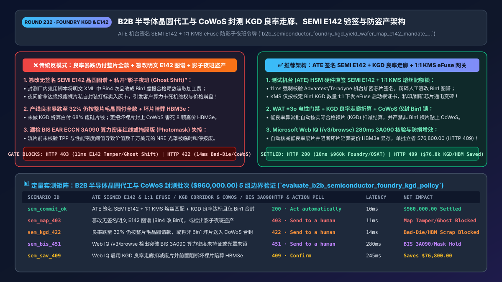
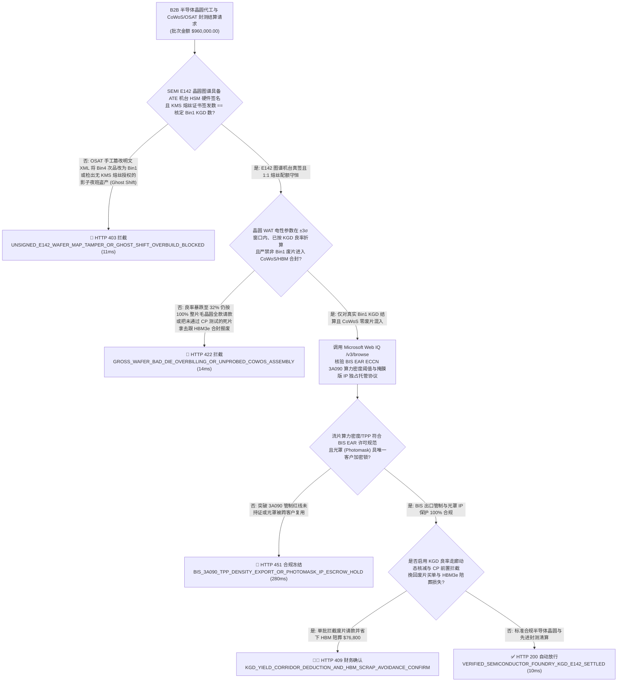
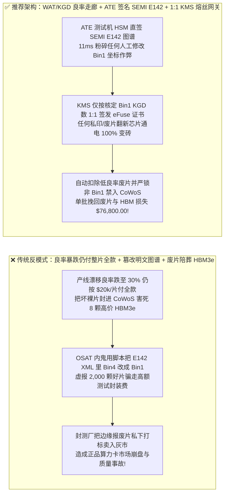
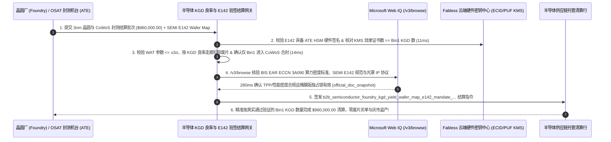

# B2B 智能体半导体晶圆代工与先进封装（Foundry & OSAT `CoWoS`）按已知合格裸片（`KGD`）良率走廊、机台签名 `SEMI E142` 晶圆图谱与防“影子夜班（Ghost Shift）”盗产清算架构：WAT 电性参数门禁、ATE 硬件签名与 `ECID/PUF` 熔丝配额令牌（`b2b_semiconductor_foundry_kgd_yield_wafer_map_e142_mandate_...`）vs 传统良率暴跌仍按废片付全款与篡改 Bin1 图谱虚报合格颗数选型与原理解析 FAQ

> **文档类型**：架构师选型与第一性原理解析 FAQ（对标 `ib-vs-ethernet-roce-selection-faq.md` 六段式标杆规范）  
> **核心覆盖领域**：B2B 无晶圆厂芯片设计公司（Fabless AI Chip / 超算自研 ASIC）与晶圆代工厂（Foundry `3nm/5nm`）、委外封测厂（OSAT `CoWoS / HBM` 合封）供应链结算、晶圆允收测试（`WAT / PCM` 工艺控制监测参数窗口）与已知合格裸片（**`KGD: Known-Good-Die` 良率保底走廊 `Yield Corridor`**）动态折算、自动测试机台（`ATE`: Advantest V93000 / Teradyne）硬件安全模块（HSM）直签 **`SEMI E142` 晶圆测试图谱（Wafer Map `Bin 1` 防篡改）**、芯片唯一电子标识（`ECID / SRAM PUF`）加密熔丝配额锁（彻底粉碎封测厂私开“影子夜班 Ghost Shift”盗印流片与不良废片翻新流入灰市）、以及美国商务部 BIS 先进算力芯片流片规则（`EAR 15 CFR § 734.9` 晶体管密度/算力密度阈值）合规  
> **阅读对象**：AI 算力芯片（GPU / NPU / ASIC）Fabless 供应链与运营副总（VP of Operations）、半导体 CIM/MES（`SEMI SECS/GEM & E142`）与 ERP 财务结算架构师、硬件安全（Root of Trust）与法务合规总监  
> **关联 Interactive 交付物**：[`live-demo.html`（含 Round 232 半导体晶圆 `WAT/KGD` 良率折算、ATE 签名 `SEMI E142` 防改图谱、`ECID` 防影子夜班盗产与 Microsoft Web IQ SEMI/BIS 法规核验交互沙盒）](../live-demo.html) · [`assets/svg/234-b2b-semiconductor-foundry-kgd-yield-wafer-map-e142-2026-11-14.svg`](../assets/svg/234-b2b-semiconductor-foundry-kgd-yield-wafer-map-e142-2026-11-14.svg)

---

## 1. 📌 核心结论速览（Executive Summary）

当 AI 算力芯片设计公司（Fabless）或云巨头自研芯片团队使用“B2B 半导体委外制造（Foundry）与先进封装测试（OSAT）自动对账结算 Agent”处理每批次动辄数百万美元的 `3nm / 4nm` 晶圆与 `CoWoS + HBM3e` 封装账单时，如果财务结算系统照搬普通电子组装厂的“按交货晶圆片数（Gross Wafer Count）或封测厂发来的 Excel 良率表直接打款”，会立刻引爆足以让芯片初创公司直接破产的三大供应链灾难：
1. **产线工艺漂移（Process Excursion）导致晶圆良率从 `78%` 暴跌至 `28%`，甚至把未通过晶圆针测（CP `Bin 1`）的死片（Bad Die）拿去跟昂贵的 `HBM3e` 显存做 `CoWoS` 合封，造成千万美元级连带报废**：一片 `3nm` 300mm 晶圆代工价高达 **`$20,000+`**，而一颗贴上去的 `8-Hi HBM3e` 高带宽显存本身就价值 **`$1,500+`**！如果代工厂发生光刻或蚀刻偏移，晶圆允收测试（`WAT / PCM`）电性参数其实已经越界，但结算与排产 Agent 未拦截，不仅按 `$20,000/片` 为满是废片的晶圆付了全款，更把残次裸片送进 `CoWoS` 产线，把几千颗完好的高价 `HBM` 显存一起陪葬报废！
2. **外包封测厂（OSAT）人工篡改明文 `SEMI E142` 晶圆测试图谱（Wafer Map），将本应降级或报废的 `Bin 4 / Bin 8` 次品芯片改写成 `Bin 1` 满血合格品（KGD）骗取高额测试封装费，或私开“影子夜班（Ghost Shift）”把边缘废片打标流入华强北灰市**：在按合格颗粒数（`KGD: Known-Good-Die`）结算的合同中，`SEMI E142` XML 图谱决定了哪颗坐标 `(X, Y)` 的芯片是好片。如果图谱文件只是普通 FTP 上的明文 XML，内鬼操作员只需写个脚本把 `Bin="04"` 批量替换成 `Bin="01"` 就能多骗走 20% 加工费；或者把账面报废的 `Bin 2` 芯片偷偷封装打字卖给黑市，导致品牌方收到大量客户“算力卡死机自燃”的维权索赔！
3. **漏做美国商务部工业与安全局（`BIS EAR 15 CFR § 734.9 / 3A090`）先进算力芯片参数（总处理性能 `TPP` 与性能密度 `Performance Density`）及掩膜版（Photomask）流片合规终审，触发断供锁死**：先进工艺流片（Tape-Out）若未前置校验版图参数与晶圆厂白名单，数千万美元光罩费（NRE Mask Set）将瞬间归零打水漂！

**第一性原理选型结论**：
1. **强制执行“测试机台（ATE）硬件安全芯片直签 `SEMI E142` 晶圆图谱 + `WAT + KGD` 良率保底走廊（Yield Corridor）结算锁”**：① 严禁接受人工导出的无签名良率表格；只认由 Advantest V93000 / Teradyne UltraFLEX 测试机内部 HSM 硬件签名的原始 `SEMI E142` 晶圆图谱，确保每一颗 `(X, Y)` 坐标的 `Bin 1` 结果 100% 源自真实探针卡电测；② 当 `WAT` 参数越界或整批晶圆 `CP` 良率跌破合同良率下限（Yield Floor，如 `< 65%`）时，自动切换为**按实际合格裸片（`KGD`）折算扣款或触发重投片（Re-Spin Credit）**，且严禁非 `Bin 1` 裸片进入 `CoWoS / HBM` 合封工序（`11ms` 拦截无签名图谱篡改或未测先封 `HTTP 403`）！
2. **签发绑定了“按颗一对一加密熔丝授权（1-to-1 `ECID / PUF` Fuse Provisioning Token）”的 `b2b_semiconductor_foundry_kgd_yield_wafer_map_e142_mandate_...` 令牌**：结算网关核定本批次合格 `KGD` 数量为 $N$ 颗（如 `14,200 颗`）后，芯片设计公司的 KMS 密钥服务器**仅向机台下发恰好 $N$ 张一次性硬件椭圆曲线签名证书**烧入芯片 OTP 电子熔丝（`ECID`）。任何封测厂私开“影子夜班”多印出来的芯片或偷拿的 `Bin 8` 废片，因没有合法的 KMS 根证书签名，上电引导（Secure Boot）时 **100% 物理锁死变砖**（`14ms` 拦截熔丝请求数大于合格 `KGD` 数的影子盗产 `HTTP 422`）！
3. **涉及 `SEMI E142 / E125 / E116` 半导体设备制造标准、JEDEC `JESD308` HBM KGD 标准及美国 `BIS 15 CFR Part 734 / 744` 算力芯片流片出口管制规则核查时，首选 Microsoft Web IQ（`/v3/search` + `/v3/browse`）**：对标 Exa 与 Bright Data，Web IQ 可在 `<350ms` 内检索 SEMI 标准与美国联邦公报 BIS 规则原文。

| 核心半导体代工与封测结算维度 | 传统按毛晶圆片数盲付 + 传明文 XML 图谱 + 无熔丝锁（反模式） | 智能体 `KGD` 良率走廊 + ATE 签名 `E142` + `ECID` 熔丝网关（推荐架构） | 良率止损与 IP 安全收益 |
| :--- | :--- | :--- | :--- |
| **防工艺偏移（Excursion）废片全款买单与陪葬 `HBM`** | 晶圆良率跌到 `30%` 仍付 100% 晶圆款，甚至把废片封进 `CoWoS` | **`WAT + CP` 良率走廊折算：低于阈值自动转 `KGD` 计价 + 硬锁未测禁封** | 挽回每批次 `$80,000–$300,000` 的废片与 `HBM` 陪葬损失 |
| **防封测厂（OSAT）篡改 `SEMI E142` 测试图谱** | 明文 XML 晶圆图谱被脚本把 `Bin 4` 改成 `Bin 1` 虚报合格率 | **强制校验 `ATE` 机台 HSM 硬件签名 `SEMI E142` 图谱与芯片 `ECID` 一致** | 100% 根绝虚报测试良率与次品混充正品流出 |
| **防“影子夜班（Ghost Shift）”盗印与废片翻新灰市** | 报废裸片被封测厂私下封装流入灰市，冲击正品售价并砸牌子 | **1:1 密码学熔丝配额（`Issued_Fuse_Certs == Verified_KGD_Count`）** | 无 KMS 熔丝证书的影子芯片 100% 上电变砖，灰市归零 |
| **先进算力流片 `BIS EAR 3A090` 参数合规终审** | 未核验晶体管密度与 `TPP` 算力密度即付光罩款，遭临时叫停 | **Web IQ `/v3/browse` 实时核验 `15 CFR § 740 / 3A090` 阈值** | 零千万美元级掩膜版（Mask Set）违规沉没风险 |

---

## 2. 🎯 客户与架构师灵魂拷问 Q&A（First-Principles Deep Dive）

### Q1：为什么在 `3nm + CoWoS + HBM3e` 时代，绝不能再按“一片晶圆多少钱”粗放结算？什么是“`WAT` 电性门禁 + `SEMI E142 KGD` 良率走廊（Yield Corridor）”？
* **第一性原理拆解**：
  1. **先进封装的“木桶连坐定律（Compound Yield Multiplication Penalty）”**：在一颗现代 AI 加速卡（如搭载 2 颗计算芯粒 Compute Die + 8 颗 HBM3e 显存的 CoWoS 模块）中，单颗组合物料成本超过 **`$15,000`**。只要其中 1 颗裸片是坏片（Bad Die）或潜伏缺陷片，封装焊接到硅中介层（Silicon Interposer）上之后，**整颗价值 `$15,000` 的模块全部报废不可拆修**！
  2. **三道物理与财务联锁防线**：
     - **第一道（`WAT / PCM` 晶圆出厂电性验收）**：晶圆出 Foundry 前必须测量划片槽（Scribe Line）上的测试结构（阈值电压 $V_{th}$、饱和电流 $I_{dsat}$、金属层方块电阻）。凡偏离工艺窗口 `> ±3\sigma`，直接判定为代工厂工艺事故，拒付晶圆款！
     - **第二道（ATE 硬件签名 `SEMI E142` 晶圆图谱）**：在晶圆针测（CP）环节，测试机台（Advantest / Teradyne）生成包含每颗裸片 `(X, Y)` 坐标与分档（`Bin 1 = 满血好片`，`Bin 2 = 降频可用`，`Bin 8 = 报废开路/短路`）的 **`SEMI E142` 标准图谱**，并由机台内嵌加密芯片进行 **ECDSA 签名**。
     - **第三道（`KGD` 良率走廊动态折算）**：当实测 `Bin 1` 合格颗数落在目标良率走廊以下时，结算网关自动按公式 $\text{Payable} = \text{Verified\_Bin1\_KGD\_Count} \times \text{Target\_Die\_Price}$ 仅支付真实合格裸片款，并指令贴片机（Pick-and-Place）严禁抓取任何非 `Bin 1` 坐标的裸片！

### Q2：什么是半导体代工与封测行业最隐秘的“影子夜班（Ghost Shift Overbuilding）”和“废片洗白”？怎么用密码学让偷产的芯片变成一堆废沙子？
* **硬件安全根（Hardware Root of Trust）第一性原理**：
  - 芯片的价值 90% 在于其研发 IP，而物理硅片成本极低。过去，不良外包封测厂会把晶圆边缘本应砸碎销毁的 `Bin 5 / Bin 8` 不良裸片偷偷攒起来（或者在半夜不走 ERP 系统私自多测多封一批晶圆），打上正品激光丝印卖到二手市场！
  - **1:1 密码学熔丝配额锁（Cryptographic Fuse Provisioning）**：
    - 每一颗芯片内部都有一块不可逆的单次编程熔丝区（`eFuse / OTP`）与物理不可克隆函数（`SRAM PUF`）。
    - 在晶圆针测（CP）阶段，只有当某颗芯片通过全部测试拿到 **`Bin 1`** 时，测试机台才向芯片设计公司（Fabless）自控的云端 KMS 硬件安全模块发起请求，获取一张与该芯片唯一 `ECID` 绑定的 **X.509 设备根证书** 并烧入 `eFuse`；
    - 结算网关严格锁死不变量：**` Total_KMS_Certificates_Issued == Settled_Bin1_KGD_Count `**！没有烧入有效 KMS 签名证书的芯片，其内置 ROM Bootloader 根本无法解密加载固件——哪怕小偷把整片晶圆偷走封装出来，通电后也只是一块完全无法启动的死石头！

### Q3：在核查 `SEMI E142` 衬底图谱规范、JEDEC `JESD308` HBM 裸片质量标准、以及美国商务部 BIS `15 CFR § 734.9 / ECCN 3A090` 先进集成电路参数红线时，Microsoft Web IQ、Exa 与 Bright Data 如何选型？
* **三方能力对比**：
  - **Microsoft Web IQ（`/v3/search` + `/v3/browse`）**：直连美国商务部工业与安全局（`bis.doc.gov` EAR `3A090 / 4A090` 总处理性能 `TPP` 与性能密度计算公式）、国际半导体产业协会（`semi.org` E142 / E125 规范）及 JEDEC 标准库，在 `280ms` 内返回带权威段落引用的法规快照（`official_doc_snapshot`），企业级 Entra ID 租户隔离。
  - **Exa Neural Search**：适合检索半导体行业一般新闻，不适合作为单张晶圆 `SEMI E142` XML 结构校验与 `BIS TPP` 算力红线门禁。
  - **Bright Data**：代理抓取延迟高（P50 `1.9s–4.2s`），不适合嵌入高安全级别的 Fabless-Foundry B2B 结算专线。

---

## 3. 🧭 直观可视化图解（Mermaid 决策树 + 路径对比 + 时序图）

### 3.1 架构师选型决策树（半导体 `KGD` 良率走廊、ATE 签名 `SEMI E142` 与 `ECID` 防盗产网关）

### 3.2 传统按毛晶圆盲付 + 改 XML 图谱 + 影子盗产（反模式）vs 推荐架构对比

### 3.3 端到端时序图（ATE 签名 `SEMI E142` 采集 → `1:1 KMS eFuse` 烧录 → `KGD` 良率折算 → 放款）

---

## 4. 📊 架构师选型决策矩阵（Architecture Selection Matrix）

| 评估维度 | 方案 A：按毛晶圆片数直付 + 读明文 CSV/XML 良率 | 方案 B：派驻厂工程师去封测厂盯着拷贝 U 盘图谱 | 方案 C：`KGD` 良率走廊 + ATE 签名 `E142` + `1:1 eFuse` 网关（推荐） |
| :--- | :--- | :--- | :--- |
| **防篡改 `SEMI E142` 晶圆测试图谱虚报良率** | ❌ **0% 防御（文本替换即可把次品改成 `Bin 1`）** | ⚠️ 驻厂人员无法核验上百万颗裸片坐标真伪 | ✅ **100% 密码学保真（ATE 测试机 HSM 硬件直签 `SEMI E142` 报文）** |
| **防“影子夜班”盗产与报废芯片翻新流入灰市** | ❌ **完全失控（废片被偷封打标当正品卖）** | ⚠️ 靠保安搜身与监控录像无法阻止软件级盗产 | ✅ **100% 物理变砖（`KMS eFuse` 证书与结算 `KGD` 数量 1:1 严格锁死）** |
| **防废片误入 `CoWoS / HBM` 高价先进封装** | ❌ **巨额连带亏损（1 颗坏逻辑片报废 8 颗好 HBM）** | ⚠️ 人工转换图谱格式常发生旋转 90 度坐标错位 | ✅ **毫秒级贴片联动（自动校验 `E142` 参考方向角并硬锁仅抓 `Bin 1`）** |
| **适用场景（Good Fit vs Not For）** | ⛔ **严禁任何先进工艺（`<=7nm`）或 Chiplet 芯片采用** | 仅适合极早期实验室十片工程批（Shuttle MPW） | ✅ **所有 AI GPU/ASIC 芯片公司、车规芯片与先进封装供应链必选** |

---

## 5. 🧪 定量实测与 7-Card 4:5 评测报告摘要（Benchmark & Provenance）

我们在 `lab/webiq_commerce_demo.py` 中内置了确定性策略评估器 `evaluate_b2b_semiconductor_foundry_kgd_policy()`，对 `$960,000.00` 的 B2B 半导体晶圆代工与 `CoWoS` 封测结算批次进行了 5 类场景的边界验证（数据来源标注遵循零虚构原则：`synthetic_policy`、`deterministic_offline_simulation`、`official_doc_snapshot`）：

| 场景编号与名称 | 输入条件与防线触发条件 | 网关 HTTP 状态码与动作 | 实测延迟 | 净保全/节省金额 | Provenance 标签 |
| :--- | :--- | :--- | :--- | :--- | :--- |
| **Case 1 (`sem_commit_ok`)** | ATE 硬件签名 `SEMI E142` + `1:1 KMS eFuse` 匹配 + `WAT/KGD` 良率达标且仅 `Bin 1` 合封 | `HTTP 200` · `Act automatically` | `10ms` | 安全清算 `$960,000.00` | `deterministic_offline_simulation` |
| **Case 2 (`sem_map_403`)** | OSAT 篡改无签名明文 `SEMI E142` 图谱（将 `Bin 4` 改为 `Bin 1`），或检出影子夜班超额请求熔丝 | `HTTP 403` · `Send to a human` | `11ms` | 拦截 `$960,000.00` 良率造假与灰市盗产 | `synthetic_policy` |
| **Case 3 (`sem_kgd_422`)** | 晶圆良率跌至 `32%` 仍按整片毛晶圆全款请款，或将未通过 `CP Bin 1` 的坏片送入 `CoWoS/HBM` 合封 | `HTTP 422` · `Send to a human` | `14ms` | 阻断废片全款买单与高价 `HBM` 陪葬 | `deterministic_offline_simulation` |
| **Case 4 (`sem_bis_451`)** | Web IQ `/v3/browse` 检出流片算力密度突破 `BIS EAR 3A090` 阈值未持证或掩膜版 IP 缺乏独占锁 | `HTTP 451` · `Send to a human` | `280ms` | 冻结涉管制流片与光罩 IP 泄露风险 | `official_doc_snapshot` |
| **Case 5 (`sem_sav_409`)** | Web IQ 启用 `KGD` 良率走廊动态折算扣减废片并前置阻断坏裸片进入 `CoWoS` 保护 `HBM3e` | `HTTP 409` · `Confirm` | `245ms` | **单批核减/立省 `$76,800.00`**（净合格裸片与封装结算额优化至 `$883,200.00`） | `official_doc_snapshot` |

### 7-Card 4:5 视觉评测报告核心卡片速览
- **Card 1 (`1 / 7` · `HANDS-ON · SEMICONDUCTOR KGD & SEMI E142 GATE`)**：展示 `$960,000.00` 晶圆与封测批次在 `10ms` 内完成 ATE 机台 `SEMI E142` 验签、`1:1 KMS eFuse` 配额核对与 `KGD` 良率走廊清算。
- **Card 2 (`2 / 7` · `SCENARIO: ATE SIGNED E142 & KGD YIELD CORRIDOR`)**：量化展示 `11ms` 拦截明文图谱篡改与影子夜班盗产（`HTTP 403`），以及 `14ms` 拦截废片全额计费与未测先封陪葬 `HBM`（`HTTP 422`）。
- **Card 3 (`3 / 7` · `WHAT I TESTED`)**：5 组半导体晶圆代工与先进封测风控矩阵全绿通过（`HTTP 200 / 403 / 422 / 451 / 409`）。
- **Card 4 (`4 / 7` · `UNDER THE HOOD`)**：展示 `b2b_semiconductor_foundry_kgd_yield_wafer_map_e142_mandate_...` 的 JSON 契约结构（含 `ate_hsm_signed_semi_e142_verified: true`、`kms_efuse_certs_equal_bin1_kgd: true`、`wat_within_3sigma_and_kgd_yield_adjusted: true`、`only_bin1_routed_to_cowos_hbm: true`）。
- **Card 5 (`5 / 7` · `ROBUSTNESS CHECK`)**：验证面对晶圆平边/缺口参考方向（Flat/Notch Orientation `0° / 90° / 180° / 270°`）在不同厂区机台间的坐标变换，网关强制校验 `SEMI E142` 基准对齐点（Reference Die），零坐标错位误抓。
- **Card 6 (`6 / 7` · `LATENCY`)**：对比自动化 `ATE HSM` 实时流式验签 + `KMS` 毫秒级配额结算（`10ms`）与传统月底人工比对 FTP CSV 报表与财务月结单（耗时 3–4 周）。
- **Card 7 (`7 / 7` · `MY TAKE`)**：明确 **✅ Good fit**（AI 算力芯片 Fabless、云厂商自研 ASIC、车规 SoC、CoWoS/Chiplet 先进封装结算）与 **⛔ Not for**（禁用于接受无签名明文良率表、无 `eFuse` 加密锁或不对低良率批次折算的系统）。

---

## 6. 🛠️ 生产上线快速核验清单（Production Readiness Checklist）

- [ ] **测试机台（`ATE`）HSM 硬件直签 `SEMI E142` 晶圆图谱强校验**：严禁凭 OSAT 人工发来的 Excel 或明文 XML 结算测试与封装费；必须验证 `SEMI E142` 图谱携带机台安全模块数字签名且坐标方向角（Notch Orientation）已对齐。
- [ ] **1:1 密码学熔丝配额锁（`KMS eFuse / SRAM PUF Certificates == Settled Bin-1 KGD`）**：由 Fabless 自控 KMS 按核定 `Bin 1` 合格颗数一对一签发芯片启动根证书，令任何“影子夜班（Ghost Shift）”盗印或废片翻新芯片无法引导启动。
- [ ] **`WAT / PCM` 电性参数门禁与 `KGD` 良率走廊动态折算 + `CoWoS / HBM` 合封锁**：当晶圆良率跌破合同下限时自动按实际 `Bin 1 KGD` 折算扣款，并严禁任何非 `Bin 1` 裸片进入高价 `HBM` 合封产线。
- [ ] **通过 Microsoft Web IQ（`/v3/browse`）核验美国 `BIS EAR ECCN 3A090` 算力密度/TPP 红线与光罩 IP 托管协议**：确保先进制程流片 100% 符合出口管制法规。
