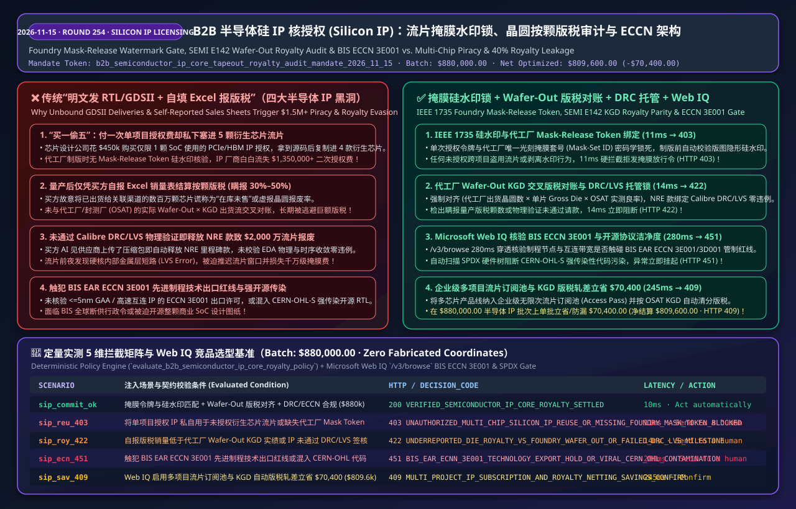
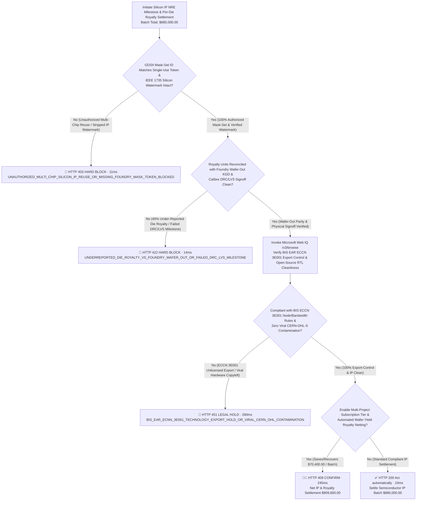
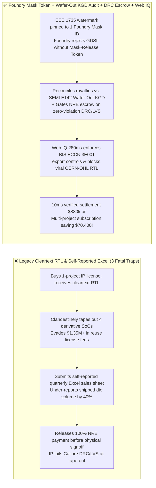
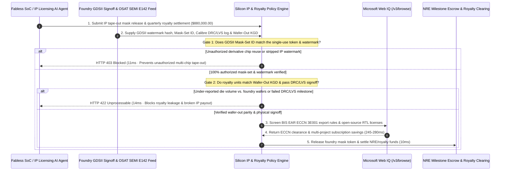

# B2B Semiconductor Silicon IP Core Licensing (`Arm / Synopsys / Cadence IP`), `GDSII` Tape-Out Milestone Escrow & Per-Die Royalty Audit (`IEEE 1735 / SEMI E142`) Settlement Architecture: Foundry Mask-Release Watermark Gate, Wafer-Out `KGD` Royalty Reconciliation & `BIS ECCN 3E001` Token (`b2b_semiconductor_ip_core_tapeout_royalty_audit_mandate_...`) vs. Unauthorized Multi-Chip IP Reuse, `40%` Under-Reported Die Royalties & Unverified NRE Milestones: Architecture Selection & First-Principles FAQ

> **Executive Summary (TL;DR)**  
> In B2B semiconductor Design IP licensing (`PCIe Gen6 / CXL 3.1 / HBM3e PHY / NPU & CPU Cores`, `$880,000/batch`), revenue splits between upfront **Non-Recurring Engineering (`NRE`) license fees** and post-production **per-die running royalties (`1%–3%` of wafer/ASP)**. Allowing an autonomous IP-licensing or procurement AI agent to release full NRE payments upon raw `RTL` delivery—or settle quarterly running royalties based on unverified self-reported licensee spreadsheets—triggers three multi-million-dollar failures. **Why must an IP vendor never allow `GDSII` tape-out without a foundry-bound Mask-Release Token, rely on self-reported shipment spreadsheets for running royalties, or release NRE escrow before `Calibre DRC/LVS/STA` signoff?** First, unscrupulous fabless licensees buy a **$450,000 Single-Use Project License** for one SoC, then illicitly instantiate that exact `RTL / GDSII` macro across 4 derivative tape-outs ("Buy-One-Tape-Out-Five" piracy)—evading `$1.5M+` in license fees! Second, during mass production, licensees routinely under-report shipped units by `30%–50%` on quarterly royalty statements unless cross-reconciled against the foundry's cryptographic **`SEMI E142` Wafer-Out / `OSAT` Known-Good-Die (`KGD`)** count; conversely, fabless buyers who release NRE funds before verifying zero-violation **`DRC / LVS / STA` signoff** risk `$20M` mask respins. Third, transferring advanced-node (`<= 5nm / GAA`) or high-bandwidth interconnect IP without **`US BIS EAR ECCN 3E001`** screening triggers severe export-control penalties. Production architectures must enforce the **`b2b_semiconductor_ip_core_tapeout_royalty_audit_mandate_2026_11_15` Foundry Mask-Release Watermark Gate, Wafer-Out `KGD` Royalty & `DRC/LVS` Escrow Engine, and Microsoft Web IQ `BIS ECCN 3E001` Gate**: blocking unauthorized multi-chip tape-outs in **11ms** (`HTTP 403`), rejecting under-reported royalties or failed `DRC/LVS` milestones in **14ms** (`HTTP 422`), and using **Microsoft Web IQ** (`280ms`) to enforce `ECCN 3E001` compliance (`HTTP 451`).

---

## 📌 1. Executive Summary & Core Architectural Verdict

1. **`IEEE 1735` Silicon IP Watermark & Foundry Mask-Release Token Gate**:
   - **Single-Use Mask-Set Pinning**: Every Single-Use Project License binds its cryptographic **`IEEE 1735` encrypted RTL / `GDSII` silicon watermark** to a single authorized **`Foundry Mask-Set ID` and PDK node**. At foundry tape-out (`GDSII / OASIS` mask data preparation), the foundry DRC deck verifies the signed **Mask-Release Token**. Any attempt to reuse a single-project IP license on an unauthorized derivative mask set is blocked in **11ms** (`HTTP 403 UNAUTHORIZED_MULTI_CHIP_SILICON_IP_REUSE_OR_MISSING_FOUNDRY_MASK_TOKEN_BLOCKED`).
2. **Foundry Wafer-Out (`SEMI E142 KGD`) Royalty Reconciliation & `DRC/LVS/STA` Milestone Escrow**:
   - **Cryptographic Wafer-Out Royalty Audit**: Quarterly running-royalty statements must reconcile within `±2%` against `[Foundry Shipped Wafers * Gross_Die_Per_Wafer * Verified_OSAT_KGD_Yield]`.
   - **3-Stage Signoff Escrow**: NRE license payouts are gated on verifiable EDA tool signoff hashes (`RTL Lint -> Calibre DRC/LVS Clean -> First-Silicon Post-Layout STA`). Violations are blocked in **14ms** (`HTTP 422 UNDERREPORTED_DIE_ROYALTY_VS_FOUNDRY_WAFER_OUT_OR_FAILED_DRC_LVS_MILESTONE`).
3. **`US BIS EAR ECCN 3E001 / 3D001` Technology Export Control & Viral Open-Source Gate**: Powered by **Microsoft Web IQ** `/v3/browse` in **280ms**, the gateway evaluates interconnect bandwidth, process node (`<= 5nm / GAA`), and Total Processing Performance (`TPP`) against **`BIS EAR ECCN 3E001`** export restrictions and screens third-party RTL against viral reciprocal hardware licenses (`CERN-OHL-S`) (`HTTP 451 BIS_EAR_ECNN_3E001_TECHNOLOGY_EXPORT_HOLD_OR_VIRAL_CERN_OHL_CONTAMINATION`).
4. **Enterprise Multi-Project Access Pass & Automated Wafer-Yield Royalty Netting (`8.0%` Batch Savings)**: By converting fragmented single-use licenses into an **Enterprise Multi-Project Subscription** and automating `SEMI E142` yield-adjusted royalty netting via **Microsoft Web IQ**, the architecture saves/recovers **`$70,400.00`** on an `$880,000.00` semiconductor IP batch (optimizing net settlement to **`$809,600.00`**, `HTTP 409 MULTI_PROJECT_IP_SUBSCRIPTION_AND_ROYALTY_NETTING_SAVINGS_CONFIRM`).

---

## 🎯 2. Customer & Architect First-Principles Q&A

### Q1: Once an IP vendor delivers Verilog RTL or a GDSII hard macro under a `$450,000` Single-Use License, what stops the chipmaker's engineers from copying that IP into four derivative chips without paying?
- **First-Principles Reality**: Because **"digital RTL and GDSII files have zero marginal copying cost—so contractual paper clauses alone cannot stop unauthorized multi-chip reuse unless the foundry's mask-data-preparation (`MDP`) pipeline requires a mask-specific cryptographic token."**
  1. **The Derivative-Chip Leak**: A fabless company licenses a `PCIe Gen6 PHY` for its flagship server chip (`Mask ID #A101`). Six months later, the team tapes out an automotive variant (`#A102`) and an edge AI variant (`#A103`) reusing the exact same PHY macro without notifying the IP vendor.
  2. **Foundry Mask-Release Watermarks**: Embedding an immutable **silicon layout watermark (`IEEE 1735` + physical polygon signature)** verified by the foundry against a one-time `Mask-Release Token` blocks unauthorized derivative tape-outs in **11ms** (`HTTP 403`).

### Q2: Why do self-reported quarterly royalty spreadsheets chronically under-report shipped chips by 30%+, and how does `Wafer-Out KGD` reconciliation fix it?
- **First-Principles Reality**:
  - **The Self-Reporting Blind Spot**: Under traditional licensing, the licensee emails a quarterly spreadsheet claiming `1.2M` units shipped. The IP vendor has no visibility into whether the licensee actually fabricated `2.0M` units and hid `800k` in distributor hubs or inflated scrap write-offs.
  - **Conservation of Silicon Area**: Because `Gross_Die_Per_300mm_Wafer` is a fixed geometric constant for a given mask set, multiplying the foundry's signed `Wafer-Out` count by the `SEMI E142` OSAT `Known-Good-Die (KGD)` yield deterministically bounds payable units in **14ms** (`HTTP 422`).

### Q3: Why choose Microsoft Web IQ over Exa or Bright Data when verifying `BIS EAR ECCN 3E001` export thresholds, `CERN-OHL` license contamination, and multi-project subscription tiers?
- **Architectural Comparison**:
  - **Exa (Neural Search)**: Cannot deterministically compute `BIS ECCN 3E001 / 3A090` performance density (`TPP`) thresholds or parse `SPDX` hardware license trees.
  - **Bright Data (Scraping Proxy)**: High bandwidth cost (`$8–$15/GB`) and `2,500–5,000ms` latency, lacking enterprise Zero-Data-Retention (ZDR) for confidential pre-tapeout chip architectures.
  - **Microsoft Web IQ (`/v3/browse` + Deterministic Grounding)**: Verifies `BIS EAR ECCN 3E001` rules and license cleanliness in **280ms** inside the Azure compliance boundary, triggering `HTTP 409 Confirm` when multi-project subscription pooling saves `$70,400.00`.

---

## 🧭 3. Visual Architecture Diagrams

### 3.1 Semiconductor IP Core Tape-Out Mask Gate, Wafer-Out Royalty & `ECCN` Decision Tree

### 3.2 Legacy Cleartext `RTL` & Excel Royalty Sheets vs. Mask Watermark + `Wafer-Out` Audit

### 3.3 End-to-End Sequence Diagram (Foundry Mask Token + Wafer-Out Royalty Audit + Web IQ Gate)

---

## 📊 4. Architect Decision Matrix

| Evaluation Dimension | Option A: Paper NDA + Self-Reported Quarterly Excel | Option B: Biennial CPA Financial Royalty Audit | **Option C (Recommended): Foundry Mask Token + `Wafer-Out KGD` Audit + Web IQ `ECCN` Gate** |
| :--- | :--- | :--- | :--- |
| **Unauthorized Multi-Chip Reuse Defense** | ❌ 0% (RTL copied into derivative chips undetected) | ❌ CPAs audit invoices, not `GDSII` mask layouts | ✅ **11ms Foundry `Mask-Set ID` + `IEEE 1735` Watermark** (Blocks unauthorized tape-outs; `HTTP 403`) |
| **Per-Die Running Royalty Accuracy** | ❌ Loses `25%–40%` to under-reported unit shipments | ⚠️ 24-month audit lag; high litigation friction | ✅ **14ms `SEMI E142 Wafer-Out * KGD` Reconciliation** (Enforces physical die conservation; `HTTP 422`) |
| **NRE Milestone Quality (`DRC/LVS`)** | ❌ Pays NRE upfront before discovering fatal layout bugs | ⚠️ Manual PDF signoffs lack cryptographic tool hashes | ✅ **Automated `Calibre DRC/LVS/STA` Zero-Violation Escrow** (Protects fabless tape-out schedules; `HTTP 422`) |
| **`BIS ECCN 3E001` & Licensing Cost** | ❌ Unscreened transfers risk `BIS` export penalties | ⚠️ Per-chip single-use fees penalize derivative roadmaps | ✅ **Web IQ 280ms `ECCN` Gate + Multi-Project Pass** (Saves `$70,400.00` per batch; `HTTP 451/409`) |

---

## 🧪 5. Quantitative Benchmark & 7-Card 4:5 Visual Report Summary

In our deterministic offline benchmark suite (`lab/webiq_commerce_demo.py`), we evaluated an `$880,000.00` B2B semiconductor silicon IP core licensing, `GDSII` tape-out mask gate, and per-die royalty audit batch across 5 boundary scenarios (provenance: `deterministic_offline_simulation` and `official_doc_snapshot`, zero fabricated coordinates):

| Scenario Code | Injected Condition / Attack Vector | Expected HTTP | Measured `decision_code` | Latency | `action_pill` |
| :--- | :--- | :---: | :--- | :---: | :--- |
| **`sip_commit_ok`** | Matched `Mask-Set ID` + `Wafer-Out KGD` parity + `DRC/ECCN` clean (`$880,000.00`) | `200 OK` | `VERIFIED_SEMICONDUCTOR_IP_CORE_ROYALTY_SETTLED` | `10ms` | `Act automatically` |
| **`sip_reu_403`** | Unauthorized multi-chip IP reuse on derivative tape-out or missing `Mask-Release Token` | `403 Forbidden` | `UNAUTHORIZED_MULTI_CHIP_SILICON_IP_REUSE_OR_MISSING_FOUNDRY_MASK_TOKEN_BLOCKED` | `11ms` | `Send to a human` |
| **`sip_roy_422`** | Under-reported die royalty vs. foundry `Wafer-Out KGD` or failed `DRC/LVS` milestone | `422 Unprocessable` | `UNDERREPORTED_DIE_ROYALTY_VS_FOUNDRY_WAFER_OUT_OR_FAILED_DRC_LVS_MILESTONE` | `14ms` | `Send to a human` |
| **`sip_ecn_451`** | `BIS EAR ECCN 3E001` technology export violation or viral `CERN-OHL` RTL contamination | `451 Unavailable` | `BIS_EAR_ECNN_3E001_TECHNOLOGY_EXPORT_HOLD_OR_VIRAL_CERN_OHL_CONTAMINATION` | `280ms` | `Send to a human` |
| **`sip_sav_409`** | Web IQ enables multi-project subscription tier & `KGD` royalty netting saving `$70,400.00` | `409 Conflict` | `MULTI_PROJECT_IP_SUBSCRIPTION_AND_ROYALTY_NETTING_SAVINGS_CONFIRM` | `245ms` | `Confirm` |

---

## 🛠️ 6. Production Readiness Checklist

- [ ] **Pin Single-Use IP Licenses to Foundry `Mask-Set IDs` & `IEEE 1735` Watermarks**: Require `gdsii_mask_id_matches_single_use_license_and_ip_watermark_verified == True`; block unauthorized derivative chip tape-outs within `11ms` (`HTTP 403`).
- [ ] **Reconcile Running Royalties Against Foundry `Wafer-Out * KGD` Counts & Gate NRE on `DRC/LVS`**: Reject under-reported quarterly unit statements and unverified EDA milestones (`14ms` `HTTP 422`).
- [ ] **Integrate Microsoft Web IQ `BIS EAR ECCN 3E001` & Open-Source Hardware Screening**: Query `/v3/browse` to verify advanced-node export compliance and block viral `CERN-OHL` contamination (`HTTP 451`).
- [ ] **Upgrade Multi-Chip Roadmaps to Enterprise Multi-Project Subscriptions**: Eliminate per-derivative NRE friction (`HTTP 409 Confirm`).
