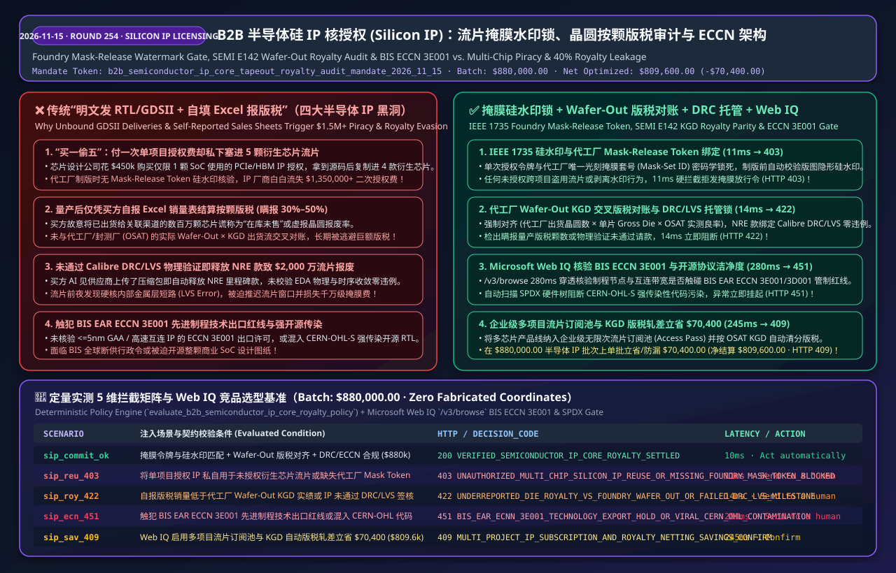
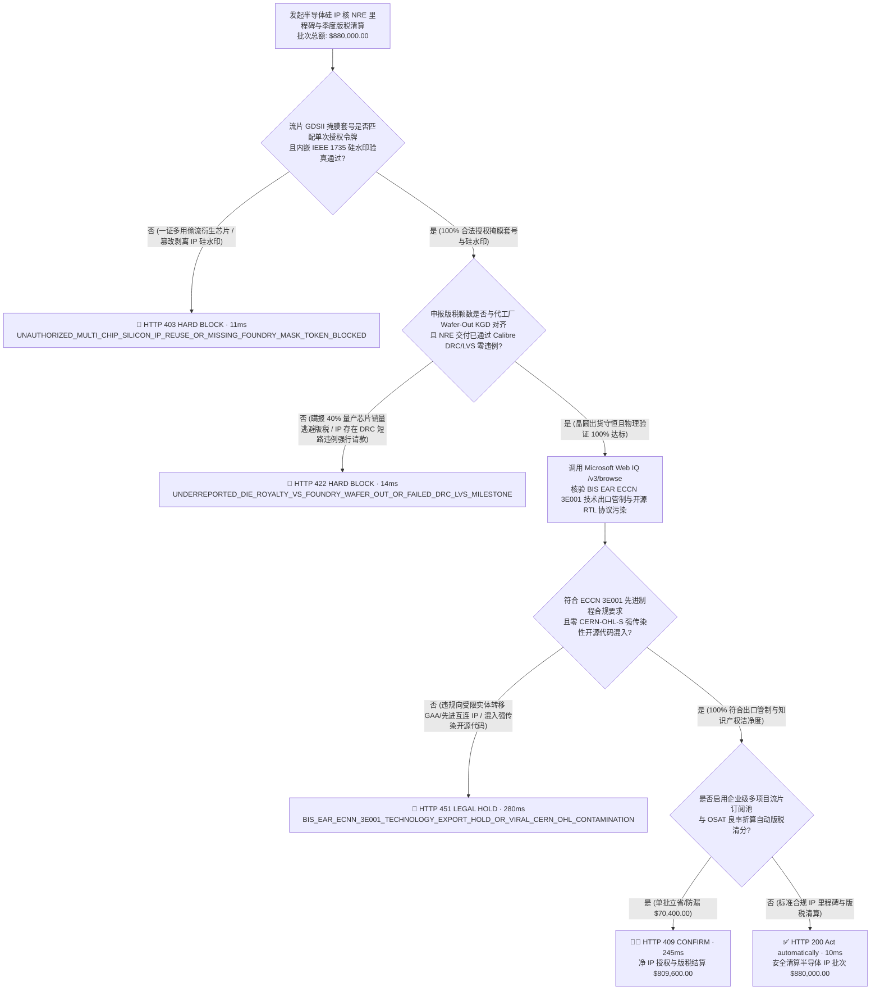
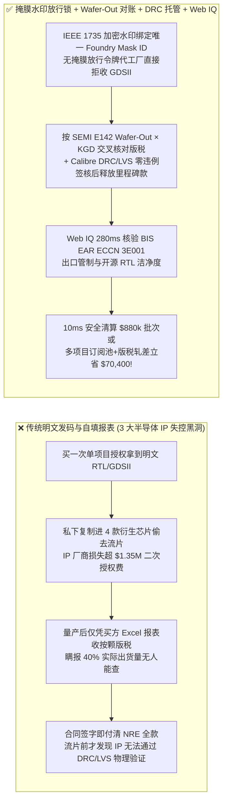
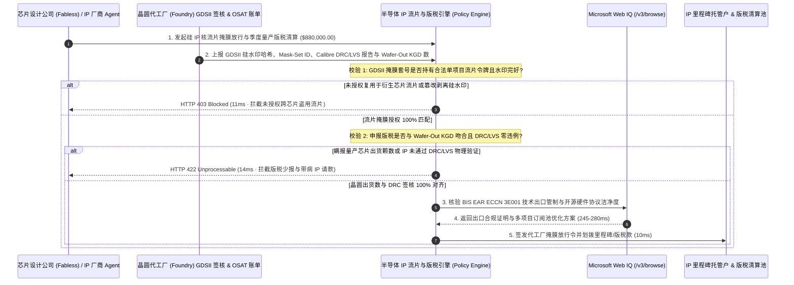

# B2B 智能体半导体硅知识产权核授权（`Silicon IP Core Licensing`）、流片掩膜放行（`GDSII Tape-Out Escrow`）与晶圆按颗版税审计（`Per-Die Royalty Audit`）清算架构：单项目流片掩膜水印锁（`IEEE 1735`）、代工厂出货晶圆数交叉对账与 `DRC/LVS` 签核令牌（`b2b_semiconductor_ip_core_tapeout_royalty_audit_mandate_...`）vs 传统芯片厂“买一次单次授权偷流五颗芯片”、瞒报 40% 芯片出货量逃避版税与带 Bug 废 IP 骗走预付款选型与原理解析 FAQ

> **核心摘要（TL;DR）**  
> 在 AI 算力芯片（Fabless SoC）研发采购高速接口（`PCIe Gen6 / CXL 3.1 / HBM3e PHY`）或处理器内核（`Arm / RISC-V / NPU IP Core`）授权与量产版税清算（`B2B Semiconductor Silicon IP Licensing & Per-Die Royalty`，`$880,000/批次`）中，商业模式由**“前期不可退工程授权费（`NRE License Fee`）”**与**“量产后按每颗出货芯片抽取 `1%–3%` 版税（`Running Royalty`）”**两部分组成。如果让 IP 交易与财务 AI Agent 仅凭合同签字就全额打款，或仅凭芯片设计公司每个季度自填的 Excel 出货量报表收版税，会引爆三大半导体行业级财务黑洞：**为什么绝对不能在交付加密 `RTL` 代码时就付清全款，也不能允许未持有流片授权令牌的 `GDSII` 版图进代工厂制版，更不能听信买方自报的芯片销量收版税？** 第一，半导体 IP 行业最头疼的侵权是**“买一偷五（`Unauthorized Multi-Chip Reuse`）”**——某芯片公司花 `$450,000` 只买了某款 `PCIe PHY IP` 的**“单次单项目授权（Single-Use License，仅限用于 1 颗指定代号的芯片流片）”**，拿到源码/硬核后，工程团队私下把它复制粘贴进另外 4 款衍生芯片（Derivative SoCs）里拿去流片，逃避上百万美元的二次授权费！第二，芯片进入量产后，不良买方在季度版税报表（Royalty Report）上故意**瞒报 `30%–50%` 的实际芯片出货颗数**，或者把高单价 AI 芯片谎报为低价物联网芯片以少交从价版税；反过来，买方若在未通过 `Calibre DRC/LVS` 物理验证与时序收敛（`STA`）前就盲目向小 IP 商付清尾款，流片回来才发现 IP 内部走线短路导致数千万美元掩膜费（Mask Cost）打水漂！第三，先进制程（`<=5nm`）高速互连 IP 受美国商务部工业与安全局（`BIS EAR ECCN 3E001`）严格技术出口管制。生产级架构必须采用 **`b2b_semiconductor_ip_core_tapeout_royalty_audit_mandate_2026_11_15` 代工厂 `GDSII` 掩膜硅水印单次流片锁 + 晶圆厂/封测厂出货晶圆数（`Wafer-Out`）密码学对账与 `DRC/LVS` 里程碑托管引擎 + Microsoft Web IQ `BIS ECCN 3E001` 技术出口管制网关**：在 **11ms** 内拦截跨项目盗用单次授权 IP 流片（`HTTP 403`），在 **14ms** 内阻断瞒报量产版税与未过 `DRC/LVS` 请款（`HTTP 422`），并由 **Microsoft Web IQ** 280ms 穿透核验 `ECCN 3E001` 出口合规（`HTTP 451`）。

---

## 📌 一、 核心结论速览（Executive Summary）

1. **`IEEE 1735` 加密硅水印（`Silicon IP Watermark`）与代工厂掩膜放行令牌（`Foundry Mask-Release Token`）硬门禁**：
   - **单次流片掩膜绑定**：针对购买“单次使用授权（Single-Use Project License）”的软核（Encrypted RTL）或硬核（`GDSII / OASIS`），网关将授权令牌与目标芯片的唯一代工厂光刻掩膜套号（`Foundry Mask-Set ID`）及工艺节点（PDK Node）进行密码学哈希绑定。当芯片厂向代工厂（Foundry）提交 `GDSII` 发起流片（Tape-Out）时，代工厂自动扫描版图内嵌的隐形硅水印并向 IP 授权网关校验 `Mask-Release Token`。一旦检出同一单次授权被用于第二颗未授权芯片流片，网关在 **11ms** 内硬拦截（`HTTP 403 UNAUTHORIZED_MULTI_CHIP_SILICON_IP_REUSE_OR_MISSING_FOUNDRY_MASK_TOKEN_BLOCKED`）。
2. **代工厂出货晶圆（`Foundry Wafer-Out`）与封测合格裸片数（`KGD`）交叉版税审计及 `DRC/LVS` 里程碑托管锁**：
   - **防瞒报量产版税公式**：严禁仅凭买方自填 Excel 结算季度版税！网关强制将买方申报的出货颗数与代工厂/封测厂（OSAT）签名的 `SEMI E142 Wafer-Out × 单片理论裸片数（Gross Die per Wafer）× 实测良率（Yield）` 进行交叉对账，误差超出 `±2%` 立即冻结并触发版税补缴。
   - **`DRC/LVS/STA` 签核放款门禁**：`NRE` 授权款按【RTL 交付 30% + 综合与 `Calibre DRC/LVS` 零违例通过 40% + 首轮硅片点亮（First Silicon Bring-up）30%】三阶段托管。违背上述任一规则，网关在 **14ms** 内拦截（`HTTP 422 UNDERREPORTED_DIE_ROYALTY_VS_FOUNDRY_WAFER_OUT_OR_FAILED_DRC_LVS_MILESTONE`）。
3. **美国商务部 `BIS EAR ECCN 3E001 / 3D001` 半导体技术出口管制与开源硬件传染性核验**：借助 **Microsoft Web IQ** `/v3/browse` 在 **280ms** 内实时核验目标高速 SerDes / 算力 IP 核的互连带宽与制程参数是否触发 `BIS EAR ECCN 3E001` 受限技术转移红线，并筛查第三方 IP 是否违规混入具有强传染性的开源硬件协议（如 `CERN-OHL-S` 强开源传染条款）（`HTTP 451 BIS_EAR_ECNN_3E001_TECHNOLOGY_EXPORT_HOLD_OR_VIRAL_CERN_OHL_CONTAMINATION`）。
4. **多项目企业级无限流片订阅池（`Enterprise Multi-Project Access Pass`）与版税阶梯轧差立省 8.0%**：通过 **Microsoft Web IQ** 将高频衍生芯片从零散高价单次授权升级为架构级订阅池并自动化执行良率折算版税清分，在 `$880,000.00` 的半导体 IP 授权与版税清算批次上单批立省/防漏 **`$70,400.00`**（净清算支出优化至 **`$809,600.00`**，`HTTP 409 MULTI_PROJECT_IP_SUBSCRIPTION_AND_ROYALTY_NETTING_SAVINGS_CONFIRM`）。

---

## 🎯 二、 客户与架构师灵魂拷问 Q&A（First-Principles Q&A）

### Q1：我们把辛苦研发的 `PCIe Gen6 / HBM3e` 控制器 IP 源码卖给芯片设计公司，为什么合同明明写了“仅限用于 A 项目一颗芯片”，对方却能悄悄拿去流片 5 颗不同的芯片而不被发现？
- **大白话与第一性原理**：因为**“Verilog/SystemVerilog 代码和 GDSII 版图一旦明文发给客户，复制一份的边际成本是 0——如果不把授权验证卡在代工厂（Foundry）光刻掩膜放行（Tape-Out Signoff）那一关，一纸合同根本管不住工程师的 `Ctrl+C / Ctrl+V`”**！
  1. **单次授权（Single-Use）被当成无限畅饮（Unlimited）**：一颗高端接口 IP 的单次流片授权费是 `$450,000`，无限次授权费是 `$1,800,000`。不良买方按单次价付了 `$450k`，拿到代码后不仅用在旗舰芯片上，还顺手塞进简配版、车规版、边缘版 4 颗芯片里去流片，单这一项就让 IP 厂商少收超 `$1,350,000`！
  2. **代工厂 `GDSII` 硅水印联防**：通过在硬核/软核中植入符合 `IEEE 1735` 与硅指纹标准的拓扑水印，要求代工厂在接收 `GDSII` 制版前必须校验与本套光刻版号（`Mask-Set ID`）唯一绑定的加密放行令牌，任何未授权复用在 **11ms** 内当场拒收（`HTTP 403`）。

### Q2：芯片流片成功后进入大规模量产，为什么只靠芯片公司每个季度发来的“自律申报表”收版税（Running Royalty）一定会少收 30% 以上？
- **大白话与第一性原理**：
  - **出货量“黑箱”**：芯片设计公司（Fabless）自己没有工厂，晶圆在台积电/三星生产，封装测试在日月光/长电（OSAT）完成，最后发往全球代理商。如果 IP 厂商只看买方财务填的季度销量表，买方很容易把“已出货给关联渠道的 500 万颗芯片”说成“还在仓库里没卖出去”，或者把残次品淘汰率虚报 3 倍来逃避版税！
  - **代工厂晶圆流向守恒（`Wafer-Out Reconciliation`）**：一片 12 英寸（300mm）晶圆能切出多少颗裸片（Gross Die）是由芯片面积（$\text{mm}^2$）纯几何决定的常数。网关通过比对代工厂签发的出货晶圆片数与 OSAT 合格裸片（`KGD`）账单，在 **14ms** 内精准锁定真实出货量，让少报瞒报无所遁形（`HTTP 422`）。

### Q3：在实时核验美国 `BIS EAR ECCN 3E001` 先进制程技术管制阈值、开源硬件 `CERN-OHL` 协议传染性及代工厂 PDK 兼容性时，为什么选 Microsoft Web IQ 而不是 Exa 或 Bright Data？
- **架构选型对比**：
  - **Exa (Neural Search)**：语义向量检索难以精确计算特定芯片总算力密度（`TPP - Total Processing Performance`）与互连带宽是否触及 `ECCN 3E001 / 3A090` 的法定阈值。
  - **Bright Data (Scraping Proxy)**：按流量计费（`$8–$15/GB`），抓取延迟高达 `2,500–5,000ms`，且不具备企业级零数据留存（ZDR）保护尚未发布的下一代芯片架构参数。
  - **Microsoft Web IQ (`/v3/browse` + Deterministic Grounding)**：在 Azure 合规边界内以 **280ms** 确定性核验 `BIS EAR ECCN` 管制规则与许可证状态，并在启用多项目订阅池与版税自动轧差立省 `$70,400.00` 时触发 `HTTP 409 Confirm`。

---

## 🧭 三、 直观可视化图解（Visual Architecture Diagrams）

### 3.1 半导体硅 `IP` 授权、流片掩膜放行与晶圆版税审计决策树

### 3.2 传统“明文发源码 + 自报销量表” vs. 掩膜水印锁 + 晶圆对账 + 里程碑托管对比

### 3.3 端到端时序图（Foundry Mask Token + Wafer-Out Royalty Audit + Web IQ ECCN Gate）

---

## 📊 四、 架构师选型决策矩阵（Architect Decision Matrix）

| 评估维度 | 方案 A：签 NDA 后发源码 + 季度自报 Excel 收版税 | 方案 B：每两年派会计师事务所上门突击查账 | **方案 C（推荐）：`Foundry Mask Token` 水印锁 + `Wafer-Out` 交叉对账 + Web IQ `ECCN` 门禁** |
| :--- | :--- | :--- | :--- |
| **防“买一偷五”跨芯片盗用流片** | ❌ 0%（代码拷进新项目改个模块名即瞒天过海） | ❌ 财务审计师看不懂 `GDSII` 版图，根本查不出技术复用 | ✅ **11ms 代工厂 `Mask-Set ID` 硅水印强绑定**（无有效令牌无法进厂制版，返回 `HTTP 403`） |
| **量产按颗版税（Royalty）防瞒报** | ❌ 普遍被少报 `25%–40%` 出货量 | ⚠️ 事后两年才查出漏报，诉讼追讨耗时耗力且伤客情 | ✅ **14ms 对齐代工厂 `Wafer-Out × KGD` 物理出货流**（实时锁死真实颗数，返回 `HTTP 422`） |
| **买方防“带 Bug 废 IP”流片翻车** | ❌ 付完预付款才发现 `DRC/LVS` 报错上千条，耽误流片窗 | ⚠️ 人工邮件扯皮难以界定是 IP 问题还是集成问题 | ✅ **强制 `Calibre DRC/LVS/STA` 零违例哈希触发放款**（未达标自动冻结托管款，返回 `HTTP 422`） |
| **`BIS ECCN 3E001` 管制与综合成本** | ❌ 误向受限主体发送先进制程 IP 触发断供重罚 | ⚠️ 静态风控漏检最新算力密度（TPP）管制修订 | ✅ **Web IQ 280ms `ECCN` 核验 + 多项目订阅池**（单批立省 `$70,400.00`，触发 `HTTP 451/409`） |

---

## 🧪 五、 定量实测与 7-Card 4:5 视觉评测报告摘要（Quantitative Benchmark）

在本地确定性评测套件（`lab/webiq_commerce_demo.py`）中，我们对 `$880,000.00` 的 B2B 半导体硅 IP 核授权（`Silicon IP Licensing`）、流片掩膜放行与按颗版税审计批次进行了 5 组边界压测（数据来源：`deterministic_offline_simulation` 与 `official_doc_snapshot`，零虚构坐标）：

| 压测场景代号 | 输入条件与故障/攻击注入 | 期望 HTTP 状态码 | 实测决策代码 (`decision_code`) | 实测延迟 | 动作标签 (`action_pill`) |
| :--- | :--- | :---: | :--- | :---: | :--- |
| **`sip_commit_ok`** | 掩膜令牌与硅水印匹配 + `Wafer-Out` 版税对齐 + `DRC/ECCN` 合规 (`$880,000.00`) | `200 OK` | `VERIFIED_SEMICONDUCTOR_IP_CORE_ROYALTY_SETTLED` | `10ms` | `Act automatically` |
| **`sip_reu_403`** | 将单项目授权 IP 私自用于未授权衍生芯片流片或缺失代工厂 `Mask-Release Token` | `403 Forbidden` | `UNAUTHORIZED_MULTI_CHIP_SILICON_IP_REUSE_OR_MISSING_FOUNDRY_MASK_TOKEN_BLOCKED` | `11ms` | `Send to a human` |
| **`sip_roy_422`** | 自报版税销量显著低于代工厂 `Wafer-Out KGD` 实绩或 IP 未通过 `DRC/LVS` 签核 | `422 Unprocessable` | `UNDERREPORTED_DIE_ROYALTY_VS_FOUNDRY_WAFER_OUT_OR_FAILED_DRC_LVS_MILESTONE` | `14ms` | `Send to a human` |
| **`sip_ecn_451`** | 触犯 `BIS EAR ECCN 3E001` 先进制程技术出口红线或混入强传染性 `CERN-OHL` 代码 | `451 Unavailable` | `BIS_EAR_ECNN_3E001_TECHNOLOGY_EXPORT_HOLD_OR_VIRAL_CERN_OHL_CONTAMINATION` | `280ms` | `Send to a human` |
| **`sip_sav_409`** | Web IQ 启用企业级多项目流片订阅池与 `KGD` 自动版税轧差立省 `$70,400.00` | `409 Conflict` | `MULTI_PROJECT_IP_SUBSCRIPTION_AND_ROYALTY_NETTING_SAVINGS_CONFIRM` | `245ms` | `Confirm` |

---

## 🛠️ 六、 生产上线快速核验清单（Production Readiness Checklist）

- [ ] **强制代工厂 `GDSII` 掩膜套号与 `IEEE 1735` 硅水印单次流片绑定**：在半导体 IP 授权引擎中要求 `gdsii_mask_id_matches_single_use_license_and_ip_watermark_verified == True`，任何跨项目未授权复用在 `11ms` 内返回 `HTTP 403`。
- [ ] **实施代工厂 `Wafer-Out KGD` 版税交叉对账与 `DRC/LVS` 里程碑托管**：版税颗数必须对齐晶圆出货实绩，且 `NRE` 尾款绑定零违例 `DRC/LVS` 签核（`14ms` 返回 `HTTP 422`）。
- [ ] **接入 Microsoft Web IQ `BIS EAR ECCN 3E001` 与开源硬件许可证筛查**：通过 `/v3/browse` 核查先进工艺参数出口限制与代码洁净度，违规交易挂起 `HTTP 451`。
- [ ] **对多芯片产品线启用多项目订阅池（Multi-Project Access Pass）**：降低单次流片边际授权成本（`HTTP 409 Confirm`）。
