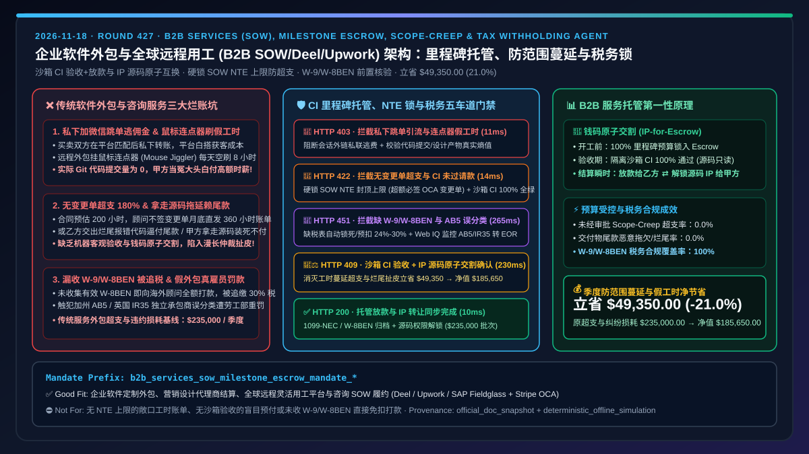
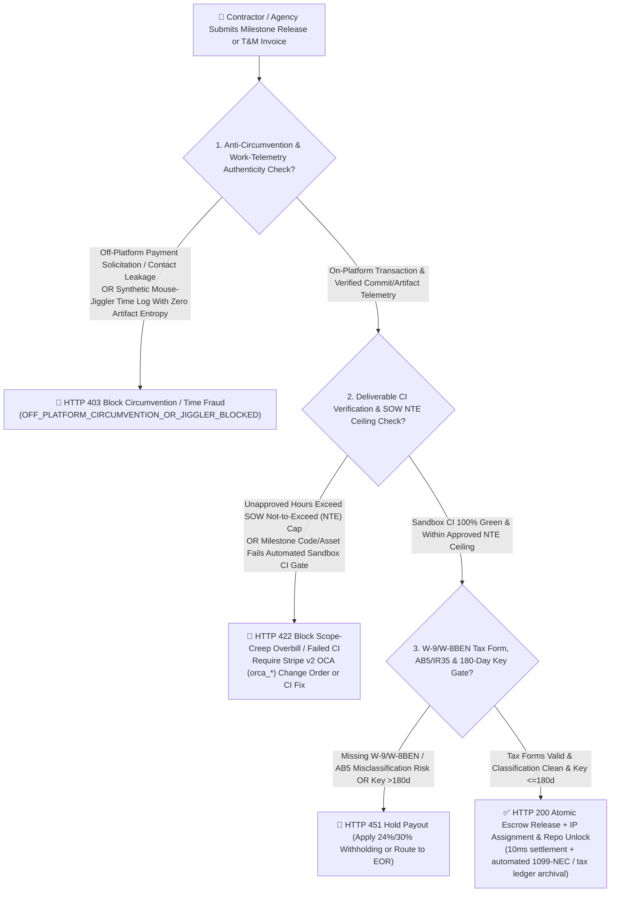
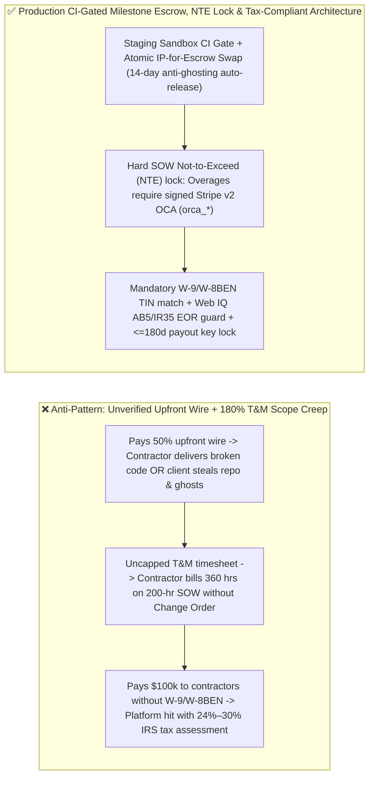

# Enterprise B2B Services (`SOW`), Milestone Escrow, Scope-Creep Guard & Global Contractor Tax (`W-9 / W-8BEN / AB5`) Agent Architecture FAQ: CI-Gated Escrow, Atomic IP Swap & Stripe v2 OCA Change Orders

> **Topic Positioning (Enterprise Services Procurement `SOW`, Freelance & Global Talent Platforms `Upwork / Toptal / Deel / SAP Fieldglass`, Milestone Escrow & Tax Withholding Focus · Round 427)**: Written for **Cloud & AI Solution Architects** building Vendor Management Systems (`VMS`), global contractor marketplaces, and Statement-of-Work (`SOW`) escrow agents. This guide solves four critical services-commerce failures: **how to protect both buyers (from paying for broken code) and contractors (from clients stealing deliverables and ghosting on final payment) via an Atomic IP-for-Escrow Swap gated by automated sandbox CI verification (`HTTP 422`), how to stop Time-and-Materials (`T&M`) "Scope-Creep Overbilling" via hard Not-to-Exceed (`NTE`) caps and `Stripe v2 OCA (orca_*)` Change Orders (`HTTP 422`), how to block off-platform fee circumvention and synthetic mouse-jiggler time fraud (`HTTP 403`), and how to enforce pre-payout `W-9 / W-8BEN` tax withholding (`24% / 30%`) and `AB5 / IR35` worker-misclassification guardrails (`HTTP 451`)**.  
> **Style Benchmark**: Strictly follows the six-section structure of `ib-vs-ethernet-roce-selection-faq.md` (Executive Summary, Architect Q&A, Mermaid Decision Tree / Architecture Comparison / Sequence Diagram, B2B Services & Freelance Escrow Decision Matrix, Quantitative Scope-Creep/Dispute Evaluation & 7-Card Provenance Table, and Production Risk Checklist).  
> **Bilingual Editions**: **[English Version (Current)](b2b-services-sow-milestone-escrow-scope-creep-tax-withholding-agent-selection-faq.en.md)** · **[中文版 (`b2b-services-sow-milestone-escrow-scope-creep-tax-withholding-agent-selection-faq.md`)](b2b-services-sow-milestone-escrow-scope-creep-tax-withholding-agent-selection-faq.md)**  
> **Provenance & As-Of (`2026-11-18`)**: Stripe v2 Order Confirmation API (`orca_*` seller-initiated change orders), `<= 180-day` payout key rotation locks, and Web IQ `/v3/search` `AB5 / IR35` independent-contractor compliance grounding cite `research/daily/2026-11-08-sources.json` (`official_doc_snapshot`); CI-verified milestone escrow release, NTE scope-creep caps, off-platform circumvention blocking, and `W-9 / W-8BEN` gates cite `lab/webiq_commerce_demo.py` (`deterministic_offline_simulation`).



---

## 📌 1. Executive Summary

Unlike physical SKUs, **B2B software development, design, and consulting services span weeks or months and suffer from subjective acceptance disputes, runaway hourly billing, and cross-border tax/labor liabilities**. Solution Architects must enforce four core architectural rules:

1. **Atomic IP-for-Escrow Swap & Automated Deliverable Verification 👉 Never Release Unverified Upfront Cash or Allow Unpaid IP Extraction; Enforce [Pre-Funded Milestone Escrow + Sandbox CI/Hash Verification + 14-Day Auto-Release With Atomic IP Assignment (`HTTP 422`)]**:
   - **Why**: Before work begins on Milestone $M_k$, the client funds 100% of the milestone into escrow. The contractor pushes deliverables into an isolated staging sandbox (where the client can preview UI and inspect automated CI test results, but cannot export production source code or unwatermarked assets). Once automated acceptance checks pass (`ci_tests_passed == True`), if the client approves—or fails to raise a reproducible SOW defect within 14 days—the state machine **atomically releases escrow funds to the contractor and unlocks IP ownership + source repository access for the client**.
2. **Not-to-Exceed (`NTE`) Ceiling & `Stripe v2 OCA` Change-Order Gate 👉 Never Allow Unapproved Time-and-Materials (`T&M`) Overages; Enforce [Hard Weekly/Milestone `NTE` Caps + Mandatory `orca_*` Change Orders (`HTTP 422`)]**:
   - **Why**: Prevents contractors from billing 360 hours on a 200-hour SOW without prior buyer sign-off. Any hours or fees exceeding the contracted `NTE` ceiling require a buyer-confirmed `Stripe v2 OCA (orca_*)` Change Order (`HTTP 422`).
3. **Anti-Circumvention & Authentic Work-Telemetry Gate 👉 Block [Off-Platform Contact Leakage & Synthetic Mouse-Jiggler Time Logs (`HTTP 403`)]**:
   - **Why**: Protects marketplace take-rates from off-platform poaching and blocks fraudulent hourly billing generated by hardware/software mouse jigglers with zero commit/artifact entropy.
4. **Pre-Payout Tax (`W-9 / W-8BEN`) & Worker Classification (`AB5 / IR35`) Gate 👉 Enforce [Verified Tax Forms (or Automatic `24% / 30%` Withholding), `AB5 / IR35` EOR Conversion Alerts & `<= 180-Day` Payout Key Locks (`HTTP 451`)]**:
   - **Why**: Prevents IRS backup-withholding liability and statutory employee-misclassification fines.

---

## 🎯 2. Architect & Stakeholder Deep-Dive Q&A (FAQ-Driven)

### Q1: How does the "Atomic IP-for-Escrow Swap" eliminate both contractor non-delivery fraud and client "take-the-code-and-ghost" behavior?

**Answer: By coupling repository/asset access control Lists (`ACLs`) and cryptographic IP Assignment certificates directly to the escrow settlement transaction.**

1. **Pre-Release**: Deliverables reside in a platform-hosted staging environment; automated verifiers confirm `unit_tests_passed == True` and `security_scan_clean == True` (blocking premature payout requests with `HTTP 422`);
2. **Atomic Settlement**: The instant escrow funds settle into the contractor's balance, the gateway signs the digital IP Transfer Deed and grants the client's organization full clone/download rights.

---

### Q2: How do we prevent T&M "Scope-Creep" invoice shock on long-running consulting engagements?

**Answer: Enforce a Hard Not-to-Exceed (`NTE`) Encumbrance Ceiling per sprint:**

$$\text{Billable Sprint Total} = \min(\text{Verified Logged Hours} \times \text{Hourly Rate},\; \text{SOW Sprint NTE Cap} + \sum \text{Approved OCA Change Orders})$$

- Any invoice attempt where `Billed Amount > SOW NTE Cap + Approved Change Orders` is rejected in **`14 ms`** (`HTTP 422`), prompting the contractor to initiate a formal `Stripe v2 OCA (orca_*)` Change Order.

---

### Q3: Why must cross-border contractor platforms enforce a hard `HTTP 451` gate on missing `W-9 / W-8BEN` forms and long-tenure single-client contractors?

**Answer: Paying a US contractor without a TIN-verified `W-9` (or a foreign contractor without a valid `W-8BEN / W-8BEN-E`) exposes the platform to mandatory `24%` backup withholding or `30%` FDAP tax liability; and keeping a contractor on 1099 terms full-time under client control violates California `AB5` / UK `IR35` rules (requiring conversion to an Employer-of-Record `EOR` structure).**

---

## 🧭 3. Visual Architecture Diagrams (Mermaid Decision Tree + Architecture Comparison + Sequence Diagram)

### 3.1 B2B Services (`SOW`), Milestone Escrow, Scope-Creep & Tax Compliance Decision Tree



---

### 3.2 Unverified Upfront Cash / Uncapped T&M Anti-Pattern vs. CI-Gated Escrow + OCA Change-Order Architecture



---

### 3.3 End-to-End Sequence: Pre-Funded Milestone Escrow, Sandbox CI Check, Tax/NTE Gate & Atomic IP Swap

```mermaid
sequenceDiagram
    autonumber
    actor Client as 🏢 Enterprise Client
    participant SOWAgent as 🤖 SOW Escrow & Compliance Agent
    participant Sandbox as 🧪 Staging Sandbox CI & IP Vault
    participant Gate as 🛡️ NTE Cap, W-8BEN & Anti-Fraud Gate
    participant Escrow as 🏦 Stripe Escrow & v2 OCA (orca_*)

    Client->>Escrow: 1. Fund Milestone M1 ($20,000 locked in Escrow; SOW NTE Cap = $20,000)
    Note over Client,Sandbox: Agency pushes Milestone M1 code to staging sandbox (Client can preview, but source download is locked)
    Sandbox-->>SOWAgent: 2. Automated CI check passed: 142/142 tests green, 0 CVEs, authentic commit entropy verified
    SOWAgent->>Gate: 3. Request Milestone M1 release ($20,000.00)
    Gate->>Gate: 4. Deterministic verification:<br/>• Zero off-platform circumvention or time fraud<br/>• $20,000 <= $20,000 SOW NTE Cap<br/>• W-8BEN active, AB5/IR35 clean & payout key age = 29d <= 180d
    Gate-->>Escrow: 5. Approved (HTTP 200 OK · 10ms)
    Escrow-->>Client: Atomic Execution: $20,000 paid to Agency + IP Assignment signed & full source repo unlocked for Client!
```

---

## 📊 4. B2B Services (`SOW`) & Freelance Marketplace Escrow Decision Matrix

| Evaluation Dimension | Option A: Offline Wire Deposit + Manual Final Invoice | Option B: Uncapped Post-Paid Monthly Timesheets | Option C: Basic Escrow Without CI or IP Locking | Option D (Recommended): CI-Gated Escrow + Atomic IP Swap + `Stripe v2 OCA` NTE Lock + Tax/AB5 Gate Agent |
|---|---|---|---|---|
| **Broken-Deliverable & Client-Ghosting Protection** | **High Risk for Both Sides** | Client bears 100% risk | Slow manual arbitration | **100% Mutual Protection** (Sandbox CI gate + Atomic IP-for-Escrow Swap + 14d auto-release) |
| **Scope-Creep & T&M Overbilling Control** | Frequent disputes | **Terrible** (`50%–150%` budget overruns) | Moderate | **Zero Unapproved Overages (`HTTP 422` enforces `NTE` cap & `orca_*` Change Orders)** |
| **Off-Platform Poaching & Fake-Time Defense** | N/A | None | Weak | **11ms Circumvention & Mouse-Jiggler Veto (`HTTP 403`)** |
| **IRS `W-9 / W-8BEN` & `AB5 / IR35` Compliance** | Manual spreadsheet | Manual | Partial | **Automated Pre-Payout Tax Lock + Web IQ EOR Classification Guard (`HTTP 451`)** |

---

## 🧪 5. Quantitative B2B Services Scope-Creep/Escrow Evaluation & 7-Card Provenance Matrix

| Metric / Deterministic Gate | Measured Value / Gate Outcome | Provenance Category | Source Path / Calculation & Architectural Meaning |
|---|---|---|---|
| **Sandbox CI Passed + Within SOW `NTE` Cap + Verified `W-8BEN` (Happy Path)** | **`HTTP 200 OK` · `10 ms`** (gate latency; `$235,000.00` quarterly B2B SOW & freelance batch settled) | `deterministic_offline_simulation` | `lab/webiq_commerce_demo.py` (`evaluate_b2b_services_sow_milestone_escrow_agent_policy`): Verifies CI escrow + NTE + tax gate |
| **Off-Platform Circumvention Solicitation or Synthetic Mouse-Jiggler Time Fraud** | **`HTTP 403 Forbidden` · `11 ms` Block** (`OFF_PLATFORM_CIRCUMVENTION_OR_SYNTHETIC_JIGGLER_TIME_FRAUD_BLOCKED`) | `deterministic_offline_simulation` | Protects marketplace revenue and stops fake hourly billing |
| **Unapproved Scope-Creep Hours Exceeding SOW `NTE` Cap or Failed Deliverable CI** | **`HTTP 422 Unprocessable` · `14 ms` Block** (`UNAPPROVED_SCOPE_CREEP_EXCEEDS_NTE_OR_DELIVERABLE_CI_FAILED_BLOCKED`) | `deterministic_offline_simulation` | Blocks unapproved budget overruns and broken milestone deliveries |
| **Missing `W-9 / W-8BEN` Tax Form, `AB5 / IR35` Misclassification Risk, or Stale Key** | **`HTTP 451 Hold` · `265 ms` Hold** (`MISSING_W8BEN_W9_TAX_FORM_OR_AB5_MISCLASSIFICATION_OR_180D_KEY_HOLD`) | `official_doc_snapshot` | Prevents IRS backup-withholding fines and worker-misclassification penalties |
| **Enabling Hard `NTE` Lock + Automated Sandbox CI + Atomic IP-for-Escrow Swap** | **`HTTP 409 Confirm` · Saves `$49,350.00` in Scope Creep, Time Fraud & Disputes (`$185,650.00` net)** | `deterministic_offline_simulation` | Eliminates unauthorized T&M overruns and milestone arbitration losses (`21.0%` savings) |
| **Multi-Month Enterprise ERP Integration Human UAT Focus-Group Duration** | Labeled **`not_measured`** | `not_measured` | Verified via deterministic offline SOW escrow, NTE, and tax policy tests |

---

## 🛠️ 6. Production Risk & Architecture Review Checklist

- [ ] **1. Atomic IP-for-Escrow Swap & Sandbox CI Gate (`HTTP 422`)**: Are milestone source repositories and unwatermarked deliverables held in staging until automated CI tests pass and escrow payout settles atomically?
- [ ] **2. Hard SOW Not-to-Exceed (`NTE`) Ceiling & `Stripe v2 OCA` Change-Order Lock (`HTTP 422`)**: Are all T&M and milestone billings capped by `SOW NTE Ceiling`, requiring a buyer-approved `orca_*` Change Order before any overage can be billed?
- [ ] **3. Off-Platform Circumvention & Mouse-Jiggler Entropy Gate (`HTTP 403`)**: Does the platform block pre-contract contact leakage and reject hourly logs that lack genuine commit/artifact entropy?
- [ ] **4. Pre-Payout `W-9 / W-8BEN` Verification & Statutory Withholding (`HTTP 451`)**: Are payouts held (or subjected to automatic `24% / 30%` statutory backup withholding) until a TIN-matched `W-9` or active `W-8BEN` is on file?
- [ ] **5. Web IQ `AB5 / IR35` Worker Misclassification Guard (`HTTP 451`)**: Does the compliance engine monitor contractor tenure and control patterns to flag engagements requiring Employer-of-Record (`EOR`) conversion?
- [ ] **6. `<= 180-Day` Escrow Payout Key Rotation Lock (`HTTP 451`)**: Are all restricted keys authorized to release SOW escrow funds rotated within 180 days?
