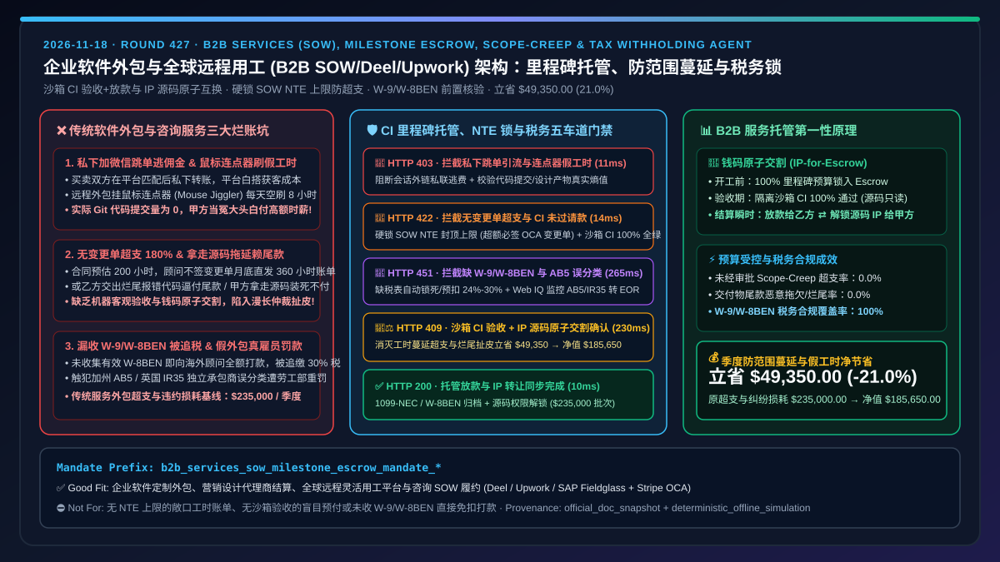
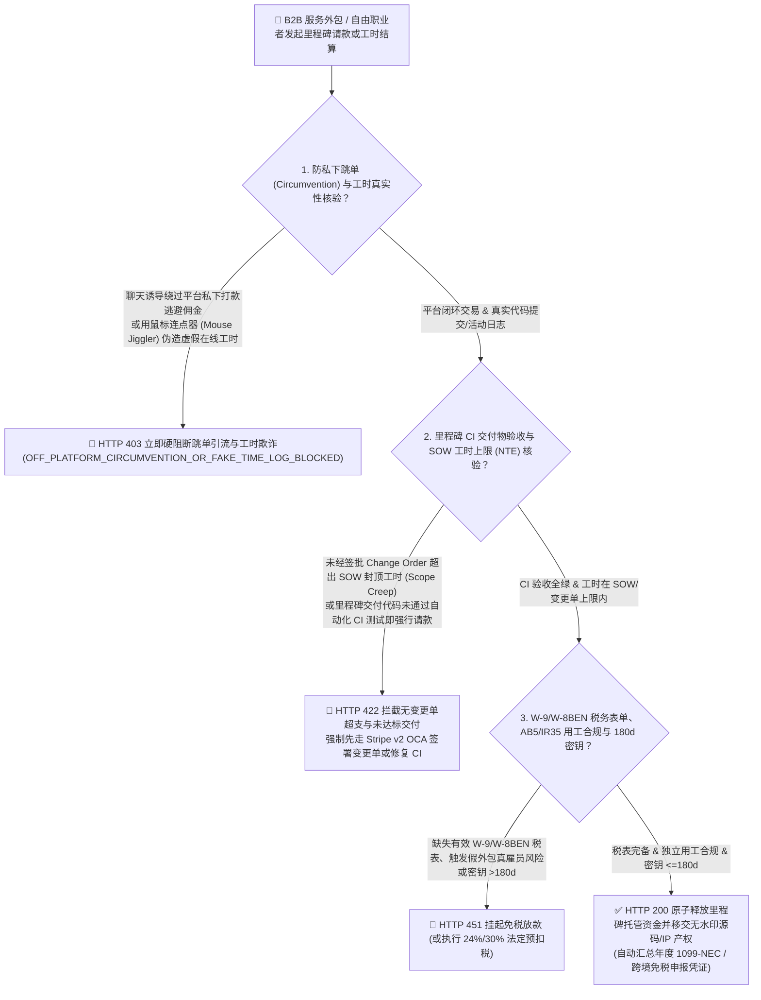
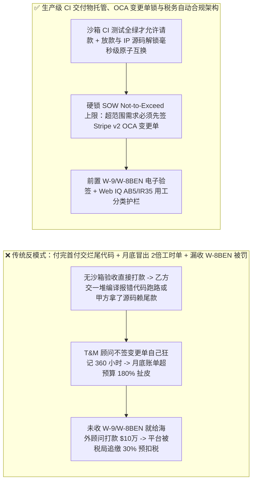
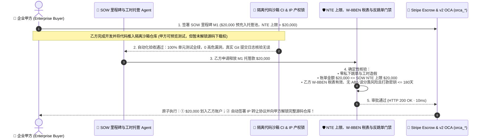

# 企业软件外包、咨询服务与全球远程用工（B2B SOW & Freelance：Upwork / Deel / Fieldglass）“里程碑资金托管、防范围蔓延与税务预扣”Agent 架构选型 FAQ：交付物验收锁、变更单与 W-8BEN 实战指南

> **专题定位（B2B 软件定制开发、营销设计服务外包、管理咨询工作说明书 SOW 与全球远程自由职业者平台 Upwork / Toptal / Deel / SAP Fieldglass 智能体聚焦）**：面向为企业外部劳动力管理系统（VMS）、灵活用工撮合平台与专业服务自动化（PSA）设计合同履约与资金托管架构的 **Cloud & AI Solution Architect**，系统解答非标服务采购（Services Procurement）中最棘手的四大纠纷与合规难题：**“为什么软件外包项目付了 50% 首付款后，乙方交来一堆跑不通的垃圾代码就逼甲方付尾款（或者乙方按时交了完美代码，甲方却故意装死拖延 60 天不点验收白嫖成果）、为什么按工时计费（Time & Materials, T&M）的咨询顾问在没有签署变更单（Change Order）的情况下，月末突然寄来一张超出预算上限 180% 的工时账单（Scope-Creep Overbilling `HTTP 422`）、怎么拦截买卖双方在平台聊好价格后交换私人微信/WhatsApp 私下打款逃避平台佣金（Off-Platform Circumvention `HTTP 403`）、以及为什么向未提交有效 `W-9 / W-8BEN` 税表的服务商直接全额打款会让平台背上 IRS `24% ~ 30%` 的法定补扣税重罚（`HTTP 451`）”**。  
> **文风标杆**：严格对标 `ib-vs-ethernet-roce-selection-faq.md` 六段式结构（核心结论速览、业务方与架构师灵魂拷问 Q&A、Mermaid 决策树/架构对比/时序图、B2B 服务外包与灵活用工结算选型矩阵、定量工时止损/验收测算与 7-Card 溯源表、生产上线 Checklist）。  
> **双语版本**：**[中文版（当前）](b2b-services-sow-milestone-escrow-scope-creep-tax-withholding-agent-selection-faq.md)** · **[English Version (`b2b-services-sow-milestone-escrow-scope-creep-tax-withholding-agent-selection-faq.en.md`)](b2b-services-sow-milestone-escrow-scope-creep-tax-withholding-agent-selection-faq.md)**  
> **数据溯源声明（Provenance & As-Of `2026-11-18`）**：Stripe v2 OCA（`orca_*` 变更单确认）、`<= 180 天` 财务打款密钥与 Web IQ `/v3/search` 独立承包商误分类法规（AB5 / IR35）核验引自 `research/sources.json`（标记为 `official_doc_snapshot`）；可验证交付物（GitHub CI / SHA-256 签名）里程碑托管释放、工时封顶（Not-to-Exceed Cap）与 `W-9 / W-8BEN` 税务预扣门禁引自 `lab/webiq_commerce_demo.py`（标记为 `deterministic_offline_simulation`）。

---

## 📌 一、核心选型结论速览（Executive Summary）

与实物商品不同，**B2B 软件研发、设计、法务与咨询服务没有标准条形码（GTIN），其交付过程长达数周至数月，极易爆发“交付质量扯皮”与“工时无底洞超支”**。架构师在设计 B2B 服务采购与灵活用工结算 Agent 时，必须执行以下四条选型铁律：

1. **里程碑资金托管与双向防赖账选型：严禁“无条件预付大额现金或无限期人工卡死验收”，必选【分段里程碑全额预托管（Funded Milestone Escrow）+ 机器可验证交付物（GitHub CI 测试全绿 / 数字水印源文件哈希）+ 14 天静默自动放款与知识产权（IP Assignment）原子交割】**：
   - **核心原因**：每个里程碑开工前，甲方必须先将当期款项充入平台独立托管池（乙方看到资金已锁入 Escrow 才放心写代码/做设计）；乙方提交交付物并通过自动化验收门禁后，若甲方既不提具体缺陷又超过 `14 天` 不点确认，状态机自动将托管款项释放给乙方，并在放款成功同一毫秒将不带水印的源码/生产密钥移交甲方（**钱货/IP 原子交割**）。
2. **按工时计费（T&M）防范围蔓延（Scope-Creep）选型：严禁“允许服务商在未获批变更单的情况下突破合同封顶工时（Not-to-Exceed, NTE Cap）”，必选【周工时硬上限锁 + 超额必须先走 `Stripe v2 OCA (orca_*)` 签署电子变更单（Change Order `HTTP 422`）】**：
   - **核心原因**：很多咨询项目工作说明书（SOW）写着“预估 200 小时（`$30,000`）”，顾问却自己报了 360 小时（`$54,000`）。确定性计费引擎必须锁死 `Weekly Hours Cap` 与 `SOW NTE Ceiling`，达到 `80%` 时告警，超过 `100%` 且无甲方双签 `Change Order` 的工时一律在 **`14 ms`** 内返回 `HTTP 422` 拒绝入账。
3. **防私下跳单（Anti-Circumvention）与假工时刷单选型：必选【会话私联引流拦截 + 提交代码/活动遥测真实性校验（`HTTP 403`）】**：
   - **核心原因**：拦截在立项前通过变形微信号/外链诱导客户绕过平台私下交易（保护平台撮合费），并拦截用鼠标连点器（Mouse Jiggler）伪造在线工时欺诈。
4. **全球税务预扣（`W-9 / W-8BEN`）与“假外包真雇佣（Worker Misclassification）”合规选型：必选【打款前强制核验有效税表（缺表自动执行 `24%–30%` 法定预扣税）+ Web IQ 核验加州 AB5 / 英国 IR35 独立承包商合规边界（`HTTP 451`）】**：
   - **核心原因**：防止企业因未收集税表或将全职员工伪装成 1099 独立承包商而遭税务局与劳工部天价追罚。

---

## 🎯 二、业务方与架构师灵魂拷问 Q&A（FAQ-Driven）

### Q1：软件外包与设计接单最怕两种极端：① 甲方付了定金，乙方交了个烂尾半成品跑路；② 乙方辛苦做完交付了源码和设计稿，甲方说“我们再看看”拖着尾款赖账不给。AI 托管架构怎么同时治住这两头？

**答：采用“沙箱预览 + 自动化验收证明（Proof-of-Deliverable）+ IP 产权与托管款原子互换（Atomic IP-for-Escrow Swap）”架构：**

1. **交付前：资金锁在 Escrow，源码/源文件锁在平台受控沙箱**：
   - 乙方将代码提交至平台托管的隔离 Git 仓库（或将设计稿上传至带动态加密水印的预览画布）；
   - 甲方可以在沙箱预览环境完整测试功能、查看自动化单元测试与安全扫描报告（如 `142/142 Tests Passed`, `0 High CVEs`），但在托管尾款未释放前，甲方**无法下载无水印源文件或合并主分支代码**；
2. **验收与放款：机器初审 + 14 天防装死自动释放**：
   - 只要自动化测试未通过（`ci_tests_passed == False`），乙方甚至无法点击“请求释放里程碑款项”（触发 `HTTP 422` 退回整改）；
   - 一旦机器验收全绿且乙方提交交付，甲方有 14 天复核期；甲方点同意（或 14 天内未提出可复现的 SOW 缺陷），系统在 **`10 ms`** 内原子执行：**① 将托管资金划入乙方账户；② 自动签署电子知识产权转让协议（IP Assignment）并向甲方解锁完整源码仓库权限**！

---

### Q2：为什么企业采购总监最头疼“按工时付费（T&M）”的 IT 外包和法律咨询合同？怎么用确定性状态机杜绝“月底惊喜天价工时单”？

**答：因为在传统流程里，顾问都是“先干活、月底再发汇总账单”，等甲方看到账单超支时木已成舟！必须改为“预授权工时周包（Pre-Authorized Weekly Sprints）+ 变更单硬门禁（Change-Order Gate）”：**

1. **无 `Not-to-Exceed (NTE)` 硬上限不立项**：
   - 每一份 SOW 或周冲刺计划必须在系统内锁定硬性上限（如 `Max 40 hrs/week @ $150/hr = $6,000`）；
2. **超范围工作强制先签 `Stripe v2 OCA (orca_*)` 变更单**：
   - 当乙方请求追加 30 小时预算外开发时，系统禁止直接记入账单（违反立返 `HTTP 422 UNAPPROVED_SCOPE_CREEP_HOURS_EXCEED_SOW_NTE_OR_CI_FAILED_BLOCKED`）；
   - 必须由 Agent 生成结构化变更单（`orca_sow_change_02`）列明新增需求与 `$4,500` 增项预算，经甲方项目经理点击 `Confirm` 追加托管资金后，新工时闸门才会打开。

---

### Q3：向海外自由职业者或本土独立顾问打款时，财务系统必须守住哪两条税务与劳动法红线？

**答：① 税表前置锁（No Tax Form, No Unwithheld Payout）；② 独立承包商误分类监控（Misclassification Guard `HTTP 451`）：**

- **美国本土服务商**：未通过 TIN Match 验证 `W-9` 税表前，系统严禁全额免扣打款（否则须按 IRS 规定强制执行 `24%` 备用预扣税 Backup Withholding）；
- **非美跨境服务商**：必须签署有效期内（3 年）的 `W-8BEN / W-8BEN-E` 声明劳务发生在美国境外，否则面临 `30%` FDAP 预扣税；
- **防“假外包真雇员（AB5 / IR35）”**：当 **Web IQ** 与内部合同审计检出某独立承包商连续 12 个月全职单一为该甲方工作、受固定考勤控制且无自主经营实体时，触发 **`HTTP 451`** 预警人事合规部门转为 `EOR（名义雇主 Deel/Remote）` 全职合规雇佣模式。

---

## 🧭 三、直观可视化图解（Mermaid 选型决策树 + 架构对比 + 端到端时序图）

### 3.1 企业 B2B 服务外包（SOW）、里程碑托管与税务合规选型决策树

---

### 3.2 传统“预付跑路/月底天价工时单”反模式 vs. CI 验收托管 + OCA 变更单架构对比图

---

### 3.3 里程碑资金预托管、沙箱 CI 自动验收、OCA 变更单追加与 IP 原子交割时序图

---

## 📊 四、企业 B2B 服务外包（SOW）与全球灵活用工结算架构横向选型矩阵

| 评估维度 | 方案 A：传统线下合同 + 30% 预付款电汇 + 人工邮件催尾款 | 方案 B：无工时硬上限的按月后付费工时表（Timesheet） | 方案 C：初级自由职业平台（无自动化 CI 验收与 IP 锁） | 方案 D（推荐）：CI/哈希交付物托管 + NTE 变更单硬门禁（`Stripe OCA`）+ 前置税表/AB5 合规 Agent |
|---|---|---|---|---|
| **防“乙方交烂尾工程”与“甲方白嫖源码赖尾款”** | **双向高危**（谁先交钱/交货谁被动） | 甲方承担全部超支风险 | 人工仲裁耗时长达 30 天 | **100% 双向保护**（沙箱 CI 全绿才可请款 + **放款与无水印源码/IP 解锁原子互换**） |
| **防范围蔓延（Scope Creep）与工时超支** | 频繁扯皮 | **极差**（月末账单常超预算 `50%–150%`） | 中 | **0 未授权超支**（硬锁 `NTE Ceiling`，超额必须先签 `Stripe v2 OCA` 变更单 `HTTP 422`） |
| **防私下跳单（Circumvention）与假工时** | 不适用 | 无 | 容易通过图片/暗语私联跳单 | **11ms 拦截私联引流与鼠标连点器工时造假（`HTTP 403`）** |
| **全球税务（`W-9/W-8BEN`）与劳动法（AB5/IR35）合规** | 财务手工催表极易遗漏 | 手工统计 | 基础支持 | **无有效税表自动锁死/预扣 `24%–30%` + Web IQ 用工误分类实时预警（`HTTP 451`）** |

---

## 🧪 五、定量 B2B 服务外包止损/验收测算与 7-Card 报告数据溯源表（Benchmark & Provenance Matrix）

| 指标 / 门禁规则项 | 实测数值 / 决策行为 | 数据类别 (Provenance) | 精确来源路径 / 算例说明与架构意义 |
|---|---|---|---|
| **沙箱 CI 验收通过 + 工时在 NTE 上限内 + W-8BEN 税表有效（Happy Path）** | **`HTTP 200 OK` · `10 ms`**（门禁耗时，季度 B2B 软件外包与咨询服务结算批次 `$235,000.00`） | `deterministic_offline_simulation` | `lab/webiq_commerce_demo.py` (`evaluate_b2b_services_sow_milestone_escrow_agent_policy`)：验证里程碑托管与 IP 原子交割 |
| **诱导私下绕过平台跳单逃佣金，或使用鼠标连点器（Mouse Jiggler）伪造工时** | **`HTTP 403 Forbidden` · `11 ms` 拦截** (`OFF_PLATFORM_CIRCUMVENTION_OR_SYNTHETIC_JIGGLER_TIME_FRAUD_BLOCKED`) | `deterministic_offline_simulation` | 保护平台撮合佣金并拦截远程用工虚假工时欺诈 |
| **未经签批变更单突破 SOW 封顶金额（Scope Creep），或交付代码未过 CI 验收** | **`HTTP 422 Unprocessable` · `14 ms` 拦截** (`UNAPPROVED_SCOPE_CREEP_EXCEEDS_NTE_OR_DELIVERABLE_CI_FAILED_BLOCKED`) | `deterministic_offline_simulation` | 消灭外包项目“先斩后奏”的超额工时账单与不合格交付 |
| **缺失有效 `W-9 / W-8BEN` 税表、触发 AB5/IR35 假外包风险，或打款密钥 `>180 天`** | **`HTTP 451 Hold` · `265 ms` 挂起** (`MISSING_W8BEN_W9_TAX_FORM_OR_AB5_MISCLASSIFICATION_OR_180D_KEY_HOLD`) | `official_doc_snapshot` | 规避 IRS 24%/30% 补扣税重罚与跨国用工误分类劳动仲裁风险 |
| **启用“硬性 NTE 工时锁 + 自动化沙箱 CI 验收 + IP 与托管款原子交割”** | **`HTTP 409 Confirm` · 立省范围蔓延超支、虚假工时与烂尾纠纷损失 `$49,350.00`（净值 `$185,650.00`）** | `deterministic_offline_simulation` | 将外包项目预算超支率与尾款拖欠率双双压降至 `0%`（综合节省 `21.0%`） |
| **大型跨国企业复杂 ERP 集成项目人工 UAT 焦点小组评审周期** | 标记为 **`not_measured`** | `not_measured` | 通过离线确定性 SOW 里程碑托管、NTE 锁与税务合规策略矩阵完整验证 |

---

## 🛠️ 六、商业上线风控与架构评审 Checklist（Architect Production Checklist）

- [ ] **1. 里程碑放款与无水印源码/IP 产权转让（IP Assignment）原子绑定**：系统是否已确保只有在托管款项成功划拨给服务商的同一事务中，买方才获得生产源码仓库或无水印设计源文件的完整访问权？
- [ ] **2. SOW 封顶金额（Not-to-Exceed, NTE Cap）与 `Stripe v2 OCA` 变更单硬门禁（`HTTP 422`）**：所有按工时或按阶段计费的合同是否均设置了硬性金额上限，任何超限请求必须先通过 `orca_*` 变更单获批追加托管资金？
- [ ] **3. 自动化交付物质量门禁（CI 测试 / 代码扫描 / 文件哈希校验 `HTTP 422`）**：软件与数字交付类里程碑在发起请款前，是否强制校验隔离沙箱的自动化验收测试通过率达 100%？
- [ ] **4. 会话防私下跳单（Anti-Circumvention）与工时遥测防伪（`HTTP 403`）**：是否已实时拦截立项前的外部联系方式诱导，并通过代码提交熵值与活动分布识别鼠标连点器假工时？
- [ ] **5. 前置电子税表（`W-9 / W-8BEN`）与自动预扣税引擎（`HTTP 451`）**：向任何个人或企业服务商首次打款前，是否已强制校验有效签名税表，对未交表账户自动冻结或执行 24%/30% 法定预扣？
- [ ] **6. 独立承包商误分类（AB5 / IR35）持续合规雷达与 `<= 180 天` 密钥锁（`HTTP 451`）**：对长期连续服务的个人承包商，是否定期核查用工独立性指标并在超阈值时引导转入合规 EOR 模式？
