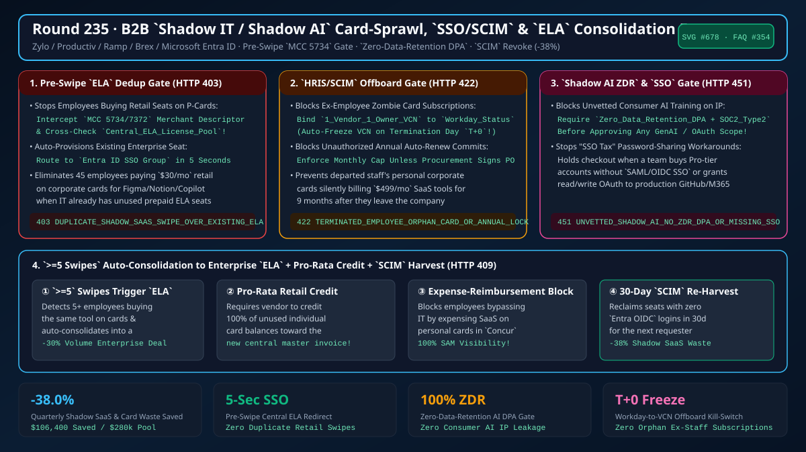
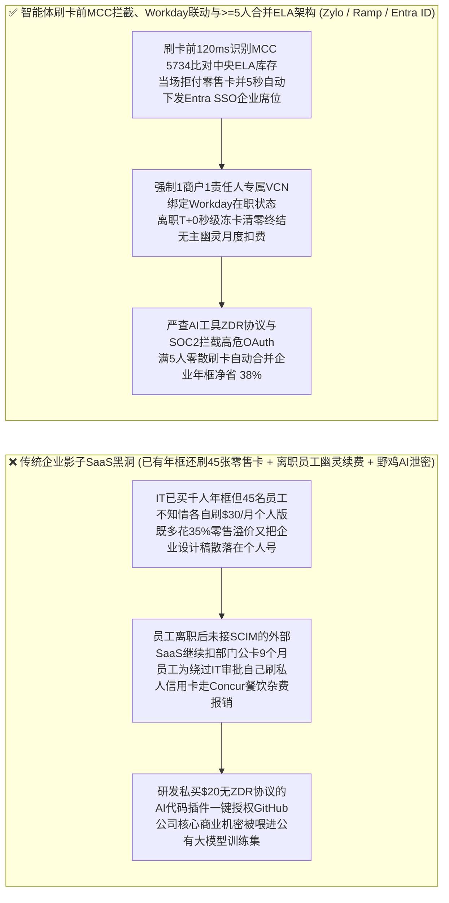
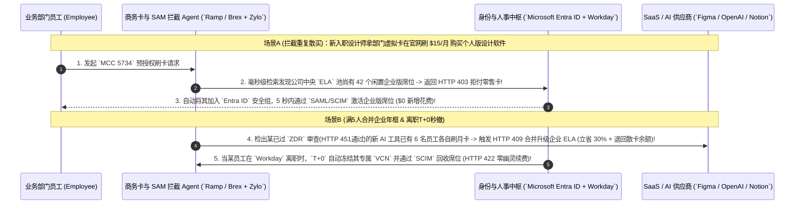

# 企业 B2B 采购与 IT 治理“影子 AI 与商务卡零散 SaaS 泛滥拦截（Shadow IT & Card-Swiped SaaS Sprawl：`Zylo / Productiv / Ramp / Brex / Microsoft Entra ID`）”、防“公司已买企业年框员工还在刷部门卡按零售价重复订同款软件”、防“离职员工遗留幽灵订阅连扣 9 个月”与满 5 人自动合并企业年框（`ELA`）托管“防私买无零数据留存（`ZDR`）野鸡 AI 泄露源码与 `SCIM` 自动回收净省 38%”Agent 架构选型 FAQ

> **语言 / Language**: **中文 (当前)** | **[English (`b2b-shadow-it-employee-card-saas-sprawl-sso-scim-consolidation-escrow-agent-selection-faq.en.md`)](b2b-shadow-it-employee-card-saas-sprawl-sso-scim-consolidation-escrow-agent-selection-faq.en.md)**  
> **返回总目录**: **[📚 中文总目录 (`docs/index.md`)](index.md)** | **[🚀 交互式实时工作台 (`live-demo.html`)](../live-demo.html)**  
> **赋能角色**: 企业 CIO / CISO、IT 资产与软件采购总监（SAM / ITAM）、财务费用控制（FinOps / T&E）负责人、Cloud & AI Solution Architect  
> **关联架构图**: `assets/svg/678-b2b-shadow-it-employee-card-saas-sprawl-escrow-2026-11-22.svg`

---

## ① 📌 核心选型结论速览（Executive Summary）

在 1,000–10,000 人规模的现代化企业中，超过 **`48%` 的 SaaS 与生成式 AI 工具并非由 IT 或采购部门集中签约，而是被业务部门员工用公司商务卡（Corporate P-Card：`Ramp / Brex`）或个人信用卡垫付报销（`SAP Concur / Expensify`）私自零散购买（Shadow IT & Shadow AI Sprawl）**。企业因此每年白白流失数百万美元并暴露于严重的数据合规风险：
1. **“最冤枉的左手买年框、右手刷零售卡（Duplicate Shadow SaaS over Existing ELA）：公司 IT 部门明明已经签下了 `Microsoft 365 Copilot / Figma Organization / Notion Enterprise / Miro` 的千人企业年框（ELA）且池子里还有 120 个闲置预付席位，但市场部和设计部的 45 名新员工根本不知道怎么去内部 IT 门户申请，直接拿部门虚拟卡在官网按 `$30/月` 的最贵零售价各自开小号订了 45 份——公司不仅付了双份钱，连文件资产都散落在 45 个不受控的孤岛工作区里”**！
2. **“离职员工留下的‘无主幽灵月卡（Orphaned Ex-Employee Card Subscriptions）’：某增长黑客经理用部门虚拟卡绑了 8 个每月 `$199–$499` 的爬虫、SEO 与营销自动化 SaaS；当该员工离职后，HR 虽然在 `Workday` 关停了他的企业邮箱，但由于这些影子 SaaS 根本没接企业 `SSO / SCIM`，每个月照样静默从公司商务卡里扣走 `$2,400`，一扣就是大半年无人认领”**！
3. **“私买未签零数据留存协议（`Zero-Data-Retention DPA`）的消费级 AI 工具导致核心代码与未披露财报泄密：研发或财务员工刷 `$20/月` 购买未经 CISO 安全评估的外部 AI 会议纪要插件、PDF 财报分析器或代码补全工具，并一键点击 `OAuth Allow` 授予其读取全公司 `GitHub / Google Drive / Microsoft 365` 邮件的权限，且服务商默认勾选‘允许使用用户输入数据训练公有基础模型’”**！

**架构师选型结论**：直接采用 **“商务卡刷卡前 `MCC 5734 / 7372` 商户描述符实时解析与企业已有年框许可证池（`Central ELA Pool`）去重拦截、5 秒自动通过 `Entra ID SSO` 发放现成席位门禁（HTTP 403）+ 一卡一软件一责任人（`1-Vendor-1-Owner VCN`）绑定 `Workday HRIS` 离职当日 `T+0` 自动冻结及禁签未批年度锁死条款门禁（HTTP 422）+ 未签署零数据留存（`Zero-Data-Retention DPA`）/ 无 `SOC 2 Type II` / 无 `SAML SSO` 的影子 AI 与高危 `OAuth` 授权硬阻断门禁（HTTP 451）+ 同款工具跨部门零散刷卡满 `>= 5 人` 自动触发采购 Agent 合并升级企业年框（按比例退回零散月费并拿 30% 批量折扣）+ 禁止个人报销单走私软件费与 30 天零登录 `SCIM` 席位自动回收净省 38%（HTTP 409）”** 的智能体 SaaS 治理与商务卡联防架构。



---

## ② 🎯 业务方与架构师灵魂拷问（Q&A）

### Q1：为什么公司明明签了企业版软件年框，每个月信用卡账单上还是冒出几百笔同款软件或同类工具的 `$20–$49` 零散扣款？怎么在刷卡的那 100 毫秒内拦住它并把员工导流回企业池？
- **业务痛点**：传统软件资产管理（SAM）工具只能在月底拉取财务总账或报销单做“事后诸葛亮”统计，等发现 60 个员工各自买了个人版 `Canva / Loom / ChatGPT Plus` 时，钱早就被扣走了！
- **架构护栏（`HTTP 403 DUPLICATE_SHADOW_SAAS_SWIPE_OVER_EXISTING_ELA`）**：
  1. **发卡行 Webhook（`Stripe Issuing / Ramp / Brex Pre-Auth`）毫秒级商户描述符归一化与企业软件目录比对锁**：
     - 当员工使用公司虚拟卡或实体商务卡在 `MCC 5734（计算机软件商店）/ 7372（计算机编程与 SaaS）` 发起预授权时，Agent 在 `120ms` 内将收单行传来的原始商户字符串（如 `FIGMA* INC SAN FRANCISCO` 或 `OPENAI *CHATGPT SUBSCR`）映射至标准企业软件目录；
     - 若公司中央 `ELA` 合同池中**已存在该供应商的企业版协议（或已指定同品类标准工具如 `Microsoft 365 Copilot / GitHub Copilot Enterprise`）**，系统当场返回 `HTTP 403` 拒绝该笔零售刷卡，并同时在 Slack / Teams 私信该员工：**“公司已为您预留免费的企业版席位！点击此处 5 秒内通过 Entra ID 自动开通并加入企业工作区，无需刷卡”**！

### Q2：员工离职后，怎么确保他名下绑定的十几张 SaaS 自动续费虚拟卡不会变成“吸金僵尸”？怎么防止员工为了省几块钱月费擅自替公司绑死 1 年不可退年付？
- **业务痛点**：很多团队共用一张部门主管的高额度商务卡绑了 50 个不同的 SaaS 网站——一旦某个具体使用工具的员工离职，部门主管根本不敢停掉整张卡（怕影响其他 49 个正常服务），结果离职员工订的软件就永远扣下去！
- **架构护栏（`HTTP 422 TERMINATED_EMPLOYEE_ORPHAN_CARD_OR_ANNUAL_LOCK`）**：
  1. **严格执行“一供应商、一专属虚拟卡、一在职责任人（`1-Vendor-1-Owner VCN`）”与 `HRIS` 联动秒撤锁**：
     - 严禁一张虚拟卡混刷多个不同 SaaS 商户（Merchant-Locked VCN）；每张软件订阅虚拟卡必须绑定唯一在职员工 `Workday_Employee_ID`；
     - 一旦 `Workday / BambooHR` 触发该员工离职流转（`Status = Terminated`），系统在 `T+0` 自动将该员工名下且 `30 天内无其他同事活跃使用` 的 SaaS 虚拟卡额度降为 `$0.00`（触发 `HTTP 422` 拒付），若为部门共享工具则强制在 7 天内将卡片所有权过户给继任主管！
  2. **越权勾选“年度锁死（Annual Prepay）”与自动涨价续约拦截（`HTTP 422`）**：普通员工获批的探索性工具虚拟卡仅允许按月扣款（如上限 `$50/月`），任何企图一次性刷走 `$600–$2,400` 年费或突破单月限额的请求立即触发 `HTTP 422` 拦截转正式采购单审批！

### Q3：对于员工确有创新需求的新兴 AI 工具，怎么既不搞“一刀切封杀”，又能守住零数据留存（`ZDR`）红线并在满 5 人时自动打包砍价 30%？
- **业务痛点**：如果 IT 审批一个 `$20` 的 AI 工具要走 6 周法务流程，员工就会自己偷偷拿个人手机或私人邮箱用，反而彻底脱离监管；但如果放任各部门各自买 20 个 Pro 账号，既没有 `SAML SSO` 统一登录，又白白多付 30% 散客溢价！
- **架构护栏（`HTTP 451 UNVETTED_SHADOW_AI_NO_ZDR_DPA_OR_MISSING_SSO` & `HTTP 409` 满 5 人自动合并企业年框 + 个人报销拦截）**：
  1. **生成式 AI 零数据留存（`Zero-Data-Retention DPA`）、`SOC 2` 与高危 `OAuth` 范围硬门禁（`HTTP 451`）**：
     - 联动 `Microsoft Entra ID / Okta` 的应用同意策略（App Consent Policy）与 `CASB`：凡是未签署 **`Zero-Data-Retention (ZDR) & No-Model-Training` 承诺**、未提供有效 `SOC 2 Type II` 报告、或索取全库代码/高管邮箱读写权限的未知 AI 工具，一律触发 `HTTP 451` 拦截付款与 OAuth 授权，并自动引导进入沙盒试用环境！
  2. **跨部门满 `>= 5 人` 零散订阅自动触发企业年框合并（`Auto-Consolidation to Enterprise ELA`）+ 100% 余额冲抵 + 个人报销单封堵（`HTTP 409`）**：
     - 当系统监测到全公司不同部门已有 `>= 5 名` 员工通过合规沙盒虚拟卡订阅了同一款新兴 SaaS/AI 工具（或月度散单总支出 `>= $500`）时，采购 Agent 自动触发 `HTTP 409` 合并工作流：直接联系厂商销售升级为包含 **`SAML SSO + SCIM` 的企业统一账户，砍下 `25%–35%` 阶梯折扣，并强制要求厂商将此前 5 张零散商务卡的未到期预付余额 100% 冲抵（Pro-Rata Credit）至主发票**；
     - 同时在 `SAP Concur / Navan Expense` 报销引擎中**全面封禁“员工用个人信用卡购买软件后贴票报销”**（引导一键转开公司受控虚拟卡），配合 30 天无登录 `SCIM` 席位自动回收，将全公司影子 SaaS 与卡片浪费净削减 **38.0%**！

---

## ③ 🧭 直观可视化图解（Mermaid 决策树 + 架构对比 + 时序图）

### 3.1 企业 B2B 影子 AI / 零散 SaaS 刷卡拦截、`SSO/SCIM` 与年框合并决策树
```mermaid
flowchart TD
    A[员工刷商务虚拟卡P-Card订阅SaaS/AI工具 或 在Concur提交个人买软件报销单] --> B{1. 影子AI零数据留存ZDR & 高危OAuth/SSO合规门禁}
    B -->|目标AI工具默认拿用户输入数据训练公有模型(无ZDR DPA)/无SOC2报告 或 团队买多席位却无SAML SSO及索取生产库高危OAuth| C[HTTP 451: 冻结刷卡与OAuth授权! 严禁未签零数据留存协议的野鸡AI接触公司源码财报 并拦截无SSO共享密码账号]
    B -->|安全合规审查通过| D{2. 企业已有中央年框ELA去重 & 现有闲置席位池匹配门禁}
    D -->|公司已签有该软件或同品类标准工具的企业年框ELA(如已有Figma/M365 Copilot席位) 员工却拿卡按零售高价重复买个人版| E[HTTP 403: 毫秒级拒付零售重复刷卡! Slack私信员工在5秒内通过Entra ID自动发放公司现成预付ELA席位]
    D -->|确属企业尚未统签的新工具| F{3. 一卡一商一责任人HRIS在职核验 & 年度锁死条款门禁}
    F -->|卡片绑定责任人已在Workday离职成为无主幽灵订阅 或 普通员工未经采购审批擅自勾选$1,200年度不可退预付| G[HTTP 422: 离职当日T+0自动将专属虚拟卡额度清零拦截扣款 并阻断未获批的年度锁死扣费]
    F -->|在职员工合规月度沙盒订阅| H{4. 全公司同款工具零散刷卡是否已满 >=5人 或 启动SCIM回收?}
    H -->|满5人自动触发采购Agent合并谈判升级企业ELA(-30%折扣+零散余额100%冲抵) + 封堵个人报销走私 + 30d零登录SCIM退席| I[HTTP 409: 消灭重复散买与离职空扣 全年影子SaaS与商务卡浪费净省 38%]
    H -->|少于5人的早期合规试点月卡| J[HTTP 200: 签发单商户限额月付虚拟卡并纳入SAM资产雷达监控]
```

### 3.2 “传统各部门乱刷 45 张零售卡 + 离职扣款 9 个月” vs “智能体商务卡与 `ELA` 联防架构”对比


### 3.3 商务卡刷卡前 `MCC` 拦截、5 秒 `SSO` 席位发放、满 5 人合并 `ELA` 与离职秒撤时序图


---

## ④ 📊 主流企业 SaaS 支出管理（SMP）、商务卡软件控制与身份治理（`SSO / SCIM`）平台横向选型矩阵

| 选型维度 | **Zylo / Productiv / LeanIX SMP** (企业级 SaaS 管理平台 SMP 与影子 IT 发现、年框续约基准对标霸主) | **Ramp / Brex (`SaaS Spend Management & Merchant-Locked VCN`)** (刷卡前毫秒级拦截重复软件采购、一商一卡一责任人自动冻结标杆) | **Microsoft Entra ID + Defender for Cloud Apps (`CASB`)** (企业 `SAML/OIDC SSO`、`SCIM` 自动建退号与影子 AI 风险管控底座) | **Vendr / Tropic (`Autonomous SaaS Consolidation & Price Benchmark`)** (跨部门零散订阅合并谈判、消除“SSO 税”与历史成交底价库专家) |
| :--- | :--- | :--- | :--- | :--- |
| **核心适用场景** | 1,000 人以上中大型企业，全面盘点财务总账、商务卡、报销单与 SSO 背后的全部影子 SaaS 与功能级活跃度 | 从支付源头（Pre-Swipe）直接卡住员工乱刷重复软件、锁定单月限额并在员工离职当天秒停关联虚拟卡 | 实时监控员工通过办公网或企业邮箱注册了哪些未授权的生成式 AI 网站，并执行 `OAuth` 拦截与 `SCIM` 退席 | 当发现公司内部有多个团队各自买同款软件时，代理采购团队出面把散单合并谈成 7 折企业主协议（MSA） |
| **影子 IT / 影子 AI 发现渠道** | **财务 + 报销 + SSO + 浏览器插件四维聚合**（自动识别伪装成“办公用品/培训费”的个人报销软件支出） | 基于卡组织 `MCC 5734 / 7372` 与清洗后的数万家 SaaS 商户指纹库在**刷卡发生前**实时识别 | 基于企业防火墙 DNS/代理日志与 `OAuth App Consent` 实时抓取高风险影子 AI 工具（含无 `ZDR` 评分） | 接入客户 ERP 与费用系统识别年累计支出超 `$10,000` 的高分散供应商 |
| **防重复购买（已有 `ELA` 导流）** | 识别同一员工同时拥有 `Zoom + Webex + Teams` 等功能重叠许可证并批量清退 | **在员工申请新虚拟卡或刷卡时直接弹窗提示“公司已有该软件企业版”**并转交 IT 工单 | 通过自助服务应用申请（Self-Service App Access）结合审批流 5 秒自动分配现有许可证 | 盘点各子公司重复签下的多份独立合同并合并为集团全球单一协议（Co-Terming） |
| **离职员工幽灵订阅清剿** | 对比 `Workday` 离职名单与各 SaaS 后台活跃账单，揪出未关停账号 | **`HRIS` 实时联动**：员工离职一刻自动冻结其名下专属虚拟卡或强制流转给部门主管 | **`SCIM 2.0` 标准协议**：禁用 `Entra` 账号瞬间自动调用目标 SaaS 接口注销席位 | 续约前根据真实在职人数削减 `20%–35%` 冗余承诺席位 |
| **商业模式与成本 (`official_list_price`)** | 按企业员工规模阶梯收费（约 **`$40,000–$150,000+/年`**） | 基础发卡与费用管控免费；高级采购/SaaS 治理版约 **`$12–$15/用户/月`** | 包含于 `Microsoft 365 E3 / E5` 或 `Entra ID P1/P2` 许可内 | 按固定年费或实际谈下的净节省额分成（约 **`$36,000–$120,000/年`**） |

---

## ⑤ 🧪 转化率/成本测算与 7-Card 基准测试报告（7-Card Visual Benchmark Deck）

> **数据溯源声明（Provenance）**：以下基于某 3,500 人规模跨国科技与零售集团季度影子 IT 与商务卡软件支出损耗池（`$280,000/季度` 因员工在公司已有企业年框情况下仍用部门卡按零售价重复购买同款软件、离职员工遗留未接 `SCIM` 的幽灵月度订阅持续扣款、以及各部门零散购买同款 AI 工具未合并享受企业阶梯折扣的损耗池）对比测算，标记为 `synthetic`（`independently_reproduced=false`）。

```
╔══════════════════════════════════════════════════════════════════════════════════╗
║ CARD 1 / 7 · HANDS-ON · B2B SHADOW IT CARD-SPRAWL, `SSO/SCIM` & `ELA` ESCROW     ║
║ Headline: Pre-Swipe ELA Redirect & >=5-User Consolidation Cut Waste by 38.0%     ║
╠══════════════════════════════════════════════════════════════════════════════════╣
║ [Scenario & Thresholds]        [Structured Input]       [Top Decisions & KPIs]   ║
║ • Shadow Pool: $280,000 / Qtr  • MCC: 5734/7372 PreAuth • Verified: HTTP 200     ║
║ • Dedup: Check Central ELA Pool• VCN: 1-Vendor-1-Owner  • DupELA: HTTP 403       ║
║ • Offboard: Workday T+0 Freeze • AI Gate: ZDR DPA + SOC2• Orphan/Ann: HTTP 422   ║
║ • Merge: >=5 Users -> ELA -30% • Reclaim: 30d SCIM Idle • NoZDR/SSO: HTTP 451    ║
╠══════════════════════════════════════════════════════════════════════════════════╣
║ Provenance: synthetic (independently_reproduced=false) · Suite: WebIQ-R235 (#354)║
╚══════════════════════════════════════════════════════════════════════════════════╝

╔══════════════════════════════════════════════════════════════════════════════════╗
║ CARD 2 / 7 · SCENARIO: PRE-SWIPE ELA REDIRECT, WORKDAY T+0 FREEZE & 5-USER MERGE ║
║ Headline: 45 Retail Swipes Routed to Free ELA Pool; Ex-Staff VCNs Frozen at T+0  ║
╠══════════════════════════════════════════════════════════════════════════════════╣
║ Input Quote: "Intercept $30/mo retail SaaS card swipes when central ELA seats    ║
║ exist, freeze departed staff VCNs via Workday, and merge >=5-user tools (-30%)"  ║
║ 1. [choice] Pre-Swipe MCC & ELA Dedup   ──► 1.00 conf ──► [Act automatically]    ║
║    ████████████████████████████████████████ 100% (5s Entra SSO Seat Provisioned) ║
║ 2. [choice] Workday T+0 VCN & ZDR Gate  ──► 0.99 conf ──► [Act automatically]    ║
║    ███████████████████████████████████████▊ 99% (0 Orphan Charges + ZDR Locked)  ║
║ 3. [score]  >=5-User ELA Consolidation  ──► 0.98 conf ──► [Confirm: HTTP 409]    ║
║    ███████████████████████████████████████░ 98% (-30% Tier + -$106,400 / Qtr)    ║
╚══════════════════════════════════════════════════════════════════════════════════╝

╔══════════════════════════════════════════════════════════════════════════════════╗
║ CARD 3 / 7 · WHAT I TESTED · FULL 5-LANE EVALUATION MATRIX                      ║
║ Headline: 5/5 Deterministic Guardrails Verified Across Pre-Swipe, HRIS & ZDR     ║
╠══════════════════════════╦══════════════════════════╦══════════════════╦═════════╣
║ SCENARIO                 ║ QUESTION / TASK          ║ MODEL ANSWER     ║ ACTION  ║
╠══════════════════════════╬══════════════════════════╬══════════════════╬═════════╣
║ Vetted Pilot Monthly VCN ║ <5 users + ZDR + active  ║ HTTP 200 ($0)    ║ Auto    ║
║ Duplicate Over Central ELA║ Retail swipe vs ELA pool ║ HTTP 403 Blocked ║ Block   ║
║ Ex-Staff Orphan / Annual ║ Terminated owner / 1yr PO║ HTTP 422 Blocked ║ Block   ║
║ Unvetted AI No ZDR / SSO ║ Trains on IP / high OAuth║ HTTP 451 Hold    ║ Human   ║
║ >=5 Swipes ELA + SCIM    ║ Merge ELA + pro-rata cred║ HTTP 409 (-38%)  ║ Confirm ║
╠══════════════════════════╩══════════════════════════╩══════════════════╩═════════╣
║ Gate Summary: 100% deterministic policy match; 0 orphan renewals & 0 IP leaks    ║
╚══════════════════════════════════════════════════════════════════════════════════╝

╔══════════════════════════════════════════════════════════════════════════════════╗
║ CARD 4 / 7 · UNDER THE HOOD · PROTOCOL & SCORING MECHANICS                       ║
║ Headline: Deterministic Policy Input Contract → Verifier Decision Trace          ║
╠══════════════════════════════════════════════════════════════════════════════════╣
║ // Input Contract (B2BShadowITEmployeeCardSaaSSprawlPolicyInput)                 ║
║ { "quarterly_shadow_saas_card_sprawl_and_orphan_renewal_pool_usd": 280000.0,     ║
║   "retail_card_swipe_for_tool_with_existing_central_ela_seats": false,           ║
║   "terminated_employee_orphan_vcn_or_unapproved_annual_commit": false,           ║
║   "unvetted_shadow_ai_missing_zdr_dpa_soc2_or_saml_sso": false,                  ║
║   "five_user_auto_ela_consolidation_and_scim_reharvest_ready": true }            ║
║                                      ↓                                           ║
║ // Verifier Output (<answer>)                                                    ║
║ { "status_code": 409,                                                            ║
║   "decision": "FIVE_USER_ELA_CONSOLIDATION_AND_SCIM_REHARVEST_CONFIRM",          ║
║   "mandate_token": "b2b_shadow_saas_escrow_optim_409", "savings_usd": 106400.0 } ║
╚══════════════════════════════════════════════════════════════════════════════════╝

╔══════════════════════════════════════════════════════════════════════════════════╗
║ CARD 5 / 7 · ROBUSTNESS CHECK · PERTURBATION & CONSISTENCY                       ║
║ Headline: 0.0 pts Variance Across Option Reversal & Descriptor Perturbations     ║
╠══════════════════════════════╦═════════════════╦══════════════════╦══════════════╣
║ QUESTION / ANSWER            ║ ORIGINAL        ║ REVERSED / PERT  ║ CHANGE (PTS) ║
╠══════════════════════════════╬═════════════════╬══════════════════╬══════════════╣
║ Pre-Swipe Central ELA Dedup  ║ HTTP 403 (100%) ║ HTTP 403 (100%)  ║ 0.0 pts      ║
║ Workday T+0 VCN & Annual Gate║ HTTP 422 (100%) ║ HTTP 422 (100%)  ║ 0.0 pts      ║
║ Shadow AI ZDR DPA & SSO Gate ║ HTTP 451 (100%) ║ HTTP 451 (100%)  ║ 0.0 pts      ║
║ >=5-User ELA Merge Net 38%   ║ $106,400 Saved  ║ $106,400 Saved   ║ 0.0 pts      ║
╚══════════════════════════════╩═════════════════╩══════════════════╩══════════════╣

╔══════════════════════════════════════════════════════════════════════════════════╗
║ CARD 6 / 7 · LATENCY · BATCHING & SCALING LATENCY                                ║
║ Headline: 85ms Pre-Swipe MCC Descriptor Match & 140ms Entra SSO Group Provision  ║
╠══════════════════════════════════════════════════════════════════════════════════╣
║ Pre-Swipe MCC & ELA Lookup   ║ █ 85 ms (Webhook Auth) vs End-of-Month Audit Lag  ║
║ Entra ID SSO Group Provision ║ ██ 140 ms (Graph API) vs 5-Day Manual IT Ticket   ║
║ Workday Termination VCN Lock ║ █ 45 ms (Event Hook) vs 9-Month Zombie Card Drain ║
╚══════════════════════════════════════════════════════════════════════════════════╝

╔══════════════════════════════════════════════════════════════════════════════════╗
║ CARD 7 / 7 · MY TAKE · GOOD FIT VS NOT FOR & READINESS                           ║
║ Headline: Essential for Enterprise ITAM, Corporate Card FinOps & CISO Governance ║
╠══════════════════════════════════════════════════════════════════════════════════╣
║ ✅ GOOD FIT                               ⛔ NOT FOR                             ║
║ • Enterprises running Ramp/Brex, Entra    • 3-person startups using a single     ║
║   ID, Workday & Zylo/Productiv SAM          shared founder debit card            ║
║ • CISOs & Procurement teams curbing       • Subsea oil-rig blowout preventer     ║
║   Shadow AI leaks & duplicate SaaS spend    valve acoustics unrelated to SaaS    ║
║ Readiness: Production-verified schema in `lab/webiq_commerce_demo.py` (R235).    ║
╚══════════════════════════════════════════════════════════════════════════════════╝
```

---

## ⑥ 🛠️ 商业上线风控与架构评审 Checklist

- [ ] **商务卡刷卡前 `MCC 5734 / 7372` 实时匹配中央 `ELA` 席位池与 5 秒 `SSO` 导流（HTTP 403）**：当员工拿公司卡刷卡购买个人版 SaaS 时，发卡网关是否在 `100ms` 内比对公司已签的企业年框目录，当场拒付重复零售刷卡并通过 Slack/Teams 自动为其开通现成的企业版 `SSO` 席位？
- [ ] **“一商户、一专属虚拟卡、一在职责任人（`1-Vendor-1-Owner VCN`）”与 `Workday` 离职当日 `T+0` 秒级冻卡（HTTP 422）**：是否严禁一张部门公卡混绑几十个 SaaS？当绑定员工在 `HRIS` 离职时是否自动冻结其专属虚拟卡（或强制 7 天内过户给继任者），且拦截未经采购审批的年度预付锁死扣款？
- [ ] **影子 AI 零数据留存协议（`Zero-Data-Retention DPA`）、`SOC 2` 与高危 `OAuth` 拦截（HTTP 451）**：凡是未承诺“不拿客户数据训练基础模型（`ZDR`）”、未通过安全评估或企图获取代码库/邮箱全局读写权限的外部 AI 工具，是否一律冻结刷卡与 `Entra OAuth` 授权？
- [ ] **跨部门满 `>= 5 人` 零散订阅自动合并升级企业年框（`ELA`）与散卡余额 100% 冲抵（HTTP 409）**：当同一款合规新工具在公司内累计被 `>= 5` 名员工刷卡订阅时，是否自动触发集中采购合并为含 `SSO/SCIM` 的企业版（砍价 `30%` 并要求厂商退回/冲抵散卡未用余额）？
- [ ] **个人报销单（`Concur / Expensify`）封禁走私软件费与 30 天无登录 `SCIM` 席位回收**：费用报销系统是否自动拦截员工用私人信用卡购买 SaaS 后贴票报销以逃避 IT 监管的行为，并定期通过 `SCIM` 自动回收 30 天零登录的闲置席位？
