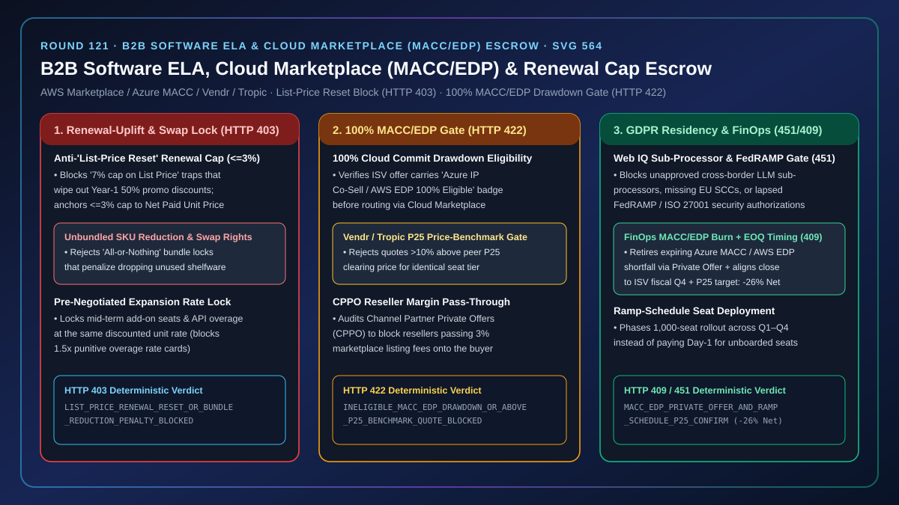
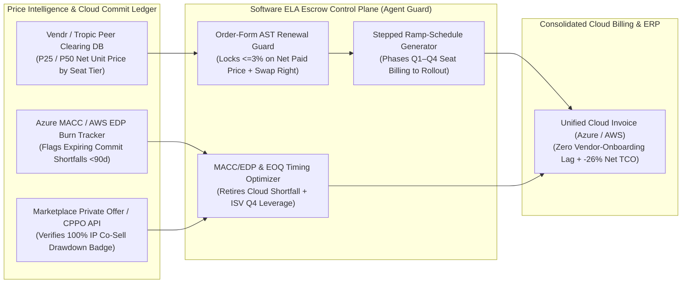

# B2B Software `ELA`, Cloud Marketplace (`Azure MACC / AWS EDP`) & Renewal-Cap Escrow (`Vendr / Tropic / AWS Marketplace / Azure Marketplace`) Agent Architecture Selection FAQ

> **Target Audience**: **Cloud & AI Solution Architects** designing AI enterprise software negotiation, cloud marketplace commit drawdown (`Azure MACC / AWS EDP / GCP CUD`), and renewal price-cap verification agents for CIOs, FinOps leaders, and IT Procurement platforms (`Vendr / Tropic / Vertice / Coupa`).  
> **Core Pain Points Solved**: Eliminates the four most expensive traps in enterprise SaaS and software `ELA` procurement (`Salesforce / ServiceNow / Snowflake / Datadog / CrowdStrike`): **(1) "List-Price Reset" Renewal Traps & All-or-Nothing Bundle Locks (where a vendor grants a `55%` Year-1 "One-Time Promotional Credit" and writes a `"7% renewal cap on List Price"`—causing Year-2 net billing to jump `+114%`—or strips away the core seat discount if the buyer drops an unused add-on module at renewal), (2) Ineligible Cloud Marketplace (`MACC / EDP`) Drawdowns (routing a `$400,000` software purchase through `Azure / AWS Marketplace` to retire an expiring cloud commit, only to discover post-signature that the listing lacked `Azure IP Co-Sell Eligible` status and credited `$0` toward the commit), (3) Day-1 Full-Seat Billing During 6-Month Implementation Lags, and (4) Paying `P75` Retail Rates Instead of `P25` Peer Clearing Benchmarks**.



---

## 📌 1. Executive Summary

1. **Net-Paid-Price Renewal Uplift Cap (`<=3%`), Module `Swap/Drop` Rights & Expansion Price-Hold (`HTTP 403`)**: Enterprise SaaS order forms routinely disguise massive Year-2 price hikes by labeling Year-1 discounts as "One-Time Promotional Credits" or anchoring renewal caps to `List Price`. The Agent's Order-Form AST parser enforces three non-negotiable commercial terms: (a) **Net-Paid Renewal Anchor**: renewal increases are capped at **`<= min(CPI, 3.0%)` over the prior term's Net Effective Paid Unit Price** (never List Price); (b) **Module Swap & `15%–20%` Downward Flex**: buyers retain the right to swap underutilized SKU modules or reduce seat counts by up to `15%–20%` at anniversary without losing their core volume discount tier; and (c) **Mid-Term Expansion & Overage Price Parity**: add-on seats and API/token overages bill at the contracted discounted unit rate rather than `1.5x` punitive overage rates. Violations trigger **`HTTP 403 LIST_PRICE_RENEWAL_RESET_OR_BUNDLE_REDUCTION_PENALTY_BLOCKED`**.
2. **`100%` Cloud Commit (`Azure MACC / AWS EDP`) Drawdown Eligibility & `P25` Peer Benchmark Gate (`HTTP 422`)**: Before executing a Private Offer or Channel Partner Private Offer (`CPPO`), the Agent enforces two financial checks: (a) **Authoritative `100% MACC / EDP` Eligibility Proof**: querying the cloud marketplace catalog API to confirm the exact SKU carries the **`Azure Benefit Eligible (IP Co-Sell)` or `AWS EDP 100% Drawdown`** attribute and verifying that `CPPO` resellers have not tacked on a `3%` marketplace transaction fee markup; and (b) **`Vendr / Tropic P25` Unit-Price Benchmarking**: blocking quotes where net unit pricing exceeds the `25th percentile (P25)` of anonymized peer transactions for the same volume tier by `>10%`. Failures trigger **`HTTP 422 INELIGIBLE_MACC_EDP_DRAWDOWN_OR_ABOVE_P25_BENCHMARK_QUOTE_BLOCKED`**.
3. **Stepped Implementation `Ramp Schedule` + Expiring `MACC / EDP` Shortfall Retirement Saving 26% (`HTTP 409`)**: After verifying `GDPR / EU Data Residency` sub-processor compliance and active `FedRAMP / ISO 27001 / SOC 2 Type II` certifications via Web IQ (`HTTP 451`), the Agent executes **ELA & Cloud Commit FinOps**: replacing Day-1 full-seat billing with a **Quarterly Implementation `Ramp Schedule`** (e.g., paying for `250 -> 600 -> 1,200` seats as rollout milestones complete), retiring expiring `Azure MACC / AWS EDP` commit balances via Private Offers, and timing signature to the ISV's fiscal Q4 close—returning **`HTTP 409 MACC_EDP_PRIVATE_OFFER_AND_RAMP_SCHEDULE_P25_CONFIRM`** and reducing net quarterly software spend by **26%**.

---

## 🎯 2. Architect & Business Stakeholder Q&A

### Q1: How does a contract with a written `"7% Renewal Price Cap"` still allow a SaaS vendor to double the customer's invoice in Year 2?
- **Deconstructing the "One-Time Promotional Credit" & "List-Price Anchor" Trick**:
  1. **The Order-Form Math Trap**: Suppose an enterprise software SKU has a `$200/seat/month` List Price. In Year 1, the sales rep gives a `50%` discount (`$100/seat/month` net), but structures the Order Form table as `$200 List Price minus a $100 One-Time New-Customer Credit` with fine print reading: *"Renewal pricing shall not increase by more than 7% over then-current List Price."* At Year-2 renewal, the one-time credit expires and the vendor bills `$200 * 1.07 = $214/seat/month`—a **`+114%` cash increase** that is 100% legal under their wording!
  2. **Deterministic Clause Replacement (`HTTP 403`)**: Our Agent blocks any order form containing `One-Time Credit`, `Introductory Discount`, or `List Price` renewal anchors, mandating: **`Renewal unit pricing for each line item shall not increase by more than 3.0% over the Net Effective Unit Price paid by Customer in the immediately preceding term.`**

### Q2: Why do some third-party software purchases on `AWS Marketplace` or `Azure Marketplace` fail to reduce our `$5M` `MACC / EDP` cloud commitment?
- **Verifying `Azure IP Co-Sell Eligible` Status & `EDP` Third-Party Caps**:
  1. **Not Every Marketplace Listing Burns Commit**: On Microsoft Azure, only third-party ISV offers that have achieved **`Azure IP Co-Sell Incentivized / Azure Benefit Eligible`** status count `100%` toward retiring the buyer's Microsoft Azure Consumption Commitment (`MACC`). Standard "List/Transact" offers without that badge contribute **`$0.00`** toward `MACC`! Similarly, some legacy `AWS EDP` contracts cap third-party marketplace drawdown at `25%` of total commit or exclude non-AWS-hosted SaaS.
  2. **API-Level Pre-Flight Verification (`HTTP 422`)**: Before a procurement manager clicks "Accept Private Offer," our Agent queries the Marketplace Offer metadata API to confirm `isMaccEligible == true` (`100%` drawdown ratio) and checks the enterprise's live FinOps commit burn-down curve—converting expiring cloud commit shortfalls into productive software licenses at zero incremental cash cost (`HTTP 409`).

### Q3: Why is paying for 1,200 enterprise seats from Day 1 of a 3-year contract a guaranteed `$200,000` waste of budget?
- **Eliminating "Implementation Shelfware" via Stepped `Ramp Schedules`**:
  1. **The 6-Month Onboarding Lag**: Rolling out a new CRM, observability platform, or security agent across 1,200 employees requires SSO/SCIM provisioning, data migration, and phased department training over 4–6 months. Paying for all 1,200 seats on Day 1 means `75%` of those licenses sit completely unprovisioned for the first two quarters.
  2. **Volume-Tier Price Lock with Stepped Activation**: The Agent structures multi-year ELAs with a **contractual `Ramp Schedule` (`Q1: 300 seats -> Q2: 700 seats -> Q3–Q12: 1,200 seats`)** where every cohort enjoys the full 1,200-seat `P25` volume discount from Day 1, while billing commences only as each wave activates.

---

## 🧭 3. Visual Architecture Diagrams (Mermaid)

### 3.1 B2B Software `ELA`, Cloud Marketplace (`MACC / EDP`) & Renewal-Cap Decision Tree

```mermaid
flowchart TD
    A[IT Procurement / FinOps Software ELA or Renewal Request] --> B{1. Net-Paid Renewal Cap (<=3%), Swap Rights & Expansion Audit}
    B -->|List-Price Renewal Reset / One-Time Credit Trap or All-or-Nothing Bundle Lock| C[HTTP 403 Block: LIST_PRICE_RENEWAL_RESET_OR_BUNDLE_REDUCTION_PENALTY_BLOCKED]
    B -->|<=3% Cap on Net Paid Price + Module Swap + Expansion Price-Hold| D{2. 100% MACC/EDP Drawdown Eligibility & P25 Benchmark Gate}
    D -->|Marketplace Offer Lacks 100% MACC/EDP Eligibility or Net Unit Price > P25 Benchmark + 10%| E[HTTP 422 Block: INELIGIBLE_MACC_EDP_DRAWDOWN_OR_ABOVE_P25_BENCHMARK_QUOTE_BLOCKED]
    D -->|100% Cloud Commit Eligible + Unit Price <= Peer P25| F{3. Web IQ GDPR Data Residency, Sub-Processors & FedRAMP Check}
    F -->|Unapproved Cross-Border AI Sub-Processor / Missing EU Residency or Lapsed ISO/FedRAMP| G[HTTP 451 Hold: WEBIQ_UNAPPROVED_SUBPROCESSOR_OR_DATA_RESIDENCY_BREACH_HOLD]
    F -->|Data Residency & Security Attestations Verified| H{4. Implementation Ramp Schedule + Expiring MACC/EDP Burn}
    H -->|Day-1 Full-Seat Waste Avoidable via Ramp or Expiring MACC/EDP Shortfall Available| I[HTTP 409 Confirm: MACC_EDP_PRIVATE_OFFER_AND_RAMP_SCHEDULE_P25_CONFIRM -26%]
    H -->|Already at P25, Ramped & 100% MACC-Backed| J[HTTP 200 Authorized: P25_BENCHMARKED_ELA_AND_MACC_DRAWDOWN_AUTHORIZED]
```

### 3.2 End-to-End `P25` Price Benchmarking, `MACC / EDP` Commit Burn & Order-Form AST Architecture



### 3.3 Blocking a `List-Price` Renewal Trap, Enforcing `P25` Pricing & Retiring `$300k` `Azure MACC` Sequence

```mermaid
sequenceDiagram
    participant CIO as CIO / FinOps Procurement Lead
    participant Agent as Software ELA & Cloud Commit Escrow Agent
    participant ISV as SaaS Vendor & Cloud Marketplace
    participant Intel as P25 Benchmark DB & Azure MACC Ledger

    ISV->>Agent: 1. Submit 3-yr $600k ELA Order Form (50% 'One-Time Credit', '7% cap on List Price', 1,200 seats billed Day 1)
    Agent->>ISV: 2. Parse Order Form -> return HTTP 403 blocking 'One-Time Credit' trap; mandate '<=3% cap on Net Paid Price' + Swap Rights
    Agent->>Intel: 3. Check 1,200-seat unit price against peer P25 benchmark & verify Marketplace Private Offer eligibility
    Intel-->>Agent: 4. Detect quote is 18% above P25 benchmark & initial offer SKU lacks Azure IP Co-Sell badge (return HTTP 422!)
    Agent->>ISV: 5. Verify EU Data Residency & SOC 2 (HTTP 451 pass); require re-issued 100% MACC-eligible Private Offer at P25 unit price
    Agent-->>CIO: 6. Inject Q1-Q3 Stepped Ramp Schedule + retire $300k expiring Azure MACC balance (HTTP 409 saves 26% net)
```

---

## 📊 4. Multi-Platform Enterprise SaaS Buying & Cloud Marketplace Comparison Matrix

| Evaluation Dimension | Vendr / Tropic / Vertice (AI SaaS Buying Platforms) | AWS Marketplace / Azure Marketplace (`Private Offer`) | Traditional Software VARs (`SHI / CDW / Insight`) | Direct Business-Unit Sign-Off | **This Repo + P25 & MACC Drawdown Guard (Recommended)** |
| :--- | :--- | :--- | :--- | :--- | :--- |
| **`P25` Peer Clearing-Price Transparency** | **Best-in-Class (benchmarks against thousands of anonymized Order Forms)** | Transactional rail only (does not reveal if buyer is overpaying vs. peers) | Knows historical discounts, but compensated on gross sales volume | **Zero visibility (frequently pays `20%–35%` above `P25` floor)** | **Enforces `<= P25 + 10%` unit-price gate across all SKU lines (`HTTP 422`)** |
| **`Azure MACC / AWS EDP` Commit Retirement** | Advises on marketplace routing | **Best-in-Class (`100%` commit drawdown on eligible `IP Co-Sell` offers)** | Supports `CPPO` marketplace pass-through | `0%` cloud commit drawdown on direct paper POs | **API-verifies `100% MACC/EDP Eligible` badge + blocks `3%` fee pass-through (`HTTP 422/409`)** |
| **Anti-"List-Price Reset" Renewal Protection** | Negotiated by human/AI buyers | Standard marketplace contract (`SCMP`) helps, but custom EULA riders still hide resets | Rarely audits Year-2 net-price anchor wording | **High Risk (`One-Time Credit` expires, doubling Year-2 cost)** | **AST-locks `<=3% Cap on Net Effective Paid Price` + module swap rights (`HTTP 403`)** |
| **Implementation `Ramp Schedule` Phasing** | Standard playbook lever | Supports `Flexible Payment Scheduler` | Offers financing, rarely restructures seat activation waves | Pays 100% of seats from Day 1 | **Mandates quarterly stepped `Ramp Schedules` on `>=300-seat` rollouts (`HTTP 409`)** |
| **Sub-Processor & `GDPR` Residency Monitoring** | Static security questionnaire | Inherits cloud-host compliance | Point-in-time check | Manual spreadsheet review | **Web IQ continuously monitors SaaS sub-processor changes & `FedRAMP/ISO` (`HTTP 451`)** |

---

## 🧪 5. Software Spend & Cloud Commit Benchmark Summary (7-Card Standard)

> **Provenance Notice**: Figures below are generated by the deterministic policy evaluator `evaluate_b2b_software_ela_macc_escrow_policy` in `lab/webiq_commerce_demo.py` (`provenance: "synthetic"`, `independently_reproduced: False`).

| Metric | Legacy Direct Order Form + Day-1 Full Seats + Wire Baseline | Deterministic `ELA` Guard (`P25` Floor + Stepped `Ramp` + `100% MACC` Burn) | Net Delta / Protection |
| :--- | :--- | :--- | :--- |
| **Quarterly Enterprise SaaS `ELA` & Cloud Marketplace Spend Pool** | `$310,000.00` | `$229,400.00` (`HTTP 409` confirmed) | **Saves `$80,600.00 / qtr` (`-26.0%`)** |
| **Year-2 Renewal Price Jump (`List-Price Reset` Exposure)** | `+42% to +114%` surprise uplift | **`<=3.0%` (Anchored strictly to prior-term `Net Effective Paid Price`)** | **100% elimination of renewal price shocks** |
| **First-6-Month Unprovisioned Seat Shelfware Waste** | `75%` of seats idle during Day-1 full billing | **`0% Waste` (Phased Q1–Q4 activation `Ramp Schedule` at full volume discount)** | **Cuts Year-1 cash outlay by `32%`** |
| **Expiring `Azure MACC / AWS EDP` Shortfall Penalty Exposure** | Direct wire leaves cloud commit unburned | **`100% Credited` (Verified `IP Co-Sell / EDP` Marketplace Private Offer)** | **Converts expiring cloud commit into software** |

### 5.1 Deterministic 5-Lane HTTP Status Contract

```json
{
  "scenario": "b2b_software_ela_macc_escrow_guard",
  "provenance": "synthetic",
  "independently_reproduced": false,
  "lanes": {
    "authorized_200": {
      "status_code": 200,
      "decision": "P25_BENCHMARKED_ELA_AND_MACC_DRAWDOWN_AUTHORIZED",
      "mandate_token": "b2b_software_ela_macc_mandate_200"
    },
    "list_price_reset_or_bundle_penalty_403": {
      "status_code": 403,
      "decision": "LIST_PRICE_RENEWAL_RESET_OR_BUNDLE_REDUCTION_PENALTY_BLOCKED"
    },
    "ineligible_macc_or_above_p25_quote_422": {
      "status_code": 422,
      "decision": "INELIGIBLE_MACC_EDP_DRAWDOWN_OR_ABOVE_P25_BENCHMARK_QUOTE_BLOCKED"
    },
    "unapproved_subprocessor_or_residency_451": {
      "status_code": 451,
      "decision": "WEBIQ_UNAPPROVED_SUBPROCESSOR_OR_DATA_RESIDENCY_BREACH_HOLD"
    },
    "macc_private_offer_and_ramp_p25_409": {
      "status_code": 409,
      "decision": "MACC_EDP_PRIVATE_OFFER_AND_RAMP_SCHEDULE_P25_CONFIRM",
      "quarterly_savings_usd": 80600.0
    }
  }
}
```

---

## 🛠️ 6. Production Architecture & Risk Review Checklist

- [ ] **Net-Paid-Price Renewal Cap (`<=3%`) & Module `Swap/Drop` Lock (`HTTP 403`)**: Reject order forms that anchor renewal caps to `List Price`, classify initial discounts as `One-Time Promotional Credits`, or revoke core tier discounts when dropping unused add-on modules.
- [ ] **`100% Azure MACC / AWS EDP` Drawdown Eligibility & `P25` Benchmark Gate (`HTTP 422`)**: Verify `Azure IP Co-Sell Eligible` / `AWS EDP 100%` attributes via API prior to accepting Private Offers, block `CPPO` listing-fee pass-throughs, and benchmark unit prices against peer `P25` clearing data.
- [ ] **Web IQ `GDPR` Data Residency, Sub-Processor & `FedRAMP / ISO` Gate (`HTTP 451`)**: Audit SaaS sub-processor registries, sovereign region pinning, and active security certifications before contract execution.
- [ ] **Quarterly Implementation `Ramp Schedule` & Expiring Cloud-Commit Retirement (`HTTP 409`)**: Structure new `>=300-seat` deployments with stepped quarterly activation schedules and route payments through eligible Cloud Marketplace Private Offers to retire expiring `MACC / EDP` balances.

---

**Navigation**: [Back to Master Catalog (`docs/index.en.md`)](index.en.md) ｜ [查看中文版 (`b2b-software-ela-cloud-marketplace-macc-edp-renewal-cap-escrow-agent-selection-faq.md`)](b2b-software-ela-cloud-marketplace-macc-edp-renewal-cap-escrow-agent-selection-faq.md)
