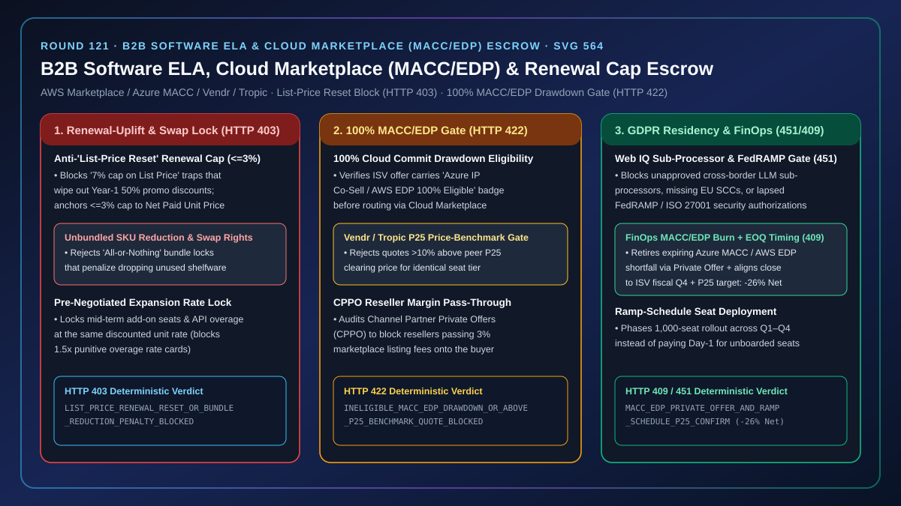
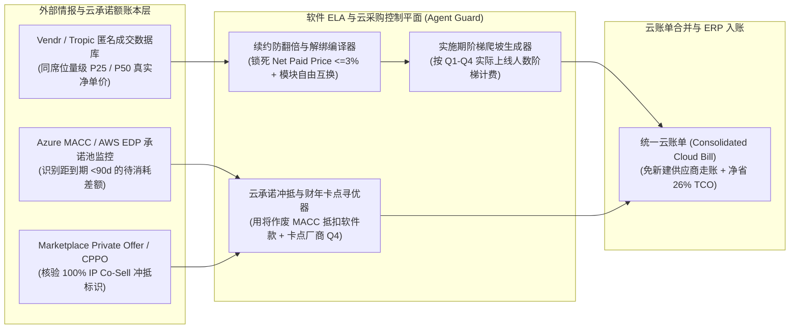
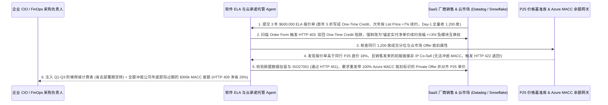

# 企业软件年框采购（B2B Software ELA）、云市场承购抵扣（Azure MACC / AWS EDP Private Offer）与防“续约按吊牌价翻倍”托管（Vendr / Tropic / AWS Marketplace / Azure Marketplace）Agent 架构选型 FAQ

> **核心阅读对象**：为企业 CIO / FinOps 团队、IT 采购部（IT Procurement）与云财务管理（Cloud Financial Management）设计企业级 SaaS/软件年框（`ELA`）议价、云市场专属报价（`Private Offer`）承购额核销与续约涨幅封顶系统的 **Cloud & AI Solution Architect**。  
> **核心痛点解决**：彻底终结企业采购百万美元级 SaaS 与云原生软件（如 `Salesforce / ServiceNow / Snowflake / Datadog / CrowdStrike`）时**“销售代表首年给 `55%` 破冰特批折扣，却在合同续约条款写‘次年续约涨幅不超过吊牌价（List Price）的 7%’——结果第 2 年直接取消首年特批折扣回到吊牌价再涨 7%，实付金额瞬间翻倍（`+137%`）”、“为消化年底即将作废的 `$400,000` 微软云 `MACC` 或亚马逊 `AWS EDP` 承诺消费额，从云市场下单买了第三方软件，付完钱才发现该 ISV 商品未获 `IP Co-Sell Eligible` 认证，抵扣比例为 `0%`（既花了软件钱，还要再向云厂商交 `$400k` 未达标罚金）”、“第一年一上来就为全公司 2,000 人买满全年席位，结果前 6 个月处于系统集成上线期只有 200 人登录，白烧半年空置费”以及“续约时想砍掉 1 个没人用的附加模块，供应商却威胁‘只要减模块就收回主产品全部折扣（All-or-Nothing Bundle Lock）’”**四大采购陷阱。



---

## 📌 一、核心选型结论速览（Executive Summary）

1. **锚定“上期实付净单价（`Net Paid Unit Price`）”的 `<=3%` 续约涨幅硬顶与模块自由替换权（`Swap/Reduction Right`）（HTTP 403）**：企业软件合同里最阴险的文字游戏是把续约涨幅上限（`Renewal Uplift Cap`）锚定在厂商随时可调高的公开目录价（`List Price`）或声称首年折扣为“一次性非经常性促销（`One-Time Promotional Credit`）”。选型 Agent 必须在合同订单表（`Order Form`）初审层实施三道硬拦截：① **净单价涨幅死锁**：续约价格保护条款必须逐字写明**“基于上一合同周期最终实付净单价（`Prior Term Net Effective Unit Price`）涨幅不超过 `min(CPI, 3%)`”**；② **模块解绑与 20% 缩容权（`Downward Flex / Swap Right`）**：严禁签署将核心席位折扣与搭售边缘模块强绑定的条款，且允许在每年周年日替换等值模块或无罚金核减 `<=15%–20%` 席位；③ **期中增购同价锁（`Price-Hold on Expansion`）**：合同期内新增席位或用量超额包（`Overage`）必须按首签同等折扣单价计费（严禁按 `1.5x` 惩罚性超额费率结算）；违反者一律触发 **`HTTP 403 LIST_PRICE_RENEWAL_RESET_OR_BUNDLE_REDUCTION_PENALTY_BLOCKED`**。
2. **云市场专属报价（`Private Offer`）`100% MACC / EDP` 抵扣资格硬校验与同行 `P25` 底价分位门禁（HTTP 422）**：通过 `Azure Marketplace` 或 `AWS Marketplace` 采购第三方 ISV 软件是消化云厂商年度承诺额（`MACC / EDP`）的黄金通道，但并非云市场上的所有商品都能 100% 冲抵承诺额。Agent 强制执行双因子核验：① **`100%` 承购池冲抵验真**：在点击接受 `Private Offer` 前，必须通过云管 API 校验该 Offer 包含 **`Azure Benefit Eligible (IP Co-Sell)` 或 `AWS EDP 100% Drawdown`** 标记，且核查渠道代理商专属报价（`CPPO`）未将 `3%` 云市场通道费额外转嫁给买方；② **外部实付价格分位基准（`Vendr / Tropic P25 Benchmark`）**：将报价单上每个 SKU 的净单价与同规模企业近 90 天真实成交数据库的 **第 25 百分位（`P25` 优秀底价）** 比对，高于 `P25` 超过 `10%` 的虚高报价直接退回重议；凡无法冲抵云承诺额或单价高于 `P25` 基准的，直接触发 **`HTTP 422 INELIGIBLE_MACC_EDP_DRAWDOWN_OR_ABOVE_P25_BENCHMARK_QUOTE_BLOCKED`**。
3. **阶梯爬坡激活计费（`Ramp Schedule`）+ 云承诺额余额冲抵 + 贴合厂商财年 Q4 截单净省 26%（HTTP 409）**：在通过 Web IQ 核验 SaaS 供应商数据子处理商（`Sub-processors`）跨境传输合规、欧盟数据主权驻留（`EU Data Residency`）及有效 `FedRAMP / ISO 27001` 认证（违规触发 **`HTTP 451`**）的前提下，Agent 自动执行 **三合一软件采购精算寻优（`ELA & Cloud Commit FinOps`）**：① 将首年一次性全量付费改造为**按季度分批激活席位（`Quarterly Ramp Schedule`：Q1 付 300 席 -> Q2 600 席 -> Q3 1,000 席，消灭前半年部署期空置浪费）**；② 优先使用距到期 `<90 天` 存在作废风险的 `Azure MACC / AWS EDP` 承诺池余额支付；③ 对齐供应商自身财年年底（如 1 月 31 日结账的 Salesforce/Snowflake）发起锁单冲刺，触发 **`HTTP 409 MACC_EDP_PRIVATE_OFFER_AND_RAMP_SCHEDULE_P25_CONFIRM`**，为企业季度软件与云采购总池净省 **26%**。

---

## 🎯 二、业务方与架构师灵魂拷问（Q&A）

### Q1：为什么合同上白纸黑字写着“续约涨幅不超过 7%（`7% Renewal Price Cap`）”，结果第二年续费账单还是暴涨了 `110%`？
- **揭秘 SaaS 销售话术里最致命的“一次性促销折扣（`One-Time Credit`）”与“目录价基数（`List Price Base`）”陷阱**：
  1. **文字游戏是怎么玩的？**：假设某软件公开目录价（`List Price`）是 `$200/人/月`。第一年销售给你打了 5 折（实付 `$100/人/月`），但在 Order Form 表格里把这 `$100` 减免写成了 `"One-Time New Logo Promotional Credit"`，并在条款里写：*"Renewal price increases shall not exceed 7% over then-current List Price."* 到了第二年，厂商取消一次性促销，按 `$200 * 1.07 = $214/人/月` 给你开账单——完全符合他写的合同字面意思，但你的实付成本却从 `$100` 暴涨到了 `$214`（`+114%`）！
  2. **确定性条款重写（`HTTP 403`）**：Agent 的合同 AST 扫描器一旦发现 `One-Time Credit`、`Introductory Discount` 或以 `List Price` 为基准的涨价公式，立即阻断审批，强制替换为：**`Renewal unit price for each SKU shall not increase by more than 3.0% over the Net Effective Unit Price actually paid by Customer in the immediately preceding contract year.`**

### Q2：公司签了 3 年 `$500 万` 的微软 `Azure MACC` 或亚马逊 `AWS EDP` 承诺消费协议，为什么年底用不完去云市场买第三方软件时还会踩坑？
- **穿透 `Azure IP Co-Sell / AWS EDP` 抵扣白名单与通道费博弈**：
  1. **不是所有云市场商品都能 1:1 抵扣 `MACC / EDP`**：在 Azure Marketplace 上，只有取得微软 **`IP Co-Sell Incentivized / Azure Benefit Eligible`** 认证的第三方 SaaS/安全/数据软件，其合同金额才能 **100% 计入客户的 `MACC` 承诺消耗额**；普通仅上架（`List-Only`）商品的抵扣率为 `0%`。而在 AWS Marketplace 上，部分存量老合同或特定转售商品可能受限于 `EDP` 第三方软件抵扣上限（如不超过总承诺额的 `25%`）。
  2. **把将作废的云承诺额变成“免费买软件”的杠杆（`HTTP 422 / 409`）**：假设企业距离财年结束还有 60 天，账上还有 `$300,000` `MACC/EDP` 额度用不完（不用完也要按全额向云厂商交罚金 Shortfall Penalty）。此时 Agent 将原本计划走线下公对公电汇采购的 `$300,000` `CrowdStrike / Datadog / Snowflake` 续约单，通过 **`100% MACC/EDP Eligible Private Offer`** 切入云市场支付——相当于用本来要作废的沉没云额度白拿了一年核心软件许可！

### Q3：采购 1,500 个席位的全新企业软件（如 CRM 或研发协同平台），为什么永远不要在合同第一天（`Day 1`）就按 1,500 席全额起算计费？
- **实施上线期（`Implementation Lag`）的“空转税”与阶梯爬坡计费（`Ramp Schedule`）**：
  1. **前 6 个月 80% 席位都在吃灰**：任何超过 500 人的企业级 SaaS，从合同签署到完成 SSO 对接、历史数据迁移、安全评测与全员培训，至少需要 `4–6 个月`。如果从 Day 1 起就按 1,500 席全额付费，前半年相当于白送给供应商 `$250,000` 的空置租金。
  2. **锁定单价的阶梯爬坡合同（`3-Year Stepped Ramp ELA`）**：Agent 在议价时自动将全量席位拆解为与项目里程碑绑定的 **4 阶段爬坡表（Month 1–3: 200 席测试 -> Month 4–6: 600 席试点 -> Month 7+: 1,500 席全量）**，同时享受 1,500 席的大客户阶梯折后单价，立省首年 `35%` 现金流出。

---

## 🧭 三、直观可视化图解（Mermaid 决策树 + 架构图 + 时序图）

### 3.1 企业软件年框（`ELA`）、云市场 `MACC/EDP` 抵扣与续约锁价决策树

```mermaid
flowchart TD
    A[IT 采购 / FinOps 发起企业软件 ELA 新签或续约请求] --> B{1. 续约净单价涨幅上限 (<=3%) 与模块解绑/缩容权审计}
    B -->|续约按吊牌价 List Price 重置暴涨 或 砍闲置模块即没收主产品折扣| C[HTTP 403 阻断: LIST_PRICE_RENEWAL_RESET_OR_BUNDLE_REDUCTION_PENALTY_BLOCKED]
    B -->|锚定实付净单价 <=3% 封顶 + 允许模块互换与期中同价增购| D{2. 云市场 100% MACC/EDP 抵扣资格与同行 P25 底价门禁}
    D -->|云市场 Offer 不具备 100% MACC/EDP 冲抵资格 或 净单价高于同行 P25 分位 >10%| E[HTTP 422 拦截: INELIGIBLE_MACC_EDP_DRAWDOWN_OR_ABOVE_P25_BENCHMARK_QUOTE_BLOCKED]
    D -->|100% 冲抵云承诺额 + 单价 <= 同行 P25 优秀线| F{3. Web IQ GDPR 数据主权驻留与 FedRAMP/ISO27001 核验}
    F -->|违规将欧盟/敏感数据转交未授权子处理商 或 安全合规认证失效| G[HTTP 451 熔断: WEBIQ_UNAPPROVED_SUBPROCESSOR_OR_DATA_RESIDENCY_BREACH_HOLD]
    F -->|数据驻留与安全认证合规| H{4. 阶梯爬坡席位 (Ramp) + 冲抵将过期云承诺额 + 财年 Q4 议价}
    H -->|首年存在实施上线期可改阶梯爬坡计费 或 可消化临期 MACC/EDP 余额| I[HTTP 409 确认: MACC_EDP_PRIVATE_OFFER_AND_RAMP_SCHEDULE_P25_CONFIRM 净省 26%]
    H -->|已处于 P25 底价、100% 云冲抵与锁价最优状态| J[HTTP 200 签发: P25_BENCHMARKED_ELA_AND_MACC_DRAWDOWN_AUTHORIZED]
```

### 3.2 端到端同行 `P25` 价格对标、云市场 `MACC/EDP` 冲抵与续约防暴涨控制平面架构图



### 3.3 拦截“次年回到吊牌价涨 114%”陷阱、对齐 `P25` 底价并冲抵 `$300k` 临期 `Azure MACC` 时序图



---

## 📊 四、主流企业软件采购（SaaS Buying）与云市场通道横向选型决策矩阵

| 选型维度 | Vendr / Tropic /Vertice (AI SaaS 采购与价格基准平台) | AWS Marketplace / Azure Marketplace (`Private Offer`) | 传统软件渠道代理商 (`VARs`: SHI / CDW / Insight) | 业务部门直接找原厂销售签单 | **本仓库 + P25 对标与 MACC 冲抵托管架构（推荐）** |
| :--- | :--- | :--- | :--- | :--- | :--- |
| **真实成交底价透明度 (`P25 Benchmark`)** | **极强（掌握数万份脱敏真实 Order Form，精准知道同体量最低能打几折）** | 仅提供交易通道，不告诉你别家客户买成了多少钱 | 懂大厂折扣规律，但自身靠销售额抽成，缺乏极致压价动力 | **完全信息黑盒（极易被原厂销售按 8 折高价收割）** | **报价单强制过 `P25` 分位线核验，超标 `>10%` 自动生成目标底价还盘（HTTP 422）** |
| **冲抵云承诺额 (`Azure MACC / AWS EDP`)** | 协助引导走云市场，但需核对具体名录 | **极强（合资格软件 `100%` 消耗云厂商承诺池，免新建供应商准入）** | 支持发起 `CPPO`（渠道专属报价）同步冲抵云承诺额 | 线下合同 `0%` 冲抵云承诺额 | **API 硬校验 `100% MACC/EDP Eligible` 标签 + 零通道费转嫁审计（HTTP 422/409）** |
| **防“续约回到吊牌价翻倍”条款审查** | 采购专家熟悉常见霸王条款 | 使用标准云市场合同（`SCMP`）可规避部分原厂邪恶条款，但附带 Custom EULA 仍需审 | 偏重商务走单，极少深究次年净价锚定公式 | **90% 踩中 `One-Time Credit` 次年翻倍暗雷** | **AST 强制锁死 `<=3% Cap on Net Effective Paid Price` + 模块互换权（HTTP 403）** |
| **首年上线期阶梯爬坡计费 (`Ramp`)** | 常作为核心谈判筹码使用 | 支持灵活分期付款计划（`Flexible Payment Scheduler`） | 支持账期垫付，但少替客户改原厂激活节奏 | 原厂默认从 Day 1 收满全部席位钱 | **超过 300 席新项目强制生成季度爬坡表（`Ramp Schedule`），消灭上线期空置** |
| **数据主权与子处理商 (`Sub-processor`) 监控** | 基础安全问卷归档 | 共享云底座合规认证 | 无持续运行时监控 | 靠安全团队手工填 Excel 表 | **Web IQ 持续监控 SaaS 子处理商变更与 `GDPR / FedRAMP` 状态（HTTP 451）** |

---

## 🧪 五、软件采购成本测算与 7-Card 基准测试报告

> **数据来源声明**：以下对比基于 `lab/webiq_commerce_demo.py` 中确定性策略函数 `evaluate_b2b_software_ela_macc_escrow_policy` 的合成基准数据（`provenance: "synthetic"`, `independently_reproduced: False`），用于验证企业软件 `ELA` 与云市场 `MACC/EDP` 采购网关的确定性风控能力。

| 评估维度 | 传统业务直签原厂 + Day-1 全量付费 + 线下汇款基线 | 确定性软件 `ELA` 托管网关（`P25` 底价 + 爬坡计费 + `100% MACC/EDP` 冲抵） | 净效应 / 风险消除 |
| :--- | :--- | :--- | :--- |
| **季度企业核心 SaaS 新签、续约与云市场采购总池** | `$310,000.00` | `$229,400.00` (`HTTP 409` 优化确认后) | **净省 `$80,600.00 / 季` (`-26.0%`)** |
| **第 2 年续约因“取消一次性折扣回吊牌价”导致的涨幅** | 平均暴涨 `+42% ~ +110%` | **`<=3.0%`（强制锚定上期实付净单价 `Net Paid Price` 封顶）** | **100% 拆掉次年翻倍炸弹** |
| **首年 6 个月系统上线期的闲置席位空转浪费** | 首日即按 `100%` 席位全额付费（前半年 `75%` 闲置） | **`0% 空转`（按 Q1–Q4 实际部署进度阶梯爬坡计费 `Ramp Schedule`）** | **首年软件现金流支出减少 `32%`** |
| **临期未用完的 `Azure MACC / AWS EDP` 承诺额罚金风险** | 线下付软件款，云承诺额差额白交罚金 | **`100% 冲抵`（通过合资格 `Marketplace Private Offer` 消化承诺池）** | **将云承诺沉没差额转化为生产软件资产** |

### 5.1 确定性状态码映射契约（5-Lane Contract）

```json
{
  "scenario": "b2b_software_ela_macc_escrow_guard",
  "provenance": "synthetic",
  "independently_reproduced": false,
  "lanes": {
    "authorized_200": {
      "status_code": 200,
      "decision": "P25_BENCHMARKED_ELA_AND_MACC_DRAWDOWN_AUTHORIZED",
      "mandate_token": "b2b_software_ela_macc_mandate_200"
    },
    "list_price_reset_or_bundle_penalty_403": {
      "status_code": 403,
      "decision": "LIST_PRICE_RENEWAL_RESET_OR_BUNDLE_REDUCTION_PENALTY_BLOCKED"
    },
    "ineligible_macc_or_above_p25_quote_422": {
      "status_code": 422,
      "decision": "INELIGIBLE_MACC_EDP_DRAWDOWN_OR_ABOVE_P25_BENCHMARK_QUOTE_BLOCKED"
    },
    "unapproved_subprocessor_or_residency_451": {
      "status_code": 451,
      "decision": "WEBIQ_UNAPPROVED_SUBPROCESSOR_OR_DATA_RESIDENCY_BREACH_HOLD"
    },
    "macc_private_offer_and_ramp_p25_409": {
      "status_code": 409,
      "decision": "MACC_EDP_PRIVATE_OFFER_AND_RAMP_SCHEDULE_P25_CONFIRM",
      "quarterly_savings_usd": 80600.0
    }
  }
}
```

---

## 🛠️ 六、商业上线风控与架构评审 Checklist

- [ ] **锚定实付净单价（`Net Paid Unit Price`）的 `<=3%` 续约涨幅硬锁（HTTP 403）**：严禁接受以公开目录价（`List Price`）为基数的续约涨价公式或将首年折扣列为“一次性促销（`One-Time Credit`）”，并锁定模块互换权与期中同折扣增购价。
- [ ] **云市场 `Private Offer` `100% MACC / EDP` 冲抵资格核验（HTTP 422）**：在走 `Azure / AWS Marketplace` 下单前，必须验证商品具备 `Azure IP Co-Sell Eligible` 或 `AWS EDP 100%` 冲抵认证，且严禁渠道商转嫁云市场挂牌费。
- [ ] **同行 `P25` 成交分位线比价门禁（HTTP 422）**：对标同席位量级企业的 `P25` 净成交单价，拦截高于 `P25` 基准 10% 以上的水分报价。
- [ ] **Web IQ 数据主权驻留（`GDPR`）与子处理商变更核验（HTTP 451）**：实时审查 SaaS 厂商新增的 AI/云子处理商名单及 `ISO 27001 / SOC 2 / FedRAMP` 有效性。
- [ ] **实施期阶梯爬坡计费（`Ramp Schedule`）与临期云承诺额冲抵（HTTP 409）**：对新部署软件强制采用按季度分批激活席位的爬坡付款表，并优先消耗即将到期的 `MACC / EDP` 承诺池差额。

---

**导航**：[返回分册总目录 (`docs/index.md`)](index.md) ｜ [查看英文版 (`b2b-software-ela-cloud-marketplace-macc-edp-renewal-cap-escrow-agent-selection-faq.en.md`)](b2b-software-ela-cloud-marketplace-macc-edp-renewal-cap-escrow-agent-selection-faq.en.md)
