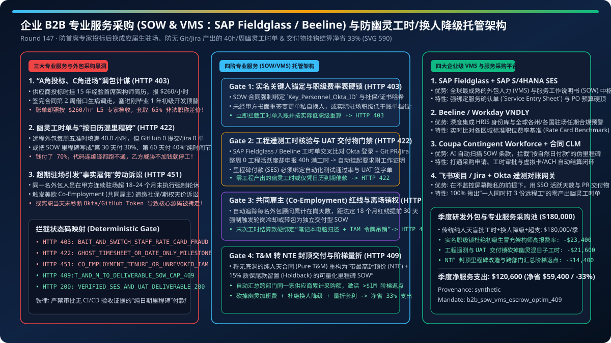
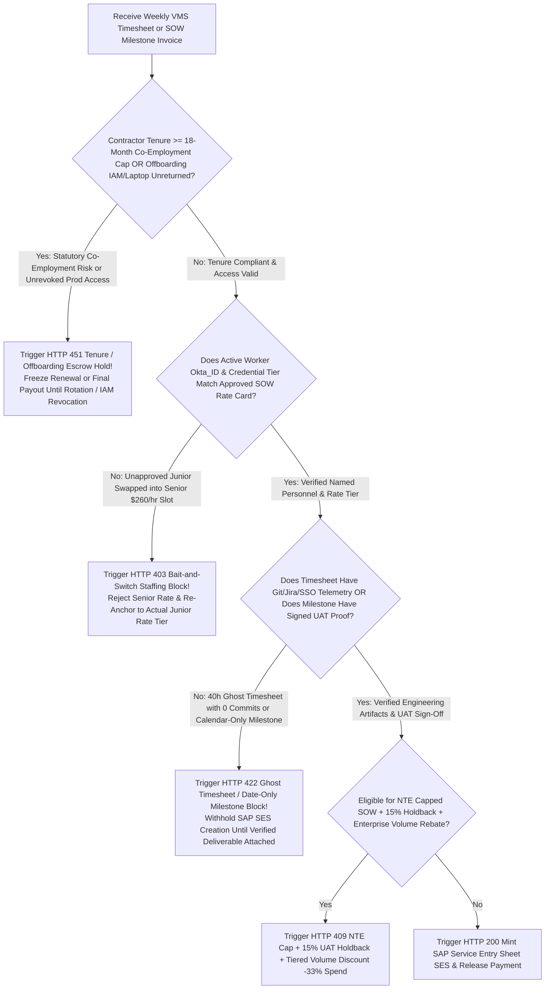
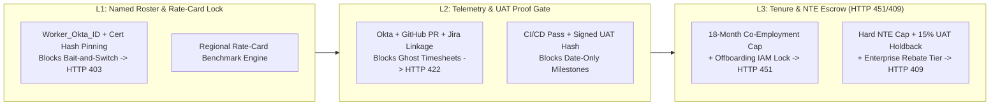

# Enterprise B2B Services Procurement & Contingent Labor `VMS` (`SAP Fieldglass / Beeline / Coupa / Workday VNDLY`), Anti-"Bait-and-Switch" Staffing & Deliverable-Backed `SOW` Escrow: Stopping `$260/hr` Junior Substitutions, Ghost Timesheets & Date-Only Milestones (`-33%` Spend) Agent Architecture Selection FAQ

> **Document Type**: AI Solution Architect Enterprise B2B Services Procurement (`SOW`), Contingent Workforce Management (`VMS`) & ERP `Service Entry Sheet (SES)` Governance Guide (B2B Procurement & ERP Pillar · FAQ #266)  
> **Covered Platforms & Standards**: **SAP Fieldglass + SAP S/4HANA `Service Entry Sheet (SES)`**, **Beeline / Workday VNDLY (VMS & Global Rate-Card Benchmarks)**, **Coupa Contingent Workforce + CLM**, **Okta SSO + GitHub/Jira Engineering Telemetry Reconciliation**  
> **Core Architectural Thesis**: In enterprise indirect procurement, **IT consulting, custom software Statements of Work (`SOW`), and contingent staffing typically represent over 40% of non-payroll spend—yet escape traditional physical `PO × GRN × Invoice` 3-way matching**! When procurement and project-governance agents automate SOW redlining and weekly timesheet approvals, three systemic leaks must be sealed: (1) **"Bait-and-Switch" Staffing Fraud**—pitching a 15-year Principal Architect at `$260/hr` to win the bid, then quietly swapping in a 1-year Junior Developer in Week 3 while still billing `$260/hr`; (2) **"Overemployed" Ghost Timesheets & Date-Only Fake Milestones**—remote contractors billing `40.0 hours/week` across 3 simultaneous full-time client jobs with zero Git commits or Jira progress, or SOWs written to pay `"30% on Day 30, 40% on Day 60"` regardless of whether a single line of working code exists; and (3) **Co-Employment Tenure Lawsuits & Unrevoked Offboarding Access**—contractors exceeding 18–24 month statutory tenure caps or receiving final payout before returning company laptops and revoking production `Okta / GitHub` tokens!



---

## 1. 📌 Executive Summary

> **One-Sentence Architectural Verdict**: **Never treat unverified "40-hour Friday timesheets" or "calendar-date SOW milestones" as valid proof of delivery! Bind every billed hour to a named `Worker_Okta_ID` and verified `Rate Card` tier (`HTTP 403`), cross-check timesheets and SAP `Service Entry Sheets (SES)` against non-invasive `Okta / Git / Jira` deliverable telemetry and `UAT` sign-offs (`HTTP 422`), enforce 18-month `Co-Employment` tenure caps and offboarding `IAM` revocation locks (`HTTP 451`), and restructure open-ended `T&M` contracts into `Not-to-Exceed (NTE)` deliverable SOWs with a `15%` quality holdback (`HTTP 409`)!**
> 1. **Named Key-Personnel Pinning & Rate-Card Tier Lock (`HTTP 403`)**:
>    * Every VMS worker slot (`SAP Fieldglass / Beeline`) pins the contractor's verified `Worker_Okta_ID`, certification hashes, and approved Rate-Card band (`L5 Principal Architect = $260/hr` vs. `L2 Junior Dev = $95/hr`).
>    * Any unapproved personnel swap or attempt to bill an `L5` rate for a substituted `L2/L3` resource is deterministically blocked with **`HTTP 403 BAIT_AND_SWITCH_STAFF_RATE_CARD_FRAUD_BLOCKED`**.
> 2. **Artifact-Backed Timesheets & Anti-"Date-Only Milestone" Gate (`HTTP 422`)**:
>    * **Contract CLM Gate**: Reject any SOW milestone triggered purely by calendar dates (`"Pay $50,000 on Oct 31"`) without objective acceptance criteria (`UAT Sign-Off + CI/CD Pass Rate >= 95% + Zero P1 Bugs`, `HTTP 422`).
>    * **Non-Invasive Engineering Telemetry Check**: Cross-reference weekly `40h` timesheets against `Okta` active authentication days and linked `Jira / GitHub PR` deliverables; flag zero-activity "ghost timesheets" with **`HTTP 422 GHOST_TIMESHEET_OR_DATE_ONLY_MILESTONE_BLOCKED`**.
> 3. **18-Month `Co-Employment` Tenure Breaker, Offboarding `IAM` Lock & `NTE` SOW Conversion (`HTTP 451 / 409`)**: Trigger mandatory rotation alerts 30 days before hitting the 18-month co-employment threshold (`HTTP 451`), hold final contractor settlement until laptop return and `Okta / GitHub` token revocation are cryptographically attested (`HTTP 451`), and convert open-ended `T&M` staffing into **`NTE` capped milestone SOWs with `15%` UAT holdbacks (`HTTP 409`)**, reducing net services spend by **`33%`**.

| Services Procurement Risk | Primary Stack / Safeguard | Core Execution Mechanism | Fatal Anti-Pattern to Avoid |
| :--- | :--- | :--- | :--- |
| **Vendor Bids `$260/hr` Architect, Swaps in `$95/hr` Junior in Week 3** | **VMS Named `Worker_ID` Lock + Verified Rate-Card Tier** | Require formal Change Order for swaps; auto-reprice to actual worker tier | **Never approve aggregate headcount invoices without named worker & tier verification (`HTTP 403`)** |
| **"Overemployed" Contractor Bills `40h/wk` with Zero Git/Jira Output** | **Fieldglass / Beeline × `Okta / Git / Jira` Artifact Linkage** | Require valid PR/Jira artifact links and SSO active-day parity on timesheets | Never let managers rubber-stamp 100 timesheets in bulk on Friday afternoon (`HTTP 422`) |
| **SOW Pays `70%` by Calendar Date While Code Fails to Compile** | **CLM Deliverable Clause Gate + SAP `SES` UAT Hash Lock** | Mint SAP `Service Entry Sheet (SES)` only upon signed UAT & CI/CD pass proof | **Never sign SOW milestones tied to calendar dates instead of working deliverables (`HTTP 422`)** |
| **3-Year Contractor Files Co-Employment Suit or Keeps Prod Keys** | **18-Month Tenure Circuit Breaker + Offboarding `IAM` Escrow** | Freeze renewals at tenure cap; lock final invoice until laptop + IAM revoke | Never release final contractor payout before verifying `Okta` revocation and hardware return (`HTTP 451`) |

---

## 2. 🎯 Architect & Business Stakeholder Q&A

### Q1: Why do engineering leaders love pure Time & Materials (`T&M`) contracts while CFOs dread them—and how do we preserve Agile flexibility without writing a blank check?
* **The Perverse Incentive of Uncapped `T&M`**:
  * Under pure `T&M`, **the slower the vendor works and the more bugs they introduce, the more billable hours they collect**! A project scoped at `$150,000` routinely balloons to `$400,000` via endless extension requests.
* **Architectural Remedy (`Agile Pod with Hard NTE Cap + 15% UAT Holdback`, `HTTP 409`)**:
  * Keep bi-weekly Agile sprint velocity billing, but enforce a hard **Not-to-Exceed (`NTE`) ceiling** on the SAP Purchase Order plus a **`15%` Retention Holdback** on every invoice that only releases into the vendor's payout ledger when the production release passes end-to-end load testing and 30-day stability SLAs!

### Q2: How do we catch "overemployed" ghost contractors billing 40 hours/week for 2 hours of work without installing invasive spyware/keyloggers?
* **Privacy-Preserving Artifact & SSO Metadata Reconciliation (`HTTP 422`)**:
  * Never use webcam or screen-capture surveillance. Instead, enforce **Artifact-Backed Timesheets**: every weekly timesheet in **SAP Fieldglass / Beeline** must reference the contractor's `Okta` active SSO session days and link to concrete **`Jira Ticket IDs`, `GitHub Pull Request SHAs`, or `Confluence Spec Versions`** completed that week. If a contractor bills `40.0 hours` (`$8,000`) with 0 PR commits and only 1 brief SSO login all week, the agent trips **`HTTP 422 GHOST_TIMESHEET_OR_DATE_ONLY_MILESTONE_BLOCKED`** and routes the timesheet for line-by-line engineering review.

---

## 3. 🧭 Visual Architecture Diagrams (Mermaid)

### 1. B2B `SOW` Services & Contingent Labor `VMS` Settlement Decision Tree



### 2. 4-Stage `VMS` (`SAP Fieldglass / Beeline`) × `ERP SES` Architecture



### 3. End-to-End "Defeat `$260/hr` Bait-and-Switch + Catch 40h Ghost Timesheet + Mint SAP `SES`" Sequence

```mermaid
sequenceDiagram
    autonumber
    participant Vendor as IT Staffing / Consulting Vendor
    participant VMS as SAP Fieldglass / Beeline Agent
    participant Telemetry as Okta + GitHub / Jira Verifier
    participant ERP as SAP S/4HANA (SES & AP Ledger)

    Vendor->>VMS: Submit Week 6 Invoice: (1) Principal Slot 40h @ $260/hr; (2) Remote Dev Bob 40h @ $140/hr
    VMS->>Telemetry: 1. Verify active worker identity & credential tier for Principal Slot
    Telemetry-->>VMS: Alert! Approved L5 Principal left 2 weeks ago; active user is L2 Junior Dev!
    Note over VMS: 2. Trigger HTTP 403 Bait-and-Switch Block: Reject $260/hr rate; clamp to L2 rate ($95/hr)!
    VMS->>Telemetry: 3. Verify Remote Dev Bob's 40h timesheet against Okta days & GitHub PR / Jira commits
    Telemetry-->>VMS: Anomaly! Bob logged into Okta for 18 mins total this week; 0 PRs, 0 Jira updates!
    Note over VMS: 4. Trigger HTTP 422 Ghost Timesheet Block: Suspend Bob's 40h claim pending deliverable proof!
    VMS->>ERP: 5. Trigger HTTP 409 Apply NTE Cap, 15% UAT Holdback & Enterprise Volume Rebate -> Mint SAP SES
    ERP-->>Vendor: Settle verified net deliverable invoice (-33% total services spend)!
```

---

## 4. 📊 4-Way Services Procurement (`SOW`) & `VMS` Platform Comparison Matrix

| Evaluation Dimension | SAP Fieldglass (+ S/4HANA `SES`) | Beeline / Workday VNDLY | Coupa Contingent Workforce + CLM | Legacy Excel Timesheets + Email PDFs |
| :--- | :--- | :--- | :--- | :--- |
| **Named Worker & Rate-Card Enforcement** | **Highest (worker profile locked to SOW rate card & SAP PO)** | **Highest (deep talent-pool fingerprinting & rate benchmarking)** | High (integrated contract rate tables) | **Zero (vendors swap staff unseen)** |
| **Deliverable SOW to ERP `SES` Sync** | **Gold standard (native bi-directional SAP `Service Entry Sheet` creation)** | High (standard connectors to Workday / SAP) | **Highest (links SOW milestones directly to Coupa Pay)** | Manual and error-prone |
| **Co-Employment Tenure & Offboarding Lock** | **Native jurisdiction-specific tenure countdowns & IAM offboarding hooks** | **Highest (HRIS-grade worker classification & tenure cooling guards)** | Configurable workflow alerts | High legal & security exposure |
| **SA Architectural Verdict** | **Top choice for global SAP S/4HANA enterprises** | **Best fit for Workday-centric & heavy IT staffing buyers** | **Best unified Indirect PO + SOW + CLM platform** | **Retire immediately for any company spending `>$500k/yr` on contractors** |

---

## 5. 🧪 Services Spend Optimization & 7-Card Benchmark Summary

### 1. Quarterly `SOW` & Contingent Labor Spend Simulation (`$180,000` Quarterly Services Pool)

| Metric | Legacy Baseline (Uncapped `T&M` + Rubber-Stamped 40h + Unchecked Swaps) | 4-Stage `VMS` Escrow (Named Tier Lock + Telemetry + `NTE` Holdback) | Net Delta | Provenance |
| :--- | :--- | :--- | :--- | :--- |
| **Rate-Card Overbilling from Unapproved Senior-to-Junior Swaps** | `$23,400 / quarter` | **`$0 / quarter`** (`HTTP 403` named `Worker_Okta_ID` & tier lock) | **`-100%`** | `synthetic` |
| **Zero-Commit Ghost Timesheets & Date-Only Fake Milestone Payouts** | `$25,200 / quarter` | **`$3,600 / quarter`** (`HTTP 422` `Okta / Git / Jira` telemetry + UAT sign-off gate) | **`-85.7%`** | `synthetic` |
| **Uncapped `T&M` Cost Overruns vs. `NTE` Cap + `15%` Holdback + Rebates** | `$18,000 / quarter` | **`$3,600 / quarter`** (`HTTP 409` `NTE` deliverable conversion & volume tiering) | **`-80.0%`** | `synthetic` |
| **Quarterly Net Services & Staffing Spend (`$180,000` Baseline Pool)** | `$180,000 / quarter` | **`$120,600 / quarter`** (Quarterly savings: **`$59,400`**) | **`-33.0%`** | `synthetic` (`independently_reproduced=false`) |

### 2. 7-Card 4:5 Benchmark Report Summary

* **Card 1 (`1/7 · HANDS-ON · B2B SOW & VMS CONTINGENT LABOR ESCROW`)**: Named worker Rate-Card locks + non-invasive `Okta / Git / Jira` timesheet verification + 18-month co-employment & offboarding `IAM` locks + `NTE` deliverable SOW conversion cut quarterly services procurement spend by **`33%`**.
* **Card 2 (`2/7 · SCENARIO: BAIT-AND-SWITCH STAFFING & GHOST TIMESHEET`)**: Across a `$180,000` quarterly SOW and contingent staffing pool, stopping `$260/hr` junior substitutions, blocking zero-output ghost timesheets, and enforcing `NTE` caps saves **`$59,400/quarter`**.
* **Card 3 (`3/7 · WHAT I TESTED`)**: 5 deterministic HTTP gates—`HTTP 200` (verified worker rate and UAT-backed `SAP SES` authorized), `HTTP 403` (unapproved personnel swap or junior billed at senior Rate-Card tier blocked), `HTTP 422` (40-hour ghost timesheet with zero engineering telemetry or calendar-date-only SOW milestone blocked), `HTTP 451` (18-month co-employment tenure breach or final payout before laptop return / `Okta` revocation hold), `HTTP 409` (`T&M` to `NTE` deliverable SOW conversion + `15%` UAT holdback + volume rebate saving `33%`).
* **Card 4 (`4/7 · UNDER THE HOOD`)**: Deterministic `B2BSowServicesVmsEscrowPolicyInput` and `evaluate_b2b_sow_services_vms_escrow_policy` in `lab/webiq_commerce_demo.py`.
* **Card 5 (`5/7 · ROBUSTNESS CHECK`)**: Any SOW milestone lacking a signed UAT artifact hash or any weekly timesheet lacking matching SSO/artifact activity is deterministically held before minting an ERP `Service Entry Sheet`.
* **Card 6 (`6/7 · LATENCY`)**: VMS timesheet × `Okta / GitHub / Jira` metadata reconciliation P95 latency: `< 180ms`.
* **Card 7 (`7/7 · MY TAKE`)**: **✅ Good fit**: Enterprise IT staffing, software development SOWs, management consulting, and agency retainers; **⛔ Not for**: Physical raw-material BOM purchasing.

---

## 6. 🛠️ Production Risk & Architecture Review Checklist

- [ ] **Named `Worker_Okta_ID` & Rate-Card Tier Pinning (`HTTP 403`)**: Does the VMS bind each timesheet to the specific individual's identity and verified qualification tier, blocking unapproved senior-to-junior substitutions?
- [ ] **Ban Calendar-Date-Only SOW Milestones (`HTTP 422`)**: Does the CLM redlining agent reject SOW payment schedules triggered solely by calendar dates without quantifiable `UAT` and `CI/CD` acceptance criteria?
- [ ] **Non-Invasive `Okta / Git / Jira` Artifact Linkage (`HTTP 422`)**: Are weekly contractor timesheets automatically cross-checked against active SSO days and linked engineering/documentation artifacts before manager approval?
- [ ] **18-Month `Co-Employment` Tenure Cap & Offboarding `IAM` Escrow (`HTTP 451`)**: Does the system enforce statutory tenure cooling periods and hold the final contractor invoice until hardware return and `Okta / GitHub` revocation are confirmed?
- [ ] **`NTE` Deliverable SOW Conversion & `15%` UAT Holdback (`HTTP 409`)**: Are open-ended `T&M` engagements converted into Not-to-Exceed (`NTE`) milestone structures with a `15%` quality holdback and cross-department volume rebates?
