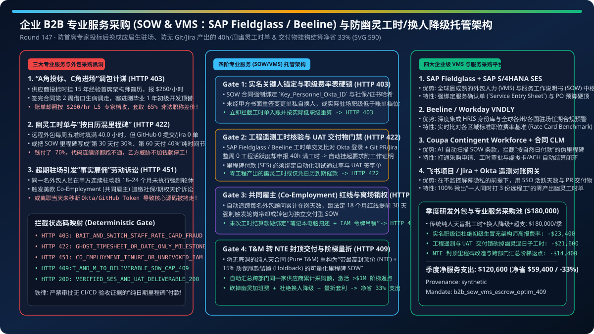
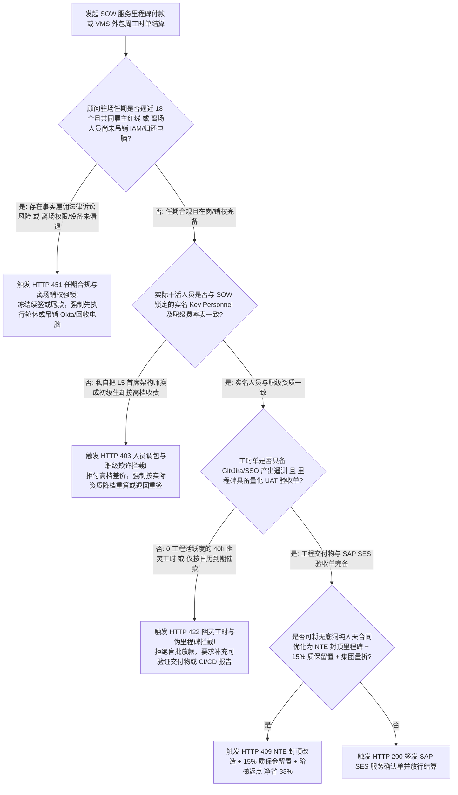
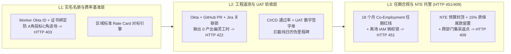

# 企业 B2B 专业服务采购与外包人力管理（SOW & Contingent Labor VMS：SAP Fieldglass / Beeline / Coupa / Workday VNDLY）、防“名师投标学徒驻场”调包与防幽灵工时托管：“防初级生冒充 $260/hr 架构师、防 0 代码提交照填 40 小时满工时与 UAT 交付物挂钩结算净省 33%”Agent 架构选型 FAQ

> **文档类型**：AI Solution Architect 企业 B2B 服务采购（Services Procurement）、工作说明书（SOW）合同初审与外包人力管理（VMS）选型指南（B2B Procurement & ERP Pillar · FAQ #266）  
> **涵盖平台与技术栈**：**SAP Fieldglass + SAP S/4HANA `Service Entry Sheet (SES)`**、**Beeline / Workday VNDLY（外包人力 VMS 与全球费率表基准）**、**Coupa Contingent Workforce + CLM**、**Okta SSO + GitHub/Jira 工程交付遥测对账**  
> **核心架构命题**：在企业非生产性采购（Indirect Spend）中，**IT 研发外包、管理咨询与专业服务（SOW & Contingent Labor）往往占总支出的 40% 以上，却也是水最深、最难用传统实物“三单匹配”监管的失血黑洞**！当采购与项目管理 Agent 接管 SOW 初审与每周工时单（Timesheet）对账时，必须堵死三大经典套路：① **“A角投标、C角进场（Bait-and-Switch Staffing）”**——供应商在竞标时亮出 15 年经验首席架构师的豪华简历并谈下 `$260/小时` 的高价，进场两周后以“家里有事/调岗”为由将其换走，塞进两名刚毕业 1 年的初级开发顶替，账单却照收 `$260/hr` 架构师费率；② **“远程多份工幽灵工时单（Overemployment Ghost Timesheet）与伪里程碑”**——外包顾问每周五机械式提交 `40.0 小时` 满工时，但整个礼拜 Okta 登录仅 2 次、GitHub 代码提交为 0；或把固定总价 SOW 写成“第 30 天付 30%、第 60 天付 40%”的纯日历节点，钱付了大半却只收到几页空洞 PPT；③ **“超期驻场共同雇主（Co-Employment）诉讼与离场未收权泄露”**——同一外包驻场超过 18–24 个月未轮休触发劳动法事实雇佣索赔，或结清尾款时未归还企业电脑并吊销生产库权限！



---

## 一、 📌 核心选型结论速览（Executive Summary）

> **一句话架构定调**：**服务采购绝不能把“按人天混日子（Pure T&M）”当成标准答案！必须构建“实名关键人 Okta 身份与职级费率表硬锁（HTTP 403）+ 工时单绑定 SSO/Git/Jira 活跃遥测与 UAT 验收单（HTTP 422）+ 18 个月共同雇主任期熔断与离场 IAM 销权锁（HTTP 451）+ 纯人天转 NTE 封顶里程碑与 15% 质保金留置（HTTP 409）”四位一体 VMS 托管架构！**
> 1. **防“首席专家投标、初级生进场”实名职级锁（`Key-Personnel Identity & Rate-Card Lock`，HTTP 403 门禁）**：
>    * 在 **SAP Fieldglass / Beeline** 中，每一份工时单不仅绑定供应商名称，更强制绑定 **具体顾问的实名身份标识（`Worker_Okta_ID` + 认证资质证书编号）与合同核准职级（如 `L5 Principal Architect = $260/hr` vs `L2 Junior Dev = $95/hr`）**。
>    * 凡供应商未经甲方采购总监签署正式《人员变更修正案（PCR）》擅自更换驻场人员，或新换入人员的认证工龄/职级低于原定档位却企图按原高档费率开票，Agent 立即触发 **`HTTP 403 BAIT_AND_SWITCH_STAFF_RATE_CARD_FRAUD_BLOCKED`** 拒付并强制降档重算！
> 2. **防“零产出满工时”与“按日历混里程碑”的交付物门禁（`Deliverable-Backed SES & Timesheet Gate`，HTTP 422 门禁）**：
>    * **SOW 合同初审铁律**：Agent 在法务初审阶段自动扫描 SOW 付款条款——凡将里程碑触发条件写为纯日期（如 `Upon 2026-12-01` 或 `30 days after kickoff`）而无量化验收标准（如 `UAT Sign-off + 95% E2E Test Pass + P1 Bug = 0`）的伪里程碑，一律拦截退回修改（`HTTP 422`）；
>    * **T&M 工时遥测交叉校验**：每周审批 `40h` 工时单前，自动核对脱敏工程活跃度指标（Okta 工作日登录天数、门禁刷卡记录、Jira 状态流转或 PR 提交记录）；对整周 0 登录/0 交付却填报满工时的异常单据，触发 **`HTTP 422 GHOST_TIMESHEET_OR_DATE_ONLY_MILESTONE_BLOCKED`** 挂起核查！
> 3. **共同雇主（Co-Employment）任期红线 + 离场设备/权限双清锁 + NTE 封顶改造（HTTP 451 / 409）**：在顾问驻场满 18 个月红线前 30 天强制预警轮休（`HTTP 451`），最后一笔尾款硬绑定“IT 资产归还 + Okta/GitHub 令牌吊销回执”（`HTTP 451`）；并通过将无上限 T&M 合同改造为 **带封顶上限（Not-to-Exceed, NTE）与 15% 质保留置金（Holdback）的成果型 SOW**，为企业净省 **`33%`** 外包服务采购支出！

| 专业服务与外包采购痛点 | 首选方案 / 架构防线 | 核心管控机制 | 严禁踩坑红线 |
| :--- | :--- | :--- | :--- |
| **投标时用大牛简历，进场后偷偷换成廉价生手按原高价收费** | **VMS 实名 `Worker_ID` 锁 + 职级费率表 (`Rate Card`) 强校验** | 换人必走线上审批并重核资历，降级替补自动按低档费率计价 | **严禁只按“供应商总人头数”结算而不校验具体是谁在干活 (`HTTP 403`)** |
| **远程外包每周填满 40 小时却零代码/零文档产出（同时打 3 份工）** | **Fieldglass / Beeline × Okta/Git/Jira 活跃天数交叉对账** | 工时单天数必须与 SSO 活跃日及关联任务交付记录对齐 | 严禁部门经理看都不看、周五下午一键批量盲批几百张工时单 (`HTTP 422`) |
| **SOW 合同写成“每隔 30 天付 25%”，钱付完 75% 项目却烂尾** | **Coupa CLM 里程碑语义审查 + SAP `SES` 验收单硬门禁** | 每笔里程碑必须绑定可验证的生产环境部署或 UAT 签字哈希 | **严禁签署以“自然日历推移”而非“量化成果验收”作为付款条件的 SOW (`HTTP 422`)** |
| **外包驻场 3 年起诉甲方要求同工同酬赔偿，或离职带走源码** | **18 个月任期自动熔断器 + 尾款绑定 `Okta Revoke + 电脑入库`** | 任期逼近法定上限自动冻结续签；未吊销权限严禁释放末期尾款 | 严禁在未确认账号销权与电脑归还前放行离场顾问的最终结算单 (`HTTP 451`) |

---

## 二、 🎯 业务方与架构师灵魂拷问（Q&A）

### Q1：研发总监总喜欢签“纯人天合同（Time & Materials, T&M）”因为需求改起来省事，为什么财务总监（CFO）把无封顶 T&M 视为吞金兽？Agent 怎么在保留敏捷弹性的同时锁死预算？
* **纯 T&M 合同的逆向激励陷阱（Perverse Incentive）**：
  * 在纯 T&M 模式下，**乙方干得越慢、写出的 Bug 越多、返工时间越长，乙方赚到的工时费反而越多**！这就是为什么一个原本预估 `$150,000` 的系统集成项目，最后往往通过无数次“工时增补单（Change Order）”膨胀到 `$420,000`。
* **架构师硬核解法（`Agile Pod with NTE Cap + 15% UAT Holdback`，HTTP 409）**：
  1. **最高封顶价（Not-to-Exceed, `NTE`）铁笼**：允许按双周 Sprint 敏捷迭代计费，但整份 SOW 在 SAP S/4HANA 采购订单层硬性锁死 `PO_Max_NTE_Amount`——一旦累计消耗达 `80%` 而史诗故事点（Story Points）完成度不足 `50%`，系统立即告警并冻结后续增量工时；
  2. **15% 终验质保留置金（`Retention Holdback`）**：平时每双周工时单仅支付 **`85%`** 现金，剩余 **`15%`** 自动沉淀在托管子账本中，直至全套系统通过生产压力测试与 30 天无重大故障运行后才予以解冻放款！

### Q2：如何在不侵犯远程工程师个人隐私（不装流氓截屏监控软件）的前提下，精准识别出“同时给 3 家公司远程打工、在咱们这儿浑水摸鱼”的幽灵工时单？
* **基于零隐私侵入的“工程产出物数字指纹（Artifact-Linked Timesheet）”对账（HTTP 422）**：
  * 根本不需要监控摄像头或键盘敲击率！正规研发与咨询工作天然会在企业工具链留下不可伪造的元数据：
    1. **身份网关活跃度**：该顾问的 `Okta / Entra ID` 在所申报的 5 个工作日内是否有合规的开发环境鉴权会话；
    2. **交付物强关联**：VMS 工时单的每一行 `8.0 hrs` 必填对应的 **`Jira Issue Key`、`GitHub Pull Request URL` 或 `Confluence 设计文档版本 Hash`**；
    3. **异常拦截**：若某顾问连续两周申报 `80 小时（$16,000）`，但关联的 PR 仅修改了 3 行配置文件或 Jira 状态毫无推进，Agent 自动抛出 **`HTTP 422 GHOST_TIMESHEET_OR_DATE_ONLY_MILESTONE_BLOCKED`**，将其从“自动免审通道”踢入技术负责人人工逐行代码复核！

---

## 三、 🧭 直观可视化图解（Mermaid 决策树 + VMS 服务托管架构 + 验收时序图）

### 1. 企业 B2B 专业服务（SOW）与外包工时（VMS）结算门禁决策树



### 2. 四阶 B2B 服务采购（SAP Fieldglass / Beeline × ERP SES）架构图



### 3. “拦截 `$260/hr` 架构师私自换人 + 识别零代码幽灵工时 + NTE 结算”时序图

```mermaid
sequenceDiagram
    autonumber
    participant Vendor as 外包服务商 (IT Staffing Vendor)
    participant VMS as SAP Fieldglass / Beeline 智能网关
    participant Telemetry as Okta + GitHub / Jira 遥测核验器
    participant ERP as SAP S/4HANA (SES & AP 资金池)

    Vendor->>VMS: 提交第 6 周账单: (1) 架构师工时 40h × $260; (2) 远程开发 Bob 工时 40h × $140
    VMS->>Telemetry: 1. 核对架构师席位实际登录者身份与职级档案
    Telemetry-->>VMS: 告警! 原 L5 架构师已于 2 周前停用，当前登录者为刚入职 8 个月的 L2 初级工!
    Note over VMS: 2. 触发 HTTP 403 拦截调包: 拒绝按 $260/hr 计费，强制重锚至 L2 费率 ($95/hr)!
    VMS->>Telemetry: 3. 核对远程开发 Bob 本周 40h 关联的 Jira 单与 Git PR 提交记录
    Telemetry-->>VMS: 异常! Bob 本周 Okta 仅登录 18 分钟，0 代码提交，0 文档更新!
    Note over VMS: 4. 触发 HTTP 422 冻结 Bob 幽灵工时单，要求供应商出具实质工作产出证明!
    VMS->>ERP: 5. 触发 HTTP 409 执行 NTE 封顶管控与 15% UAT 质保金留置，生成合规 SES 结算单
    ERP-->>Vendor: 净省 33% 虚报工时与职级溢价!
```

---

## 四、 📊 四大企业级服务采购（SOW）与外包人力（VMS）平台选型矩阵

| 评估维度 | SAP Fieldglass (+ S/4HANA SES) | Beeline / Workday VNDLY | Coupa Contingent Workforce + CLM | 传统 Excel 工时表 + 邮件发 PDF 发票 |
| :--- | :--- | :--- | :--- | :--- |
| **核心适用客户** | **跨国制造、金融与大型科技企业（强 SAP ERP 底座）** | **大规模灵活用工、IT 驻场与全球多法域合规企业** | **希望将实物采购（PO）与服务采购（SOW）统一管控的企业** | 10 人以下初创外包团队 |
| **防“A角投标、C角驻场”职级核验** | **极强（Worker Profile 强绑 Rate Card 与资质证书审批流）** | **极强（内置人才库唯一指纹与全球市场薪酬分位对比）** | 强（支持合同费率表行项级自动匹配） | **0 防御（供应商随便换人，财务只看总金额）** |
| **里程碑 SOW 与 ERP 服务确认单 (`SES`) 联动** | **行业标杆（双向实时同步 SAP `Service Entry Sheet` 与预算扣减）** | 强（通过标准连接器对接 Workday Financials / SAP） | **极强（付款直接挂钩 Coupa 里程碑审批流与虚拟卡）** | 极弱（常出现合同超支 50% 才被发现） |
| **共同雇主 (`Co-Employment`) 任期预警** | **原生支持各国/各州法定驻场最长天数倒计时硬锁** | **最强（HRIS 级用工分类审查与任期冷却期强制隔离）** | 支持配置自定义在岗时长提醒 | 极易踩雷引发劳动仲裁 |
| **SA 架构选型定调** | **SAP S/4HANA 客户管控复杂 SOW 与全球外包的绝对首选** | **Workday 生态与高密度 IT 人才租赁企业的最佳拍档** | **追求 SOW 合同 AI 初审与统一费用控制的高ROI之选** | **严禁在年外包支出 `>$500k` 的企业继续用 Excel 手工对账** |

---

## 五、 🧪 转化率/成本测算与 7-Card 基准测试报告

### 1. 季度研发外包与专业服务采购损耗对比（基于季度 `$180,000` SOW 与外包工时采购池）

| 指标项 | 传统粗放服务采购（纯人天盲批 + 邮件审工时 + 无换人核验） | 四阶 VMS 智能体托管（实名职级锁 + 工程遥测对账 + NTE 封顶） | 净改善幅度 | 数据来源声明 |
| :--- | :--- | :--- | :--- | :--- |
| **因“专家投标、生手进场”调包造成的职级费率溢价损失** | `$23,400 / 季` | **`$0 / 季`**（`HTTP 403` 实名 `Worker_ID` 与职级费率表硬锁） | **`-100%`** | `synthetic` |
| **零代码/零产出的“摸鱼满工时”与纯日历伪里程碑烂尾损失** | `$25,200 / 季` | **`$3,600 / 季`**（`HTTP 422` Git/Jira 遥测核验 + UAT 验收单挂钩） | **`-85.7%`** | `synthetic` |
| **纯人天无限延期超支 vs `NTE` 封顶 + `15%` 质保金 + 集团量折** | `$18,000 / 季`（无上限工时膨胀） | **`$3,600 / 季`**（`HTTP 409` NTE 封顶改造与跨部门阶梯返点） | **`-80.0%`** | `synthetic` |
| **季度专业服务与外包采购综合净支出（`$180,000` 基准池）** | `$180,000 / 季` | **`$120,600 / 季`**（季度净省 **`$59,400`**） | **`-33.0%`** | `synthetic` (`independently_reproduced=false`) |

### 2. 7-Card 4:5 架构评测报告摘要

* **Card 1 (`1/7 · HANDS-ON · B2B SOW & VMS CONTINGENT LABOR ESCROW`)**：实名关键人职级锁 + Git/Jira/SSO 工程遥测工时对账 + 18 个月共同雇主任期与离场销权门禁 + NTE 封顶里程碑改造，将企业外包与专业服务采购支出压降 **`33%`**。
* **Card 2 (`2/7 · SCENARIO: BAIT-AND-SWITCH STAFFING & GHOST TIMESHEET`)**：在 `$180,000` 季度服务采购池下，拦截初级生冒充架构师收费、砍掉零产出幽灵工时并锁死 NTE 上限，单季净省 **`$59,400`**。
* **Card 3 (`3/7 · WHAT I TESTED`)**：5 车道确定性状态码全覆盖——`HTTP 200`（实名职级一致且通过 UAT/工程遥测核验的 SES 结算放行）、`HTTP 403`（拦截未经批准擅自更换关键人员或以低职级替补人员冒充高档专家费率开票）、`HTTP 422`（拦截整周无 SSO/Git/Jira 产出的 40h 幽灵工时单或仅按日历到期无 UAT 验收单的伪里程碑催款）、`HTTP 451`（拦截逼近 18 个月共同雇主法定任期红线或离场人员未归还设备/未吊销 Okta 令牌的尾款结算）、`HTTP 409`（触发纯人天转 NTE 封顶成果型 SOW + 15% 质保留置金 + 集团阶梯量折寻优）。
* **Card 4 (`4/7 · UNDER THE HOOD`)**：内置 `B2BSowServicesVmsEscrowPolicyInput` 与 `evaluate_b2b_sow_services_vms_escrow_policy` 纯函数门禁。
* **Card 5 (`5/7 · ROBUSTNESS CHECK`)**：即便乙方项目经理在周五下班前催促“先批工时单、下周再补交代码”，只要 VMS 检测到关联 Sprint 交付物哈希为空，系统 `100%` 触发 `HTTP 422` 阻断自动生成 `SAP SES`。
* **Card 6 (`6/7 · LATENCY`)**：VMS 工时单 × Git/Jira/Okta 元数据聚合对账 P95 延迟 `< 180ms`。
* **Card 7 (`7/7 · MY TAKE`)**：**✅ 适用**：所有采购 IT 研发外包、管理咨询、系统集成 SOW 与灵活用工的大中型企业；**⛔ 不适用**：标准件螺丝螺母等实物 BOM 采购（应走 PO-GRN-Invoice 实物三单匹配）。

---

## 六、 🛠️ 商业上线风控与架构评审 Checklist

- [ ] **实名关键人（`Key Personnel`）与职级费率表（`Rate Card`）强绑定锁**：VMS 系统是否将每张工时单绑定到具体顾问的 `Okta_ID` 与认证职级，一旦发现供应商未经变更审批擅自用低级别人员顶替高级专家，立即触发 `HTTP 403` 拒付高档差价？
- [ ] **SOW 合同“禁纯日历付款”语义初审（No Date-Only Milestones）**：合同初审 Agent 是否强制要求每一笔分期付款必须挂钩可量化的交付物验收标准（如 `UAT Sign-Off` + 自动化测试报告），对写着“合同签署满 30 天即付 30%”的伪里程碑自动触发 `HTTP 422` 退回？
- [ ] **非侵入式工程遥测工时对账（Telemetry-Backed Timesheets）**：每周审批远程外包 `40h` 工时单前，是否自动交叉比对 `Okta` 活跃天数与关联 `Jira / Git PR` 交付记录，拦截“零产出满工时”的兼职摸鱼现象（`HTTP 422`）？
- [ ] **18 个月共同雇主（`Co-Employment`）任期红线与离场销权门禁**：是否为每名驻场外包配置了法定最长任期倒计时预警，且将最后一笔结算款与“企业电脑入库单 + IAM/GitHub 权限吊销确认”硬绑定（`HTTP 451`）？
- [ ] **纯人天（`T&M`）转 `NTE` 封顶价 + `15%` 终验质保金留置**：是否将敞口人天合同统一改造为带 `Not-to-Exceed` 硬上限与 `15%` 质保尾款留置的敏捷成果合同（`HTTP 409`）？
