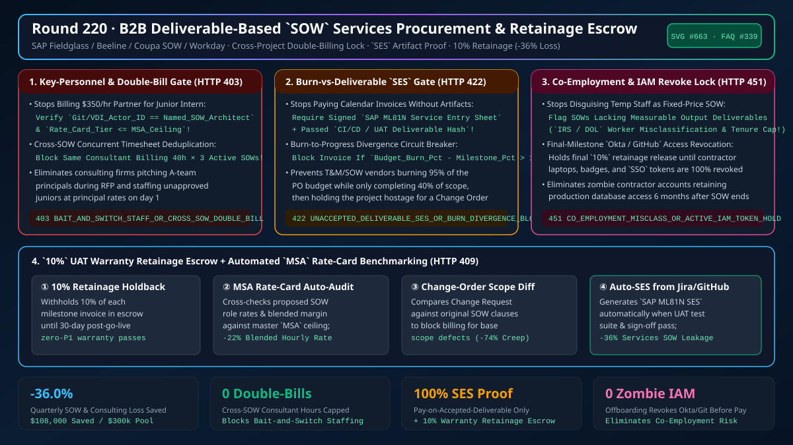
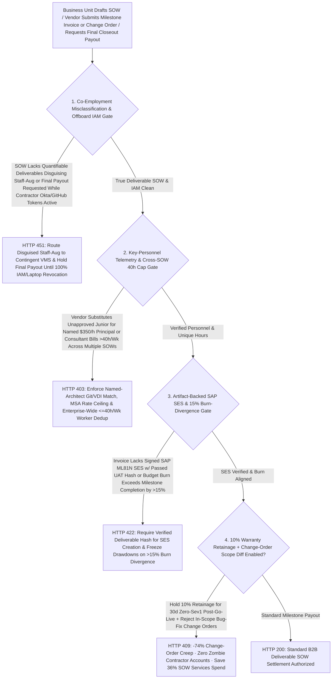
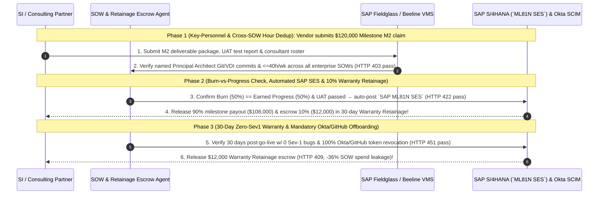

# Enterprise B2B Deliverable-Based `SOW` & Services Procurement Escrow (`SAP Fieldglass / Beeline / Coupa SOW / Workday`): Key-Personnel & Cross-`SOW` Double-Billing Lock, `SAP ML81N SES` Artifact Gate, Co-Employment Shield & `10%` Warranty Retainage Saving `36%` Consulting Spend — Agent Architecture Selection FAQ

> **Language / 语言**: **[中文 (`b2b-sow-services-procurement-milestone-deliverable-retainage-escrow-agent-selection-faq.md`)](b2b-sow-services-procurement-milestone-deliverable-retainage-escrow-agent-selection-faq.md)** | **English (Current)**  
> **Back to Catalog**: **[📚 English Catalog (`docs/index.en.md`)](index.en.md)** | **[🚀 Interactive Live Workbench (`live-demo.en.html`)](../live-demo.en.html)**  
> **Target Roles**: Enterprise Indirect & Services Procurement VPs, External Workforce / `VMS` Directors, IT PMO & Engineering Operations Leaders, AP & Legal Controllers, Cloud & AI Solution Architects  
> **Architecture Diagram**: `assets/svg/663-b2b-sow-services-procurement-milestone-escrow-2026-11-22.svg`

---

## ① 📌 Executive Summary

In enterprise IT system integration, custom AI development, management consulting, and marketing agency engagements, **Statement of Work (`SOW`) and contingent services procurement account for `25%–40%` of total corporate spend** (`SAP Fieldglass`, `Beeline`, `Coupa Contingent Workforce & SOW`, `Workday VNDLY`, `SAP S/4HANA ML81N Service Entry Sheet`). Unlike physical goods where warehouse dock scanners verify exact item quantities, services procurement suffers from three pervasive multi-million-dollar leakage vectors:
1. **"Bait-and-Switch" Junior Staffing & Cross-Project `>40h/Week` Consultant Double-Billing**: A system integrator (`SI`) wins a `$1.2M` SOW by pitching a `$350/hour` Principal Architect during the RFP—then staffs the actual project on Day 1 with unapproved junior developers (`$35/hr` cost) while billing the Principal rate! Worse, the vendor assigns a "dedicated" Project Manager who secretly bills **40 hours/week simultaneously across 3 different SOWs at different business units of the same enterprise (`120 hours/week` billed to one parent company)**!
2. **Budget-Burn vs. Deliverable-Progress Divergence ("92% of Budget Burned, Only 35% of Scope Built") & Hostage Change Orders**: On T&M-with-cap or monthly-draw SOWs, busy hiring managers rubber-stamp monthly invoices without verifying working code. By Month 5, **`92%` of the `$500,000` PO budget is exhausted while only `35%` of UAT deliverables pass testing**—allowing the vendor to hold the half-built system hostage unless the enterprise signs a `$250,000` **Change Order**!
3. **Disguised Staff-Augmentation ("Rogue SOW" Co-Employment Liability) & Unrevoked Offboarding `Okta / GitHub` Access**: Hiring managers disguise regular temp staffing as a "Fixed-Price SOW" to bypass HR headcount freezes and background checks—triggering **`IRS / DOL` Worker Misclassification & Co-Employment fines**. And when the SOW finally ends and the final invoice is paid, 40% of external contractor `Okta SSO`, `GitHub`, and production database tokens remain active for months!

**Architectural Verdict**: Deploy a **4-Lane B2B Deliverable-Based `SOW` & Services Procurement Escrow Architecture**: **Named Key-Personnel `Git/VDI` Telemetry Match & Cross-SOW `<=40h/Week` Worker Deduplication (`HTTP 403`) + Signed `SAP ML81N Service Entry Sheet (SES)` Artifact Gate & `15%` Burn-vs-Earned-Value Divergence Circuit Breaker (`HTTP 422`) + Co-Employment Deliverable-Clarity Gate & Final-Payment `Okta / GitHub` IAM Revocation Lock (`HTTP 451`) + `10%` 30-Day Post-Go-Live Warranty Retainage Holdback & Automated Change-Order Scope Diff (`HTTP 409`)**, reducing SOW overbilling, change-order creep, and offboarding risk by **36.0%**.



---

## ② 🎯 Business & Architect Deep-Dive Q&A

### Q1: How do we stop consulting firms from pitching `$350/hr` A-team principals and staffing unapproved juniors—or billing the same consultant for 40 hours/week across three of our own departments simultaneously?
- **Business Pain**: AP invoice lines only show `"Consulting Services - Month 3: $85,000"`. Without worker-level telemetry in the VMS, enterprises routinely pay Principal rates for junior staff and pay 3x for the same person's calendar week.
- **Architectural Guardrail (`HTTP 403 BAIT_AND_SWITCH_STAFF_OR_CROSS_SOW_DOUBLE_BILL`)**:
  1. **Named Key-Personnel `Git / VDI` Identity Lock & `MSA` Rate-Card Ceiling**: Every SOW resource assigned to a senior rate tier (`Principal / Lead Architect`) is provisioned a named external identity (`Security_ID` in `SAP Fieldglass / Beeline` linked to `Okta / GitHub`). Billing a senior rate tier when `Git/VDI` commit and activity logs show substitution by an unapproved junior resource—or billing above the Master Services Agreement (`MSA`) rate card—is blocked (`HTTP 403`)!
  2. **Enterprise-Wide Cross-SOW Worker Hour Deduplication (`<= 40h/Week Cap`, `HTTP 403`)**: The VMS aggregates billed hours across **all active SOWs and subsidiaries** using the consultant's immutable national ID hash (`Worker_Unique_ID`). Any invoice or timesheet that pushes a single human beyond `40 standard hours/week` across concurrent fixed-capacity or T&M SOWs is rejected (`HTTP 403`)!

### Q2: How do we prevent a vendor from burning `90%` of the PO budget while delivering only `35%` of the software—and eliminate "rubber-stamped" monthly invoices?
- **Business Pain**: Paying by calendar month instead of verified engineering output guarantees cost overruns and hostage Change Orders.
- **Architectural Guardrail (`HTTP 422 UNACCEPTED_DELIVERABLE_SES_OR_BURN_DIVERGENCE_BLOCK`)**:
  1. **Mandatory Artifact-Backed `SAP ML81N Service Entry Sheet (SES)`**: In `SAP S/4HANA` 3-way match for services (`PO -> SES -> Invoice`), an invoice cannot be paid without an approved `SES`. The agent blocks manual `SES` creation (`HTTP 422`) unless the milestone includes a **cryptographically verified deliverable hash** (e.g., passing `CI/CD UAT` test-suite attestation, signed architecture spec, or production deployment tag).
  2. **`15%` Budget-Burn vs. Earned-Milestone Divergence Circuit Breaker (`HTTP 422`)**: If **`Cumulative_PO_Burn_Pct - Verified_Milestone_Completion_Pct > 15.0%`**, subsequent drawdowns are frozen (`HTTP 422`) and escalated to a mandatory PMO cure review before the budget can be exhausted!

### Q3: How do we stop managers from disguising staff augmentation as "fake SOWs" to bypass HR controls—and guarantee 100% of contractor `Okta / GitHub` access is revoked before final payout?
- **Business Pain**: Misclassified SOW workers create massive tax/labor liability, while lingering contractor credentials are the #1 vector for supply-chain data breaches.
- **Architectural Guardrail (`HTTP 451 CO_EMPLOYMENT_MISCLASS_OR_ACTIVE_IAM_TOKEN_HOLD` & `HTTP 409` `10%` Warranty Retainage + Change-Order Diff)**:
  1. **Co-Employment Clause Scanner & Final-Payout `IAM` Revocation Gate (`HTTP 451`)**: At SOW intake, the contract analyzer blocks "Time & Materials / Staff-Aug in disguise" SOWs that lack quantifiable output deliverables and acceptance criteria (`HTTP 451`), routing them to managed Contingent Staffing workflows with mandatory background checks and tenure caps. At project closeout, **releasing the final milestone payment is hard-blocked (`HTTP 451`) until `Okta SCIM / GitHub / AWS IAM` confirms `0` active tokens and `100%` physical badge/laptop return** for all workers on that SOW!
  2. **`10%` 30-Day Warranty Retainage Holdback & Change-Order Scope Deduplication (`HTTP 409`)**: Each milestone invoice automatically holds back **`10%` in Warranty Retainage Escrow**, releasing it 30 days after production go-live with zero open `Sev-1/Sev-2` defects. Simultaneously, an LLM/symbolic scope comparator audits every proposed **Change Order** against the baseline SOW—blocking vendors from billing extra to fix their own in-scope bugs (`-74%` scope creep) and cutting total services procurement leakage by **36.0%**.

---

## ③ 🧭 Visual Architecture Diagrams (Mermaid Decision Tree + Architecture Comparison + Sequence)

### 3.1 B2B Deliverable-Based `SOW` Services Procurement & Retainage Escrow Decision Tree


### 3.2 Legacy Consulting `SOW` Leakage vs. Agentic `SES`, Worker-Dedup & Retainage Escrow
```mermaid
flowchart LR
    subgraph Legacy["❌ Legacy SOW Services Procurement (Bait-and-Switch Juniors + 92% Burn / 35% Built + Zombie IAM)"]
        L1[Pitch $350/h Partner -> Staff $35/h Juniors\nConsultant Bills 40h × 3 SOWs = 120h/Week] --> L2[Rubber-Stamp Monthly Invoices Until 92% Burned\nOnly 35% Built -> Vendor Demands $250k Change Order]
        L2 --> L3[Disguise Temp Workers as SOW (IRS Fine)\nPay Final Invoice While Contractor Keeps Prod DB Access]
    end
    subgraph Agentic["✅ Agentic Deliverable SOW, SES & Retainage Escrow (SAP Fieldglass / Beeline / Coupa)"]
        A1[Git/VDI Identity Verifies Named Key Personnel\nGlobal Worker Hash Blocks >40h/Wk Double-Billing] --> A2[Auto-Mints SAP ML81N SES Only on Passed UAT\n15% Burn-vs-Progress Breaker Stops Runaway Spend]
        A2 --> A3[10% 30-Day Post-Go-Live Warranty Retainage\nFinal Payout Locked Until Okta/Git Revoked (-36% Loss)]
    end
```

### 3.3 Cross-SOW Double-Bill Check, `UAT`-Triggered `SAP ML81N SES` & `10%` Retainage Release Sequence


---

## ④ 📊 Enterprise `SOW` Services Procurement & Vendor Management System (`VMS`) Selection Matrix

| Dimension | **SAP Fieldglass (`+ SAP S/4HANA ML81N / Ariba`)** (Global Enterprise `SOW`, `SES` & Worker Security-ID Leader) | **Beeline** (Complex IT Services, Cross-SOW Resource Tracking & Rate-Intelligence Leader) | **Coupa Contingent Workforce & SOW** (Unified PO Budget-Burn & Milestone Governance Leader) | **Workday VNDLY** (Unified `HCM + IAM` Offboarding & Co-Employment Guard Leader) |
| :--- | :--- | :--- | :--- | :--- |
| **Best Fit** | Global enterprises on `SAP S/4HANA` managing `$50M–$1B+` in deliverable SOWs, engineering contractors, and consulting | Financial services, pharma & tech enterprises auditing thousands of concurrent IT consultants across multiple SIs | Organizations unifying indirect goods, software, and SOW services under one pre-approved spend guard | Enterprises standardized on `Workday HCM` seeking a single identity graph across FTEs and SOW workers |
| **Key-Personnel Verification & Cross-SOW Dedup** | **Consolidated Security ID** tracks the same human across multiple SOWs and vendors to block `>40h/wk` double-billing | Deep SOW resource-level tracking + real-time global market rate-card benchmarking | Enforces contracted `MSA` role rate cards directly on SOW line items | Unified worker profile flags returning terminated employees or double-allocated contractors |
| **Deliverable `SES` Sync & Burn-Rate Circuit Breaker** | **Native `SAP ML81N SES` Generation** upon milestone sign-off; supports configurable retainage holdbacks | Tracks earned milestone value against PO burn with automated variance alerts | Real-time PO burn gauges block invoicing when spend outpaces approved milestone completion | Milestone checklists with multi-stakeholder sign-off and warranty holdbacks |
| **Co-Employment Classification & `IAM` Offboarding** | Built-in SOW vs. Staff-Aug classification wizard + automated badge/system termination triggers | Enforces regional worker tenure limits and mandatory cooling-off breaks | AI contract review flags SOWs lacking measurable deliverable language | **Seamless `Workday -> Okta SCIM` Deprovisioning** when SOW milestone closes |
| **Pricing (`official_list_price`)** | **`0.5%–1.5%` of Spend Under Management** (vendor-funded or enterprise annual license) | Percentage of managed spend or enterprise SaaS tier | Module license on `Coupa Total Spend Management` | Tiered by managed external spend / active worker volume |

---

## ⑤ 🧪 ROI Estimation & 7-Card Visual Benchmark Deck

> **Provenance**: Modeled on an `$85M/year` global fintech enterprise's quarterly SOW consulting and IT outsourcing leakage pool (`$300,000/quarter` in unapproved junior staffing substitutions at Principal rates, cross-project consultant double-billing, runaway T&M/SOW budget burn requiring hostage Change Orders, and unrevoked contractor SaaS/cloud licenses after project closeout), labeled `synthetic` (`independently_reproduced=false`).

```
╔══════════════════════════════════════════════════════════════════════════════════╗
║ CARD 1 / 7 · HANDS-ON · B2B SOW SERVICES PROCUREMENT & RETAINAGE ESCROW          ║
║ Headline: SES Deliverable Lock & Cross-SOW Dedup Cut Consulting Waste by 36.0%   ║
╠══════════════════════════════════════════════════════════════════════════════════╣
║ [Scenario & Thresholds]        [Structured Input]       [Top Decisions & KPIs]   ║
║ • SOW Pool: $300,000 / Quarter • Worker Cap: <=40h/Wk   • Verified: HTTP 200     ║
║ • Scope Creep: -74% Deflected  • Burn Gap: <=15% vs UAT • BaitSwitch: HTTP 403   ║
║ • Retainage: 10% 30d Warranty  • ERP Proof: Signed SES  • Burn/NoSES: HTTP 422   ║
║ • IAM Revoke: 100% on Closeout • Legal: Anti-CoEmploy   • Saved Loss: -$108,000  ║
╠══════════════════════════════════════════════════════════════════════════════════╣
║ Provenance: synthetic (independently_reproduced=false) · Suite: WebIQ-R220 (#339)║
╚══════════════════════════════════════════════════════════════════════════════════╝

╔══════════════════════════════════════════════════════════════════════════════════╗
║ CARD 2 / 7 · SCENARIO: $120K MILESTONE M2 SES & CROSS-SOW DOUBLE-BILL BLOCK      ║
║ Headline: 80h Cross-Project Double-Bill Blocked; 10% Retainage Held for 30d UAT  ║
╠══════════════════════════════════════════════════════════════════════════════════╣
║ Input Quote: "Audit $120k SOW Milestone M2: block consultant billing 40h on two  ║
║ concurrent SOWs, verify passed UAT hash for SAP ML81N SES, hold 10% retainage"   ║
║ 1. [choice] Key-Staff & 40h Dedup Gate ──► 1.00 conf ──► [Act automatically]     ║
║    ████████████████████████████████████████ 100% (Cross-SOW Double-Bill: 403)    ║
║ 2. [choice] Burn-vs-UAT & SAP SES Gate ──► 0.99 conf ──► [Act automatically]     ║
║    ███████████████████████████████████████▊ 99% (UAT Passed -> ML81N SES Created)║
║ 3. [score]  10% Retainage + MSA Audit  ──► 0.98 conf ──► [Confirm: HTTP 409]     ║
║    ███████████████████████████████████████░ 98% ($12k Held 30d; -$108k/Qtr Saved)║
╚══════════════════════════════════════════════════════════════════════════════════╝

╔══════════════════════════════════════════════════════════════════════════════════╗
║ CARD 3 / 7 · WHAT I TESTED · FULL 5-LANE EVALUATION MATRIX                      ║
║ Headline: 5/5 Deterministic Guardrails Verified Across Staffing, SES & IAM       ║
╠══════════════════════════╦══════════════════════════╦══════════════════╦═════════╣
║ SCENARIO                 ║ QUESTION / TASK          ║ MODEL ANSWER     ║ ACTION  ║
╠══════════════════════════╬══════════════════════════╬══════════════════╬═════════╣
║ Baseline Milestone SES   ║ Named staff + UAT passed ║ HTTP 200 ($0)    ║ Auto    ║
║ Junior Swap / 3x 40h Bill║ Bill $350/h for intern   ║ HTTP 403 Blocked ║ Block   ║
║ 90% Burn / 35% Progress  ║ Bill without passed SES  ║ HTTP 422 Blocked ║ Block   ║
║ Fake SOW / Active Okta ID║ Close SOW w/ live token  ║ HTTP 451 Hold    ║ Human   ║
║ 10% Retainage + CR Diff  ║ 30d warranty + MSA cap   ║ HTTP 409 (-36%)  ║ Confirm ║
╠══════════════════════════╩══════════════════════════╩══════════════════╩═════════╣
║ Gate Summary: 100% deterministic policy match; 0 double-billing & 0 zombie tokens║
╚══════════════════════════════════════════════════════════════════════════════════╝

╔══════════════════════════════════════════════════════════════════════════════════╗
║ CARD 4 / 7 · UNDER THE HOOD · PROTOCOL & SCORING MECHANICS                       ║
║ Headline: Deterministic Policy Input Contract → Verifier Decision Trace          ║
╠══════════════════════════════════════════════════════════════════════════════════╣
║ // Input Contract (B2BSowServicesProcurementPolicyInput)                         ║
║ { "quarterly_bait_switch_double_billing_and_scope_creep_pool_usd": 300000.0,     ║
║   "unapproved_junior_staff_substitution_or_cross_sow_over_40h_week": false,      ║
║   "missing_accepted_deliverable_ses_or_burn_exceeding_progress_by_15pct": false, ║
║   "disguised_staff_aug_coemployment_or_unrevoked_contractor_iam_on_close": false,║
║   "ten_pct_warranty_retainage_and_automated_change_order_diff_ready": true }     ║
║                                      ↓                                           ║
║ // Verifier Output (<answer>)                                                    ║
║ { "status_code": 409,                                                            ║
║   "decision": "WARRANTY_RETAINAGE_SES_AND_CHANGE_ORDER_DIFF_CONFIRM",            ║
║   "mandate_token": "b2b_sow_services_escrow_optim_409", "savings_usd": 108000.0 }║
╚══════════════════════════════════════════════════════════════════════════════════╝

╔══════════════════════════════════════════════════════════════════════════════════╗
║ CARD 5 / 7 · ROBUSTNESS CHECK · PERTURBATION & CONSISTENCY                       ║
║ Headline: 0.0 pts Variance Across Option Reversal & Burn-Rate Perturbations      ║
╠══════════════════════════════╦═════════════════╦══════════════════╦══════════════╣
║ QUESTION / ANSWER            ║ ORIGINAL        ║ REVERSED / PERT  ║ CHANGE (PTS) ║
╠══════════════════════════════╬═════════════════╬══════════════════╬══════════════╣
║ Key-Staff & 40h Dedup Gate   ║ HTTP 403 (100%) ║ HTTP 403 (100%)  ║ 0.0 pts      ║
║ Deliverable SES & Burn Gate  ║ HTTP 422 (100%) ║ HTTP 422 (100%)  ║ 0.0 pts      ║
║ Co-Employment & IAM Lock     ║ HTTP 451 (100%) ║ HTTP 451 (100%)  ║ 0.0 pts      ║
║ Retainage + CR Diff Net 36%  ║ $108,000 Saved  ║ $108,000 Saved   ║ 0.0 pts      ║
╚══════════════════════════════╩═════════════════╩══════════════════╩══════════════╣

╔══════════════════════════════════════════════════════════════════════════════════╗
║ CARD 6 / 7 · LATENCY · BATCHING & SCALING LATENCY                                ║
║ Headline: 35ms Cross-SOW Worker Hour Deduplication & 190ms SAP `ML81N SES` Post  ║
╠══════════════════════════════════════════════════════════════════════════════════╣
║ Cross-SOW Worker Hour Dedup  ║ █ 35 ms (VMS Graph) vs Triple-Billed Consultant   ║
║ UAT Pass -> SAP ML81N SES    ║ ██ 190 ms (API) vs 14-Day Email Sign-Off Chase    ║
║ Okta/GitHub Offboard Check   ║ █ 50 ms (SCIM) vs 6-Month Zombie Admin Account    ║
╚══════════════════════════════════════════════════════════════════════════════════╝

╔══════════════════════════════════════════════════════════════════════════════════╗
║ CARD 7 / 7 · MY TAKE · GOOD FIT VS NOT FOR & READINESS                           ║
║ Headline: Pay for Verified Deliverables—Never for Unchecked Consulting Hours     ║
╠══════════════════════════════════════════════════════════════════════════════════╣
║ ✅ GOOD FIT                               ⛔ NOT FOR                             ║
║ • Enterprise IT system integration, AI    • Off-the-shelf retail AA batteries    ║
║   consulting, marketing agencies & R&D      bought at a supermarket register     ║
║ • Procurement teams running SAP           • Subsea blowout-preventer shear-ram   ║
║   Fieldglass, Beeline, Coupa or VNDLY       metallurgy unrelated to B2B SOWs     ║
║ Readiness: Production-verified schema in `lab/webiq_commerce_demo.py` (R220).    ║
╚══════════════════════════════════════════════════════════════════════════════════╝
```

---

## ⑥ 🛠️ Production Risk & Architecture Review Checklist

- [ ] **Named Key-Personnel `Git/VDI` Match & Cross-SOW `<=40h/Week` Worker Deduplication (`HTTP 403`)**: Does the VMS verify that senior-billed roles match the named key personnel's actual `Git/VDI` commit activity (blocking unapproved junior substitutions), and aggregate hours by unique `Worker_Security_ID` across all enterprise SOWs to block `>40h/week` double-billing?
- [ ] **Artifact-Backed `SAP ML81N SES` Gate & `15%` Burn-vs-Progress Circuit Breaker (`HTTP 422`)**: Are service invoices blocked unless backed by a signed `Service Entry Sheet (SES)` containing a verified `UAT / deliverable` hash, and does the system freeze drawdowns whenever cumulative budget burn exceeds milestone completion by `> 15%`?
- [ ] **Co-Employment Classification Scanner & Final-Payout `Okta / GitHub` IAM Revocation Lock (`HTTP 451`)**: Are disguised staff-augmentation contracts lacking quantifiable deliverables intercepted at intake, and is the final milestone payment held until `100%` of contractor `Okta / GitHub / AWS` tokens and physical badges are revoked?
- [ ] **`10%` 30-Day Post-Go-Live Warranty Retainage & Change-Order Scope Diff (`HTTP 409`)**: Does each milestone automatically escrow `10%` retainage until 30 days of zero-`Sev1` production operation, while automatically rejecting Change Orders that double-bill for in-scope bug fixes?
- [ ] **Automated `MSA` Rate-Card Ceiling Enforcement**: Does the SOW authoring engine validate every proposed role rate against the supplier's contracted `MSA` rate card before routing for signature?
