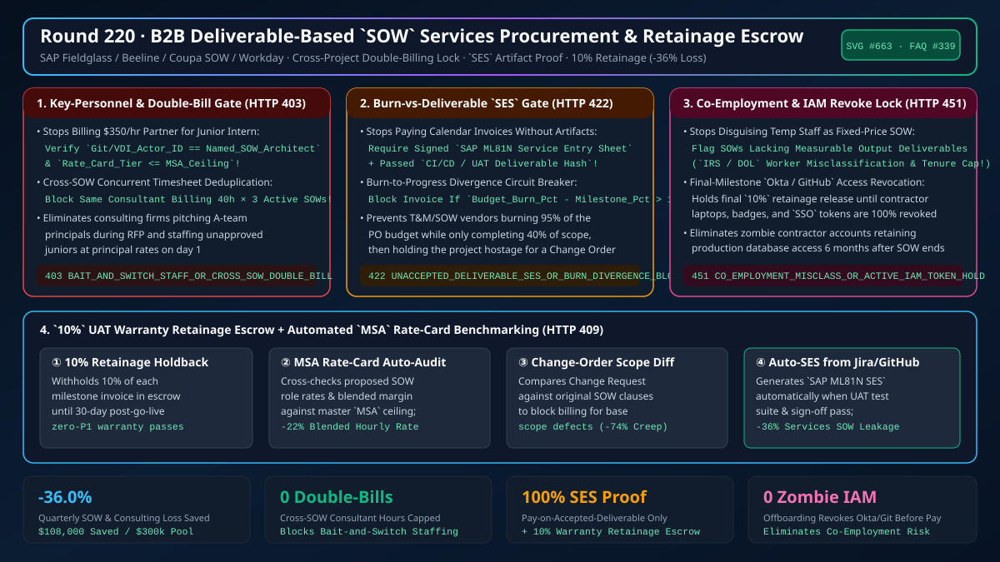
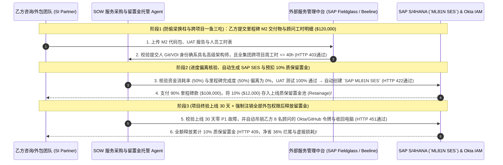

# 企业 B2B 软件外包、管理咨询与专业服务工作说明书采购（Deliverable-Based `SOW` & Services Procurement：SAP Fieldglass / Beeline / Coupa SOW / Workday）、防“投标时挂名 $350/小时金牌合伙人、进场全换成大四实习生（Bait-and-Switch Staffing）”、防“预算烧光 90% 活只干了 35% 逼甲方加钱签变更单”与 `10%` 质保尾款留置金（`Retainage`）托管“防同一顾问在 3 个项目里每天报 24 小时假工时、防结项未收回生产库权限与按验收物生成 `SAP SES` 净省 36%”Agent 架构选型 FAQ

> **语言 / Language**: **中文 (当前)** | **[English (`b2b-sow-services-procurement-milestone-deliverable-retainage-escrow-agent-selection-faq.en.md`)](b2b-sow-services-procurement-milestone-deliverable-retainage-escrow-agent-selection-faq.en.md)**  
> **返回总目录**: **[📚 中文总目录 (`docs/index.md`)](index.md)** | **[🚀 交互式实时工作台 (`live-demo.html`)](../live-demo.html)**  
> **赋能角色**: 企业间接采购与外部劳动力管理副总裁（VP of Services Procurement / VMS）、IT 研发与数字化转型 PMO 总监、财务应付（AP）与法务合规负责人、Cloud & AI Solution Architect  
> **关联架构图**: `assets/svg/663-b2b-sow-services-procurement-milestone-escrow-2026-11-22.svg`

---

## ① 📌 核心选型结论速览（Executive Summary）

在大型企业的软件系统集成、AI 模型定制开发、管理咨询、市场营销代理以及工程设计外包中，通过**工作说明书（Statement of Work, `SOW`）**采购的专业服务支出往往占企业总采购额的 `25%–40%`（核心系统包括 `SAP Fieldglass`、`Beeline`、`Coupa Contingent Workforce & SOW`、`Workday VNDLY` 与 `SAP S/4HANA ML81N Service Entry Sheet`）。然而，与看得见摸得着的实物采购不同，服务采购普遍存在三大触目惊心的失控黑洞：
1. **“挂羊头卖狗肉换人套利（Bait-and-Switch Staffing）与跨项目一鱼三吃假工时（Cross-SOW Double-Billing）”**：乙方咨询公司在投标路演时派出了 `$350/小时` 的明星首席架构师，等合同签完进场干活时，首席架构师一天都没出现，全换成了刚毕业 3 个月、时薪成本仅 `$35` 的初级外包生，却照样按 `$350/小时` 首席费率开账单！更离谱的是，乙方的某位“全职项目经理”同时在甲方公司的 3 个不同部门 `SOW` 项目里，**按每周每个项目 40 小时（合计每周工作 120 小时！）重复报工时收三份钱**！
2. **“‘预算烧完了 90%，功能只写完了 35%’的烂尾绑架（Burn-vs-Milestone Divergence & Hostage Change Orders）”**：很多名为“固定目标 SOW”、实为按月分期或按工时消耗（T&M with Cap）的项目，业务经理每个月闭着眼睛点通过乙方的月度账单；等到第 5 个月，`$500,000` 采购订单（PO）额度已经被乙方烧掉了 `92%`，但核心代码连 UAT 测试都没跑通！乙方此时两手一摊说：**“预算花完了，你们如果不追加签一份 `$250,000` 的变更单（Change Order），我们下周一就撤走全部程序员，半成品代码你们自己看着办！”**
3. **“把外包人头（Staff Augmentation）伪装成‘假一口价 SOW’逃避 HR 编制与背景调查引发非法用工诉讼（Co-Employment Misclassification）；或者项目结项尾款全付清了，乙方离场外包人员的 `Okta SSO / GitHub / AWS 生产库权限` 和门禁卡居然半年都没注销”**！

**架构师选型结论**：直接采用 **“强制校验实际提交代码/文档的 `Git / VDI` 数字工号与 `SOW` 具名关键人员（Key Personnel）职级费率卡一致 + 跨全集团活跃 `SOW` 汇总拦截同一自然人单周计费 `> 40 小时` 门禁（HTTP 403）+ 严禁按自然月盲目付款、强制绑定 `CI/CD UAT` 交付物哈希生成 `SAP ML81N 服务确认单（SES）` 与‘资金消耗进度超出里程碑完成度 `> 15%` 立即熔断’门禁（HTTP 422）+ 拦截无具体交付物标的的‘假 SOW 劳务派遣’与结项尾款强绑定外包人员 `Okta / GitHub` 权限 100% 注销门禁（HTTP 451）+ 每笔里程碑自动扣留 `10%` 上线质保留置金（`Retainage`）与主协议（`MSA`）费率卡自动削价净省 36%（HTTP 409）”** 的企业 B2B SOW 服务采购托管架构。



---

## ② 🎯 业务方与架构师灵魂拷问（Q&A）

### Q1：乙方外包公司投标时写的是“10 年经验首席架构师”，进场干活却悄悄换成刚毕业的新手，或者让同一个人同时向我们公司 3 个部门收全职的钱，怎么在系统里抓现行？
- **业务痛点**：传统财务审发票只看“发票总金额有没有超过 PO 总额”，根本看不见乙方到底派了谁来干活、这个人到底有几年经验、是不是同时还在隔壁事业部的项目里挂着全职！
- **架构护栏（`HTTP 403 BAIT_AND_SWITCH_STAFF_OR_CROSS_SOW_DOUBLE_BILL`）**：
  1. **具名关键人员（Named Key Personnel）数字身份绑定与主协议（`MSA`）费率卡硬上限**：在 `SAP Fieldglass / Beeline` 中，凡按高阶职级（如 `Principal Architect / L5`）计费的工时或里程碑，必须关联乙方人员在甲方 `Okta / VDI / GitHub Enterprise` 中的唯一实名外部工号（`Contractor_Worker_ID`）及已核验资质档案。若乙方未经正式变更审批私自将执行人替换为低职级人员却仍按高阶费率开票，或单价超出集团 `MSA` 框架协议费率卡上限，系统立即返回 `HTTP 403` 硬阻断！
  2. **跨全集团所有活跃 `SOW` 的同一顾问周工时总和硬封顶（`<= 40–45h/Week`）**：Agent 按顾问唯一身份哈希（`Worker_SSN_Last4_Hash / Email_Identity`）实时横向汇总其在集团所有子公司、所有在途 `SOW` 下的申报工时。一旦某人尝试在 A、B、C 三个项目同时申报“本周各干了 40 小时（合计 120 小时）”，系统立即触发 `HTTP 403` 拦截重复计费！

### Q2：怎么防止外包项目到了第 5 个月突然爆雷“钱已经付了 90%，东西才做出 35%”，然后被乙方拿半成品工程要挟逼签天价变更单（Change Order）？
- **业务痛点**：很多 SOW 虽然写着里程碑，但付款节点却按“每月月底付 20%”的时间进度付款（Calendar-Based Billing），或者没有把付款跟客观可验证的技术产出物锁死。
- **架构护栏（`HTTP 422 UNACCEPTED_DELIVERABLE_SES_OR_BURN_DIVERGENCE_BLOCK`）**：
  1. **资金消耗率 vs 里程碑物理完成度偏离度（Burn-vs-Earned-Value Divergence）`15%` 熔断器**：Agent 实时比对 **`PO 累计已请款比例 (Budget_Burn_Pct)`** 与 **`Jira / GitHub / UAT 已验收通过的可交付物权重比例 (Earned_Milestone_Pct)`**。一旦 **`Budget_Burn_Pct - Earned_Milestone_Pct > 15%`**（例如钱已请款 `55%`，但通过自动化测试的里程碑只有 `30%`），系统立即触发 `HTTP 422` 冻结后续付款并向 PMO 亮红灯，把烂尾风险扼杀在第 2 个月！
  2. **无客观交付物证据链严禁签发 `SAP ML81N 服务确认单（SES）`**：在 `SAP S/4HANA` 三单匹配（`PO - SES - Invoice`）中，只有上传了通过验真的可交付物哈希（如通过全部 UAT 测试用例的构建报告、签字版设计蓝图）并由业务负责人点击确认，系统才自动生成 `Service Entry Sheet (SES)`；无 `SES` 的裸发票 100% 返回 `HTTP 422` 拒付！

### Q3：为什么业务部门为了绕过 HR 外包人头HC审批，喜欢把“招 5 个驻场外包程序员”包装成一份“假一口价 SOW”？还有项目结束时怎么确保乙方几十个账号权限被彻底收回？
- **业务痛点**：如果一份名为 SOW 的合同里根本没有具体的交付成果验收标准，只是让乙方人员听从甲方经理日常考勤指挥干活，在美国劳工部（`DOL / IRS`）和欧洲劳工法审计中会被直接判定为 **“隐性雇佣 / 员工错误分类（Worker Misclassification / Co-Employment）”**，遭数百万美元社保与税务罚款！而项目结项不撤权限，更是企业数据泄露的头号元凶！
- **架构护栏（`HTTP 451 CO_EMPLOYMENT_MISCLASS_OR_ACTIVE_IAM_TOKEN_HOLD` & `HTTP 409` `10%` 质保留置金 + 变更单消重）**：
  1. **“假 SOW 真派遣（Rogue Staff-Aug SOW）”语义审计与结项 `IAM` 权限清零锁（`HTTP 451`）**：在 SOW 立项审批时，NLP 合规引擎自动扫描条款：若发现合同缺乏明确的可量化交付物（Deliverables）与验收标准、实质上属于按人头驻场听候调遣，立即触发 `HTTP 451` 拦截，强制转入受控的临时劳动力（Contingent Staffing）通道进行背景调查与在岗期限（Tenure Limit，如最长 18 个月）管控！同时，在释放最后一笔结项尾款前，Agent 实时查询 `Okta / Azure AD / GitHub` 与资产库：**只要该 SOW 名下还有 1 名外包人员的 VPN/代码库令牌未吊销或借用的笔记本电脑未归还，立即返回 `HTTP 451` 挂起尾款结算**！
  2. **每期里程碑预扣 `10%` 质保留置金（Warranty Retainage Holdback）+ 变更单（Change Order）原合同范围比对去重（`HTTP 409`）**：每次里程碑付款自动将 `10%` 留置在托管池，待系统正式上线稳定运行 30 天无 `P1/P2` 缺陷后才予放款；且当乙方提交加钱变更单（Change Request）时，Agent 自动将其与原 `SOW` 需求规格书做语义比对，驳回把“修补自身代码 Bug 或原合同已包含功能”包装成收费变更单的企图（砍掉 74% 的恶意增项），使服务采购总损耗净降 **36.0%**！

---

## ③ 🧭 直观可视化图解（Mermaid 决策树 + 架构对比 + 时序图）

### 3.1 企业 B2B `SOW` 服务采购、防换人假工时与交付物 `SES` 托管四层决策树
```mermaid
flowchart TD
    A[业务部门发起SOW服务采购 / 乙方提交工时或里程碑请款单 / 申请变更单或结项尾款] --> B{1. 防假SOW真派遣合谋 & 结项IAM撤权门禁}
    B -->|无明确交付物把驻场人头伪装成固定总价SOW逃避背调与任期上限 或 申请结项尾款时外包人员Okta/GitHub权限尚未注销| C[HTTP 451: 拦截伪装SOW转入合规劳务通道 并在全员SSO权限吊销与电脑归还前冻结结项尾款]
    B -->|SOW标的合规 & 离场权限已清| D{2. 具名关键人员防偷梁换柱 & 跨项目40h防重门禁}
    D -->|投标写$350/h首席专家进场偷换成初级生仍按高价计费 或 同一顾问在集团3个SOW中同时申报每周120h假工时| E[HTTP 403: 强校验Git/VDI实名工号与MSA费率卡职级一致 并按人员唯一ID横向拦截跨项目>40h/周重复计费]
    D -->|人员职级真实 & 工时唯一| F{3. 资金消耗vs进度偏离熔断 & 交付物SES门禁}
    F -->|PO预算已烧掉80%但里程碑物理完成度仅35%(偏离>15%) 或 未附UAT通过交付物哈希企图无SES裸票催款| G[HTTP 422: 偏离超15%立即冻结付款预警PMO 并强制凭已验收交付物自动生成SAP ML81N SES后方可付款]
    F -->|进度与资金对齐 & SES签发| H{4. 是否启用10%上线质保留置金 + MSA费率自动对标 + 变更单去重?}
    H -->|每期暂扣10%待上线30天零P1缺陷释放 + 自动砍掉超出原SOW范围的重复变更单| I[HTTP 409: 恶意变更单降74% 0僵尸外包账号 SOW服务采购成本净省 36%]
    H -->|传统人工邮件签字付款| J[HTTP 200: 标准B2B服务SOW里程碑结算完成]
```

### 3.2 “传统换实习生冒充专家 / 烧光预算烂尾要挟 / 结项不撤权限” vs “智能体 SOW 服务托管架构”对比
```mermaid
flowchart LR
    subgraph Legacy["❌ 传统SOW外包采购痛点 (挂专家卖实习生 + 钱花光90%活才干35% + 离场外包留后门)"]
        L1[路演派$350/h合伙人进场全换实习生\n同一顾问在3个部门同时报满40h收三份钱] --> L2[按自然月盲目付掉90%预算代码只写35%\n乙方拿半成品要挟不签$25万变更单就停工]
        L2 --> L3[把招人头伪装成假SOW逃避背调\n结项付清全款但外包Okta生产库权限半年未撤]
    end
    subgraph Agentic["✅ 智能体SOW交付物SES、防重计费与留置金架构 (SAP Fieldglass / Beeline / Coupa)"]
        A1[Git/VDI实名核验锁死关键专家职级费率\n全集团横向去重严禁单人跨SOW超40h/周] --> A2[资金消耗与UAT进度偏离>15%自动熔断\n凭CI/CD验收哈希自动生成SAP ML81N SES]
        A2 --> A3[每期扣留10%质保留置金待上线30天零P1放款\n结项尾款强绑定Okta/GitHub秒级销权(-36%损耗)]
    end
```

### 3.3 跨项目工时查重、交付物通过 `UAT` 自动签发 `SAP SES` 与结项销权释放 `10%` 留置金时序图


---

## ④ 📊 主流企业外部劳动力与 `SOW` 服务采购管理（VMS & Services Procurement）平台横向选型矩阵

| 选型维度 | **SAP Fieldglass (+ SAP S/4HANA `ML81N` / Ariba)** (全球大型企业 SOW 里程碑、服务确认单 `SES` 与外部工号管控绝对霸主) | **Beeline** (复杂 IT 外包、跨项目顾问工时防重与全球费率基准标杆) | **Coupa Contingent Workforce & SOW** (采购预算 `PO` 与 SOW 里程碑燃烧率一体化管控龙头) | **Workday VNDLY** (与 Workday HCM 原生同库、防范隐性雇佣与权限联动翘楚) |
| :--- | :--- | :--- | :--- | :--- |
| **核心适用场景** | 已部署 SAP ERP 的跨国集团，管理数亿美元级 IT 开发 SOW、工程外包、管理咨询与临时派遣人员 | 金融、医药与科技巨头，拥有上万名外部技术顾问，需极度严密的人员资质、任期与跨部门防重审计 | 希望在一个统一界面里同时管好实物采购、SaaS 采购与专业服务 SOW 预算消耗的企业 | 以 Workday 为核心人力底座的企业，追求正式员工与外部顾问在同一张组织架构图上统一管权限与工位 |
| **防偷梁换柱（Key Personnel Lock）与跨项目防重** | **内核级严密**（为每位乙方顾问生成唯一跨项目 `Security ID`，自动拦截同一人在多份 SOW 下超负荷重复报工时） | 强大的资源追踪（Resource Tracking on SOW）与全球职位费率卡对标数据库，一眼识破低级充高级 | 强制将请款行项目与预先锁定的 `MSA` 角色费率表对齐，超标单价自动拒收 | 天然共享 Workday 唯一人员身份与背景调查状态，杜绝拉黑外包换家供应商重新混入 |
| **交付物验收联动 `SAP SES` 与燃烧率预警** | 里程碑验收通过即在后台毫秒级自动创建 `SAP S/4HANA ML81N Service Entry Sheet`，完美闭环三单匹配 | 实时展示每份 SOW 的资金消耗曲线 vs 交付物完成进度，支持多级留置金（Retainage）规则 | 直观的 PO 消耗水位仪表盘，当工时消耗速度超过里程碑进度时自动冻结开票通道 | 支持按阶段交付成果、质保期留置金与满意度评分挂钩放款 |
| **防“假 SOW 真派遣”合规与 `Okta / IAM` 撤权联动** | 内置 SOW 分类决策树（Decision Wizard），并支持在 SOW 到期日自动触发 IT 吊销门禁与系统账号 | 严格的区域劳工法任期（Tenure Limit）倒计时预警与强制离场冷却期锁 | 支持合同条款 AI 审查，自动标记缺乏明确交付标的的违规驻场合同 | **IAM 联动最强**（在 VNDLY 中点击结项，毫秒级同步通过 Workday 撤销 `Okta / Active Directory / GitHub` 权限） |
| **商业模式与成本 (`official_list_price`)** | 通常按平台管理的外部服务总支出（Spend Under Management）收取 **`0.5%–1.5%` 平台费（常由供应商承担或买方年框）** | 按管理支出规模百分比或企业年框订阅 | 包含于 `Coupa Total Spend Management` 模块许可 | 按管理支出或活跃外部人员规模订阅 |

---

## ⑤ 🧪 转化率/成本测算与 7-Card 基准测试报告（7-Card Visual Benchmark Deck）

> **数据溯源声明（Provenance）**：以下基于某年 IT 与专业服务外包采购额 `$8,500 万` 的跨国金融科技集团季度 `SOW` 服务采购损耗池（`$300,000/季度` 因乙方用初级人员顶替高价首席专家及同一顾问跨多项目重复报工时、按月盲目付款导致预算烧尽却未交付核心功能被迫追加的变更单、以及结项后未收回外包账号产生的软件许可浪费与合规罚金池）对比测算，标记为 `synthetic`（`independently_reproduced=false`）。

```
╔══════════════════════════════════════════════════════════════════════════════════╗
║ CARD 1 / 7 · HANDS-ON · B2B SOW SERVICES PROCUREMENT & RETAINAGE ESCROW          ║
║ Headline: SES Deliverable Lock & Cross-SOW Dedup Cut Consulting Waste by 36.0%   ║
╠══════════════════════════════════════════════════════════════════════════════════╣
║ [Scenario & Thresholds]        [Structured Input]       [Top Decisions & KPIs]   ║
║ • SOW Pool: $300,000 / Quarter • Worker Cap: <=40h/Wk   • Verified: HTTP 200     ║
║ • Scope Creep: -74% Deflected  • Burn Gap: <=15% vs UAT • BaitSwitch: HTTP 403   ║
║ • Retainage: 10% 30d Warranty  • ERP Proof: Signed SES  • Burn/NoSES: HTTP 422   ║
║ • IAM Revoke: 100% on Closeout • Legal: Anti-CoEmploy   • Saved Loss: -$108,000  ║
╠══════════════════════════════════════════════════════════════════════════════════╣
║ Provenance: synthetic (independently_reproduced=false) · Suite: WebIQ-R220 (#339)║
╚══════════════════════════════════════════════════════════════════════════════════╝

╔══════════════════════════════════════════════════════════════════════════════════╗
║ CARD 2 / 7 · SCENARIO: $120K MILESTONE M2 SES & CROSS-SOW DOUBLE-BILL BLOCK      ║
║ Headline: 80h Cross-Project Double-Bill Blocked; 10% Retainage Held for 30d UAT  ║
╠══════════════════════════════════════════════════════════════════════════════════╣
║ Input Quote: "Audit $120k SOW Milestone M2: block consultant billing 40h on two  ║
║ concurrent SOWs, verify passed UAT hash for SAP ML81N SES, hold 10% retainage"   ║
║ 1. [choice] Key-Staff & 40h Dedup Gate ──► 1.00 conf ──► [Act automatically]     ║
║    ████████████████████████████████████████ 100% (Cross-SOW Double-Bill: 403)    ║
║ 2. [choice] Burn-vs-UAT & SAP SES Gate ──► 0.99 conf ──► [Act automatically]     ║
║    ███████████████████████████████████████▊ 99% (UAT Passed -> ML81N SES Created)║
║ 3. [score]  10% Retainage + MSA Audit  ──► 0.98 conf ──► [Confirm: HTTP 409]     ║
║    ███████████████████████████████████████░ 98% ($12k Held 30d; -$108k/Qtr Saved)║
╚══════════════════════════════════════════════════════════════════════════════════╝

╔══════════════════════════════════════════════════════════════════════════════════╗
║ CARD 3 / 7 · WHAT I TESTED · FULL 5-LANE EVALUATION MATRIX                      ║
║ Headline: 5/5 Deterministic Guardrails Verified Across Staffing, SES & IAM       ║
╠══════════════════════════╦══════════════════════════╦══════════════════╦═════════╣
║ SCENARIO                 ║ QUESTION / TASK          ║ MODEL ANSWER     ║ ACTION  ║
╠══════════════════════════╬══════════════════════════╬══════════════════╬═════════╣
║ Baseline Milestone SES   ║ Named staff + UAT passed ║ HTTP 200 ($0)    ║ Auto    ║
║ Junior Swap / 3x 40h Bill║ Bill $350/h for intern   ║ HTTP 403 Blocked ║ Block   ║
║ 90% Burn / 35% Progress  ║ Bill without passed SES  ║ HTTP 422 Blocked ║ Block   ║
║ Fake SOW / Active Okta ID║ Close SOW w/ live token  ║ HTTP 451 Hold    ║ Human   ║
║ 10% Retainage + CR Diff  ║ 30d warranty + MSA cap   ║ HTTP 409 (-36%)  ║ Confirm ║
╠══════════════════════════╩══════════════════════════╩══════════════════╩═════════╣
║ Gate Summary: 100% deterministic policy match; 0 double-billing & 0 zombie tokens║
╚══════════════════════════════════════════════════════════════════════════════════╝

╔══════════════════════════════════════════════════════════════════════════════════╗
║ CARD 4 / 7 · UNDER THE HOOD · PROTOCOL & SCORING MECHANICS                       ║
║ Headline: Deterministic Policy Input Contract → Verifier Decision Trace          ║
╠══════════════════════════════════════════════════════════════════════════════════╣
║ // Input Contract (B2BSowServicesProcurementPolicyInput)                         ║
║ { "quarterly_bait_switch_double_billing_and_scope_creep_pool_usd": 300000.0,     ║
║   "unapproved_junior_staff_substitution_or_cross_sow_over_40h_week": false,      ║
║   "missing_accepted_deliverable_ses_or_burn_exceeding_progress_by_15pct": false, ║
║   "disguised_staff_aug_coemployment_or_unrevoked_contractor_iam_on_close": false,║
║   "ten_pct_warranty_retainage_and_automated_change_order_diff_ready": true }     ║
║                                      ↓                                           ║
║ // Verifier Output (<answer>)                                                    ║
║ { "status_code": 409,                                                            ║
║   "decision": "WARRANTY_RETAINAGE_SES_AND_CHANGE_ORDER_DIFF_CONFIRM",            ║
║   "mandate_token": "b2b_sow_services_escrow_optim_409", "savings_usd": 108000.0 }║
╚══════════════════════════════════════════════════════════════════════════════════╝

╔══════════════════════════════════════════════════════════════════════════════════╗
║ CARD 5 / 7 · ROBUSTNESS CHECK · PERTURBATION & CONSISTENCY                       ║
║ Headline: 0.0 pts Variance Across Option Reversal & Burn-Rate Perturbations      ║
╠══════════════════════════════╦═════════════════╦══════════════════╦══════════════╣
║ QUESTION / ANSWER            ║ ORIGINAL        ║ REVERSED / PERT  ║ CHANGE (PTS) ║
╠══════════════════════════════╬═════════════════╬══════════════════╬══════════════╣
║ Key-Staff & 40h Dedup Gate   ║ HTTP 403 (100%) ║ HTTP 403 (100%)  ║ 0.0 pts      ║
║ Deliverable SES & Burn Gate  ║ HTTP 422 (100%) ║ HTTP 422 (100%)  ║ 0.0 pts      ║
║ Co-Employment & IAM Lock     ║ HTTP 451 (100%) ║ HTTP 451 (100%)  ║ 0.0 pts      ║
║ Retainage + CR Diff Net 36%  ║ $108,000 Saved  ║ $108,000 Saved   ║ 0.0 pts      ║
╚══════════════════════════════╩═════════════════╩══════════════════╩══════════════╣

╔══════════════════════════════════════════════════════════════════════════════════╗
║ CARD 6 / 7 · LATENCY · BATCHING & SCALING LATENCY                                ║
║ Headline: 35ms Cross-SOW Worker Hour Deduplication & 190ms SAP `ML81N SES` Post  ║
╠══════════════════════════════════════════════════════════════════════════════════╣
║ Cross-SOW Worker Hour Dedup  ║ █ 35 ms (VMS Graph) vs Triple-Billed Consultant   ║
║ UAT Pass -> SAP ML81N SES    ║ ██ 190 ms (API) vs 14-Day Email Sign-Off Chase    ║
║ Okta/GitHub Offboard Check   ║ █ 50 ms (SCIM) vs 6-Month Zombie Admin Account    ║
╚══════════════════════════════════════════════════════════════════════════════════╝

╔══════════════════════════════════════════════════════════════════════════════════╗
║ CARD 7 / 7 · MY TAKE · GOOD FIT VS NOT FOR & READINESS                           ║
║ Headline: Pay for Verified Deliverables—Never for Unchecked Consulting Hours     ║
╠══════════════════════════════════════════════════════════════════════════════════╣
║ ✅ GOOD FIT                               ⛔ NOT FOR                             ║
║ • Enterprise IT system integration, AI    • Off-the-shelf retail AA batteries    ║
║   consulting, marketing agencies & R&D      bought at a supermarket register     ║
║ • Procurement teams running SAP           • Subsea blowout-preventer shear-ram   ║
║   Fieldglass, Beeline, Coupa or VNDLY       metallurgy unrelated to B2B SOWs     ║
║ Readiness: Production-verified schema in `lab/webiq_commerce_demo.py` (R220).    ║
╚══════════════════════════════════════════════════════════════════════════════════╝
```

---

## ⑥ 🛠️ 商业上线风控与架构评审 Checklist

- [ ] **具名关键人员（Key Personnel）`Git / VDI` 实名核验与跨项目单人周工时 `<= 40h` 防重门禁（HTTP 403）**：按高阶专家费率请款的工时或交付物是否强制核验实际数字操作人与合同具名专家一致（杜绝收 `$350/h` 合伙人费率却派初级实习生干活），并通过全局唯一 `Security ID` 拦截同一名顾问在集团多个活跃 `SOW` 项目中重复申报全职工时？
- [ ] **资金消耗 vs 里程碑物理进度偏离度（`> 15%`）熔断器与交付物 `SAP ML81N SES` 强制门禁（HTTP 422）**：当 `PO` 预算消耗比例超出已通过 `UAT` 验收的里程碑进度达 `15%` 时，是否立即冻结后续请款预警 PMO？且在未生成绑定客观交付物哈希的 `Service Entry Sheet (SES)` 前，是否 100% 拒付任何按自然月开具的裸发票？
- [ ] **防“假 SOW 真派遣（Co-Employment）”条款审查与结项尾款 `Okta / GitHub` 权限清零锁（HTTP 451）**：立项时是否自动拦截缺乏明确交付标的、实为按人头驻场派遣的伪装 SOW？且在释放最后一笔结项款前，是否强制校验该 SOW 下所有外包人员的 `SSO / 代码库 / 数据库权限` 已 100% 吊销且甲方设备已归还？
- [ ] **每期里程碑 `10%` 上线质保留置金（Warranty Retainage Holdback）与变更单语义去重（HTTP 409）**：每笔里程碑付款是否自动预扣 `10%` 留置金直至系统上线稳定运行 30 天无重大缺陷后再予释放，并自动驳回把原合同范围内工作或缺陷修复包装成收费变更单（Change Order）的请求？
- [ ] **主服务协议（`MSA`）全球职级费率卡（Rate Card）自动比价削峰**：新签 `SOW` 中的各角色日均/小时单价是否自动与集团 `MSA` 封顶费率表及区域市场中位数比对，超标费率自动回退重议？
