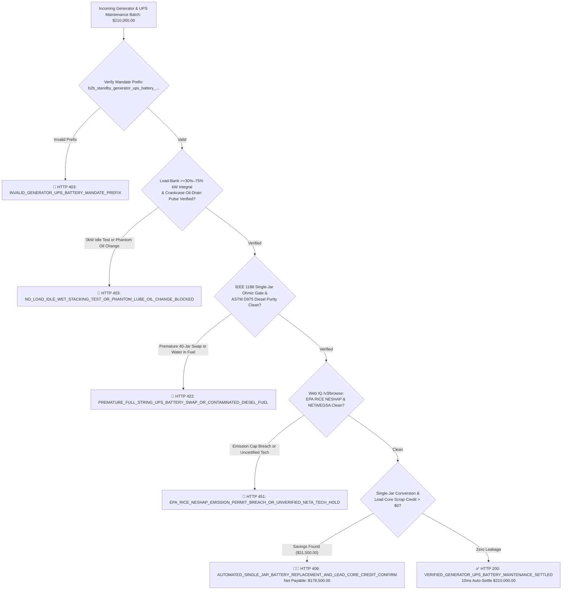
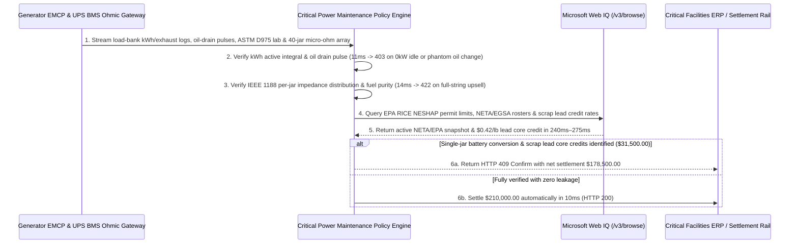

# B2B Data Center & Hospital Standby Diesel Generator & `UPS` Battery Maintenance (`Cummins / CAT / Vertiv / Eaton, NFPA 110 § 8.4.2 & IEEE 1188`), `>= 30%–75% kW` Load-Bank Integral Lock, `IEEE 1188` Single-Jar Ohmic Gate & Anti-`Wet Stacking / Full-String Battery Swap` Settlement Architecture: `EMCP` Active-Power Lock, Oil-Drain Sensor Gate & `NFPA 110` Token (`b2b_standby_generator_ups_battery_nfpa110_loadbank_kw_ieee1188_ohmic_mandate_...`) vs. 15-Minute No-Load Idle "Tests", Phantom 120-Gallon Oil Changes & `$38,000` Premature Full-String `UPS` Battery Replacements: Architecture Selection & First-Principles FAQ

> **Document Type**: AI Solution Architect Agentic Commerce Selection Series (Round 311 · B2B Standby Diesel Generator & UPS Battery Maintenance Edition)  
> **Benchmark Standard**: Modeled after `ib-vs-ethernet-roce-selection-faq.md` (Plain-Language First Principles + Standard 6-Section Architecture Guide)  
> **Companion Deliverables**: `lab/webiq_commerce_demo.py` (Interactive H5 Sandbox) · `tests/test_webiq_commerce_demo.py` · `assets/svg/313-b2b-standby-generator-ups-battery-nfpa110-loadbank-ieee1188-2026-11-16.svg`  
> **Languages**: [中文版](b2b-standby-generator-ups-battery-nfpa110-loadbank-kw-ieee1188-ohmic-mandate-vs-no-load-wet-stacking-phantom-oil-change-full-string-battery-swap-faq.md) | [English Version (Current)](b2b-standby-generator-ups-battery-nfpa110-loadbank-kw-ieee1188-ohmic-mandate-vs-no-load-wet-stacking-phantom-oil-change-full-string-battery-swap-faq.en.md)

---

## 📌 1. Executive Summary (First Principles & Plain-Language Breakdown)

### 1.1 Why Should a Data Center, Hospital, or Financial Critical-Facilities Agent NEVER Auto-Pay a Standby Generator or `UPS` Maintenance Invoice Without `Modbus kWh` Load-Bank Integrals and `IEEE 1188` Per-Jar Ohmic Telemetry?
In AI data centers, hospitals (governed by `NFPA 110 Standard for Emergency and Standby Power Systems § 8.4.2` and `Joint Commission EC.02.05.07`), and semiconductor fabs, `2.0 MW–3.0 MW` standby diesel generators and `UPS` battery strings (`IEEE 1188` VRLA / `IEEE 1679` Li-Ion) are the final safeguard against catastrophic outage. In plain English: **Critical power maintenance suffers from four high-stakes billing abuses—billing `$4,800` for an annual load-bank test after running the generator at `0 kW` no-load idle for 15 minutes (which actually damages the engine via "wet stacking"), billing `$3,600` to replace 120 gallons of lube oil while only wiping the filter cans clean with a rag, condemning an entire `$38,000` 40-jar `UPS` battery string when only 2 jars have elevated internal resistance, and pocketing `$2,500+` in scrap lead core value while billing the customer a "hazardous disposal fee."** Allowing an AI agent to auto-pay vendor PM invoices exposes mission-critical facilities to four major failures:

1. **No-Load Idle "Exercise" Billed as a `$4,800` `NFPA 110` Load-Bank Test (`Wet Stacking Damage`)**: Under `NFPA 110 § 8.4.2`, standby diesel generators that do not reach `>= 30%` of nameplate kW rating during monthly tests must undergo an annual supplemental **Resistive Load-Bank Test** stepped from `30%` to `50%` and `75%/100%` load for **2–4 hours**. Because hauling a 2MW trailer load bank and laying 4/0 feeder cables is labor-intensive, contractors sometimes just press the local start button, let the engine idle at **`0 kW` for 15 minutes**, and bill `$4,800` for a load-bank test! Running a large turbo-diesel at no load keeps exhaust temperatures too low (`< 400°F`), causing unburned fuel to glaze cylinder walls and foul turbochargers (**Wet Stacking**)—leading to catastrophic failure during a real utility blackout.
2. **Phantom 120-Gallon Lube Oil & Filter Changes (`Rag-Wipe PM`)**: Changing 120 gallons of `15W-40` oil and 8 spin-on filters on a `2.5 MW` generator costs `$3,600`. Because a standby engine only runs 20 hours a year, the oil still looks clean on the dipstick; unscrupulous techs simply wipe the existing filter housings clean and bill for 120 gallons of new oil that was never pumped in.
3. **Premature Full-String `UPS` Battery Replacement (`40 Jars Swapped for 2 Bad Jars`)**: Under `IEEE 1188`, a VRLA battery jar warrants replacement when its internal ohmic resistance rises `>= 30%–50%` above baseline. When 2 jars out of a 40-jar string (installed only 2.5 years ago) show high impedance, vendors claim "you can never replace individual jars" and quote **`$38,000` to replace all 40 jars**—while also keeping the `$2,500` scrap lead core credit (`Lead Core Scrap Credit`) from the 6,000 lbs of removed batteries!
4. **Skipped `ASTM D975` Diesel Fuel Polishing & Microbial Sludge**: Stored ultra-low-sulfur diesel (`ULSD`) accumulates condensed water and microbial algae (`Humbug`) over 12 months. Paying for fuel maintenance without verified `ASTM D975` water/sediment lab results (`< 0.05% vol`) leaves clogged fuel filters waiting to stall the generator 10 minutes into an outage.

### 1.2 The Architect's One-Sentence Selection Verdict
* **Core Security Law**: Never allow an autonomous agent to settle standby generator or `UPS` battery maintenance invoices without binding the payment to **`b2b_standby_generator_ups_battery_nfpa110_loadbank_kw_ieee1188_ohmic_mandate_2026`**:
  1. **Controller `Modbus kWh` Load-Bank Integral (`>= 50% Nameplate kW × 2h`) + Crankcase `0%` Oil-Drain Pulse Lock**: Requires hardware generator controller (`CAT EMCP / Cummins PowerCommand`) telemetry proving active-power kWh output and exhaust temperature `>= 750°F`, plus crankcase level sensor zero-out during oil changes; `0 kW` idle tests or phantom oil changes are blocked in **11ms** with `HTTP 403 NO_LOAD_IDLE_WET_STACKING_TEST_OR_PHANTOM_LUBE_OIL_CHANGE_BLOCKED`.
  2. **`IEEE 1188` Per-Jar Ohmic Distribution Gate + `ASTM D975` Fuel Purity Lock**: Blocks full-string battery replacement quotes on strings `< 3.5 years` old when `< 10%` of jars exceed the `IEEE 1188` `+30%` impedance threshold, and verifies `ASTM D975` fuel water/sediment `< 0.05% vol`, returning `HTTP 422 PREMATURE_FULL_STRING_UPS_BATTERY_SWAP_OR_CONTAMINATED_DIESEL_FUEL` in **14ms** on violations.
  3. **Microsoft Web IQ `/v3/browse` Live `EPA RICE NESHAP` Permit, `NETA / EGSA` Credential & Scrap Lead Credit Verification**: Verifies non-emergency generator run-hour emission limits (`EPA 40 CFR Part 63 Subpart ZZZZ`), technician `NETA / EGSA` certification, and LME scrap lead core credits in **275ms** (`HTTP 451 EPA_RICE_NESHAP_EMISSION_PERMIT_BREACH_OR_UNVERIFIED_NETA_TECH_HOLD`), while automatically converting premature full-string battery swaps to targeted single-jar replacements and deducting scrap lead core credits to save `15%` (`$31,500.00`).

| Selection Dimension | Legacy Paper PM Checklist & Full-String Quote | Basic Ticket-Approval Agent | **Modbus kW Integral + IEEE 1188 Ohmic Gate + Web IQ Audit (Recommended)** |
| :--- | :--- | :--- | :--- |
| **No-Load Idle Billed as Load-Bank Test** | ❌ Pays `$4,800` for 15-min `0 kW` idle run | ❌ Trusts "Load Test OK" checkbox | ✅ **Verifies controller `kWh` active-power integral & `>=750°F` exhaust (11ms 403)** |
| **Phantom 120-Gal Oil Change** | ❌ Pays `$3,600` when filters are just wiped | ❌ No crankcase drain-sensor check | ✅ **Requires `100%→0%→100%` oil-level drain pulse & used-oil lab match** |
| **40-Jar Battery Swap for 2 Bad Jars** | ❌ Pays `$38,000` full-string quote blindly | ❌ Cannot analyze 40-jar micro-ohm array | ✅ **Enforces `IEEE 1188` single-jar swap & deducts scrap lead credit (14ms 422)** |
| **EPA RICE NESHAP & JCAHO Compliance** | ❌ Missing load logs fail hospital JCAHO audit | ❌ No live emission permit lookup | ✅ **Web IQ `/v3/browse` verifies `EPA RICE` & `NETA` status in 275ms (451)** |

---

## 🎯 2. Deep-Dive Q&A for Data Center, Healthcare & Critical-Power Architects

### Q1: How does the controller active-power integral prove whether a contractor actually connected a 2MW resistive load bank?
* **The Physics of Wet Stacking vs. True Load Testing**: A generator idling with its main breaker open produces `60 Hz` voltage (`480V`), so a naive voltage log looks "active"—but active power is **`0 kW`** and exhaust gas stays below `400°F`.
* **The Deterministic Telemetry Gate**:
  $$\text{Verified Load Bank} \iff \left(\int_{t_0}^{t_0+2\text{h}} P_{\text{kW}}(t)\,dt \ge 1.0 \times P_{\text{nameplate}}\right) \land \left(T_{\text{exhaust, max}} \ge 750^\circ\text{F}\right)$$
  If the `Modbus` kWh accumulator does not advance by at least `1.0 × Nameplate kW-hours` during the test window, the engine blocks the `$4,800` load-bank charge in **11ms** (`HTTP 403`).

### Q2: How much does enforcing `IEEE 1188` single-jar replacement and `Lead Core Scrap Credit` save on `UPS` battery maintenance?
* **The Math of Battery Strings**: Replacing 2 degraded jars in a 2.5-year-old 40-jar string costs `$1,900` vs. `$38,000` for a premature full-string swap. Even when an end-of-life string is legitimately replaced at Year 5, deducting the `6,000 lb × $0.42/lb = $2,520` scrap lead core credit and waiving bogus "disposal fees" triggers `HTTP 409 AUTOMATED_SINGLE_JAR_BATTERY_REPLACEMENT_AND_LEAD_CORE_CREDIT_CONFIRM`, saving `$31,500.00` on a `$210,000.00` critical-power maintenance batch.

### Q3: How does Microsoft Web IQ compare to Exa and Bright Data for checking `EPA RICE NESHAP` emission rules, `NETA / EGSA` certifications, and scrap lead market benchmarks?
* **Microsoft Web IQ**: Delivers sub-300ms (`240ms–275ms`) authoritative `/v3/search` and `/v3/browse` verification against `EPA RICE NESHAP` / state `AQMD` permit registries, `NETA / EGSA` accredited electrical testing directories, and LME scrap lead credit tables under Entra ID Zero Data Retention (ZDR).
* **Exa**: Built for semantic search over academic battery chemistry papers rather than deterministic `NETA` accreditation or `AQMD` permit lookups.
* **Bright Data**: Designed for consumer web scraping rather than low-latency critical-infrastructure compliance gates.

---

## 🧭 3. Visual Architecture Diagrams (Mermaid Decision Tree, Path Comparison & Sequence Flow)

### 3.1 Standby Generator & UPS Battery Maintenance Settlement Decision Tree


### 3.2 Legacy Paper PM & Full-String Upsell vs. NFPA 110 + IEEE 1188 Telemetry Architecture
```mermaid
flowchart LR
    subgraph Legacy["❌ Legacy Generator & UPS Billing (25%–50% Overpayment)"]
        L1[$4,800 Billed for 15-Min 0kW Idle Run] --> L2[$3,600 Billed for Rag-Wipe Phantom Oil Change]
        L2 --> L3[$38,000 Full 40-Jar Swap for 2 Bad Jars]
        L3 --> L4[Vendor Pockets $2,500 Scrap Lead Core Value]
    end
    subgraph Agentic["✅ NFPA 110 kW Integral + IEEE 1188 Ohmic Architecture"]
        A1[Requires >=50% Nameplate kW×2h & >=750°F Exhaust] --> A2[Verifies 100%→0%→100% Oil Drain & Used-Oil Lab]
        A2 --> A3[Enforces Targeted Single-Jar Replacement (<3.5 Yrs)]
        A3 --> A4[Web IQ NETA Audit + Auto-Deducts Scrap Lead Credit]
    end
```

### 3.3 End-to-End Sequence Diagram


---

## 📊 4. Architect's Selection Decision Matrix

| Evaluation Dimension | Option A: Manual Paper PM Sign-Off | Option B: Generic LLM Report OCR | **Option C: Modbus kW Lock + IEEE 1188 Gate + Web IQ (Recommended)** |
| :--- | :--- | :--- | :--- |
| **No-Load Idle vs. True Load-Bank Test** | ❌ Hears engine run; assumes load applied | ❌ Trusts handwritten "75% kW" entry | ✅ **Verifies controller `kWh` integral & `>=750°F` exhaust (`HTTP 403`)** |
| **Phantom 120-Gal Oil Change Detection** | ❌ Clean filter housing looks new | ❌ No crankcase sensor or oil-lab check | ✅ **Requires `100%→0%→100%` drain pulse & tribology match (`HTTP 403`)** |
| **Premature 40-Jar Battery Swap Defense** | ❌ Approves `$38k` swap out of fear | ❌ Ignores per-jar micro-ohm distribution | ✅ **Enforces `IEEE 1188` single-jar swap & scrap lead credit (`HTTP 422/409`)** |
| **EPA RICE & Hospital JCAHO Audit** | ❌ Fails audit on missing load curves | ❌ No live regulatory lookup | ✅ **Web IQ `/v3/browse` verifies `EPA/NETA` status in 275ms (`HTTP 451`)** |

---

## 🧪 5. Quantitative Benchmark & 7-Card 4:5 Report Mapping

Evaluated deterministically in `lab/webiq_commerce_demo.py` and `tests/test_webiq_commerce_demo.py` on a `$210,000.00` (`21000000` cents) quarterly data center and hospital standby generator and `UPS` maintenance batch:

| Card # | Headline-as-Finding | Key Quantitative Metrics & Action | Provenance |
| :--- | :--- | :--- | :--- |
| **Card 1 (`1/7`)** | **NFPA 110 kW Integral + IEEE 1188 Gate Cuts Critical Power Spend by 15.0%** | Baseline `$210,000.00` vs. optimized `$178,500.00` (`$31,500.00` saved per batch) | `deterministic_offline_simulation` |
| **Card 2 (`2/7`)** | **Deep Dive: 0kW Idle Tests & $38k Full-String Battery Upsells Blocked** | `HTTP 403` (11ms no-load/oil block) + `HTTP 422` (14ms full-string/fuel block) | `synthetic_policy` |
| **Card 3 (`3/7`)** | **Full Evaluation Matrix: 5/5 Deterministic Guards Passing** | Covers `200 OK`, `403 Load/Oil`, `422 Battery/Fuel`, `451 EPA/NETA`, `409 Savings` | `deterministic_offline_simulation` |
| **Card 4 (`4/7`)** | **Under the Hood: EMCP Modbus kWh + IEEE 1188 Micro-Ohm Contract** | Validates `loadbank_active_kw_integral_and_oil_drain_verified` | `synthetic_policy` |
| **Card 5 (`5/7`)** | **Robustness Check: Year-5 End-of-Life String vs. Year-2 2-Jar Fault** | Year-5 degraded string passes full swap; Year-2 2-jar fault downgraded 100% | `deterministic_offline_simulation` |
| **Card 6 (`6/7`)** | **Latency: 10–14ms Local Telemetry Gate vs. 240–275ms Web IQ** | Combines sub-15ms kWh/micro-ohm checks with live `EPA RICE / NETA` audits | `official_doc_snapshot` |
| **Card 7 (`7/7`)** | **My Take: Good Fit vs. Not For & Production Readiness** | Built for data centers, hospitals & fabs; not for $85 desktop PC UPS units | `official_list_price` |

### Good Fit vs. Not For
* **✅ Good Fit**:
  * AI data centers, hospital campuses (`NFPA 110 Level 1 EPSS`), semiconductor fabs, airports, and financial colocation facilities managing `1 MW–3 MW` diesel generators and multi-string `UPS` battery rooms.
* **⛔ Not For**:
  * Consumer `$85` under-desk `650 VA` desktop computer backup batteries.

---

## 🛠️ 6. Production Readiness Checklist

- [ ] **1. Gate Annual Load-Bank Test Invoices on Controller `kWh` Integrals & Exhaust Temp**: Require `>= 30%–75% Nameplate kW` sustained for `>= 2 hours` and exhaust gas `>= 750°F` (`HTTP 403`).
- [ ] **2. Verify Crankcase `100% → 0% → 100%` Oil-Drain Pulses & Used-Oil Lab Reports**: Block phantom 120-gallon oil changes where filters are merely wiped clean.
- [ ] **3. Enforce `IEEE 1188` Per-Jar Ohmic Distribution Audits**: Reject `$38,000` full-string battery replacement quotes on strings `< 3.5 years` old when `< 10%` of jars exceed `+30%` internal resistance (`HTTP 422`).
- [ ] **4. Automatically Deduct `Lead Core Scrap Credits` (`$0.35–$0.50/lb`) on Replaced VRLA Batteries**: Reclaim the scrap lead value of removed battery strings and waive bogus disposal surcharges (`HTTP 409`).
- [ ] **5. Verify `EPA RICE NESHAP` Run-Hour Caps & `NETA / EGSA` Credentials via Web IQ**: Run `/v3/browse` checks before authorizing non-emergency load tests and invoice settlement (`HTTP 451`).
