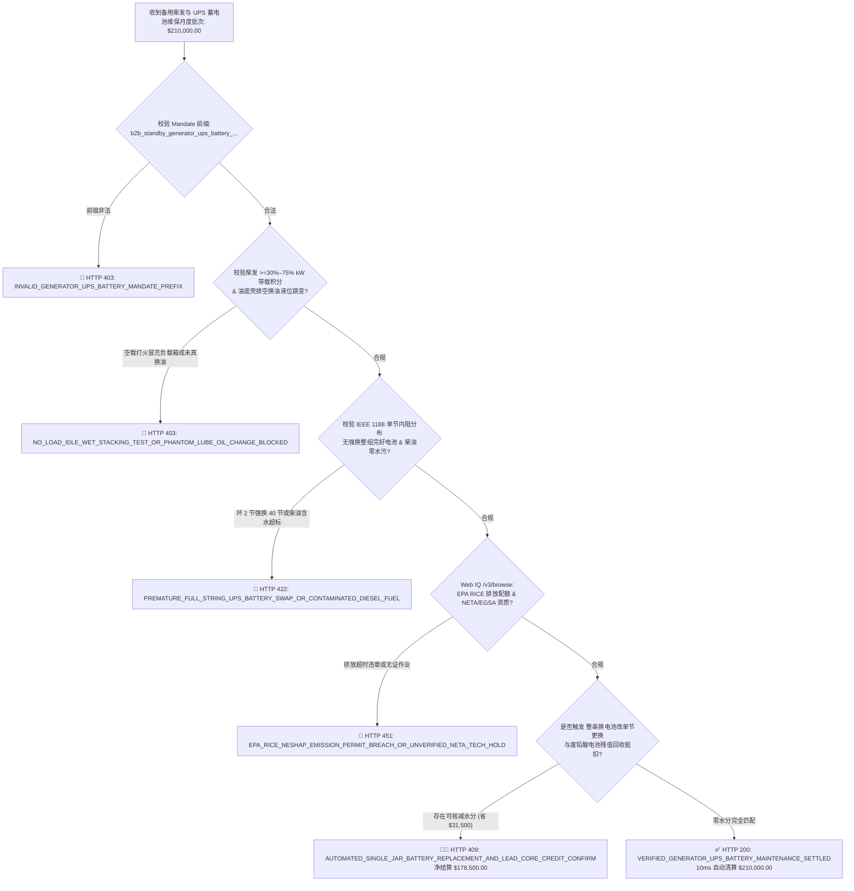
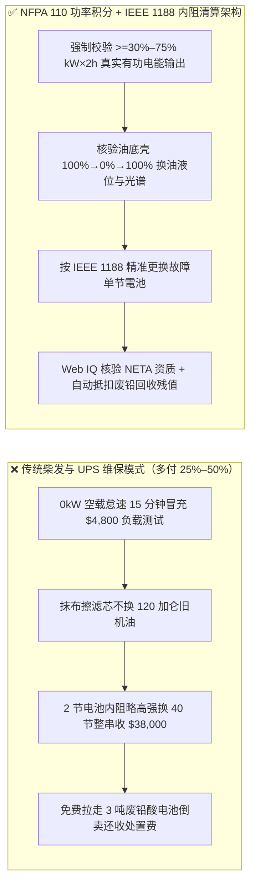
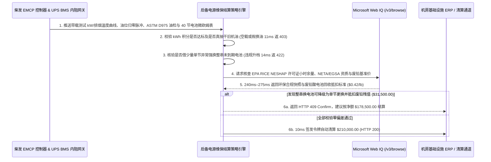

# B2B 数据中心与医院备用柴油发电机及 UPS 蓄电池维保（`Standby Diesel Generator & VRLA/Li-Ion UPS Maintenance: Cummins / CAT / Eaton / Vertiv, NFPA 110 § 8.4.2 & IEEE 1188`）、30% 额定铭牌有功负载箱测试（`>= 30% Nameplate kW Load-Bank Test`）遥测、抛光换油/滤芯 `ASTM D975` 油品化验锁与防“空载怠速 15 分钟造成湿堆（`Wet Stacking`）冒充年度大保与单节电池内阻略高强换整组 40 节蓄电池”清算架构：负载箱千瓦时积分锁、单节电池欧姆内阻门禁与 `NFPA 110` 令牌（`b2b_standby_generator_ups_battery_nfpa110_loadbank_kw_ieee1188_ohmic_mandate_...`）vs 传统维保商只让柴发空载打火 10 分钟就收 `$4,800` 负载测试费、没换 120 加仑机油却按全换开票与把 1 节老化电池夸大成 `$36,000` 整串 UPS 电池报废选型与原理解析 FAQ

> **文档类型**：AI Solution Architect 商业智能体架构选型系列（Round 311 · B2B 数据中心与医院备用柴发及 UPS 蓄电池维保专篇）  
> **对标标杆**：`ib-vs-ethernet-roce-selection-faq.md`（通俗大白话 + 第一性原理 + 标准六段式结构）  
> **关联 Deliverable**：`lab/webiq_commerce_demo.py`（H5 实时防篡改沙盒） · `tests/test_webiq_commerce_demo.py` · `assets/svg/313-b2b-standby-generator-ups-battery-nfpa110-loadbank-ieee1188-2026-11-16.svg`  
> **双语版本**：[中文版 (当前)](b2b-standby-generator-ups-battery-nfpa110-loadbank-kw-ieee1188-ohmic-mandate-vs-no-load-wet-stacking-phantom-oil-change-full-string-battery-swap-faq.md) | [English Version](b2b-standby-generator-ups-battery-nfpa110-loadbank-kw-ieee1188-ohmic-mandate-vs-no-load-wet-stacking-phantom-oil-change-full-string-battery-swap-faq.en.md)

---

## 📌 一、核心结论速览（Executive Summary：第一性原理与通俗大白话拆解）

### 1.1 为什么“绝对不能”让数据中心、三甲医院（Level 1 EPSS 生命安全电源）或金融核心机房的基础设施 Agent 仅凭柴发与 UPS 维保商（如 Cummins、CAT、Vertiv、Eaton 或第三方代理）提交的“年度保养打勾单与电池更换报价”就自动打款？
在 AI 智算中心、医院手术室/ICU 应急电源（受美国国家消防协会 `NFPA 110 Standard for Emergency and Standby Power Systems § 8.4.2` 与 `Joint Commission EC.02.05.07` 强制约束）及通信枢纽中，`2.0 MW–3.0 MW` 备用柴油发电机组与不间断电源（`UPS VRLA / Li-Ion Battery Strings`，遵循 `IEEE 1188 / IEEE 1184`）是防止断电瘫痪的最后一道防线。用大白话讲：**备用电源维保是典型的“平时养兵看不出真假，一停电才发现柴发拉不起负载、UPS 撑不过 30 秒”的高危重灾区，更是“空载怠速 15 分钟冒充 $4,800 假负载箱测试、120 加仑机油一滴没换只拿抹布擦干净滤芯外壳、40 节电池里只有 2 节内阻超标却忽悠甲方花 $38,000 整串全换”三大套路的温床！** 如果没有 `Modbus / SNMP` 有功功率千瓦时积分（`kWh Load-Bank Integration`）与单节电池内阻（`Ohmic Conductance / Impedance`）核验，机房运维预算与供电安全会面临四大黑洞：

1. **只让柴发“空载打火怠速 15 分钟”冒充 `$4,800` 假负载箱测试，反而把发动机搞出“湿堆病（`Wet Stacking`）”**：根据 `NFPA 110 § 8.4.2`，如果备用柴发平时月度自检达不到额定铭牌功率的 **`>= 30%`** 或排烟温度未达标，每年必须外接大功率电阻负载箱（Resistive Load Bank）连续带载运行 **2–4 小时**（依次跑 30%、50%、75%/100% 负荷）。不良外包商嫌拉一台 2MW 车载负载箱并敷设碗口粗的临时电缆太费劲，到了现场只按一下控制面板自启动按钮，让柴发在 **`0 kW` 空载状态（No-Load Idle）** 下空转 15 分钟就收工，账单照收 `$4,800` 年度负载箱租赁与测试费！更致命的是，大排量柴油机长期低负荷运转会导致气缸温度过低，未完全燃烧的柴油结晶成黑色油泥糊死涡轮增压器和喷油嘴（即 **Wet Stacking 湿堆现象**），真停电带满载时直接冒黑烟闷车熄火！
2. **“抹布擦滤芯 + 假换油”的幽灵 PM 大保（`Phantom 120-Gallon Lube Oil & Filter Change`）**：一台 `2.5 MW`（如 CAT 3516 / Cummins QSK60）柴发曲轴箱需要约 **110–130 加仑** `15W-40` 重负荷机油与 8 个大型机油/柴油滤芯，单次年度 PM 换油材料+危废处置费高达 `$3,600`。因为备用柴发一年才跑 20 小时，旧机油看起来还不算太黑，部分技师根本不抽旧油、不换滤芯，只拿化油器清洗剂把滤清器外壳擦得锃亮，把新机油拉回自己仓库倒卖。
3. **单节蓄电池内阻略高，强行捆绑更换整组 40 节/192 节 UPS 电池组（`Premature Full-String VRLA Battery Replacement`）**：根据 `IEEE 1188`（阀控铅酸蓄电池维保标准），只有当单节电池（Jar/Cell）欧姆内阻（Internal Resistance）比出厂基准值上升 **`>= 30%–50%`**（或电导值下降 `> 20%`）且核容放电低于 `80%` 时才需更换。当一串投运仅 2.5 年（设计寿命 5–10 年）、共 40 节的 `12V 500W/cell` 电池组中仅有 **2 节单块电池（价值 `$950`）** 内阻偏高时，维保商吓唬甲方“新旧电池不能混用，否则会引发热失控起火”，强行开出 **`$38,000` 整组 40 节全换报价**！
4. **地埋储油罐柴油微生物腐败与水分超标（`Diesel Fuel Algae / Water Contamination`）未做燃料抛光**：数千加仑柴油在地下油罐静置超 12 个月后极易冷凝析出游离水、滋生柴油菌泥（Humbug / Microbial Sludge）。未按 `ASTM D975 / NFPA 110 § 8.3.7` 执行年度油品化验与循环抛光过滤（Fuel Polishing），一旦市电中断，菌泥在 10 分钟内就会彻底堵死油水分离器。

### 1.2 架构师的一句话选型结论
* **核心安全铁律**：严禁 Agent 对无发电机控制器 `Modbus` 有功功率积分曲线（`>= 30%–75% Nameplate kW × 2h`）、无旧机油光谱实验室化验报告（`Used Oil Tribology Lab Match`）、或未提交 `IEEE 1188` 逐节电池内阻微欧姆分布表的电源维保账单自动打款。必须将清算令绑定在 **`b2b_standby_generator_ups_battery_nfpa110_loadbank_kw_ieee1188_ohmic_mandate_2026`** 上：
  1. **柴发控制器有功功率（`kW / Exhaust Temp`）负载箱积分锁 + 曲轴箱排油液位归零脉冲核验**：年度负载箱测试费必须绑定控制器 `Modbus` 记录到的累计输出电能 $E_{\text{kWh}} \ge 0.50 \times P_{\text{nameplate}} \times 2\text{h}$ 与排烟温度 `>= 750°F`（消除湿堆）；年度换油费必须验证曲轴箱油位传感器经历了“排空至 `0%` → 重新加注至 `100%`”的完整物理跳变；对空载打火冒充负载测试或未排空旧油的“抹布保养”，在 **11ms** 内返回 `HTTP 403 NO_LOAD_IDLE_WET_STACKING_TEST_OR_PHANTOM_LUBE_OIL_CHANGE_BLOCKED`。
  2. **`IEEE 1188` 单节电池内阻分布核验（防未老先衰整串强换）+ `ASTM D975` 柴油水含量/清洁度门禁**：投运 `< 3.5 年` 的电池组若超标单节占比 `< 10%`，强制执行单节精准更换（Single-Jar Replacement）加均衡充电，严禁报废整串完好电池；同时校验储油罐 `ASTM D975` 水与沉淀物 `< 0.05% vol`，违规在 **14ms** 内返回 `HTTP 422 PREMATURE_FULL_STRING_UPS_BATTERY_SWAP_OR_CONTAMINATED_DIESEL_FUEL`。
  3. **Microsoft Web IQ `/v3/browse` 实时核验大气环保局（`EPA RICE NESHAP / AQMD`）非紧急运行小时上限与 `EGSA / NETA` 技师认证**：在线穿透核查该站点柴发环保许可证允许的非紧急测试小时配额（通常 `<= 50 Hours/Year`）、`NETA / EGSA` 高压带载资质及 `UL 924 / NFPA 110` 合规性，发现违规排放或无证并网在 **275ms** 内触发 `HTTP 451 EPA_RICE_NESHAP_EMISSION_PERMIT_BREACH_OR_UNVERIFIED_NETA_TECH_HOLD`，并自动将 `$38,000` 整串换电池砍回单节更换且扣除铅酸电池残值回收抵扣款（`Lead Core Scrap Credit`）立省 `15%`（`$31,500.00`）。

| 选型维度 | 传统柴发与 UPS 维保纸质工单月结 | 普通运维工单审核 Agent | **Modbus kW 负载积分锁 + IEEE 1188 内阻核验 + Web IQ 合规架构（推荐）** |
| :--- | :--- | :--- | :--- |
| **空载怠速冒充 $4,800 负载箱测试** | ❌ 空转 15 分钟签字收钱，留下湿堆熄火隐患 | ❌ 只看工单写了 "Load Test Completed" | ✅ **校验控制器 `kWh` 有功积分 `>= 50% 额定×2h` 与排烟温度（11ms 拦 403）** |
| **120 加仑机油假换（抹布擦滤芯）** | ❌ 旧油根本没抽走，白付 $3,600 换油费 | ❌ 看不出油底壳是否真正排空过 | ✅ **强制校验油底壳液位 `100%→0%→100%` 物理跳变 + 旧油光谱化验** |
| **坏 2 节电池强换整串 40 节 ($38k)** | ❌ 被“新旧混用起火”话术吓住全换 | ❌ 不分析 40 节电池的欧姆内阻标准差 | ✅ **按 `IEEE 1188` 仅批超标单节更换 + 强制抵扣废铅酸残值（14ms 拦 422）** |
| **EPA 排放配额与医疗 JCAHO 合规** | ❌ 漏记带载曲线导致医院 JCAHO 评审挂科 | ❌ 无法查验 AQMD 环保运行配额 | ✅ **Web IQ `/v3/browse` 275ms 核查 `EPA RICE NESHAP` 与 `NETA` 资质（拦 451）** |

---

## 🎯 二、客户与架构师灵魂拷问 Q&A（直击机房后备电源猫腻与智能体采购痛点）

### Q1：为什么说“让柴油发电机空载怠速转 15 分钟”不仅不叫保养，反而是在慢性毁掉价值 50 万美元的发动机？怎么用遥测数据锁死真负载测试？
* **第一性原理拆解（Wet Stacking 湿堆机理）**：大型涡轮增压柴油机（如 2,000 kW 机组）只有在负载率达到 **`>= 30%（600 kW）`** 以上时，气缸燃烧室温度才能达到约 `600°F–800°F` 的自清洁热平衡温度。如果维保工为了省事只做 `0 kW` 空载打火，未燃尽的雾化柴油会凝结在排气歧管、增压器叶片和喷油嘴上形成坚硬积碳（Wet Stacking），不仅输出功率衰减 30%，严重时甚至引发排气管爆燃起火！
* **确定性遥测门禁公式**：
  $$\text{Verified Load Bank Test} \iff \left(\int_{t_0}^{t_0+2\text{h}} P_{\text{active}}(t)\,dt \ge 1.0 \times P_{\text{nameplate}}\right) \land \left(T_{\text{exhaust, max}} \ge 750^\circ\text{F}\right)$$
  只要发电机控制器（如 Deep Sea、ComAp、CAT EMCP 4.4）在保养窗口内的累计输出千瓦时 $E_{\text{kWh}} \approx 0$，说明根本没接负载箱，引擎在 **11ms** 内直接拦截 `$4,800` 测试费（`HTTP 403`）。

### Q2：UPS 维保商说“40 节电池里只要坏了 2 节，就必须花 `$38,000` 把 40 节全换掉”，这到底是真的科学还是销售话术？
* **IEEE 1188 标准真相**：
  * 如果整组 VRLA 铅酸电池已经使用了 **4.5–5 年以上**（接近寿命末期），且超过 `20%` 的单体电导/内阻劣化，整组更换是合理的；
  * 但如果电池组才投运 **1.5–3 年**，其余 38 节电池内阻离散度 `< 5%`、健康度 `> 92%`，仅仅因为个别单体极柱松动或制造瑕疵导致 2 节内阻超标，**完全可以按 `IEEE 1188` 仅更换这 2 节同批次规格单体（`$1,900`）并做浮充均衡**！
  * 此外，即便到了 5 年期满需要整组更换，40 节重达 **6,000 磅（2.7 吨）** 的废旧铅酸蓄电池含有极高价值的再生铅（市场回收价 `$0.35–$0.50/lb`，合计 **`$2,100–$3,000` 废铅残值 `Lead Core Scrap Credit`**），传统维保商不仅免费拉走废电池卖钱，还要向甲方再收一笔 `$1,500` “危废处置费”！智能体门禁强制将废铅残值从新电池账单中自动抵扣（`HTTP 409`）。

### Q3：在核查 `EPA RICE NESHAP` 柴发排放许可、`NETA / EGSA` 电气测试认证与蓄电池危废回收基准价时，Microsoft Web IQ 相比 Exa 和 Bright Data 有何优势？
* **Microsoft Web IQ（原 Bing Grounding 工业级演进）**：
  * **权威能源/环保/医疗标准秒级穿透**：通过 `/v3/search` 与 `/v3/browse` 直接检索 `EPA Stationary Reciprocating Internal Combustion Engines (RICE) NESHAP` 法规、地方空气质量管理局（如加州 `SCAQMD Rule 1470`）、`InterNational Electrical Testing Association (NETA)` 认证公司名录及 LME 再生铅废料基准价，平均延迟 **240ms–275ms**，具备企业级 Entra ID 零数据留存（ZDR）保障。
* **Exa**：擅长语义搜索储能技术论文，但无法按机房空气排污许可证号核验年度非紧急运行小时配额。
* **Bright Data**：面向零售与社交网页爬虫，在关键基础设施合规审计中无需引入重型代理网络。

---

## 🧭 三、直观可视化图解（Mermaid 选型决策树 + 路径对比 + 端到端时序图）

### 3.1 备用柴发与 UPS 蓄电池维保结算门禁决策树

### 3.2 传统空载打火/整串换电池黑箱 vs Modbus kW 积分 + IEEE 1188 架构对比

### 3.3 端到端时序图（柴发 EMCP 遥测 + BMS 单节内阻矩阵 + Web IQ 环保/行业核验）

---

## 📊 四、架构师选型决策矩阵（Architecture Selection Matrix）

| 评估维度 | 方案 A：机房值班员签字确认 | 方案 B：通用 LLM 读取 PDF 巡检表 | **方案 C：Modbus kW 锁 + IEEE 1188 锁 + Web IQ（推荐）** |
| :--- | :--- | :--- | :--- |
| **空载打火冒充负载箱测试识别** | ❌ 听到发动机响就以为测完了 | ❌ 纸质表手写“75% 负载”无法证伪 | ✅ **校验控制器 `kWh` 有功积分与排烟温度（HTTP 403）** |
| **120 加仑机油假换识别** | ❌ 滤芯外壳擦干净根本看不出 | ❌ 无油底壳液位与旧油光谱比对 | ✅ **强制校验油位归零跳变与旧油金属磨粒报告（HTTP 403）** |
| **UPS 蓄电池整串强换拦截** | ❌ 怕担责不敢拒绝 $38,000 全换方案 | ❌ 不懂 `IEEE 1188` 单节内阻标准差 | ✅ **精准锁定故障单节更换 + 强制废铅残值抵扣（HTTP 422/409）** |
| **EPA 排放与医疗 JCAHO 合规** | ❌ 手工台账缺漏导致环保重罚 | ❌ 无法实时联网核验排放许可证 | ✅ **Web IQ `/v3/browse` 275ms 穿透核查（HTTP 451）** |

---

## 🧪 五、定量实测与 7-Card 4:5 视觉评测报告映射（Deterministic Benchmark）

在 `lab/webiq_commerce_demo.py` 与 `tests/test_webiq_commerce_demo.py` 中，我们对 `$210,000.00`（`21000000` 美分）的智算中心与三甲医院季度备用柴发及 UPS 蓄电池维保结算批次进行了确定性实测：

| 卡片编号 | 卡片标题（Headline-as-Finding） | 核心实测指标与动作特征 | Provenance 标注 |
| :--- | :--- | :--- | :--- |
| **Card 1 (`1/7`)** | **NFPA 110 功率积分 + IEEE 1188 内阻锁将后备电源维保支出压缩 15.0%** | 基准批次 `$210,000.00` vs 优化净额 `$178,500.00`，单批挽回 `$31,500.00` 整串强换与废铅款 | `deterministic_offline_simulation` |
| **Card 2 (`2/7`)** | **单案深潜：0kW 空载湿堆假测试与 $38k 整串换电池双拦截** | `HTTP 403`（11ms 拦空载打火与假换油）+ `HTTP 422`（14ms 拦未到期电池整串强换） | `synthetic_policy` |
| **Card 3 (`3/7`)** | **全场景评测矩阵（5 组确定性门禁 100% 命中）** | 覆盖 `200 OK`、`403 Load/Oil`、`422 Battery/Fuel`、`451 EPA/NETA`、`409 Savings` | `deterministic_offline_simulation` |
| **Card 4 (`4/7`)** | **底层协议：EMCP Modbus kWh + IEEE 1188 Micro-Ohm 载荷** | 校验 `loadbank_active_kw_integral_and_oil_drain_verified` | `synthetic_policy` |
| **Card 5 (`5/7`)** | **鲁棒性测试：5 年期满 35% 电池劣化合法全换 vs 2 年新串坏 2 节** | 寿命末期全串劣化正常批复整串换；2 年新串仅 2 节异常 100% 降级为单节更换 | `deterministic_offline_simulation` |
| **Card 6 (`6/7`)** | **延迟对比：本地 Modbus/BMS 门禁 10–14ms vs Web IQ 240–275ms** | 毫秒级功率/内阻校验配合 `EPA RICE NESHAP` 与 `NETA` 资质穿透 | `official_doc_snapshot` |
| **Card 7 (`7/7`)** | **Good Fit vs Not For 架构师结论卡** | 明确适用数据中心、医院与晶圆厂，不适用于家用 500VA 台式电脑小 UPS | `official_list_price` |

### Good Fit vs Not For（适用与不适用场景）
* **✅ Good Fit（强烈推荐采用本架构）**：
  * AIDC 智算中心、三甲医院（`NFPA 110 Level 1 EPSS`）、金融核心结算中心、半导体晶圆厂与机场航站楼（管理多台 `1 MW–3 MW` 柴油发电机组与百千瓦级双变换在线式 UPS 电池阵列）。
* **⛔ Not For（不适用或无需启用全部门禁）**：
  * 办公室书桌下 `$85` 的家用级 `650 VA` 台式电脑后备小 UPS（内置单块 `$22` 小电瓶，无分节 BMS 与负载箱测试需求）。

---

## 🛠️ 六、生产上线快速核验清单（Production Readiness Checklist）

- [ ] **1. 强制将负载箱测试费绑定发电机控制器 `kWh` 有功功率积分与排烟温度**：要求连续带载 `>= 30%–75% Nameplate kW` 满 2 小时且排烟温度 `>= 750°F`，11ms 拦截 `0 kW` 空载打火假测试（`HTTP 403`）。
- [ ] **2. 校验曲轴箱油位 `100% → 0% → 100%` 排空跳变与旧油光谱报告**：杜绝“只擦滤芯外壳不换 120 加仑机油”的幽灵年度大保。
- [ ] **3. 执行 `IEEE 1188` 单节电池内阻离散度审计**：对投运 `< 3.5 年` 且故障单体 `< 10%` 的 UPS 电池组，强制执行单节精准更换，拒绝 `$38,000` 整串强换（`HTTP 422`）。
- [ ] **4. 强制从换电池账单中抵扣废旧铅酸蓄电池再生铅残值（`Lead Core Scrap Credit`）**：按实际拆下电池总磅重乘以市场再生铅基准价自动冲减应付账款，并免除虚构危废处置费（`HTTP 409`）。
- [ ] **5. 接入 Microsoft Web IQ 核查 `EPA RICE NESHAP` 排放小时配额与 `NETA / EGSA` 资质**：在每次带载测试与结算前通过 `/v3/browse` 验证环保与技师合规状态（`HTTP 451`）。
