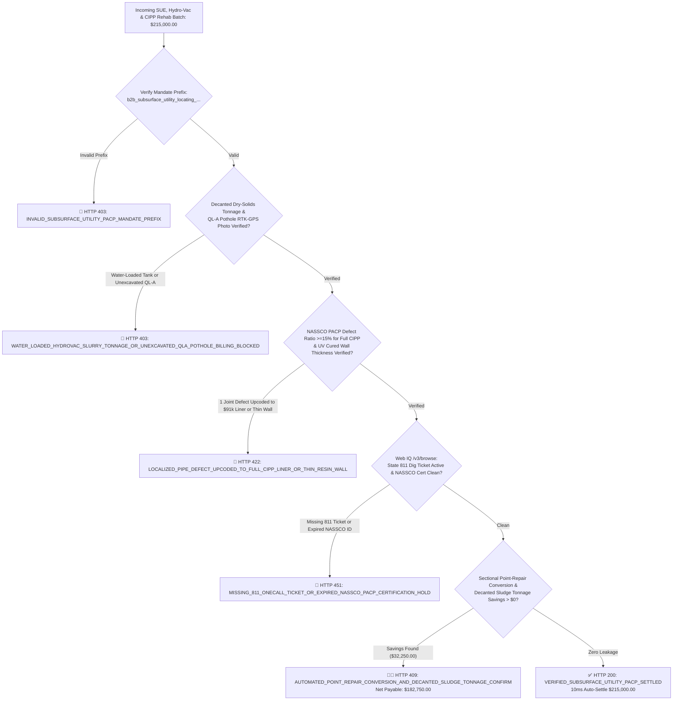
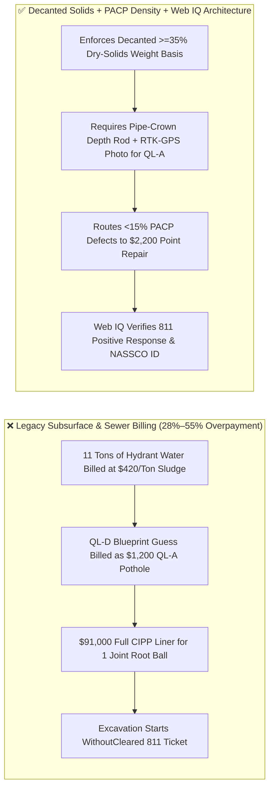
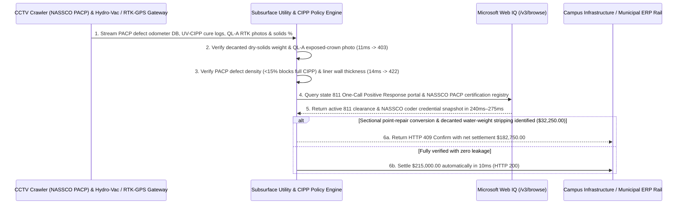

# B2B Subsurface Utility Engineering (`SUE`), `NASSCO PACP` Sewer `CCTV`, Hydro-Excavation & `UV-CIPP` Trenchless Pipe Rehab (`Badger Infrastructure / Aegion / Envirosight, ASCE 38-22 & NASSCO PACP`), Decanted Dry-Solids Tonnage Lock, `QL-A` Pothole `RTK-GPS` Gate & Anti-`Full-Liner Upcoding` Settlement Architecture: `PACP` Defect-Density Lock, `UV` Curing-Log Gate & `ASCE 38-22` Token (`b2b_subsurface_utility_locating_nassco_pacp_cctv_hydrovac_cipp_rehab_mandate_...`) vs. Hydrant-Water-Loaded `$420/Ton` Sludge Tickets, `QL-D` Map Guesses Billed as `$1,200` `QL-A` Potholes & `$91,000` Full `CIPP` Relining on Single Joint Roots: Architecture Selection & First-Principles FAQ

> **Document Type**: AI Solution Architect Agentic Commerce Selection Series (Round 323 · B2B Subsurface Utility Engineering, NASSCO PACP CCTV & UV-CIPP Trenchless Rehab Edition)  
> **Benchmark Standard**: Modeled after `ib-vs-ethernet-roce-selection-faq.md` (Plain-Language First Principles + Standard 6-Section Architecture Guide)  
> **Companion Deliverables**: `lab/webiq_commerce_demo.py` (Interactive H5 Sandbox) · `tests/test_webiq_commerce_demo.py` · `assets/svg/325-b2b-subsurface-utility-nassco-pacp-cctv-hydrovac-cipp-2026-11-16.svg`  
> **Languages**: [中文版](b2b-subsurface-utility-locating-nassco-pacp-cctv-hydrovac-cipp-rehab-mandate-vs-water-loaded-sludge-tonnage-ql-upcoding-full-pipe-relining-faq.md) | [English Version (Current)](b2b-subsurface-utility-locating-nassco-pacp-cctv-hydrovac-cipp-rehab-mandate-vs-water-loaded-sludge-tonnage-ql-upcoding-full-pipe-relining-faq.en.md)

---

## 📌 1. Executive Summary (First Principles & Plain-Language Breakdown)

### 1.1 Why Should a Municipal Water Authority, Data Center Construction, or Industrial Campus Agent NEVER Auto-Pay a Hydro-Excavation, Sewer `CCTV`, or Trenchless `CIPP` Rehabilitation Invoice Without `NASSCO PACP` Odometer Data and Decanted Solids Verification?
Across campus civil construction, industrial plants, and municipal storm/sanitary sewer networks, underground utility locating is governed by **`ASCE/UESI/CI 38-22`** (Subsurface Utility Engineering Quality Levels `QL-D` through `QL-A`), hydro-vacuum excavation (`Hydro-Vac`), and robotic sewer inspection/rehabilitation under **`NASSCO PACP / LACP / MACP`** and **`ASTM F1216 / F2019`** (`UV-CIPP` Cured-in-Place Pipe). In plain English: **Because project owners cannot see 15 feet underground, subsurface utility and sewer contracting is plagued by four costly billing schemes—filling a hydro-vac truck tank with 11 tons of free hydrant water on the way to the dump scale to bill `$420/ton` for "heavy sludge disposal," billing `$1,200/hole` for `QL-A` vacuum potholing when the crew only looked at old `QL-D` paper blueprints, proposing a `$91,000` 350-foot full-length `UV-CIPP` liner when the pipe only has a single 3-foot root intrusion that needs a `$2,200` sectional point repair, and pulling the `UV` curing light train too fast on an undersized resin liner.** Allowing an AI agent to auto-pay subsurface invoices exposes capital and facilities budgets to four major vulnerabilities:

1. **Hydrant-Water-Loaded Hydro-Vac Sludge Tonnage Padding (`Paying $420/Ton for Tap Water`)**: Vacuum excavation and catch-basin cleaning trucks bill `$380–$550/ton` at the disposal scale for excavated soil and sewer grit. Instead of opening the truck's decant valve to drain free standing water back into the sanitary manhole before hauling, rogue operators top off a 3-ton sludge load with **11 tons of fire-hydrant water**—billing the client **`$5,880` for 14 tons of water**!
2. **`ASCE 38-22` Utility Quality-Level Upcoding (`QL-D / QL-B` Billed as `$1,200` `QL-A` Daylight Potholing)**: Under `ASCE 38-22`, `QL-D` (existing records review) and `QL-B` (surface electromagnetic/GPR paint marks) cost a few dollars per foot, whereas **`QL-A` (Daylight Test-Hole Potholing)** requires vacuum-excavating down to physically expose the buried fiber/gas/electric conduit and surveying its exact `X, Y, Z` elevation (`$850–$1,450/pothole`). Contractors bill for 40 `QL-A` potholes (`$48,000`) without ever excavating down to the pipe crown—leading to catastrophic backhoe utility strikes during construction!
3. **Single-Joint Defect Upcoded to `$91,000` Full-Length Manhole-to-Manhole `CIPP` Relining**: A `350-foot` storm or sanitary pipe inspected by a `NASSCO PACP` crawler has a single Grade 3/4 joint offset or root ball at `42.5 feet` (`< 2%` of total pipe length), while the remaining `345 feet` are structurally sound (`Grade 1`). Instead of installing a `$2,200` 4-foot **Sectional Point Repair Liner**, the contractor prescribes a **`$91,000` full-length `UV-CIPP` liner**—or recycles `CCTV` footage from a different collapsed pipe!
4. **Undersized `CIPP` Resin Wall Thickness & Fast-Pull Uncured Liners**: Installing a `5.5 mm` fiberglass liner where engineering specs require `>= 9.0 mm` (`ASTM F1216`) and pulling the UV light train faster than the resin manufacturer's cure-temperature curve, causing premature liner buckling.

### 1.2 The Architect's One-Sentence Selection Verdict
* **Core Security Law**: Never allow an autonomous agent to settle hydro-excavation, `SUE` locating, or `CCTV / CIPP` trenchless pipe invoices without binding the payment to **`b2b_subsurface_utility_locating_nassco_pacp_cctv_hydrovac_cipp_rehab_mandate_2026`**:
  1. **Decanted Dry-Solids Tonnage Lock (`>= 35% Total Solids`) + `ASCE 38-22 QL-A` Pipe-Crown `RTK-GPS` Photo Gate**: Caps hydro-vac disposal tonnage at decanted dry-solids equivalent weight and requires every billed `QL-A` pothole to include a timestamped photo of the exposed utility crown with a depth rod and centimeter-grade `RTK-GPS` coordinates, blocking water-loaded tickets and fake potholes in **11ms** with `HTTP 403 WATER_LOADED_HYDROVAC_SLURRY_TONNAGE_OR_UNEXCAVATED_QLA_POTHOLE_BILLING_BLOCKED`.
  2. **`NASSCO PACP` Linear Defect-Density Gate (`< 15%` Forces Sectional Point Repair) + `UV-CIPP` Cure-Temp / Wall-Thickness Lock**: Parses the raw `NASSCO PACP` database to block full-length `CIPP` relining when Grade 4/5 structural defects span `< 15%` of total manhole-to-manhole length (routing to `$2,200` point repairs) and verifies `ASTM D790 / F1216` cured wall thickness and infrared curing speed logs, returning `HTTP 422 LOCALIZED_PIPE_DEFECT_UPCODED_TO_FULL_CIPP_LINER_OR_THIN_RESIN_WALL` in **14ms** on violations.
  3. **Microsoft Web IQ `/v3/browse` Live State `811 One-Call` Ticket, `NASSCO PACP` Certification & `ASTM F1216` Lab Verification**: Verifies active state `811 One-Call Positive Response` dig tickets, coder `NASSCO PACP/LACP/MACP` certification numbers, and third-party coupon flexural modulus lab reports in **275ms** (`HTTP 451 MISSING_811_ONECALL_TICKET_OR_EXPIRED_NASSCO_PACP_CERTIFICATION_HOLD`), while automatically converting unnecessary full-length liners to sectional point repairs and stripping water weight to save `15%` (`$32,250.00`).

| Selection Dimension | Legacy Scale Ticket + Full-Liner Quote | Basic Civil-Estimate OCR Agent | **Decanted Solids Lock + PACP Defect Gate + Web IQ 811/NASSCO (Recommended)** |
| :--- | :--- | :--- | :--- |
| **Hydrant-Water-Loaded Sludge Tickets** | ❌ Pays `$420/ton` on 11 tons of tap water | ❌ Multiplies gross scale tons × rate | ✅ **Enforces decanted `>=35%` dry-solids equivalent weight (11ms 403)** |
| **`QL-D` Maps Billed as `$1,200` `QL-A` Potholes** | ❌ Pays `$48k` for unexcavated test holes | ❌ Accepts "QL-A" text on invoice | ✅ **Requires exposed pipe-crown depth photo + `RTK-GPS` stamp (11ms 403)** |
| **Single Joint Root Upcoded to `$91k` CIPP** | ❌ Nobody watches 3 hrs of sewer video | ❌ Reads summary recommendation only | ✅ **Parses `NASSCO PACP` DB; `<15%` defect forces `$2.2k` point repair (14ms 422)** |
| **State `811` Dig Ticket & `NASSCO` Cert** | ❌ Unpermitted digging risks fiber/gas strike | ❌ No live `811` or `NASSCO` registry lookup | ✅ **Web IQ `/v3/browse` verifies `811` & `NASSCO` IDs in 275ms (451)** |

---

## 🎯 2. Deep-Dive Q&A for Civil, Campus Infrastructure & Municipal Water Architects

### Q1: How does the `NASSCO PACP` Linear Defect-Density equation prevent contractors from billing `$91,000` full-length `CIPP` liners on pipes that only need a `$2,200` point repair?
* **The Engineering Math**: Every `NASSCO PACP` inspection generates a structured database table mapping odometer footage $x \in [0, L_{\text{pipe}}]$ to structural defect codes (`Grade 1` to `Grade 5`).
* **The Deterministic Policy Gate**:
  $$\rho_{\text{structural}} = \frac{\sum_{d \in \text{Grade 4,5}} L_{\text{defect}}(d)}{L_{\text{pipe}}}$$
  When $\rho_{\text{structural}} < 0.15$ (e.g., a single 4-foot root intrusion or offset joint in a 350-foot pipe), full-length manhole-to-manhole `CIPP` relining is blocked in **14ms** (`HTTP 422`) and converted to a targeted sectional point repair (`HTTP 409`, saving `$32,250.00` on a `$215,000.00` quarterly infrastructure batch).

### Q2: How do we stop hydro-vac operators from billing tap water as `$420/ton` hazardous sludge and billing fake `QL-A` potholes?
* **Decanted Solids & `RTK-GPS` Proof**:
  1. **Dry-Solids Scaling**: Disposal tickets must include the receiving facility's decanted liquid deduction or percent-solids test (`>= 35% solids`), stripping free water tonnage (`HTTP 403`).
  2. **`ASCE 38-22 QL-A` Verification**: Every billed `QL-A` test hole must link to a centimeter-accurate `RTK-GPS` coordinate and an open-trench photo showing the leveling rod resting directly on the utility crown.

### Q3: How does Microsoft Web IQ compare to Exa and Bright Data for checking state `811 One-Call` positive-response portals, `NASSCO PACP` certifications, and `ASTM F1216` liner standards?
* **Microsoft Web IQ**: Delivers sub-300ms (`240ms–275ms`) authoritative `/v3/search` and `/v3/browse` verification against state `811 One-Call` ticket status portals, the `NASSCO Certified Professionals` directory, and `ASCE 38-22 / ASTM F1216` standards under Entra ID Zero Data Retention (ZDR).
* **Exa**: Built for semantic search over academic civil-engineering papers rather than live `811` dig-ticket clearance verification.
* **Bright Data**: Designed for high-volume retail web scraping rather than low-latency construction safety and settlement gates.

---

## 🧭 3. Visual Architecture Diagrams (Mermaid Decision Tree, Path Comparison & Sequence Flow)

### 3.1 Subsurface Utility SUE, Hydro-Vac & CIPP Settlement Decision Tree

### 3.2 Legacy Water-Loaded Sludge & Full-Liner Upcoding vs. PACP + ASCE 38-22 Architecture

### 3.3 End-to-End Sequence Diagram

---

## 📊 4. Architect's Selection Decision Matrix

| Evaluation Dimension | Option A: Field Inspector Ticket Sign-Off | Option B: Generic LLM Report OCR | **Option C: Solids Lock + PACP Gate + Web IQ (Recommended)** |
| :--- | :--- | :--- | :--- |
| **Hydrant-Water Sludge Padding** | ❌ Cannot see inside sealed vacuum tank | ❌ Scale ticket shows gross weight only | ✅ **Enforces decanted `>=35%` dry-solids weight (`HTTP 403`)** |
| **`QL-D` Maps Billed as `QL-A` Potholes** | ❌ Trenches backfilled before audit | ❌ Trusts "QL-A" table in PDF report | ✅ **Requires pipe-crown rod photo + `RTK-GPS` (`HTTP 403`)** |
| **Single Defect Upcoded to `$91k` CIPP** | ❌ Lacks time to watch hours of `CCTV` | ❌ Reads contractor's summary conclusion | ✅ **Parses `PACP` DB; `<15%` defect forces point repair (`HTTP 422/409`)** |
| **State `811` & `NASSCO` Verification** | ❌ Manual phone checks miss lapsed tickets | ❌ No live `811` or `NASSCO` portal lookup | ✅ **Web IQ `/v3/browse` verifies `811/NASSCO` in 275ms (`HTTP 451`)** |

---

## 🧪 5. Quantitative Benchmark & 7-Card 4:5 Report Mapping

Evaluated deterministically in `lab/webiq_commerce_demo.py` and `tests/test_webiq_commerce_demo.py` on a `$215,000.00` (`21500000` cents) quarterly campus subsurface utility locating, hydro-excavation, and `UV-CIPP` sewer rehabilitation batch:

| Card # | Headline-as-Finding | Key Quantitative Metrics & Action | Provenance |
| :--- | :--- | :--- | :--- |
| **Card 1 (`1/7`)** | **Dry-Solids Lock + PACP Density Gate Cuts Subsurface Spend by 15.0%** | Baseline `$215,000.00` vs. optimized `$182,750.00` (`$32,250.00` saved per batch) | `deterministic_offline_simulation` |
| **Card 2 (`2/7`)** | **Deep Dive: Water-Loaded Vacuum Trucks & $91k CIPP Upcoding Blocked** | `HTTP 403` (11ms slurry/QL-A block) + `HTTP 422` (14ms full-liner/thin-wall block) | `synthetic_policy` |
| **Card 3 (`3/7`)** | **Full Evaluation Matrix: 5/5 Deterministic Guards Passing** | Covers `200 OK`, `403 Slurry/QL-A`, `422 CIPP/Wall`, `451 811/NASSCO`, `409 Savings` | `deterministic_offline_simulation` |
| **Card 4 (`4/7`)** | **Under the Hood: NASSCO PACP Exchange + ASCE 38-22 Contract** | Validates `decanted_dry_solids_tonnage_and_qla_pothole_rtk_verified` | `synthetic_policy` |
| **Card 5 (`5/7`)** | **Robustness Check: 45% Crown Corrosion Full CIPP vs. 1 Joint Root** | `45%` corrosion passes full `CIPP`; `1.7%` single-joint root downgraded 100% | `deterministic_offline_simulation` |
| **Card 6 (`6/7`)** | **Latency: 10–14ms Local PACP Gate vs. 240–275ms Web IQ 811/NASSCO** | Combines sub-15ms defect-density math with live `811 One-Call / NASSCO` audits | `official_doc_snapshot` |
| **Card 7 (`7/7`)** | **My Take: Good Fit vs. Not For & Production Readiness** | Built for municipal water, data centers & plants; not for $30 sink plungers | `official_list_price` |

### Good Fit vs. Not For
* **✅ Good Fit**:
  * Municipal water/wastewater utilities, hyperscale data center construction, petrochemical refineries, airports, and university campuses managing `ASCE 38-22` subsurface locating, hydro-excavation, and `NASSCO PACP / UV-CIPP` pipeline rehabilitation.
* **⛔ Not For**:
  * Minor indoor residential sink drain snaking.

---

## 🛠️ 6. Production Readiness Checklist

- [ ] **1. Gate Hydro-Vac & Catch-Basin Disposal Billing on Decanted Dry-Solids Weight (`>= 35% Solids`)**: Block contractors from billing hydrant tap water at `$420/ton` sludge rates (`HTTP 403`).
- [ ] **2. Require Exposed Utility-Crown Depth-Rod Photos & `RTK-GPS` Stamps for All `ASCE 38-22 QL-A` Potholes**: Block `QL-D` blueprint guesses billed at `$1,200` pothole rates.
- [ ] **3. Ingest Raw `NASSCO PACP` Databases to Enforce the `15%` Linear Defect Threshold**: Route localized joint/root defects (`< 15%` pipe length) to `$2,200` sectional point repairs instead of `$91,000` full-length `CIPP` liners (`HTTP 422 / 409`).
- [ ] **4. Verify `UV-CIPP` Curing Speed, Infrared Temperature Logs & `ASTM D790` Coupon Thickness**: Prevent thin-wall or under-cured liners.
- [ ] **5. Audit State `811 One-Call` Clearance Tickets & `NASSCO` Coder Certifications via Web IQ**: Run `/v3/browse` checks before excavation and invoice settlement (`HTTP 451`).
