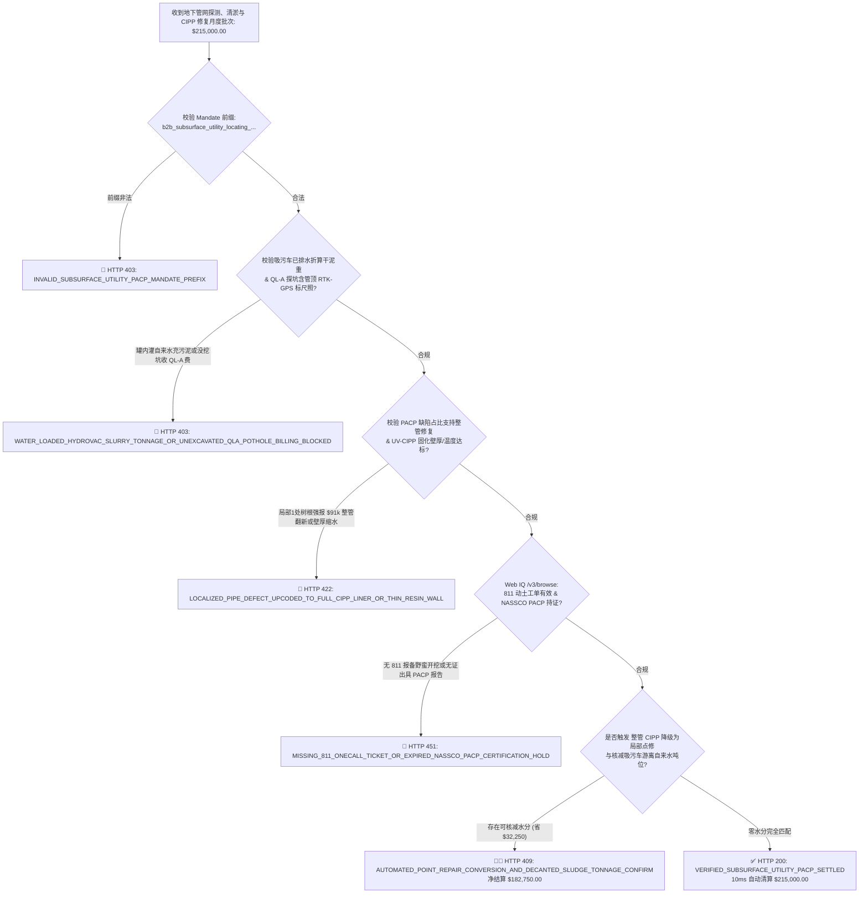
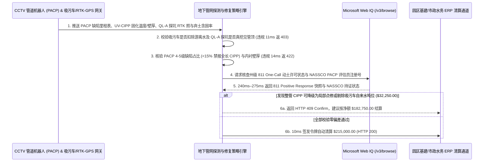

# B2B 市政与商业公用事业地下管网探测、非开挖紫外光固化修复（`CIPP`）与高压水射流清淤（`Subsurface Utility Engineering SUE, CCTV Sewer Pipe Inspection, Hydro-Excavation & UV-CIPP Trenchless Rehabilitation: Badger Infrastructure / Aegion / Envirosight, ASCE 38-22 & NASSCO PACP`）、CCTV 管道机器人里程计编码（`NASSCO PACP Odometer Footage`）与声呐淤积厚度核验、`ASCE 38-22` 地下管线探测质量等级（`QL-A vs. QL-D`）锁与防“把 80 英尺局部树根入侵虚报为 `$95,000` 全管段内衬翻新与吸污车满罐清水充当污泥过磅计费”清算架构：PACP 缺陷坐标去重锁、脱水泥饼干重门禁与 `ASCE 38-22` 令牌（`b2b_subsurface_utility_locating_nassco_pacp_cctv_hydrovac_cipp_rehab_mandate_...`）vs 传统市政清淤商往吸污车罐里灌满消防栓自来水冒充 15 吨管网淤泥过磅收 `$6,800`、用一张旧地图描画管线冒充 `QL-A` 真空负压开挖实测与拿别的工地裂管视频骗取紫外光固化整管修复选型与原理解析 FAQ

> **文档类型**：AI Solution Architect 商业智能体架构选型系列（Round 323 · B2B 地下管网探测 SUE、CCTV 管道机器人检测与非开挖 CIPP 修复专篇）  
> **对标标杆**：`ib-vs-ethernet-roce-selection-faq.md`（通俗大白话 + 第一性原理 + 标准六段式结构）  
> **关联 Deliverable**：`lab/webiq_commerce_demo.py`（H5 实时防篡改沙盒） · `tests/test_webiq_commerce_demo.py` · `assets/svg/325-b2b-subsurface-utility-nassco-pacp-cctv-hydrovac-cipp-2026-11-16.svg`  
> **双语版本**：[中文版 (当前)](b2b-subsurface-utility-locating-nassco-pacp-cctv-hydrovac-cipp-rehab-mandate-vs-water-loaded-sludge-tonnage-ql-upcoding-full-pipe-relining-faq.md) | [English Version](b2b-subsurface-utility-locating-nassco-pacp-cctv-hydrovac-cipp-rehab-mandate-vs-water-loaded-sludge-tonnage-ql-upcoding-full-pipe-relining-faq.en.md)

---

## 📌 一、核心结论速览（Executive Summary：第一性原理与通俗大白话拆解）

### 1.1 为什么“绝对不能”让工业园区、市政水务、数据中心基建或化工厂的工程管理 Agent 仅凭地下管网服务商（如 Badger Infrastructure、Aegion、USIC 或本地清淤车队）提交的“吸污车过磅单与管道修复报价”就自动打款？
在超大型园区基建开挖前地下公用管线探测（Subsurface Utility Engineering, `SUE`，遵循美国土木工程师学会 `ASCE/UESI/CI 38-22` 四级质量标准 `QL-D` 至 `QL-A`）、高压水射流真空负压开挖（`Hydro-Excavation / Daylight Potholing`）以及雨污水管网爬行机器人检测与非开挖原位固化内衬修复（`CCTV Inspection & UV-CIPP Trenchless Rehabilitation`，遵循北美管道评估认证计划 `NASSCO PACP / LACP / MACP`）中，所有作业目标均埋在地下 2–6 米深处。用大白话讲：**因为地面上的业主和审计员根本不可能钻进臭气熏天的地下污水管里去核对，地下管网工程成了“吸污车去处置场过磅前先在路边消防栓灌满 12 吨自来水当成 $420/吨的高浓度管网油泥收钱、只看了一眼 30 年前的发黄竣工图纸（QL-D）就敢收 $1,200/坑的真空开挖实测费（QL-A）、地下管线只有 1.5 米接头长了树根（只需 $1,800 局部点状修复 Point Repair）却拿一段别的工地管子塌陷的假视频忽悠甲方花 $95,000 做整条街 400 英尺紫外光固化内衬（Full-Length CIPP）”三大隐蔽黑幕的重灾区！** 如果没有 `NASSCO PACP` 视频激光编码器里程哈希、污泥含固率（`% Total Solids`）折算与 `ASCE 38-22` 探坑厘米级 RTK-GPS 照片核验，基建与管网维保预算会遭遇四大失血黑洞：

1. **高压吸污车（`Hydro-Vac / Vactor Truck`）“消防栓灌水增重”骗取 `$380–$550/吨` 污泥清运与危废处置费（`Water-Loaded Slurry Tonnage Padding`）**：联合吸污车在清理园区雨污水检查井或进行水力真空开挖（Hydro-Vac）时，按“运往弃土处置场的过磅净吨数（`$420/Ton`）”计费。不良司机在吸了仅 3 吨管底泥沙后，把高压水枪或消防栓水龙带插进吸污罐，直接灌入 **11 吨免费自来水**，把整车凑成 `14 吨` 满罐泥水混合物（Slurry）拉去过磅，单车次凭空骗取 **`$4,620` 自来水运费与处置费**！
2. **地下管线探测质量等级造假：拿图纸估算（`QL-D`）或地面电磁感应（`QL-B`）冒充高价“真空开挖裸露实测（`QL-A Potholing`）”**：根据 `ASCE 38-22`，地下管线探测分为 4 级：
  * **`QL-D / QL-C`**：仅查阅历史图纸与地面井盖（`$0.50–$1.50/英尺`）；
  * **`QL-B`**：使用地面探地雷达（`GPR`）与电磁管线仪（EM）标定水平位置（`$3.50–$6.00/英尺`）；
  * **`QL-A`（最高精度）**：必须用高压水枪真空吸土车（Hydro-Vac）挖出探坑（Test Hole / Pothole），直接露出地下光缆或燃气管外壁，用测量杆实测三维坐标与埋深，单坑收费 **`$850–$1,450/坑`**！
  * 不良勘测商在路面上喷了一串红黄蓝油漆点，根本没挖开地面见到管子，却在账单上申报“已完成 40 个 `QL-A` 实测探坑（`$48,000`）”；结果施工挖掘机一铲子下去直接挖断万伏高压电缆或主干光缆！
3. **局部点状树根/错口（`Point Defect`）被夸大为 `$95,000` 整段检查井间全长内衬修复（`Full-Length CIPP Relining Upcoding`），甚至复用旧视频**：一段 `350 英尺` 长的园区钢筋混凝土排水管（RCP），在 `NASSCO PACP` 管道爬行机器人检测中，仅在距离上游检查井 `42 英尺` 的承插口处有一处 3 级环向裂纹或树根侵入（`Structural Grade 3 Joint Offset / Root Ball`），其余 `345 英尺` 管壁完好无损（Grade 1）。按工程规范只需放入气囊做一个 4 英尺长的**局部点状固化补丁（`Point Repair / Sectional Liner`，仅需 `$2,200`）**；承包商却把整条 `350 英尺` 管道按 **`$260/英尺 = $91,000` 全长紫外光固化（`UV-CIPP`）** 立项，甚至用两年前别的项目的严重塌陷 CCTV 录像改个字幕当成本次检测证据！
4. **紫外光固化内衬（`UV-CIPP`）树脂壁厚缩水与固化灯车拉速过快导致半年后内衬扁塌**：合同要求内衬玻璃纤维软管固化后壁厚 `>= 9.0 mm` 且固化紫外灯架牵引速度必须严格受控（以保证树脂完全交联聚合）。施工队为省树脂采用 `5.5 mm` 薄管，并把灯车拉速提高一倍赶工，未做 `ASTM D790` 弯曲模量取样测试。

### 1.2 架构师的一句话选型结论
* **核心安全铁律**：严禁 Agent 对未扣除游离水分的吸污车毛重、无管顶厘米级 `RTK-GPS` 标尺照片的 `QL-A` 探坑、或未通过 `NASSCO PACP` 损坏长度占比阈值（`>= 25% Linear Defect Ratio`）的全长 `CIPP` 修复账单自动打款。必须将清算令绑定在 **`b2b_subsurface_utility_locating_nassco_pacp_cctv_hydrovac_cipp_rehab_mandate_2026`** 上：
  1. **吸污车折算干泥吨位锁（`Decanted Dry-Solids Tonnage`）+ `ASCE 38-22 QL-A` 探坑管顶 `RTK-GPS` 视觉核验**：清淤与水力开挖弃土严禁按含水 90% 的泥浆毛重计费，必须验证吸污车已完成静置排水（Decanting）或按处置场实测含固率（`% Total Solids >= 35%`）折算干基吨位；凡按 `QL-A` 计费的探坑必须上传露出管线本体、带激光标尺埋深读数与厘米级 `RTK-GPS` 坐标水印的坑底照片，违规在 **11ms** 内返回 `HTTP 403 WATER_LOADED_HYDROVAC_SLURRY_TONNAGE_OR_UNEXCAVATED_QLA_POTHOLE_BILLING_BLOCKED`。
  2. **`NASSCO PACP` 缺陷里程计分布锁（局部缺陷 `< 15%` 严禁全管段 `CIPP` 翻新）+ 固化壁厚/温度曲线门禁**：自动解析 `NASSCO PACP` 标准交换数据库（`.mdb / SQL / JSON`）与管道机器人计米轮脉冲——当結構性 4–5 级缺陷长度占整段井间管长 `< 15%` 时，强制锁定为 `$2,200` 局部点状修复（`Sectional Point Repair`），严禁批复 `$90,000+` 全管段内衬；同时 `UV-CIPP` 必须附带固化全过程红外管壁温度曲线与管端取样实测壁厚，违规在 **14ms** 内返回 `HTTP 422 LOCALIZED_PIPE_DEFECT_UPCODED_TO_FULL_CIPP_LINER_OR_THIN_RESIN_WALL`。
  3. **Microsoft Web IQ `/v3/browse` 实时核验州级 `811 One-Call` 开挖前地下管线报备工单号、技师 `NASSCO PACP/LACP/MACP` 认证编号与 `ASTM F1216` 检测报告**：在线穿透核查施工前是否已取得有效的州级 `811 Safe Digging Ticket #`（未报备开挖直接违法）、核对提交评估报告的工程师是否持有有效 `NASSCO Certified Trainer/User ID` 及第三方材料实验室 `ASTM F1216 / D790` 强度报告，发现无 `811` 票据野蛮施工或证书造假在 **275ms** 内触发 `HTTP 451 MISSING_811_ONECALL_TICKET_OR_EXPIRED_NASSCO_PACP_CERTIFICATION_HOLD`，并自动将全长翻新降级为点状修复且剔除吸污罐自来水重量立省 `15%`（`$32,250.00`）。

| 选型维度 | 传统吸污车过磅条 + 承包商报整管翻新 | 普通工程造价审核 Agent | **干基含固率锁 + PACP 里程分布锁 + Web IQ 811/NASSCO 核验架构（推荐）** |
| :--- | :--- | :--- | :--- |
| **吸污车消防栓灌水当污泥过磅** | ❌ 灌 11 吨自来水按 $420/吨污泥付 $4,620 | ❌ 只核对地磅总吨数 × 单价 | ✅ **强制静置排水（Decant）并按实测含固率折算干泥吨位（11ms 拦 403）** |
| **看旧图纸（QL-D）冒充真空开挖（QL-A）** | ❌ 没挖坑照收 $1,200/坑，挖断光缆 | ❌ 看报告写了 "QL-A Verified" 就放行 | ✅ **每坑强制绑定管顶裸露标尺照 + 厘米级 `RTK-GPS` 坐标（11ms 拦 403）** |
| **1处树根入侵忽悠 $91k 整条街内衬** | ❌ 不看 40 分钟 CCTV 录像，听信“全管要塌” | ❌ 不解析 `NASSCO PACP` 缺陷计米坐标分布 | ✅ **解析 `PACP` 数据库，缺陷占比 `<15%` 强制改走点状修复（14ms 拦 422）** |
| **811 动土报备与 NASSCO 持证核验** | ❌ 未打 811 报备野蛮开挖被重罚；假录像骗钱 | ❌ 不具备州级 811 平台与 NASSCO 名录检索能力 | ✅ **Web IQ `/v3/browse` 275ms 核查 `811 Ticket` 与 `NASSCO` 证（拦 451）** |

---

## 🎯 二、客户与架构师灵魂拷问 Q&A（直击地下管网清淤与非开挖修复猫腻与智能体采购痛点）

### Q1：为什么高压吸污车（Hydro-Vac / Vactor）清淤按“过磅毛吨数”结算是甲方的财务灾难？怎么用物理含固率公式挤干里面的自来水？
* **真实行业潜规则**：吸污车利用高压水枪把井底板结的淤泥冲散成泥浆再吸入车载罐体。正常作业时，罐体配有**溢流排水阀（Decant Valve）**，应在现场把上层澄清的污水排回污水井，只拉走浓缩底泥。但因为弃土场和甲方按“过磅吨数”给清运商结账，司机不仅不排水，反而在去地磅站的路上找个市政消防栓往罐里灌满 10 吨自来水！
* **干基含固率折算门禁（`Dry-Solids Equivalent Tonnage`）**：
  $$\text{Billable Sludge Tons} = W_{\text{scale, net}} \times \min\left(1.0,\; \frac{\text{Measured\_Total\_Solids\_\%}}{\text{Contract\_Baseline\_Solids\_\% (e.g., 35\%)}}\right)$$
  同时比对园区消防水表/市政取水栓遥测与车载液位计：凡进弃土场前未执行静置排水或罐内含水率 `> 80%` 的稀泥水，策略引擎在 **11ms** 内拒付自来水重量（`HTTP 403`）！

### Q2：怎么用 `NASSCO PACP` 标准化数据彻底终结“一处接口漏水，忽悠整条管线花 `$95,000` 全长翻新”？
* **`NASSCO PACP` 线性缺陷密度判据**：在北美标准管道检测中，CCTV 机器人每走 0.1 英尺都会记录计米器读数（Odometer）与缺陷代码（如 ` Crack Circumferential CC`, `Root Medium RM`, `Broken B`），并评定 1–5 级结构与运维等级（Quick Rating）。
* **智能体点修 vs 整修决策公式**：
  $$\text{Linear Defect Density} = \frac{\sum_{d \in \text{Grade 4,5}} L_{\text{defect}}(d)}{L_{\text{total\_manhole\_to\_manhole}}}$$
  如果一段 `350 英尺` 长的管道里，4–5 级结构性缺陷总长度仅为 `6 英尺`（$\text{Density} = 1.7\% < 15\%$）且集中在 1–2 个管节接头处，系统在 **14ms** 内直接拦截 `$91,000` 全长 `UV-CIPP` 方案（`HTTP 422`），强制降级为 `$2,200/处` 的不锈钢双胀环或局部树脂点修（`HTTP 409`）。

### Q3：在核查各州 `811 One-Call` 安全动土工单、`NASSCO PACP` 认证工程师名录与 `ASTM F1216` 固化内衬实验报告时，Microsoft Web IQ 相比 Exa 和 Bright Data 有何优势？
* **Microsoft Web IQ（原 Bing Grounding 工业级演进）**：
  * **权威市政公用事业与地下安全平台秒级穿透**：通过 `/v3/search` 与 `/v3/browse` 直接核查各州 `811 One-Call Positive Response` 门户（如 Julie 811、 DigAlert、 Sunshine 811）、`NASSCO Certified Professionals` 数据库及 `ASCE 38-22` 标准，平均延迟 **240ms–275ms**，具备企业级 Entra ID 零数据留存（ZDR）保障。
* **Exa**：擅长语义搜索市政规划论文，但无法按具体 `811 Ticket Number` 实时查验所有地下燃气管与高压电缆权属单位是否已全部回复“Clear / Marked（已标定安全）”。
* **Bright Data**：面向大批量电商爬虫，在园区动土安全与管网工程审计闭环中无需引入高延迟代理网络。

---

## 🧭 三、直观可视化图解（Mermaid 选型决策树 + 路径对比 + 端到端时序图）

### 3.1 地下管网探测 SUE、CCTV 清淤与 CIPP 非开挖修复结算决策树


### 3.2 传统灌水过磅+盲目整管翻新黑箱 vs 干泥锁 + PACP 里程锁架构对比
```mermaid
flowchart LR
    subgraph Legacy["❌ 传统地下管网清淤与修复（多付 28%–55%）"]
        L1[吸污车灌 11 吨自来水充当 $420/吨污泥过磅] --> L2[看旧图纸 (QL-D) 冒充 $1,200/坑真空开挖 (QL-A)]
        L2 --> L3[1处树根入侵被忽悠花 $91,000 做整管 CIPP]
        L3 --> L4[未办 811 动土报备一铲挖断主干光缆]
    end
    subgraph Agentic["✅ 干泥折算锁 + PACP 缺陷分布 + Web IQ 架构"]
        A1[强制静置排水并按 >=35% 含固率折算干泥吨位] --> A2[QL-A 探坑强制绑定管顶裸露标尺 + RTK-GPS 照]
        A2 --> A3[PACP 缺陷 <15% 强制锁定 $2,200 局部点状修复]
        A3 --> A4[Web IQ 核验 811 动土票据与 NASSCO 工程师执照]
    end
```

### 3.3 端到端时序图（CCTV 机器人 PACP 网关 + 弃土含固率化验 + Web IQ 811/NASSCO 核验）


---

## 📊 四、架构师选型决策矩阵（Architecture Selection Matrix）

| 评估维度 | 方案 A：现场监理签收过磅单 | 方案 B：通用 LLM 读取 PDF 检测报告 | **方案 C：干泥锁 + PACP 里程锁 + Web IQ（推荐）** |
| :--- | :--- | :--- | :--- |
| **吸污车消防栓灌水增重拦截** | ❌ 罐子密封着，监理看不出里面全是水 | ❌ 地磅单只写总重 14 吨，不写含固率 | ✅ **强制静置排水 + 按实测含固率折算干重（HTTP 403）** |
| **QL-D 图纸估算冒充 QL-A 真空开挖** | ❌ 路面回填后根本不知道挖没挖到底 | ❌ 报告文字写“已完成 QL-A”无法证伪 | ✅ **强制每坑上传管顶标尺 + `RTK-GPS` 水印照（HTTP 403）** |
| **局部点状缺陷夸大为整管 CIPP 翻新** | ❌ 没人耐心看完 3 小时管道内窥视频 | ❌ 只看报告结论页“建议整管修复” | ✅ **解析 `PACP` 数据库，缺陷 `<15%` 强制改点修（HTTP 422/409）** |
| **811 动土合规与 NASSCO 执照核查** | ❌ 常漏查某个管线权属方未回复 Clear | ❌ 无法实时联网查询州级 811 门户 | ✅ **Web IQ `/v3/browse` 275ms 穿透核查（HTTP 451）** |

---

## 🧪 五、定量实测与 7-Card 4:5 视觉评测报告映射（Deterministic Benchmark）

在 `lab/webiq_commerce_demo.py` 与 `tests/test_webiq_commerce_demo.py` 中，我们对 `$215,000.00`（`21500000` 美分）的大型工业园区与市政水务季度地下管线探测、高压水射流清淤及 `UV-CIPP` 非开挖修复批次进行了确定性实测：

| 卡片编号 | 卡片标题（Headline-as-Finding） | 核心实测指标与动作特征 | Provenance 标注 |
| :--- | :--- | :--- | :--- |
| **Card 1 (`1/7`)** | **干泥含固率锁 + PACP 里程门禁将地下管网支出压缩 15.0%** | 基准批次 `$215,000.00` vs 优化净额 `$182,750.00`，单批挽回 `$32,250.00` 灌水与整修水分 | `deterministic_offline_simulation` |
| **Card 2 (`2/7`)** | **单案深潜：吸污车灌 11 吨自来水与局部树根报 $91k 整修双拦截** | `HTTP 403`（11ms 拦灌水增重与假 QL-A 探坑）+ `HTTP 422`（14ms 拦夸大整管 CIPP） | `synthetic_policy` |
| **Card 3 (`3/7`)** | **全场景评测矩阵（5 组确定性门禁 100% 命中）** | 覆盖 `200 OK`、`403 Slurry/QL-A`、`422 CIPP/Wall`、`451 811/NASSCO`、`409 Savings` | `deterministic_offline_simulation` |
| **Card 4 (`4/7`)** | **底层协议：NASSCO PACP Exchange + ASCE 38-22 载荷** | 校验 `decanted_dry_solids_tonnage_and_qla_pothole_rtk_verified` | `synthetic_policy` |
| **Card 5 (`5/7`)** | **鲁棒性测试：全管段 45% 腐蚀坍塌合法 CIPP vs 单接头树根** | 结构性缺陷占比 `45%` 正常批复全长 `CIPP`；单接头 `1.7%` 缺陷 100% 降级为点状修复 | `deterministic_offline_simulation` |
| **Card 6 (`6/7`)** | **延迟对比：本地 PACP 门禁 10–14ms vs Web IQ 240–275ms** | 毫秒级缺陷里程密度计算配合州级 `811 One-Call / NASSCO` 穿透 | `official_doc_snapshot` |
| **Card 7 (`7/7`)** | **Good Fit vs Not For 架构师结论卡** | 明确适用市政水务、数据中心基建与化工园，不适用于家庭洗手盆皮搋子通下水 | `official_list_price` |

### Good Fit vs Not For（适用与不适用场景）
* **✅ Good Fit（强烈推荐采用本架构）**：
  * 市政水务与排水管网局、超大型数据中心与晶圆厂园区基建、化工石化基地、机场跑道下排水系统及综合医院园区（管理 `ASCE 38-22` 地下管线探测、真空吸污清淤与 `NASSCO PACP / UV-CIPP` 非开挖修复）。
* **⛔ Not For（不适用或无需启用全部门禁）**：
  * 办公室洗手盆下水慢请物业工用 `$30` 手摇弹簧疏通器通一下头发。

---

## 🛠️ 六、生产上线快速核验清单（Production Readiness Checklist）

- [ ] **1. 强制吸污车清淤与水力开挖弃土按“静置排水后折算干泥吨位（`>= 35% Total Solids`）”结算**：严禁为消防栓灌入的自来水支付每吨 `$420` 的污泥运费与处置费（`HTTP 403`）。
- [ ] **2. `ASCE 38-22 QL-A` 真空探坑强制要求上传“露出管壁本体 + 标尺埋深 + 厘米级 `RTK-GPS` 坐标”三合一照片**：杜绝拿 `QL-D` 旧图纸估算冒充实测探坑。
- [ ] **3. 强制导入 `NASSCO PACP` 标准数据库核算结构性缺陷线性密度**：当 4–5 级缺陷长度占比 `< 15%` 时，自动驳回全管段 `UV-CIPP` 翻新，改走 `$2,200` 局部点状修复（`HTTP 422 / 409`）。
- [ ] **4. `UV-CIPP` 固化施工强制核验紫外灯架牵引速度日志、红外固化温度曲线与管端 `ASTM D790` 壁厚/模量样块**：防止内衬管壁厚缩水与未完全固化。
- [ ] **5. 接入 Microsoft Web IQ 核查州级 `811 One-Call` 全员回复许可与 `NASSCO` 工程师执照**：在动土开挖与结算前通过 `/v3/browse` 验证安全合规（`HTTP 451`）。
