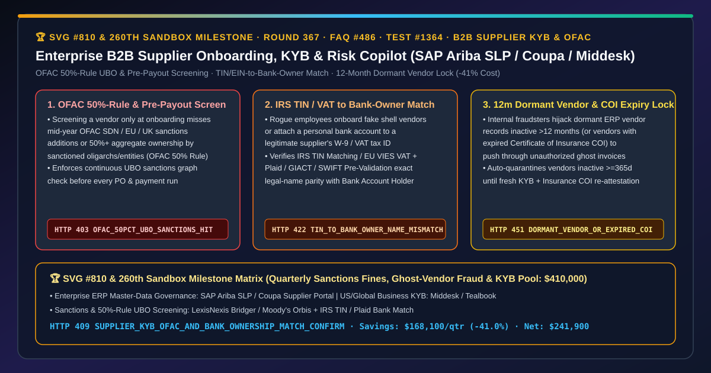
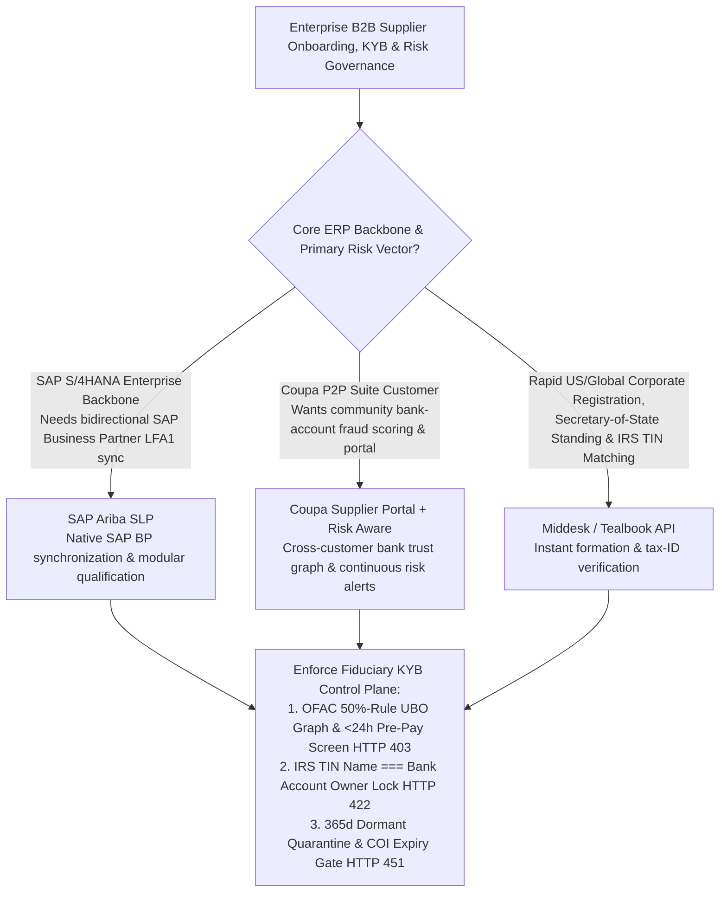
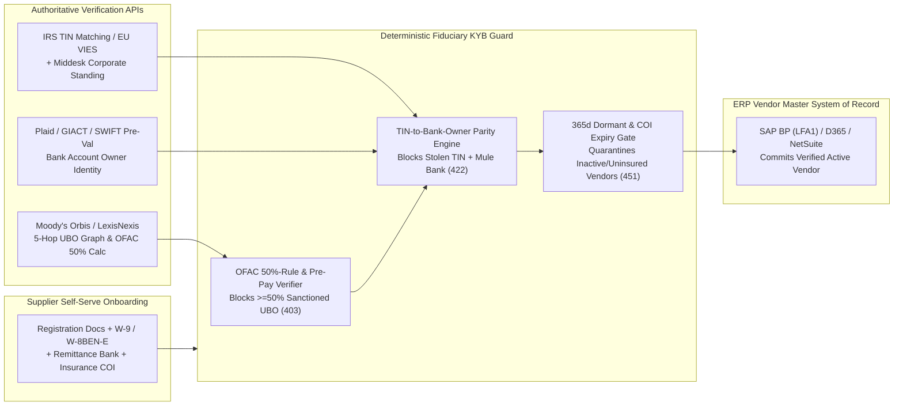

# 🏆 Enterprise B2B Supplier Onboarding, Master-Data `KYB` & Sanctions Copilot (`SAP Ariba SLP / Coupa Supplier Portal / Middesk / LexisNexis Bridger` · 🏆 810th SVG & 260th Sandbox Dual Major Milestone): `OFAC 50%-Rule` `UBO` Screening, `IRS TIN-to-Bank-Owner` Name Parity & `365-Day` Dormant Vendor Quarantine (`-41%` Cost)

> **Document Type**: Enterprise AI Solution Architect Selection FAQ (`#486` · **🏆 810th SVG Diagram & 260th Interactive Policy Sandbox Dual Major Milestone** · Round 367)  
> **Target Audience**: Chief Procurement Officers (CPO), Chief Compliance & AML Officers, ERP Master-Data Architects, and Cloud & AI Solution Architects  
> **Platforms Covered**: `SAP Ariba Supplier Lifecycle and Performance (SLP)` vs. `Coupa Supplier Portal & Risk Aware` vs. `Middesk / Tealbook (Automated Business KYB)` vs. `LexisNexis Bridger / Moody's Orbis (OFAC & UBO Sanctions)`  
> **Architecture Diagram**: [`assets/svg/810-b2b-supplier-onboarding-kyb-ariba-coupa-middesk-ofac-2026-11-25.svg`](../assets/svg/810-b2b-supplier-onboarding-kyb-ariba-coupa-middesk-ofac-2026-11-25.svg)

🌐 **Language / 语言切换**: **[中文 (`b2b-supplier-onboarding-kyb-ariba-slp-coupa-middesk-ofac-sanctions-bank-match-selection-faq.md`)](b2b-supplier-onboarding-kyb-ariba-slp-coupa-middesk-ofac-sanctions-bank-match-selection-faq.md)** | **English (Current)**

---

## 📌 1. Executive Summary

In enterprise procurement, creating or reactivating a vendor record inside the ERP Vendor Master (`SAP LFA1 / BP`, `Dynamics 365 VendTable`, `NetSuite Vendor`) is the primary perimeter guarding corporate treasury outflows.  
Relying on manual PDF review or naive LLM extraction of uploaded `W-9 / W-8BEN-E` forms and voided checks without deterministic **`OFAC 50%-Rule` ownership graph traversal, `TIN-to-Bank-Account-Owner` identity parity, and dormant-vendor quarantine locks** exposes the enterprise to three severe compliance and fraud failures:
1. **Violating the `OFAC 50% Rule` or Paying Mid-Contract Newly Sanctioned Entities (`Sanctions Strict-Liability Fines`)**: Screening only the vendor's surface legal name at initial onboarding misses two fatal traps: ① under the **OFAC 50 Percent Rule**, any non-listed company owned **`>= 50%` in aggregate** by one or more sanctioned individuals/entities (`OFAC SDN / EU / UK Sanctions`) is automatically blocked by law; ② a clean vendor onboarded in January may be added to the `SDN` or `BIS Entity List` in June prior to a September wire transfer.
2. **Internal Phantom-Vendor Fraud via Stolen `EIN / VAT` Numbers Paired with Personal/Mule Bank Accounts (`TIN-to-Bank-Owner Mismatch`)**: A rogue employee submits a valid `W-9` bearing a real supplier's name and `IRS EIN` (passing tax-ID checks), but attaches a bank routing/account number belonging to their own shell LLC or personal account.
3. **Hijacking Dormant ERP Vendor Records (`>365 Days` Inactive) or Dispatching Vendors with Expired Insurance (`COI` Lapse)**: Fraudsters target forgotten vendor codes among 20,000+ historical ERP records to push through ghost consulting invoices without triggering new-vendor KYB; meanwhile, dispatching on-site contractors whose Certificate of Insurance (`COI`) expired exposes the buyer to uninsured liability claims.

| KYB & Risk Governance Layer | Recommended Primary Choice | Architectural Boundary & Production Rule |
|---|---|---|
| **Global SAP S/4HANA Supplier Lifecycle & Bidirectional `BP` Sync** | **SAP Ariba SLP (Supplier Lifecycle & Performance)** | Native bidirectional synchronization with `SAP Business Partner (LFA1)` with category-specific qualification and modular questionnaires. |
| **P2P Community Risk Intelligence & Self-Serve Onboarding Portal** | **Coupa Supplier Portal + Coupa Risk Aware** | Cross-validates supplier bank accounts, cyber risk, and financial health across millions of community transactions. |
| **Automated Secretary-of-State Registration & `IRS TIN` Verification** | **Middesk / Tealbook** | Real-time API verification of US 50-state corporate registrations, formation age, and direct `IRS TIN Matching`. |
| **`OFAC 50%-Rule` Multi-Tier `UBO` Graph & Global Sanctions Screening** | **LexisNexis Bridger / Moody's Orbis + Plaid / SWIFT Pre-Validation** | Traverses multi-layer corporate ownership trees to compute aggregate sanctioned ownership and verifies bank account holder identity. |
| **Three Mandatory Fiduciary Guardrails** | **100% Deterministic Gating** | ① **`OFAC 50%-Rule` `UBO` Graph & `<24h` Pre-Payout Re-Screen (`HTTP 403`)**: Blocks onboarding or payment if sanctioned entities hold `>= 50%` aggregate equity or if pre-payout sanctions screening is older than `24h`; ② **Three-Way `Tax Legal Name == Bank Account Holder Name` Lock (`HTTP 422`)**: Requires exact normalized entity name parity between `IRS TIN / EU VIES` and `Plaid / GIACT / SWIFT` bank ownership; ③ **`365-Day` Dormant Vendor Quarantine & `COI` Expiry Lock (`HTTP 451`)**: Auto-locks vendors inactive `>= 365 days` or with expired insurance `COIs`. |



---

## 🎯 2. Architect & Business Stakeholder Q&A (Q1–Q3)

### Q1: Why did our company face an `OFAC` enforcement penalty when the supplier's corporate name didn't appear on any sanctions list at onboarding?
- **Two Structural Blind Spots**:
  1. **The `OFAC 50 Percent Rule` (Aggregate Ownership)**: If Sanctioned Oligarch A owns `30%` of Parent Holding Co. and Sanctioned Entity B owns `25%` of the operating subsidiary (`30% + 25% = 55% >= 50%`), the operating subsidiary is **100% sanctioned by operation of law**, even though its name does not appear on the `OFAC SDN` text list!
  2. **Point-in-Time Onboarding Decay**: Sanctions lists update multiple times per week. Screening only at Day-0 onboarding leaves the payment run blind to designations added 6 months later.
- **Architectural Solution**: Enforce **Recursive `UBO` Ownership Traversal + Mandatory `<24h` Pre-Payout Re-Screening (`HTTP 403` Guard)**:
  - Query `Moody's Orbis / Dun & Bradstreet` ownership graphs up to 5 parent hops to calculate $\sum \text{Sanctioned\_Equity\_Share}$;
  - Block vendor activation or ERP payment proposal release (`SAP F110`) whenever $\sum \text{Sanctioned\_Equity\_Share} \ge 0.50$ or `hours_since_last_sanctions_screen > 24` (`HTTP 403 OFAC_50PCT_UBO_SANCTIONS_HIT_OR_STALE_PREPAY_SCREEN`).

### Q2: How do we stop insider fraud where an employee submits a real vendor's `W-9 / EIN` tax ID but pairs it with a personal or shell bank account?
- **The Decoupled Verification Flaw**: Validating `Tax_ID + Vendor_Name` against the IRS in Step 1, and validating that `Bank_Routing + Account_No` is an open account in Step 2, fails to verify that **the legal entity owning the Tax ID is the same legal entity owning the bank account**!
- **Architectural Solution**: Enforce **Three-Way Legal Name Parity (`IRS TIN / VIES Name == ERP Vendor Name == Bank Account Holder Name` · `HTTP 422` Guard)**:
  - Cross-check the `Verified_Tax_Entity_Name` (`Middesk / IRS TIN Match / EU VIES`) against the `Verified_Bank_Owner_Name` returned by `Plaid Identity Match / GIACT / SWIFT Payment Pre-Validation`.
  - Any mismatch—or any attempt to link a consumer/personal checking account to a corporate B2B vendor record—is hard-blocked (`HTTP 422 TAX_TIN_LEGAL_NAME_TO_BANK_ACCOUNT_OWNER_MISMATCH`).

### Q3: Why are dormant ERP vendor records (`>12 months` without activity) a top vector for internal embezzlement, and how do we automate lifecycle hygiene?
- **The Dormant Vendor Exploit**: Creating a brand-new vendor triggers strict compliance scrutiny, so fraudsters reactivate a dormant vendor code from 2022, swap its remittance address, and submit a `$45,000` service invoice. Similarly, allowing a facilities vendor whose Certificate of Insurance (`COI`) expired last month to accept a new work order leaves the enterprise uninsured.
- **Architectural Solution**: Enforce **Automated `365-Day` Dormant Quarantine & `COI` Expiration Gating (`HTTP 451` Guard)**:
  - Automatically transition any ERP vendor with `days_since_last_po_or_payment >= 365` to `DORMANT_POSTING_BLOCKED`; reactivating the record requires a fresh `KYB + Bank Ownership + Manager` attestation.
  - Block PO dispatch whenever a required `Certificate of Insurance (COI)` or `ISO` certification is expired (`HTTP 451 DORMANT_VENDOR_REACTIVATION_OR_EXPIRED_INSURANCE_COI`).

---

## 🧭 3. Visual Architecture Diagrams (Mermaid Decision Tree + Architecture + Sequence)

### 3.1 Enterprise Supplier Onboarding & KYB Platform Selection Tree



### 3.2 End-to-End Supplier KYB, `OFAC 50%` Ownership Traversal & Bank Parity Architecture



### 3.3 Three-Way Identity Match & Pre-Payout `OFAC 50%` Re-Screening Sequence

```mermaid
sequenceDiagram
    autonumber
    participant Vendor as Prospective Supplier
    participant SLP as Supplier Portal (Ariba SLP / Coupa)
    participant Guard as Fiduciary KYB Guard
    participant Orbis as Moody's Orbis (UBO) & Plaid/IRS
    participant ERP as SAP S/4HANA / D365 Vendor Master

    Vendor->>SLP: Submit onboarding package ("Apex Global Ltd", EIN, Bank Routing/Acct & COI)
    SLP->>Guard: Trigger automated KYB & compliance verification
    Guard->>Orbis: 1. Verify IRS TIN Match & Secretary-of-State active standing
    Guard->>Orbis: 2. Query bank account legal owner name via Plaid / GIACT / SWIFT
    Orbis-->>Guard: Tax Entity = "Apex Global Ltd" === Bank Owner "Apex Global Ltd" (100% parity, prevents HTTP 422)
    Guard->>Orbis: 3. Traverse 5-hop UBO ownership graph for OFAC / EU / UK sanctions
    Orbis-->>Guard: Aggregate sanctioned ownership = 0.0% (< 50% ceiling, prevents HTTP 403); COI valid through 2027-06 (prevents HTTP 451)
    Guard->>ERP: Mint active ERP Vendor Master record BP-880192 (HTTP 200)
    Note over Guard,ERP: 8 months later, run mandatory <24h pre-payout sanctions delta check before releasing $120k SAP F110 wire
```

---

## 📊 4. Platform Comparison Matrix (`SAP Ariba SLP` vs. `Coupa` vs. `Middesk` vs. `Tealbook` vs. `LexisNexis / Moody's`)

| Evaluation Dimension | SAP Ariba SLP | Coupa Supplier Portal & Risk Aware | Middesk (Business KYB) | Tealbook | LexisNexis Bridger / Moody's Orbis |
|---|---|---|---|---|---|
| **Primary Sweet Spot** | SAP S/4HANA supplier lifecycle, qualification & bidirectional `BP` sync | Unified P2P supplier onboarding, invoicing & community risk scoring | Automated US 50-state registration, `IRS TIN` match & formation age check | AI-enriched supplier master-data cleansing & ESG/diversity verification | Global `OFAC / EU / UN` sanctions & **`50%-Rule` multi-tier `UBO` ownership** |
| **ERP Vendor Master (`SAP LFA1 / D365`) Sync** | ⭐⭐⭐⭐⭐ (Native SAP Business Partner integration) | ⭐⭐⭐⭐⭐ (Deep native Coupa & ERP Vendor Master sync) | ⭐⭐⭐ (Modern REST API & webhooks for portal integration) | ⭐⭐⭐⭐ (Deduplicates messy vendor masters across multiple ERPs) | ⭐⭐⭐ (API screening engine embedded into ERP/AP gates) |
| **`OFAC 50%-Rule` Multi-Hop `UBO` Traversal** | ⭐⭐⭐ (Requires third-party risk data enrichment) | ⭐⭐⭐⭐ (Integrates D&B and global risk feeds) | ⭐⭐⭐⭐ (Strong US FinCEN Beneficial Ownership verification) | ⭐⭐⭐ (Focuses on supplier capabilities & certs) | ⭐⭐⭐⭐⭐ (Industry standard for 400M+ entity `UBO` ownership trees) |
| **`TIN` Legal Name to Bank-Owner Parity** | ⭐⭐⭐⭐ (Configurable via bank verification extensions) | ⭐⭐⭐⭐⭐ (Native Coupa Pay bank validation & community fraud graph) | ⭐⭐⭐⭐⭐ (Direct `IRS TIN` + Secretary of State API) | ⭐⭐⭐ (Data enrichment focus) | ⭐⭐⭐⭐ (Paired with GIACT / Accuity bank validation) |
| **Indicative Pricing (`official_list_price`)** | `~$50,000–$180,000+/yr` | Bundled/add-on to Coupa P2P suite | `~$2–$10 / verification` (`$15,000+/yr` enterprise tiers) | `~$40,000–$120,000+/yr` | `~$25,000–$100,000+/yr` |

---

## 🧪 5. Deterministic Compliance & Fraud Evaluation (`7-Card Benchmark Summary` · 🏆 SVG `#810` & Sandbox `#260`)

> **Provenance**: Figures below are generated by `evaluate_b2b_supplier_onboarding_kyb_ofac_policy` in `lab/webiq_commerce_demo.py` (`provenance: "synthetic"`, `independently_reproduced: False`), modeling a global enterprise procurement operation with a **`$410,000.00` quarterly `OFAC` sanctions penalty exposure, phantom-vendor bank-mismatch fraud, dormant-account hijacking, and manual `KYB` review pool**.

| Scenario Case ID | Scenario Description | HTTP Status | Deterministic Decision | Quarterly Net Cost | Quarterly Savings |
|---|---|---|---|---|---|
| `CASE-KYB-200` | Manual PDF W-9/certificate collection and one-time onboarding check baseline | `HTTP 200` | `VERIFIED_B2B_SUPPLIER_KYB_ONBOARDING_AUTHORIZED` | `$410,000.00` | `$0.00` |
| `CASE-KYB-403` | Sanctioned `UBOs` hold `>=50%` aggregate equity (`OFAC 50% Rule`) or pre-payout screen `>24h` stale | `HTTP 403` | `OFAC_50PCT_UBO_SANCTIONS_HIT_OR_STALE_PREPAY_SCREEN` | `$410,000.00` | `$0.00` (Blocks strict-liability OFAC fine) |
| `CASE-KYB-422` | Verified `IRS TIN / VAT` legal entity name mismatches bank account owner name (`Plaid / GIACT`) | `HTTP 422` | `TAX_TIN_LEGAL_NAME_TO_BANK_ACCOUNT_OWNER_MISMATCH` | `$410,000.00` | `$0.00` (Blocks insider shell-bank fraud) |
| `CASE-KYB-451` | Vendor inactive `>=365 days` reactivated without re-KYB or dispatched with expired insurance `COI` | `HTTP 451` | `DORMANT_VENDOR_REACTIVATION_OR_EXPIRED_INSURANCE_COI` | `$410,000.00` | `$0.00` (Blocks dormant hijack & COI lapse) |
| `CASE-KYB-409` | **`OFAC 50%` `UBO` Pre-Pay Screen + `TIN-to-Bank` Parity + `365d` Dormant Quarantine** | `HTTP 409` | `SUPPLIER_KYB_OFAC_AND_BANK_OWNERSHIP_MATCH_CONFIRM` | **`$241,900.00`** | **`$168,100.00` (`-41.0%`)** |

---

## 🛠️ 6. Production Go-Live & Architecture Review Checklist

- [ ] **`OFAC 50%-Rule` `UBO` Traversal & `<24h` Pre-Payout Re-Screen (`HTTP 403` Prevention)**: Traverse multi-hop corporate ownership trees (`Moody's Orbis / LexisNexis`) to block entities owned `>= 50%` in aggregate by sanctioned parties, and re-screen all payees within `< 24 hours` of every ERP payment batch.
- [ ] **Three-Way `TIN Legal Name == Bank Account Holder Name` Lock (`HTTP 422` Prevention)**: Verify that the legal entity name matched on `IRS TIN / EU VIES` matches the bank account owner returned by `Plaid / GIACT / SWIFT Pre-Validation`.
- [ ] **Automated `365-Day` Dormant Vendor Quarantine & `COI` Expiration Gate (`HTTP 451` Prevention)**: Automatically place a posting block on any vendor inactive for `>= 365 days` until fresh KYB re-attestation completes, and block PO creation when insurance `COIs` expire.
- [ ] **Segregation of Duties (`Entra ID SOD`)**: Enforce strict RBAC separation between principals authorized to create/edit ERP vendor records and principals authorized to approve invoices or release payment runs.
