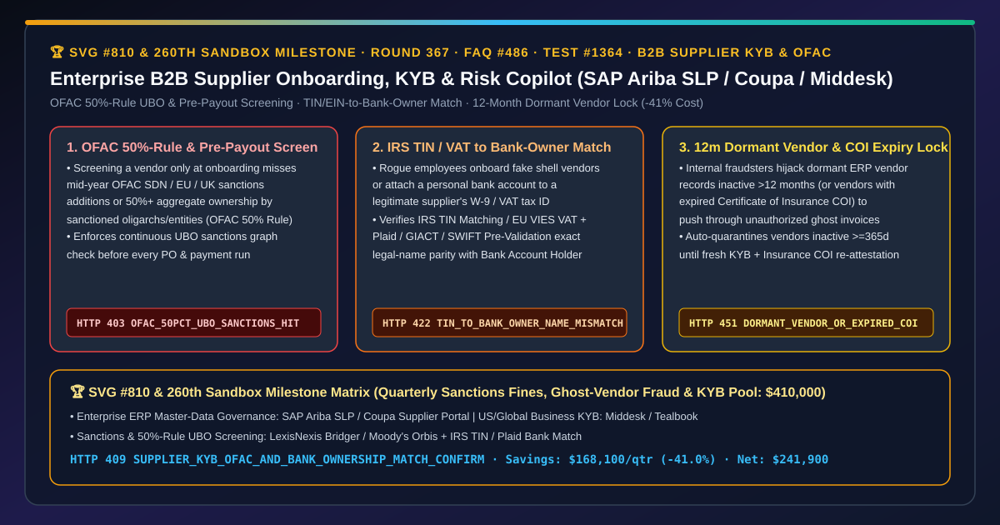
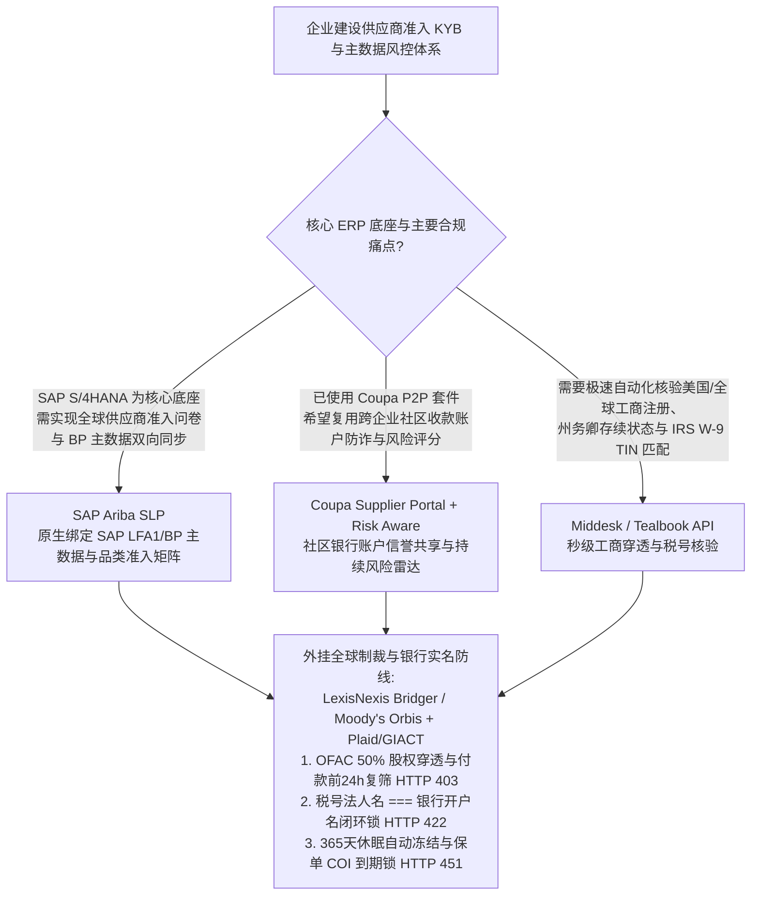
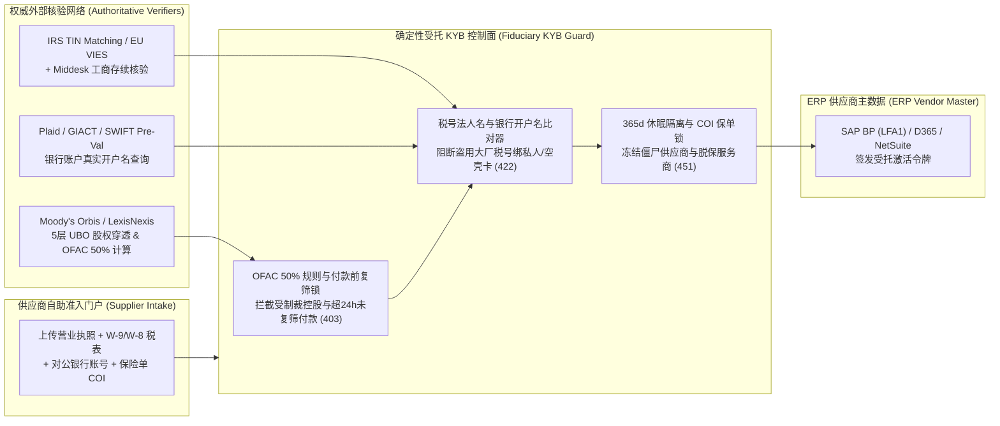
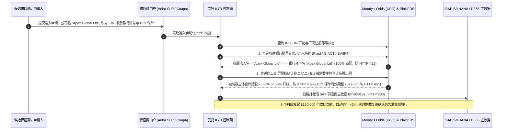

# 🏆 企业 B2B 供应商准入、主数据治理（`KYB`）与制裁筛查智能体（`SAP Ariba SLP / Coupa Supplier Portal / Middesk / LexisNexis Bridger` · 🏆 第 810 张架构图与第 260 个策略沙盒双重大里程碑）：`OFAC 50%` 股权穿透与付款前实时复筛、税号与对公银行开户名 100% 一致性锁及 365 天休眠僵尸供应商冻结净省 41% 指南

> **文档类型**：企业级 AI Solution Architect 选型决策指南（Selection FAQ · `#486` · **🏆 第 810 张 SVG 架构图 & 第 260 个交互式策略沙盒双重大里程碑** · Round 367）  
> **适用读者**：集团首席采购官（CPO）、企业合规与反洗钱总监（Chief Compliance Officer）、ERP 主数据治理负责人与 Cloud & AI Solution Architect  
> **核心覆盖平台**：`SAP Ariba Supplier Lifecycle and Performance (SLP)` vs. `Coupa Supplier Portal & Risk Aware` vs. `Middesk / Tealbook (Automated Business KYB)` vs. `LexisNexis Bridger / Moody's Orbis (OFAC & UBO Sanctions)`  
> **关联架构图**：[`assets/svg/810-b2b-supplier-onboarding-kyb-ariba-coupa-middesk-ofac-2026-11-25.svg`](../assets/svg/810-b2b-supplier-onboarding-kyb-ariba-coupa-middesk-ofac-2026-11-25.svg)

🌐 **语言切换 / Language**: **中文 (当前)** | **[English (`b2b-supplier-onboarding-kyb-ariba-slp-coupa-middesk-ofac-sanctions-bank-match-selection-faq.en.md`)](b2b-supplier-onboarding-kyb-ariba-slp-coupa-middesk-ofac-sanctions-bank-match-selection-faq.en.md)**

---

## 📌 一、核心选型结论速览（Executive Summary）

在大型企业采购与供应链管理中，向 ERP 供应商主数据表（`SAP LFA1 / D365 VendTable / NetSuite Vendor Record`）新增或激活一家供应商，是整个资金安全体系的第一道闸门。  
如果仅靠人工或普通 OCR 识别供应商上传的营业执照和 `W-9 / W-8BEN-E` PDF 表格就建档放行，企业将暴露在三大合规与内控贪腐风险之下：
1. **“只查表面公司名、不查背后 50% 控股股东”，且只在入驻时查一次，误向受制裁关联实体（`OFAC SDN / EU Sanctions`）打款遭数百万美元严格责任重罚（`OFAC 50%-Rule & Stale Screening Breach`）**：某海外供应商表面名字不在美国财政部 `OFAC SDN` 名单上，但其背后由两名被制裁实体分别持股 `30%` 和 `25%`（合计 `55% >= 50%`）；根据 **OFAC 50% 穿透规则（OFAC 50 Percent Rule）**，该公司依法自动视同被制裁对象！或者供应商 1 月入驻时清白，6 月被列入实体清单，9 月付款时因未做“付款前实时复筛”直接触犯联邦红线。
2. **内部贪腐员工“盗用真实大公司税号（`EIN / VAT`），却绑定自己亲戚的银行卡”套取公司采购款（`TIN-to-Bank-Account-Owner Mismatch`）**：内鬼员工提交一份真实的知名供应商 `W-9` 税表（税号与公司名完全匹配 IRS 库），但在收款银行账号栏填了自己控制的空壳公司或个人账户；如果不校验 **法定纳税主体名称 === 银行账户开户名**，三单匹配也拦不住监守自盗。
3. **利用 ERP 里沉睡 3 年未交易的“僵尸供应商（`Dormant Vendor`）”或商业责任险（`COI`）早已过期的外包商突击走账（`Dormant Vendor Hijacking & Expired COI`）**：ERP 里躺着 20,000 家几年前建档后就再没交易过的历史供应商；造假者专门挑这些没人盯的旧编码突然挂入一笔 `$80,000` 咨询费发票快速批付，或者让保險已过期的施工队进场作业引发巨额连带赔偿。

| 选型维度与企业生态 | 推荐主选方案 | 适用边界与架构落地准则 |
|---|---|---|
| **SAP S/4HANA 集团级供应商全生命周期准入与双向主数据同步** | **SAP Ariba SLP (Supplier Lifecycle & Performance)** | 原生与 SAP Business Partner (`BP / LFA1`) 双向实时同步，支持按品类/风险等级动态触发资质问卷与现场审核。 |
| **全链路 P2P 社区共享风险评分与自助门户** | **Coupa Supplier Portal + Coupa Risk Aware** | 依托数百万供应商社区交叉验证收款账户信誉、网络安全评级与财务健康度。 |
| **自动化工商注册穿透、州政府存续核验与 IRS `TIN` 实时比对** | **Middesk / Tealbook** | 秒级直连美国 50 州州务卿工商库與 IRS `TIN Matching` 接口，自动识别刚注册 3 天的皮包公司。 |
| **全球制裁名单（`OFAC / UN / EU / UK`）与 `50%` 股权穿透筛查** | **LexisNexis Bridger / Moody's Orbis + Plaid / SWIFT Pre-Validation** | 穿透多层级离岸母公司计算被制裁主体累计持股比例，并联动银行清算网核验开户名。 |
| **三大确定性风控红线** | **100% 强制拦截** | ① **`OFAC 50%` 穿透与付款前 24h 实时复筛锁（`HTTP 403`）**：被制裁实体直接或间接合计持股 `>= 50%`、或距上次制裁扫描 `> 24h` 严禁下发 PO 及付款指令；② **税号法定名称与银行开户名 100% 一致性锁（`HTTP 422`）**：必须同时通过 `IRS TIN / EU VIES` 校验且银行侧返回 `Bank_Account_Owner_Name == Legal_Entity_Name`；③ **`365 天` 无交易休眠冻结与保险单（`COI`）到期停派锁（`HTTP 451`）**：连续 365 天无 PO/付款的供应商自动置为 `DORMANT_LOCKED`，保单过期立即冻结派单。 |



---

## 🎯 二、业务方与架构师灵魂拷问 Q&A（Q1–Q3）

### Q1：为什么用普通正则或模糊搜索查了供应商名字不在 `OFAC SDN` 名单上，公司还是因为这笔跨境付款被罚了数百万美元？
- **两大合规盲区**：
  1. **`OFAC 50% 合计持股规则（Aggregate 50% Ownership Rule）`**：美国财政部海外资产控制办公室（OFAC）及欧盟制裁条例规定，即使一家公司本身的名字**从未出现在任何制裁清单上**，只要一个或多个受制裁主体（SDN）直接或间接**合计持有该公司 `50% 或以上` 的股权**，该公司在法律上即被自动封锁（Blocked by Operation of Law）！普通名字搜索对这种多层股权结构完全瞎眼。
  2. **入驻后动态新增制裁**：制裁名单每周都在更新。很多系统只在 2 年前供应商入驻时扫了一次，之后每次付款都不再复筛。
- **架构解法**：在供应商准入与 AP 付款出口双端强制串联 **`Moody's Orbis / D&B` 多层股权穿透 + 付款批次前 `<24h` 实时复筛门禁（防 `HTTP 403`）**：
  - 递归遍历供应商向上 5 层股权树，计算所有命中 `OFAC SDN / EU Consolidated / UK HMT / UN` 节点的加权累计持股比例 $\sum w_k$；一旦 $\sum w_k \ge 0.50$ 或付款前 `<24h` 实时扫描未通过，立即在 ERP 中将该供应商置为 `PAYMENT_BLOCKED`（`HTTP 403 OFAC_50PCT_UBO_SANCTIONS_HIT_OR_STALE_PREPAY_SCREEN`）。

### Q2：如何防范内部采购员与外部串通，拿一家真实合格企业的营业执照和税号建档，却把收款银行账号填成第三方洗钱账户？
- **“张冠李戴”内控漏洞**：
  - 很多企业买了 OCR 识别营业执照和 `W-9` 税表，验证了“A 公司确实存在且税号正确”；又单独验证了“银行账号 `123456` 是真实存在的有效账号”。但**没有验证银行账号 `123456` 的开户人到底是不是 A 公司**！
- **架构解法**：强制执行 **“税局法定名称 ⇔ ERP 抬头 ⇔ 银行开户名”三方实名闭环锁（`Three-Way Identity & Bank Ownership Parity` · 防 `HTTP 422`）**：
  1. 调用 `Middesk / IRS TIN Matching / EU VIES` 验证 `Tax_ID` 对应的官方注册法人名称 `Verified_Tax_Legal_Name`；
  2. 调用 `Plaid Identity Match / GIACT / Early Warning / SWIFT Payment Pre-Validation` 获取目标银行账户的真实开户主体名称 `Verified_Bank_Holder_Name`；
  3. 必须满足归一化字符串完全匹配（或经人工合规特批的母子公司同名保理授权），严禁绑定个人账户、严禁绑定无保理备案的第三方收款户（不匹配直接阻断建档与打款 `HTTP 422 TAX_TIN_LEGAL_NAME_TO_BANK_ACCOUNT_OWNER_MISMATCH`）。

### Q3：为什么内审发现高达 40% 的虚假发票贪腐案，都是通过“激活 ERP 里两三年没用过的老供应商编码”实施的？
- **休眠僵尸供应商（Dormant Vendor）温床**：
  - 新增一家供应商通常要过五关斩六将（采购总监 + 法务 + 合规审批）；但给一家“已经在 ERP 里存在了 3 年的老供应商”改个邮箱、提一张小额发票，往往能绕过全套准入审查！
  - 此外，对于现场服务、物流运输或IT驻场供应商，入驻时提交的 **商业综合责任险 / 网络安全险保单（`Certificate of Insurance - COI`）** 通常 1 年就过期，若过期后继续派单，一旦发生工伤或数据泄露事故，买方将承担无限连带赔偿。
- **架构解法**：部署 **`365 天` 无交易自动休眠隔离与资质证书（`COI / ISO`）到期熔断器（`Dormant Vendor & COI Expiry Gate` · 防 `HTTP 451`）**：
  - 后台每日扫描 ERP 供应商主数据：凡是连续 `365 天` 无有效 PO 及无付款记录的供应商，自动将其状态迁移为 `DORMANT_QUARANTINED`；任何试图向休眠供应商下发新 PO 或录入发票的操作必须重新走完完整的 KYB、银行实名与采购主管复核流。
  - 同时将 `COI_Expiration_Date < Today` 的服务商自动锁定下单权限（违规向休眠或脱保供应商派单付钱直接触发 `HTTP 451 DORMANT_VENDOR_REACTIVATION_OR_EXPIRED_INSURANCE_COI`）。

---

## 🧭 三、直观可视化图解（Mermaid 选型决策树 + KYB 风控架构图 + 时序图）

### 3.1 企业 B2B 供应商准入、KYB 与风险监控平台选型决策树



### 3.2 端到端供应商准入、50% 股权穿透与银行实名闭环架构图



### 3.3 供应商准入三方实名核验与付款前 `OFAC 50%` 实时复筛时序图



---

## 📊 四、主流企业级供应商准入（KYB）与风险管理平台横向选型矩阵

| 评估维度 | SAP Ariba SLP | Coupa Supplier Portal & Risk Aware | Middesk (Business KYB) | Tealbook | LexisNexis Bridger / Moody's Orbis |
|---|---|---|---|---|---|
| **核心优势场景** | SAP S/4HANA 集团供应商准入、分级考核与主数据双向同步 | Coupa P2P 客户的一站式自助入驻、发票提交与社区风险预警 | 美国与北美企业工商注册文件调取、州务卿状态与 `IRS TIN` 秒级自动核验 | AI 驱动的全球供应商主数据清洗、多样性认证（ESG/Diversity）与寻源画像 | 全球金融级反洗钱（AML）、`OFAC 50%` 穿透与政治公众人物（PEP）筛查 |
| **ERP 供应商主数据（SAP BP / D365）同步深度** | ⭐⭐⭐⭐⭐（SAP 原生标准集成，支持复杂公司代码与采购组织视图扩展） | ⭐⭐⭐⭐⭐（深度集成 Coupa 及主流 ERP Vendor Master） | ⭐⭐⭐（提供现代 REST API 与 Webhook，需嵌入门户或 CLM 调用） | ⭐⭐⭐⭐（擅长跨多套混乱 ERP 清洗合并重复供应商主数据） | ⭐⭐⭐（专注合规筛查引擎，通过 API 对接 ERP/AP） |
| **`OFAC 50%` 多层股权（UBO）穿透能力** | ⭐⭐⭐（需外接第三方风险数据源扩展） | ⭐⭐⭐⭐（Risk Aware 模块整合了 D&B 等多维风险源） | ⭐⭐⭐⭐（擅长美国本土企业受益所有人 FinCEN BOI 核验） | ⭐⭐⭐（侧重供应链能力与资质认证） | ⭐⭐⭐⭐⭐（全球超 4 亿企业股权树，精准计算 50% 合计受制裁持股） |
| **税号与银行开户名实名比对（TIN + Bank Match）** | ⭐⭐⭐⭐（可配置银行证明附件与第三方核验接口） | ⭐⭐⭐⭐⭐（Coupa Pay 原生内置银行账户验证与社区交叉防诈） | ⭐⭐⭐⭐⭐（原生直连 IRS TIN Matching API） | ⭐⭐⭐（非支付清算层工具） | ⭐⭐⭐⭐（配合 GIACT / Accuity 银行目录核验） |
| **参考定价模式（`official_list_price`）** | 按年订阅（约 `$50,000–$180,000+/年`） | 随 Coupa 平台模块订阅 | 按 KYB 核验企业数计费（约 `$2–$10 / 家` 或年包 `$15,000+/年`） | 企业数据平台年费（约 `$40,000–$120,000+/年`） | 按筛查量与监控实体数订阅（约 `$25,000–$100,000+/年`） |

---

## 🧪 五、转化率/成本测算与 7-Card 基准测试报告（Deterministic Evaluation · 🏆 SVG `#810` & Sandbox `#260`）

> **数据来源说明（Provenance）**：以下季度损益数据来自 `lab/webiq_commerce_demo.py` 中的确定性评估器 `evaluate_b2b_supplier_onboarding_kyb_ofac_policy`（`provenance: "synthetic"`, `independently_reproduced: False`），用于量化对比“人工审 PDF 证照 + 仅入驻时扫一次表面名字 + 不冻结僵尸编码”与“OFAC 50% 穿透与付款前复筛 + 税号/银行开户名实名闭环 + 365天休眠自动隔离”的季度合规与反舞弊收益。

### 5.1 基准测试场景输入与确定性状态码矩阵

- **设定场景**：某跨国制造与零售集团管理 `18,000` 家活跃与历史供应商，每季度因未穿透 `OFAC 50%` 股权或未做付款前复筛导致的合规重罚风险、内外部串通虚假供应商/偷换银行户名贪腐损失、以及休眠供应商被盗用与人工收集核验 `W-9 / COI` 的运营成本池（`quarterly_sanctions_fine_ghost_vendor_fraud_and_kyb_labor_pool_usd`）为 **`$410,000.00`**。

| 测试用例 ID | 场景描述 | 触发确定性状态码 | 决策枚举 (`decision`) | 季度净成本 (USD) | 季度净节省 (USD) |
|---|---|---|---|---|---|
| `CASE-KYB-200` | 传统人工邮件收集证照与静态表格归档基线 | `HTTP 200` | `VERIFIED_B2B_SUPPLIER_KYB_ONBOARDING_AUTHORIZED` | `$410,000.00` | `$0.00` |
| `CASE-KYB-403` | 被制裁实体（`OFAC SDN`）累计持股 `>= 50%` 却放行建档，或付款前 `>24h` 未执行实时制裁复筛 | `HTTP 403` | `OFAC_50PCT_UBO_SANCTIONS_HIT_OR_STALE_PREPAY_SCREEN` | `$410,000.00` | `$0.00` (阻断百万级制裁违法重罚) |
| `CASE-KYB-422` | 供应商 `IRS TIN / VAT` 法定纳税名称与收款银行账户真实开户名不一致（盗用税号绑私人/空壳卡） | `HTTP 422` | `TAX_TIN_LEGAL_NAME_TO_BANK_ACCOUNT_OWNER_MISMATCH` | `$410,000.00` | `$0.00` (阻断内鬼空壳供应商贪腐) |
| `CASE-KYB-451` | 直接向休眠满 `365 天` 未复审的僵尸供应商下发付款，或向商业责任险（`COI`）已过期的外包商派单 | `HTTP 451` | `DORMANT_VENDOR_REACTIVATION_OR_EXPIRED_INSURANCE_COI` | `$410,000.00` | `$0.00` (阻断僵尸户走账与脱保连带赔偿) |
| `CASE-KYB-409` | **启用 OFAC 50% 股权穿透与付款复筛 + 税号/银行实名闭环 + 365d 休眠隔离锁** | `HTTP 409` | `SUPPLIER_KYB_OFAC_AND_BANK_OWNERSHIP_MATCH_CONFIRM` | **`$241,900.00`** | **`$168,100.00` (`-41.0%`)** |

### 5.2 核心确定性策略评估代码摘录

```python
@dataclass(frozen=True)
class B2bSupplierOnboardingKybOfacPolicyInput:
    quarterly_sanctions_fine_ghost_vendor_fraud_and_kyb_labor_pool_usd: float = 410000.0
    ofac_sanctioned_ubo_aggregate_ownership_over_50pct_or_stale_prepay_screen: bool = False
    tax_tin_legal_entity_name_mismatches_bank_account_holder_name: bool = False
    vendor_inactive_over_365d_reactivated_without_kyb_or_coi_expired: bool = False
    ofac_50pct_ubo_screen_tin_bank_match_and_dormant_lock_ready: bool = False
```

---

## 🛠️ 六、商业上线风控与架构评审 Checklist

- [ ] **`OFAC 50%` 股权穿透与双时点（准入 + 付款前 24h）强制筛查（防 `HTTP 403`）**：严禁仅做表面公司名称匹配；必须接入 `Moody's Orbis / LexisNexis` 穿透计算被制裁受益所有人合计持股比例（`< 50%`），且在每次 ERP 生成付款文件（Payment Proposal `SAP F110`）前 24 小时内自动完成全量复筛。
- [ ] **税号法定名称与银行开户名 100% 闭环验证（防 `HTTP 422`）**：准入流必须串接 `IRS TIN Matching / EU VIES` 与 `Plaid / GIACT / SWIFT Pre-Validation`，确保收款银行账户开户人就是税表上的法定公司主体，严禁付款给个人账户或未经合规备案的第三方公司。
- [ ] **`365 天` 无交易僵尸供应商自动休眠与保单（`COI`）到期停派（防 `HTTP 451`）**：配置夜间批处理将满 12 个月无交易的供应商置为 `Posting Blocked`，重新启用必须重走 KYB 审批；对高危施工/物流/IT驻场供应商设置保险单 `COI` 到期前 30 天预警与到期日自动锁单。
- [ ] **采购建档与财务付款职责分离（`Entra ID SOD`）**：在 ERP 权限矩阵中物理互斥“创建/修改供应商主数据权限（`FK01/FK02`）”与“录入/审批付款发票权限（`FB60/F110`）”，防止单人闭环舞弊。
