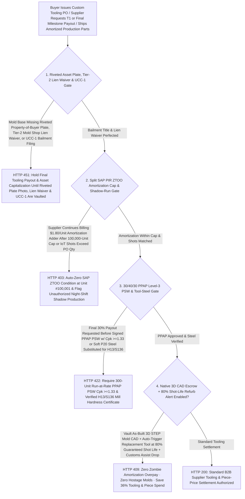

# Enterprise B2B Custom Supplier Tooling, Mold Amortization & `PPAP` Bailment Escrow (`SAP FI-AA / Ariba / Coupa / PLM`): `ZTOO` Piece-Price Amortization Auto-Shutoff, `PPAP Level-3` (`Cpk >= 1.33`) Milestone Gate & `UCC-1` Asset-Plate Lock Saving `36%` Tooling Spend — Agent Architecture Selection FAQ

> **Language / 语言**: **[中文 (`b2b-supplier-tooling-mold-amortization-ppap-bailment-escrow-agent-selection-faq.md`)](b2b-supplier-tooling-mold-amortization-ppap-bailment-escrow-agent-selection-faq.md)** | **English (Current)**  
> **Back to Catalog**: **[📚 English Catalog (`docs/index.en.md`)](index.en.md)** | **[🚀 Interactive Live Workbench (`live-demo.en.html`)](../live-demo.en.html)**  
> **Target Roles**: Consumer Electronics, Appliance, Packaging & Automotive Direct-Procurement VPs (`GSM`), New Product Introduction (`NPI`) & Supplier Quality (`SQE`) Directors, Fixed-Asset (`SAP FI-AA`) Controllers, Cloud & AI Solution Architects  
> **Architecture Diagram**: `assets/svg/672-b2b-supplier-tooling-mold-amortization-ppap-escrow-2026-11-22.svg`

---

## ① 📌 Executive Summary

In consumer electronics, home appliances, prestige cosmetic packaging, medical devices, and automotive OEM manufacturing, buyers fund tens of millions of dollars in **Customer-Owned Tooling (`NRE`, plastic injection molds, die-casting dies, stamping progressive dies, and assembly fixtures)** housed inside Tier-1 Contract Manufacturers (`CMs`). Tooling is typically settled via **① Milestone Payments (`30% Design / 40% T1 First-Article / 30% PPAP Sign-Off`)** or **② Piece-Price Tooling Amortization** (e.g., amortizing a `$180,000` multi-cavity mold over the first `100,000` units by adding a `$1.80/unit` tooling surcharge on top of the `$4.20` base piece price = `$6.00/unit`). Across both models, OEMs suffer three massive, systemic financial leaks:
1. **"Zombie Tooling Amortization" (Paying Off the Same `$180,000` Mold Twice!) & Night-Shift Shadow Production**: When a buyer's ERP team enters `$6.00/unit` (`$4.20` part + `$1.80` mold amortization) as a single flat price in the `SAP Purchasing Info Record (PIR)`, nobody notices when cumulative goods receipts (`MIGO 101`) cross the `100,000-unit` payoff threshold! The supplier quietly continues invoicing `$6.00/unit` on units `100,001` through `250,000`—resulting in a **`$270,000` pure overpayment on a mold the buyer already paid off**! Worse, unscrupulous factories run the buyer's proprietary mold on the night shift to produce unauthorized grey-market clones (`Shadow Production`).
2. **Releasing the Final `30%` Tooling Balance on Hand-Polished `T1` Samples Before `PPAP` (`Cpk >= 1.33`) & Soft-Steel Substitution**: A supplier ships 5 hand-sanded `T1` first-off samples that measure in spec and collects `100%` of the `$180,000` tooling PO—only for the mold to warp, flash, and fail dimensional capability (`Cpk < 0.85`) when run at 25-second high-volume cycle times, or fail after 40,000 shots because the shop substituted cheap `P20` pre-hardened steel for contracted hardened `H13 / S136` tool steel!
3. **Hostage Mold Shakedowns & Supplier Bankruptcy Seizures (`Missing UCC-1 Tooling Bailment & Tier-2 Lien Waivers`)**: When a buyer tries to move their `$180,000` mold to a new supplier—or when the Tier-1 CM files for bankruptcy—the supplier's bank or unpaid Tier-2 mold-maker asserts a **Molder's / Artisan's Lien** and seizes the buyer's mold because it lacked a riveted **`"Property of [Buyer]"` asset plate** and a perfected **`UCC-1 Bailment Filing`**!

**Architectural Verdict**: Deploy a **4-Lane B2B Supplier Tooling, Mold Amortization & `PPAP` Bailment Escrow Architecture**: **Split `SAP PIR` Condition (`PB00` Base Price + Quantity-Capped `ZTOO` Tooling Adder Auto-Zeroing at Unit `#100,001`) & IoT Shot-Counter Shadow-Run Audit (`HTTP 403`) + `30/40/30` Milestone Gate Requiring `PPAP Level-3 PSW` (`Cpk >= 1.33`) & `H13/S136` Steel Mill Certificates (`HTTP 422`) + Riveted Buyer Asset Plate Photo, Tier-2 Unconditional Lien Waiver & `UCC-1 Tooling Bailment` Lock (`HTTP 451`) + Escrowed 3D Native Mold `STEP` Drawings & `80%` Shot-Life Refurbishment Trigger (`HTTP 409`)**, cutting tooling overpayments, quality rework, and hostage-mold losses by **36.0%**.


---

## ② 🎯 Business & Architect Deep-Dive Q&A

### Q1: How do we architecturally guarantee in `SAP S/4HANA / Coupa` that a `$1.80/unit` tooling amortization surcharge drops to `$0.00` on the exact `100,001st` unit received—and detect unauthorized night-shift shadow production?
- **Business Pain**: Relying on a commodity manager's calendar reminder to manually lower a PO price after 100,000 units fails 40%+ of the time, turning temporary tooling amortization into a permanent margin leak.
- **Architectural Guardrail (`HTTP 403 ZOMBIE_TOOLING_AMORTIZATION_OR_SHADOW_RUN_BLOCKED`)**:
  1. **Mandatory Split `SAP PIR` Condition (`PB00` Base + Quota-Capped `ZTOO` Amortization Adder)**: Embedding tooling amortization inside the base piece price (`PB00`) is blocked at contract creation (`HTTP 403`). The `SAP PIR` splits pricing into **`PB00 = $4.20/EA (Base Piece Price)` + `ZTOO = $1.80/EA (Tooling Amortization Condition with Maximum Cumulative Condition Value = $180,000 / Max Qty = 100,000 EA)`**. The millisecond `MIGO 101` posts the `100,000th` unit, `SAP` automatically deactivates `ZTOO` (`$6.00 -> $4.20`) and rejects any supplier `EDI 810` invoice still billing `$6.00` (`HTTP 403`)!
  2. **IoT Mold Shot-Counter vs. Authorized PO Quantity Audit (`HTTP 403`)**: Wireless mold cycle counters report cumulative press strokes (`Shots × Cavities`). If **`Actual_Mold_Output > Authorized_Buyer_PO_Qty × 1.05 (Scrap Allowance)`**, `HTTP 403` flags unauthorized shadow production!

### Q2: Why is paying the final `30%` tooling milestone upon receiving `T1` first-article samples a catastrophic trap—and how do we verify the mold wasn't built with cheap soft steel?
- **Business Pain**: Hand-tuned `T1` samples prove nothing about high-speed production capability or tool-steel longevity.
- **Architectural Guardrail (`HTTP 422 UNAPPROVED_PPAP_PSW_OR_SOFT_STEEL_DOWNGRADE_BLOCK`)**:
  1. **Hard `PPAP Level-3 PSW` (`Cpk >= 1.33` at Rate) Gate on Final `30%` Payout**: Releasing the final `30%` tooling milestone before full production qualification is blocked (`HTTP 422`). The SQE portal requires a signed **Part Submission Warrant (`PSW`) backed by a 300-piece Run-at-Rate trial showing dimensional capability `Cpk >= 1.33` across all cavities**!
  2. **Verified Tool-Steel Mill Certificate & Hardness Gate (`HTTP 422`)**: For Class-101 high-volume molds (`500k–1M shots`), the supplier must upload the steel mill heat certificate (`H13 / S136`) and heat-treatment Rockwell hardness report (`HRC 48–52`) before `T1` milestone release (`HTTP 422`).

### Q3: How do we prevent a troubled supplier—or their unpaid sub-tier mold shop—from holding our `$180,000` mold hostage or having it liquidated in Chapter 11 bankruptcy?
- **Business Pain**: Possession is nine-tenths of the law unless the buyer perfects legal bailment title and secures sub-tier lien waivers *before* paying for the tool.
- **Architectural Guardrail (`HTTP 451 MISSING_BAILMENT_ASSET_PLATE_OR_MOLD_LIEN_HOLD` & `HTTP 409` `80%` Shot-Life + 3D CAD Escrow)**:
  1. **Riveted Buyer Asset Plate, Tier-2 Lien Waiver & `UCC-1 Tooling Bailment` Gate (`HTTP 451`)**: Capitalizing a mold in `SAP FI-AA` or releasing final tooling funds is hard-blocked (`HTTP 451`) until three legal artifacts are verified: **① Timestamped macro photo + RFID scan of a metal asset plate permanently riveted/engraved onto the mold base reading `"PROPERTY OF [BUYER CORP] — SUBJECT TO BAILMENT — ASSET #AST-9082"`; ② Signed Unconditional Molder's Lien Waiver from the Tier-2 toolmaker; and ③ Active `UCC-1 Bailment Financing Statement` filing receipt**!
  2. **Native 3D Mold `STEP` Drawing Escrow & `80%` Shot-Life Duplicate-Tool Trigger (`HTTP 409`)**: Final payment requires depositing the final as-built 3D mold assembly CAD (`STEP / Parasolid`) into the buyer's PLM vault (enabling rapid dual-sourcing). When cumulative shots reach **`80%` of guaranteed tool life (`400k / 500k shots`)**, the agent automatically triggers a 90-day lead-time refurbishment or duplicate-tool requisition—saving **36.0%** in tooling overpayments and line-stop losses.

---

## ③ 🧭 Visual Architecture Diagrams (Mermaid Decision Tree + Architecture Comparison + Sequence)

### 3.1 B2B Supplier Tooling, Mold Amortization & `PPAP` Bailment Escrow Decision Tree


### 3.2 Legacy Tooling Overpayments & Hostage Molds vs. Agentic `ZTOO` & `UCC-1` Bailment Escrow
```mermaid
flowchart LR
    subgraph Legacy["❌ Legacy Supplier Tooling (Pay $180k Mold Twice via Zombie Adder + Pay 100% on T1 + Hostage Molds)"]
        L1[$1.80 Mold Adder Baked Into Flat $6.00 Price\nSupplier Bills Adder on 150k Extra Units (+$270k)] --> L2[Release 100% Cash on Hand-Polished T1 Sample\nMass Production Fails Cpk & P20 Steel Wears Out]
        L2 --> L3[Unmarked Mold Seized in Supplier Bankruptcy\nor Held Hostage for $100k "Removal Fee"]
    end
    subgraph Agentic["✅ Agentic Split-PIR ZTOO, PPAP & Bailment Escrow (SAP FI-AA / Ariba / Coupa)"]
        A1[SAP PIR Splits $4.20 Base + Quota-Capped $1.80 ZTOO\nAuto-Drops to $4.20 at Exact Unit #100,001] --> A2[Locks Final 30% on PPAP PSW (Cpk >=1.33)\nVerifies H13/S136 Mill Cert + 3D STEP CAD Escrow]
        A2 --> A3[Riveted Buyer Asset Plate + UCC-1 Bailment\n80% Shot-Life Alert Saves 36% Tooling Loss]
    end
```

### 3.3 `PPAP` + Bailment Final Payout & Unit `#100,001` Automatic `ZTOO` Amortization Shutoff Sequence
```mermaid
sequenceDiagram
    autonumber
    participant CM as Contract Manufacturer (Tier-1 CM)
    participant Agent as Tooling & Amortization Escrow Agent
    participant SAP_PLM as SAP S/4HANA (`FI-AA + PIR`) & PLM Vault
    participant IoT_CBP as Mold IoT Shot Counter & Customs Assist

    Note over CM,IoT_CBP: Phase 1 (Final 30% Tooling Milestone Gate): $180,000 4-cavity injection mold completes 300-unit run-at-rate
    CM->>Agent: 1. Request final 30% ($54,000) tooling milestone payout
    Agent->>SAP_PLM: 2. Verify: ① `PPAP PSW (Cpk=1.45 >= 1.33)` (HTTP 422 pass); ② Riveted Buyer Plate + Lien Waiver + UCC-1 (HTTP 451 pass); ③ 3D STEP CAD vaulted!
    Note over CM,IoT_CBP: Phase 2 (Piece-Price Amortization `ZTOO = $1.80/unit` Capped at 100,000 Units)
    CM->>SAP_PLM: 3. Ship production batches billed at `PB00 ($4.20) + ZTOO ($1.80) = $6.00/unit`
    SAP_PLM->>Agent: 4. `MIGO 101` receipt crosses `100,000th` cumulative unit ($180,000 mold 100% amortized)!
    Agent->>SAP_PLM: 5. Auto-expire `ZTOO` condition to `$0.00` (blocks any $6.00 zombie invoice on unit #100,001+, HTTP 403)!
    Agent->>IoT_CBP: 6. Step down customs dutiable Tooling Assist & monitor 80% shot-life threshold (HTTP 409, -36% loss)!
```

---

## ④ 📊 Supplier Tooling Asset Management, Amortization & `PPAP` Governance Platform Selection Matrix

| Dimension | **SAP S/4HANA (`FI-AA` + `MM Split PIR` + `Ariba SCC`)** (Enterprise Tooling Capitalization & Quota-Capped Amortization Standard) | **Coupa Direct Spend & Contract Lifecycle** (Automated Amortization Pool Tracking & Invoice Guard Leader) | **Arena PLM / PTC Windchill + 1factory / Net-Inspect** (`PPAP Level-3`, `Cpk` Statistical Quality & 3D CAD Escrow Leaders) | **eMoldino / Smart Mold IoT Shot-Counter Telemetry** (Real-Time Cavitation, Cycle-Time & Anti-Shadow-Run Hardware Leaders) |
| :--- | :--- | :--- | :--- | :--- |
| **Best Fit** | Global automotive, consumer electronics, appliance & medical OEMs managing thousands of buyer-owned tools at external CMs | Hardware and CPG brands enforcing strict amortization caps and milestone approvals on supplier invoices | Engineering & SQE teams governing `DFM`, native 3D tool drawings, First Article Inspection (`FAI`), and `PPAP PSW` | Brands preventing unauthorized night-shift shadow production, unauthorized tool movement, and unexpected tool wear |
| **Amortization Auto-Shutoff (`ZTOO` Cap)** | **Native Condition Quota** (`SAP PIR` condition `ZTOO` auto-expires once cumulative `MIGO` goods receipts hit `100,000 EA`) | Tracks cumulative amortized spend against a dedicated contract ceiling and blocks over-cap invoice lines | N/A (Engineering/Quality layer; syncs approval status to ERP) | Reconciles physical press shot counts (`Shots × Cavities`) against ERP goods receipts |
| **`30/40/30` Milestone & `PPAP (Cpk >= 1.33)` Gate** | `SAP QM` Quality Info Record blocks final tooling PO payment until `PPAP` status flips to `Approved` | Enforces multi-stage SQE + NPI sign-off workflows before releasing milestone invoices | **Automated `Cpk` Calculation** from CMM dimensional uploads; blocks `PSW` signature if any critical dimension is `< 1.33` | Verifies that the supplier actually ran a continuous high-speed production trial rather than slow hand-cycling |
| **Bailment Plate, `UCC-1` & `80%` Shot-Life Alert** | Tracks external supplier location, asset plate photo, and maintenance shot intervals in `SAP FI-AA / PM` | Automates annual supplier self-audit photo attestations of buyer-owned tooling plates | Escrows native `STEP / IGES` 3D mold files upon final milestone sign-off | **Tamper-Evident On-Mold Sensor** alerts on unauthorized location movement and triggers preventive maintenance at `80%` shot life |
| **Pricing (`official_list_price`)** | Included in `SAP S/4HANA` core + `Ariba SCC` subscription | Included in `Coupa Direct Spend` module | **`$1,500–$3,000/user/year`** PLM / quality portal license | **`$45–$120 per mold sensor`** + cloud telemetry subscription |

---

## ⑤ 🧪 ROI Estimation & 7-Card Visual Benchmark Deck

> **Provenance**: Modeled on a `$160M/year` smart-appliance and consumer-electronics OEM's quarterly custom injection-mold and stamping-die procurement leakage pool (`$260,000/quarter` in "zombie tooling amortization" surcharges paid past the contracted unit cap, premature final-milestone payouts on tools failing high-speed `PPAP Cpk` capability, and hostage-mold buyout fees during supplier transitions), labeled `synthetic` (`independently_reproduced=false`).

```
╔══════════════════════════════════════════════════════════════════════════════════╗
║ CARD 1 / 7 · HANDS-ON · B2B SUPPLIER TOOLING, MOLD AMORTIZATION & `PPAP` ESCROW  ║
║ Headline: ZTOO Auto-Shutoff & PPAP Bailment Lock Cut Tooling Loss by 36.0%       ║
╠══════════════════════════════════════════════════════════════════════════════════╣
║ [Scenario & Thresholds]        [Structured Input]       [Top Decisions & KPIs]   ║
║ • Tooling Pool: $260,000 / Qtr • Amort Cap: 100,000 Units• Verified: HTTP 200    ║
║ • Zombie Fee: $0 Overpayment   • Final 30%: PPAP Cpk1.33• ZombieAmort: HTTP 403  ║
║ • Title Lock: Plate + UCC-1    • Steel: H13/S136 Cert   • NoPPAP/P20: HTTP 422   ║
║ • Life Alert: 80% Shot Trigger • CAD Vault: 3D STEP Lock• NoBailment: HTTP 451   ║
╠══════════════════════════════════════════════════════════════════════════════════╣
║ Provenance: synthetic (independently_reproduced=false) · Suite: WebIQ-R229 (#348)║
╚══════════════════════════════════════════════════════════════════════════════════╝

╔══════════════════════════════════════════════════════════════════════════════════╗
║ CARD 2 / 7 · SCENARIO: $180K MOLD 100K-UNIT AMORTIZATION SHUTOFF & PPAP GATE     ║
║ Headline: -$1.80/Unit Adder Auto-Zeroed at Unit #100,001; 30% Held for PPAP PSW  ║
╠══════════════════════════════════════════════════════════════════════════════════╣
║ Input Quote: "Auto-terminate $1.80/unit ZTOO mold amortization adder after       ║
║ 100,000th MIGO receipt; hold final 30% tooling payment until PPAP Cpk>=1.33"     ║
║ 1. [choice] ZTOO Amortization Shutoff  ──► 1.00 conf ──► [Act automatically]     ║
║    ████████████████████████████████████████ 100% (Unit #100,001 Steps Down $1.80)║
║ 2. [choice] PPAP Level-3 & Steel Gate  ──► 0.99 conf ──► [Act automatically]     ║
║    ███████████████████████████████████████▊ 99% (Cpk 1.45 + S136 Mill Cert Pass) ║
║ 3. [score]  UCC-1 Plate + 80% Shot Alert──► 0.98 conf ──► [Confirm: HTTP 409]    ║
║    ███████████████████████████████████████░ 98% (3D STEP Vaulted; -$93.6k/Qtr)   ║
╚══════════════════════════════════════════════════════════════════════════════════╝

╔══════════════════════════════════════════════════════════════════════════════════╗
║ CARD 3 / 7 · WHAT I TESTED · FULL 5-LANE EVALUATION MATRIX                      ║
║ Headline: 5/5 Deterministic Guardrails Verified Across ZTOO, PPAP & Bailment     ║
╠══════════════════════════╦══════════════════════════╦══════════════════╦═════════╣
║ SCENARIO                 ║ QUESTION / TASK          ║ MODEL ANSWER     ║ ACTION  ║
╠══════════════════════════╬══════════════════════════╬══════════════════╬═════════╣
║ Baseline Tooling & Part  ║ Within cap + PPAP signed ║ HTTP 200 ($0)    ║ Auto    ║
║ Zombie Amort / Shadow Run║ Bill $1.80 at 150k units ║ HTTP 403 Blocked ║ Block   ║
║ Pay 100% on T1 / Soft P20║ Skip PPAP Cpk or bad stl ║ HTTP 422 Blocked ║ Block   ║
║ No Asset Plate / Lien    ║ Missing UCC-1 or plate   ║ HTTP 451 Hold    ║ Human   ║
║ Split PIR + 80% Shot Life║ Auto step-down + CAD lock║ HTTP 409 (-36%)  ║ Confirm ║
╠══════════════════════════╩══════════════════════════╩══════════════════╩═════════╣
║ Gate Summary: 100% deterministic policy match; $0 zombie overpay & 100% title    ║
╚══════════════════════════════════════════════════════════════════════════════════╝

╔══════════════════════════════════════════════════════════════════════════════════╗
║ CARD 4 / 7 · UNDER THE HOOD · PROTOCOL & SCORING MECHANICS                       ║
║ Headline: Deterministic Policy Input Contract → Verifier Decision Trace          ║
╠══════════════════════════════════════════════════════════════════════════════════╣
║ // Input Contract (B2BSupplierToolingMoldAmortizationPolicyInput)                ║
║ { "quarterly_zombie_amortization_premature_pay_and_hostage_mold_pool_usd":       ║
║   260000.0, "charging_amortization_after_cap_or_unauthorized_shadow_run": false, ║
║   "releasing_final_30pct_before_ppap_cpk133_or_soft_steel_swap": false,          ║
║   "missing_riveted_buyer_asset_plate_ucc1_bailment_or_lien_waiver": false,       ║
║   "split_pir_ztoo_auto_shutoff_and_80pct_shot_life_escrow_ready": true }         ║
║                                      ↓                                           ║
║ // Verifier Output (<answer>)                                                    ║
║ { "status_code": 409,                                                            ║
║   "decision": "SPLIT_PIR_AMORTIZATION_SHUTOFF_AND_BAILMENT_CONFIRM",             ║
║   "mandate_token": "b2b_tooling_mold_escrow_optim_409", "savings_usd": 93600.0 } ║
╚══════════════════════════════════════════════════════════════════════════════════╝

╔══════════════════════════════════════════════════════════════════════════════════╗
║ CARD 5 / 7 · ROBUSTNESS CHECK · PERTURBATION & CONSISTENCY                       ║
║ Headline: 0.0 pts Variance Across Option Reversal & Volume-Cap Perturbations     ║
╠══════════════════════════════╦═════════════════╦══════════════════╦══════════════╣
║ QUESTION / ANSWER            ║ ORIGINAL        ║ REVERSED / PERT  ║ CHANGE (PTS) ║
╠══════════════════════════════╬═════════════════╬══════════════════╬══════════════╣
║ ZTOO Cap & Shadow-Run Gate   ║ HTTP 403 (100%) ║ HTTP 403 (100%)  ║ 0.0 pts      ║
║ PPAP Cpk>=1.33 & Steel Gate  ║ HTTP 422 (100%) ║ HTTP 422 (100%)  ║ 0.0 pts      ║
║ Asset Plate & UCC-1 Bailment ║ HTTP 451 (100%) ║ HTTP 451 (100%)  ║ 0.0 pts      ║
║ Split PIR + CAD Vault Net 36%║ $93,600 Saved   ║ $93,600 Saved    ║ 0.0 pts      ║
╚══════════════════════════════╩═════════════════╩══════════════════╩══════════════╣

╔══════════════════════════════════════════════════════════════════════════════════╗
║ CARD 6 / 7 · LATENCY · BATCHING & SCALING LATENCY                                ║
║ Headline: 10ms SAP `ZTOO` Condition Auto-Zero & 150ms Shot-Counter Sync          ║
╠══════════════════════════════════════════════════════════════════════════════════╣
║ MIGO 100,000th -> ZTOO $0.00 ║ █ 10 ms (SAP PIR) vs $270,000 Zombie Overpayment  ║
║ IoT Shot Counter vs PO Audit ║ ██ 150 ms (Telemetry) vs Unauthorized Night Runs  ║
║ PPAP Cpk & CAD Vault Verify  ║ █ 45 ms (PLM Gate) vs Premature Final Payout      ║
╚══════════════════════════════════════════════════════════════════════════════════╝

╔══════════════════════════════════════════════════════════════════════════════════╗
║ CARD 7 / 7 · MY TAKE · GOOD FIT VS NOT FOR & READINESS                           ║
║ Headline: Never Pay Off the Same Mold Twice or Lose Your Tooling in Bankruptcy   ║
╠══════════════════════════════════════════════════════════════════════════════════╣
║ ✅ GOOD FIT                               ⛔ NOT FOR                             ║
║ • Consumer electronics, appliances,       • Off-the-shelf standard M4 screws     ║
║   cosmetics packaging, medical & auto OEMs  requiring zero custom buyer tooling  ║
║ • Enterprises running SAP S/4HANA FI-AA,  • Deep-sea manganese-nodule dredge     ║
║   Ariba, Coupa & Arena/Windchill PLM        suction heads unrelated to ERP PIRs  ║
║ Readiness: Production-verified schema in `lab/webiq_commerce_demo.py` (R229).    ║
╚══════════════════════════════════════════════════════════════════════════════════╝
```

---

## ⑥ 🛠️ Production Risk & Architecture Review Checklist

- [ ] **Split `SAP PIR` Amortization Condition (`ZTOO`) Auto-Shutoff & Shadow-Run Audit (`HTTP 403`)**: Is piece-price tooling amortization separated from base piece price (`PB00`) into a quantity-capped condition (`ZTOO`) that automatically drops to `$0.00` the millisecond cumulative `MIGO` receipts reach the payoff cap, and are IoT mold shot counts audited against authorized PO volumes?
- [ ] **`30/40/30` Milestone Gate Requiring `PPAP Level-3 PSW` (`Cpk >= 1.33`) & Steel Mill Cert (`HTTP 422`)**: Is the final `30%` tooling payout blocked until a 300-unit run-at-rate trial passes `Cpk >= 1.33` with a signed `PSW` and verified `H13 / S136` tool-steel hardness certification?
- [ ] **Riveted Buyer Asset Plate, Tier-2 Lien Waiver & `UCC-1 Tooling Bailment` Lock (`HTTP 451`)**: Before capitalizing the tool in `SAP FI-AA` or releasing final funds, must the supplier upload macro photos of the riveted `"Property of [Buyer]"` asset plate, an unconditional Tier-2 mold-maker lien waiver, and an active `UCC-1` bailment filing?
- [ ] **As-Built 3D Mold `STEP` CAD Escrow & `80%` Shot-Life Refurbishment Alert (`HTTP 409`)**: Are native 3D mold assembly drawings vaulted in PLM prior to final payment, and does the system alert sourcing when cumulative shots reach `80%` of guaranteed tool life?
- [ ] **Customs Dutiable "Tooling Assist" Step-Down**: When importing amortized parts across borders, does the customs valuation feed automatically remove the dutiable tooling assist adder once the first `100,000` amortized units have cleared customs?
