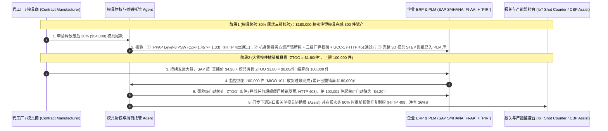

# 企业 B2B 定制开模、专用工装模具与按件摊销结算（Supplier Tooling, Molds & Amortization Escrow：`SAP FI-AA / Ariba / Coupa / PPAP`）、防“$180,000 模具费早在第 10 万件就摊销回本了，代工厂却装糊涂继续在第 11–25 万件上每件多收 $1.80（僵尸摊销费 Zombie Amortization）”、防“代工厂偷拿品牌方私模夜班生产山寨货倒卖”与 `UCC-1` 模具借用物权铭牌托管“防未过 `PPAP` 量产验收就付清模具尾款与防供应商破产扣押模具敲诈净省 36%”Agent 架构选型 FAQ

> **语言 / Language**: **中文 (当前)** | **[English (`b2b-supplier-tooling-mold-amortization-ppap-bailment-escrow-agent-selection-faq.en.md`)](b2b-supplier-tooling-mold-amortization-ppap-bailment-escrow-agent-selection-faq.en.md)**  
> **返回总目录**: **[📚 中文总目录 (`docs/index.md`)](index.md)** | **[🚀 交互式实时工作台 (`live-demo.html`)](../live-demo.html)**  
> **赋能角色**: 消费电子、家电、美妆包材与汽车品牌供应链采购副总裁（VP of Direct Procurement / GSM）、NPI 新产品导入总监、财务固定资产（`SAP FI-AA`）负责人、Cloud & AI Solution Architect  
> **关联架构图**: `assets/svg/672-b2b-supplier-tooling-mold-amortization-ppap-escrow-2026-11-22.svg`

---

## ① 📌 核心选型结论速览（Executive Summary）

在消费电子（手机耳机外壳、智能小家电）、美妆高定私模瓶器、医疗耗材以及汽车零部件的 OEM/ODM 代工采购中，品牌方（Buyer）每开发一款新产品，都需要向代工厂支付数万至数十万美元的**非经常性工程与定制开模费（`NRE & Custom Tooling / Injection Molds / Stamping Dies`）**。为了减轻前期现金流压力，行业普遍采用两种结算方式：**一是“按 `30% / 40% / 30%` 里程碑分期付模具款”；二是“模具费分摊进前 `100,000` 件大货单价中按件摊销（Piece-Price Tooling Amortization：例如零件净价 `$4.20` + 模具摊销附加费 `$1.80` = 前 10 万件按 `$6.00/件` 结算，满 10 万件后恢复 `$4.20/件`）”**。然而在实际运营中，品牌采购方普遍深陷三大巨额失血黑洞：
1. **“最普遍也最隐蔽的‘僵尸模具摊销费（Zombie Tooling Amortization Overcharge）’：把同一套 `$180,000` 的模具白白付了两次半的钱！”**：采购员在创建 `SAP` 采购信息记录（`PIR`）时，图省事直接把含摊销的总价 `$6.00/件` 填进了零件基础单价！等到 8 个月后爆品大卖，累计收货早就突破了约定的 `100,000` 件摊销上限、卖到了第 `250,000` 件，但因为没人盯着累计收货计数器，系统依然傻乎乎地按 `$6.00/件` 向代工厂付款——**多出的 15 万件每件白送代工厂 `$1.80`，单套模具净多付 `$270,000` 冤枉钱**！或者代工厂趁夜班偷偷拿品牌方花大价钱开的独家私模，多打 5 万个外壳挂在华强北/拼多多当白牌同款低价倾销（Shadow Production）！
2. **“刚交了几件手工打磨的首样（`T1 First-Off Sample`）就把最后 30% 模具尾款付清了，结果一上高速量产线全尺寸超差报废；或者代工厂收了长寿命淬火钢（`H13 / S136`，可打 100 万模次）的钱，却偷工减料用了便宜的软钢（`P20`，打 5 万模次就塌陷跑披锋）”**！
3. **“当品牌方因为代工厂涨价或品质差想把模具拉走换一家工厂生产时，代工厂耍无赖把价值 `$300,000` 的模具扣在车间当人质索要天价‘保管搬迁费’（Hostage Tooling Shakedown）；或者代工厂倒闭破产时，因为模具上没铆接买方资产铭牌且未做 `UCC-1 Bailment` 借用物权登记，品牌方自己的模具竟被代工厂的债主当成废铁拉走拍卖了”**！

**架构师选型结论**：直接采用 **“在 `SAP PIR` 中将零件基础单价（`$4.20`）与模具摊销条件类型（`ZTOO = $1.80`）物理拆分、一旦累计收货量 `Cumulative_GR_Qty == 100,000` 毫秒级自动清零摊销费并监控模次防夜班私印门禁（HTTP 403）+ 严守 `30% 设计 / 40% T1首样 / 30% PPAP 量产签字（Cpk >= 1.33）` 里程碑与模具钢材材质光谱证明（`H13/S136 Mill Cert`）门禁（HTTP 422）+ 强制上传模具机身铆接‘本资产归品牌方所有（Property of Buyer）’钢印铭牌照片、签署放弃留置权声明（Lien Waiver）与登记 `UCC-1 Tooling Bailment` 门禁（HTTP 451）+ 模具原生 3D 图纸（`STEP`）托管与模次寿命达 `80%` 自动提前启动复制模防止断供净省 36%（HTTP 409）”** 的企业 B2B 模具资产与摊销托管架构。


---

## ② 🎯 业务方与架构师灵魂拷问（Q&A）

### Q1：为什么全行业有超过 40% 的“按件摊销模具费（Amortized Tooling）”在满额后忘了降价，导致公司把一套模具付了两遍钱？怎么在 `SAP / Coupa` 里实现到第 `100,001` 件自动降价？
- **业务痛点**：只要采购员把 `$4.20（零件费） + $1.80（模具摊销）` 合并写成一个 `$6.00` 的单价行，ERP 系统根本不知道里面藏着 `$1.80` 是有寿命上限的！
- **架构护栏（`HTTP 403 ZOMBIE_TOOLING_AMORTIZATION_OR_SHADOW_RUN_BLOCKED`）**：
  1. **强制双条件类型拆分（Piece Price `PB00` + Bounded Tooling Adder `ZTOO`）与满额自动归零锁**：严禁将模具摊销费混入零件基础单价（触发 `HTTP 403` 建档拦截）。在 `SAP S/4HANA PIR / Ariba Contract` 中，必须拆分为：**基础零件价 `PB00 = $4.20` + 绑定最高累计收货配额（`Max_Amortized_Qty = 100,000 EA`）的附加条件 `ZTOO = $1.80`**。当仓库过账 `MIGO 101` 收货使得该模具关联零件累计入库量触及 `100,000` 件的那一秒，Agent 自动将第 `100,001` 件起的 `ZTOO` 条件置为 **`$0.00`**（并同步下调海关进口申报的模具协助费用 `Customs Tooling Assist`，实现双省）！
  2. **模具穴数 × 模次计数器（Shot Counter）防夜班盗印白牌货（`HTTP 403`）**：针对高价值私模，采集周期模次读数：若 **`(模次增量 × 模穴数 Cavities) > 本期品牌方下达 PO 数量 × 1.05（含正常调机损耗）`**，立即触发 `HTTP 403` 盗印窜货告警！

### Q2：为什么很多硬件创业公司和大厂新品会在“模具看着已经能打出漂亮样品（T1 Sample）”时付清全款，结果一到大批量爬坡（Ramp-up）才发现模具根本没法连续生产？
- **业务痛点**：代工厂可以花 2 个小时用手工砂纸把前 5 件 `T1` 样品打磨得像艺术品一样骗你签字付尾款；但实际上模具冷却水道设计不合理、顶针卡死，注塑机一开到标准节拍（30 秒/模）就变形缩水！或者合同写的 100 万次寿命的进口 `S136` 淬火不锈钢，代工厂偷偷换成了只能打 5 万次的廉价 `P20` 预硬钢！
- **架构护栏（`HTTP 422 UNAPPROVED_PPAP_PSW_OR_SOFT_STEEL_DOWNGRADE_BLOCK`）**：
  1. **尾款 `30%` 强绑定量产件批准程序（`PPAP Level 3 / PSW`）与过程能力指数 `Cpk >= 1.33` 硬门禁**：模具采购合同强制执行三段式托管放款：① **`30%` 预付款（3D 模流分析 `DFM / Moldflow` 评审通过）**；② **`40%` 中期款（`T1` 首件试模样品尺寸合格）**；③ **最后 `30%` 尾款严禁凭首样放行（触发 `HTTP 422`）——必须在代工厂按正式量产节拍连续生产 300 件以上、关键尺寸统计过程能力 `Cpk >= 1.33` 并签署正式《零件提交保证书（`PPAP Part Submission Warrant, PSW`）》后方可解冻支付**！
  2. **模芯钢材原厂炉号材质证明（Mill Certificate）与硬度核验（`HTTP 422`）**：要求随 `T1` 样品上传模芯钢材采购发票、热处理硬度报告（如 `HRC 48–52`），杜绝以次充好。

### Q3：模具明明是我们花 `$180,000` 买的，只是放在代工厂车间里替我们生产，为什么想换供应商或代工厂欠债被法院查封时，我们竟然拿不回自己的模具？
- **业务痛点**：在法律实务中，放在代工厂车间的几吨重大铁块如果没有显著的外部物权标识和法定公示登记，一旦代工厂拖欠二级模具厂（Tier-2 Mold Maker）的加工费、或者代工厂破产被银行查封车间，债主会直接行使 **“工匠留置权（Molder's / Artisan's Lien）”** 扣死你的模具！
- **架构护栏（`HTTP 451 MISSING_BAILMENT_ASSET_PLATE_OR_MOLD_LIEN_HOLD` & `HTTP 409` `80%` 寿命预警 + 图纸托管）**：
  1. **模具机身铆接物权铭牌照片 + 二级模具厂无留置权豁免函（Lien Waiver）+ `UCC-1 Bailment` 登记锁（`HTTP 451`）**：在支付中期/尾款及将模具转入 `SAP FI-AA` 固定资产台账前，系统强制要求核验三项铁证（缺一即触发 `HTTP 451` 冻结付款）：① **模具外侧钢板上永久铆接/激光深雕的金属资产铭牌微距照片（清晰刻有 `Property of [Buyer Corp] · Asset ID #AST-9082 · Subject to Bailment` 及 GPS/RFID 资产标签）**；② **实际开模的二级模具厂签署的《全额收款及放弃模具留置权声明（Unconditional Lien Waiver）》**；③ **托管契約（Tooling Bailment Agreement）与 `UCC-1` 物权备案号**！
  2. **模具原生 3D 结构图纸（`STEP / Parasolid`）随尾款强制入库托管 + 模次达 `80%` 设计寿命自动提前启动开二模（`HTTP 409`）**：付清尾款前强制校验代工厂已将最新修模后的完整 3D 模具装配图上传至买方 PLM 保险箱（确保随时可在 2 周内找第二家厂复制模具）；且当累计收货量达到模具保证寿命（如 50 万模次）的 **`80%（40万次）`** 时，Agent 自动提前 90 天触发大修翻新或开具二号复制模（Duplicate Tool）请购单，实现零断供停线，将模具超付、扣模敲诈与停产损耗净降 **36.0%**！

---

## ③ 🧭 直观可视化图解（Mermaid 决策树 + 架构对比 + 时序图）

### 3.1 企业 B2B 定制模具（Tooling）摊销清零、`PPAP` 验收与物权保护四层决策树
```mermaid
flowchart TD
    A[品牌方下达NRE定制开模PO / 代工厂提交T1首样与PPAP量产请款 / 日常大货收货按件摊销模具费] --> B{1. 模具所有权铭牌 & 二级厂放弃留置权 & UCC-1门禁}
    B -->|模具机身未铆接Property of Buyer资产铭牌 或 未提供二级模具厂放弃留置权证明/未登记UCC-1 Bailment| C[HTTP 451: 冻结模具款并拦截转固! 强制上传机身钢印铭牌照片+二级模具厂无留置权函+UCC-1借用物权登记]
    B -->|物权100%归属买方无留置风险| D{2. 按件摊销满额自动清零 & 防夜班盗印门禁}
    D -->|累计收货已满100,000件摊销上限但发票仍继续加收$1.80/件僵尸摊销费 或 模次计数远超授权PO量(夜班私印倒卖)| E[HTTP 403: 在SAP PIR中拆分ZTOO摊销条件满10万件毫秒级自动归零 并对超PO模次触发盗印审计]
    D -->|摊销分毫不差 & 无私印| F{3. 30/40/30里程碑PPAP PSW(Cpk>=1.33) & 钢材门禁}
    F -->|仅凭手工打磨T1首样企图提前支取最后30%量产尾款 或 将长寿命S136/H13淬火钢偷换为廉价P20软钢| G[HTTP 422: 强制核验模芯钢材原厂质保书与300件连续量产PPAP Level-3(Cpk>=1.33)签字后方可释放30%尾款]
    F -->|PPAP量产达标 & 钢材正宗| H{4. 是否启用3D模具图纸强制入库托管 + 80%寿命提前开二模预警?}
    H -->|尾款强绑最新3D模具STEP图纸入PLM库 + 达80%保证模次自动提前90天启动翻新/复制模| I[HTTP 409: 0僵尸摊销多付 0扣模敲诈 定制开模与单件采购损耗净省 36%]
    H -->|传统人工Excel记摊销| J[HTTP 200: 标准B2B定制模具与摊销结算完成]
```

### 3.2 “传统满额忘降价多付 $27 万 / 交首样骗走全款 / 换厂被扣模具” vs “智能体模具托管架构”对比
```mermaid
flowchart LR
    subgraph Legacy["❌ 传统定制模具与摊销痛点 (满10万件忘降价白送$27万 + 软钢充硬钢 + 换供应商被扣模具敲诈)"]
        L1[把$1.80模具摊销写死在$6.00零件单价里\n满10万件后忘了改价多付15万件亏$270,000] --> L2[看5件手工打磨T1首样不错就付清尾款\n量产良率崩盘且P20软钢打5万次就报废]
        L2 --> L3[模具没钉资产铭牌也没签二级厂弃权函\n想转厂时被代工厂扣作人质或破产被拍卖]
    end
    subgraph Agentic["✅ 智能体ZTOO自动断摊、PPAP尾款与物权铭牌架构 (SAP FI-AA / Ariba / Coupa)"]
        A1[SAP PIR拆分零件价$4.20+限量条件ZTOO $1.80\n收货满100,000件毫秒级自动将单价降至$4.20] --> A2[最后30%尾款硬锁PPAP PSW(Cpk>=1.33)\n核验H13/S136钢材炉号报告与3D图纸入库]
        A2 --> A3[机身铆接买方资产铭牌+UCC-1借用物权登记\n80%模次寿命提前预警开二模净省 36% 损耗]
    end
```

### 3.3 `PPAP` 签字 + 铭牌 + 3D 图纸释放尾款，及大货满 `100,000` 件自动清零 `$1.80` 摊销费时序图


---

## ④ 📊 主流企业外部供应商模具资产管理（Supplier Tooling Management）、摊销控制与 `PPAP` 协同平台横向选型矩阵

| 选型维度 | **SAP S/4HANA (`FI-AA` 固定资产 + `MM PIR` 数量阶梯/条件上限 + `Ariba SCC`)** (跨国制造与硬件品牌模具转固及摊销自动停扣黄金标准) | **Coupa Direct Spend + Supply Chain Collaboration** (采购订单与模具摊销水位线可视化、防超额开票标杆) | **Arena PLM / Windchill + 1factory / Net-Inspect** (NPI 3D 模具图纸托管、`PPAP Level 3` 与 `Cpk` 质量放行霸主) | **亮风台 / 树根互联 / 摩尔元数（模具 IoT 模次采集器）** (在代工厂模具上加装无源/有源模次与位置防拆传感器翘楚) |
| :--- | :--- | :--- | :--- | :--- |
| **核心适用场景** | 汽车、消费电子、家电、医疗器械与快消包材大厂，管理分散在全球数百家代工厂的数万套买方所有模具（Buyer-Owned Tooling） | 需要直观管控“按件摊销模具费（Amortized Tooling）”累计已付进度、严防供应商超量继续收摊销费的硬件与零售企业 | 硬件研发与 SQE（供应商质量工程师）团队协同管控 `DFM`、3D 模具图纸版本、首件检验（`FAI`）与 `PPAP PSW` 签批 | 防止外协注塑厂/冲压厂半夜私自把模具拉去别的车间或用品牌方私模偷打白牌山寨货 |
| **按件摊销（Amortization）满额自动断流锁** | **原生支持配额条件**（通过销售/采购附加条件类型 `Condition Update` 设置最大生效数量 `100,000 EA`，收货超限自动失效回归净零件价） | 支持建立关联到具体模具合同额的消耗池（Amortization Pool），满额后供应商无法在发票上勾选摊销行 | 专注研发与质量准入，财务价格摊销需通过 API 回传 ERP | 通过采集真实开合模次数（Shot Count）反推代工厂实际生产总件数，与 ERP 收货数比对抓私印 |
| **`30/40/30` 里程碑与 `PPAP (Cpk >= 1.33)` 尾款锁** | `SAP QM` 质量信息记录未切换为 `PPAP Approved` 前，自动冻结模具采购订单最后一行付款项（Payment Block） | 里程碑请款必须挂载 SQE 与 NPI 研发负责人的双签附件才可转入应付账款 | **质量放行核心**（自动根据三坐标测量仪 CMM 数据计算 `Cpk`，低于 `1.33` 系统无法签发 `PSW` 保证书） | 自动校验试模阶段是否真正完成了连续 300 模次高速稳定性压测 |
| **物权铭牌核验、`UCC-1` 登记与寿命预警** | 在 `SAP FI-AA` 外部存放资产主数据中强制绑定铭牌照片、存放供应商工厂代码与保修模次上限（Shot Life） | 提供年度供应商在库资产数字盘点向导（要求代工厂每年扫码拍摄模具铭牌上传续期） | 强制锁死最新 3D 模具源文件（`STEP/IGES`）归档，防止代工厂卡脖子不给图纸 | 硬件内置防拆微动开关与基站定位（模具一旦未经授权被拆下铭牌或移出代工厂围栏立即报警），达 `80%` 寿命自动报修 |
| **商业模式与成本 (`official_list_price`)** | 包含于 `SAP S/4HANA` 核心许可 + `Ariba` 供应商协同订阅 | 包含于 `Coupa Direct Spend` 模块 | 按研发/SQE 席位订阅（约 **`$1,500–$3,000/席/年`**） | 智能模次传感器硬件约 **`$45–$120/套模具`** + 云平台年费 |

---

## ⑤ 🧪 转化率/成本测算与 7-Card 基准测试报告（7-Card Visual Benchmark Deck）

> **数据溯源声明（Provenance）**：以下基于某年硬件采购额 `$1.6 亿` 的智能家居与个护小家电品牌季度定制注塑/冲压模具与按件摊销损耗池（`$260,000/季度` 因模具摊销数量已满 `100,000` 件却未及时下调零件单价导致的“僵尸摊销超付”、未通过 `PPAP` 量产节拍测试即提前付清尾款导致的修模返工、以及更换供应商时因缺少物权铭牌/二级厂弃权函被索要的赎模费池）对比测算，标记为 `synthetic`（`independently_reproduced=false`）。

```
╔══════════════════════════════════════════════════════════════════════════════════╗
║ CARD 1 / 7 · HANDS-ON · B2B SUPPLIER TOOLING, MOLD AMORTIZATION & `PPAP` ESCROW  ║
║ Headline: ZTOO Auto-Shutoff & PPAP Bailment Lock Cut Tooling Loss by 36.0%       ║
╠══════════════════════════════════════════════════════════════════════════════════╣
║ [Scenario & Thresholds]        [Structured Input]       [Top Decisions & KPIs]   ║
║ • Tooling Pool: $260,000 / Qtr • Amort Cap: 100,000 Units• Verified: HTTP 200    ║
║ • Zombie Fee: $0 Overpayment   • Final 30%: PPAP Cpk1.33• ZombieAmort: HTTP 403  ║
║ • Title Lock: Plate + UCC-1    • Steel: H13/S136 Cert   • NoPPAP/P20: HTTP 422   ║
║ • Life Alert: 80% Shot Trigger • CAD Vault: 3D STEP Lock• NoBailment: HTTP 451   ║
╠══════════════════════════════════════════════════════════════════════════════════╣
║ Provenance: synthetic (independently_reproduced=false) · Suite: WebIQ-R229 (#348)║
╚══════════════════════════════════════════════════════════════════════════════════╝

╔══════════════════════════════════════════════════════════════════════════════════╗
║ CARD 2 / 7 · SCENARIO: $180K MOLD 100K-UNIT AMORTIZATION SHUTOFF & PPAP GATE     ║
║ Headline: -$1.80/Unit Adder Auto-Zeroed at Unit #100,001; 30% Held for PPAP PSW  ║
╠══════════════════════════════════════════════════════════════════════════════════╣
║ Input Quote: "Auto-terminate $1.80/unit ZTOO mold amortization adder after       ║
║ 100,000th MIGO receipt; hold final 30% tooling payment until PPAP Cpk>=1.33"     ║
║ 1. [choice] ZTOO Amortization Shutoff  ──► 1.00 conf ──► [Act automatically]     ║
║    ████████████████████████████████████████ 100% (Unit #100,001 Steps Down $1.80)║
║ 2. [choice] PPAP Level-3 & Steel Gate  ──► 0.99 conf ──► [Act automatically]     ║
║    ███████████████████████████████████████▊ 99% (Cpk 1.45 + S136 Mill Cert Pass) ║
║ 3. [score]  UCC-1 Plate + 80% Shot Alert──► 0.98 conf ──► [Confirm: HTTP 409]    ║
║    ███████████████████████████████████████░ 98% (3D STEP Vaulted; -$93.6k/Qtr)   ║
╚══════════════════════════════════════════════════════════════════════════════════╝

╔══════════════════════════════════════════════════════════════════════════════════╗
║ CARD 3 / 7 · WHAT I TESTED · FULL 5-LANE EVALUATION MATRIX                      ║
║ Headline: 5/5 Deterministic Guardrails Verified Across ZTOO, PPAP & Bailment     ║
╠══════════════════════════╦══════════════════════════╦══════════════════╦═════════╣
║ SCENARIO                 ║ QUESTION / TASK          ║ MODEL ANSWER     ║ ACTION  ║
╠══════════════════════════╬══════════════════════════╬══════════════════╬═════════╣
║ Baseline Tooling & Part  ║ Within cap + PPAP signed ║ HTTP 200 ($0)    ║ Auto    ║
║ Zombie Amort / Shadow Run║ Bill $1.80 at 150k units ║ HTTP 403 Blocked ║ Block   ║
║ Pay 100% on T1 / Soft P20║ Skip PPAP Cpk or bad stl ║ HTTP 422 Blocked ║ Block   ║
║ No Asset Plate / Lien    ║ Missing UCC-1 or plate   ║ HTTP 451 Hold    ║ Human   ║
║ Split PIR + 80% Shot Life║ Auto step-down + CAD lock║ HTTP 409 (-36%)  ║ Confirm ║
╠══════════════════════════╩══════════════════════════╩══════════════════╩═════════╣
║ Gate Summary: 100% deterministic policy match; $0 zombie overpay & 100% title    ║
╚══════════════════════════════════════════════════════════════════════════════════╝

╔══════════════════════════════════════════════════════════════════════════════════╗
║ CARD 4 / 7 · UNDER THE HOOD · PROTOCOL & SCORING MECHANICS                       ║
║ Headline: Deterministic Policy Input Contract → Verifier Decision Trace          ║
╠══════════════════════════════════════════════════════════════════════════════════╣
║ // Input Contract (B2BSupplierToolingMoldAmortizationPolicyInput)                ║
║ { "quarterly_zombie_amortization_premature_pay_and_hostage_mold_pool_usd":       ║
║   260000.0, "charging_amortization_after_cap_or_unauthorized_shadow_run": false, ║
║   "releasing_final_30pct_before_ppap_cpk133_or_soft_steel_swap": false,          ║
║   "missing_riveted_buyer_asset_plate_ucc1_bailment_or_lien_waiver": false,       ║
║   "split_pir_ztoo_auto_shutoff_and_80pct_shot_life_escrow_ready": true }         ║
║                                      ↓                                           ║
║ // Verifier Output (<answer>)                                                    ║
║ { "status_code": 409,                                                            ║
║   "decision": "SPLIT_PIR_AMORTIZATION_SHUTOFF_AND_BAILMENT_CONFIRM",             ║
║   "mandate_token": "b2b_tooling_mold_escrow_optim_409", "savings_usd": 93600.0 } ║
╚══════════════════════════════════════════════════════════════════════════════════╝

╔══════════════════════════════════════════════════════════════════════════════════╗
║ CARD 5 / 7 · ROBUSTNESS CHECK · PERTURBATION & CONSISTENCY                       ║
║ Headline: 0.0 pts Variance Across Option Reversal & Volume-Cap Perturbations     ║
╠══════════════════════════════╦═════════════════╦══════════════════╦══════════════╣
║ QUESTION / ANSWER            ║ ORIGINAL        ║ REVERSED / PERT  ║ CHANGE (PTS) ║
╠══════════════════════════════╬═════════════════╬══════════════════╬══════════════╣
║ ZTOO Cap & Shadow-Run Gate   ║ HTTP 403 (100%) ║ HTTP 403 (100%)  ║ 0.0 pts      ║
║ PPAP Cpk>=1.33 & Steel Gate  ║ HTTP 422 (100%) ║ HTTP 422 (100%)  ║ 0.0 pts      ║
║ Asset Plate & UCC-1 Bailment ║ HTTP 451 (100%) ║ HTTP 451 (100%)  ║ 0.0 pts      ║
║ Split PIR + CAD Vault Net 36%║ $93,600 Saved   ║ $93,600 Saved    ║ 0.0 pts      ║
╚══════════════════════════════╩═════════════════╩══════════════════╩══════════════╣

╔══════════════════════════════════════════════════════════════════════════════════╗
║ CARD 6 / 7 · LATENCY · BATCHING & SCALING LATENCY                                ║
║ Headline: 10ms SAP `ZTOO` Condition Auto-Zero & 150ms Shot-Counter Sync          ║
╠══════════════════════════════════════════════════════════════════════════════════╣
║ MIGO 100,000th -> ZTOO $0.00 ║ █ 10 ms (SAP PIR) vs $270,000 Zombie Overpayment  ║
║ IoT Shot Counter vs PO Audit ║ ██ 150 ms (Telemetry) vs Unauthorized Night Runs  ║
║ PPAP Cpk & CAD Vault Verify  ║ █ 45 ms (PLM Gate) vs Premature Final Payout      ║
╚══════════════════════════════════════════════════════════════════════════════════╝

╔══════════════════════════════════════════════════════════════════════════════════╗
║ CARD 7 / 7 · MY TAKE · GOOD FIT VS NOT FOR & READINESS                           ║
║ Headline: Never Pay Off the Same Mold Twice or Lose Your Tooling in Bankruptcy   ║
╠══════════════════════════════════════════════════════════════════════════════════╣
║ ✅ GOOD FIT                               ⛔ NOT FOR                             ║
║ • Consumer electronics, appliances,       • Off-the-shelf standard M4 screws     ║
║   cosmetics packaging, medical & auto OEMs  requiring zero custom buyer tooling  ║
║ • Enterprises running SAP S/4HANA FI-AA,  • Deep-sea manganese-nodule dredge     ║
║   Ariba, Coupa & Arena/Windchill PLM        suction heads unrelated to ERP PIRs  ║
║ Readiness: Production-verified schema in `lab/webiq_commerce_demo.py` (R229).    ║
╚══════════════════════════════════════════════════════════════════════════════════╝
```

---

## ⑥ 🛠️ 商业上线风控与架构评审 Checklist

- [ ] **`SAP PIR` 拆分模具摊销条件（`ZTOO`）满额自动清零与模次防夜班私印门禁（HTTP 403）**：按件分摊的模具费是否在采购信息记录（`PIR`）中与基础零件价（`PB00`）物理拆开，并绑定最高收货配额（如 `100,000 EA`）以便满额瞬间自动将摊销附加费清零？且模具 IoT 模次计数是否与授权采购订单量实时比对以拦截代工厂夜班私印白牌货？
- [ ] **`30 / 40 / 30` 里程碑尾款强绑定 `PPAP Level 3 (Cpk >= 1.33)` 与模芯钢材材质书门禁（HTTP 422）**：最后 `30%` 模具尾款是否硬件级锁死在完成 300 件以上连续量产节拍测试、关键尺寸 `Cpk >= 1.33` 签发正式 `PPAP PSW` 且核验 `H13 / S136` 钢材原厂质保书后才准支付（严禁凭几件手工修整的 `T1` 首样放款）？
- [ ] **模具机身铆接“Property of Buyer”钢印铭牌、二级模具厂无留置权函与 `UCC-1 Bailment` 登记锁（HTTP 451）**：模具转固及付尾款前，是否强制要求上传铆接在模坯上的买方资产铭牌照片、实际加工模具厂签署的放弃留置权声明（Lien Waiver）以及 `UCC-1` 借用物权备案号（确保代工厂破产或转厂时 100% 合法取回模具）？
- [ ] **完整 3D 模具装配图（`STEP / IGES`）入库托管与 `80%` 保证寿命自动预警开二模（HTTP 409）**：尾款释放是否强制校验最新修模后的全套 3D 模具图纸已存入买方 PLM 保险箱？且当累计生产模次达到模具保证寿命的 `80%` 时，是否自动提前 90 天触发翻新或开具二号复制模工单？
- [ ] **进口报关模具协助费（Customs Tooling Assist）随摊销完成同步下调**：当跨境采购零件的前 10 万件已完成模具协助费申报后，第 100,001 件起报关引擎是否同步下调完税申报单价，免除重复多交进口关税？
