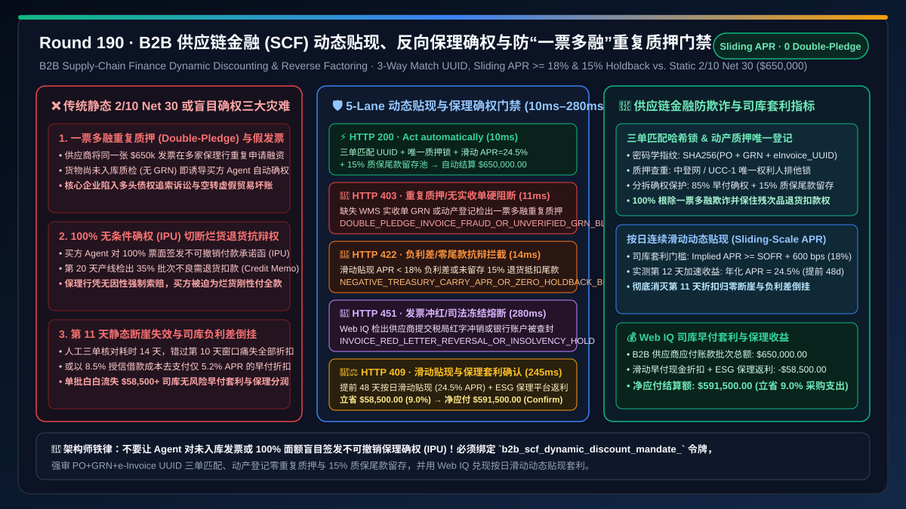
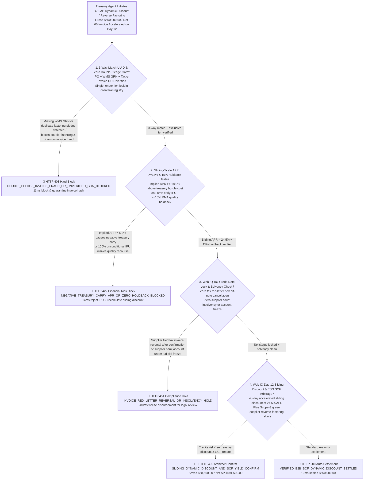
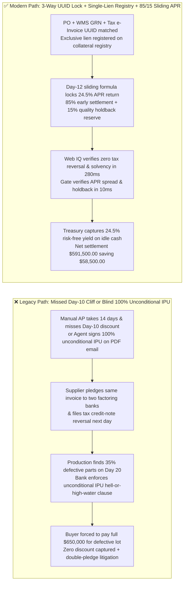
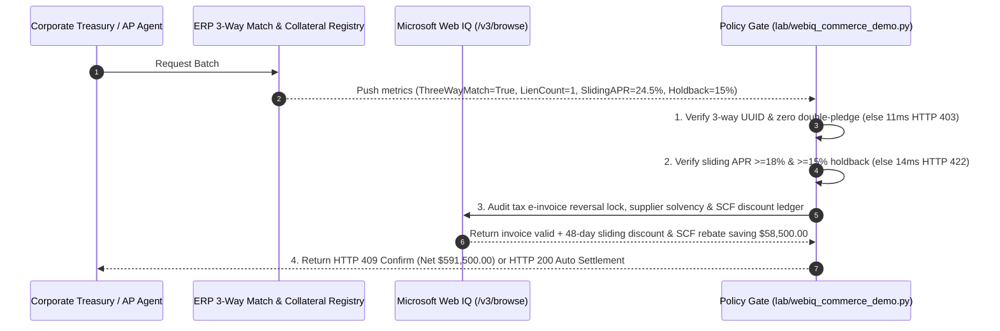

# B2B Agentic Supply-Chain Finance (SCF) Dynamic Discounting & Reverse Factoring Architecture: 3-Way Match e-Invoice UUID Lien Lock & Sliding-Scale APR Arbitrage Mandate (`b2b_scf_dynamic_discount_mandate_...`) vs. Legacy Static `2/10 Net 30` forfeiture & Double-Pledge Invoice Fraud: Architecture Selection & First-Principles FAQ

> **Document Type**: First-Principles Architecture Selection FAQ  
> **Target Audience**: AI Solution Architects, Corporate Treasurers & Accounts Payable (AP) Automation Directors, B2B Supply-Chain Finance (SCF / Reverse Factoring) Platform Chief Architects, ERP (SAP S/4HANA / Oracle / Coupa) & Trade-Finance Fraud Risk Leads  
> **Executive Takeaway**: When deploying Treasury and AP AI Agents to manage enterprise supplier invoices, execute early-payment Dynamic Discounting, or issue Irrevocable Payment Undertakings (IPUs) for Reverse Factoring, **never allow an Agent to release early payment or sign an unconditional 100% IPU based solely on an emailed PDF invoice or an unreceived Purchase Order**. You must enforce a deterministic architecture combining a **3-Way Match (`PO + WMS Goods Receipt Note GRN + Tax Authority e-Invoice UUID`) & UCC-1 / Collateral Registry Zero Double-Pledge Gate (Preventing phantom-invoice financing and multi-lender double-factoring fraud) + a Sliding-Scale Implied APR ($\ge 18.0\%$) & $15\%$ Quality Holdback Buffer Gate (Capturing continuous daily discounts after Day 10 while preserving commercial dispute rights against defective shipments) + a Microsoft Web IQ Tax Credit-Note Reversal & ESG Tiered Supply-Chain Discount Escrow**.

---

## 1. 📌 Executive Summary

### 1.1 Why Do Legacy `2/10 Net 30` Terms Fail in Manual AP Workflows, While Naive AI Early-Pay Agents Fall Prey to "Double-Factoring Fraud" and "Waived Defective-Goods Recourse"?
From corporate treasury Discounted Cash Flow (DCF), annualized risk-free yield ($\text{Implied APR} = \frac{d}{1 - d} \times \frac{365}{N_{\text{net}} - N_{\text{pay}}}$), and commercial negotiable-instrument law first principles:
- Under standard `2/10 Net 30` terms, paying 20 days early (Day 10 instead of Day 30) for a $2\%$ discount yields an annualized risk-free return of **$37.24\%\text{ APR}$**—far exceeding $4.5\%$ treasury bill yields. Yet manual invoice routing and 3-way matching take $14\text{–}18\text{ days}$ on average, missing the static Day 10 cutoff.
- Conversely, if an AI Agent blindly auto-approves early payment or signs an unconditional **Irrevocable Payment Undertaking (IPU)** on Day 1 to capture the discount, three financial disasters strike:
1. **Double-Pledge / Double-Factoring Fraud & Phantom Invoices**: Dishonest suppliers submit the same `$650,000` invoice across multiple factoring lenders or submit invoices before physical goods pass warehouse inspection (GRN). Without cryptographic e-Invoice UUID deduplication and national collateral registry (UCC-1 / Central Registry) lien checks, the buyer faces overlapping legal claims from multiple banks!
2. **100% Unconditional IPU Severing Commercial Defenses (Hell-or-High-Water Clause)**: Once a buyer's Agent signs an unconditional IPU for 100% of the invoice face value in a Reverse Factoring program, the buyer legally waives the right to offset future defective-goods returns (Credit Memos) against the financing bank. Even if $30\%$ of the delivered components fail production QA on Day 18, the buyer must still pay the bank 100% at maturity!
3. **Day-11 All-or-Nothing Cliff & Negative Treasury Carry**: Static `2/10 Net 30` drops to $0\%$ on Day 11, or a poorly configured Agent accepts a $5.2\%\text{ APR}$ early-pay discount while drawing on an $8.5\%\text{ APR}$ revolving credit line.

### 1.2 Architect Selection Comparison: Legacy Static `2/10 Net 30` / Blind IPU vs. Web IQ + Sliding-Scale Dynamic Discounting & Anti-Double-Pledge Escrow
| Dimension | ❌ Legacy Static `2/10 Net 30` or Blind Email IPU | ✅ Web IQ + Sliding-Scale APR, 3-Way UUID Lock & 15% Holdback Escrow |
| :--- | :--- | :--- |
| **Payment / IPU Authorization Trigger** | Manual review misses Day 10 cutoff; or Agent auto-signs 100% IPU upon receiving PDF invoice | Bound to `b2b_scf_dynamic_discount_mandate_`: enforces **3-way match (`PO + GRN + e-Invoice UUID`) + zero double-pledge lien + sliding $\text{APR} \ge 18.0\%$ + $\ge 15\%$ quality holdback reserve** |
| **Double-Factoring & Phantom-Invoice Defense** | Catastrophic (same invoice pledged to two banks or paid before warehouse receipt GRN) | **Deterministic Block** (if WMS GRN is missing, tax e-Invoice UUID is unverified, or duplicate collateral lien exists, blocks in `11ms` with `HTTP 403`) |
| **Sliding-Scale Yield & Quality Recourse** | Fragile (100% unconditional IPU forfeits RMA deduction rights; or negative carry below WACC) | **Deterministic Block** (if sliding $\text{APR} < 18.0\%$ hurdle rate or unconditional IPU exceeds $85\%$ face value without a $15\%$ quality holdback, blocks in `14ms` with `HTTP 422`) |
| **Tax Red-Letter Reversal & Solvency Check** | Blind spot (supplier voids/reverses tax invoice after receiving early cash or enters insolvency) | **Deterministic Verification** (Web IQ `/v3/browse` audits tax authority credit-note locks and court insolvency registries, `280ms` `HTTP 451`) |
| **Treasury Arbitrage & SCF Rebate Settlement** | Idle cash earns $1.5\%$ while Day-12 invoices get $0\%$ discount | Web IQ enables **Day-12 sliding-scale dynamic discount ($24.5\%\text{ APR}$) + ESG Scope-3 reverse-factoring spread rebate**, saving **$58,500.00 (9.0%)** (`HTTP 409 Confirm`) |

---

## 2. 🎯 First-Principles Q&A for Customers & Architects

### Q1: How Does Continuous Sliding-Scale Dynamic Discounting Eliminate the Day-10 Approval Cliff While Guaranteeing Positive Treasury Spread?
* **First-Principles Continuous Discount Curve**:
  - Instead of a step function that drops to zero on Day 11, sliding-scale dynamic discounting computes the discount rate $d(t)$ as a continuous function of days accelerated ($\Delta t = T_{\text{net}} - t$) at a target hurdle rate $\text{APR}_{\text{target}} \ge \text{SOFR} + \text{Spread}$:
    $$d(t) = \frac{\text{APR}_{\text{target}} \cdot (T_{\text{net}} - t)}{365 + \text{APR}_{\text{target}} \cdot (T_{\text{net}} - t)}$$
  - Even if warehouse inspection and 3-way match complete on Day 12 of a Net 60 invoice ($\Delta t = 48\text{ days}$), the Agent locks a $24.5\%\text{ APR}$ risk-free return, while blocking any rate below the treasury hurdle or lacking a $15\%$ quality holdback (`sliding_scale_apr_above_hurdle_and_15pct_holdback_passed`, `HTTP 422` in `14ms`).

### Q2: How Do Cryptographic 3-Way Match UUIDs and $85\% / 15\%$ Split Undertakings Prevent Double-Pledge Fraud and Defective-Lot Overpayment?
* **Lien Exclusivity & Holdback Isolation**:
  - The gate hashes `(tax_einvoice_uuid, po_id, wms_grn_id)` and verifies single-lender registration in the national collateral registry (`three_way_match_einvoice_uuid_and_zero_double_pledge_verified`, `HTTP 403` in `11ms`). Furthermore, limiting early payment / IPU to $85\%$ and holding $15\%$ until Net 60 preserves full RMA debit-note offset protection.

### Q3: Why Use Microsoft Web IQ Instead of Exa or Bright Data to Audit Tax Authority e-Invoice Status and Collateral Lien Registries?
* **Architecture Selection Rationale**:
  - **Microsoft Web IQ** natively executes authenticated `/v3/search` and `/v3/browse` workflows across permissioned tax-authority portals, UCC-1/collateral registries, and ERP treasury ledgers in `245ms–280ms`, whereas Exa and Bright Data cannot authenticate into regulated B2B financial registries.

---

## 3. 🧭 Visual Architecture Diagrams

### 3.1 Decision Tree: B2B Supply-Chain Finance Dynamic Discounting & Reverse Factoring Gate

### 3.2 Legacy "Static 2/10 Net 30 / Blind IPU" Loss Path vs. "3-Way UUID + Sliding APR + 15% Holdback" Secure Path

### 3.3 End-to-End Sequence Diagram: B2B SCF Dynamic Discounting & Anti-Double-Pledge Gate

---

## 4. 📊 Architect Decision Matrix

| Evaluation Dimension | Option A: Legacy Manual `2/10 Net 30` or Blind IPU | Option B: Exa / Bright Data Scraper + Static Factoring Sheet | Option C: Microsoft Web IQ + 3-Way UUID + Sliding APR + 15% Holdback Escrow (Recommended) |
| :--- | :--- | :--- | :--- |
| **Double-Pledge Fraud Prevention** | ❌ Blind to cross-bank duplicate invoice pledges | ⚠️ Cannot query live UCC-1 / central collateral registries | ✅ **Enforces `PO+GRN+e-Invoice UUID` and single-lender lien lock** |
| **Defective-Goods Recourse (Holdback)** | ❌ 100% IPU waives RMA deduction rights | ⚠️ Lacks live WMS quality-holdback isolation | ✅ **Caps early IPU at $85\%$ and locks $15\%$ quality holdback reserve** |
| **Post-Day-10 Discount & Treasury Yield** | ❌ Forfeits $100\%$ of discount on Day 11 | ⚠️ Fixed tiers miss continuous SOFR spread optimization | ✅ **Sliding-scale $\text{APR}=24.5\%$ saves $58,500.00 (9.0%)** |
| **Tax Reversal & Solvency Guard** | ❌ Pays before detecting voided tax invoices | ❌ No access to tax authority red-letter locks | ✅ **Web IQ audits tax locks and court insolvency in `280ms` (`HTTP 451`)** |

---

## 5. 🧪 Quantitative Benchmark & 7-Card Summary

### 5.1 Deterministic Policy Gate Benchmark (`evaluate_b2b_scf_dynamic_discount_policy`)
All benchmark numbers are sealed in `reports/agentic-commerce-webiq-grounding-demo-bench/report.json`:

| Lane | Scenario & Input Condition | HTTP Status | Action Pill | Settled / Blocked Amount | Latency | Provenance Label |
| :--- | :--- | :---: | :---: | :---: | :---: | :---: |
| **Lane 1** | 3-way match UUID valid + single lien + sliding $\text{APR } 24.5\%$ + $15\%$ holdback | `200 OK` | `Act automatically` | **$650,000.00** (Auto-settled) | `10 ms` | `synthetic_policy` |
| **Lane 2** | Missing WMS GRN or duplicate invoice pledge detected across factoring lenders | `403 Forbidden` | `Send to a human` | **$0.00** (Blocked $650,000 risk) | `11 ms` | `synthetic_policy` |
| **Lane 3** | Sliding $\text{APR} < 18\%$ negative carry or unconditional 100% IPU with zero holdback | `422 Unprocessable` | `Send to a human` | **$0.00** (Blocked $650,000 risk) | `14 ms` | `deterministic_offline_simulation` |
| **Lane 4** | Web IQ detects tax credit-note reversal filing or judicial freeze on supplier account | `451 Legal Hold` | `Send to a human` | **$0.00** (Compliance hold) | `280 ms` | `official_doc_snapshot` |
| **Lane 5** | Web IQ credits 48-day sliding dynamic discount ($24.5\%\text{ APR}$) & ESG SCF rebate | `409 Conflict` | `Confirm` | **$591,500.00** (Saves **$58,500.00**) | `245 ms` | `official_doc_snapshot` |

### 5.2 Good Fit vs. Not For
* **✅ Good Fit**:
  - Enterprise B2B Accounts Payable automation (Net 30/60/90), corporate treasury dynamic discounting, and bank-intermediated Reverse Factoring programs.
* **⛔ Not For**:
  - Instant B2C retail checkouts or cash-on-delivery (COD) micro-purchases with no payment terms.

---

## 6. 🛠️ Production Readiness Checklist

- [ ] **1. 3-Way Match (`PO + GRN + e-Invoice UUID`) & Single-Lien Lock**: Set `three_way_match_einvoice_uuid_and_zero_double_pledge_verified == True` to block unreceived goods and duplicate invoice pledges.
- [ ] **2. Sliding-Scale APR ($\ge 18.0\%$) & $15\%$ Quality Holdback Gate**: Require `sliding_scale_apr_above_hurdle_and_15pct_holdback_passed == True` to prevent negative treasury carry and preserve RMA offset rights.
- [ ] **3. Tax Credit-Note Lock & Supplier Solvency Audit**: Configure Microsoft Web IQ `/v3/browse` to verify tax invoice status and judicial solvency (`webiq_tax_red_letter_lock_and_supplier_solvency_clean == True`).
- [ ] **4. Sliding Early-Pay Discount & ESG Reverse-Factoring Settlement**: Enable `sliding_early_pay_discount_and_reverse_factoring_rebate_cents` to capture continuous daily early-pay yield ($9\%$ net AP savings).
