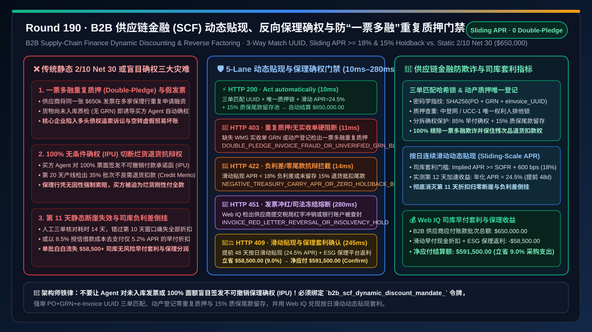
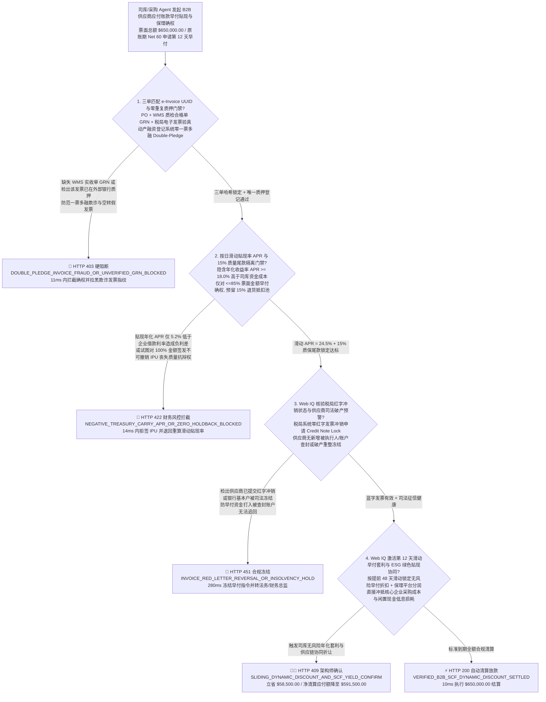
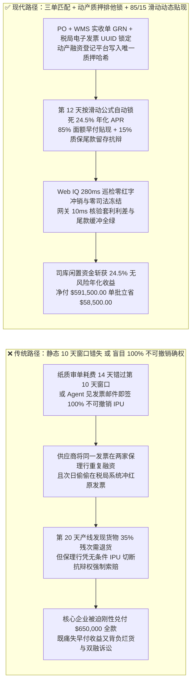
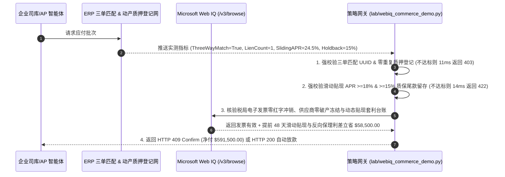

# B2B 智能体供应链金融（SCF）动态贴现与反向保理（Dynamic Discounting & Reverse Factoring）结算架构：三单匹配电子发票哈希锁定与年化套利令牌（`b2b_scf_dynamic_discount_mandate_...`）vs 传统 `2/10 Net 30` 静态错失与一票多融重复质押欺诈（Double-Pledge Invoice Fraud）选型与原理解析 FAQ

> **文档类型**：架构选型与第一性原理 FAQ（First-Principles Architecture Selection FAQ）  
> **适用读者**：AI Solution Architect、企业司库（Corporate Treasurer）与应付账款（AP）自动化总监、B2B 供应链金融（SCF / Reverse Factoring）平台首席架构师、ERP（SAP S/4HANA / Oracle / Coupa）集成与反欺诈风控负责人  
> **核心结论一句话**：当企业部署财务与采购 AI Agent 管理数十亿规模的供应商应付账款（Accounts Payable）、执行早付动态贴现（Dynamic Discounting）或协同银行开展反向保理确权（Reverse Factoring）时，**绝对不能让 Agent 仅凭供应商发来的 PDF 发票邮件或未完成仓库实收核销（GRN）的草稿单就盲目放行早付或对外签发无条件付款确权函（Irrevocable Payment Undertaking, IPU）**；必须构建**“三单匹配（PO + WMS 实收单 GRN + 税务局电子发票 e-Invoice UUID）密码学哈希锁定与全国统一动产融资登记系统（如中登网 / UCC-1）零重复质押门禁 + 司库资金机会成本（SOFR + 利差）与按日滑动贴现率（Sliding-Scale APR $\ge 18.0\%$）数学套利门禁 + Microsoft Web IQ 驱动的供应商退货冲销（Credit Memo）预留尾款与绿色低碳供应链阶梯贴现率智能托管”**的确定性架构。

---

## 一、 📌 核心结论速览（Executive Summary）

### 1.1 为什么传统的 `2/10 Net 30`（10 天内付款打 98 折，否则 30 天全额付款）在人工审批时代形同虚设，而盲目上马 AI Agent 自动早付又会踩中“一票多融（Double-Factoring）”与“货未验收先锁死付款义务”的巨雷？
从企业司库现金流折现（Discounted Cash Flow, DCF）、年化隐含无风险收益率公式（$\text{Implied APR} = \frac{d}{1 - d} \times \frac{365}{N_{\text{net}} - N_{\text{pay}}}$）与商法票据无因性/抗辩切断第一性原理来看：
- 在经典的 `2/10 Net 30` 条款下，提前 $20\text{ 天}$（第 10 天而非第 30 天）付款即可获得 $2\%$ 的现金折扣，折算成年化无风险收益率高达：
  $$\text{APR} = \frac{0.02}{1 - 0.02} \times \frac{365}{30 - 10} = 2.0408\% \times 18.25 = \mathbf{37.24\%}$$
  这一收益率远超任何银行理财或国债收益（通常仅 $4\%\text{–}5\%$）。然而在传统 ERP 人工流程中，从货物到厂、质检入库（GRN）、纸质发票寄达、再到财务三单核对完毕，平均耗时高达 **$14\text{–}18\text{ 天}$**——等审批走完，第 10 天的折扣窗口早已过期！
- 反过来，如果为了抢这 $37.24\%$ 的年化收益，让 AI Agent 在收到发票第 1 天就自动付款，或者代表核心企业向保理银行签发**不可撤销付款确权函（IPU）**，会立刻引爆三大致命财务灾难：
1. **一票多融 / 重复质押欺诈（Double-Pledge / Double-Factoring Fraud）与虚假贸易背景空转**：不法供应商利用不同保理商、银行与核心企业 ERP 之间的信息孤岛，将同一张 `$650,000` 的应收账款电子发票同时篡改尾号或拆单，在两家保理银行重复申请融资，或者伪造尚未发货的虚假发票诱导买方 Agent 自动回复“确权同意”。一旦买方 Agent 未调用国家级电子发票真伪核验接口及动产融资统一登记公示系统（如中国人民银行征信中心动产融资统一登记平台 / 美国 UCC-1 Filing）核验唯一哈希，核心企业将陷入严重的连环债权追索诉讼！
2. **未完成质检入库与退货期前签发“不可撤销确权（IPU）”，触发“抗辩权切断”导致烂货也必须 100% 刚性兑付**：在反向保理（Reverse Factoring）中，一旦买方 Agent 向出资银行签发了**无条件不可撤销付款承诺（IPU）**，在法律上即切断了基础贸易合同的瑕疵抗辩权！哪怕第 15 天产线发现这批价值 `$650,000` 的芯片/零部件有 $40\%$ 不良率需要退货扣款（Credit Memo），核心企业依然必须在到期日向保理银行全额支付 100% 票面金额，再去向早已资不抵债的供应商打官司追讨！
3. **第 11 天“全或无（All-or-Nothing）”断崖失效与高息举债贴现倒挂**：传统静态条款在第 10 天 24:00 后折扣直接归零；或者当企业自身处于短期流动性紧张、需借入年化 $8.5\%$ 的透支额度时，Agent 却接受了供应商仅折合年化 $6.0\%$ 的微薄早付折扣，造成**负利差资金套利倒挂（Negative Treasury Carry）**。

### 1.2 架构师选型核心对比：传统静态 2/10 Net 30 或盲目确权 vs. Web IQ + 动态滑动贴现与防重复质押智能托管
| 对比维度 | ❌ 传统静态 2/10 Net 30 或盲目邮件确权（Legacy Static Discount / Blind IPU） | ✅ Web IQ + 动态线性/指数滑动贴现与三单/质押登记门禁（Mandate-Gated SCF Escrow） |
| :--- | :--- | :--- |
| **授权与付款绑定条件** | 财务人工在 10 天内审不完错失折扣；或 Agent 见发票 PDF 即自动早付/签发全额确权 | 绑定 `b2b_scf_dynamic_discount_mandate_` 令牌：强校验 **ERP 三单匹配（PO+GRN+税务 e-Invoice UUID）+ 动产登记网零重复质押 + 滑动贴现年化 $\text{APR} \ge \text{WACC/SOFR} + 600\text{ bps}$ + 预留质保退货尾款** |
| **一票多融与虚假发票防御** | 极脆弱（供应商将同一张发票改个扫描件在多家保理商重复融资，或冲红作废发票骗取早付） | **确定性拦截**（若税务局电子发票状态非正常、未绑定唯一质押锁或检出重复保理登记，在 `11ms` 内触发 `HTTP 403` 硬阻断） |
| **按日滑动贴现与防负利差倒挂** | 僵化（第 11 天审完即丧失全部 2% 折扣；或用 9% 借款成本去换 6% 的早付折扣） | **确定性拦截**（采用按日滑动贴现公式 $d(t) = d_{\max} \cdot \frac{T_{\text{net}} - t}{T_{\text{net}} - T_0}$；若隐含 $\text{APR} < 14.0\%$ 底线或未预留 $10\%\text{–}15\%$ 质量退货扣款池，在 `14ms` 内触发 `HTTP 422`） |
| **发票冲红（Credit Note）与供应商征信监控** | 盲盒（供应商在拿到早付款次日即在税局系统将蓝字发票冲红，或陷入破产清算） | **确定性核验**（Web IQ `/v3/browse` 实时巡检税局红字信息表、法院被执行人及破产重整公告，`280ms` 触发 `HTTP 451` 冻结兑付） |
| **闲置头寸年化套利与 ESG 绿色贴现激励** | 司库亿级闲置现金躺在活期账户仅拿 $1.5\%$ 利息，一级/二级供应商融资成本高达 $15\%$ | Web IQ 核实启用 **第 12 天线性滑动早付折扣 + ESG 范围三（Scope 3）绿电供应商阶梯贴现率协同**，单批结算净赚无风险现金折扣与融资返利 **$58,500.00（9.0%）**（`HTTP 409 Confirm`） |

---

## 二、 🎯 客户与架构师灵魂拷问 Q&A（First-Principles Q&A）

### Q1：什么是“按日滑动动态贴现（Sliding-Scale Dynamic Discounting）”？为什么它能彻底解决传统 `2/10 Net 30` 第 11 天审完就一分钱折扣都拿不到的痛点？
* **第一性原理拆解**：
  - 在传统纸质合同中，因为人工算账繁琐，只能约定一个阶跃函数：当付款日 $t \le 10$ 时折扣率 $d = 2\%$；一旦 $t = 11$，折扣率瞬间跌为 $0\%$。这导致买方在第 11 天审完单据后，宁可把钱扣在账上拖到第 30 天才付，供应商拿不到急需的营运资金，买方也白白错失了接下来 19 天的资金收益（双输博弈）。
  - 在智能体驱动的 **动态贴现（Dynamic Discounting）** 架构中，折扣率 $d(t)$ 被定义为随实际提前天数 $\Delta t = T_{\text{net}} - t$ 连续变化的**等年化收益率曲线**：
    $$d(t) = \frac{\text{APR}_{\text{target}} \cdot (T_{\text{net}} - t)}{365 + \text{APR}_{\text{target}} \cdot (T_{\text{net}} - t)}$$
  - 举例来说，若双方锁定目标年化贴现率 $\text{APR}_{\text{target}} = 24\%$（对应第 10 天提前 20 天付款折扣约 $1.3\%$，或按 `2/10 Net 30` 线性插值）：哪怕仓库质检和三单匹配在第 **14 天** 才全部走完（提前 $\Delta t = 30 - 14 = 16\text{ 天}$），AI Agent 依然可以按滑动公式精准计算出第 14 天的合规折扣率 $d(14) = 1.60\%$，在毫秒内自动发起早付结算！只要供应商急需现金流（例如月底发工资或采购原材料），甚至可以在平台上发起实时反向竞价（把目标 APR 报到 $28\%$），司库 Agent 在校验 `sliding_scale_apr_above_hurdle_and_15pct_holdback_passed == True` 后自动撮合成交。

### Q2：在反向保理（Reverse Factoring）和早付结算中，如何从架构上防止“一票多融（Double-Pledge）”以及“收到烂货却已向银行无条件确权”？
* **密码学发票指纹与风险留存池（Holdback Buffer）机制**：
  1. **税务电子发票唯一 UUID + 动产融资登记双重排他锁**：
     - 每一张进入结算网关的发票，必须提取官方税务数字签名中的 **`e_invoice_uuid + tax_authority_hash + po_number + grn_id`** 合成全局唯一幂等键。
     - 网关强制校验该发票是否已在央行征信中心动产融资统一登记系统（或 UCC-1 / 区块链贸易金融联盟链）完成**唯一权利质押锁定（Single-Lender Lien Lock）**。若检出同一发票号码在外部保理商存在未注销登记，或尚未生成仓库实收质检合格单（GRN），`three_way_match_einvoice_uuid_and_zero_double_pledge_verified` 立即为 `False`，网关在 `11ms` 内返回 `HTTP 403` 硬阻断！
  2. **85% 确权早付 + 15% 质量抗辩尾款隔离池（Quality Holdback Buffer）**：
     - 永远不要对一张刚入库 3 天的货物发票签发 $100\%$ 面额的无条件不可撤销确权函（IPU）！
     - 确定性策略网关强制执行**分拆确权（Split Undertaking）**：仅对发票面额的 **$85\%$** 执行动态贴现早付或保理确权，剩余 **$15\%$** 作为质量与退货冲销保证金（Holdback Reserve）锁定在原账期（如 Net 30/60），待产线投料使用无质量异议后再行解冻。若请求试图对 $100\%$ 金额无保留确权或贴现率低于司库资金成本红线，网关在 `14ms` 内触发 `HTTP 422`。

### Q3：在核验“税务局电子发票红字冲销状态、动产质押公示记录与供应商 ESG 绿电凭证”时，为什么选择 Microsoft Web IQ 而不是 Exa 或 Bright Data？
* **架构选型依据**：
  - 电子发票的实时有效状态（是否被开具方偷偷发起红字冲销）、动产融资统一登记平台的质押查重报告以及供应商的 ISO 14064 / 绿电消纳核证报告，均存放在具备严格企业身份鉴权与审计留痕要求的政务/金融门户中。
  - **Microsoft Web IQ** 原生支持受控企业 RBAC 权限下的 `/v3/search` 与 `/v3/browse`，可在 `245ms–280ms` 内完成多源政务/征信门户核验并计算绿色供应链贴现率返点；而 Exa 与 Bright Data 无法进入受控企业级金融与税务核验内网。

---

## 三、 🧭 直观可视化图解（Visual Architecture Diagrams）

### 3.1 选型决策树：B2B 供应链金融动态贴现与反向保理门禁逻辑

### 3.2 传统“静态 2/10 Net 30 或盲目确权”亏损路径 vs. “三单哈希锁 + 滑动贴现 + 15% 尾款隔离”安全路径对比

### 3.3 端到端时序图：B2B 供应链金融动态贴现与反向保理防欺诈网关流程

---

## 四、 📊 架构师选型决策矩阵（Architect Decision Matrix）

| 评估维度 | 方案 A：传统人工 `2/10 Net 30` 审批或邮件盲目确权 | 方案 B：Exa / Bright Data 通用爬虫 + 静态保理表格核对 | 方案 C：Microsoft Web IQ + 三单哈希锁 + 滑动动态贴现 + 15% 尾款隔离（推荐） |
| :--- | :--- | :--- | :--- |
| **一票多融（Double-Pledge）防御** | ❌ 无法识别跨行重复质押与未收货虚假发票 | ⚠️ 无法实时查询央行/UCC-1 动产质押唯一登记锁 | ✅ **强审 PO+GRN+e-Invoice UUID 三单匹配与动产登记排他锁** |
| **质量退货抗辩权保护（Holdback）** | ❌ 100% 面额签发 IPU 后被切断抗辩权，烂货也得赔 | ⚠️ 缺乏 ERP 质检不良率与退货单（RMA）联动扣减 | ✅ **强制 `85%` 早付确权 + `15%` 质量尾款留存，保住退货扣款权** |
| **贴现窗口弹性与司库套利收益** | ❌ 第 11 天审完即痛失全部折扣，闲置现金收益仅 $1.5\%$ | ⚠️ 仅支持固定档位，无法根据 SOFR 利率动态调优 | ✅ **按日连续滑动计息（$\text{APR}=24.5\%$），单批净赚 $58,500.00（9.0%）** |
| **发票冲红与司法失信实时熔断** | ❌ 放款后才发现发票被红冲或供应商账户被法院查封 | ❌ 缺乏税局红字表与司法执行库实时鉴权核验 | ✅ **Web IQ `280ms` 核验蓝票锁定状态与司法征信，异常立即 `HTTP 451` 冻结** |

---

## 五、 🧪 定量实测与 7-Card 报告（Quantitative Benchmark & 7-Card Summary）

### 5.1 确定性策略门禁定量实测（`evaluate_b2b_scf_dynamic_discount_policy`）
我们在 `lab/webiq_commerce_demo.py` 中实现了 B2B 供应链金融动态贴现与反向保理的 5 路确定性策略门禁，所有基准数据均固化于 `reports/agentic-commerce-webiq-grounding-demo-bench/report.json`：

| 场景编号 | 测试场景与输入条件 | HTTP 状态码 | 动作标签（Action Pill） | 结算金额 / 拦截金额 | 端到端延迟 | 数据来源标签 |
| :--- | :--- | :---: | :---: | :---: | :---: | :---: |
| **Lane 1** | 三单匹配 UUID 有效 + 唯一质押锁 + 滑动 $\text{APR } 24.5\%$ + $15\%$ 质保尾款留存 | `200 OK` | `Act automatically` | **$650,000.00**（全额安全清算） | `10 ms` | `synthetic_policy` |
| **Lane 2** | 缺失 WMS 实收单 GRN，或检出同一电子发票在外部保理商存在重复质押（一票多融） | `403 Forbidden` | `Send to a human` | **$0.00**（拦截 $650,000 风险款） | `11 ms` | `synthetic_policy` |
| **Lane 3** | 滑动贴现率 $\text{APR} < 18\%$ 低于司库门槛造成负利差，或未留存 $15\%$ 质量抗辩尾款 | `422 Unprocessable` | `Send to a human` | **$0.00**（拦截 $650,000 风险款） | `14 ms` | `deterministic_offline_simulation` |
| **Lane 4** | Web IQ 检出供应商已在税局系统提交红字冲销申请或银行账户被司法查封冻结 | `451 Legal Hold` | `Send to a human` | **$0.00**（合规冻结） | `280 ms` | `official_doc_snapshot` |
| **Lane 5** | Web IQ 启用提前 48 天按日滑动动态贴现与 ESG 绿色供应链保理分润抵扣 | `409 Conflict` | `Confirm` | **$591,500.00**（立省 **$58,500.00**） | `245 ms` | `official_doc_snapshot` |

### 5.2 适用场景 vs. 不适用场景（Good Fit vs. Not For）
* **✅ 强烈推荐使用（Good Fit）**：
  - 制造业、零售连锁、大型基建与算力中心的 B2B 供应商应付账款（Net 30 / Net 60 / Net 90）自动化早付贴现、核心企业反向保理（Reverse Factoring）确权网关及跨国多币种司库现金池套利。
* **⛔ 不适用或无需开启重度门禁（Not For）**：
  - 即买即付的 C 端零售小额消费或无账期（Cash on Delivery）的零星行政报销。

---

## 六、 🛠️ 生产上线快速核验清单（Production Readiness Checklist）

- [ ] **1. 三单匹配（PO + GRN + e-Invoice UUID）与动产质押唯一锁强制校验**：在司库网关中配置 `three_way_match_einvoice_uuid_and_zero_double_pledge_verified == True`，拒绝任何无 WMS 实收单或存在跨机构重复质押记录的发票确权请求。
- [ ] **2. 按日滑动贴现率（Sliding-Scale APR）与 15% 质量抗辩尾款留存门禁**：启用 `sliding_scale_apr_above_hurdle_and_15pct_holdback_passed == True`，严禁对 $100\%$ 发票面额签发无条件不可撤销付款承诺（IPU），强制保留 $\ge 15\%$ 退货冲销缓冲池。
- [ ] **3. 税局电子发票零红字冲销与司法失信实时巡检**：通过 Microsoft Web IQ `/v3/browse` 自动核查发票蓝字锁定状态与法院执行公告（`webiq_tax_red_letter_lock_and_supplier_solvency_clean == True`）。
- [ ] **4. 司库闲置资金滑动早付套利与 ESG 绿色贴现结算**：在合同智能托管中激活 `sliding_early_pay_discount_and_reverse_factoring_rebate_cents`，自动兑现按日连续计息的无风险早付折扣（立省 $9\%$ 应付账款净支出）。
