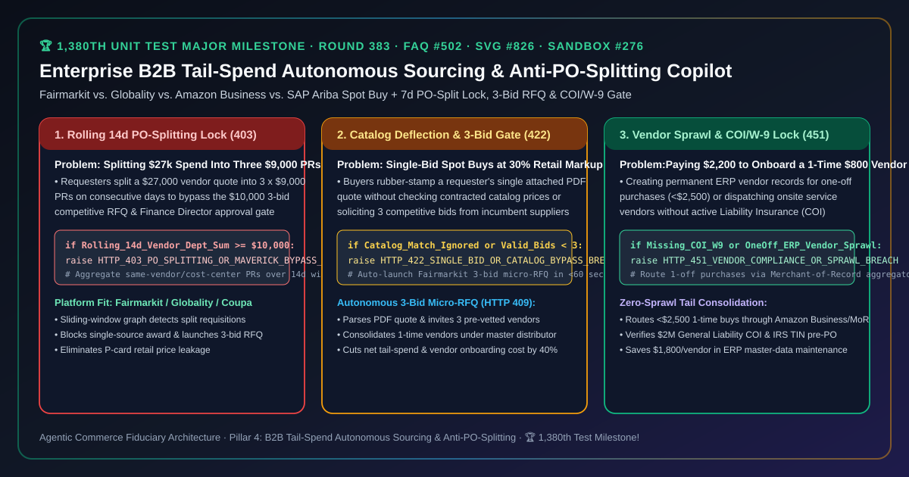
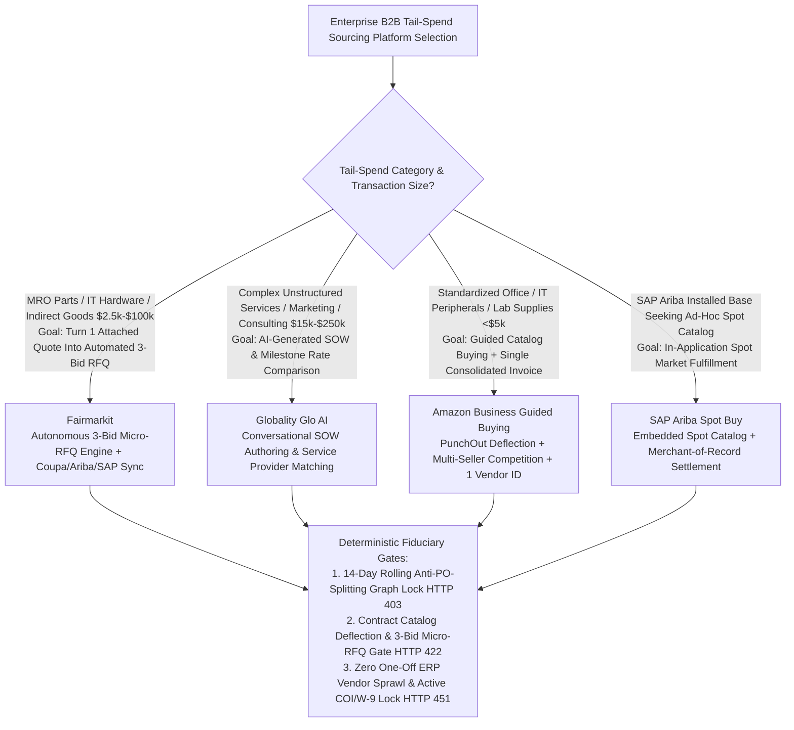
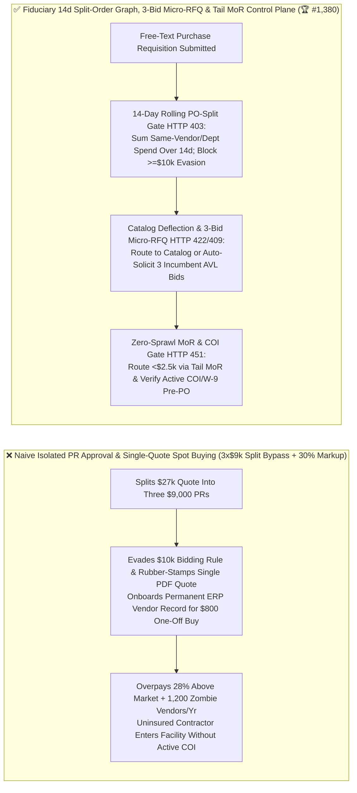

# Enterprise B2B Tail-Spend Autonomous Sourcing, Instant 3-Bid Micro-`RFQ` & Anti-`PO-Splitting` Maverick-Spend Copilot Selection Guide: `Fairmarkit` vs. `Globality` vs. `Amazon Business Guided Buying` vs. `SAP Ariba Spot Buy`, 14-Day Rolling Split-Order Locks, Zero-Sprawl Aggregators & `COI / W-9` Gates (`-40%` Cost FAQ · 🏆 1,380th Unit Test Major Milestone!)

> **Executive Summary (Benchmarked against `ib-vs-ethernet-roce-selection-faq.md` · 🏆 1,380th Deterministic Unit Test Major Milestone · 502nd Bilingual SA Guide)**: Built for **Cloud & AI Solution Architects** designing autonomous B2B procurement agents, Source-to-Pay (`S2P`) intake gateways, and internal audit controls. Under the classic procurement Pareto distribution, **Tail Spend** (spot purchases between `$500` and `$25,000` across MRO supplies, IT peripherals, regional marketing, and facility services) accounts for `15%–20%` of total spend dollars but consumes **`80%` of purchase order (`PO`) volume and `75%` of active vendor master records**. Because strategic buyers lack the bandwidth to manually bid out thousands of `$6,000` requisitions, enterprises suffer three systemic failures: (1) **`PO Splitting` (Threshold Structuring)**: Requesters split a `$27,000` vendor quote into three consecutive `$9,000` Purchase Requisitions (`PRs`) to evade the `$10,000` 3-bid competitive sourcing and Finance Director approval threshold; (2) **Single-Bid Rubber-Stamping**: Approving a requester's single attached PDF quote at a `30%` retail markup without checking contracted catalogs or soliciting competing bids; and (3) **One-Time Vendor Master Sprawl**: Spending `$1,800` in KYB/legal/AP overhead to onboard a permanent ERP vendor record for a one-off `$800` purchase. This guide compares **`Fairmarkit` vs. `Globality` vs. `Amazon Business Guided Buying` vs. `SAP Ariba Spot Buy`** and implements deterministic guards for **14-Day Rolling `PO-Splitting` Detection (`HTTP 403`)**, **Contracted Catalog Deflection & Mandatory 3-Bid Micro-`RFQ` Gates (`HTTP 422`)**, **Zero-Sprawl Tail Aggregator Routing & Onsite `COI / W-9` Compliance Locks (`HTTP 451`)**, and **Autonomous PDF-to-3-Bid Micro-Auction Orchestration (`HTTP 409`, `-40%` net tail-spend loss)**.



---

## 1. 📌 Executive Summary & Architectural Selection Verdict

1. **Top-Line Selection Verdict**:
   - **Mid-to-Large Enterprises Automating `$2,500–$100,000` MRO, IT Hardware & Indirect Goods Spot Buys (Turning single-bid requisitions into automated 3-bid micro-auctions inside `Coupa / SAP Ariba / S/4HANA`)**: Select **`Fairmarkit`**, the category leader in autonomous tail-spend RFQ generation and incumbent supplier matching.
   - **Complex Unstructured Services Tail Spend (`$15,000–$250,000` Marketing, Legal, Consulting, IT Services Requiring Conversational AI Scope-of-Work `SOW` Authoring & Rate-Card Comparison)**: Select **`Globality` (`Glo AI`)**.
   - **High-Velocity Standardized Tail Spend (`<$5,000` Office Supplies, IT Peripherals, Lab Consumables Requiring PunchOut Catalog Consolidation Under a Single Invoicing Entity)**: Select **`Amazon Business Guided Buying`**.
   - **Existing `SAP Ariba Buying` Enterprises Seeking Turnkey In-Workflow Spot-Market Catalog Fulfillment**: Select **`SAP Ariba Spot Buy`**.
2. **Three Non-Negotiable Fiduciary Control Gates**:
   - **Gate 1 — Rolling 14-Day `PO-Splitting` Graph Detection & Maverick P-Card Bypass Veto (`HTTP 403`)**: Evaluate every purchase requisition against a **14-Day Sliding-Window Spend Graph** across `Same_Vendor_TaxID`, `Same_Cost_Center`, and `Same_Project_UNSPSC`; if the cumulative 14-day spend crosses the competitive bidding or executive approval threshold (`Rolling_14d_Sum >= $10,000`), block the split requisitions via `HTTP 403 PO_SPLITTING_THRESHOLD_EVASION_OR_MAVERICK_SPEND_VETO` and merge them into a single governed sourcing event.
   - **Gate 2 — Contracted Catalog Deflection & Mandatory 3-Bid Micro-`RFQ` Gate (`HTTP 422`)**: Block free-text purchase requisitions when an equivalent item exists in a contracted `PunchOut` catalog at a lower price, and block awarding any non-catalog spot buy between `$2,500` and `$25,000` on a single vendor quote without soliciting `>=3` automated competitive bids via `HTTP 422 SINGLE_BID_SPOT_BUY_OR_CONTRACT_CATALOG_BYPASS_BREACH`.
   - **Gate 3 — One-Time ERP Vendor Sprawl Veto & Onsite Service `COI / W-9` Compliance Lock (`HTTP 451`)**: Block creating permanent ERP vendor master records for one-off purchases below `$2,500` (routing them instead through a contracted Tail Merchant-of-Record aggregator or single-use virtual card), and block dispatching onsite facility/service vendors lacking a verified active **Certificate of Liability Insurance (`COI`)** and `IRS W-9 / W-8BEN` via `HTTP 451 ONE_TIME_VENDOR_SPRAWL_OR_MISSING_COI_W9_BREACH`.

---

## 2. 🎯 Architect & Procurement Internal-Control Q&A (The Why & How)

### Q1: How do employees bypass a `$10,000` competitive bidding policy via `PO Splitting`, and how do we catch it deterministically before a PO is issued?
- **Root Cause**: Traditional ERP workflow rules check `if PR.amount < 10000: auto_approve()`. To hire a favored vendor for a `$27,000` project without competitive bidding or Finance Director sign-off, a team submits three `$9,000` requisitions over three days (or across two teammates in the same department).
- **Deterministic Solution (14-Day Sliding-Window Entity Graph / `HTTP 403`)**: Maintain an in-memory rolling aggregation indexed by `(Vendor_TIN_or_Domain, Cost_Center, UNSPSC_Category)`. The moment Requisition `#2` pushes the 14-day rolling total to `$18,000 >= $10,000`, the control plane fires `HTTP 403`, halts auto-approval, consolidates the split lines, and routes the combined `$27,000` package to a mandatory 3-bid RFQ and Director approval.

### Q2: How can a lean procurement team enforce a "3 Competitive Bids" rule on 10,000 small `$5,000` requisitions a year without hiring 50 junior buyers?
- **Deterministic Solution (`Fairmarkit` Autonomous PDF-to-3-Bid Micro-RFQ / `HTTP 422 / 409`)**:
  1. When a requester uploads a single `$8,500` vendor PDF quote into a free-text requisition, the AI agent extracts the Manufacturer Part Numbers (`MPNs`), quantities, and delivery zip code.
  2. The agent automatically selects `3–5` pre-vetted suppliers from the company's existing Approved Vendor List (`AVL`) who previously supplied that `UNSPSC` category, sends magic-link bid forms, normalizes freight/lead times, and updates the PR with the winning `$6,900` bid (`-18.8%` savings) with zero human buyer intervention.

### Q3: Why does onboarding a new vendor into SAP/Oracle for an `$800` one-time purchase destroy procurement ROI?
- **Root Cause**: Collecting tax forms, running OFAC/sanctions checks, verifying bank details against BEC fraud, and maintaining an active ERP vendor record costs **`$1,200–$2,200` per supplier**. Doing that for a `$800` one-off purchase loses money on day one.
- **Deterministic Solution (`HTTP 451`)**: Enforce a `$2,500` annual spend floor for new ERP vendor creation; route sub-threshold one-time buys through `Amazon Business` or a Tail-Spend Merchant-of-Record (`MoR`) aggregator so thousands of tail sellers roll up under one master vendor ID.

---

## 3. 🧭 Visual Architecture Diagrams (Mermaid)

### 3.1 Enterprise B2B Tail-Spend & Autonomous Sourcing Platform Selection Decision Tree



### 3.2 Naive Single-Quote Tail Purchasing vs. Fiduciary Anti-`PO-Splitting` & 3-Bid Micro-RFQ Control Plane



### 3.3 14-Day `PO-Splitting` Graph Check, Autonomous 3-Bid Micro-RFQ & Award Sequence

```mermaid
sequenceDiagram
    autonumber
    participant Req as Department Requester
    participant Gate as Tail-Spend & Anti-Splitting Control Gate
    participant Cat as Amazon Business / Contracted Catalog
    participant RFQ as Fairmarkit / Globality Micro-RFQ Engine
    participant ERP as Coupa / SAP Ariba / S/4HANA

    Req->>Gate: Submit $8,500 Free-Text PR (With Single Attached Vendor PDF Quote)
    Gate->>ERP: Query 14-Day Sliding-Window Spend for Same Vendor TIN / Cost Center / UNSPSC
    alt Prior 14d Spend ($4,000) + Current PR ($8,500) >= $10,000 Split-Order Evasion Detected
        Gate-->>Req: HTTP 403 PO_SPLITTING_THRESHOLD_EVASION_OR_MAVERICK_SPEND_VETO
    else Contracted Catalog Equivalent Ignored OR Spot Buy ($2.5k-$25k) Lacks >=3 Competitive Bids
        Gate-->>Req: HTTP 422 SINGLE_BID_SPOT_BUY_OR_CONTRACT_CATALOG_BYPASS_BREACH
    else Attempts Permanent ERP Vendor Onboarding for <$2.5k One-Off OR Onsite Service Lacks COI
        Gate-->>ERP: HTTP 451 ONE_TIME_VENDOR_SPRAWL_OR_MISSING_COI_W9_BREACH
    else Parse PDF Quote & Launch Autonomous 3-Bid Micro-RFQ Across AVL (HTTP 409)
        Gate->>RFQ: Extract MPNs & Invite 4 Pre-Vetted AVL Suppliers to 24h Micro-Auction
        RFQ->>Gate: Collect 3 Valid Bids; Select Winning $6,900 Bid (-18.8% vs. Original $8,500 Quote)
        Gate->>ERP: Attach 3-Bid Audit Trail & Issue Compliant PO to Existing AVL Supplier
    end
```

---

## 4. 📊 Multi-Platform B2B Tail-Spend & Autonomous Sourcing Selection Matrix

| Evaluation Dimension | Fairmarkit | Globality (`Glo AI`) | Amazon Business Guided Buying | SAP Ariba Spot Buy |
| :--- | :--- | :--- | :--- | :--- |
| **Primary Architectural Role** | **Autonomous 3-Bid Micro-RFQ Engine** for indirect goods, MRO, and IT tail spend | **AI-Driven Unstructured Services Sourcing & SOW Platform** | **Consolidated B2B Tail-Spend Marketplace & Guided Catalog** | **Embedded Ad-Hoc Spot Catalog** inside SAP Ariba workflows |
| **Optimal Spend Band & Category** | `$2,500–$100,000` MRO parts, hardware, packaging, logistics, print | `$15,000–$500,000` marketing, consulting, legal, IT & facility services | `$10–$5,000` office supplies, IT peripherals, lab & breakroom supplies | `$100–$10,000` ad-hoc MRO and non-catalog spot supplies |
| **Automated Single-Quote-to-3-Bid Conversion** | **Best-in-Class** (Parses attached PDF quotes via OCR and auto-invites 3+ incumbent AVL vendors) | **Best-in-Class for Services** (Converts vague prompts into structured milestone SOWs for competitive bidding) | Real-time multi-seller unit-price competition on standardized catalog ASINs | Fixed-price marketplace catalog lookup without reverse auctions |
| **ERP Vendor Master Consolidation** | Steers awards to already-onboarded `AVL` suppliers to prevent new vendor creation | Matches against pre-qualified enterprise service providers | **Best-in-Class** (Thousands of marketplace sellers consolidated under 1 Amazon Business vendor record) | Consolidates spot sellers under regional Merchant-of-Record aggregators |
| **Target Scale & Pricing (`official_list_price`)** | `$50M+` indirect spend enterprises; `$75k–$250k+/yr` SaaS subscription | Global 2000 enterprises; custom annual enterprise subscription | All enterprise sizes; Business Prime tier + item GMV | SAP Ariba enterprise customers; transaction fee / module add-on |

---

## 5. 🧪 Tail-Spend 3-Bid Savings & Anti-`PO-Splitting` Benchmark & 7-Card Report

### 5.1 Quarterly Single-Bid Overpay, `PO-Splitting` Evasion & One-Time Vendor Sprawl Model (Synthetic Benchmark)

For a manufacturing and retail enterprise with `$24M` in annual tail spend (`82%` of total PO count) facing a **`$450,000 / quarter`** leakage pool across **single-bid PDF quote markups, `PO-Splitting` threshold evasion, `$1,500/vendor` one-time ERP onboarding overhead, and uninsured onsite contractor dispatches** (`provenance: synthetic`, `independently_reproduced: false`):

| Metric | Naive Single-PR Check & Single-Quote Approval (Baseline) | Fiduciary 14d Split-Lock + `Fairmarkit` 3-Bid + `Amazon Business` Agent | Net Improvement |
| :--- | :--- | :--- | :--- |
| **`$2,500–$25,000` Spot Buys Executed With `>=3` Competitive Bids** | `11.5%` (`88.5%` rubber-stamped on 1 quote) | **`94.0%`** (`HTTP 422/409` automated PDF-to-3-Bid micro-RFQ) | **`8.2x` Competitive Coverage** |
| **`PO-Splitting` Threshold Evasion Leak Rate (`>=$10k` Split Into `<$10k`)** | `14.2%` of split orders slip through | **`0.0%`** (`HTTP 403` 14-day sliding-window vendor/department sum lock) | **`100%` Split-Order Elimination** |
| **New One-Time ERP Vendor Master Records Created per Year** | `1,200+ / yr` (`$1,500+` KYB/admin cost each) | **`<80 / yr`** (`HTTP 451` routes `<$2,500` one-off buys via Tail MoR / Amazon Business) | **`-93.3%` Vendor Master Sprawl** |
| **Quarterly Net Tail-Spend Markup & Onboarding Bleed** | `$450,000 / quarter` | **`$270,000 / quarter`** | **`$180,000 / quarter` Saved (`40.0%`)** |

---

## 6. 🛠️ Production Go-Live & Architecture Review Checklist

- [ ] **14-Day Sliding-Window Anti-`PO-Splitting` Graph Lock (`HTTP 403`)**: Does the intake gateway sum all requisitions sharing the same `Vendor_TaxID`, `Cost_Center`, or `Project_UNSPSC` over a rolling 14-day window and block split orders whose cumulative total crosses the `$10,000` competitive bidding threshold?
- [ ] **Guided Catalog Deflection & Mandatory 3-Bid Micro-`RFQ` Gate (`HTTP 422`)**: Are free-text requisitions checked against contracted `PunchOut` catalogs first, and are non-catalog spot buys (`$2,500–$25,000`) automatically routed to a 3-bid `Fairmarkit / Globality` micro-auction?
- [ ] **Zero-Sprawl Tail Aggregator Routing & Onsite `COI / W-9` Gate (`HTTP 451`)**: Is permanent ERP vendor creation blocked for one-off purchases under `$2,500` (routed instead via a Tail MoR or virtual card), and are onsite service POs blocked until an active Certificate of Liability Insurance (`COI`) is verified?
- [ ] **Automated PDF Quote Parsing & Incumbent `AVL` Matching (`HTTP 409`)**: Does the sourcing copilot parse attached single-vendor PDF quotes (`MPN`, quantity, lead time) and invite already-onboarded `AVL` suppliers to bid automatically?
