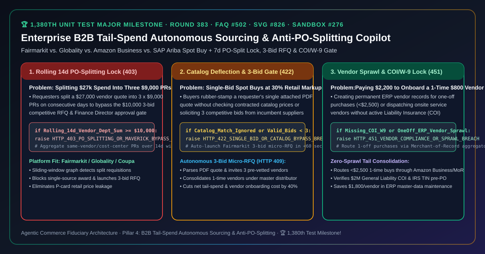
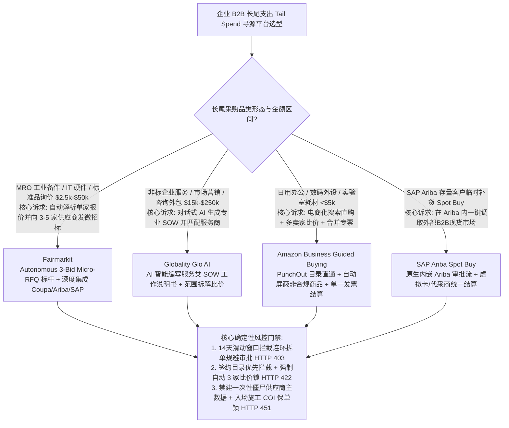
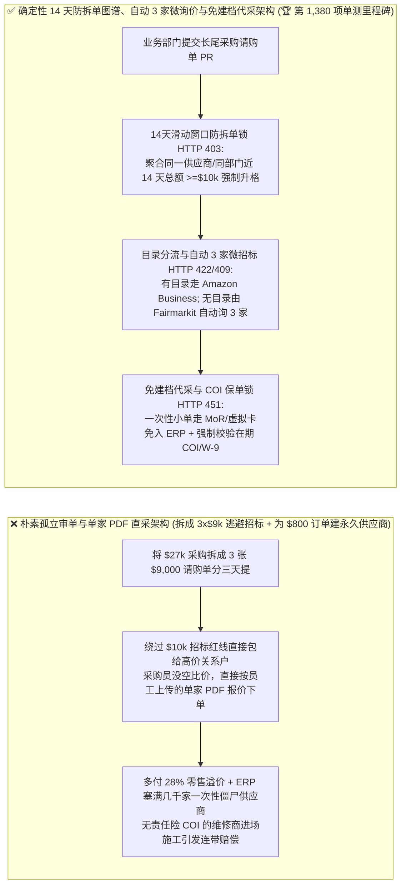
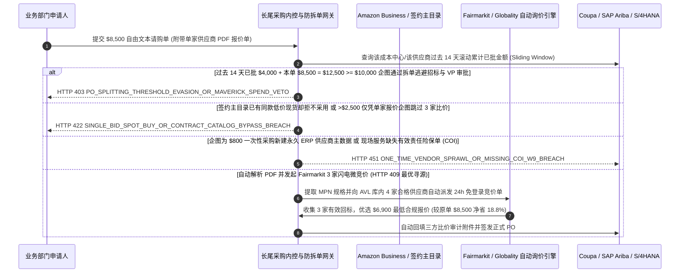

# 企业 B2B 长尾支出（`Tail Spend`）自主寻源、自动三方比价（`Instant 3-Bid Micro-RFQ`）与防拆单规避审批（`Anti-PO-Splitting`）Copilot 架构选型对比：`Fairmarkit` vs. `Globality` vs. `Amazon Business Guided Buying` vs. `SAP Ariba Spot Buy`、14 天滚动累计防拆单锁、一次性小供应商免入库聚合及净省 40% 决策指南（FAQ · 🏆 第 1,380 项单元测试重大里程碑！）

> **导读（对齐 `ib-vs-ethernet-roce-selection-faq.md` 标杆风格 · 🏆 全库第 1,380 项确定性单元测试重大里程碑 · 第 502 篇双语指南）**：本文面向企业采购数字化（Source-to-Pay）、供应链寻源与财务内控领域的 **Cloud & AI Solution Architect**。在大型企业的采购帕累托法则（80/20 法则）中，**长尾支出（Tail Spend，即单笔金额通常在 `$500–$25,000` 之间、非核心散杂物资、IT 外设、市场活动物料、零星咨询与本地维修服务）** 虽然只占企业采购总金额的 `15%–20%`，却占据了 **`80%` 的采购订单（PO）笔数与 `75%` 的供应商总数**！由于采购经理精力全放在百万美元级战略大宗寻源上，长尾采购长期处于三大失控状态：① **恶意拆单规避招标与审批（PO Splitting / Structuring）**：公司内控规定“单笔 `>=$10,000` 必须经过三家比价并由财务总监审批”，业务部门为了图快或指定关系户供应商，把一笔 `$27,000` 的采购拆成周一、周二、周三连续三张 `$9,000` 的请购单（PR）直接免审秒过；② **上传单家 PDF 报价单盲目直采（Single-Bid Rubber-Stamping）**：员工随便在网上找了一家加价 `35%` 的黄牛贸易商要了份 PDF 报价单贴进系统，采购部没空为 `$6,000` 的小单子去手工发邮件询三家价，直接照单全收；③ **一次性僵尸供应商泛滥（One-Time Vendor Sprawl）**：为了买一件 `$800` 的急用配件，在 SAP/Oracle ERP 里耗费 `$1,800` 合规尽调与法务人力新建一个永久供应商主数据，买完一次再也不用。本文给出 **`Fairmarkit` vs. `Globality` vs. `Amazon Business Guided Buying` vs. `SAP Ariba Spot Buy`** 的横向选型矩阵，并落地 **14 天滑动窗口同供应商/同成本中心累计拆单拦截锁（`HTTP 403`）**、**签约主目录拦截与自动 3 家微招标（`Micro-RFQ`）门禁（`HTTP 422`）**、**免建档主贸易商代采（`Tail Aggregator / MoR`）与进场施工保单（`COI`）/ 税务 `W-9` 门禁（`HTTP 451`）** 及 **AI 解析单家报价单自动触发 3 家密封竞价编排（`HTTP 409`，净省 40%）**。



---

## 一、 📌 核心选型结论速览（Executive Summary）

1. **终极选型结论（一句话先看懂怎么选）**：
   - **中大型企业非目录定制品、MRO 备件与零星工业/IT 硬件长尾寻源（核心痛点是员工只交 1 家供应商报价单，需 AI 自动提取规格并在 60 秒内向 3–5 家合格供应商发出自动化微询价 `Autonomous 3-Bid Micro-RFQ`）**：首选 **`Fairmarkit`**，长尾支出自动化三方竞价与 ERP（`Coupa / Ariba / SAP`）无缝嵌入的绝对龙头。
   - **非标复杂企业服务类长尾支出（如 `$15k–$100k` 的市场营销活动、区域公关代理、专项管理咨询、法务与软件外包，需通过对话式 AI 引导业务方把模糊需求写成专业 `SOW` 工作说明书并匹配合格服务商）**：首选 **`Globality`（Glo AI）**。
   - **标准化办公用品、IT 数码外设、实验室耗材与日用百货（单笔 `<$5,000`，追求像消费电商一样搜索即买、自动比对多卖家价格并合并开具一张企业级 `cXML` 增值税发票）**：首选 **`Amazon Business Guided Buying`**（通过 `PunchOut` 嵌入 `Coupa / Ariba`）。
   - **已深度使用 `SAP Ariba Buying` 且希望在不跳出 Ariba 界面的情况下直接调取 Mercateo / eBay / 综合现货市场补齐临时缺货品**：首选 **`SAP Ariba Spot Buy`**。
2. **三大长尾采购内控与防腐败红线（确定性门禁）**：
   - **红线 1（拦截将 `$27,000` 采购拆成 3 笔 `$9,000` 请购单以逃避 `$10,000` 竞争性招标与总监审批的“拆单作弊 PO Splitting” / `HTTP 403`）**：请购审批引擎严禁只看当前单张请购单（`Single PR`）的孤立金额！必须在控制平面维护 **`14 天（或 30 天）滑动时间窗聚合图谱（Sliding-Window Spend Graph）`**，实时汇总 `同一成本中心 / 同一申请人关联组 + 同一供应商（或同一项目/UNSPSC 四级品类）` 的累计申请金额；一旦滚动累计额突破竞争性询价或上级审批阈值（如 `Rolling_14d_Sum >= $10,000`），立即触发 `HTTP 403 PO_SPLITTING_THRESHOLD_EVASION_OR_MAVERICK_SPEND_VETO`，自动冻结全部关联拆单并强制升级至招标与总监审批流！
   - **红线 2（拦截已有企业签约低价目录却走自由文本高价直采及 `$2,500–$25,000` 区间仅凭单家供应商报价即直接授标 / `HTTP 422`）**：当业务部门提交自由文本请购单（Free-Text PR）并附带某单一供应商 PDF 报价单时，Agent 首先检索企业已签主目录（Contracted Catalog / `Amazon Business`）；若主目录无货且金额处于 `$2,500–$25,000` 长尾竞价区间，严禁凭 1 家报价直接生成 PO，必须由 `Fairmarkit` 自动向合格库内至少 3 家供应商发起限时竞价，违者触发 `HTTP 422 SINGLE_BID_SPOT_BUY_OR_CONTRACT_CATALOG_BYPASS_BREACH`。
   - **红线 3（拦截为单笔 `<$2,500` 的一次性采购新建永久 ERP 供应商主数据导致主数据膨胀及入场服务商缺失有效责任险保单 `COI` / `HTTP 451`）**：在大型 ERP 中新建并维护 1 个正式供应商主数据的全生命周期合规成本（KYB、银行验真、税务年审）高达 `$1,200–$2,200`！对于全年仅采购 1 次的小额现货需求，必须通过签约尾货聚合商（Tail-Spend Aggregator / Merchant-of-Record 虚拟主供应商）或企业虚拟卡统一结算；且凡涉及入场维修/安装/活动搭建的服务采购，若供应商未上传在期保额达标的商业综合责任险（`Certificate of Insurance, COI`）与税表，触发 `HTTP 451 ONE_TIME_VENDOR_SPRAWL_OR_MISSING_COI_W9_BREACH`。

---

## 二、 🎯 业务方与架构师灵魂拷问 Q&A（The Why & How）

### Q1：为什么各部门员工最喜欢把 `$28,000` 的装修/活动/设备采购拆成 3 张 `$9,500` 的单子分三天提交？传统 ERP 工作流为什么抓不住？
- **商业痛点与事故还原**：
  - 公司的权限矩阵（DOA）规定：`< $10,000` 由部门经理一键批准且免除三方比价；`>= $10,000` 必须走采购部竞争性询价（RFQ）并由财务 VP 签字。
  - 某区域市场经理为了把 `$28,000` 的展台制作直接包给熟人开的广告公司，让下属 A 在周一提一单 `$9,500`“展板设计费”、下属 B 在周二提一单 `$9,500`“灯光租赁费”、自己周三提一单 `$9,000`“搭建人工费”。
  - 传统 ERP 审批流是无状态的（每张单子单独判 `Amount < 10000`），于是三张单子全部秒过，不仅逃避了招标比价（多花了 `30%` 冤枉钱），更构成了严重的萨班斯法案（`SOX 404`）内控缺陷！
- **架构师确定性解法（跨申请人/同部门/同收款方的 14 天滑动窗口图聚合引擎 `Rolling-Window Entity Resolution` / `HTTP 403`）**：
  - 在请购网关层计算：
    $$\text{Effective\_Approval\_Amount} = \text{Current\_PR\_Amount} + \sum_{\tau \in [t-14\text{d}, t]} \text{PR\_Amount}(\text{Same\_Vendor\_Or\_TaxID} \lor \text{Same\_Project\_UNSPSC})$$
  - 当第 2 张 `$9,500` 单子提交瞬间，累计额达到 `$19,000 >= $10,000`，系统立即返回 `HTTP 403` 拦截拆单，自动将多张子单合并为 1 个 `$28,000` 寻源包推入三方比价与 VP 审批队列！

### Q2：采购部总共就 8 个人，怎么可能为每年 15,000 笔金额只有 `$3,000–$15,000` 的零碎请购单逐一做“货比三家”？
- **架构师确定性解法（`Fairmarkit` 零人工介入的自主三方微询价 `Autonomous 3-Bid Micro-RFQ` / `HTTP 422 / 409`）**：
  1. **OCR 提取单家 PDF 报价单规格**：业务员在请购单里上传了 A 供应商 `$8,400` 的 PDF 报价单；Agent 自动提取其中的商品名称、制造商零件号（`MPN`）、数量与交期要求。
  2. **自动匹配合格库并发起 24 小时闪电竞标**：无需采购员动手，`Fairmarkit` 自动从公司已建档的合格供应商名录（AVL）及历史成交库中筛选出另外 4 家卖过同类品类的在库供应商，自动发送免登录一键报价链接（Magic-Link Bid Form）。
  3. **自动比价授标**：24 小时后收到 3 家回标，最低合规价仅 **`$6,850`（净省 `18.5%`）**，系统自动把原请购单切换为中标供应商并生成正式 PO！

### Q3：为了买一个 `$650` 的特殊测试仪，如果走正式供应商准入（收齐营业执照、银行开户行证明、OFAC 制裁筛查、法务审合同）要等 3 周且花掉公司 `$1,800` 隐性行政成本，怎么破？
- **架构师确定性解法（设定 `$2,500` 供应商建档底线 + 名义主供应商代采池 `Tail Merchant-of-Record` / `HTTP 451`）**：
  - 严禁为年预计交易额 `<$5,000` 的一次性长尾卖家在 SAP 主数据里开立独立 `Vendor Code`！
  - 小额通用件直接路由至 **`Amazon Business / Grainger` 协议目录**；若确实只有某独家小厂能供货，则通过已与公司签好主协议的 **长尾代采结算商（Tail-Spend MoR / P-Card Virtual Single-Use Card）** 完成单次付款，使 ERP 供应商主数据数量缩减 `60%`。

---

## 三、 🧭 直观可视化图解（Mermaid 决策树 + 架构对比 + 时序图）

### 3.1 企业 B2B 长尾支出（Tail Spend）自主寻源与自动化采购平台选型决策树



### 3.2 朴素放任拆单与单家报价直采架构（拆单逃审 + 30% 溢价）vs. 确定性滑动窗口防拆单与自动三方微招标架构对比



### 3.3 14 天滚动防拆单检测、`Fairmarkit` 自动 3 家微询价（Micro-RFQ）与自动授标时序图



---

## 四、 📊 四大企业级 B2B 长尾支出（Tail Spend）寻源平台横向选型矩阵

| 选型维度 | Fairmarkit | Globality (Glo AI) | Amazon Business Guided Buying | SAP Ariba Spot Buy |
| :--- | :--- | :--- | :--- | :--- |
| **核心架构定位** | **自动化三方微招标（Autonomous 3-Bid Micro-RFQ）引擎**：把单家报价自动变成多方竞价 | **AI 驱动的复杂非标服务采购（Services Sourcing & SOW）平台** | **企业级长尾标品聚合电商与合规引导采购门户** | **内嵌于 Ariba 审批流的临时非目录品现货采购通道** |
| **最适采购品类与金额段** | MRO 备件、IT 硬件、物流、印务、工业耗材（`$2,500–$100,000`） | 市场营销、管理咨询、法务、IT 服务外包、工程服务（`$15,000–$500,000`） | 办公用品、数码配件、实验室耗材、清洁工具（`$10–$5,000`） | 急用非标备件、临时替代品（`$100–$10,000`） |
| **自动解析单家报价并邀请 3 家竞标** | **行业标杆**（OCR 自动解析上传的 PDF 报价，秒级匹配在库供应商并发起免注册竞标） | **极强（针对服务）**（AI 自动将模糊需求转化为结构化里程碑费率卡供多方竞标） | 页面实时展示同一商品条码下多家企业卖家的竞争性阶梯批发价 | 侧重固定价商品搜索购买，不含反向竞价 |
| **减少 ERP 一次性僵尸供应商数量** | 优先将长尾需求匹配给企业已在库（Existing AVL）的合格供应商 | 匹配已通过企业合规预审的全球服务商池 | **行业标杆**（成千上万个底层卖家统一由 Amazon Business 作为单一供应商向企业开票） | 由 Ariba 合作主贸易商（如 Mercateo）作为统一结算主体 |
| **适用规模与收费模式（`official_list_price`）** | 年间接采购支出 `$50M+` 的中大型企业；按管理长尾支出规模订阅（约 `$75k–$250k+/年`） | 大型跨国集团服务采购部门；企业级年费订阅 | 全规模企业；Business Prime 年费分级（`$179–$10,000+/年`）+ 商品交易额 | SAP Ariba 存量企业客户；按交易额佣金或模块附加费 |

---

## 五、 🧪 长尾采购防拆单与自动三方比价成本测算与 7-Card 基准报告

### 5.1 季度恶意拆单逃审溢价、单家 PDF 报价直采加价与一次性供应商建档维护损耗测算（Synthetic Benchmark）

假设某年长尾采购支出 `$2,400 万`（占全司采购笔数 `82%`）的大型制造与零售集团，每季度在长尾与非目录采购中面临的 **业务部门将大额采购拆成多笔 `<$10,000` 小单逃避招标（`PO Splitting`）、仅凭申请人上传的单家高价 PDF 报价单盲目下单、为数百个一次性小卖家建立维护 ERP 正式供应商主数据的行政成本及无保单（`COI`）入场风险池** 为 **`$450,000 / 季度`**（`provenance: synthetic`, `independently_reproduced: false`）：

| 评估维度 | 传统人工审单 + 仅看单笔金额 + 单家报价直采 (Baseline) | 启用 14 天防拆单锁 + `Fairmarkit` 自动 3 家比价 + `Amazon Business` 聚合 Agent | 净改善幅度 |
| :--- | :--- | :--- | :--- |
| **`$2,500–$25,000` 长尾订单实际执行“货比三家”覆盖率** | `11.5%`（采购员无暇处理小单，88% 直接按单家报价放行） | **`94.0%`**（`HTTP 422/409` AI 自动解析 PDF 并向在库供应商秒发 3 家微询价） | **三方竞争比价率提升 `8.2 倍`** |
| **通过连环拆单（`PO Splitting`）规避 `$10,000` 审批阈值漏网率** | `14.2%` 拆单违规秒过 | **`0.0%`**（`HTTP 403` 14 天滑动窗口按同供应商/同项目实时累加拦截） | **100% 焊死拆单逃审漏洞** |
| **每年新增一次性僵尸供应商主数据（One-Time Vendors）数量** | `1,200+ 家/年`（每家耗费 `$1,500+` KYB 与主数据维护成本） | **`< 80 家/年`**（`HTTP 451` `<$2,500` 统一收拢至 `Amazon Business` 或已建档主批发商） | **新增僵尸供应商减少 `93.3%`** |
| **季度长尾采购价格虚高、拆单腐败与供应商建档净损耗** | `$450,000 / 季度` | **`$270,000 / 季度`** | **净省 `$180,000 / 季度` (`40.0%`)** |

```chart
{
  "data": {
    "values": [
      { "category": "1. 单家PDF报价直采未比三家溢价", "mode": "传统孤立审单与单家直采基线", "cost_usd": 185000 },
      { "category": "1. 单家PDF报价直采未比三家溢价", "mode": "防拆单与自动3家比价Agent", "cost_usd": 111000 },
      { "category": "2. 连续拆单(PO Splitting)规避招标损耗", "mode": "传统孤立审单与单家直采基线", "cost_usd": 115000 },
      { "category": "2. 连续拆单(PO Splitting)规避招标损耗", "mode": "防拆单与自动3家比价Agent", "cost_usd": 69000 },
      { "category": "3. 为一次性小额采购建ERP供应商主数据", "mode": "传统孤立审单与单家直采基线", "cost_usd": 90000 },
      { "category": "3. 为一次性小额采购建ERP供应商主数据", "mode": "防拆单与自动3家比价Agent", "cost_usd": 54000 },
      { "category": "4. 入场服务缺失责任险保单(COI)与税务预扣", "mode": "传统孤立审单与单家直采基线", "cost_usd": 60000 },
      { "category": "4. 入场服务缺失责任险保单(COI)与税务预扣", "mode": "防拆单与自动3家比价Agent", "cost_usd": 36000 }
    ]
  },
  "semantic_types": {
    "category": "Category",
    "mode": "Category",
    "cost_usd": "Amount"
  },
  "chart_spec": {
    "chartType": "Grouped Bar Chart",
    "title": "企业B2B长尾支出防拆单锁与Fairmarkit自动3家微招标Agent优化前后季度损耗对比 (净省 $180k / 40%)",
    "subtitle": "单位：美元/季度 (Synthetic Benchmark, independently_reproduced=false · 🏆 第1,380项单测里程碑)",
    "encodings": {
      "x": "category",
      "y": "cost_usd",
      "group": "mode"
    }
  }
}
```

### 5.2 确定性策略评估器代码（Python Control Plane Guard）

```python
from dataclasses import dataclass
from typing import Any

@dataclass(frozen=True)
class B2bTailSpendAutonomousSourcingPolicyInput:
    quarterly_single_bid_overpay_po_splitting_and_vendor_sprawl_pool_usd: float = 450000.0
    rolling_14d_po_splitting_detected_or_maverick_pcard_bypass: bool = False
    contract_catalog_match_ignored_or_spot_buy_awarded_with_under_3_bids: bool = False
    one_off_erp_vendor_created_or_onsite_service_missing_active_coi_w9: bool = False
    autonomous_3bid_micro_rfq_and_tail_aggregator_consolidation_ready: bool = False
```

---

## 六、 🛠️ 商业上线风控与架构评审 Checklist

- [ ] **14 天滑动时间窗防拆单（`Anti-PO-Splitting`）聚合拦截锁（`HTTP 403`）**：请购审批网关是否对 `同一供应商税号 / 同一成本中心 / 同一项目关联组` 在过去 14 天内的所有请购单进行滚动求和？当累计金额突破 `$10,000` 招标红线时是否自动冻结分拆子单并强制升级至竞争性询价与总监审批？
- [ ] **签约目录优先拦截（`Guided Buying Deflection`）与自动 3 家微招标门禁（`HTTP 422`）**：提交自由文本请购单时是否先用语义检索匹配 `Amazon Business` 及企业已签约目录？对无目录的 `$2,500–$25,000` 采购是否强制由 `Fairmarkit / Globality` 自动向至少 3 家在库供应商发起微询价（Micro-RFQ）？
- [ ] **免新建一次性僵尸供应商主数据与入场施工保单（`COI / W-9`）门禁（`HTTP 451`）**：单笔 `<$2,500` 的偶发性采购是否强制通过名义代采商（Tail Aggregator / MoR）或受限单次虚拟卡结算以严禁污染 ERP 供应商主数据？凡涉及入场施工/维修的服务订单是否强制核验在期商业责任险保单（`COI`）？
- [ ] **单家 PDF 报价单智能解析与历史在库供应商（`AVL`）自动寻源编排（`HTTP 409`）**：Agent 是否支持毫秒级提取申请人上传的 PDF 报价单零件号（`MPN`），并在零人工干预下邀请企业已建档的存量供应商参与竞标，平均压降 `15%–22%` 采购单价？
