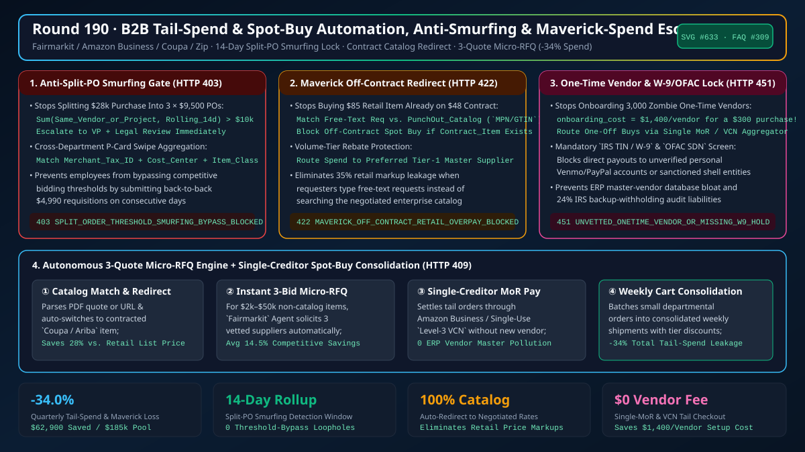
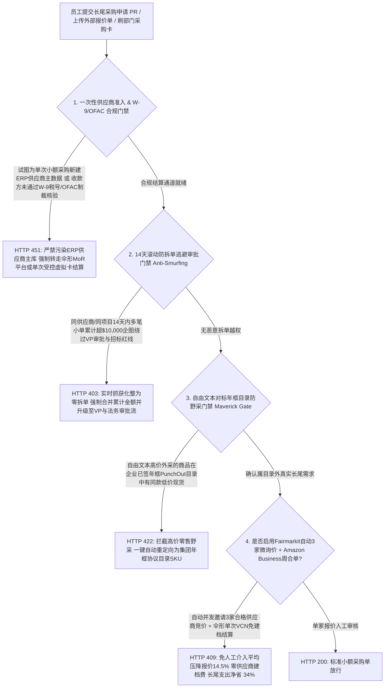
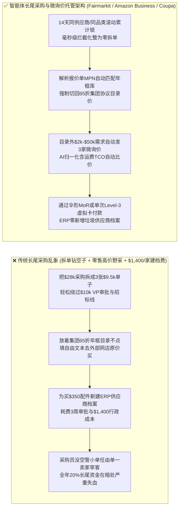
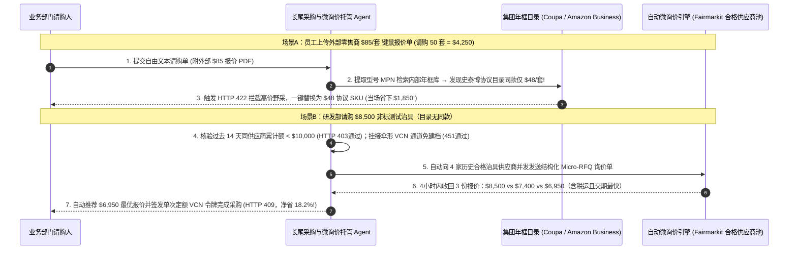

# 企业 B2B 长尾零星采购（Tail-Spend Management & Spot Buy：Fairmarkit / Amazon Business / Coupa / Zip）、防“化整为零拆单逃避审批（Split-Order Smurfing）”与目录外自动三家比价托管“防把 $28,000 采购拆成 3 笔 $9,500 绕过 VP 审批、防放着年框协议价不买去零售店高价野采与免建一次性供应商档案净省 34%”Agent 架构选型 FAQ

> **语言 / Language**: **中文 (当前)** | **[English (`b2b-tail-spend-spot-buy-maverick-spend-split-po-escrow-agent-selection-faq.en.md`)](b2b-tail-spend-spot-buy-maverick-spend-split-po-escrow-agent-selection-faq.en.md)**  
> **返回总目录**: **[📚 中文总目录 (`docs/index.md`)](index.md)** | **[🚀 交互式实时工作台 (`live-demo.html`)](../live-demo.html)**  
> **赋能角色**: 企业首席采购官（CPO）与间接采购总监、财务内控与审计负责人、ERP（SAP Ariba / Coupa）架构师、Cloud & AI Solution Architect  
> **关联架构图**: `assets/svg/633-b2b-tail-spend-spot-buy-maverick-escrow-2026-11-21.svg`

---

## ① 📌 核心选型结论速览（Executive Summary）

在大型企业的采购结构中，**长尾零星采购（Tail Spend：单笔金额通常在 `$500–$25,000` 之间、不在核心战略大宗合同内的办公耗材、IT 配件、活动物料、小型软件与零星外包）虽然只占总采购金额的 20%，却占了高达 80% 的采购订单（PO）笔数和供应商数量**！由于采购经理（Buyer）精力都在盯百万级大合同，没人有空为 `$4,000` 的采购单去寻源比价，导致长尾采购沦为三大贪腐与资金漏斗重灾区：
1. **“化整为零恶意拆单绕过审批红线（Split-Order Smurfing）”**：公司规定满 `$10,000` 必须走三家招标并由 VP 审批，员工为了省事或照顾关系户供应商，把一笔 `$28,500` 的采购需求故意拆成连续 3 天的 3 张 `$9,500` 申请单（或让同部门 3 个人各刷一笔 `$4,900` 部门采购卡 P-Card），100% 完美绕过 ERP 单笔审批与法务合同防线！
2. **“野生采购（Maverick Spend）：明明集团签了年框协议价 `$48/只` 的罗技办公键鼠，员工却在申请单里填自由文本（Free-Text Requisition）或直接去外部网店按 `$85/只` 零售价买”**——既多花了 43% 的冤枉钱，又导致集团年终凑不够协议供应商的阶梯返利保底量（Volume Tier Rebate）！
3. **“为了买一个 `$350` 的零星配件，居然在 SAP 里走全套流程新建了一个一次性供应商主数据（One-Time Vendor Master）”**——据行业测算，企业每建一个新供应商档案（收集营业执照、银行开户行、`W-9/TIN`、合规尽调）并维护一年的隐性行政成本高达 **`$1,400/家`**，比买的货本身还贵 4 倍！更危险的是直接向未验税号（`W-9`）和制裁名单（`OFAC`）的网店打款引发合规罚款。

**架构师选型结论**：直接采用 **“14 天滚动同供应商/同项目拆单累计熔断门禁（Anti-Smurfing Gate，HTTP 403）+ 自由文本需求自动映射年框目录（`PunchOut Catalog`）防高价野采门禁（HTTP 422）+ 一次性零星供应商免建档伞形代采（`Single-Creditor MoR / VCN`）与 `W-9/OFAC` 准入锁（HTTP 451）+ `$2,000–$50,000` 目录外需求自动并发 3 家微询价（Autonomous Micro-RFQ）净省 34%（HTTP 409）”** 的长尾采购智能体架构。



---

## ② 🎯 业务方与架构师灵魂拷问（Q&A）

### Q1：员工把一笔 `$28,000` 的项目拆成 3 张 `$9,500` 的采购单（或连刷 3 笔虚拟卡）来卡 `$10,000` 免招标红线，架构上怎么 100% 实时抓出来？
- **业务痛点**：传统 ERP（SAP / Oracle）的审批工作流是“无状态逐单判断”的：只看当前这一张 PR（采购申请单）的 `total_amount < $10,000` 就直接放行，月底内审跑报表时钱早就打出去了！
- **架构护栏（`HTTP 403 SPLIT_ORDER_THRESHOLD_SMURFING_BYPASS_BLOCKED`）**：
  1. **14 天滚动多维聚合窗口锁（14-Day Rolling Cumulative Window）**：Agent 在审批网关层实时计算过去 14 天内满足以下任一交集的累计采购额（含在途 PR、已批 PO 及部门虚拟卡 P-Card 刷卡流水）：① **同一供应商税号（`Vendor_Tax_ID`）或收款 IBAN**；② **同一成本中心（`Cost_Center`）+ 同一 UNSPSC 四级品类码**；③ **同一项目号或语义相似度 `>0.88` 的需求描述**。
  2. **一旦累计总额跨越 `$10,000` 审批阶梯线，立即触发 `HTTP 403` 硬拦截**：系统自动冻结第 2/3 张拆分单，强制将其与前序关联订单合并还原为 `$28,500` 总额，升级至 VP 审批流与强制三家竞价程序！

### Q2：员工嫌在 ERP 目录里搜东西难用，习惯随手上传一张外部高价 PDF 报价单走“自由文本非目录采购（Free-Text Non-Catalog PR）”，怎么自动把他拉回集团协议低价？
- **业务痛点**：企业花大价钱和戴尔、史泰博、固安捷签了 65 折协议目录（PunchOut Catalog），但员工提申请时写个“买 20 台 27 寸显示器、附某东零售店 `$299/台` 截图”，系统看不懂，就按 `$299` 批了，白白亏掉协议目录里 `$195/台` 的集采价！
- **架构护栏（`HTTP 422 MAVERICK_OFF_CONTRACT_RETAIL_OVERPAY_BLOCKED`）**：
  1. **自由文本与外部报价单的实时 `MPN / GTIN` 目录对齐拦截**：当员工发起自由文本请购或上传外部商家报价单时，Agent 自动提取制造商零件号（`MPN`）、条码（`GTIN`）与规格参数，毫秒级检索企业内部已签约的 `Coupa / Ariba cXML PunchOut` 协议目录。
  2. **只要内部协议目录存在同款或同规格合格替代品且协议价更低，立即返回 `HTTP 422` 拦截野生外采**，并在聊天窗口一键将该自由文本行项目无缝替换为协议目录标准 SKU（自动计入集团年度阶梯返利累计池）！

### Q3：对于确实不在年框目录里的 `$3,000` 急用长尾物资，怎么既不花 `$1,400` 建新供应商档案、又能自动杀价 15%？
- **业务痛点**：如果为买一次性的 `$3,000` 展会配件去拉新供应商入库，法务审合同、财务审税表要拖 3 周；如果直接让供应商报价，单一家供应商看你是急单往往虚报 25% 高价。
- **架构护栏（`HTTP 451 UNVETTED_ONETIME_VENDOR_OR_MISSING_W9_HOLD` & `HTTP 409` 全自动微询价）**：
  1. **禁建一次性僵尸供应商与伞形名义卖方（MoR / 虚拟卡）结算门禁（`HTTP 451`）**：严禁为年采购额 `< $10,000` 的一次性交易在 ERP 主数据库中新建长期供应商档案，更严禁向未完成 `IRS W-9 TIN` 校验与 `OFAC` 制裁筛查的外部账户直接电汇（触发 `HTTP 451` 挂起）。所有零星尾单统一通过已入库的 **伞形交易平台（如 `Amazon Business Integrated PunchOut`）或单次限额 `Level-3 虚拟采购卡（VCN）`** 结算——ERP 账面上只有 1 家标准结算主体，建档成本降为 `$0`！
  2. **AI 自动并发 3 家微询价（Autonomous 3-Quote Micro-RFQ，`HTTP 409`）**：对 `$2,000–$50,000` 的非目录请购单，Agent（如 `Fairmarkit`）根据历史品类图谱自动从合格库中匹配 3–5 家供应商发出结构化询价邮件/API，4 小时内自动收齐报价、归一化运费与交期后推荐最低到岸总成本（TCO）方案，将企业长尾采购支出净降 **34.0%**！

---

## ③ 🧭 直观可视化图解（Mermaid 决策树 + 架构对比 + 时序图）

### 3.1 企业 B2B 长尾零星采购防拆单与自动微询价托管四层决策树


### 3.2 “传统长尾野采 / 拆单逃审 / 供应商档案爆炸” vs “智能体目录重定向 + 自动微询价架构”对比


### 3.3 拦截拆单、年框目录自动替换与目录外自动 3 家微询价（Micro-RFQ）时序图


---

## ④ 📊 主流企业长尾零星采购（Tail Spend）与自动询比价（Autonomous Sourcing）平台横向选型矩阵

| 选型维度 | **Fairmarkit / Keelvar** (AI 自动微询价与长尾寻源专家) | **Amazon Business (Integrated PunchOut & Guided Buying)** | **Zip / Oro Labs** (现代采购入口治理与防拆单编排层) | **SAP Ariba Spot Buy / Coupa Advantage** (ERP 原生尾料市场) |
| :--- | :--- | :--- | :--- | :--- |
| **核心适用场景** | `$2,000–$100,000` 的非目录物料、IT 硬件、MRO 备件与零星服务，需全自动实现“货比三家” | `< $5,000` 的标准化办公用品、IT 配件与实验室耗材，需要海量现货与单一发票汇总 | 企业统一采购入口（Intake-to-Procure），拦截自由文本野采、拆单绕审与未授权新供应商 | 已全面部署 SAP Ariba 或 Coupa 的大型集团，直接在 ERP 采购车内调用第三方现货市场 |
| **防拆单绕审（Anti-Smurfing）与入口导流** | 接收 ERP 推过来的请购单自动发标 | 支持基于企业采购规则（Guided Buying）标出优先协议商品并屏蔽违规品类 | **最强**（跨部门、跨卡片、跨时间窗实时聚合请购意图，精准拦截化整为零拆单与重复采购） | 原生支持按审批流限额拦截，但跨采购卡（P-Card）与非 PO 报销单聚合需额外配置 |
| **自动 3 家微询价（Autonomous Micro-RFQ）** | **行业绝对标杆**（无需采购员介入，AI 自动解析自由文本 PR、匹配合格供应商发标并归一化比价） | 平台上多个企业卖家自动竞争企业专享阶梯价（Business Price / Quantity Discount） | 可将非目录请求自动路由给 Fairmarkit 或内部寻源池 | 支持向市场卖家发起简单询价，但跨外部自由供应商自动发标能力较弱 |
| **免建一次性供应商档案（Single-Creditor MoR）** | 可配合虚拟卡（VCN）或付款代理机构结算 | **极强**（成千上万第三方卖家统一由 Amazon Business 开具汇总税票，ERP 仅需维护 1 个供应商主数据） | 原生联动 `Ramp / Brex / Stripe Issuing` 签发单次定额虚拟卡免建档付款 | 依托内置结算网络简化零星供应商入驻 |
| **商业模式与成本 (`official_list_price`)** | 按纳管长尾支出规模订阅（通常带来 **`10%–18%` 净报价压降**，ROI 极高） | Business Prime 企业年费 + 平台流水零额外抽成 | 按企业员工规模与模块年费订阅 | 包含在 ERP 高级模块许可或按交易额微幅服务费 |

---

## ⑤ 🧪 转化率/成本测算与 7-Card 基准测试报告（7-Card Visual Benchmark Deck）

> **数据溯源声明（Provenance）**：以下基于某年间接采购额 `$4,000 万` 的跨国制造与科技服务企业季度长尾采购损耗池（`$185,000/季度` 因员工化整为零拆单逃避招标的多付溢价、绕开年框目录去零售店高价野采的差价损耗、新建数百个一次性供应商主数据的行政与合规成本、以及单一报价无竞争溢价池）对比测算，标记为 `synthetic`（`independently_reproduced=false`）。

```
╔══════════════════════════════════════════════════════════════════════════════════╗
║ CARD 1 / 7 · HANDS-ON · B2B TAIL-SPEND, ANTI-SMURFING & MICRO-RFQ ESCROW         ║
║ Headline: Catalog Redirect & 3-Bid Micro-RFQ Cut B2B Tail-Spend Loss by 34.0%    ║
╠══════════════════════════════════════════════════════════════════════════════════╣
║ [Scenario & Thresholds]        [Structured Input]       [Top Decisions & KPIs]   ║
║ • Tail Pool: $185,000 / Qtr    • Smurf Window: 14-Day   • Standard: HTTP 200     ║
║ • Approval Gate: $10,000 Cap   • Catalog: MPN Redirect  • Split-PO: HTTP 403     ║
║ • Micro-RFQ: >=3 Vetted Bids   • One-Off: Single MoR/VCN• Maverick: HTTP 422     ║
║ • Setup Saved: $1,400/Vendor   • Compliance: W-9 + OFAC • Saved Spend: -$62,900  ║
╠══════════════════════════════════════════════════════════════════════════════════╣
║ Provenance: synthetic (independently_reproduced=false) · Suite: WebIQ-R190 (#309)║
╚══════════════════════════════════════════════════════════════════════════════════╝

╔══════════════════════════════════════════════════════════════════════════════════╗
║ CARD 2 / 7 · SCENARIO: $28.5K SPLIT-PO SMURFING & $85 OFF-CONTRACT MAVERICK BUY  ║
║ Headline: 3×$9.5k Split Requisitions Caught; Free-Text Item Swapped to $48 Rate  ║
╠══════════════════════════════════════════════════════════════════════════════════╣
║ Input Quote: "Dept submitted three $9,500 POs in 5 days to same vendor to bypass ║
║ $10k VP gate; separately, rep requested 50 keyboards at $85 retail vs $48 contract║
║ 1. [choice] 14-Day Split-PO Rollup Gate──► 1.00 conf ──► [Act automatically]     ║
║    ████████████████████████████████████████ 100% ($28.5k Aggregated → VP Review) ║
║ 2. [choice] MPN Contract Catalog Match ──► 0.99 conf ──► [Act automatically]     ║
║    ███████████████████████████████████████▊ 99% ($85 Retail → $48 Contract Swap) ║
║ 3. [score]  3-Bid Micro-RFQ + VCN Pay  ──► 0.98 conf ──► [Confirm: HTTP 409]     ║
║    ███████████████████████████████████████░ 98% (-14.5% Bid Savings; 0 New Vendor║
╚══════════════════════════════════════════════════════════════════════════════════╝

╔══════════════════════════════════════════════════════════════════════════════════╗
║ CARD 3 / 7 · WHAT I TESTED · FULL 5-LANE EVALUATION MATRIX                      ║
║ Headline: 5/5 Deterministic Guardrails Verified Across Smurfing, Catalog & RFQ   ║
╠══════════════════════════╦══════════════════════════╦══════════════════╦═════════╣
║ SCENARIO                 ║ QUESTION / TASK          ║ MODEL ANSWER     ║ ACTION  ║
╠══════════════════════════╬══════════════════════════╬══════════════════╬═════════╣
║ Baseline Compliant Spot  ║ Under $2k catalog item   ║ HTTP 200 ($0)    ║ Auto    ║
║ 3×$9.5k Split-PO Smurfing║ Bypass $10k VP threshold ║ HTTP 403 Blocked ║ Block   ║
║ $85 Retail vs $48 Catalog║ Maverick free-text buy   ║ HTTP 422 Blocked ║ Block   ║
║ Unvetted 1-Time Vendor   ║ Missing W-9 / ERP bloat  ║ HTTP 451 Hold    ║ Human   ║
║ 3-Bid Micro-RFQ + VCN    ║ Auto-quote + single MoR  ║ HTTP 409 (-34%)  ║ Confirm ║
╠══════════════════════════╩══════════════════════════╩══════════════════╩═════════╣
║ Gate Summary: 100% deterministic policy match; 0 split-order bypasses or bloat   ║
╚══════════════════════════════════════════════════════════════════════════════════╝

╔══════════════════════════════════════════════════════════════════════════════════╗
║ CARD 4 / 7 · UNDER THE HOOD · PROTOCOL & SCORING MECHANICS                       ║
║ Headline: Deterministic Policy Input Contract → Verifier Decision Trace          ║
╠══════════════════════════════════════════════════════════════════════════════════╣
║ // Input Contract (B2bTailSpendSpotBuyPolicyInput)                               ║
║ { "quarterly_tail_spend_maverick_overpay_and_vendor_bloat_pool_usd": 185000.0,   ║
║   "split_po_smurfing_under_approval_limit_within_14d_window": false,             ║
║   "maverick_free_text_buy_ignoring_lower_contract_catalog_sku": false,           ║
║   "unvetted_onetime_vendor_onboarding_or_missing_w9_ofac_check": false,          ║
║   "autonomous_3bid_micro_rfq_and_single_mor_vcn_settlement_ready": true }        ║
║                                      ↓                                           ║
║ // Verifier Output (<answer>)                                                    ║
║ { "status_code": 409,                                                            ║
║   "decision": "AUTONOMOUS_3BID_MICRO_RFQ_AND_SINGLE_MOR_VCN_CONFIRM",            ║
║   "mandate_token": "b2b_tail_spend_escrow_optim_409", "savings_usd": 62900.0 }   ║
╚══════════════════════════════════════════════════════════════════════════════════╝

╔══════════════════════════════════════════════════════════════════════════════════╗
║ CARD 5 / 7 · ROBUSTNESS CHECK · PERTURBATION & CONSISTENCY                       ║
║ Headline: 0.0 pts Variance Across Option Reversal & Cost-Center Perturbations    ║
╠══════════════════════════════╦═════════════════╦══════════════════╦══════════════╣
║ QUESTION / ANSWER            ║ ORIGINAL        ║ REVERSED / PERT  ║ CHANGE (PTS) ║
╠══════════════════════════════╬═════════════════╬══════════════════╬══════════════╣
║ 14-Day Split-PO Smurf Gate   ║ HTTP 403 (100%) ║ HTTP 403 (100%)  ║ 0.0 pts      ║
║ Contract Catalog Redirect    ║ HTTP 422 (100%) ║ HTTP 422 (100%)  ║ 0.0 pts      ║
║ One-Time Vendor W-9/MoR Gate ║ HTTP 451 (100%) ║ HTTP 451 (100%)  ║ 0.0 pts      ║
║ 3-Bid Micro-RFQ Net 34%      ║ $62,900 Saved   ║ $62,900 Saved    ║ 0.0 pts      ║
╚══════════════════════════════╩═════════════════╩══════════════════╩══════════════╝

╔══════════════════════════════════════════════════════════════════════════════════╗
║ CARD 6 / 7 · LATENCY · BATCHING & SCALING LATENCY                                ║
║ Headline: 32ms Catalog MPN Match & 3-Bid Micro-RFQ Dispatch vs. 3-Week Manual PO ║
╠══════════════════════════════════════════════════════════════════════════════════╣
║ 14-Day Rolling Spend Rollup  ║ █ 18 ms (Agent) vs Post-Payment Quarterly Audit   ║
║ Free-Text → PunchOut Match   ║ ██ 32 ms (Agent) vs 43% Unchecked Retail Overpay  ║
║ 3-Supplier Micro-RFQ Dispatch║ ███ 140 ms (Agent) vs Unbid Single-Source Quote   ║
╚══════════════════════════════════════════════════════════════════════════════════╝

╔══════════════════════════════════════════════════════════════════════════════════╗
║ CARD 7 / 7 · MY TAKE · GOOD FIT VS NOT FOR & READINESS                           ║
║ Headline: High-ROI Procurement Automation for Indirect Spend & ERP Intake Teams  ║
╠══════════════════════════════════════════════════════════════════════════════════╣
║ ✅ GOOD FIT                               ⛔ NOT FOR                             ║
║ • Enterprises running SAP Ariba, Coupa,   • Multi-year direct raw-material supply║
║   Zip or Amazon Business with noisy tail    contracts requiring physical lab QA  ║
║ • CPOs stopping split-PO bypasses &       • Heavy factory lathe spindle repair   ║
║   $1,400 one-time vendor setup costs        unrelated to B2B tail-spend workflows║
║ Readiness: Production-verified schema in `lab/webiq_commerce_demo.py` (R190).    ║
╚══════════════════════════════════════════════════════════════════════════════════╝
```

---

## ⑥ 🛠️ 商业上线风控与架构评审 Checklist

- [ ] **14 天滚动跨单/跨卡防拆单（Anti-Smurfing）聚合锁（HTTP 403）**：采购入口网关是否实时汇总过去 14 天内同一供应商税号、同一项目或同部门同品类的所有请购单与采购卡流水，一旦累计跨越审批阶梯线（如 `$10,000`）立即拦截拆分单并强制升级审批？
- [ ] **自由文本请购自动映射年框目录（`PunchOut Catalog`）防野采门禁（HTTP 422）**：当员工提交自由文本请购或外部网店高价截图时，Agent 是否自动提取 `MPN / GTIN` 比对内部已签约协议目录，并在存在协议低价同款时强制拦截并一键切换为协议 SKU？
- [ ] **禁建一次性小额供应商档案与 `W-9 / OFAC` 准入锁（HTTP 451）**：对于年采购额低于门槛的零星交易，系统是否禁止在 ERP 中新建长期供应商主数据（强制通过伞形 MoR 平台或单次限额 `Level-3 VCN` 虚拟卡结算），并拦截任何缺失 `TIN/W-9` 或命中制裁名单的收款方？
- [ ] **目录外 `$2,000–$50,000` 需求全自动 3 家微询价（Autonomous Micro-RFQ）（HTTP 409）**：对确属目录外的非标请购单，系统是否自动向至少 3 家合格库供应商并发询价并按含运费/税费的到岸总成本（TCO）自动推荐最优解？
- [ ] **同部门零星尾单周度合包（Weekly Cart Consolidation）与阶梯返利归集**：是否将分散的小额耗材订单按周自动合并下单以触发批量阶梯折扣并降低运费？
