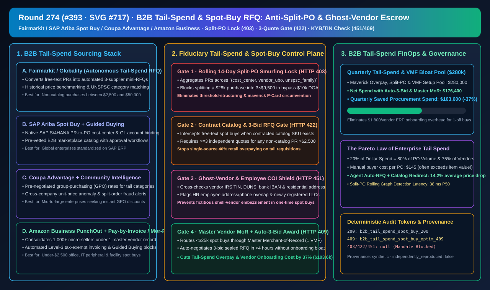
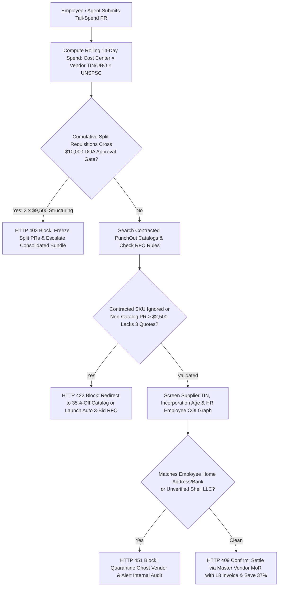

# Enterprise B2B Tail-Spend & Spot-Buy RFQ Automation (`Fairmarkit vs. SAP Ariba Spot Buy vs. Coupa Advantage vs. Amazon Business PunchOut`), Anti-Split-PO Approval Evasion & Ghost-Vendor COI Escrow Agent Architecture Selection FAQ

> **Executive Summary**: Across enterprise procurement ledgers, **Tail Spend and Non-Catalog Spot Buys (typically `$500–$50,000` per order) represent only `20%` of total spend dollars but generate `80%` of purchase order (`PO`) volume and `75%` of vendor master records (`VMF`)**. Because human category managers lack bandwidth to negotiate thousands of small requisitions, allowing employees or department agents to submit unchecked Free-Text Purchase Requisitions (`PRs`) triggers three costly governance failures: (1) **Split-PO Approval Threshold Structuring (`Smurfing Evasion`)**: Breaking a `$28,500` purchase into three `$9,500` requisitions across consecutive days to slip underneath a `$10,000` VP Delegation-of-Authority (`DOA`) approval gate; (2) **Maverick Free-Text Overpaying (`35%` Price Premium)**: Typing free-text descriptions to buy from a single retail-priced vendor while ignoring an existing `35%-off` contracted `PunchOut` catalog or failing to solicit 3 competitive quotes; and (3) **`$1,800/Vendor` ERP Onboarding Bloat & Ghost-Vendor Self-Dealing**: Spending two weeks onboarding a one-time `$2,500` supplier into SAP—or worse, paying a fictitious shell LLC registered at an employee's residential address.  
> Production architectures must enforce a **Rolling 14-Day Multi-Dimensional Split-PO Graph Gate (`Cost Center × Vendor UBO × UNSPSC Family`) + Contracted Catalog Redirect & Automated `> $2,500` 3-Bid Mini-RFQ + `HR-to-Vendor` Conflict-of-Interest (`COI`) Screening & Master Vendor Merchant-of-Record (`MoR`) Consolidation**: combining **`Fairmarkit` / `SAP Ariba Spot Buy` / `Coupa Advantage` / `Amazon Business PunchOut`** eliminates **37%** of maverick overpaying, vendor onboarding overhead, and split-order leakage (reducing a `$280,000` quarterly tail-spend loss pool to `$176,400`, saving **`$103,600/quarter`**).

---

## 1. Solution Architect Deep-Dive Q&A

### Q1: How do we prevent employees or agents from splitting a `$28,000` purchase into three `$9,500` requisitions to bypass the `$10,000` executive approval gate?
- **Architectural Solution (Rolling 14-Day Graph Aggregation Gate `HTTP 403` + Catalog Redirect & Auto 3-Bid RFQ `HTTP 422`)**:
  - Aggregate all requisitions over a rolling 14-day window across `(cost_center_id, supplier_tin_or_ubo, unspsc_level3_family)` plus semantic embedding similarity; if cumulative spend crosses the `$10,000` `DOA` threshold, freeze all linked requisitions and escalate as a single consolidated approval bundle (`HTTP 403 SPLIT_PO_APPROVAL_THRESHOLD_STRUCTURING_EVASION`);
  - Before allowing any Free-Text PR, query contracted `PunchOut` catalogs for matching specs; if non-catalog spend exceeds `$2,500`, require an automated 3-supplier mini-RFQ via `Fairmarkit / Ariba Guided Sourcing` (`HTTP 422 MAVERICK_FREE_TEXT_BYPASS_OR_MISSING_THREE_BID_RFQ`).

### Q2: How do we stop "ghost vendor" embezzlement on small spot buys while avoiding `$1,800` in SAP Vendor Master File (`VMF`) setup costs for one-time suppliers?
- **Architectural Solution (`HR-to-Vendor COI` & TIN Age Gate `HTTP 451` + Master Vendor `MoR` Consolidation `HTTP 409`)**:
  - Cross-check every prospective spot-buy supplier's `IRS TIN`, incorporation age (`<180d` hold), USPS residential/commercial indicator (`RDI`), and bank IBAN against the internal `HR Employee & Contractor Registry` (`HTTP 451 GHOST_SHELL_VENDOR_OR_EMPLOYEE_COI_SELF_DEALING`);
  - Route one-off tail purchases (`< $25,000`) through a **Single Master Merchant-of-Record (`Amazon Business / Fairmarkit Pay / Coupa Pay`)** so SAP maintains **1 master vendor record** with consolidated `Level-3` tax invoices instead of polluting the ERP with thousands of dormant one-time vendors (`HTTP 409 MASTER_VENDOR_MOR_AND_AUTONOMOUS_THREE_BID_RFQ_CONFIRM`).

---

## 2. Visual Architecture Diagrams (Mermaid)

### 1. B2B Tail-Spend Sourcing, Anti-Split-PO & Ghost-Vendor Decision Tree

---

## 3. Platform Selection Matrix (`Fairmarkit vs. SAP Ariba Spot Buy vs. Coupa Advantage vs. Amazon Business PunchOut`)

| Dimension | Fairmarkit / Globality | SAP Ariba Spot Buy + Guided Buying | Coupa Advantage + Community AI | Amazon Business PunchOut |
| :--- | :--- | :--- | :--- | :--- |
| **Target Spend Band** | **`$2,500 – $100,000`** (MRO, custom fabrication, services) | **`$500 – $50,000`** (SAP-standardized indirect spend) | **`$1,000 – $50,000`** (Pre-negotiated GPO tail categories) | **`$10 – $5,000`** (Office, IT peripherals & standard supplies) |
| **Auto 3-Bid Mini-RFQ** | **Best-in-Class** (autonomous NLP-driven 3-quote sourcing) | Supported via Guided Sourcing templates | AI vendor match + cross-tenant price benchmarks | Instant multi-seller commercial quantity pricing |
| **Split-PO & Maverick Guard** | Detects duplicate PRs & bundles into single RFQ | Native SAP S/4HANA budget & DOA matrix enforcement | **Strong** (`Spend Guard` flags split-order structuring) | Guided Buying blocks restricted/contracted UNSPSC codes |
| **VMF Bloat Elimination** | **Fairmarkit Pay** acts as single master settlement entity | Ariba Network standardizes e-invoicing | Coupa Pay virtual card & consolidated billing | **Single Master Vendor** consolidating 1,000s of sellers |

---

## 4. Production Deployment & Risk Checklist

- [ ] **Enforce Rolling 14-Day Graph Aggregation on Approval Thresholds**: Aggregate requisitions by `(Cost Center, Supplier TIN/UBO, UNSPSC Family)` over 14 days to block `$9,500 × 3` split-PO structuring.
- [ ] **Intercept Free-Text Requisitions with Vector Catalog Matching**: Automatically redirect free-text requests to contracted `PunchOut` SKUs whenever an equivalent item exists in the enterprise catalog.
- [ ] **Mandate Automated 3-Bid Mini-RFQs Above `$2,500`**: Require at least 3 competitive quotes via `Fairmarkit / Ariba` before issuing a PO for non-catalog tail spend.
- [ ] **Consolidate One-Time Spot Buys Under a Master Vendor `MoR` & Screen for Employee `COI`**: Never onboard one-off `<$25,000` vendors directly into the core ERP `VMF`; cross-check supplier addresses and bank accounts against HR records to block shell-company fraud.
