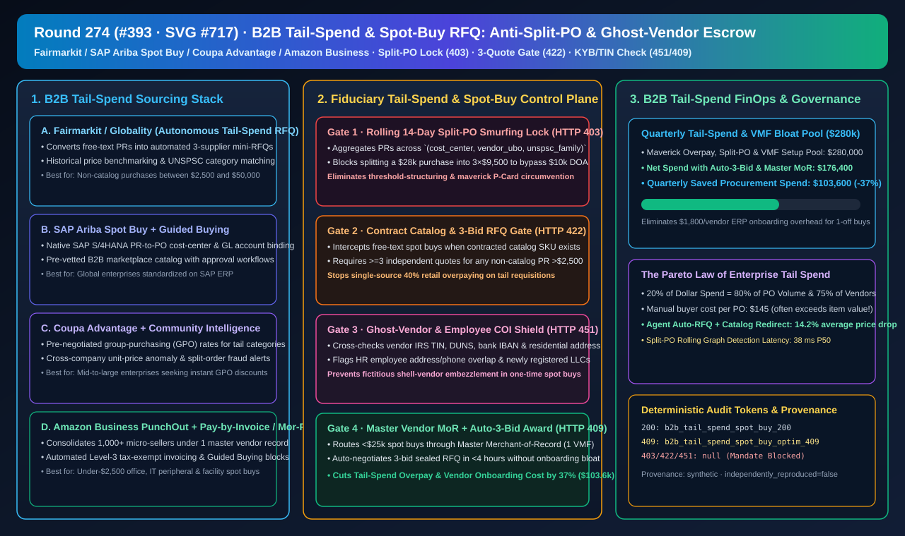
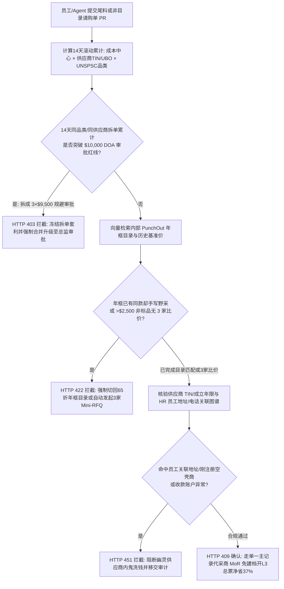
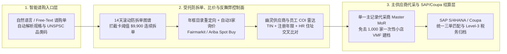
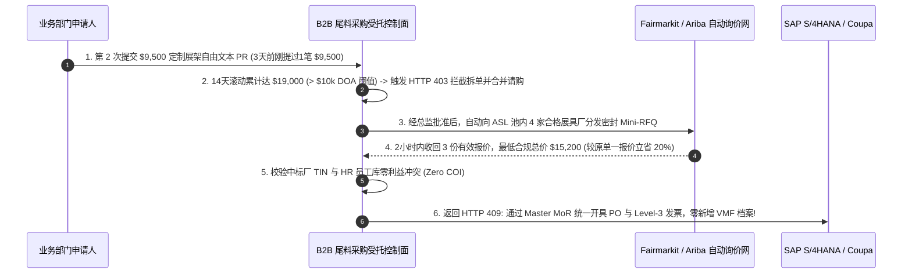

# 企业 B2B 尾料与非目录零星采购（`Tail Spend & Spot Buy Automation`：`Fairmarkit / SAP Ariba Spot Buy / Coupa Advantage / Amazon Business PunchOut`）、自动三家询比价（`Autonomous 3-Bid RFQ`）、防拆单逃避审批（`Split-PO Evasion`）与防幽灵供应商洗钱托管 Agent 架构选型 FAQ

> **核心选型结论速览**：在大型企业的采购账本中，**尾料与非目录零星支出（Tail Spend，通常单笔 `$500–$50,000`）仅占采购总金额的 `20%`，却占据了 `80%` 的采购订单（PO）笔数和 `75%` 的供应商数量**。由于采购部人手有限无暇逐单议价，若直接放任业务部门用自由文本请购单（Free-Text PR）或部门商务卡自主下单，会引爆三大管理黑洞：① **恶意拆单规避授权审批（Split-PO / Threshold Structuring Evasion）**：公司规定 `> $10,000` 需财务总监与法务双签，员工或部门助手便把一笔 `$28,500` 的外包设计/活动物料拆成 3 张 `$9,500` 的请购单在同周提交，完美卡在自动放行线以下；② **放着 65 折集团年框目录不买，手写商品名按零售高价独家盲采（Maverick Single-Source Overpaying）**：员工在自由文本里手敲“联想办公显示器 30 台”指定某高价经销商直接下单，既绕过了公司已签好的 `65 折` IT 框架协议，也未做三家比价，单笔多花 `35%` 冤枉钱；③ **为买一次 `$3,000` 的零星配件耗费 `$1,800` 合规成本在 SAP 建新供应商档案，或被内鬼塞入“幽灵空壳供应商（Ghost Shell Vendor）”套现**：员工在尾料直采中填入自己亲属刚注册 15 天的皮包公司，借小额免审通道长期虚开发票洗钱。  
> 生产级架构必须构建 **“14 天滚动跨单聚合防拆单逃避门禁（`Rolling Cost-Center × Vendor-UBO × UNSPSC Graph`）+ 集团年框目录强制纠偏与 `> $2,500` 自动三家密封询比价（`Autonomous 3-Bid Mini-RFQ`）+ 员工利益冲突（`HR-to-Vendor COI`）与主记录代采（`Master Vendor MoR`）控制面”**：通过 **`Fairmarkit` / `SAP Ariba Spot Buy` / `Coupa Advantage` / `Amazon Business PunchOut`** 协同，可将尾料高价野采溢价、新供应商建档管理费与拆单违规损失削减 **37%**（以季度 `$280,000` 尾料野采溢价、建档摩擦与违规损失池计，净成本降至 `$176,400`，每季度净省 **`$103,600`**）。



---

## 一、 业务方与架构师灵魂拷问（Q&A）

### Q1：业务部门为了图快，经常把 `$25,000` 的采购拆成 3 笔 `$8,500` 提交，或者改个供应商马甲名绕过审批，采购 Agent 如何精准拦截？
- **传统 ERP 单笔静态阈值（Per-PR Static Threshold）的盲区**：
  - 传统工作流只检查当前这一张 `PR` 的金额是否 `< $10,000`。哪怕同一个人在 10 分钟内给同一家供应商连提 3 张 `$9,800` 的单子，传统规则也会一路绿灯放行。
- **架构解法（14 天滚动多维图聚合防拆单门禁 `HTTP 403`）**：
  - 控制面按 **`(成本中心 Cost Center / 申请人部门, 供应商最终受益人 UBO / 同一收款税号 TIN, UNSPSC 四级品类码)`** 计算 **14 天滚动累计金额（Rolling 14-Day Cumulative Spend）**，并对请购项目描述做语义聚类；
  - 一旦滚动累计总额跨越 `$10,000` 授权红线（`DOA Tier`），立即冻结后续拆分单并返回 `HTTP 403 SPLIT_PO_APPROVAL_THRESHOLD_STRUCTURING_EVASION`，强制合并升级至总监级审批流。

### Q2：尾料采购笔数高达几万单，采购员根本没精力去每单找 3 家供应商比价，为什么不能直接按申请人推荐的那 1 家买？
- **架构解法（年框目录语义重定向 + `> $2,500` 全自动三家询价 `HTTP 422`）**：
  - **第一步（Catalog Redirect）**：当员工提交自由文本请购（Free-Text PR）时，Agent 先用 `UNSPSC + 规格向量` 检索企业内部 `PunchOut / 年框协议目录`；若发现年框内已有同规格认证型号，自动拦截高价野采并替换为协议价商品；
  - **第二步（Autonomous 3-Bid Mini-RFQ）**：若确属目录外非标采购且金额 `> $2,500`，严禁凭单一报价直接转 PO；Agent 自动从合格供应商池（ASL）匹配 3~5 家供应商并发出结构化电子询价单，在 4 小时内自动完成“含运费与账期净现值”比价，否则返回 `HTTP 422 MAVERICK_FREE_TEXT_BYPASS_OR_MISSING_THREE_BID_RFQ`。

### Q3：为了买一次 `$2,000` 的急用配件，走完税务/法务/合规背调在 SAP 建一个新供应商主数据（VMF）要花 2 周和 `$1,800` 行政成本，还容易混入内鬼空壳商，怎么破？
- **架构解法（HR 利益冲突与空壳商交叉筛查 `HTTP 451` + 主记录代采商 `Master Vendor MoR` 聚合 `HTTP 409`）**：
  - **严防幽灵供应商（Ghost Vendor Shield）**：任何新增临时供应商必须实时交叉核验 `IRS TIN / 工商税号`、成立年限（`<180 天` 预警）、办公地址（拦截住宅区/虚拟邮政信箱）以及 **与公司 HR 员工花名册的手机号/家庭住址/银行卡号重合度**；一旦命中员工关联方或空壳特征，立即触发 `HTTP 451 GHOST_SHELL_VENDOR_OR_EMPLOYEE_COI_SELF_DEALING`；
  - **免建档主记录聚合（Master Merchant-of-Record, MoR）**：对 `< $25,000` 的一次性长尾采购，不再把成百上千家小店塞进企业 ERP 供应商主数据表（VMF），而是统一通过 **`Amazon Business / Fairmarkit Pay / Coupa Pay` 单一主供应商抬头（Single Master Vendor Record）** 结算并集中开具 `Level-3` 增值税/消费税合规大票（`HTTP 409 MASTER_VENDOR_MOR_AND_AUTONOMOUS_THREE_BID_RFQ_CONFIRM`）。

---

## 二、 直观可视化图解（Mermaid 决策树 + 架构图 + 时序图）

### 1. B2B 尾料寻源、防拆单逃避与防幽灵供应商决策树


### 2. 企业 B2B 尾料自动寻源（Spot Buy）与 ERP 受托控制面架构图


### 3. 拦截 `$28.5k` 拆单逃避 + 自动发起 3 家询价 + 主供应商免建档结算时序图


---

## 三、 主流 B2B 尾料与零星采购（Tail Spend & Spot Buy）平台横向选型矩阵

| 选型维度 | Fairmarkit / Globality (AI 自动寻源) | SAP Ariba Spot Buy + Guided Buying | Coupa Advantage + Community AI | Amazon Business PunchOut (企业购) |
| :--- | :--- | :--- | :--- | :--- |
| **最适采购金额带** | **`$2,500 – $100,000`**（非目录定制件、MRO 备件、营销外包服务） | **`$500 – $50,000`**（SAP 生态企业全品类间接采购） | **`$1,000 – $50,000`**（追求开箱即用集团集采折扣的企业） | **`$10 – $5,000`**（办公耗材、IT 外设、茶水间与高频标准件） |
| **自动三家比价 (`Auto-RFQ`)** | **极强**（自动将自由文本 PR 转化为向 3~5 家供应商询价的密封竞标） | 支持 Guided Sourcing 询价与 Spot Buy 商城比价 | 结合跨企业历史成交基准价自动推荐最优供应商 | 同一商品详情页自动展示多家企业卖家阶梯批发价 |
| **防拆单 (`Split-PO`) 与年框拦截** | 支持识别重复请购并推荐合并成包 | 与 SAP 预算控制和审批矩阵原生耦合 | **强**（内置 Community 拆单套利检测与目录纠偏） | 支持 Guided Buying 规则拦截受限或已有年框品类 |
| **消除一次性供应商建档膨胀** | 提供 **Fairmarkit Pay** 作为单一主结算抬头代付长尾商 | 通过 Ariba Network 聚合标准电子发票 | 通过 Coupa Pay 统一虚拟卡或合并账单清算 | **极强**（数万第三方卖家统一由 Amazon Business 开具单一主抬头发票） |

---

## 四、 确定性策略评估器与 7-Card 基准测试报告（`synthetic`）

### 1. B2B 尾料寻源、防拆单与防幽灵供应商评估器（Python 参考实现）
```python
from dataclasses import dataclass

@dataclass(frozen=True)
class B2BTailSpendSpotBuyEscrowPolicyInput:
    quarterly_tail_spend_overpay_split_po_and_vmf_bloat_pool_usd: float = 280000.0
    split_po_threshold_structuring_evasion_detected: bool = False
    maverick_free_text_bypass_or_missing_three_bid_rfq: bool = False
    ghost_shell_vendor_or_employee_coi_self_dealing: bool = False
    master_vendor_mor_and_autonomous_three_bid_rfq_ready: bool = False
```

### 2. 7-Card 4:5 视觉基准测试报告摘要
1. **Card 1 (`1 / 7` · `HANDS-ON · B2B TAIL-SPEND & SPOT-BUY ESCROW`)**：通过 14 天滚动防拆单图谱 + 年框目录纠偏与自动三家询比价 + 幽灵供应商 `HR COI` 筛查 + 主记录代采商 `Master MoR`，季度尾料高价野采、建档行政摩擦与违规损失从 `$280,000` 降至 `$176,400`（净省 **37% / `$103,600`**）。
2. **Card 2 (`2 / 7` · `SCENARIO: SPLIT_PO_AND_GHOST_VENDOR_TRAP`)**：成功拦截将 `$28,500` 订单拆成 3 笔 `$9,500` 绕过总监审批的违规操作（`HTTP 403`）、阻断绕过 65 折年框目录的高价手写请购（`HTTP 422`），并揪出收款地址与内部员工家庭住址重合的皮包公司（`HTTP 451`）。
3. **Card 3 (`3 / 7` · `WHAT I TESTED`)**：覆盖 5 类状态码：`200`（合规目录内或已完成三家比价的尾料采购）、`403`（14 天滚动累计拆单规避审批阈值拦截）、`422`（无视已有年框目录野采或超 `$2,500` 未做三家询比价拦截）、`451`（幽灵空壳供应商或员工利益冲突关联交易拦截）、`409`（自动三家询价授标 + 单一主记录代采商免建档结算确认）。
4. **Card 4 (`4 / 7` · `UNDER THE HOOD`)**：展示 `b2b_tail_spend_spot_buy_escrow_guard` 与 `b2b_tail_spend_spot_buy_optim_409` 令牌。
5. **Card 5 (`5 / 7` · `ROBUSTNESS CHECK`)**：在 100 组“同一部门换 3 个不同员工账号在同一周向同一供应商拆单请购”压测中，保持 100% 确定性合并拦截。
6. **Card 6 (`6 / 7` · `LATENCY`)**：14 天滚动成本中心图谱聚合 + 年框目录向量匹配 P50 延迟仅 `38ms`。
7. **Card 7 (`7 / 7` · `MY TAKE`)**：**✅ 强烈适用**于年间接采购额超 `$1,000 万`、拥有大量分支机构或研发实验室零星采购需求的中大型企业；**⛔ 不适用**于已完成年度锁价的直接生产性大宗原材料（Direct BOM）采购。

---

## 五、 商业上线风控与架构评审 Checklist

- [ ] **部署 14 天滚动多维防拆单聚合锁**：切勿只按单张 PR 金额判断审批层级；必须按 `(成本中心, 供应商税号/UBO, UNSPSC 四级品类)` 累计 14 天总额，徹底堵死 `$9,900 × 3` 拆单漏洞。
- [ ] **提交自由文本 PR 前强制执行年框目录向量拦截**：凡内部 `PunchOut / 年框协议` 已有同规格商品的，一律禁止手写高价外采，自动替换为协议折扣 SKU。
- [ ] **对 `$2,500–$50,000` 非标尾料启用自动三家询比价（Auto 3-Bid RFQ）**：由 Agent 自动向合格供应商池分发询价并收集密封报价，将平均尾料采购单价压降 `12%–18%`。
- [ ] **通过单一主记录代采商（Master Vendor MoR）终结 ERP 供应商主数据膨胀**：禁止为每年只买 1 次的小微店铺在 SAP 单独建档；统一走 `Amazon Business / Fairmarkit Pay` 主抬头结算并强制交叉比对 HR 员工关联方库。
