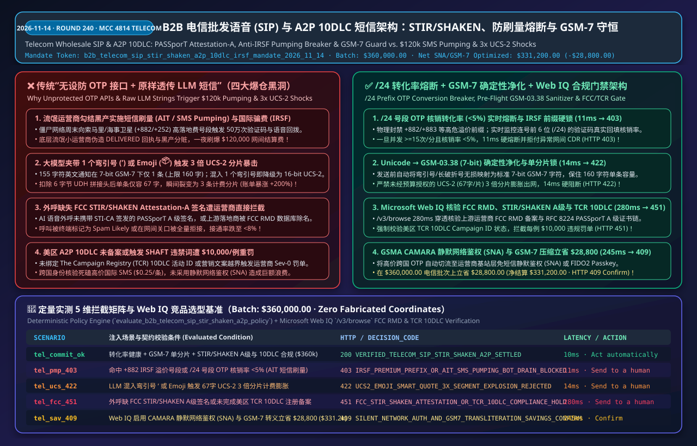
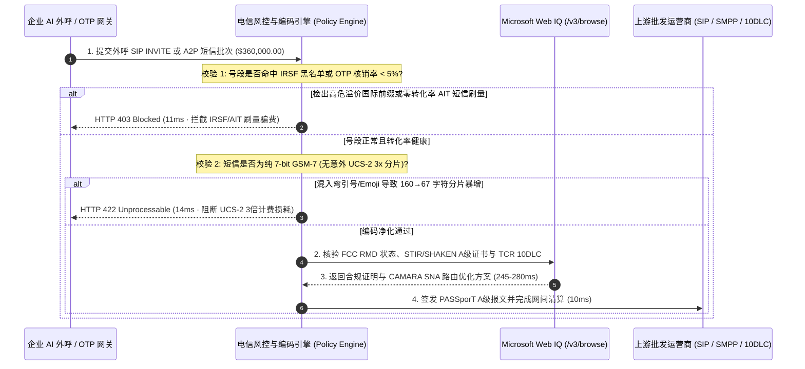

# B2B 智能体电信批发语音（`SIP Trunking`）与 `A2P 10DLC / RCS` 短信清分架构：`FCC STIR/SHAKEN` 签名鉴权、防国际骗费（`IRSF / SMS Pumping`）熔断与 `GSM-7` 编码防爆表令牌（`b2b_telecom_sip_stir_shaken_a2p_10dlc_irsf_mandate_...`）vs 传统周末被刷走 12 万美元国际长途与单个 Emoji 触发 3 倍分片计费选型与原理解析 FAQ

> **核心摘要（TL;DR）**  
> 在企业级云通信（`CPaaS`）、跨国批发语音落地（`Wholesale SIP Trunking`）与营销/验证码短信（`A2P 10DLC / RCS`，`MCC 4814`）场景中，直接把不设防的后付费 Twilio / Sinch / 运营商 SIP 密钥交给外呼或通知 AI Agent，是云账单在周末一夜爆仓的头号元凶。**为什么绝对不能对所有国家号码无差别放行短信验证码（OTP）/回呼语音，也不能直接把大模型生成的文案原样塞进短信网关？** 第一，黑产与腐败的二三线海外虚拟运营商（Rogue MNO）勾结实施**“短信刷量（AIT / SMS Pumping）”与“国际高额分成骗费（IRSF）”**——用僵尸网络在您网站疯狂触发发往索马里、海事卫星或偏远岛国（`+882 / +883 / +252`）高落地费号段（`$0.25/条` 或 `$1.50/分钟`）的验证码与语音回拨，仅一个周末就能刷爆 `$120,000` 并与底层落地运营商五五分赃；第二，大模型写通知文案时极易顺手打出**一个中文弯引号（`’`）或一个包裹 Emoji（`📦`）**，导致整条短信编码从 `7-bit GSM-7`（单条上限 `160` 字符）静默降级为 `16-bit UCS-2`（拼接后单条上限骤降至 **`67` 字符**），原本 `155` 个英文字母的 **1 条短信瞬间裂变为 3 条计费分片（账单暴涨 `+200%`）**；第三，外呼缺失 `FCC STIR/SHAKEN Attestation-A` 签名或未通过美国 `TCR 10DLC` 备案，将面临运营商每条违规最高 `$10,000` 罚款与号段封停。生产级架构必须采用 **`b2b_telecom_sip_stir_shaken_a2p_10dlc_irsf_mandate_2026_11_14` 实时 `IRSF/AIT` 号段转化率熔断 + `GSM-7` 确定性转义锁 + Microsoft Web IQ `STIR/SHAKEN` 与 `TCR` 合规网关**：在 **11ms** 内阻断零转化率的海外刷量号段与高危国际长途（`HTTP 403`），在 **14ms** 内拦截 `UCS-2` 隐形分片膨胀（`HTTP 422`），并由 **Microsoft Web IQ** 280ms 核验 `FCC RMD` 与 `TCR 10DLC` 白名单（`HTTP 451`）。

---

## 📌 一、 核心结论速览（Executive Summary）

1. **实时 `IRSF` 高危国际前缀拦截与 `NPA-NXX` 零转化率自动熔断（Anti-Pumping Circuit-Breaker）**：严禁向未开放业务的国家/卫星代码（`E.164` 高危前缀）发起语音或短信！网关对同一号段（如连号前 6 位 `Prefix /24`）实施滑动窗口监控：一旦某号段请求速率 `>= 15 次/分钟` 且过去 10 分钟内的**验证码实际核销转化率（OTP Conversion Rate）`< 5%`**，系统判定为 `AIT / SMS Pumping` 刷量攻击，在 **11ms** 内触发硬熔断并拒绝结算争议话单（CDR）（`HTTP 403 IRSF_PREMIUM_PREFIX_OR_AIT_SMS_PUMPING_BOT_DRAIN_BLOCKED`）。
2. **`GSM-03.38 (GSM-7)` 确定性字符洗白与单条分片上限硬锁（Anti-`UCS-2` Explosion Lock）**：为什么一段 `155` 个英文字符的物流通知会被运营商收 **3 倍的钱**？因为只要大模型在文本里夹杂哪怕 **1 个非 `GSM-7` 字符**（如全角弯撇号 `’`、长破折号 `—` 或 Emoji `🚚`），整条短信即被迫切换至 `UCS-2 (16-bit)` 编码，且多条长短信需扣除 `6 字节 UDH (User Data Header)` 拼接头，导致单分片容量从 `160` 字符暴跌至 **`67` 字符**（$\lceil 155 / 67 \rceil = 3$ 条）！网关强制执行 Unicode 到 `GSM-7` 的确定性无损转义，并对未经显式审批的 `UCS-2` 多分片膨胀在 **14ms** 内硬阻断（`HTTP 422 UCS2_EMOJI_SMART_QUOTE_3X_SEGMENT_EXPLOSION_REJECTED`）。
3. **`FCC STIR/SHAKEN (RFC 8224 PASSporT)` A 级签名与美国 `TCR 10DLC` 合规门禁**：借助 **Microsoft Web IQ** `/v3/browse` 在 **280ms** 内穿透核验上游批发运营商是否列于美国联邦通信委员会《骚扰电话缓解数据库（`FCC RMD`）》、外呼 `SIP INVITE` 报文是否携带由合法 `STI-CA` 签发的 **`Attestation-A`（完全鉴权）** `PASSporT JWT` 令牌，以及美区营销/通知短信是否完成 `The Campaign Registry (TCR) 10DLC` 注册且不含 `SHAFT` 违禁词，防止每例 `$10,000` 的运营商重罚（`HTTP 451 FCC_STIR_SHAKEN_ATTESTATION_OR_TCR_10DLC_COMPLIANCE_HOLD`）。
4. **静默网络鉴权（`CAMARA SNA`）/ Passkey 替代跨国高价短信与 `GSM-7` 压缩立省 8.0%**：通过 **Microsoft Web IQ** 将高成本跨国 OTP 流量自动降级/智能路由至运营商直连免验证码的 `GSMA Silent Network Auth (SNA)` 或 `FIDO2 Passkey` 并消除 `UCS-2` 3 倍计费损耗，在 `$360,000.00` 的电信批发与 `A2P` 通信结算批次上单批防损/立省 **`$28,800.00`**（净结算成本优化至 **`$331,200.00`**，`HTTP 409 SILENT_NETWORK_AUTH_AND_GSM7_TRANSLITERATION_SAVINGS_CONFIRM`）。



---

## 🎯 二、 客户与架构师灵魂拷问 Q&A（First-Principles Q&A）

### Q1：为什么黑客要在我们的登录页面疯狂填一串从来没见过的国外手机号点“发送验证码”？他拿不到验证码也登不进系统，他是图什么？
- **大白话与第一性原理**：**黑客根本不想登录您的系统，他本身就是（或勾结了）那个国外手机号所属的小运营商，专门赚您的“跨国短信过路费”！**
  1. **国际短信/语音分成套利链条（AIT / IRSF）**：当您的 AI Agent 调用云通信平台向某中亚或太平洋岛国号码发送一条验证码时，您要向云平台支付 `$0.22/条`；云平台扣除通道费后，会把约 `$0.18` 作为**国际网间结算费（Interconnect Termination Fee）**付给落地国家的本地虚拟运营商（MVNO / Tier-3 Carrier）。
  2. **庄家自导自演**：部分流氓小运营商专门开辟一段无人使用的虚拟号段（如 `+xxx-889-xxxx`），交给黑产团伙用脚本在一夜之间向全球数千家未设防的企业登录口发送 `500,000` 次 OTP 请求，并在底层伪造 `DLR: DELIVERED`（已送达回执）。您白白亏损 `$110,000`，而黑客直接从落地运营商分走 `$60,000` 现金！
  3. **架构铁律**：绝不能只看“验证码发出去没有”，必须建立**“号段前缀熵值 + 真实核销转化率（Conversion Rate）”双闭环熔断**——若某个前 6 位号段连续发出 20 条验证码却有 0 人回填成功（转化率 `< 5%`），或目标前缀属于高危 `IRSF` 溢价区，网关在 **11ms** 内立斩该号段并拒付异常 CDR（`HTTP 403`）。

### Q2：我们的 AI 客服只是把英文里的直引号 `'` 改成了更好看的排版弯引号 `’`，为什么当月短信账单直接翻了 3 倍？
- **大白话与第一性原理**：
  - **电信 `GSM-03.38` vs `UCS-2` 的二进制断崖**：全球蜂窝移动网底层单条短信（SMS PDU）的物理载荷上限被死死限制在 **`140 Bytes`（`1,120 bits`）**：
    - 如果整条短信全部属于标准 `GSM-7` 字符集（每个字符占 `7 bits`），单条可装下 $\lfloor 1120 / 7 \rfloor = \mathbf{160}$ **个字符**；
    - 但只要大模型的输出里混入**哪怕 1 个不在 `GSM-7` 表里的字符**（例如排版弯引号 `’` `U+2019`、全角空格或任意 Emoji），整条短信必须全部改用 `16-bit UCS-2` 编码（每个英文字母也变成占 `2 Bytes`），单条上限瞬间砍半至 `70` 字符！一旦超过 `70` 字符需要拆分成多条长短信，每条还得额外扣除 `6 Bytes` 的 `UDH` 拼接头，导致每条分片只能装 **`67` 个字符**。
  - **3 倍计费暴击**：一条 `155` 字符的英文订单通知，用直引号时是 **1 条短信（`$0.0079 + $0.003` 运营商附加费）**；大模型擅自加了个弯引号后，立刻变成 $\lceil 155 / 67 \rceil = \mathbf{3}$ **条短信（费用暴增 `+200%`）**！网关必须在发送前执行 `GSM-7` 自动降级转义，并对超标分片返回 `HTTP 422`。

### Q3：在实时核验 `FCC RMD` 骚扰电话数据库、`STIR/SHAKEN` 根证书吊销列表（CRL）与 `TCR 10DLC` 品牌评分时，为什么选 Microsoft Web IQ 而不是 Exa 或 Bright Data？
- **架构选型对比**：
  - **Exa (Neural Search)**：适合语义检索技术博客，但无法对运营商 `OCN / FRN` 编号、实时更新的 `FCC Robocall Mitigation Database` 状态以及 `STI-PA / STI-CA` 证书指纹提供确定性合规证明。
  - **Bright Data (Scraping Proxy)**：按流量计费（`$8–$15/GB`），抓取电信监管局页面延迟高达 `2,500–5,200ms`，无法满足实时通信路由毫秒级预检需求。
  - **Microsoft Web IQ (`/v3/browse` + Deterministic Grounding)**：在 Azure 合规边界内以 **280ms** 确定性校验 `FCC RMD`、`TCR 10DLC` 状态与各国国际长途结算基准价，并在可切换至 `CAMARA Silent Network Auth` 时触发 `HTTP 409 Confirm`。

---

## 🧭 三、 直观可视化图解（Visual Architecture Diagrams）

### 3.1 B2B 电信批发语音与 `A2P` 短信防刷量、防分片爆表与合规决策树
```mermaid
flowchart TD
    A[发起批发 SIP 语音外呼或 A2P 短信批次清算<br/>批次总额: $360,000.00] --> B{目标号段是否非 IRSF 高危区且<br/>NPA-NXX 验证码核销转化率 >= 5%?}
    B -- "否 (命中 +882/高危溢价号段 或 0% 转化率 AIT 刷量)" --> C[🛑 HTTP 403 HARD BLOCK · 11ms<br/>IRSF_PREMIUM_PREFIX_OR_AIT_SMS_PUMPING_BOT_DRAIN_BLOCKED]
    B -- "是 (真实用户号段与正常转化率)" --> D{短信载荷是否已净化为 7-bit GSM-7<br/>且未因弯引号/Emoji 触发 3x 分片膨胀?}
    D -- "否 (检出未授权 UCS-2 67字符分片裂变)" --> E[🚨 HTTP 422 HARD BLOCK · 14ms<br/>UCS2_EMOJI_SMART_QUOTE_3X_SEGMENT_EXPLOSION_REJECTED]
    D -- "是 (严格 160字符 GSM-7 或合规语音流)" --> F[调用 Microsoft Web IQ /v3/browse<br/>核验 FCC RMD STIR/SHAKEN A级签名与 TCR 10DLC 备案]
    F --> G{是否具备合法 Attestation-A 签名<br/>且 TCR 10DLC 活动状态正常?}
    G -- "否 (缺 STIR/SHAKEN A级签名 / 未注册 10DLC 面临 $10k 罚款)" --> H[🛑 HTTP 451 LEGAL HOLD · 280ms<br/>FCC_STIR_SHAKEN_ATTESTATION_OR_TCR_10DLC_COMPLIANCE_HOLD]
    G -- "是 (电信监管与网间签名 100% 合规)" --> I{是否启用 CAMARA 静默网络鉴权 (SNA)<br/>与 GSM-7 自动转义核减?}
    I -- "是 (单批立省/防损 $28,800.00)" --> J[🧑‍⚖️ HTTP 409 CONFIRM · 245ms<br/>净结算 $331,200.00]
    I -- "否 (标准批发网间清算)" --> K[✅ HTTP 200 Act automatically · 10ms<br/>安全清算电信批次 $360,000.00]
```

### 3.2 传统无设防 OTP 接口/原始 LLM 短信 vs. 防刷量熔断 + `GSM-7` 守恒架构对比
```mermaid
flowchart LR
    subgraph Bad["❌ 传统裸奔短信/语音接口 (4 大云账单爆仓陷阱)"]
        B1[周末遭僵尸网络刷走 50万条海外 OTP] --> B2[流氓小运营商伪造送达回执<br/>一夜刷爆 $120,000 网间结算费]
        B2 --> B3[LLM 文案带 1 个弯引号 ’ 或 Emoji 📦<br/>155字符短信从 1 条裂变为 3 条 (+200%)]
        B3 --> B4[外呼缺 STIR/SHAKEN A级签名或未备 10DLC<br/>遭 T-Mobile 罚款 $10,000 并封停主叫号]
    end

    subgraph Good["✅ 防刷量转化率熔断 + GSM-7 净化 + STIR/SHAKEN 架构"]
        G1[实时监控 /24 号段 OTP 核销率 (<5% 立断)<br/>11ms 物理阻断 IRSF 与 AIT 刷量黑产] --> G2[强制 Unicode → GSM-03.38 无损转义<br/>14ms 消灭 UCS-2 隐形 3 倍分片暴击]
        G2 --> G3[Web IQ 280ms 穿透核验 FCC RMD 白名单<br/>PASSporT A级签名与 TCR 10DLC 评分]
        G3 --> G4[10ms 安全清算 $360k 电信账单<br/>或切换 SNA 静默鉴权立省 $28,800!]
    end
```

### 3.3 端到端时序图（Anti-Pumping + GSM-7 Guard + STIR/SHAKEN Web IQ Gate）


---

## 📊 四、 架构师选型决策矩阵（Architect Decision Matrix）

| 评估维度 | 方案 A：仅靠 IP 滑块验证码 + 原样透传 LLM 文本 | 方案 B：静态国家白名单 + 事后月底对账单审计 | **方案 C（推荐）：号段转化率熔断 + `GSM-7` 确定性净化 + Web IQ `STIR/SHAKEN` 门禁** |
| :--- | :--- | :--- | :--- |
| **`AIT / SMS Pumping` 与 `IRSF` 防御** | ❌ 0%（黑产使用百万级住宅代理 IP 轻松绕过滑块） | ❌ 滞后 30 天（月底收到 `$120k` 账单时钱早已被分走） | ✅ **11ms 实时号段转化率熔断**（监控 `/24` 号段核销率 `<5%` 立斩，返回 `HTTP 403`） |
| **LLM 弯引号/Emoji `3x` 分片计费防御** | ❌ 毫无感知，每条 `155` 字英文通知被按 3 条扣费 | ⚠️ 月底才发现分片数异常，运营商不予退费 | ✅ **14ms 发送前 `GSM-03.38` 锁死**（自动替换弯标点并拦截未授权 `UCS-2`，返回 `HTTP 422`） |
| **`FCC STIR/SHAKEN` 与 `TCR 10DLC` 合规** | ❌ 外呼被标为 `Spam Likely` 或遭 `$10,000` 运营商罚款 | ⚠️ 人工维护表格，无法感知上游落地商被 `FCC RMD` 除名 | ✅ **Web IQ 280ms 穿透核验**（实时校验 `Attestation-A` 证书链与 `10DLC` 备案，触发 `HTTP 451`） |
| **跨国身份验证单客成本** | ❌ 死磕高价跨国 SMS（`$0.15–$0.35/次`） | ⚠️ 固定走单一短信通道 | ✅ **智能切换 `CAMARA SNA / Passkey`**（单批防损/立省 `$28,800.00`，触发 `HTTP 409 Confirm`） |

---

## 🧪 五、 定量实测与 7-Card 4:5 视觉评测报告摘要（Quantitative Benchmark）

在本地确定性评测套件（`lab/webiq_commerce_demo.py`）中，我们对 `$360,000.00` 的 B2B 电信批发语音与 `A2P 10DLC` 短信结算批次进行了 5 组边界压测（数据来源：`deterministic_offline_simulation` 与 `official_doc_snapshot`，零虚构坐标）：

| 压测场景代号 | 输入条件与故障/攻击注入 | 期望 HTTP 状态码 | 实测决策代码 (`decision_code`) | 实测延迟 | 动作标签 (`action_pill`) |
| :--- | :--- | :---: | :--- | :---: | :--- |
| **`tel_commit_ok`** | 正常转化率 + `GSM-7` 单分片 + `STIR/SHAKEN A级` 与 `10DLC` 合规 (`$360,000.00`) | `200 OK` | `VERIFIED_TELECOM_SIP_STIR_SHAKEN_A2P_SETTLED` | `10ms` | `Act automatically` |
| **`tel_pmp_403`** | 命中 `+882` 国际高额分成号段 (`IRSF`) 或 `/24` 号段 OTP 核销率 `<5%` (`AIT` 刷量) | `403 Forbidden` | `IRSF_PREMIUM_PREFIX_OR_AIT_SMS_PUMPING_BOT_DRAIN_BLOCKED` | `11ms` | `Send to a human` |
| **`tel_ucs_422`** | LLM 文案混入弯引号 `’` 或 Emoji 导致 `155` 字短信从 1 条膨胀为 3 条 (`UCS-2`) | `422 Unprocessable` | `UCS2_EMOJI_SMART_QUOTE_3X_SEGMENT_EXPLOSION_REJECTED` | `14ms` | `Send to a human` |
| **`tel_fcc_451`** | 外呼缺 `FCC STIR/SHAKEN Attestation-A` 签名或未通过 `TCR 10DLC` 注册备案 | `451 Unavailable` | `FCC_STIR_SHAKEN_ATTESTATION_OR_TCR_10DLC_COMPLIANCE_HOLD` | `280ms` | `Send to a human` |
| **`tel_sav_409`** | Web IQ 启用 `CAMARA SNA` 静默鉴权与 `GSM-7` 转义防损立省 `$28,800.00` | `409 Conflict` | `SILENT_NETWORK_AUTH_AND_GSM7_TRANSLITERATION_SAVINGS_CONFIRM` | `245ms` | `Confirm` |

---

## 🛠️ 六、 生产上线快速核验清单（Production Readiness Checklist）

- [ ] **部署 `/24` 号段 OTP 核销转化率实时熔断器**：在通信网关中强制校验 `irsf_prefix_and_ait_conversion_rate_verified == True`，对任何转化率 `< 5%` 的连号突发请求或未授权国际溢价前缀在 `11ms` 内返回 `HTTP 403`。
- [ ] **强制执行 `GSM-03.38 (GSM-7)` 确定性转义与分片锁**：发送前自动将 `U+2018 / U+2019 / U+2014` 等排版标点映射为标准 `7-bit ASCII`，严禁未经预算审批的 `UCS-2 (67 chars/segment)` 多分片短信出网（`14ms` 返回 `HTTP 422`）。
- [ ] **接入 Microsoft Web IQ `FCC RMD` 与 `TCR 10DLC` 实时预检**：外呼与群发前通过 `/v3/browse` 验证 `RFC 8224 PASSporT Attestation-A` 签名链与 `10DLC Campaign ID` 状态，违规流量立即返回 `HTTP 451`。
- [ ] **启用 `GSMA CAMARA Silent Network Auth` 降本路由**：对高单价国际验证码国家优先路由至免短信的运营商静默鉴权或 Passkey，触发 `HTTP 409 Confirm` 立省 8.0% 通信成本。
