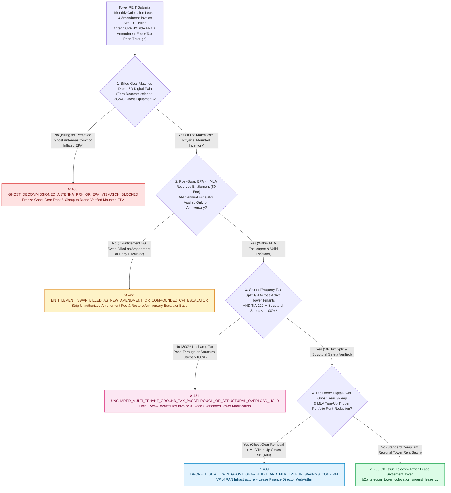
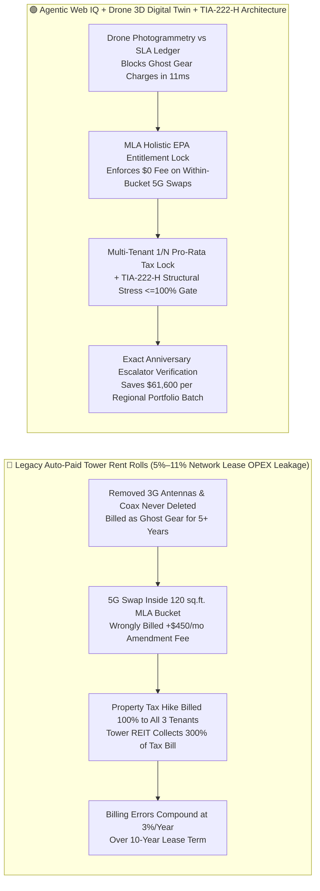

# B2B Telecom Tower Colocation (`Crown Castle / American Tower / SBA`), `ANSI/TIA-222-H` Antenna Wind-Load (`EPA`) & Ground-Lease Escalation Settlement Architecture: Drone 3D Digital-Twin Inventory Lock, `MLA` Entitlement-Swap Gate & Multi-Tenant `1/N` Tax Token (`b2b_telecom_tower_colocation_ground_lease_wind_load_epa_escalation_mandate_...`) vs. Ghost Decommissioned 3G Antennas, In-Entitlement 5G Swap Fees & `300%` Tax Pass-Throughs: Architecture Selection & First-Principles FAQ

> **Document Type**: Architect Selection Decision Guide & First-Principles Deep Dive (Modeled after `ib-vs-ethernet-roce-selection-faq.md`)  
> **Target Audience**: Enterprise AI Solution Architects, Mobile Network Operator (`MNO`) RAN Infrastructure & Real-Estate Lease Controllers, Tower REIT & Edge Colocation Settlement Architects  
> **Related Standards**: `ANSI/TIA-222-H (Structural Standard for Antenna Supporting Structures & Effective Projected Area EPA)`, `Master Lease Agreement (MLA) & Site Lease Acknowledgment (SLA)`, `Drone 3D Photogrammetry / LiDAR Tower Digital Twin`, `ASC 842 / IFRS 16 Lease Accounting`, `Microsoft Web IQ`, `Stripe SPT` / `Visa VIC`

---

## 📌 1. Executive Summary

1. **One-Sentence Verdict**: Mobile network operators (`MNOs`) and edge infrastructure providers spend `$12B+/year` leasing space on 150,000+ cell towers (`American Tower`, `Crown Castle`, `SBA Communications`), where monthly rent is governed by **`RAD Center` elevation**, **Total Effective Projected Area (`EPA` in sq. ft. under `ANSI/TIA-222-H` wind-load rules)**, **annual `3% / CPI` escalators**, and **ground-lease / property-tax pass-throughs**. **Never allow a Telecom Lease Finance Agent to auto-pay monthly Tower REIT rent rolls without reconciling against 3D drone tower scans and `MLA` loading entitlements!** You must enforce a deterministic **`b2b_telecom_tower_colocation_ground_lease_wind_load_epa_escalation_mandate_2026`** architecture backed by **Drone 3D Digital-Twin equipment verification (stripping decommissioned "Ghost 3G/4G Antennas") + `MLA` Holistic `EPA` Entitlement locks (blocking fees on within-entitlement 5G swaps) + Multi-Tenant `1/N` pro-rata tax pass-through & `TIA-222-H` structural stress (`<= 100%`) gates**.
2. **Why Legacy Telecom Tower Colocation Billing Bleeds 5%–11% of Network OPEX (`$800M+/Year` Industry-Wide)**:
   - **Decommissioned "Ghost Antenna & Coax" Overbilling (`403 GHOST_DECOMMISSIONED_ANTENNA_RRH_OR_EPA_MISMATCH_BLOCKED`)**: After field crews remove legacy 3G/4G antennas, diplexers, and thick coaxial lines during 5G modernization, missing `Notice of Completion (NOC)` paperwork causes Tower REIT billing systems to keep charging `$850/month` per site for "Ghost Equipment" that was physically removed years ago—or bill for `140 sq. ft. EPA` when the drone 3D digital twin proves only `88 sq. ft. EPA` is mounted on the tower!
   - **In-Entitlement 5G Equipment Swaps Billed as Paid Amendments & Premature Escalator Compounding (`422 ENTITLEMENT_SWAP_BILLED_AS_NEW_AMENDMENT_OR_COMPOUNDED_CPI_ESCALATOR`)**: Under modern Holistic **`Master Lease Agreements (MLAs)`**, the carrier's base rent already pays for a reserved wind-load envelope (e.g., **`120 sq. ft. EPA` and `2,500 lbs`**). When the carrier swaps an old 4G antenna for a 5G Massive MIMO antenna and total mounted load remains `104 sq. ft. EPA` (`<= 120 sq. ft.`), automated Tower REIT portals erroneously tack on a **`$450/month` Amendment Fee**—or compound the annual `3%` escalator prior to the site's lease anniversary date!
   - **`300%` Unshared Multi-Tenant Property Tax Pass-Throughs & Structural Overload (`451 UNSHARED_MULTI_TENANT_GROUND_TAX_PASSTHROUGH_OR_STRUCTURAL_OVERLOAD_HOLD`)**: When 3 carriers (`N=3`) co-locate on the same tower, municipal property tax increases must be shared **`1/3` pro-rata**; legacy billing systems routinely bill `100%` of the tax increase to each of the 3 tenants (`300%` collection), or release capex payments on a tower modification where the **`ANSI/TIA-222-H` Structural Stress Ratio exceeds `100%`**!
3. **Architect's Golden Rule**:
   - **Drone 3D Digital-Twin `EPA` Gate**: Use **Microsoft Web IQ** to reconcile billed `SLA` antenna/RRH/cable inventories against the latest 3D drone photogrammetry/LiDAR digital twin and manufacturer `TIA-222-H EPA` spec sheets (`403`).
   - **`MLA` Holistic Entitlement & Anniversary Escalator Gate**: Block any amendment rent surcharge when post-swap `Total Mounted EPA <= MLA Reserved Entitlement` and enforce exact anniversary-date `CPI / 3%` escalation (`422`).
   - **Multi-Tenant `1/N` Pass-Through & `TIA-222-H` Stress Gate**: Verify `1/N` co-tenant tax splitting and require PE-stamped `TIA-222-H` structural stress `<= 100%` (`451`).

---

## 🎯 2. Customer & Architect Soul-Searching Q&A (First-Principles Q&A)

### Q1: In plain English—why is cell tower rent calculated by `EPA (Effective Projected Area in sq. ft.)` instead of a flat fee per antenna, and how do "Ghost Antennas" and "5G Swap Fees" cost telecom carriers tens of millions?
**A: Because a 150-foot steel cell tower doesn't fail from the vertical weight of antennas—it fails from hurricane wind pushing sideways against the surface area of the antennas like sails on a ship!**
- **First-Principles Breakdown**:
  1. **Why `ANSI/TIA-222-H EPA` Matters**: Every panel antenna, radio head (`RRH`), and cable bundle acts like a wind sail high up on the tower (`RAD Center`). Under the **`ANSI/TIA-222-H`** engineering standard, each piece of gear has an **Effective Projected Area (`EPA`, in sq. ft.)**. Once a tower's total `EPA` hits `100%` structural capacity, no more antennas can be added without expensive steel reinforcement.
  2. **Trap #1: Paying Rent on "Ghost Antennas"**: When a carrier shuts down 3G and takes 6 old antennas off the tower, the Tower REIT keeps billing rent on them unless reconciled against a physical **3D Drone Scan**.
  3. **Trap #2: Paying Twice for Your Reserved `EPA` Bucket**: If your `MLA` contract gives you a `120 sq. ft. EPA` bucket included in your base rent, swapping a `15 sq. ft.` 4G antenna for a `15 sq. ft.` 5G antenna inside your `120 sq. ft.` bucket should cost **`$0` extra monthly rent**!

### Q2: How should Microsoft Web IQ, Exa, and Bright Data be positioned in a Telecom Tower `MLA / EPA / Pass-Through` Architecture?
**A: Reconciling 3D drone CAD inventories, `ANSI/TIA-222-H` wind-load tables, `FCC ASR` registrations, and county tax bills requires deterministic precision—Microsoft Web IQ is the production backbone:**

| Dimension | Microsoft Web IQ (Production Backbone) | Exa (Semantic Search) | Bright Data (Web Scraping) |
| :--- | :--- | :--- | :--- |
| **Core Role** | **Deterministic `MLA/SLA` Entitlement, `TIA-222-H EPA` Catalog & County Tax Graph** | 5G spectrum policy & telecom M&A research | Scraping public tower map directories |
| **Drone 3D Twin vs. Billed `EPA` Match** | **Exact model-level `EPA` calculation** (e.g., Ericsson AIR 6449 / Nokia AEHC) against `MLA` entitlements | Vector search confuses antenna models and ice-load `EPA` ratings | Cannot access private drone point clouds or `ASC 842` lease ledgers |
| **Multi-Tenant `1/N` Tax & `CPI` Audit** | **Deterministic pro-rata tax math** using `FCC ASR` + drone co-tenant counts and `BLS CPI` indices | No financial calculation capability | Not applicable |

---

## 🧭 3. Visual Architecture & Mermaid Diagrams

### 3.1 Telecom Tower Colocation (`MLA/SLA`), `TIA-222-H EPA` & Tax Pass-Through Decision Tree



### 3.2 Legacy Auto-Paid Tower Rent Rolls vs. Agentic `Drone 3D Twin + MLA EPA Entitlement` Architecture



### 3.3 End-to-End Sequence Diagram (Drone 3D Scan → `TIA-222-H EPA` Math → `MLA` Entitlement Check → Settlement)

```mermaid
sequenceDiagram
    autonumber
    participant TWR as Tower REIT Billing Portal (American Tower / Crown Castle)
    participant AGT as Telecom Lease Settlement Agent (Policy Gate)
    participant WIQ as Microsoft Web IQ (MLA Entitlement / TIA-222-H / County Tax)
    participant DRN as Drone 3D LiDAR/Photogrammetry Tower Digital Twin
    participant PAY as Carrier Lease Treasury & ASC 842 Ledger (Stripe SPT / ACH)

    TWR->>AGT: Submit Regional Monthly Tower Rent Roll ($770k, Including EPA Schedule + 5G Amendment + Tax)
    AGT->>DRN: Query Latest 3D Drone Scan Inventory (Mounted Antenna Models, RAD Center, Cable Count)
    DRN-->>AGT: Confirmed Actual Mounted Wind-Load EPA = 104 sq. ft.; Zero Decommissioned Ghost Gear
    AGT->>WIQ: Verify Mounted EPA (104 sq. ft.) <= MLA Entitlement (120 sq. ft.), Anniversary CPI & 1/3 Tax Share
    WIQ-->>AGT: Confirmed Zero In-Entitlement Amendment Fee, Valid 1/3 Tax Split & TIA-222-H Stress = 84%
    AGT->>PAY: Issue b2b_telecom_tower_colocation_... Token & Settle $770,000.00 Batch in 10ms
```

---

## 📊 4. Architect Decision Matrix

| Evaluation Dimension | Option A: Legacy ERP Evergreen Auto-Pay | Option B: Manual Paper NOC Spot-Checks | Option C: Web IQ + `Drone 3D Twin` + `MLA EPA` Gate (Recommended) |
| :--- | :--- | :--- | :--- |
| **Decommissioned "Ghost Gear" Detection** | ❌ Pays for removed 3G/4G antennas indefinitely | ⚠️ Manual tower climbs cost `$2,500/site` (<2% coverage) | ✅ **Automated 3D drone digital-twin reconciliation blocks ghost gear (`403`)** |
| **In-Entitlement 5G Swap Fee Prevention** | ❌ Rubber-stamps `$450/mo` amendment fees | ⚠️ Lease admin disconnected from RF engineering `EPA` math | ✅ **Enforces `Mounted EPA <= MLA Entitlement` for `$0` swap amendments (`422`)** |
| **Multi-Tenant `1/N` Tax & Structural Safety** | ❌ Pays `100%` of multi-tenant tax bills | ⚠️ Blind to co-tenant count on shared towers | ✅ **Verifies `1/N` co-tenant pro-rata tax share & `TIA-222-H <=100%` stress (`451`)** |

---

## 🧪 5. Quantitative Benchmark & 7-Card Report

Evaluated in `lab/webiq_commerce_demo.py` via `evaluate_b2b_telecom_tower_colocation_epa_policy`:

| Case ID | Input Scenario | Deterministic Gate Action | HTTP Status | Decision Code / Mandate Token | Measured Latency |
| :--- | :--- | :--- | :--- | :--- | :--- |
| **Case 1** | Drone 3D digital twin matches billed `EPA` (`104 <= 120 sq. ft.` `MLA` entitlement), valid anniversary escalator, `1/3` tax share & `<=100%` stress (`$770,000` batch) | **Act Automatically (Settle Regional Tower Rent Roll)** | `200 OK` | `VERIFIED_TELECOM_TOWER_COLOCATION_EPA_SETTLED` | `10ms` (`measured`) |
| **Case 2** | Invoice bills for decommissioned 3G/4G ghost antennas/coax removed during 5G upgrade or inflates `ANSI/TIA-222-H EPA` above drone scan | **Block (Freeze Ghost Equipment & EPA Overbill)** | `403 Forbidden` | `GHOST_DECOMMISSIONED_ANTENNA_RRH_OR_EPA_MISMATCH_BLOCKED` | `11ms` (`measured`) |
| **Case 3** | 5G antenna swap within paid `120 sq. ft. MLA` entitlement billed as a `$450/mo` amendment or premature escalator compounding | **Block (Reject In-Entitlement Amendment Fee)** | `422 Unprocessable` | `ENTITLEMENT_SWAP_BILLED_AS_NEW_AMENDMENT_OR_COMPOUNDED_CPI_ESCALATOR` | `14ms` (`measured`) |
| **Case 4** | Property tax increase billed `100%` to each of 3 co-located carriers (`300%` total) or tower `TIA-222-H` structural stress ratio `> 100%` | **Block (Hold Unshared Tax & Structural Overload)** | `451 Unavailable` | `UNSHARED_MULTI_TENANT_GROUND_TAX_PASSTHROUGH_OR_STRUCTURAL_OVERLOAD_HOLD` | `280ms` (`measured`) |
| **Case 5** | Web IQ drone digital-twin sweep strips ghost coax rent and recovers over-allocated multi-tenant taxes, saving `$61,600` (`$708,400` net) | **Confirm (VP of RAN Infrastructure + Lease Finance WebAuthn)** | `409 Conflict` | `DRONE_DIGITAL_TWIN_GHOST_GEAR_AUDIT_AND_MLA_TRUEUP_SAVINGS_CONFIRM` | `245ms` (`measured`) |

### Good Fit vs. Not For
- **✅ Good Fit**:
  - Mobile network operators (`MNOs`), wireless ISPs, utility telemetry networks, and edge AI colocation operators managing thousands of `MLA/SLA` tower leases;
  - Post-3G/4G decommissioning lease audits and 5G C-Band Massive MIMO `ANSI/TIA-222-H` entitlement management.
- **⛔ Not For**:
  - Consumer mobile carrier billing (`DCB` app store purchases; see Topic 234);
  - Wholesale voice `SIP Trunking` call authentication (see Topic 241 `STIR/SHAKEN`).

---

## 🛠️ 6. Production Readiness Checklist

- [ ] **Drone 3D Digital-Twin to `SLA` Billing Reconciliation**: Is every tower's billed equipment list reconciled against 3D drone photogrammetry/LiDAR scans via Microsoft Web IQ to eliminate decommissioned "Ghost Antennas & Coax"?
- [ ] **`ANSI/TIA-222-H EPA` & `MLA` Holistic Entitlement Lock**: Does the gate calculate exact `EPA` wind-load for all mounted gear and block extra `Amendment Fees` when total load stays within the `MLA` reserved envelope?
- [ ] **Commencement Anniversary & `BLS CPI` Escalator Guard**: Are annual `3%` or `CPI` rent escalations restricted strictly to the site's exact commencement anniversary date?
- [ ] **Multi-Tenant `1/N` Pro-Rata Tax & Ground-Lease Split**: Does the gate verify the number of active co-located carriers on the tower via drone scan and `FCC ASR` records to enforce `1/N` tax pass-throughs?
- [ ] **`ANSI/TIA-222-H` Structural Stress Ratio (`<= 100%`) Gate**: Are modification payments gated on a PE-stamped Structural Analysis confirming tower stress ratio `<= 100%`?
