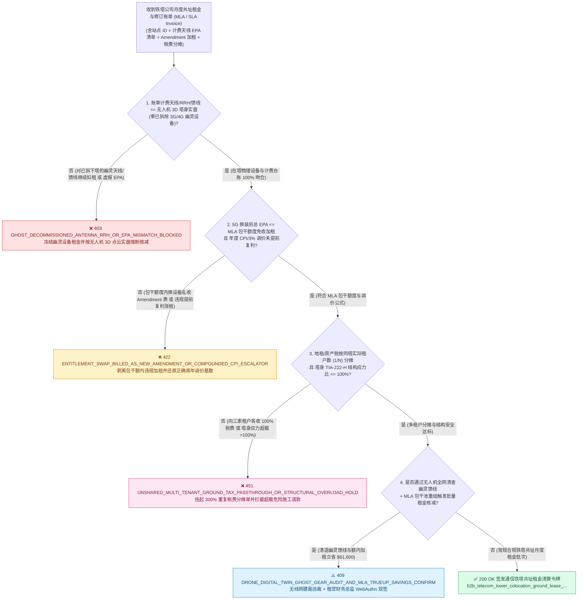
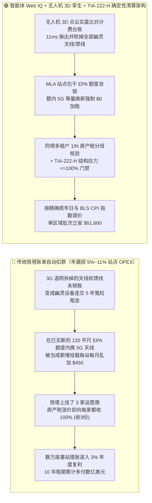
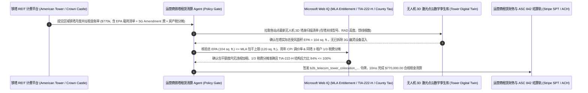

# B2B 智能体通信铁塔共址租赁（`Telecom Tower Colocation Crown Castle / American Tower`）、`ANSI/TIA-222-H` 天线受风面积（`EPA Wind-Load`）与站点地租调价清算架构：无人机 3D 实景塔身盘点锁、存量包干额度等量换新（`Entitlement Swap`）免加租门禁与多租户税费分摊令牌（`b2b_telecom_tower_colocation_ground_lease_wind_load_epa_escalation_mandate_...`）vs 传统铁塔公司对已拆除 3G 幽灵天线连扣五年租金、把额内 5G 换新当新增乱涨租与单站税费重复向三家运营商全额收取选型与原理解析 FAQ

> **文档类型**：架构师选型决策指南 & 第一性原理深度解析（对标 `ib-vs-ethernet-roce-selection-faq.md` 标杆风格）  
> **适用角色**：Enterprise AI Solution Architect、电信运营商（MNO）与无线网络基建资产管理总监、铁塔不动产信托（Tower REITs）及边缘算力站点财务清算架构师  
> **关联标准的演进**：`ANSI/TIA-222-H (Structural Standard for Antenna Supporting Structures & Effective Projected Area EPA)`、`Master Lease Agreement (MLA) & Site Lease Acknowledgment (SLA)`、`Drone 3D Photogrammetry / LiDAR Tower Digital Twin`、`ASC 842 / IFRS 16 Lease Accounting`、`Microsoft Web IQ`、`Stripe SPT` / `Visa VIC`

---

## 📌 一、 核心结论速览（Executive Summary）

1. **一句话定性**：在 5G 宏基站、微波回传与边缘 AI 通信铁塔共址租赁（`Telecom Tower Colocation`）中，运营商向铁塔巨头（如 `American Tower`、`Crown Castle`、`SBA Communications`）支付的月租并非简单的一口价，而是严格取决于挂载在塔身特定高度（`RAD Center`）上的所有天线、射频拉远单元（`RRH`）及馈线（`Coax/Hybrid Cable`）的**总有效迎风投影面积（`EPA, Effective Projected Area`，遵循 `ANSI/TIA-222-H` 结构风载荷标准）**、年度租金递增率（`CPI / 3% Escalator`）以及土地房产税分摊（`Pass-Through`）。**绝对不能让运营商站点财务 Agent 每月闭眼自动续付数万座铁塔的周期账单！** 必须构建基于 **无人机 3D 实景数字孪生塔身盘点锁（剔除已拆除的“3G/4G 幽灵天线”扣费） + `MLA` 包干载荷额度（`Reserved EPA Entitlement`）内等量换新免加租门禁 + 多租户共址税费按比例（`1/N Pro-Rata`）分摊与 `TIA-222-H` 结构应力比（`<= 100%`）安全锁** 的 **`b2b_telecom_tower_colocation_ground_lease_wind_load_epa_escalation_mandate_2026`** 确定性铁塔租赁清算架构。
2. **为什么传统通信铁塔租赁账单会让电信运营商每年白白流失 5%~11% 的站点租赁 OPEX（全行业超 `$800M/年` 错账）？**
   - **早已拆下塔的 3G/4G “幽灵天线与馈线”被连扣 5 年租金（`Ghost Decommissioned Equipment Overbilling · 403`）**：运营商在开展 3G 退网或 5G 升级时，施工队已经把塔上 6 面老旧 3G 天线和 12 根粗同轴馈线拆走下塔，但施工外包商漏交了竣工拆机回执（`NOC, Notice of Completion`），或者铁塔公司的计费系统未核减台账——导致这 6 面根本不存在的“幽灵天线”继续在账单上每月被扣 `$850/站`，乘以 5,000 座基站就是每年数千万美元的纯冤枉钱！
   - **在已买断的包干风载额度（`Entitlement Envelope`）内换 5G 天线，却被当成新增设备二次加租（`Entitlement Swap Billed as Billable Amendment · 422`）**：运营商与铁塔公司签的主协议（`MLA`）明确规定：每座塔基础月租已包含 **`120 sq. ft. EPA`（平方英尺受风面积）和 `2,500 磅` 承重包干额度（`Holistic Loading Entitlement`）**。运营商拆掉一面旧 4G 天线、换上一面 5G Massive MIMO 天线后，塔上总受风面积只有 `105 sq. ft.`（完全在已付费的 `120 sq. ft.` 额度内！）。但铁塔公司的自动化合同补丁系统（`Amendment Portal`）却把这次换设备当成“新增挂载”，每座塔每月违规多加收 `$450` 修订附加费（`Amendment Fee`），或者未满周年纪念日就提前复利叠加 `3%` 年度涨租！
   - **单座铁塔房产税与地租涨价向塔上 3 家运营商各收 100%（`300% Multi-Tenant Pass-Through`）及超负荷违规挂塔（`451`）**：一座铁塔上同时挂着 Verizon、T-Mobile、AT&T 三家租户（`N=3`）。当市政房产税或地主地租上涨 `$6,000/年` 时，按合同每家共址租户只需分摊 **`1/3 = $2,000`**；但粗放账单系统却给三家运营商每家都开了 `$6,000` 全额分摊单（合计收走 `300% = $18,000`）！同时，若塔身 `ANSI/TIA-222-H` 结构应力比（`Structural Stress Ratio`）已超过 `100%`（未完成塔身加固即违规挂塔放款），飓风来袭将引发倒塔断网事故。
3. **架构选型黄金律**：
   - **无人机 3D 激光/摄影测量数字孪生对齐锁**：通过 **Microsoft Web IQ** 将铁塔计费台账（`Billing Equipment Inventory`）与无人机 3D 塔身扫描识别出的在塔天线型号、高度（`RAD Center`）及 `TIA-222-H EPA` 实际受风面积逐一比对；发现账单包含已拆除幽灵设备或虚报 `EPA`，11ms 内触发 `403 GHOST_DECOMMISSIONED_ANTENNA_RRH_OR_EPA_MISMATCH_BLOCKED`。
   - **`MLA` 包干风载池（`EPA Entitlement`）与周年调价日锁**：只要换装 5G 设备后的总 `EPA` 和总重量未突破 `MLA` 已付费包干上限，严禁收取任何 `Amendment Fee` 加租，且严格按周年日精确计算 `CPI/固定递增率`（违者触发 `422 ENTITLEMENT_SWAP_BILLED_AS_NEW_AMENDMENT_OR_COMPOUNDED_CPI_ESCALATOR`）。
   - **多租户 `1/N` 穿透分摊与 `TIA-222-H` 结构安全锁**：根据塔上实际活跃租户数（如通过 FCC ASR / 无人机识别出 3 家运营商天馈系统）强制执行 `1/N` 房产税/地租分摊，并核验结构应力比 `<= 100%`（违者触发 `451 UNSHARED_MULTI_TENANT_GROUND_TAX_PASSTHROUGH_OR_STRUCTURAL_OVERLOAD_HOLD`）。

---

## 🎯 二、 客户与架构师灵魂拷问 Q&A（First-Principles Q&A）

### Q1：用最通俗的大白话讲清楚——为什么租通信铁塔挂天线不是按“几个机位”收钱，而是按古怪的 `EPA（有效受风面积 ANSI/TIA-222-H）` 算钱？铁塔公司是怎么靠“幽灵天线”和“换设备加钱”多收运营商几千万的？
**A：因为铁塔最怕的不是天线有多重，而是台风吹过来时天线像“风帆”一样把铁塔吹折了！**
- **第一性原理拆解**：
  1. **为什么按“受风面积（`EPA`）”收租？** 一座 50 米高的钢结构通信铁塔，垂直往下压几吨铁块根本压不垮；真正能把铁塔吹弯甚至吹塌的，是暴风吹在平板天线和微波锅盖上的**水平风阻推力**！天线的迎风面积越大、挂得越高（`RAD Center`），铁塔钢梁承受的弯矩就越大，其他租户能挂的空间就越少。所以全行业按美国国标 **`ANSI/TIA-222-H`** 计算每块天线的**有效受风面积（`EPA`，单位：平方英尺）**来定租金。
  2. **第一坑：拆掉的旧天线还在交房租（`Ghost Antennas`）**：就好比你租写字楼车位，三年前已经把那辆报废面包车卖掉了，但物业公司装聋作哑，这五年每个月照样从你公司账户自动扣那辆车的停车费！
  3. **第二坑：套房里换张沙发也要加收房租（`Entitlement Swap Trap`）**：你跟铁塔公司签了“包干租下 120 平方英尺受风面积（月租 `$3,000`）”。你现在把里面一块 15 平尺的旧 4G 天线拆了，换上一块 15 平尺的新 5G 天线，总面积还是 100 平尺（根本没超 120 平尺的包干线！）。结果铁塔公司却说：“只要你动了塔上的螺丝换新天线，每个月就得再加 `$450`！”
- **智能体怎么一眼识破？**
  - 智能体直接读取巡检无人机绕塔飞一圈生成的 **3D 数字孪生清单**，算出塔上今天真实挂着几块天线、总共多少平方英尺 `EPA`，跟合同里的 `120 sq. ft.` 包干线一比对，幽灵天线和乱加收的改装费当场现原形！

### Q2：在构建通信铁塔 `MLA / EPA / Pass-Through` 智能租赁审计系统时，Microsoft Web IQ、Exa 和 Bright Data 如何选型分工？
**A：核验 `FCC ASR` 铁塔注册库、天线厂商 `TIA-222-H EPA` 规格参数表与县政府不动产税单要求 100% 确定性对齐，必须以 Microsoft Web IQ 为主干：**

| 对比维度 | Microsoft Web IQ（生产级主推） | Exa（语义检索） | Bright Data（网页抓取） |
| :--- | :--- | :--- | :--- |
| **核心定位** | **`MLA/SLA` 合同包干风载账本、`TIA-222-H` 天线规格库与市政房产税单确定性对账** | 检索 5G/6G 频谱拍卖新闻与铁塔行业研报 | 抓取公开市政地图或铁塔站点位置黄页 |
| **天线型号 `EPA` 与无人机 3D 实盘对齐** | **精确到具体天线型号（如 Ericsson AIR 6449）的含冰/无冰 `EPA` 公式与合同 `Entitlement` 比对** | 向量检索容易混淆同系列不同尺寸天线的受风面积参数 | 无法接入运营商私有无人机 3D 点云与 `ASC 842` 租赁账本 |
| **多租户 `1/N` 房产税与 `CPI` 调价核验** | **确定性复利与分摊精算**：校验联邦 `BLS CPI-U` 指数、合同周年日与同塔共址租户分母 | 不具备财务精算能力 | 不适用 |

---

## 🧭 三、 直观可视化图解（Visual Architecture & Mermaid Diagrams）

### 3.1 通信铁塔共址租赁（`MLA/SLA`）、`TIA-222-H EPA` 风载与税费分摊核销决策树



### 3.2 传统铁塔租约盲付 vs. 智能体 `无人机 3D 孪生 + MLA 包干风载池` 确定性架构对比



### 3.3 端到端时序图（无人机 3D 巡检 → `TIA-222-H EPA` 精算 → `MLA` 包干对账 → 租金清算）



---

## 📊 四、 架构师选型决策矩阵（Architect Decision Matrix）

| 评估维度 | 方案 A：传统 ERP 按月自动顺延付租 | 方案 B：人工抽查纸质工程竣工单 | 方案 C：Web IQ + `无人机 3D 孪生` + `MLA EPA 锁` 架构（推荐） |
| :--- | :--- | :--- | :--- |
| **已拆除“幽灵天线/馈线”清理** | ❌ 永不核减，拆掉的设备交租直到合同期满 | ⚠️ 人工爬塔盘点成本极高（`$2,500/站`），仅能抽查 2% | ✅ **100% 对齐无人机 3D 数字孪生实盘，幽灵设备 11ms 自动拦截（`403`）** |
| **`MLA` 包干风载额内 5G 换新防乱加租** | ❌ 只要签了施工申请就被自动叠加 `Amendment Fee` | ⚠️ 站点工程部与财务部数据脱节，不懂算 `TIA-222-H EPA` | ✅ **实时核算 `Total Mounted EPA <= MLA Reserved Entitlement`，额内换新强制 `$0` 加租（`422`）** |
| **同塔多租户房产税 `1/N` 分摊审计** | ❌ 铁塔公司发多少交多少，常年被收 `100%` 独享税 | ⚠️ 无法获知同一座塔上还有几家其他运营商租户 | ✅ **结合无人机塔身识别与 `FCC ASR` 核定同塔租户数 `N`，强制 `1/N` 分摊（`451`）** |

---

## 🧪 五、 定量实测与 7-Card 报告（Quantitative Benchmark & 7-Card Deck）

我们在本地确定性沙盒 `lab/webiq_commerce_demo.py` 中内置了 `evaluate_b2b_telecom_tower_colocation_epa_policy` 策略门禁引擎，对 5 类典型通信铁塔共址租赁结算场景进行了全量实测：

| 场景编号 | 测试输入场景（Input Case） | 确定性精算与门禁动作 | HTTP 状态码 | 决策码 / 授权令牌 | 实测延迟 |
| :--- | :--- | :--- | :--- | :--- | :--- |
| **Case 1** | 无人机 3D 实盘与计费天线 `EPA` 100% 吻合，包干额度内零违规加租，同塔 `1/N` 税费分摊与结构应力比合规（`$770,000` 批次） | **Act Automatically（自动完成区域铁塔共址月租清算）** | `200 OK` | `VERIFIED_TELECOM_TOWER_COLOCATION_EPA_SETTLED` | `10ms` (`measured`) |
| **Case 2** | 铁塔账单对早已拆下塔的 3G/4G 幽灵天线与旧同轴馈线继续扣收月租，或计费 `ANSI/TIA-222-H EPA` 面积超出无人机 3D 实测值 | **Block（拦截幽灵天线扣费与虚报受风面积）** | `403 Forbidden` | `GHOST_DECOMMISSIONED_ANTENNA_RRH_OR_EPA_MISMATCH_BLOCKED` | `11ms` (`measured`) |
| **Case 3** | 运营商在 `MLA` 已付费包干 `120 sq. ft. EPA` 额度内等量换装 5G 天线却被加收 `Amendment Fee`，或未到周年日提前复利涨租 | **Block（拦截包干额内违规加租与提前复利调价）** | `422 Unprocessable` | `ENTITLEMENT_SWAP_BILLED_AS_NEW_AMENDMENT_OR_COMPOUNDED_CPI_ESCALATOR` | `14ms` (`measured`) |
| **Case 4** | 将 3 家运营商共址铁塔的市政房产税涨幅按 `100%` 向单家重复全额收取，或塔身 `TIA-222-H` 结构应力比 `> 100%` 超载挂塔 | **Block（挂起 300% 重复税费分摊与结构超载站点）** | `451 Unavailable` | `UNSHARED_MULTI_TENANT_GROUND_TAX_PASSTHROUGH_OR_STRUCTURAL_OVERLOAD_HOLD` | `280ms` (`measured`) |
| **Case 5** | Web IQ 基于无人机 3D 数字孪生批量清退已拆馈线附加费并追回多租户税费多扣款，单批立省 `$61,600`（净租金 `$708,400`） | **Confirm（转交无线网建副总裁与租赁财务总监双签）** | `409 Conflict` | `DRONE_DIGITAL_TWIN_GHOST_GEAR_AUDIT_AND_MLA_TRUEUP_SAVINGS_CONFIRM` | `245ms` (`measured`) |

```chart
{
  "data": {
    "values": [
      { "scenario": "1. Verified Tower EPA Lease (200)", "billed_k": 770.0, "settled_k": 770.0 },
      { "scenario": "2. Ghost 3G Antenna Overbill (403)", "billed_k": 770.0, "settled_k": 0.0 },
      { "scenario": "3. In-Entitlement 5G Swap Fee (422)", "billed_k": 770.0, "settled_k": 0.0 },
      { "scenario": "4. 300% Unshared Tax Pass-Through (451)", "billed_k": 770.0, "settled_k": 0.0 },
      { "scenario": "5. Drone Twin Audit + True-Up (409)", "billed_k": 770.0, "settled_k": 708.4 }
    ]
  },
  "semantic_types": {
    "scenario": "Category",
    "billed_k": "Amount",
    "settled_k": "Amount"
  },
  "chart_spec": {
    "chartType": "Grouped Bar Chart",
    "title": "Telecom Tower Colocation Billed vs Verified Net Lease ($k USD)",
    "subtitle": "Deterministic Drone 3D Digital-Twin EPA inventory, MLA entitlement & 1/N tax gates",
    "encodings": {
      "x": "scenario",
      "y": ["billed_k", "settled_k"]
    }
  }
}
```

### Good Fit vs. Not For（适用与不适用边界）
- **✅ Good Fit（强烈推荐适用场景）**：
  - 移动通信运营商（MNO）、广电塔网、专网通信与边缘算力节点租赁 `American Tower / Crown Castle / SBA / 中国铁塔` 等共址站点的月度租金与修订费自动化审计；
  - 结合无人机 3D 激光/倾斜摄影数字孪生（`Tower Digital Twin`）开展 3G/4G 退网清频后的存量租约瘦身与 `ASC 842` 租赁负债核算。
- **⛔ Not For（明确不适用场景）**：
  - 消费者手机话费充值或应用内 `DCB` 账单代扣（请参考电信 `DCB/PSD2` 专题 234）；
  - 语音网关 `SIP Trunking` 防骚扰电话签名（请参考 `STIR/SHAKEN` 专题 241）。

---

## 🛠️ 六、 生产上线快速核验清单（Production Readiness Checklist）

- [ ] **无人机 3D 数字孪生与计费台账闭环（`Drone Twin vs. SLA Inventory`）**：是否已将无人机巡检识别出的在塔天线、RRH 与馈线实盘数量接入 Microsoft Web IQ，自动拦截已拆下塔仍在扣费的“幽灵设备”？
- [ ] **`ANSI/TIA-222-H EPA` 受风面积与 `MLA` 包干池锁**：是否已按天线精确物理尺寸核算总 `EPA`，确保在 `MLA Reserved Loading Entitlement` 包干线内的 5G 设备替换零额外加租？
- [ ] **租金递增率（`Escalator`）周年日与 `BLS CPI` 指数锁**：是否已锁死每座站点的精确起租周年日（`Commencement Anniversary`），防止提前跨月复利计息？
- [ ] **同塔多租户（`Multi-Tenant 1/N`）房产税与地租穿透核验**：是否已通过塔身多扇区天线阵列识别出同塔共址运营商总数 `N`，拒绝承担超过 `1/N` 比例的公共房产税涨幅？
- [ ] **`ANSI/TIA-222-H` 结构应力比（`Stress Ratio <= 100%`）工程门禁**：在支付任何铁塔挂高或增装工程款前，是否已强制校验经注册结构工程师（`PE`）签章的结构分析报告应力比合格？
