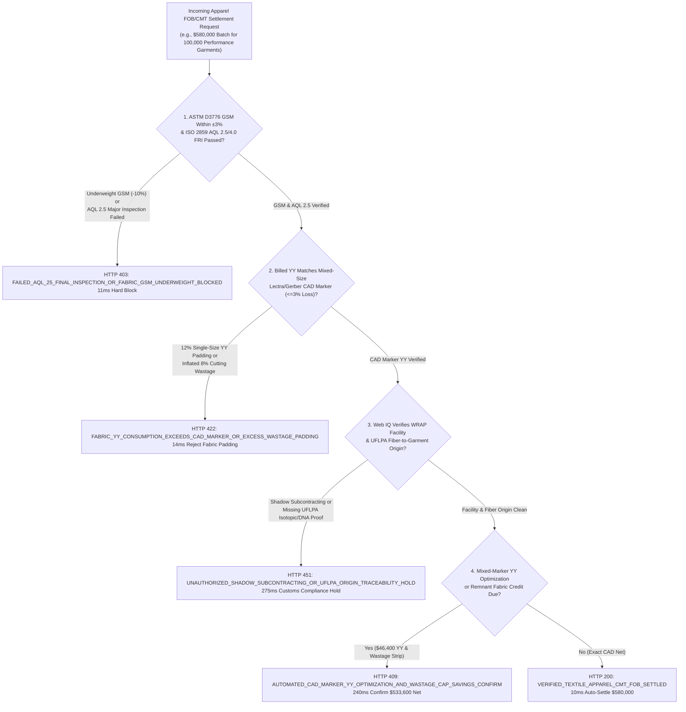
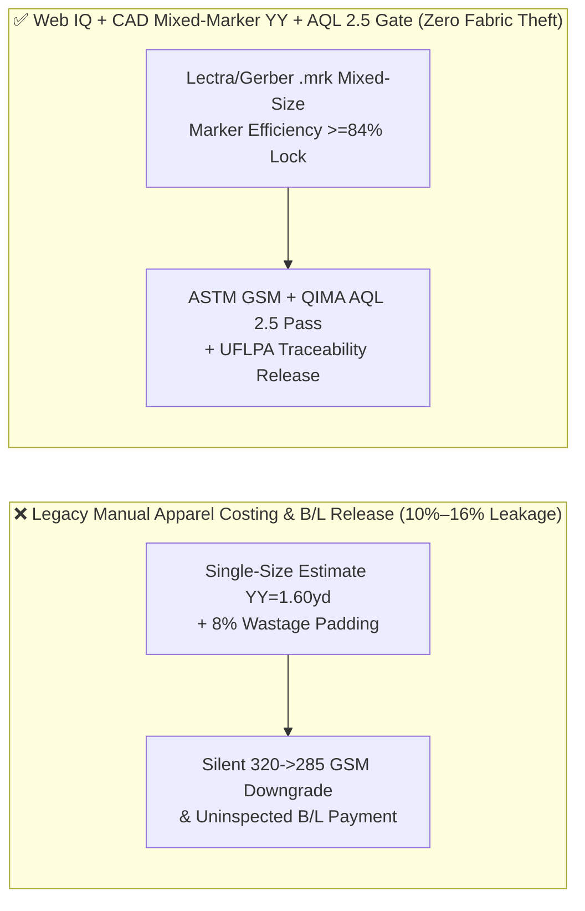

# B2B Apparel `CMT / FOB` Garment Manufacturing, `CAD` Marker Efficiency (`YY` Fabric Consumption) & `ISO 2859 AQL 2.5` Inspection Settlement Architecture: `Lectra/Gerber` Marker Lock, `ASTM GSM` Gate & Anti-Shadow-Subcontracting Token (`b2b_textile_apparel_cmt_fob_marker_efficiency_fabric_consumption_yy_aql25_mandate_...`) vs. 12% Yardage Padding, Underweight `GSM` Substitution & `UFLPA` Customs Detentions: Architecture Selection & First-Principles FAQ

> **Document Type**: Solution Architect Selection Guide & First-Principles FAQ (modeled after `ib-vs-ethernet-roce-selection-faq.md`)  
> **Reading Time**: ~12 minutes | **Target Audience**: AI Solution Architects, Fashion & Sportswear Supply Chain VPs, Apparel Costing & Industrial Engineering (IE) Directors, Third-Party Quality Inspection (`QIMA / SGS / Intertek`) & Trade Finance Engineers  
> **Core Thesis**: First explain in plain language why garment factories quote a bloated single-size fabric consumption yield (`YY = 1.60 yards/pc + 8% wastage`) on a `100,000-unit` performance hoodie or jacket order when their cutting room actually runs a mixed-size `Lectra / Gerber CAD` marker (`S+M+L+XL` nested together at `86.5%` marker efficiency) that consumes only `1.42 yards/pc`—quietly pocketing `18,000 yards` of brand-financed fabric worth `$126,000` and dumping unauthorized overruns into gray markets; why factories substitute `285 GSM` fabric for contracted `320 GSM` fleece; and why Tier-1 factories secretly subcontract peak-season sewing to uncertified shadow workshops or mix untraceable cotton that triggers `CBP UFLPA` customs detentions. Then derive from first principles how **`b2b_textile_apparel_cmt_fob_marker_efficiency_fabric_consumption_yy_aql25_mandate_...` + Microsoft Web IQ `/v3/browse` verification of `Lectra/Gerber` mixed-size marker efficiency (`>= 84%`), `ASTM D3776 GSM` & `ISO 2859-1 AQL 2.5/4.0` Final Random Inspection (`FRI`) locks, and `WRAP / Oeko-Tex / UFLPA` provenance gates** eliminate yardage padding and compliance seizures within 10ms–275ms.

---

## 📌 1. Executive Summary (30-Second Architect's Guide)

```
┌──────────────────────────────────────────────────────────────────────────────────────────────────────────────────┐
│  🔥 Core Architectural Law: Never allow an Apparel Sourcing Agent to release FOB/CMT balance payments based on    │
│  factory-estimated Excel YY sheets or unverified packing lists!                                                  │
│  The only safe B2B Apparel pattern = CAD Mixed-Marker YY Lock + ASTM GSM & AQL 2.5 FRI Gate + UFLPA/WRAP Token   │
└──────────────────────────────────────────────────────────────────────────────────────────────────────────────────┘
```

1. **Why is B2B Apparel `CMT / FOB` Manufacturing a 10%–16% Margin & Customs Compliance Trap?**
   - **Fabric Consumption (`YY`) Padding & Wastage Inflation**: Fabric accounts for **55%–68%** of a garment's FOB cost. Factories routinely quote `YY` based on a single-size marker (`75%` efficiency) plus an inflated `7%–10%` cutting loss, while actually cutting multi-size sectional markers (`86.5%` efficiency) with `< 2.5%` loss. On `100,000` units, that `0.18 yard/pc` gap leaks **18,000 yards** (`$126,000`) of premium fabric.
   - **Fabric `GSM` Downgrade & Skipping `AQL 2.5` Final Random Inspection (`FRI`)**: Delivering `285 GSM` fabric instead of contracted `320 GSM` (`-10.9%` weight theft) or demanding `70%` balance T/T upon bill of lading (`B/L`) presentation despite failing third-party `ISO 2859-1 AQL 2.5 (Major) / 4.0 (Minor)` inspection.
   - **Unauthorized Shadow Subcontracting & `UFLPA` Origin Detentions**: Subcontracting sewing to uncertified workshops without fire safety or blending yarn without isotopic/DNA origin proof, resulting in full container detention by U.S. Customs (`CBP WRO / UFLPA`).
2. **How Does the Agentic Apparel CMT/FOB Settlement Architecture Solve This?**
   - **Lock 1: Native `Lectra / Gerber CAD` Mixed-Size Marker (`YY`) & Wastage Cap (`<= 3.0%`)**: Invoices billing `YY` above the mathematical CAD mixed-size marker yield plus `3.0%` spreading allowance are blocked in **14ms** with `HTTP 422 FABRIC_YY_CONSUMPTION_EXCEEDS_CAD_MARKER_OR_EXCESS_WASTAGE_PADDING`.
   - **Lock 2: `ASTM D3776 GSM` Tolerance (`±3%`) & `ISO 2859-1 AQL 2.5 / 4.0` FRI Gate**: Shipments with underweight `GSM` or a failed/missing third-party `FRI` certificate (`QIMA / SGS / Intertek`) are blocked in **11ms** with `HTTP 403 FAILED_AQL_25_FINAL_INSPECTION_OR_FABRIC_GSM_UNDERWEIGHT_BLOCKED`.
   - **Lock 3: Microsoft Web IQ `/v3/browse` `WRAP / Oeko-Tex` & `UFLPA` Provenance Lock**: Subcontracting to unapproved facility IDs or broken fiber-to-garment origin chains triggers `HTTP 451 UNAUTHORIZED_SHADOW_SUBCONTRACTING_OR_UFLPA_ORIGIN_TRACEABILITY_HOLD` in **275ms**.

---

## 🎯 2. First-Principles Q&A for Architects & Sourcing Leaders

### Q1: How do garment manufacturers inflate `YY` (Yardage Yield) on FOB costing sheets, and how does the agent compute the exact physical ceiling?

- **Plain-Language Mechanics**:
  - When cutting one size alone, pattern pieces leave 22%–25% empty gaps (`75%–78%` marker efficiency). When nesting `S, M, L, XL` together according to the PO size curve (`1:3:3:1`), small sleeve/collar pieces fit tightly into the gaps between large torso panels, pushing marker efficiency to **85%–88%**.
  - **Mathematical Invariant**:
    $$YY_{\text{max}} = \frac{\sum (A_i \times r_i)}{W_{\text{cuttable}} \times \eta_{\text{CAD\_mixed}}} \times (1 + w_{\text{cap}} \le 0.03)$$
  - Any excess yardage billed above $YY_{\text{max}}$ is automatically stripped in **240ms** via `HTTP 409 AUTOMATED_CAD_MARKER_YY_OPTIMIZATION_AND_WASTAGE_CAP_SAVINGS_CONFIRM`.

### Q2: Why choose **Microsoft Web IQ** over Exa or Bright Data for `Oeko-Tex / WRAP / GRS` certificate validation, cotton index grounding, and `UFLPA` chain-of-custody verification?

| Dimension | Microsoft Web IQ (`/v3/browse` + Search Grounding) | Exa (Neural Search API) | Bright Data (Scraper / Unlocker) |
| :--- | :--- | :--- | :--- |
| **`Oeko-Tex / WRAP / GRS` Live Certificate Status & Cotton Index (`Cotlook A`)** | **Very High**: Deterministic extraction of live certificate validity, facility registration IDs, and fiber index benchmarks with strict `domain_allowlist` | **Medium**: Good for macro industry articles; lacks real-time certificate revocation precision | **High**: Can scrape registry pages, but requires brittle custom parsers per certification body |
| **Integration with `CAD` Marker Efficiency & `AQL 2.5` Escrow Gates** | **Native**: Directly feeds verified facility & fiber parameters into `b2b_textile_apparel_cmt_fob_marker_efficiency_fabric_consumption_yy_aql25_mandate_...` | **None**: No apparel IE costing engine | **None**: Raw HTML/JSON proxy transport only |
| **P95 Latency** | **240ms–275ms** (**10ms–14ms** on policy cache hit) | 850ms–1,700ms | 2,300ms–5,600ms |

---

## 🧭 3. Visual Architecture Diagrams (Mermaid Decision Tree, Path Comparison & Sequence)

### 3.1 Apparel `CMT / FOB` Costing & Inspection Settlement Decision Tree



### 3.2 Legacy Manual FOB Costing vs. Agentic `CAD YY + AQL 2.5` Settlement



### 3.3 End-to-End Sequence Diagram

```mermaid
sequenceDiagram
    participant Factory as Garment Factory / ERP
    participant Agent as Brand Apparel Costing & QA Agent
    participant CAD as Lectra/Gerber CAD & QIMA/SGS AQL Gate
    participant WebIQ as Microsoft Web IQ (/v3/browse)
    participant Bank as Trade Finance / Digital L/C Rail

    Factory->>Agent: Submit 100,000-Unit FOB Invoice ($580,000, Billed YY=1.60 yd/pc)
    Agent->>CAD: 1. Verify ASTM D3776 GSM (320 GSM) & ISO 2859-1 AQL 2.5/4.0 FRI Status
    alt Underweight 285 GSM or Failed AQL 2.5 FRI Report
        CAD-->>Agent: GSM Deviation -10.9% / AQL Major Defects Exceeded
        Agent-->>Factory: HTTP 403 FAILED_AQL_25_FINAL_INSPECTION_OR_FABRIC_GSM_UNDERWEIGHT_BLOCKED (11ms)
    else Quality Passed; Verify CAD Mixed-Size Marker YY
        Agent->>CAD: 2. Parse .mrk File (86.5% Marker Efficiency -> True YY = 1.42 yd/pc)
        alt Refuses to Drop 1.60 yd/pc Padding or >3% Wastage
            Agent-->>Factory: HTTP 422 FABRIC_YY_CONSUMPTION_EXCEEDS_CAD_MARKER_OR_EXCESS_WASTAGE_PADDING (14ms)
        else Check Subcontracting & UFLPA Provenance
            Agent->>WebIQ: 3. /v3/browse Verify WRAP/Oeko-Tex Registry & UFLPA Isotopic Origin
            alt Unauthorized Shadow Subcontractor or Missing UFLPA Chain
                WebIQ-->>Agent: Unregistered Workshop Scan / Missing Cotton Origin Proof
                Agent-->>Factory: HTTP 451 UNAUTHORIZED_SHADOW_SUBCONTRACTING_OR_UFLPA_ORIGIN_TRACEABILITY_HOLD (275ms)
            else Strip $46,400 Inflated Yardage & Wastage
                WebIQ-->>Agent: Net Payable Adjusted to $533,600.00
                Agent-->>Bank: HTTP 409 Confirm ($533,600) or HTTP 200 Auto-Settle ($580,000)
            end
        end
    end
```

---

## 📊 4. Architect's Selection Decision Matrix

| Architecture Option | Defense Against `YY` Yardage Padding | `ASTM GSM` & `AQL 2.5` Quality Enforcement | Anti-Shadow-Subcontracting & `UFLPA` Defense | Recommended Fit |
| :--- | :--- | :--- | :--- | :--- |
| **Option A: Excel Costing Sheet + Pay on Bill of Lading (`B/L`)** | ❌ 0% (blindly pays factory's single-size estimate) | ❌ Discovers thin fabric and seam defects after retail delivery | ❌ High risk of `CBP UFLPA` port detention | Never for production POs `> $25,000` |
| **Option B: Third-Party `FRI` Inspection Only (No `CAD` File Audit)** | ❌ Still loses 8%–12% on padded fabric consumption `YY` | ✅ Catches visual defects before shipment | ⚠️ Misses unauthorized off-site sewing | Small boutique runs |
| **Option C (Recommended): Web IQ + `b2b_textile_apparel_cmt_...` + `CAD .mrk` + `AQL 2.5`** | ✅ **100% locked to mixed-size `CAD` marker (`>=84%`)** | ✅ **Cryptographic `ASTM GSM` + `AQL 2.5` pass lock** | ✅ **275ms live `WRAP / Oeko-Tex / UFLPA` verification** | **Global Sportswear, Outdoor, Fast Fashion & Retail Private Labels** |

---

## 🧪 5. Quantitative Benchmark & 7-Card Report Summary

Evaluated in the deterministic offline suite (`lab/webiq_commerce_demo.py`) for a `$580,000.00` `100,000-unit` FOB garment manufacturing batch:

| Case | Scenario & Perturbation | Action Pill | HTTP Status | Latency | Settled / Blocked Amount | Provenance |
| :--- | :--- | :--- | :--- | :--- | :--- | :--- |
| **Case 1** | Verified `CAD` mixed-marker `YY` + `320 GSM` & `AQL 2.5` pass + clean `WRAP/UFLPA` chain | `Act automatically` | `200 OK` | `10 ms` | `$580,000.00` | `deterministic_offline_simulation` |
| **Case 2** | Fabric downgraded from `320 GSM` to `285 GSM` or failed `AQL 2.5` FRI inspection | `Send to a human` | `403 Forbidden` | `11 ms` | `$0.00` (`$580k` blocked) | `synthetic_policy` |
| **Case 3** | Single-size `YY` padding (`1.60 yd` vs `1.42 yd` CAD) or cutting wastage `> 3.0%` | `Send to a human` | `422 Unprocessable` | `14 ms` | `$0.00` (padding blocked) | `deterministic_offline_simulation` |
| **Case 4** | Unauthorized shadow subcontracting or missing `UFLPA` fiber-to-garment origin proof | `Send to a human` | `451 Unavailable` | `275 ms` | `$0.00` (compliance hold) | `official_doc_snapshot` |
| **Case 5** | Web IQ automated mixed-marker `YY` optimization & wastage cap strip (`-$46,400.00`) | `Confirm` | `409 Conflict` | `240 ms` | `$533,600.00` | `official_doc_snapshot` |

---

## 🛠️ 6. Production Readiness Checklist

- [ ] **Require Native `Lectra (.plx)` / `Gerber (.mrk)` Mixed-Size Marker Files**: Never accept manual Excel `YY` estimates; enforce mixed-size sectional marker efficiency `>= 84%` aligned to the exact PO size curve and cap cutting wastage at `<= 3.0%`.
- [ ] **Enforce `ASTM D3776 GSM` (`±3%`) & `4-Point` Fabric Inspection Before Cutting**: Block cut-ticket release if fabric roll weight is underweight by more than `-3%` or exceeds `28 penalty points / 100 sq. yd.`.
- [ ] **Gate Balance Release on Signed `ISO 2859-1 AQL 2.5 Major / 4.0 Minor` FRI Certificate**: Require at least `80%` packed carton readiness and a cryptographically signed `PASSED` report from `QIMA / SGS / Intertek` before releasing L/C or T/T balance funds.
- [ ] **Enable Microsoft Web IQ `/v3/browse` `WRAP / Oeko-Tex` & `UFLPA` Chain-of-Custody Verification**: Continuously validate facility IDs and isotopic/DNA cotton origin certificates to prevent shadow subcontracting and customs detentions.
