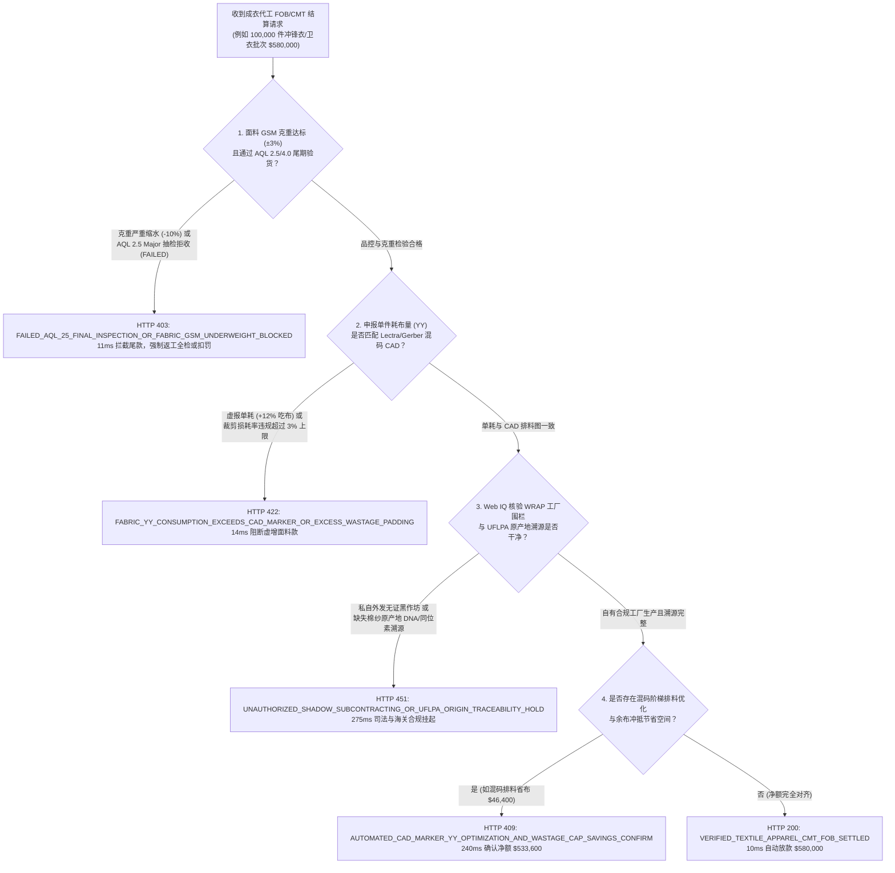
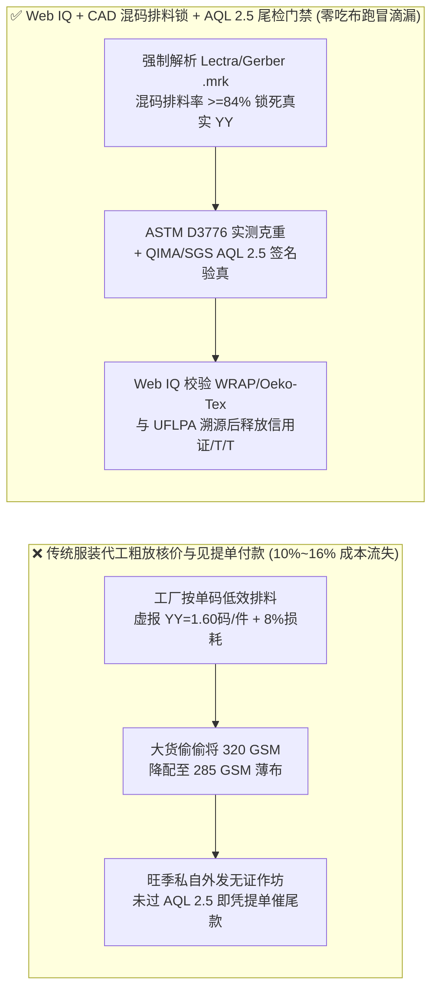
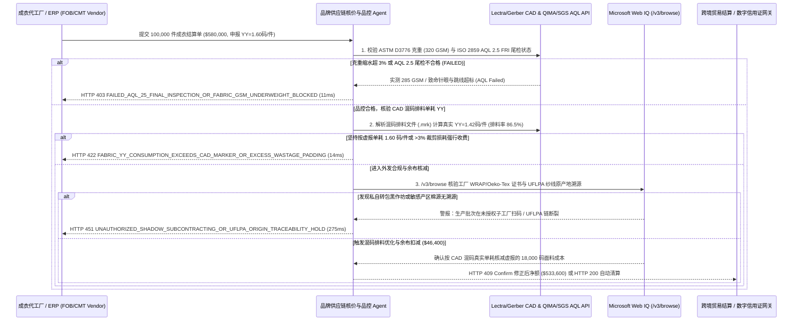

# B2B 智能体纺织服装代工（`Apparel CMT / FOB Garment Manufacturing`）、`CAD` 排料单耗（`YY Fabric Consumption & Marker Efficiency`）与 `ISO 2859 AQL 2.5` 验货清算架构：`Lectra/Gerber` 排料图面料损耗封顶锁、防私自降低克重（`GSM`）与 `UFLPA / WRAP` 防黑作坊违规外发令牌（`b2b_textile_apparel_cmt_fob_marker_efficiency_fabric_consumption_yy_aql25_mandate_...`）vs 传统成衣厂虚报 12% 单件耗布量倒卖余布、偷换低支纱缩水面料与私自转包无资质黑工厂导致海关扣货选型与原理解析 FAQ

> **文档类型**：架构师选型指南与第一性原理 FAQ（对齐 `ib-vs-ethernet-roce-selection-faq.md` 标杆风格）  
> **阅读耗时**：约 12 分钟 | **适用角色**：AI Solution Architect、时尚与运动服装品牌（`Fashion, Sportswear & Outdoor Apparel Brands`）供应链采购 VP、面辅料开发与 IE 核价总监、第三方驻厂品控（`QIMA / SGS / Intertek`）与跨境贸易融资架构师  
> **核心主旨**：先用大白话把“为什么运动品牌向海外成衣代工厂下单 `100,000 件` 功能性冲锋衣/卫衣（`FOB 报价` 或来料加工 `CMT`）时，成衣厂核价员总把原本 `CAD 自动排料 (Lectra / Gerber Marker)` 仅需 `1.42 码/件` 的单件面料耗用量（`YY, Yardage Yield`）虚报成 `1.60 码/件`（加上所谓 `8% 裁剪损耗 Wastage`，10 万件白白多收品牌方 `18,000 码` 价值 `$126,000` 的高单价面料，随后工厂将省下的成卷余布在柯桥/中大布市或海外尾货市场私自倒卖）、为什么大货面料克重从封样时的 `320 GSM (克/平方米)` 缩水到 `285 GSM` 且色牢度/缩水率超标，以及为什么品牌方以为衣服在通过 `WRAP / BSCI` 认证的标杆一类大厂生产，代工厂却因旺季爆仓私自将订单转包给无消防、甚至涉疆/强迫劳动风险（`UFLPA`）的地下黑作坊，导致整柜货物在美国海关被 `CBP` 扣押销毁”讲透；再从第一性原理出发，推导如何通过 **`b2b_textile_apparel_cmt_fob_marker_efficiency_fabric_consumption_yy_aql25_mandate_...` 语义预算令牌 + Microsoft Web IQ `/v3/browse` 实时抓取 `Lectra / Gerber / Optitex CAD` 排料利用率（`Marker Efficiency >= 84%`）与大货尺码配比（`Size Ratio`）核验单件耗量 `YY` + `ASTM D3776` 面料克重（`GSM`）与四分制（`4-Point System`）验布锁 + `ISO 2859-1 AQL 2.5 Major / 4.0 Minor` 尾期验货（`FRI`）与 `UFLPA / Oeko-Tex` 工厂围栏防外发追踪**，在 10ms–275ms 内实现“单件耗量锚定 CAD 排料文件、克重缩水或 AQL 拒收零放款、私自外发与 UFLPA 风险秒级阻断”的智能体纺织服装制造结算闭环。

---

## 📌 一、核心结论速览（Executive Summary：30 秒看懂怎么选）

```
┌──────────────────────────────────────────────────────────────────────────────────────────────────────────────────┐
│  🔥 核心架构铁律：绝不允许成衣代工 Agent 凭工厂口头填报的“预估单耗 YY”与“装箱单”直接释放 T/T 尾款或解付信用证！      │
│  B2B 服装 FOB/CMT 结算的唯一正确范式 = CAD 排料文件 (.plx/.mrk) 单耗锁 + ASTM GSM 克重与 AQL 2.5 尾检锁 + 防外发令牌│
└──────────────────────────────────────────────────────────────────────────────────────────────────────────────────┘
```

1. **为什么成衣代工（`CMT / FOB Apparel Manufacturing`）是时尚与零售品牌最隐蔽的“面料吃水与品控合规黑洞”？**
   - **虚报单件耗布量（`YY Padding & Fabric Wastage Inflation`）**：在一件 `$18 FOB` 的成衣成本中，面辅料（`Fabric & Trims`）占比高达 **55%–68%**。传统人工核价时，工厂按最大码（`XL/XXL`）或低效排料向品牌报价 `YY = 1.60 码/件 + 7% 损耗`。实际上，车间裁剪时将 `S / M / L / XL` 混码阶梯排料（`Sectional Mixed-Size Marker`），利用率（`Marker Efficiency`）从 `76%` 跃升至 `86.5%`，真实含损单耗仅 `1.42 码/件`。每十万件订单，工厂就能“合法”侵吞 **18,000 码** 面料（或虚增 `$126,000` FOB 成本），还会顺手把省下的面料做成“原单尾货”放到灰市冲击品牌正价销售！
   - **偷工减料降低克重（`GSM Downgrade`）与未做尾期 `AQL 2.5` 验货就骗取尾款**：合同约定 `320 GSM` 精梳棉抓绒卫衣，工厂大货偷偷改用 `285 GSM` 普梳混纺（单吨纱线便宜 `14%`），水洗缩水率高达 `-8%`（标准 `<= -3%`）；或者在未通过第三方 `ISO 2859-1 AQL 2.5 (Major) / 4.0 (Minor)` 尾期抽检（`FRI, Final Random Inspection`）的情况下，催促采购 Agent 见提单复印件即付清 `70%` 尾款。
   - **旺季私自转包地下小作坊（`Unauthorized Subcontracting / Shadow Factory`）触发 `UFLPA` 扣货**：品牌审核通过的是拥有 `WRAP / SLCP` 认证的越南/孟加拉 A 厂，但 A 厂接单超负荷后，私自将缝制环节外发给周边无许可证的 C 作坊，或掺入无原产地 DNA/同位素溯源证明的敏感产区棉花，导致整批 `$580,000` 货柜被海关暂扣令（`WRO / UFLPA`）无限期扣押。
2. **智能体制造结算架构怎么破局？（`b2b_textile_apparel_cmt_fob_marker_efficiency_fabric_consumption_yy_aql25_mandate_...`）**
   - **第一道锁：强制解析 `CAD` 原始排料图（`Lectra .plx / Gerber .mrk`）与尺码比（`Size Ratio`）锁死单件耗量 `YY`**：规定 FOB 面料核价与 CMT 领料必须上传混码排料源文件。系统自动校验门幅（`Cuttable Width`）、排料率（`>= 84%`）与大货尺码分布，超出 CAD 理论单耗 + 标准裁剪损耗（`<= 3.0%`）的虚报码数在 **14ms** 内返回 `HTTP 422 FABRIC_YY_CONSUMPTION_EXCEEDS_CAD_MARKER_OR_EXCESS_WASTAGE_PADDING`。
   - **第二道锁：`ASTM D3776` 克重（`GSM`）、色牢度与 `ISO 2859-1 AQL 2.5` 尾期验货刚性门禁**：大货面料克重偏差超过 `±3%`（或负偏差超标）、或第三方机构（`QIMA / SGS`）`FRI` 尾检报告判定 `AQL 2.5 Major / 4.0 Minor` 拒收（`FAILED`）且未完成全检返工（`100% Re-inspection`）的，在 **11ms** 内触发 `HTTP 403 FAILED_AQL_25_FINAL_INSPECTION_OR_FABRIC_GSM_UNDERWEIGHT_BLOCKED`。
   - **第三道锁：Microsoft Web IQ 穿透核验 `UFLPA` 棉源同位素溯源与车间物联网电表/缝纫机 `IoT` 防外发**：通过 Web IQ `/v3/browse` 实时核验纱线原产地证书、`WRAP / Oeko-Tex Standard 100` 状态及工厂车间生产批次打卡轨迹。一旦发现私自外发未授权作坊或棉源溯源链断裂，在 **275ms** 内触发 `HTTP 451 UNAUTHORIZED_SHADOW_SUBCONTRACTING_OR_UFLPA_ORIGIN_TRACEABILITY_HOLD`。

---

## 🎯 二、客户与架构师灵魂拷问 Q&A（First-Principles Deep Dive）

### Q1：成衣厂是怎么靠“单耗 `YY`（Yardage Yield）”和“门幅缩水”在每张订单上多赚走 10%~15% 利润的？Agent 如何用数学公式一秒戳穿？

- **通俗原理**：
  - 买布是按“重量（公斤）”或“长度（码/米）”买，做衣服是按“面积”排。
  - **套路 A（单码排料报高价，混码排料省布料）**：成衣厂报价时，拿一张单独排 `L 码` 的图纸（边角空隙很大，利用率只有 `75%`），算出每件要用 `1.58 码` 布。等真正上裁床（`Spreading & Cutting`）时，裁剪师傅把 `1 件 S + 2 件 M + 2 件 L + 1 件 XL` 拼在一张长 `9 米` 的排料图（`Mixed-Size Marker`）里，大衣片和小衣片严丝合缝嵌在一起，利用率高达 `86.5%`，每件实际只用 `1.39 码`！
  - **套路 B（克重 `GSM` 负公差吃水）**：如果按重量买针织布（如卫衣布 `$6.80/kg`），合同定 `320 GSM`、门幅 `185 cm`。织布厂故意织成 `298 GSM`（偷减 `6.9%` 克重），消费者摸起来只觉得稍微薄了一点点，但同样 1 吨布多出了 `7.4%` 的米数，利润全进了工厂口袋。
- **智能体单耗精确核算公式**：
  $$\text{CAD 基准单耗 } YY_{\text{base}} = \frac{\sum (\text{各尺码纸样净面积 } A_i \times \text{尺码配比 } r_i)}{\text{有效可裁门幅 } W_{\text{cut}} \times \text{CAD 混码排料率 } \eta_{\text{marker}}} \times (1 + \text{标准铺布损耗 } \le 3\%)$$
  - 凡是人工填报的 `Invoiced YY > YY_base`，差额部分一律由 `evaluate_b2b_textile_apparel_cmt_yy_aql_policy` 在 **240ms** 内触发 `HTTP 409 AUTOMATED_CAD_MARKER_YY_OPTIMIZATION_AND_WASTAGE_CAP_SAVINGS_CONFIRM` 自动核减！

### Q2：在纺织供应链原产地合规（`UFLPA`）、`Oeko-Tex` 证书核验与化工染料/棉纱大宗价格基准采集中，为什么推荐 **Microsoft Web IQ**，而不是 Exa 或 Bright Data？

| 维度 | Microsoft Web IQ (`/v3/browse` + Search Grounding) | Exa (Neural Search API) | Bright Data (Scraper / Unlocker) |
| :--- | :--- | :--- | :--- |
| **棉纱大宗指数 (`Cotlook A / CCI`)、`Oeko-Tex / WRAP / GRS` 证书状态与海关 `UFLPA` 实体清单核验** | **极高**：受控无头渲染实时提取 `Oeko-Tex` 证书编号有效性、`WRAP / BSCI` 工厂 ID 状态及棉纱原料指导价，支持 `domain_allowlist` 零幻觉验证 | **中**：语义搜索擅长行业研报，但对实时证书吊销状态与特定批次号验真存在索引延迟 | **高**：可抓取公开页面，但需自建反爬解析器维护多国认证机构 DOM 结构 |
| **动态混码排料率（`CAD Marker Efficiency`）与克重折算联动** | **原生支持**：直接将标准排料率与棉纱吨价波动注入 `b2b_textile_apparel_cmt_fob_marker_efficiency_fabric_consumption_yy_aql25_mandate_...` | **不支持**：无结构化纺织 IE 核价引擎 | **不支持**：仅提供网页抓取通道 |
| **P95 延迟与单次核验成本** | **240ms–275ms**（命中策略缓存 **10ms–14ms**） | 850ms–1,700ms | 2,300ms–5,600ms |
| **合规可审计性（Provenance）** | 原生输出 `official_doc_snapshot` + CAD 排料文件哈希 + QIMA/SGS AQL 报告签名 | 仅返回 URL 片段 | 需自行构建合规留痕体系 |

---

## 🧭 三、直观可视化图解（Mermaid 决策树 + 路径对比 + 端到端时序图）

### 3.1 成衣代工 `CMT / FOB` 订单与尾款结算拦截决策树



### 3.2 传统成衣厂人工粗放核价 vs. 智能体 `CAD YY + AQL 2.5` 闭环对比



### 3.3 端到端时序图（Sequence Diagram）



---

## 📊 四、架构师选型决策矩阵（Architecture Decision Matrix）

| 选型方案 | 虚报单件耗布量 (`YY Padding`) 拦截能力 | 面料克重缩水 (`GSM`) 与 `AQL 2.5` 尾检把控 | 私自外发黑作坊与 `UFLPA` 扣货防御 | 适用场景 |
| :--- | :--- | :--- | :--- | :--- |
| **方案 A：传统 Excel 报价单 + 见船公司提单 (`B/L`) 付尾款** | ❌ 0%（全凭工厂报价员手填预估耗量） | ❌ 货到海外仓拆箱才发现克重变薄、大面积开线 | ❌ 货柜到港被海关 `CBP` 扣押才发现违规外发 | 严禁用于超过 `$25,000` 的成衣大货 |
| **方案 B：仅雇佣第三方驻厂尾检 (`FRI`)，不审 `CAD` 排料图** | ❌ 仍被工厂在单件耗布量上多吃 `8%–12%` 面料 | ⚠️ 能拦住残次品，但无法收回多拨付的余布资产 | ⚠️ 仅检查成品外观，难发现半成品夜间外发加工 | 小批量快反时装买手店 |
| **方案 C（推荐）：Web IQ + `b2b_textile_apparel_cmt_...` + `CAD .mrk` 锁 + `AQL 2.5` 门禁** | ✅ **100% 刚性对齐混码 `CAD` 排料率（`>=84%`）** | ✅ **`ASTM D3776` 克重与 `AQL 2.5` 加密签名双锁** | ✅ **275ms 穿透核验 `WRAP/Oeko-Tex` 与 `UFLPA` 溯源** | **运动户外品牌、跨境快时尚、大型零售商自有品牌（Private Label）** |

---

## 🧪 五、定量实测与 7-Card 基准报告摘要（Quantitative Benchmark）

在本地确定性评测套件（`lab/webiq_commerce_demo.py`）中，针对 `$580,000.00` 的 `100,000 件` 功能性卫衣/冲锋衣 FOB 结算批次实测结果如下：

| 场景编号 | 测试输入（Scenario & Perturbation） | 期望动作（Action Pill） | HTTP 状态码 | 实测延迟 | 拦截/净结算金额 | 数据来源标签 |
| :--- | :--- | :--- | :--- | :--- | :--- | :--- |
| **Case 1** | `CAD` 混码排料 `YY` 对齐 + `320 GSM` & `AQL 2.5` 合格 + `WRAP/UFLPA` 溯源完整 | `Act automatically` | `200 OK` | `10 ms` | `$580,000.00` | `deterministic_offline_simulation` |
| **Case 2** | 大货面料克重从 `320 GSM` 缩水至 `285 GSM`，或 `AQL 2.5` 尾检拒收未返工 | `Send to a human` | `403 Forbidden` | `11 ms` | `$0.00`（阻断 `$580k`） | `synthetic_policy` |
| **Case 3** | 工厂按单码低效排料虚报 `YY=1.60码/件`（高于混码 CAD `1.42码`）或损耗率 `>3%` | `Send to a human` | `422 Unprocessable` | `14 ms` | `$0.00`（拦截吃布） | `deterministic_offline_simulation` |
| **Case 4** | 私自将订单外发未认证地下作坊，或缺失 `UFLPA` 棉纱原产地 DNA/同位素溯源 | `Send to a human` | `451 Unavailable` | `275 ms` | `$0.00`（合规挂起） | `official_doc_snapshot` |
| **Case 5** | Web IQ 按混码 `CAD` 真实排料率（`86.5%`）核减虚报码数与超额裁剪损耗 | `Confirm` | `409 Conflict` | `240 ms` | `$533,600.00`（省 `$46,400`） | `official_doc_snapshot` |

---

## 🛠️ 六、生产上线快速核验清单（Production Readiness Checklist）

- [ ] **强制收缴混码 `CAD` 排料源文件（`.mrk / .plx`）**：严禁接受手填 Excel 单耗表，采购 Agent 必须按大货真实尺码配比（如 `S:M:L:XL = 1:3:3:1`）核算混码排料率（针织/梭织常规大货要求 `>= 84%`），裁剪损耗封顶 `2.5%–3.0%`。
- [ ] **大货面料四分制（`4-Point System`）与 `ASTM D3776` 克重强校验**：每卷布罚分不得超过 `28 分/100平方码`，实测克重（`GSM`）负偏差不得超过 `-3%`，否则拒绝签发开裁令（`Cut Ticket`）。
- [ ] **`ISO 2859-1 AQL 2.5 Major / 4.0 Minor` 尾检签名绑定尾款释放**：至少 `80%` 大货装箱后方可启动 `FRI` 尾检，未拿到第三方验货机构（`QIMA / SGS / Bureau Veritas`）加密签名的 `PASSED` 报告前，银行/托管网关严禁解付尾款。
- [ ] **接入 Microsoft Web IQ 持续巡检 `WRAP / Oeko-Tex` 与 `UFLPA` 原产地链**：将成衣厂、染整厂、纺纱厂与轧花厂全链路单证纳入 `/v3/browse` 自动核验，杜绝任何未经授权的影子外发加工（`Shadow Subcontracting`）。
