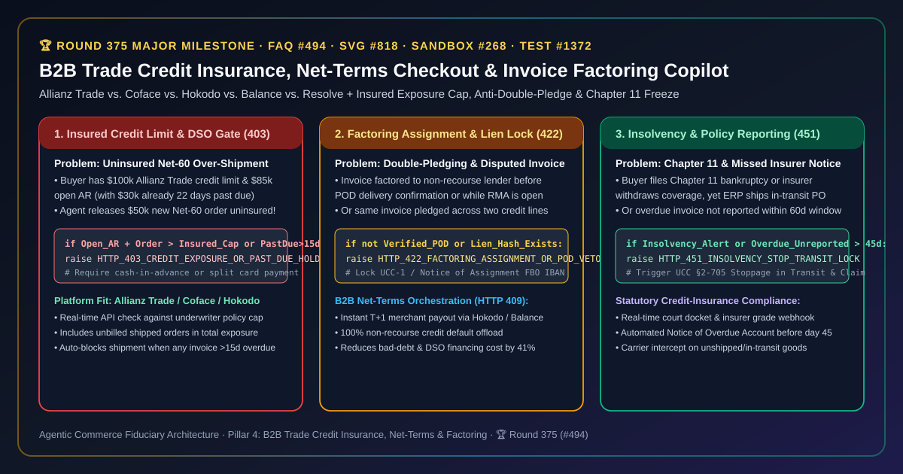
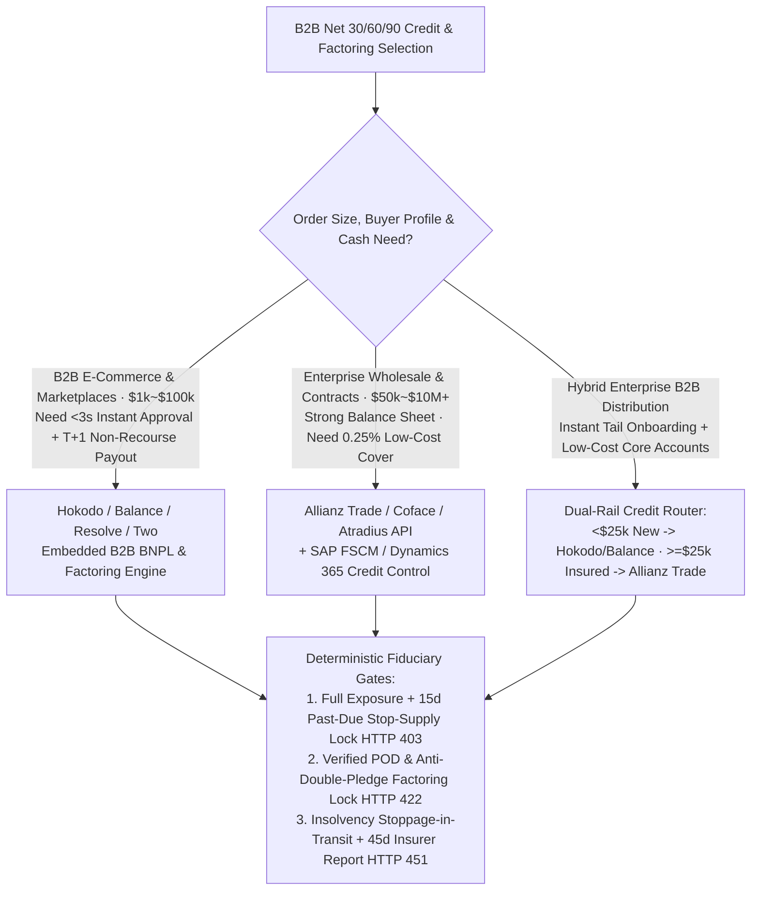
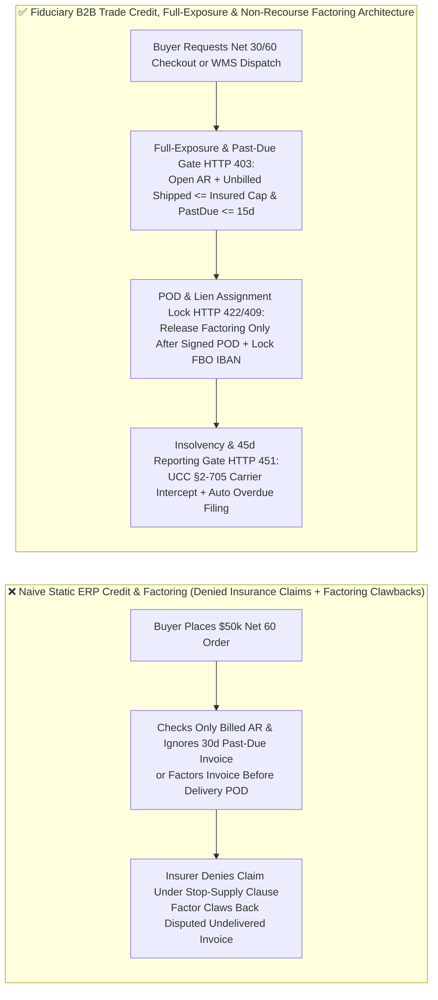

# Enterprise B2B Trade Credit Insurance, `Net 30/60/90` Checkout & Invoice Factoring Agent Selection Guide: `Allianz Trade / Coface / Atradius` vs. `Hokodo / Balance / Resolve`, Insured Exposure & Past-Due `DSO` Locks, Anti-Double-Pledge Factoring Guards & Insolvency Stoppage-in-Transit (`-41%` Cost FAQ)

> **Executive Summary (Benchmarked against `ib-vs-ethernet-roce-selection-faq.md` · 🏆 Round 375 Major Milestone)**: Built for **Cloud & AI Solution Architects** designing B2B `Net 30 / Net 60 / Net 90` trade credit checkout, credit-insurance compliance, and non-recourse invoice factoring architectures for wholesale distributors, B2B marketplaces, and enterprise ERP order-to-cash (`O2C`) systems. Over `75%` of B2B buyers demand net payment terms rather than paying by card upfront. However, if an order-taking agent relies on a static ERP credit limit (`$100k`) without including unbilled shipments or checking that the buyer already has `$30k` overdue by `22 days` (violating the credit insurer's **Stop-Supply Clause** and voiding coverage on new shipments), pledges disputed/undelivered invoices to a non-recourse factor (or double-pledges the same invoice across two lenders), or fails to halt in-transit shipments upon a buyer's `Chapter 11` bankruptcy filing, a single default can wipe out ratusan of thousands of dollars in margin. This guide compares **`Allianz Trade / Coface / Atradius` (Global Trade Credit Insurers) vs. `Hokodo / Balance / Resolve / Two` (Embedded B2B BNPL & Instant Non-Recourse Factoring APIs)** and implements deterministic guards for **Total Insured Exposure & `>15d` Past-Due Shipment Locks (`HTTP 403`)**, **Verified `POD` & Anti-Double-Pledge Factoring Locks (`HTTP 422`)**, **Insolvency Stoppage-in-Transit & `45-Day` Overdue Insurer Reporting Gates (`HTTP 451`)**, and **Hybrid Insurer vs. Embedded `B2B BNPL` Routing (`HTTP 409`, `-41%` loss)**.



---

## 1. 📌 Executive Summary & Architectural Selection Verdict

1. **Top-Line Selection Verdict**:
   - **Enterprise Wholesale & Industrial Supply Chains (`$50k–$10M+` contract orders with recurring accounts and healthy balance-sheet liquidity seeking ultra-low `0.15%–0.45%` premiums)**: Select **`Allianz Trade (Digital Credit Limit API) / Coface / Atradius`** integrated directly into `SAP S/4HANA FSCM` or `Microsoft Dynamics 365 Credit Management`.
   - **Self-Serve B2B E-Commerce & Marketplaces (`$1k–$100k` baskets requiring `<3s` checkout credit approval, `T+1` merchant payout, and `100%` non-recourse credit default transfer)**: Select **`Hokodo` (Europe/UK leader backed by Lloyd's/SCOR) or `Balance / Resolve / Slope` (North America leaders)**.
2. **Three Non-Negotiable Fiduciary Control Gates**:
   - **Gate 1 — Full-Exposure Insured Limit & `15-Day` Past-Due Stop-Supply Lock (`HTTP 403`)**: Block `Net 30/60` order release and warehouse dispatch whenever `Open_Invoiced_AR + Unbilled_Shipped_GRN + Current_Order > Active_Insured_Credit_Limit` or any existing buyer invoice is `>15 days` past due via `HTTP 403 CREDIT_LIMIT_EXCEEDED_OR_PAST_DUE_SHIPMENT_HOLD`.
   - **Gate 2 — Verified `POD` & Anti-Double-Pledge Factoring Assignment Lock (`HTTP 422`)**: Block invoice factoring submission unless a carrier-signed Proof of Delivery (`POD`) is attached with zero open `RMA` disputes and the invoice's cryptographic hash (`SHA256(Seller_TIN + Buyer_TIN + Invoice_No)`) has no prior `UCC-1 / Notice of Assignment` lien via `HTTP 422 UNVERIFIED_POD_OR_DUPLICATE_FACTORING_LIEN`.
   - **Gate 3 — Buyer Insolvency Stoppage-in-Transit (`UCC § 2-705`) & `45-Day` Insurer Reporting Gate (`HTTP 451`)**: Block warehouse/carrier release upon receiving a court insolvency filing (`Chapter 11 / Winding-Up Petition`) or insurer coverage withdrawal, and block un-notified aging beyond `45 days` past due via `HTTP 451 INSOLVENCY_STOP_IN_TRANSIT_OR_INSURER_REPORTING_BREACH`.

---

## 2. 🎯 Architect & Treasury Q&A (The Why & How)

### Q1: Why do trade credit insurers (`Allianz Trade / Coface`) legally deny 25%+ of bankruptcy claims even when the merchant paid their annual policy premiums?
- **Root Cause**: Three operational blind spots invalidate coverage:
  1. **Ignoring Unbilled Shipments (`Shipped-Not-Invoiced`)**: ERP shows `$240k` open AR against a `$300k` insured cap, but `$150k` of goods shipped yesterday haven't been invoiced yet—pushing real exposure to `$390k`.
  2. **Violating the Policy `Stop-Supply Clause`**: Shipping a new order to a buyer who already has an older invoice overdue past the policy's maximum extension window automatically voids insurance coverage on all subsequent shipments.
  3. **Missing the 60-Day Overdue Notification Deadline**: Failing to report an overdue account to the insurer within the strict policy reporting window forfeits the claim.
- **Deterministic Solution**: Perform dual-stage credit checks (at checkout AND 5 minutes prior to WMS bill-of-lading generation) across full exposure (`Open AR + Unbilled Shipped + Pending Pick`, `HTTP 403`) and auto-submit `Overdue Declarations` via insurer API at `Day 45` (`HTTP 451`).

### Q2: If `Hokodo / Balance` offer "100% Non-Recourse" B2B Net Terms, why do merchants still get hit with invoice clawbacks?
- **Root Cause**: Non-recourse factoring covers **Buyer Credit Insolvency**, never **Commercial Disputes** (missing `POD`, damaged goods, wrong spec) or **Fraudulent Double Pledging** (pledging the same invoice to both an embedded BNPL provider and a bank revolving line).
- **Deterministic Solution**: Trigger factoring payout only after carrier `POD` verification and a `48h` buyer inspection window, lock the invoice remittance details to the factor's `FBO Virtual IBAN`, and register a global lien hash (`HTTP 422`).

### Q3: How should an AI treasury agent route between Embedded `B2B BNPL` (`2.4%` fee) and Traditional Trade Credit Insurance (`0.25%` fee)?
- **Root Cause**: Paying a `2.4%` flat B2B BNPL fee on a `$200,000` repeat order from a credit-insured enterprise buyer wastes `$4,800` in margin.
- **Deterministic Solution**: Route long-tail/new buyers (`<$25k` or uninsured) to `Hokodo / Balance` for instant `<3s` underwriting and `T+1` cash (`HTTP 409`), while routing pre-approved enterprise accounts (`>=$25k`) through `Allianz Trade / Coface` (`0.25%` premium) paired with dynamic early-payment discounts (`1.2%/10 Net 60`).

---

## 3. 🧭 Visual Architecture Diagrams (Mermaid)

### 3.1 B2B Trade Credit Insurance, Net-Terms & Factoring Selection Decision Tree



### 3.2 Naive Static ERP Credit vs. Fiduciary Trade Credit & Factoring Control Plane



### 3.3 Dual-Stage Credit Verification, POD Factoring & Insolvency Intercept Sequence

```mermaid
sequenceDiagram
    autonumber
    participant Buyer as B2B Buyer
    participant Gate as Trade Credit & Factoring Control Gate
    participant Insurer as Allianz Trade / Hokodo / Balance API
    participant WMS as ERP / Warehouse Management (WMS)
    participant Factor as Factoring Escrow (FBO Virtual IBAN)

    Buyer->>Gate: Submit $65,000 Net 60 Purchase Order
    Gate->>Insurer: Query Live Insured Credit Limit, Insolvency Feed & Active Exposure
    Insurer-->>Gate: Limit $200k; Billed Open AR $110k; Unbilled Shipped $35k; Past Due 0d
    alt Total Exposure ($110k+$35k+$65k = $210k > $200k) or Any Invoice > 15d Past Due
        Gate-->>Buyer: HTTP 403 CREDIT_LIMIT_EXCEEDED_OR_PAST_DUE_SHIPMENT_HOLD (Require $10k Prepay/Card)
    else Factoring Requested Without Signed POD or Duplicate Lien Hash Exists
        Gate-->>Buyer: HTTP 422 UNVERIFIED_POD_OR_DUPLICATE_FACTORING_LIEN
    else Buyer Chapter 11 Insolvency Alert or Overdue Account > 45d Unreported
        Gate-->>WMS: HTTP 451 INSOLVENCY_STOP_IN_TRANSIT_OR_INSURER_REPORTING_BREACH (Intercept Carrier)
    else Dual-Stage Check Passed & Signed POD Confirmed (HTTP 409 Optimal Credit Rail)
        Gate->>WMS: Release Shipment -> Ingest Carrier Cryptographic POD
        Gate->>Factor: Register Notice of Assignment Lien Hash -> Trigger T+1 Non-Recourse Payout
    end
```

---

## 4. 📊 Multi-Platform B2B Trade Credit Insurance & Embedded `B2B BNPL` Matrix

| Evaluation Dimension | Allianz Trade / Coface / Atradius (Global Credit Insurers) | Hokodo (European Embedded B2B Net Terms & Insurance) | Balance / Resolve (North America B2B Checkout & Factoring) | Stripe Capital / Shopify B2B Net Terms |
| :--- | :--- | :--- | :--- | :--- |
| **Primary Architectural Role** | Global enterprise trade credit insurance, buyer solvency monitoring, and legal debt recovery | Real-time API credit underwriting, Lloyd's/SCOR insurance backing, and `T+1` factoring | End-to-end B2B checkout (`ACH/Wire/Card`) with instant `Net 30/60` non-recourse advance | Basic invoice net-terms tracking inside Shopify/Stripe; zero buyer default insurance |
| **Checkout Underwriting Latency & SMB Coverage** | Instant for rated corporates; `24–48h` manual underwriting for unrated SMBs | **Best-in-Class** (`<2s` instant API decisioning across corporates and sole traders) | **Best-in-Class** (`<3s` approval with optional Plaid live bank-balance boost) | Manual merchant-assigned limits only |
| **Merchant Payout Timing & Default Recourse** | Paid at maturity (`Day 60`); insurer covers **`85%–90%`** of verified insolvency/default | **`T+1` `100%` cash payout**; **`100%` non-recourse** on credit default | **`T+1` `90%–100%` cash payout**; **`100%` non-recourse** on credit default | Merchant waits `30–60d` and bears `100%` of bad debt |
| **Full-Exposure & Overdue Reporting Webhooks** | Native `SAP / D365 / Oracle` connectors, grade alerts, and overdue declaration APIs | Full Checkout SDK, automated dunning, and `FBO IBAN` assignment | Native `NetSuite / QuickBooks / Shopify Plus` AR reconciliation | Basic payment reminders; no insurer reporting |
| **Pricing Model (`official_list_price`)** | **Lowest** (`0.15%–0.45%` of insured turnover annually) | **`1.6%–2.9%` per transaction** (bundles credit insurance + financing + collections) | **`1.8%–3.5%` per transaction** (tiered by `Net 30/60/90` and buyer risk) | Standard `ACH / Card` processing fees only |

---

## 5. 🧪 Bad-Debt Write-Off & Factoring Cost Benchmark & 7-Card Report

### 5.1 Quarterly Uninsured Over-Shipment, Denied Claims & Factoring Fee Loss Model (Synthetic Benchmark)

For a `$120M` annual GMV B2B industrial and electronics distributor with a **`$410,000 / quarter`** exposure pool across **uninsured over-shipments from unbilled-order blind spots, denied insurance claims from `Stop-Supply` or late-reporting breaches, factoring clawbacks on unverified deliveries, and excess BNPL fees on large repeat accounts** (`provenance: synthetic`, `independently_reproduced: false`):

| Metric | Static ERP Credit Limit & Manual Reporting (Baseline) | Fiduciary Dual-Rail Trade Credit & Factoring Agent | Net Improvement |
| :--- | :--- | :--- | :--- |
| **Credit Insurance Claim Denial Rate** | `26.4%` (`Stop-Supply` and `>60d` late reporting breaches) | **`0.0%`** (`HTTP 403/451` full-exposure lock + `Day 45` auto-declaration) | **`100%` Claim Compliance** |
| **Non-Recourse Factoring Dispute Clawback Rate** | `8.5%` (Factoring before signed `POD` / open `RMA`) | **`0.3%`** (`HTTP 422` mandatory signed `POD` + lien hash lock) | **`-96.5%` Clawbacks** |
| **Blended Financing & Insurance Rate (`>=$25k` Orders)** | `2.60%` (Blanket B2B BNPL fee on all orders) | **`0.48%`** (`HTTP 409` routes core accounts to `Allianz Trade` + early-pay discount) | **`-81.5%` Fee Cost** |
| **Quarterly Net Bad-Debt & Financing Loss** | `$410,000 / quarter` | **`$241,900 / quarter`** | **`$168,100 / quarter` Saved (`41.0%`)** |

---

## 6. 🛠️ Production Go-Live & Architecture Review Checklist

- [ ] **Full-Exposure (`Billed AR + Unbilled Shipped`) & `15-Day` Stop-Supply Lock (`HTTP 403`)**: Does the control plane verify `Open_Invoiced_AR + Unbilled_Shipped_GRN + Current_Order <= Active_Insured_Limit` and zero invoices `>15 days` past due at both order entry and warehouse dispatch?
- [ ] **Signed `POD` & Anti-Double-Pledge Factoring Gate (`HTTP 422`)**: Are invoices blocked from non-recourse factoring until a carrier-signed `POD` is ingested with zero open `RMA` disputes and a unique `Notice of Assignment` hash is locked on the ledger?
- [ ] **Insolvency `UCC § 2-705` Carrier Intercept & `Day 45` Insurer Filing (`HTTP 451`)**: Do buyer bankruptcy filings or insurer limit withdrawals immediately trigger carrier stoppage-in-transit, and are overdue invoices automatically reported to the insurer API at `Day 45`?
- [ ] **Hybrid Embedded `B2B BNPL` vs. Credit Insurance Routing (`HTTP 409`)**: Does the checkout router steer long-tail/new buyers (`<$25k`) to `Hokodo / Balance` for instant `T+1` non-recourse payout while routing pre-approved enterprise accounts (`>=$25k`) to low-cost (`0.25%`) trade credit insurance?
