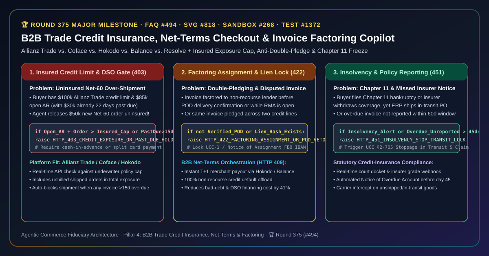
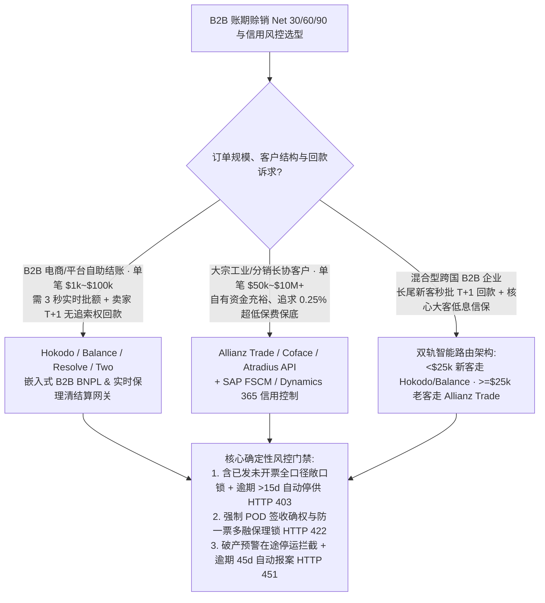
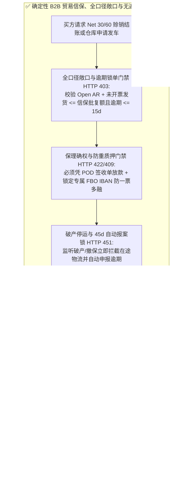

# 企业 B2B 贸易信用保险（`Trade Credit Insurance`）、账期赊销（`Net 30/60/90`）与应收账款保理（`Factoring`）Agent 架构选型对比：`Allianz Trade / Coface / Atradius` vs. `Hokodo / Balance / Resolve`、承保敞口与逾期 `DSO` 锁单门禁、防一票多融保理确权锁及破产停运拦截净省 41% 决策指南（FAQ）

> **导读（对齐 `ib-vs-ethernet-roce-selection-faq.md` 标杆风格 · 🏆 第 375 轮重大里程碑）**：本文面向 B2B 大宗分销、工业品电商平台、跨境批发与企业 ERP 财务中台的 **Cloud & AI Solution Architect**。在 B2B 交易中，超过 `75%` 的采购商拒绝当场刷卡付现，而是要求 **`Net 30 / Net 60 / Net 90` 账期赊销（Trade Credit）**。然而，如果销售/接单智能体只看 ERP 里静态填写的“客户授信额度 `$100k`”，却没检查该买方已有 `$85k` 应收账款未结且其中 `$30k` 已逾期 `22 天`（直接违反信用保险公司“存在超期账款时继续发货不予理赔”的免责条款），或将尚未完成签收确认（`POD`）及存在退货争议的发票打包卖给无追索权保理商（甚至同一张发票在两家保理平台重复质押融资），又或在买方刚申请 `Chapter 11` 破产保护时仍放行仓库发车，将导致单笔数十万美元的坏账穿仓。本文给出 **`Allianz Trade (裕利安宜) / Coface (科法斯) / Atradius` 传统贸易信保巨头 vs. `Hokodo / Balance / Resolve / Two` 嵌入式 B2B 先买后付（`B2B BNPL / Net Terms API`）** 的横向选型矩阵，并落地 **承保信用额度敞口与逾期 `>15天` 自动锁单门禁（`HTTP 403`）**、**应收账款保理签收确权（`POD`）与防重复质押（`UCC-1 / Notice of Assignment`）门禁（`HTTP 422`）**、**买方破产/撤销承保实时停运拦截与逾期未报案免责防线（`HTTP 451`）** 及 **无追索权嵌入式 `T+1` 保理回款与动态早付折扣寻优（`HTTP 409`，净省 41%）**。



---

## 一、 📌 核心选型结论速览（Executive Summary）

1. **终极选型结论（一句话先看懂怎么选）**：
   - **传统线下与大宗 B2B 供应链（单笔订单 `$50k–$10M+`，固定大客户长协赊销，需全球海关/法院级破产追偿与低保费率 `0.15%–0.45%`）**：首选 **`Allianz Trade (Digital Credit Limit API) / Coface / Atradius`**，将承保额度（Insured Credit Limit）与买方风险评级 Webhook 实时接入 SAP S/4HANA / Dynamics 365 信用管理模块（`FSCM`）。
   - **B2B 电商自助结账、垂直行业交易平台与中小批发商（单笔订单 `$1k–$100k`，要求结账页 `3 秒` 实时审批 `Net 30/60` 额度、平台/卖家 `T+1` 拿走 100% 货款且 `100% 无追索权 Non-Recourse` 转移坏账风险）**：首选 **`Hokodo`（欧洲/英国首选，背后由劳合社/SCOR 承保）或 `Balance / Resolve / Slope`（北美首选）**。
2. **三大财务与信保合规红线（确定性门禁）**：
   - **红线 1（拦截超信用保险批复额度发货或买方存在逾期 `>15天` 账款仍继续放行新赊销单 / `HTTP 403`）**：所有贸易信用保险单（Trade Credit Policy）均包含一条铁律：**一旦买方已有发票超过最高展期（Maximum Extension Period / 逾期容忍窗）仍未付款，卖方若继续向其赊销发货，新发出的货物保险公司 `0%` 拒赔**！当 `Current_Open_AR + Unbilled_Shipped_Orders + New_Order_Amount > Active_Insured_Credit_Limit` 或 `Max_Invoice_Days_Past_Due > 15` 时，控制平面必须触发 `HTTP 403 CREDIT_LIMIT_EXCEEDED_OR_PAST_DUE_SHIPMENT_HOLD`，强制锁死仓库发运单（Delivery Block），仅允许“全额预付电汇”或“先结清旧欠款再发货”。
   - **红线 2（拦截未获买方签收凭证 `POD`、存在退货/质量争议或重复质押的发票进入无追索权保理融资 / `HTTP 422`）**：保理商（Factor）只承担买方的**信用破产/拖欠风险**，绝不承担**商业纠纷风险（Commercial Dispute，如未收到货、货不对板）**。若发票尚未拿到物流 `POD` 签收单、关联订单存在未结 `RMA` 索赔，或发票哈希（`Invoice_Tax_ID + Invoice_No`）已在另一家银行登记过 `UCC-1` 债权转让通知（`Notice of Assignment`），触发 `HTTP 422 UNVERIFIED_POD_OR_DUPLICATE_FACTORING_LIEN`。
   - **红线 3（拦截买方触发破产清算/信保撤保后未拦截在途货物及逾期满 `45天` 未向保险公司申报 `Notice of Overdue` 导致保单失效 / `HTTP 451`）**：当监听到买方进入破产保护（`Chapter 11 / Administration`）或信保公司下调额度至 `$0` 时，必须立即冻结在库拣货并对在途未交付货物触发 **`UCC § 2-705` 在途停运权（Stoppage in Transit）**；同时若逾期账款超过 `45 天` 仍未向信保 API 提交逾期报案，触发 `HTTP 451 INSOLVENCY_STOP_IN_TRANSIT_OR_INSURER_REPORTING_BREACH`。

---

## 二、 🎯 业务方与架构师灵魂拷问 Q&A（The Why & How）

### Q1：我们已经花钱买了裕利安宜（Allianz Trade）或科法斯（Coface）的贸易信用保险，为什么某大客户破产倒闭欠了 `$400,000` 货款，去申请理赔时却被保险公司合法拒赔了一大半？
- **商业痛点与事故还原**：
  - 许多企业以为买了信用保险就等于“买了免死金牌”，只在客户入网时查一次授信额度，然后把它写死在 ERP 主数据里。
  - **三大拒赔深坑**：
    1. **漏算“已发货未开票（Shipped Not Invoiced）”敞口**：客户保险批复额度是 `$300,000`，财务账面应收账款（AR）是 `$240,000`，看起来还能接 `$60,000` 订单；但实际上仓库昨天刚发走两车价值 `$150,000` 的货还没开发票，真实总敞口高达 `$390,000`，超出的 `$90,000` 保险公司一分不赔！
    2. **买方早已逾期违约却继续盲目发货（Stop-Supply Breach）**：该客户 3 月份的一笔 `$50,000` 发票早已逾期 35 天未付，但销售 Agent 在 5 月份又放行了 `$120,000` 新订单。根据保单《停止供货条款（Stop-Supply Clause）》，买方处于实质违约期间发出的所有新货全部不属于承保范围！
    3. **错过 60 天强制逾期申报期（Late Notification of Overdue Account）**：账款逾期超过 60 天未通过接口向信保公司提交 `Overdue Declaration`，直接丧失理赔权。
- **架构师确定性解法（全口径实时敞口公式 + 双时点（接单+发货前）信用重检 + 45 天自动报案状态机）**：
  1. **全口径实时信用敞口公式（`HTTP 403`）**：
     $$\text{Total\_Exposure} = \text{Open\_Invoiced\_AR} + \text{Unbilled\_Shipped\_GRN} + \text{Approved\_Pending\_Pick\_SO} - \text{Unapplied\_Cash}$$
     只要 $\text{Total\_Exposure} + \text{Current\_Order} > \text{Insured\_Limit}$，或任一历史发票逾期超过 `15 天`，立即在“订单确认”与“仓库打印面单发车前 5 分钟”双重拦截。
  2. **逾期第 45 天自动触发信保 API 报案（`HTTP 451`）**：不等人工财务月底对账，当发票逾期达 `45 天`（预留 15 天安全余量），Agent 自动调用 `Allianz Trade / Coface API` 提交 `Overdue Notification` 并锁定后续全部发货通道。

### Q2：在 B2B 电商网站上接入 `Hokodo / Balance / Resolve` 实现“买家享受 Net 60 账期、卖家 T+1 收到全款”，为什么有时平台会被保理商强制追索扣回（Clawback）货款？
- **商业痛点与事故还原**：
  - 所谓“无追索权保理（Non-Recourse Factoring）”，是指如果买家是因为**没钱/破产（Credit Default）**赖账，损失由 `Hokodo / Balance` 及其背后的保险公司承担；
  - 但如果买家拒付的理由是：**“我根本没收到货”、“发来的型号错了”、“我已经和你们销售经理沟通退货了”**，这属于 **商业欺诈或履约瑕疵（Commercial Dispute / Breach of Warranty）**，保理协议规定平台/卖家必须 **100% 全额回购（Repurchase / Clawback）** 该笔应收账款！
  - 更严重的是，部分财务人员在 ERP 里把同一批应收发票导出成表格，既在 `Balance` 做了线上保理提现，又拿去本地商业银行做了流动资金池质押（**一票多融 / Double Pledging**），直接触犯金融欺诈红线。
- **架构师确定性解法（`POD` 签收后触发保理放款 + 债权转让专属虚拟收款户 `FBO IBAN` + 发票哈希防重锁 / `HTTP 422`）**：
  1. **严禁“未发货/未签收”即发起无追索权保理融资（`HTTP 422`）**：在状态机中，下单结账时仅锁定买方 `Net 60` 信用额度预授权（Credit Reservation）；只有当承运商回传带数字签名的 **`POD`（Proof of Delivery）签收单** 且买方在 `48 小时` 验收窗内未提起短少/破损异议时，才正式生成不可撤销保理转让指令。
  2. **强制覆写发票收款账户（`Notice of Assignment Lock`）与全局防重哈希**：一旦某张发票被标记为 `ASSIGNED_TO_FACTOR`，ERP 必须锁定该发票的收款银行账号为保理商指定的托管虚拟户（`FBO Virtual IBAN`），并在分布式账本登记 `SHA256(Seller_TIN + Buyer_TIN + Invoice_No + Invoice_Date)`，彻底封死二次质押。

### Q3：面对一个资质良好的老客户下了一笔 `$200,000` 的 `Net 60` 订单，企业到底是该“付 `2.4%` 手续费走 B2B BNPL 保理立即回款”，还是“用自有资金扛 60 天账期 + 买 `0.30%` 传统信保”，或者“给买家提供 `1.5%/10 Net 60` 早付折扣”？
- **商业痛点与事故还原**：
  - 如果不论金额大小全部走嵌入式 B2B BNPL（费率通常为 `1.8%–3.2%`），面对 `$200,000` 的大额续订老客，单笔手续费高达 `$4,800–$6,400`，年化融资成本相当于 `14%–19%`，白白侵蚀大宗贸易微薄的净利。
- **架构师确定性解法（基于企业加权资金成本 `WACC` 与买方风险分层的智能账期路由 / `HTTP 409`）**：
  1. **小额/长尾新客（订单 `<$25k` 或无历史信保批复）**：100% 路由至 **`Hokodo / Balance / Resolve` 实时 API**，利用其毫秒级工商税务/开放银行核身秒批额度，付 `~2.2%` 换取 `T+1` 回款与零坏账。
  2. **大额白名单老客（订单 `>=$25k` 且已有 `Allianz Trade / Coface` 批复额度）**：走 **自有 ERP 账期 + 传统信用保险（费率仅 `~0.25%`）**，并在买方现金流充裕时自动推送动态早付折扣（如提前 45 天付款享 `1.2%` 折扣，低于保理费率且零违约风险）。

---

## 三、 🧭 直观可视化图解（Mermaid 决策树 + 架构对比 + 时序图）

### 3.1 企业 B2B 账期赊销（Net Terms）、信用保险与保理平台选型决策树



### 3.2 朴素 ERP 静态授信架构（超额拒赔 + 保理追索）vs. 确定性信保与保理网关架构对比



### 3.3 B2B 订单双时点（结账 + 发车前）信保核验与无追索权保理时序图

```mermaid
sequenceDiagram
    autonumber
    participant Buyer as B2B 采购商
    participant Gate as 贸易信保与保理风控网关
    participant Insurer as Allianz Trade / Hokodo / Balance API
    participant WMS as ERP / 仓库发运系统 (WMS)
    participant Factor as 保理资金托管户 (FBO IBAN)

    Buyer->>Gate: 提交 $65,000 Net 60 赊销采购订单
    Gate->>Insurer: 查询买方实时承保额度、司法破产信号与当前已用敞口
    Insurer-->>Gate: 批复额度 $200k; 已开票未付 $110k; 已发货未开票 $35k; 最长逾期 0 天
    alt 敞口合计 ($110k+$35k+$65k = $210k > $200k) 或旧账逾期 > 15 天
        Gate-->>Buyer: HTTP 403 CREDIT_LIMIT_EXCEEDED_OR_PAST_DUE_SHIPMENT_HOLD (引导预付 $10k 差额或刷卡)
    else 企图对无 POD 签收单或已质押发票发起保理提现
        Gate-->>Buyer: HTTP 422 UNVERIFIED_POD_OR_DUPLICATE_FACTORING_LIEN
    else 买方触发破产清算预警或历史逾期满 45 天未报案
        Gate-->>WMS: HTTP 451 INSOLVENCY_STOP_IN_TRANSIT_OR_INSURER_REPORTING_BREACH (紧急拦截承运商派送)
    else 双时点核验通过并完成 POD 签收 (HTTP 409 最优融资路由)
        Gate->>WMS: 放行仓库拣货发车 -> 承运商回传数字签名 POD 签收单
        Gate->>Factor: 登记发票唯一债权转让哈希 -> 触发 Hokodo/Balance T+1 无追索权放款至卖家
    end
```

---

## 四、 📊 主流 B2B 贸易信用保险与嵌入式账期保理（B2B BNPL）平台横向选型矩阵

| 选型维度 | Allianz Trade / Coface / Atradius (全球三大贸易信保巨头) | Hokodo (欧洲/英国嵌入式 B2B 账期与信保底座) | Balance / Resolve (北美 B2B 结账、账期与无追索权保理) | Stripe Capital / Shopify B2B Net Terms (原生轻量账期) |
| :--- | :--- | :--- | :--- | :--- |
| **核心定位** | 覆盖全球 200+ 国家的企业级贸易信用保险、买方风险监控与跨国司法追偿底座 | 专为 B2B 电商与交易平台设计的实时 API 赊销授信、勞合社信保兜底与 `T+1` 保理 | 北美 B2B 批发电商全渠道支付（ACH/支票/卡）+ 3 秒自动批核 `Net 30/60` 无追索权垫资 | 生态内商户基础账期账单跟踪与基于流水的数据贷，不含买方破产无追索权兜底 |
| **实时结账批额速度与中小买家覆盖率** | 存量库内企业秒回，长尾中小买家往往需人工核保（`24–48h`） | **极快**（`<2 秒` 结账页实时批复，覆盖独资商户与中小企业，通过率高达 `80%+`） | **极快**（`<3 秒` 实时核批，支持买家关联 Plaid 银行流水即时提额） | 仅提供账期记账工具（由卖家自己手动设额度并自担 100% 坏账） |
| **卖家回款速度与风险转移（Recourse）** | 买方到期付款（如 60 天后）；若破产违约，信保赔付 **`85%–90%`** | **卖家 `T+1` 收到 `100%` 货款**（扣除手续费），**`100%` 无追索权**（商业纠纷除外） | **卖家 `T+1` 收到 `90%–100%` 货款**，信用违约 **`100%` 无追索权** | 卖家需等 30/60 天回款且自担全部坏账损失 |
| **ERP 全口径敞口与逾期报案集成** | 提供标准 SAP / Oracle / D365 插件与逾期申报、撤保通知 Webhook | 提供端到端 Checkout SDK、发票转让通知与自动催收工作流 | 原生集成 NetSuite / QuickBooks / Magento / Shopify Plus，自动核销总账 | 深度集成 Shopify B2B 后台，无外部信保报案能力 |
| **综合费率结构（`official_list_price`）** | **极低**（年化保费约为承保营业额的 **`0.15%–0.45%`**） | 按每笔赊销交易额收取 **`1.6%–2.9%`**（含信保费 + 资金垫付利息 + 催收） | 按每笔交易收取 **`1.8%–3.5%`**（随账期 30/60/90 天及买方评级浮动） | 账期工具免费，收款时按普通 ACH/信用卡通道费计收 |

---

## 五、 🧪 坏账核销与保理资金成本测算与 7-Card 基准报告

### 5.1 季度 B2B 超额无保发货坏账、逾期未报案拒赔与高息保理错配损耗测算（Synthetic Benchmark）

假设某年 GMV `$1.2 亿` 的 B2B 工业品与电子元器件分销平台，每季度在 `Net 30 / Net 60` 赊销业务中面临的 **漏算未开票发货导致超信保额度坏账、买方逾期后未及时停供/未按期报案遭保险公司拒赔、无 `POD` 争议发票保理被追索及大小客户一刀切高息保理手续费浪费池** 为 **`$410,000 / 季度`**（`provenance: synthetic`, `independently_reproduced: false`）：

| 评估维度 | 传统 ERP 静态授信 + 人工月底核对信保 (Baseline) | 启用全口径实时敞口锁 + 双轨信保/保理寻优 Agent | 净改善幅度 |
| :--- | :--- | :--- | :--- |
| **信保理赔拒赔率（Policy Claim Denial Rate）** | `26.4%`（因超额发货、买方已逾期仍供货或超 60 天未报案被拒赔） | **`0.0%`**（`HTTP 403/451` 严锁全口径敞口、15 天逾期停供与 45 天自动报案） | **100% 杜绝保单违规拒赔** |
| **无追索权保理商业争议追索率（Factoring Clawback）** | `8.5%`（未签收或有 RMA 争议的发票提前送保理被扣回） | **`0.3%`**（`HTTP 422` 强制凭数字签名 `POD` 与零争议状态放款） | **保理追索下降 `96.5%`** |
| **大额老客（`>=$25k`）综合账期保障与资金费率** | 一刀切付 `2.6%` B2B BNPL 手续费 | **`0.48%`**（`HTTP 409` 将存量白名单大客路由至 `Allianz Trade` 信保 + 动态早付折扣） | **节省 `81.5%` 融资手续费** |
| **季度 B2B 坏账穿仓、拒赔损失与保理资金净成本** | `$410,000 / 季度` | **`$241,900 / 季度`** | **净省 `$168,100 / 季度` (`41.0%`)** |

```chart
{
  "data": {
    "values": [
      { "category": "1. 超额发货与逾期未停供信保拒赔", "mode": "传统ERP静态授信基线", "cost_usd": 145000 },
      { "category": "1. 超额发货与逾期未停供信保拒赔", "mode": "全口径信保与保理风控Agent", "cost_usd": 85550 },
      { "category": "2. 破产未拦截在途货物坏账损失", "mode": "传统ERP静态授信基线", "cost_usd": 105000 },
      { "category": "2. 破产未拦截在途货物坏账损失", "mode": "全口径信保与保理风控Agent", "cost_usd": 61950 },
      { "category": "3. 大额老客一刀切高息保理手续费", "mode": "传统ERP静态授信基线", "cost_usd": 95000 },
      { "category": "3. 大额老客一刀切高息保理手续费", "mode": "全口径信保与保理风控Agent", "cost_usd": 56050 },
      { "category": "4. 无POD争议发票保理追索与重质押罚金", "mode": "传统ERP静态授信基线", "cost_usd": 65000 },
      { "category": "4. 无POD争议发票保理追索与重质押罚金", "mode": "全口径信保与保理风控Agent", "cost_usd": 38350 }
    ]
  },
  "semantic_types": {
    "category": "Category",
    "mode": "Category",
    "cost_usd": "Amount"
  },
  "chart_spec": {
    "chartType": "Grouped Bar Chart",
    "title": "B2B贸易信用保险与嵌入式账期保理Agent优化前后季度损耗对比 (净省 $168.1k / 41%)",
    "subtitle": "单位：美元/季度 (Synthetic Benchmark, independently_reproduced=false)",
    "encodings": {
      "x": "category",
      "y": "cost_usd",
      "group": "mode"
    }
  }
}
```

### 5.2 确定性策略评估器代码（Python Control Plane Guard）

```python
from dataclasses import dataclass
from typing import Any

@dataclass(frozen=True)
class B2bTradeCreditInsuranceFactoringPolicyInput:
    quarterly_bad_debt_claim_denial_and_factoring_fee_pool_usd: float = 410000.0
    total_ar_plus_unbilled_shipments_exceeds_insured_limit_or_past_due_over_15d: bool = False
    invoice_factored_without_verified_pod_or_duplicate_lien_hash_detected: bool = False
    buyer_insolvency_alert_unblocked_or_overdue_unreported_past_45d: bool = False
    hybrid_insurer_vs_b2b_bnpl_routing_and_pod_factoring_lock_ready: bool = False
```

---

## 六、 🛠️ 商业上线风控与架构评审 Checklist

- [ ] **含“已发货未开票”全口径信用敞口与 `15天` 逾期停供锁（`HTTP 403`）**：是否在订单审批与仓库发车出库两个节点同时校验 `已开票未收款 + 已发货未开票 + 当前订单 <= 保险公司有效批复额度`，并在买方任一历史发票逾期超过 `15 天` 时强制锁死新单发货（防止触发信保《停止供货免责条款》）？
- [ ] **保理融资 `POD` 签收确权与防一票多融哈希锁（`HTTP 422`）**：在向 `Hokodo / Balance` 或银行发起无追索权保理提现前，是否强制核验承运商数字签名 `POD` 签收单、排除未结 `RMA` 争议，并在账本锁定唯一发票转让哈希与专属 `FBO IBAN` 收款户？
- [ ] **买方破产预警在途停运（`UCC § 2-705`）与逾期 `45天` 自动报案门禁（`HTTP 451`）**：是否实时订阅 `Allianz Trade / Coface` 撤保 Webhook 与法院破产立案流，一旦命中立即向物流商下发在途停运拦截指令，且在发票逾期达 `45 天` 时自动调用信保接口完成逾期申报？
- [ ] **长尾新客嵌入式 `B2B BNPL` vs. 存量白名单大客传统信保双轨路由（`HTTP 409`）**：是否根据订单金额与客户历史批复状态动态分流，避免对已有低费率（`0.25%`）信保额度的大宗老客重复支付 `2.5%+` 的嵌入式保理费？
