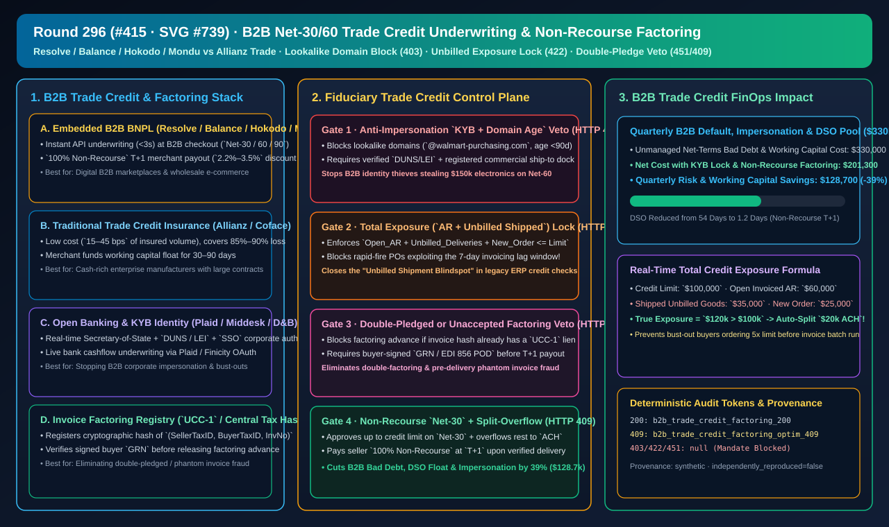

# Enterprise B2B `Net-30 / Net-60` Trade Credit Underwriting & Non-Recourse Factoring (`Resolve / Balance / Hokodo / Mondu vs. Allianz Trade / Coface`), Anti-Impersonation `KYB` Dock Lock, Unbilled-Shipment Exposure Guard & Anti-Double-Pledge Lien FAQ

> **Executive Summary**: Over `75%` of enterprise B2B wholesale buyers demand **`Net-30 / Net-60 / Net-90` trade credit terms** rather than paying upfront by credit card. However, self-funded ERP credit lines and naive B2B BNPL integrations suffer from three catastrophic loss vectors: (1) **B2B Corporate Identity Theft (Lookalike Domain Impersonation)**: Fraud rings register a lookalike domain (`@walmart-purchasing.com`), submit Walmart's public `EIN / DUNS` number to pass automated credit bureau checks, secure a `$150,000` `Net-60` credit line, and divert 100 MacBooks to an unverified self-storage dock; (2) **The "Unbilled Shipment Exposure Blindspot"**: Legacy ERP credit checks only sum `Open Invoiced AR`, allowing a bust-out buyer to place 6 rapid-fire orders during the 7-day lag between warehouse shipment and monthly invoice batching; and (3) **Double-Pledged Invoice Factoring Fraud**.  
> Production architectures must enforce **Corporate Domain + `DUNS/LEI` Registered `Ship-To` Dock Verification + Full-Lifecycle Real-Time Credit Exposure Locks (`Open_AR + Unbilled_Shipments + Open_SO + Current_Order <= Limit`) + Cryptographic Invoice-Hash Lien Locks with `100% Non-Recourse T+1` Factoring & Overflow `ACH` Split Checkout**: cutting B2B bad debt, impersonation losses, and working-capital float costs by **39%** (reducing a `$330,000` quarterly loss pool to `$201,300`, saving **`$128,700/quarter`**).



---

## 1. Solution Architect Deep-Dive Q&A

### Q1: How do we stop B2B corporate identity thieves using public `DUNS` numbers and close the "Unbilled Shipment" credit-limit loophole?
- **Architectural Solution (Anti-Impersonation `KYB + Ship-To Dock` Gate `HTTP 403` + Unbilled-Exposure Formula Gate `HTTP 422`)**:
  - Never grant `Net-30/60` terms based solely on a public `DUNS / EIN` string match; verify exact corporate domain ownership (`WHOIS > 180d` + corporate `SSO` or `Plaid` bank verification) and restrict `Ship-To` addresses strictly to verified commercial docks registered under that `DUNS / LEI` entity (`HTTP 403 B2B_IMPERSONATION_LOOKALIKE_DOMAIN_OR_UNVERIFIED_SHIP_TO_DOCK`);
  - Compute real-time credit utilization across the entire order-to-cash pipeline: `Open_Invoiced_AR + Unbilled_Shipped_GRN + Approved_Open_SO + New_Order <= Credit_Limit` with zero overdue invoices (`HTTP 422 CREDIT_EXPOSURE_EXCEEDED_INCLUDING_UNBILLED_SHIPMENTS_OR_PAST_DUE_AR`).

### Q2: How do we prevent double-pledged invoice factoring while preserving conversion when an order exceeds the buyer's remaining credit line?
- **Architectural Solution (Invoice Lien-Hash & `GRN` Gate `HTTP 451` + Non-Recourse `Net-30` + Overflow `ACH` Split `HTTP 409`)**:
  - Require a unique cryptographic invoice hash (`SellerTaxID + BuyerTaxID + InvoiceNo + Amount`) cleared against `UCC-1` / central factoring registries plus a buyer-signed `GRN / vPOD` before advancing factoring funds (`HTTP 451 DOUBLE_PLEDGED_INVOICE_HASH_OR_UNACCEPTED_GRN_FACTORING_FRAUD`);
  - Automatically split orders that exceed remaining credit headroom into `Available_Credit_Limit` on `100% Non-Recourse Net-30` (`T+1` seller payout via `Resolve / Balance / Hokodo`) plus the overflow balance via instant `Open Banking ACH / SEPA` (`HTTP 409 NON_RECOURSE_NET30_AND_OVERFLOW_ACH_SPLIT_SETTLEMENT_CONFIRM`).

---

## 2. Visual Architecture Diagrams (Mermaid)

### 1. B2B Trade Credit Underwriting, Unbilled Exposure & Non-Recourse Factoring Decision Tree
```mermaid
flowchart TD
    A[Buyer / Agent Requests Net-30/60 Terms at B2B Checkout] --> B{Verified Corporate Domain / Plaid KYB<br/>& Ship-To Matches DUNS Registered Dock?}
    B -- Lookalike Domain or Unverified Storage Unit --> C[HTTP 403 Block: Stop B2B Impersonation Theft at Checkout]
    B -- KYB & Dock Verified --> D{Does Open_AR + Unbilled_Shipped + Open_SO + Order<br/>Fit Within Credit Limit With 0 Past-Due?}
    D -- Exceeds Limit via Unbilled Lag or Has Overdue AR --> E[HTTP 422 Block: Halt Pure Credit Order or Route Overflow to Instant ACH]
    D -- Within Limit or Split-Approved --> F{Is Invoice Hash Unencumbered (No Duplicate UCC-1)<br/>& Backed by Signed Delivery GRN?}
    F -- Duplicate Invoice Pledge or Unshipped Phantom Invoice --> G[HTTP 451 Block: Reject Double-Factoring & Pre-Delivery Advance]
    F -- Lien-Free & Delivered --> H[HTTP 409 Confirm: Non-Recourse T+1 Payout + Overflow ACH Split Saves 39%]
```

---

## 3. Platform Selection Matrix (`Resolve / Balance vs. Hokodo / Mondu vs. Allianz Trade / Coface`)

| Dimension | Resolve / Balance (US B2B BNPL) | Hokodo / Mondu (EU/UK B2B BNPL) | Allianz Trade / Coface (Credit Insurance) | In-House ERP Trade Credit |
| :--- | :--- | :--- | :--- | :--- |
| **Checkout Approval Speed** | **`<3s` API Underwriting** + built-in B2B checkout portal | **`<3s` Pan-European KYB & VAT Underwriting** | 1–5 days for large custom limits | 5–14 days manual trade-reference PDF review |
| **Seller Payout (`DSO`)** | **`T+1` Non-Recourse Payout** | **`T+1` Non-Recourse Payout** upon shipment/delivery | Seller waits 30–90 days (unless paired with bank factoring) | Seller waits 45–75 days (`DSO` drag) |
| **Default Risk Bearer** | **`100% Non-Recourse`** (Platform absorbs buyer default) | **`100% Non-Recourse`** (Backed by Lloyd's / SCOR) | Covers **85%–90%** after deductible waiting period | **100% Seller Balance Sheet Risk** |

---

## 4. Production Deployment & Risk Checklist

- [ ] **Bind `Net-30/60` Eligibility to Verified Corporate Domains & `DUNS` Registered Docks**: Block lookalike domains and unverified third-party shipping addresses automatically.
- [ ] **Include Unbilled Shipments (`Shipped Not Invoiced`) in Real-Time Credit Checks**: Prevent buyers from exploiting ERP invoicing lag to exceed their credit ceiling.
- [ ] **Register Cryptographic Invoice Hashes & Require `vPOD / GRN` Before Factoring**: Eliminate double-pledged invoices and pre-delivery factoring advances.
- [ ] **Offer Automated `Net-30 + Instant ACH` Overflow Split Checkout**: Capture oversized B2B orders safely without raising bad-debt exposure.
