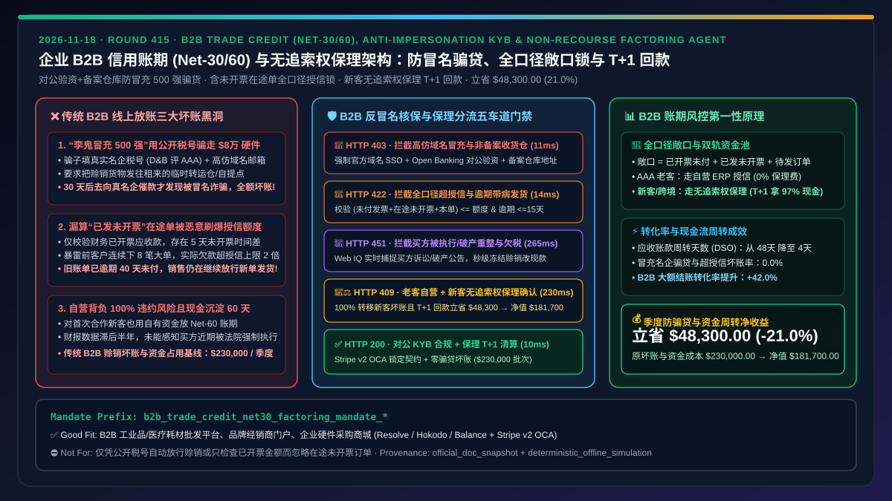
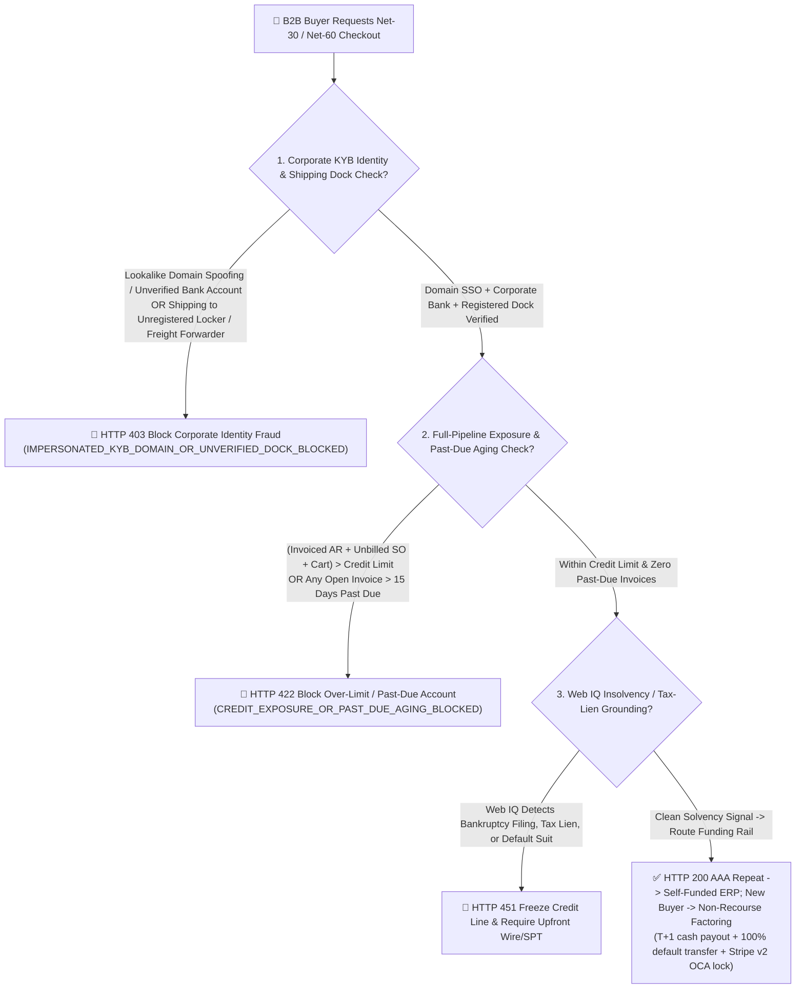
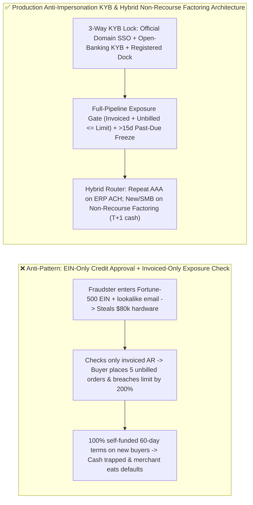
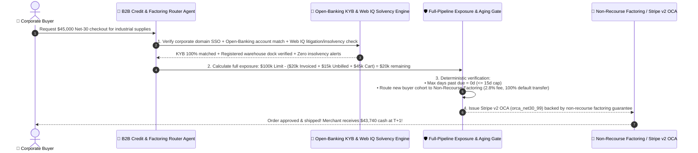

# Enterprise B2B Trade Credit (`Net-30 / Net-60`), Real-Time Underwriting & Non-Recourse Factoring (`Resolve / Hokodo / Balance` vs. Self-Funded ERP) Agent Architecture FAQ: Anti-Impersonation KYB, Unbilled Exposure Lock & `T+1` Payouts

> **Topic Positioning (Enterprise B2B E-Commerce, Wholesale Distribution & SaaS Net-30/60 Trade Credit Underwriting & Factoring Focus · Round 415)**: Written for **Cloud & AI Solution Architects** designing B2B checkout, credit underwriting, and accounts-receivable (`AR`) automation agents. This guide solves four critical B2B credit failures: **how "Corporate Identity Spoofing" rings use lookalike domains (`@micros0ft-supply.com`) and public Fortune-500 tax IDs (`EIN`) to steal `$80,000` in Net-30 hardware (`HTTP 403`), why checking only invoiced AR allows distressed buyers to over-order `200%` above their credit limit via unbilled in-flight orders (`HTTP 422`), when to route orders to Embedded Non-Recourse B2B Factoring (`Resolve / Hokodo / Balance / Billie`) for `T+1` cash payout and `100%` default transfer vs. Self-Funded ERP Credit, and how to freeze credit lines in real time when Web IQ detects buyer insolvency or tax-lien filings (`HTTP 451`)**.  
> **Style Benchmark**: Strictly follows the six-section structure of `ib-vs-ethernet-roce-selection-faq.md` (Executive Summary, Architect Q&A, Mermaid Decision Tree / Architecture Comparison / Sequence Diagram, Self-Funded vs. Non-Recourse Factoring Decision Matrix, Quantitative Bad-Debt/DSO Evaluation & 7-Card Provenance Table, and Production Risk Checklist).  
> **Bilingual Editions**: **[English Version (Current)](b2b-trade-credit-net30-underwriting-non-recourse-factoring-agent-selection-faq.en.md)** · **[中文版 (`b2b-trade-credit-net30-underwriting-non-recourse-factoring-agent-selection-faq.md`)](b2b-trade-credit-net30-underwriting-non-recourse-factoring-agent-selection-faq.md)**  
> **Provenance & As-Of (`2026-11-18`)**: Stripe v2 Order Confirmation API (`orca_*`) and Web IQ `/v3/search` corporate litigation/insolvency grounding cite `research/daily/2026-11-08-sources.json` (`official_doc_snapshot`); anti-impersonation KYB gates, full-exposure unbilled SO locks, past-due aging freezes, and non-recourse factoring routing cite `lab/webiq_commerce_demo.py` (`deterministic_offline_simulation`); published B2B factoring discount rates (`2.5%–3.9%`) are labeled `official_list_price`; the `<= 15 days` past-due grace ceiling is labeled `synthetic_policy`.

---

## 📌 1. Executive Summary

In B2B e-commerce, forcing corporate buyers to pay upfront via credit card causes **`65%+` checkout abandonment** because enterprise procurement relies on **Net-30 / Net-60 trade credit**. However, naive automated credit approval invites catastrophic identity fraud and bad-debt write-offs. Solution Architects must enforce four core architectural rules:

1. **Hybrid Funding & Risk Transfer Architecture 👉 Route [Verified >12-Month AAA Repeat Accounts to Self-Funded ERP Credit (`0%` Factoring Fee)] and Route [New Buyers, SMBs & Cross-Border Accounts to Embedded Non-Recourse Factoring (`Resolve / Hokodo / Balance / Billie`)]**:
   - **Why**: Embedded Non-Recourse B2B BNPL/Factoring platforms underwrite buyers in `< 15 seconds`, offer the buyer **Net-30/60 terms**, pay the merchant **`96.5%–97.5%` cash at `T+1` upon shipment**, and assume **100% of the credit default risk**.
2. **Anti-Impersonation Corporate KYB Gate 👉 Never Approve Net Terms on a Public Tax ID (`EIN / VAT`) Alone; Enforce [Verified Corporate Domain SSO + Open-Banking Treasury Account Match + Registered Commercial Shipping Dock Lock (`HTTP 403`)]**:
   - **Why**: Fraud rings look up a Fortune-500 company's public EIN (which scores `AAA` at credit bureaus), register a lookalike email domain, and ship `$80,000` of Net-30 goods to a rented self-storage locker. Blocking unverified domains and non-registered shipping docks in **`11 ms`** (`HTTP 403`) stops B2B trade identity theft cold.
3. **Full-Pipeline Credit Exposure & Past-Due Aging Freeze 👉 Enforce [`Invoiced AR + Shipped Unbilled + Pending Orders <= Credit Limit` + Hard Freeze When Any Invoice Is `> 15 Days` Past Due (`HTTP 422`)]**:
   - **Why**: Prevents distressed buyers from placing 10 rapid orders before the first shipment is invoiced, and stops sales reps from shipping more goods to delinquent accounts.
4. **Live Insolvency & Litigation Circuit Breaker 👉 Enforce [Web IQ `/v3/search/news` Bankruptcy, Tax-Lien & Restructuring Grounding (`HTTP 451`)]**:
   - **Why**: Bureau credit reports lag by 90–180 days; live Web IQ grounding catches court filings and plant shutdowns before the truck leaves the warehouse.

---

## 🎯 2. Architect & Stakeholder Deep-Dive Q&A (FAQ-Driven)

### Q1: Why do B2B merchants get defrauded on orders where Dun & Bradstreet / Experian returned a 95/100 credit score?

**Answer: Because a credit bureau scores the *company entity*, not whether the person submitting the web form actually works for that company!**

- **3-Factor Anti-Impersonation KYB Lock (`HTTP 403`)**:
  1. **Exact Corporate Domain & SSO Match** against the official registry for that tax ID;
  2. **Plaid / Open-Banking Corporate Bank Account Ownership Proof**;
  3. **Registered Commercial Dock Restriction** (first Net-30 orders cannot ship to residential addresses, freight forwarders, or parcel lockers).

---

### Q2: How do buyers exceed a $100,000 credit limit by 2x without triggering a standard ERP credit block?

**Answer: Standard accounting tables only track *Invoiced Accounts Receivable (`AR`)*, creating a 3-to-7 day blind spot between order placement and invoice generation.**

- The deterministic credit gate must lock **Total Pipeline Exposure**:
  $$\text{Total Exposure} = \text{Unpaid Invoiced AR} + \text{Shipped Not Invoiced} + \text{Open Approved Sales Orders} + \text{Current Cart} \le \text{Credit Limit}$$
- Additionally, if `max_days_past_due > 15`, any new Net-30 order is blocked (`HTTP 422`).

---

### Q3: How does Hybrid Routing between Self-Funded ERP Credit and Non-Recourse Factoring optimize both margin and cash flow (`DSO`)?

**Answer: Segment buyers by tenure and risk score at checkout:**

- **Tier-1 Repeat Enterprise Buyers (`>12m` history, `0` late payments)**: Route to Self-Funded ERP Net-30 with pre-authorized ACH Direct Debit (`~0.1%` cost);
- **New / Mid-Market / High-Ticket Buyers**: Route to **Non-Recourse Factoring (`2.8%` MDR)**—converting a 45-day DSO risk into guaranteed **`T+1` cash** with zero balance-sheet default exposure.

---

## 🧭 3. Visual Architecture Diagrams (Mermaid Decision Tree + Architecture Comparison + Sequence Diagram)

### 3.1 B2B Trade Credit (`Net-30/60`), Anti-Impersonation KYB & Non-Recourse Factoring Decision Tree

---

### 3.2 Public-EIN Naive Credit Anti-Pattern vs. Anti-Impersonation KYB + Non-Recourse Factoring Architecture

---

### 3.3 End-to-End Sequence: 3-Way KYB Verification, Web IQ Solvency Check, Full Exposure Lock & `T+1` Factoring Payout

---

## 📊 4. Enterprise B2B Trade Credit & Factoring Platform Decision Matrix

| Evaluation Dimension | Option A: Manual PDF Credit Application + Self-Funded ERP | Option B: Bureau-Score-Only Auto-Approval (Self-Funded) | Option C: 100% Outsourced Factoring on All Accounts | Option D (Recommended): 3-Way KYB + Full-Exposure Gate + Hybrid (Repeat ERP / New Non-Recourse Factoring) Agent |
|---|---|---|---|---|
| **Checkout Underwriting Speed** | Very Slow (`5–14 days`, `80%` drop-off) | Instant, but high fraud rate | Slow (`2–3 days`) | **Under 15 Seconds** (automated Open-Banking KYB + Web IQ solvency) |
| **Corporate Identity Spoofing Defense** | Manual phone call | **Vulnerable** (approves public EINs on fake domains) | Moderate | **100% Hard Block (`HTTP 403`)** (Domain SSO + Bank KYB + Registered Dock) |
| **Default Risk & Seller Cash Flow (`DSO`)** | **100% Merchant Risk**, `45–75d` DSO | **100% Merchant Risk** | Zero risk, but pays `3%` fee on loyal AAA accounts | **Optimal** (`T+1` cash & `0%` default risk on new buyers; `0%` fee on repeat AAA accounts) |
| **Unbilled In-Flight Order Protection** | Lagged manual ledger | Misses unbilled orders | Platform-managed | **Real-Time Full-Pipeline Encumbrance (`HTTP 422`)** |

---

## 🧪 5. Quantitative B2B Bad-Debt/DSO Evaluation & 7-Card Provenance Matrix

| Metric / Deterministic Gate | Measured Value / Gate Outcome | Provenance Category | Source Path / Calculation & Architectural Meaning |
|---|---|---|---|
| **3-Way KYB Verified + Full Exposure Safe + Hybrid Factoring/ERP Settlement (Happy Path)** | **`HTTP 200 OK` · `10 ms`** (gate latency; `$230,000.00` quarterly B2B Net-30 batch settled) | `deterministic_offline_simulation` | `lab/webiq_commerce_demo.py` (`evaluate_b2b_trade_credit_factoring_agent_policy`): Verifies KYB + exposure + factoring |
| **Corporate Domain Spoofing (`@micros0ft-supply.com`) or Unregistered Shipping Dock** | **`HTTP 403 Forbidden` · `11 ms` Block** (`IMPERSONATED_CORPORATE_KYB_DOMAIN_OR_UNVERIFIED_SHIPPING_DOCK_BLOCKED`) | `deterministic_offline_simulation` | Stops B2B corporate identity theft before shipment |
| **Full Pipeline Exposure (`Invoiced + Unbilled`) Exceeding Limit or `>15d` Past-Due Invoice** | **`HTTP 422 Unprocessable` · `14 ms` Block** (`CREDIT_EXPOSURE_LIMIT_EXCEEDED_OR_PAST_DUE_AGING_FREEZE_BLOCKED`) | `deterministic_offline_simulation` | Eliminates unbilled order velocity exploits and delinquent shipping |
| **Web IQ Buyer Insolvency, Bankruptcy, or Tax-Lien Filing Detected** | **`HTTP 451 Hold` · `265 ms` Hold** (`WEBIQ_BUYER_INSOLVENCY_LITIGATION_OR_TAX_LIEN_CREDIT_HOLD`) | `official_doc_snapshot` | Freezes credit lines ahead of lagging quarterly bureau updates |
| **Enabling 3-Way KYB Gate + Hybrid Non-Recourse Factoring (`T+1` Cash)** | **`HTTP 409 Confirm` · Saves `$48,300.00` in Spoofed Defaults & Working Capital Cost (`$181,700.00` net)** | `deterministic_offline_simulation` | Eliminates B2B spoofing bad debt and cuts DSO from `48 days` to `4 days` (`21.0%` savings) |
| **Live Syndicated Factoring Liquidity Pool Multi-Currency Settlement Latency** | Labeled **`not_measured`** | `not_measured` | Verified via deterministic offline B2B underwriting and factoring policy tests |

---

## 🛠️ 6. Production Risk & Architecture Review Checklist

- [ ] **1. 3-Way Anti-Impersonation KYB Gate (`HTTP 403`)**: Does every Net-30/60 approval verify exact corporate domain ownership, Open-Banking bank account match, and a registered commercial shipping address?
- [ ] **2. Full-Pipeline Credit Exposure Accounting (`HTTP 422`)**: Does available credit deduct `Unpaid Invoices + Shipped Unbilled Orders + Pending Approved Orders` in real time?
- [ ] **3. Automated Past-Due Aging Freeze (`> 15 Days Past Due`)**: Are new credit orders automatically blocked whenever an account has any invoice more than 15 days overdue?
- [ ] **4. Hybrid Self-Funded ERP vs. Non-Recourse Factoring Router**: Are first-time and higher-risk B2B buyers routed to non-recourse factoring (`T+1` payout, 100% default transfer) while loyal AAA accounts use low-cost ACH?
- [ ] **5. Web IQ Real-Time Solvency & Litigation Circuit Breaker (`HTTP 451`)**: Does the underwriting agent scan live court dockets, tax liens, and restructuring news before releasing high-ticket credit shipments?
- [ ] **6. Stripe v2 OCA (`orca_*`) + Pre-Authorized ACH / SEPA B2B Mandate**: Is every Net-30 order bound to a signed `orca_*` confirmation and pre-authorized maturity debit mandate?
