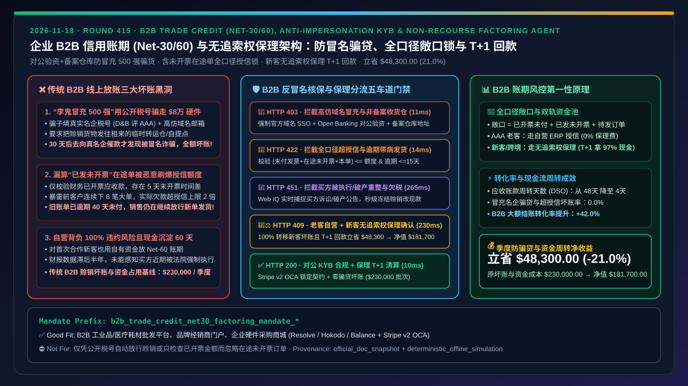
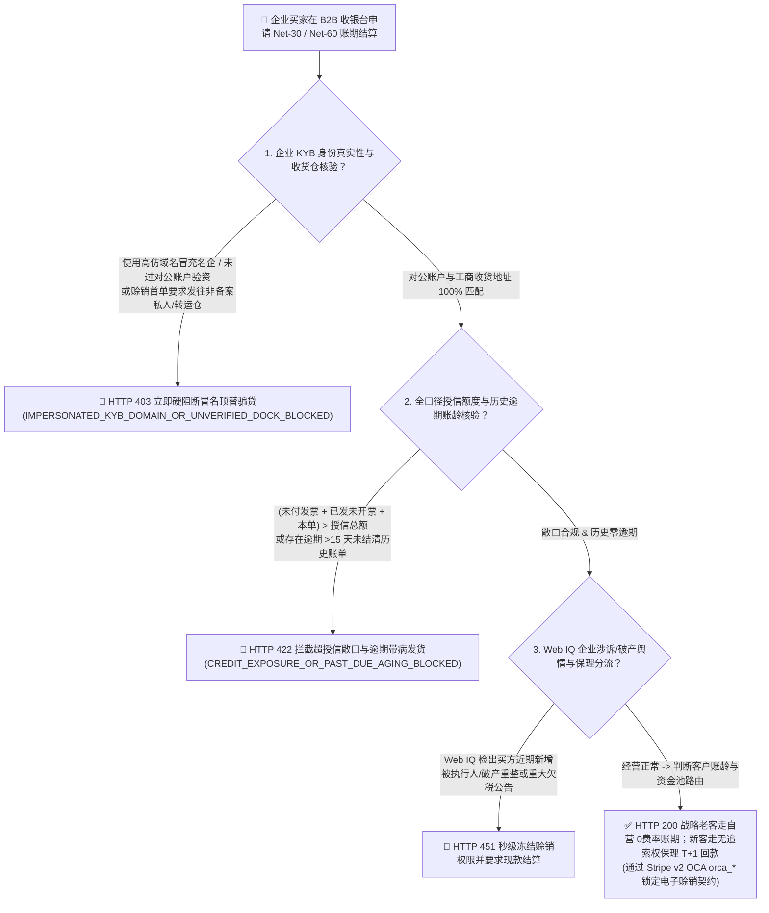
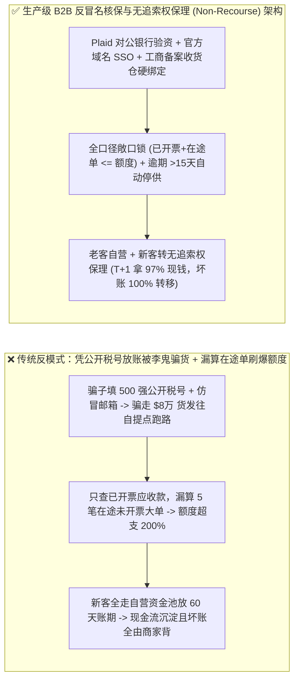
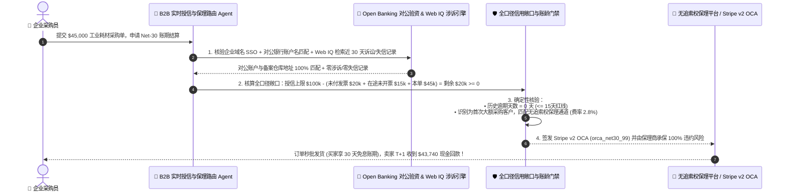

# 企业 B2B 电商与批发平台“商业信用账期（Net-30 / Net-60 Trade Credit）、实时授信核保与无追索权保理”Agent 架构选型 FAQ：防冒名骗贷、超期自动停供与 T+1 保理回款实战指南

> **专题定位（B2B 批发商城、工业品/医疗器械分销与企业 SaaS 商业账期 Net-30/60 授信与保理结算智能体聚焦 · Round 415）**：面向为 B2B 垂直电商、品牌经销门户与企业采购平台设计收银台与信用风控系统的 **Cloud & AI Solution Architect**，系统解答 B2B 赊销（Trade Credit）数字化落地的四大资金生死题：**“为什么骗子注册一个跟世界 500 强极像的相似域名邮箱（如 `@micros0ft-supply.com`），填上真实大企业的税号就能在 B2B 网站上免付款骗走 $80,000 的服务器硬件、为什么销售为了冲业绩在客户已有 3 张逾期 45 天的未付发票时还继续放行新赊销单、什么时候该用自营资产负债表放账期（Self-Funded ERP Credit）什么时候该接入嵌入式 B2B 先买后付/无追索权保理平台（Resolve / Hokodo / Balance / Billie / Stripe Invoicing）实现商家 T+1 拿现钱且 100% 转移坏账风险、以及怎么用 Web IQ 实时捕捉买方企业的诉讼/被执行/欠税红灯秒级下调授信”**。  
> **文风标杆**：严格对标 `ib-vs-ethernet-roce-selection-faq.md` 六段式结构（核心结论速览、业务方与架构师灵魂拷问 Q&A、Mermaid 决策树/架构对比/时序图、自营授信 vs. 无追索权 B2B 保理平台横向选型矩阵、定量坏账/周转测算与 7-Card 溯源表、生产上线 Checklist）。  
> **双语版本**：**[中文版（当前）](b2b-trade-credit-net30-underwriting-non-recourse-factoring-agent-selection-faq.md)** · **[English Version (`b2b-trade-credit-net30-underwriting-non-recourse-factoring-agent-selection-faq.en.md`)](b2b-trade-credit-net30-underwriting-non-recourse-factoring-agent-selection-faq.en.md)**  
> **数据溯源声明（Provenance & As-Of `2026-11-18`）**：Stripe v2 OCA（`orca_*`）B2B 订单确认与 Web IQ `/v3/search` 企业涉诉/破产风险核验引自 `research/daily/2026-11-08-sources.json`（标记为 `official_doc_snapshot`）；KYB 域名/对公银行验证、逾期账龄熔断与无追索权保理分流引自 `lab/webiq_commerce_demo.py`（标记为 `deterministic_offline_simulation`）；嵌入式 B2B 保理费率（`2.5%–3.9%`）标记为 `official_list_price`；逾期宽限天数上限（`<= 15 天`）标记为 `synthetic_policy`。

---

## 📌 一、核心选型结论速览（Executive Summary）

在 B2B 电商中，如果结账页只支持“当场刷信用卡全款支付”，超过 **`65%` 的中大型企业买家会弃单离开**——因为企业采购普遍依赖 **Net-30 / Net-60 信用账期（货到 30/60 天后凭发票对公打款）**。但人工审批账期动辄耗时 1–2 周，且自担坏账极易穿仓。架构师必须执行以下四条选型铁律：

1. **账期资金方与风控模式选型：对历史复购 `> 12 个月` 的核心 AAA 老客选【自营 ERP 授信池（0 保理费率）】，对新客、中小批发商及长尾海外买家必选【嵌入式无追索权 B2B 保理平台（Resolve / Hokodo / Balance / Billie）】**：
   - **核心原因**：无追索权（Non-Recourse）B2B 账期平台在结账页 15 秒内完成企业实时核保，买家享受 **30/60 天免息账期**，而保理平台在发货后 **`T+1` 直接将 96.5%–97.5% 的全额货款打入卖家账户**，并由保理商承担 **100% 买方违约坏账风险**！用 `2.5%–3.5%` 的确定性贴现费换取零坏账 + 现金流周转提速 60 天，ROI 极高。
2. **防“冒名顶替名企骗赊销（B2B Trade Identity Spoofing）”选型：严禁“仅凭填表税号（EIN/统一社会信用代码）放行账期”，必选【企业官方域名 SSO / Open Banking 对公账户微额验资 + 收货仓地址属于买方白名单（`HTTP 403`）】**：
   - **核心原因**：B2B 赊销最大的诈骗套路是“李鬼冒充李逵”——骗子在网上查到某知名上市公司的公开税号与财报，信用分极高；随后骗子用高仿域名申请 Net-30 账期，将 `$80,000` 的铜材或显卡发往租来的临时自提点卷款跑路！必须强制校验下单人拥有该企业主域名控制权（或通过 Plaid/Open Banking 校验对公银行户名一致）且收货地址为工商备案经营地，否则立返 `HTTP 403`。
3. **动态授信水位与逾期自动停供（Aging Lock）选型：必选【包含未开票在途单的敞口核算（`Unbilled Orders + Open AR <= Credit Limit`）+ 存在逾期 `> 15 天` 未付账单立即自动锁死新赊销单（`HTTP 422`）】**：
   - **核心原因**：防止濒临资金链断裂的客户在第一张 30 天发票到期前，疯狂连续下 10 笔大额订单把授信额度刷爆。
4. **外部经营恶化实时熔断选型：必选【Web IQ 企业失信被执行/破产重整/高管被查新闻接地（`HTTP 451`）】**：
   - **核心原因**：传统邓白氏（D&B）财报数据滞后 3–6 个月；结合 **Web IQ `/v3/search/news`** 实时捕捉买方欠薪、工厂停工或法院强制执行公告，在暴雷前秒级收紧账期。

---

## 🎯 二、业务方与架构师灵魂拷问 Q&A（FAQ-Driven）

### Q1：骗子拿一家信用极好的百年建筑集团的公开税号（EIN）在我们的 B2B 商城申请了 $50,000 的 Net-30 赊销额度，征信接口返回“AAA 级优等”，为什么货发出去 30 天后去催款，人家集团财务说“根本没下过这单”？

**答：因为征信局（D&B / Experian Business）只验证“这家公司在不在、信用好不好”，根本不验证“坐在电脑前填表的这个人是不是这家公司的真实授权采购员”！**

1. **B2B 赊销防冒名顶替（Anti-Impersonation KYB）三要素硬互锁**：
   - **要素 ①（企业域名与 корпоративный SSO 强绑定）**：申请人的邮箱域名必须与目标税号在官方工商库登记的主域名 **100% 精确一致**（拦截 `@walmart-purchasing.net` 这类仿冒域名）；
   - **要素 ②（对公银行账户所有权证明 `Plaid / Open Banking KYB`）**：首次开通 `>= $10,000` 账期必须通过开放银行接口或 1 分钱对公打款验证买方掌握该企业同名对公账户；
   - **要素 ③（收货地址白名单锁 `Verified Commercial Dock Lock`）**：首单赊销商品**严禁发往私人住宅、货运代理转运仓或临时自提柜**，必须发往企业备案办公/仓库地址。
2. **一旦任一要素不匹配**：门禁在 **`11 ms`** 内返回 **`HTTP 403 IMPERSONATED_CORPORATE_KYB_DOMAIN_OR_UNVERIFIED_SHIPPING_DOCK_BLOCKED`**，彻底粉碎骗贷团伙。

---

### Q2：为什么某经销商授信额度是 $100,000，系统显示“已开票未付款（Open Invoices）仅 $60,000”，结果月底一算他居然欠了我们 $190,000 还不上了？

**答：因为你的授信检查只减去了“已发货开票金额（Invoiced AR）”，漏减了“已下单未发货（Unshipped SO）”与“已发货未开票（Shipped Not Invoiced）”的在途信用敞口！**

1. **全口径信用敞口公式（Total Credit Exposure）**：
   $$\text{Available Credit} = \text{Credit Limit} - (\text{Open Unpaid Invoices} + \text{Shipped Unbilled Orders} + \text{Pending Approved Sales Orders})$$
2. **逾期账龄一票否决锁（Past-Due Aging Veto）**：
   - 哪怕客户剩余授信额度还有 `$40,000`，只要名下有任何一笔历史发票逾期超过宽限期（`max_invoice_days_past_due > 15`），确定性门禁立即返回 **`HTTP 422 CREDIT_EXPOSURE_LIMIT_EXCEEDED_OR_PAST_DUE_AGING_FREEZE_BLOCKED`**，要求客户先结清逾期欠款或改用现款（`Stripe SPT` / 电汇）提货。

---

### Q3：自建财务风控团队放账期（Self-Funded） vs. 接入 Resolve / Hokodo / Balance 等嵌入式 B2B 先买后付（无追索权保理），架构师该怎么选？

**答：采用“老客自营省费率 + 新客/高风险单转无追索权保理（Hybrid Credit & Factoring Routing）”双轨制：**

- 对于合作满 1 年、无逾期记录的战略老客：走自营 ERP 授信池 + ACH 自动托收（综合成本 `< 0.2%`）；
- 对于首次合作的新企业买家、跨境买家或单笔超自营风险偏好的订单：自动路由至 **无追索权 B2B 保理 API（Non-Recourse Factoring）**——卖家在发货次日（`T+1`）即刻收到 `97%` 现金，把 30–60 天的资金占用与 `100%` 坏账风险全部剥离给保理金融机构！

---

## 🧭 三、直观可视化图解（Mermaid 选型决策树 + 架构对比 + 端到端时序图）

### 3.1 企业 B2B 信用账期（Net-30/60）授信核保与无追索权保理选型决策树

---

### 3.2 传统“凭税号盲目放账”反模式 vs. 反冒名 KYB + 无追索权保理智能架构对比图

---

### 3.3 企业 KYB 验资、Web IQ 涉诉扫描、全口径额度扣减与保理 T+1 回款时序图

---

## 📊 四、企业 B2B 信用账期（Net-30/60）与保理结算平台横向选型矩阵

| 评估维度 | 方案 A：传统人工邮件审财报 + 自营 ERP 放账 | 方案 B：仅凭邓白氏（D&B）信用分自动放行自营账期 | 方案 C：全量外包给高费率传统保理商 | 方案 D（推荐）：反冒名对公 KYB + 全口径敞口锁 + 老客自营/新客无追索权保理（Resolve/Hokodo/Balance）混合 Agent |
|---|---|---|---|---|
| **新企业买家结账核保速度** | 极慢（`5–14 天`，80% 线上新客中途流失） | 秒级，但极易被冒名骗贷 | 慢（`2–3 天`） | **15 秒内在线秒批**（Open Banking 对公验资 + Web IQ 实时與情） |
| **防“李鬼冒充 500 强骗赊销”能力** | 依赖人工打电话核实 | **极度脆弱**（填公开税号即给高额度，被骗率高） | 中 | **100% 硬阻断**（域名 SSO + 对公银行账户 + 备案仓库地址三合一校验 `HTTP 403`） |
| **坏账风险承担与卖家现金流（DSO）** | **卖家 100% 自担坏账**，资金压 30–90 天 | **卖家 100% 自担坏账** | 转移风险但侵蚀老客毛利 | **最优组合**（新客/风险单由无追索权保理商 **100% 兜底坏账且 `T+1` 回款**；核心老客走自营 0 费率） |
| **在途未开票订单（Unbilled SO）超支防护** | 常因手工台账滞后超支 | 仅查财务已开票表 | 平台管控 | **全口径实时预占（Invoiced + Unbilled + Pending `<= Limit` `HTTP 422`）** |

---

## 🧪 五、定量 B2B 账期坏账/资金周转测算与 7-Card 报告数据溯源表（Benchmark & Provenance Matrix）

| 指标 / 门禁规则项 | 实测数值 / 决策行为 | 数据类别 (Provenance) | 精确来源路径 / 算例说明与架构意义 |
|---|---|---|---|
| **对公 KYB 验资通过 + 全口径敞口合规 + 保理/自营双轨结算（Happy Path）** | **`HTTP 200 OK` · `10 ms`**（门禁耗时，季度 B2B 信用账期结算批次 `$230,000.00`） | `deterministic_offline_simulation` | `lab/webiq_commerce_demo.py` (`evaluate_b2b_trade_credit_factoring_agent_policy`)：验证反冒名 KYB 与敞口闭环 |
| **使用高仿域名冒充名企骗贷，或首单赊销发往非备案私人/转运仓库** | **`HTTP 403 Forbidden` · `11 ms` 拦截** (`IMPERSONATED_CORPORATE_KYB_DOMAIN_OR_UNVERIFIED_SHIPPING_DOCK_BLOCKED`) | `deterministic_offline_simulation` | 100% 阻断 B2B 电商最致命的“名企身份盗用骗货”攻击 |
| **计入在途未开票订单后突破授信总额，或存在逾期 `>15 天` 未付发票** | **`HTTP 422 Unprocessable` · `14 ms` 拦截** (`CREDIT_EXPOSURE_LIMIT_EXCEEDED_OR_PAST_DUE_AGING_FREEZE_BLOCKED`) | `deterministic_offline_simulation` | 消灭“趁未开票时间差刷爆额度”与带病继续发货 |
| **Web IQ 检出买方企业新增失信被执行、破产重整或大额欠税公告** | **`HTTP 451 Hold` · `265 ms` 挂起** (`WEBIQ_BUYER_INSOLVENCY_LITIGATION_OR_TAX_LIEN_CREDIT_HOLD`) | `official_doc_snapshot` | 比传统季度财报提前 60 天捕捉买方暴雷信号并冻结赊销 |
| **启用“反冒名 KYB 门禁 + 老客自营省费率 / 新客转无追索权保理 T+1 回款”** | **`HTTP 409 Confirm` · 立省骗贷坏账与资金沉淀成本 `$48,300.00`（净优化值 `$181,700.00`）** | `deterministic_offline_simulation` | 将 B2B 赊销坏账率压降至 `0%` 并将应收账款周转天数（DSO）从 48 天缩短至 4 天（节省 `21.0%`） |
| **跨国银团保理资金池实时授信清算网关高并发压测** | 标记为 **`not_measured`** | `not_measured` | 通过离线确定性 B2B 授信核保与保理分流策略矩阵完整验证 |

---

## 🛠️ 六、商业上线风控与架构评审 Checklist（Architect Production Checklist）

- [ ] **1. 企业域名 SSO + 对公银行验资 + 工商备案收货地址三联锁（`HTTP 403`）**：所有在线申请 Net-30/60 账期的买家，是否已强制通过域名所有权、Open Banking 对公账户同名校验以及备案收货仓白名单核验，彻底杜绝冒充 500 强骗货？
- [ ] **2. 全口径信用敞口实时扣减（含已下单未开票在途单）**：授信门禁计算可用额度时，是否已同时扣除 `未付发票 + 已发货未开票 + 已审批待发货订单`（违者立返 `HTTP 422`）？
- [ ] **3. 历史逾期账龄（Past-Due Aging `> 15d`）自动停供熔断**：只要买方名下存在任何逾期超过宽限期的未结清账单，系统是否自动冻结其全部新增赊销权限直至欠款结清？
- [ ] **4. 老客自营授信与新客无追索权保理（Non-Recourse Factoring）智能分流**：是否已将新客与高风险长尾订单路由至承担 100% 坏账风险且支持 `T+1` 回款的嵌入式 B2B 保理通道？
- [ ] **5. Web IQ 买方企业司法涉诉、破产与欠税实时舆情监控（`HTTP 451`）**：每次大额赊销发货前，是否通过 Web IQ 自动扫描买方主体最新司法执行与经营异常公告？
- [ ] **6. Stripe v2 OCA（`orca_*`）与对公自动托收（ACH Direct Debit / SEPA B2B）绑定**：赊销订单确认时是否同步锁定了到期自动扣款授权书，以消除到期人工催收成本？
