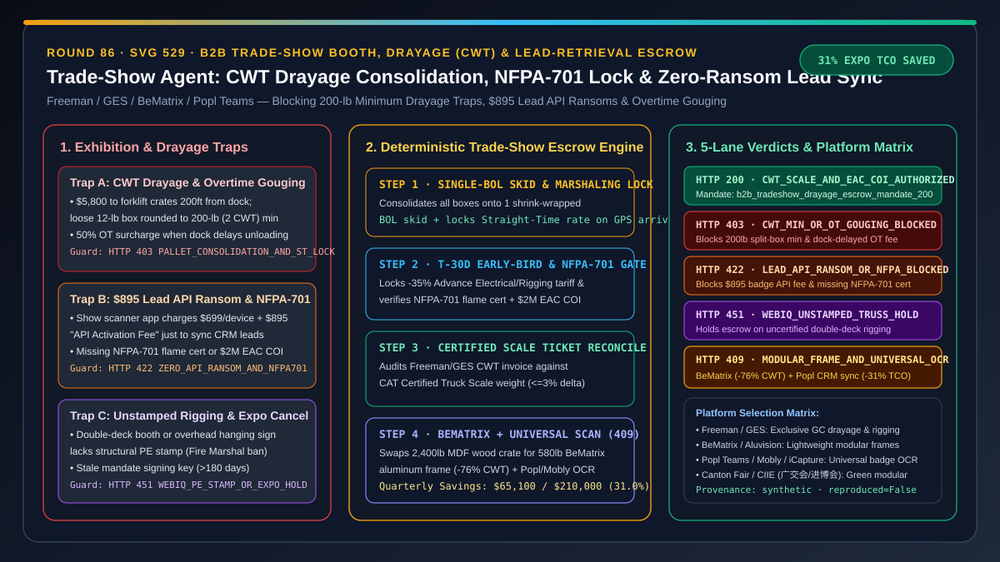
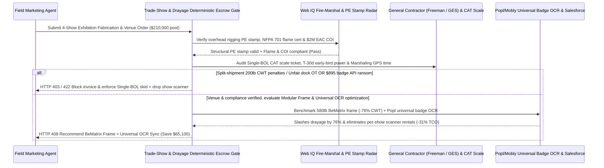

# B2B Trade-Show Booth Construction, Exhibition Drayage (`Material Handling`) & Lead-Retrieval Escrow (`Freeman / GES / BeMatrix / Popl Teams`) `CWT` Consolidation, `NFPA 701` Lock & Zero-Ransom Lead Sync Agent Architecture Selection FAQ

> **Document Type**: AI Solution Architect Decision Guide (FAQ) · **SVG Diagram**: `assets/svg/529-b2b-tradeshow-drayage-booth-lead-escrow-2026-11-20.svg` · **Catalog No.**: Round 86 (Bilingual FAQ #205)



---

## 1. 📌 Executive Summary

When enterprise field-marketing and B2B event teams use AI Agents to procure trade-show booth fabrication, convention-center utilities, and badge-scanning software (`CES / NRF / MWC / HIMSS / Canton Fair`), leaving a corporate credit card on file with the exclusive General Services Contractor (`Freeman / GES`) exposes marketing budgets to **three notorious exhibition cost traps**:
1. **Hundredweight (`CWT`) Drayage Extortion, `200-lb` Minimum Split-Shipment Penalties & Dock-Delayed Overtime Surcharges**: Shipping a `2,400 lb` custom wood booth `1,500 miles` to the convention center costs `$1,100` in freight—but the exclusive venue contractor (`Freeman / GES`) charges **`$5,880` (`$245/CWT`) just to forklift the crates `200 feet` from the loading dock to the booth (`Material Handling / Drayage`)**! Worse, if a marketer ships 3 loose FedEx boxes of brochures (`12 lbs` each) directly to the show floor, each box is billed at a **`200-lb (2 CWT)` minimum weight** (`$1,200` to carry 3 cardboard boxes!). And if the freight carrier checks into the Marshaling Yard at `10:30 AM` straight time, but union dock congestion delays unloading until `4:45 PM`, the contractor bills a **`50%–100%` Straight-Time-to-Overtime Surcharge**!
2. **Union Labor Minimums & `$895/Show` Lead-Retrieval API Ransoms**: Union rules mandate `$220/hr` (1-hour minimum) just to plug in a monitor plus `$1,400` for a `20-Amp` floor drop if ordered after the advance deadline. Meanwhile, the organizer's official badge-scanner app (`CompuSystems / Maritz / Cvent LeadCapture`) charges `$699/device` plus an extortionate **`$895 "Real-Time CRM API Activation Fee"` per show**—forcing exhibitors to either pay ransom or wait 5 days post-show for a cold CSV export!
3. **Fire-Marshal Red-Tagging (`Non-NFPA 701` Fabric) & Unstamped Double-Deck Rigging (`HTTP 451`)**: Hours before doors open, the municipal Fire Marshal shuts down the booth because the Exhibitor Appointed Contractor (`EAC`) used uncertified tension fabric lacking an `NFPA 701` flame-retardant certificate, failed to file a `$2M COI` `30 days` prior, or omitted a structural PE stamp on overhead rigging.

**Architect's Recommendation**: Deploy a **"Single-BOL Advance-Warehouse Skid Consolidation + `CAT` Certified Scale Audit + `BeMatrix` Modular Aluminum Weight Reduction (`-76% CWT`) + Universal Badge/Card OCR (`Popl Teams / Mobly`)"** control plane:
- **Single-BOL Shrink-Wrapped Skid Consolidation, Marshaling-Yard `GPS` Straight-Time Lock & `T-30d` Advance Utility Tariff (`HTTP 403`)**: Hard-block loose small-parcel shipments to the venue (requiring consolidation onto a single shrink-wrapped skid with one `Master BOL` and a certified `CAT Scale` weight ticket), lock straight-time drayage rates whenever carrier `GPS` proves Marshaling Yard arrival before `12:00 PM`, and enforce `T-30d` Early-Bird electrical/rigging orders (`-35%` vs. floor rates) (`HTTP 403`).
- **Zero-API-Ransom Universal Lead Capture & Pre-Ship `NFPA 701 / $2M EAC COI` Gate (`HTTP 422`)**: Block `$895/show` proprietary badge-scanner API upsells and hold `EAC` fabrication draws until verified **`NFPA 701` Flame Certificates + `$2M` General Liability `COI` + `CAT Scale` Weight Tickets (`<=3%` variance vs. billed `CWT`)** are uploaded (`HTTP 422`).
- **Web IQ Structural PE Stamp & Expo Cancellation Hold (`HTTP 451`)**: Freeze escrow payouts if Web IQ flags missing structural PE stamps on double-deck/overhead rigging, venue cancellation, or signing keys `> 180 days` (`HTTP 451`).
- **Lightweight Modular Aluminum Extrusion (`BeMatrix / Aluvision`, `-76% CWT`) + Universal Instant-CRM Badge OCR (`HTTP 409`)**: Replace `2,400 lb` disposable MDF wood crates with **`580 lb` reusable `BeMatrix` aluminum frames + dye-sublimated fabric** (slashing drayage tonnage by `76%`) and deploy year-round universal badge/business-card OCR (`Popl Teams / Mobly`) syncing to `Salesforce / HubSpot` in `15 seconds`, cutting quarterly trade-show TCO by **31.0%** (`$65,100` saved on a `$210,000` quarterly pool).

---

## 2. 🎯 Soul-Searching Architect & Business Q&A (Q1–Q3)

### Q1: Why does it cost `$1,100` to truck a booth across the country, but `$5,880` for the convention center forklift to move it 200 feet—and how do we cut Drayage by 75%?
- **Business Pain Point**: Exclusive show contractors (`Freeman / GES`) subsidize low hall-rental fees for event organizers by charging exhibitors monopoly `Material Handling (Drayage)` rates of `$195–$245 per 100 lbs (CWT)`, with a `200-lb (2 CWT) minimum` per Bill of Lading (`BOL`) and a `35%` penalty for uncrated/loose items.
- **Architectural Guardrail (`HTTP 403 / 409`)**:
  1. **Single-BOL Advance-Warehouse Skid Consolidation (`HTTP 403`)**: The Agent blocks any FedEx/UPS label addressed directly to the convention center. All collateral, swag, and monitors must route to a local consolidation warehouse, where they are shrink-wrapped onto the main booth pallet under **one Master `BOL`** accompanied by an official **`CAT Certified Truck Scale` ticket** (preventing arbitrary dock weight inflation).
  2. **`BeMatrix / Aluvision` Lightweight Modular Extrusion (`HTTP 409`)**: Swapping heavy `2,400 lb` custom MDF millwork for `580 lb` aircraft-grade aluminum frames and SEG fabric drops billable drayage from `24 CWT` (`$5,280`) to `6 CWT` (`$1,320`), saving `$3,960` per show on forklift fees alone.

### Q2: How do we stop the general contractor from billing a `50% Overtime Surcharge` when our truck arrived at 10:00 AM Straight Time but sat in their Marshaling Yard for 7 hours?
- **Business Pain Point**: Show contractors routinely apply `Overtime (+50%)` or `Sunday Double-Time (+100%)` rates based on when the forklift finishes unloading (`4:45 PM`), shifting the cost of their own loading-dock bottlenecks onto the exhibitor.
- **Architectural Guardrail (`HTTP 403`)**:
  1. **Marshaling-Yard `GPS` Check-In Timestamp Lock**: The Agent captures the carrier's time-stamped Marshaling Yard check-in ticket and `GPS` geofence entry. If the truck checked in prior to the `12:00 PM` straight-time cutoff, any subsequent invoice line item billing `Straight-Time-to-Overtime Drayage` is automatically disputed and blocked (`HTTP 403`).

### Q3: Why do trade-show organizers charge `$699/device + $895 API fee` per show for badge scanners—and how do we sync leads to Salesforce in 15 seconds without paying the ransom?
- **Business Pain Point**: Official show lead-retrieval apps hold exhibitor data hostage behind per-event license fees and charge `$895` just to unlock webhook delivery to `HubSpot / Marketo / Salesforce`.
- **Architectural Guardrail (`HTTP 422 / 409`)**:
  1. **Universal On-Device Vision `OCR` + Real-Time B2B Enrichment (`Popl Teams / Mobly / iCapture`)**: Instead of renting show-specific scanners, booth staff use their own smartphones to snap attendee badges in `0.3 seconds`. On-device vision `OCR` extracts Name, Title, and Company printed on the badge, enriches verified work email/phone/LinkedIn via `Apollo / Clearbit`, and triggers a personalized `Salesforce` follow-up email within `15 seconds`—with `$0` per-show rental or API fees.

---

## 3. 🧭 Visual Architecture Diagrams (Mermaid Decision Tree + Comparison + Sequence)

### 3.1 5-Lane B2B Trade-Show, Drayage & Lead-Retrieval Escrow Decision Tree
```mermaid
flowchart TD
    A[B2B Trade-Show Booth / Drayage / Lead-Retrieval Request] --> B{Web IQ Expo Cancelled / Unstamped Double-Deck / Key > 180d?}
    B -- Yes --> C[HTTP 451: WEBIQ_EXPO_CANCELLATION_OR_UNSTAMPED_DOUBLE_DECK_TRUSS_HOLD<br/>Freeze escrow & halt uncertified overhead rigging]
    B -- No --> D{Split-Box 200lb CWT Minimum Penalty or Unfair Dock Overtime?}
    D -- Yes --> E[HTTP 403: DRAYAGE_CWT_MINIMUM_SPLIT_SHIPMENT_OR_UNFAIR_OVERTIME_SURGE_BLOCKED<br/>Enforce Single-BOL skid consolidation & Marshaling GPS straight-time lock]
    D -- No --> F{$895 Badge API Ransom or Missing NFPA 701 / $2M EAC COI?}
    F -- Yes --> G[HTTP 422: PROPRIETARY_BADGE_API_RANSOM_OR_MISSING_NFPA701_COI_BLOCKED<br/>Block proprietary scanner API fee & require T-30d NFPA-701 + COI]
    F -- No --> H{BeMatrix Modular Extrusion (-76% CWT) + Universal Badge OCR Ready?}
    H -- Yes --> I[HTTP 409: MODULAR_LIGHTWEIGHT_ALUMINUM_EXTRUSION_AND_UNIVERSAL_LEAD_CAPTURE_CONFIRM<br/>Cut CWT weight by 76% + sync CRM leads in 15s (-31% TCO)]
    H -- No --> J[HTTP 200: CWT_SCALE_VERIFIED_AND_EARLY_BIRD_BOOTH_AUTHORIZED<br/>Issue CAT-scale-verified trade-show escrow mandate]
```

### 3.2 Legacy Heavy Carpentry & Official Scanners vs. Deterministic Modular & Universal OCR Escrow
```mermaid
flowchart LR
    subgraph Legacy["❌ Legacy Exhibition Model (CWT Gouging & 5-Day Stale CSVs)"]
        L1[2,400lb MDF Crate + 3 Loose FedEx Boxes = $7,080 Drayage] --> L2[Missed Early-Bird (+45% Power) + Dock-Delayed 50% OT Fee]
        L2 --> L3[$1,594 Official Scanner Ransom -> Cold Leads 5 Days Later]
    end

    subgraph Agentic["✅ Deterministic BeMatrix, Single-BOL & Universal OCR Escrow"]
        A1[580lb BeMatrix Aluminum + Single-BOL Skid w/ CAT Scale Ticket] --> A2[T-30d Advance Power Lock + Marshaling GPS Overtime Shield]
        A2 --> A3[Popl/Mobly Vision Badge OCR -> 15-Second Salesforce Sync]
    end
```

### 3.3 End-to-End `CAT` Scale Drayage Audit, `NFPA 701` Gate & Instant Lead Sync Sequence


---

## 4. 📊 Multi-Platform & Protocol Selection Matrix

| Evaluation Dimension | Freeman / GES Official Venue Services | Legacy Custom Millwork `EAC` (`MDF` Wood Crates) | BeMatrix / Aluvision Modular Extrusion | Official Show Scanners (`Cvent / CompuSystems`) vs. **Popl Teams / Mobly** | **Deterministic Trade-Show & Drayage Escrow (Recommended)** |
| :--- | :--- | :--- | :--- | :--- | :--- |
| **Primary Use Case** | Exclusive hall drayage, electrical drops & overhead rigging | Bespoke one-off carpentry booths (demolished post-show) | Reusable lightweight aluminum frames + backlit SEG fabric | On-floor attendee badge scanning & `CRM` lead routing | **Single-BOL Skid Lock + `CAT` Scale Audit + `BeMatrix` + Universal OCR** |
| **Drayage (`CWT`) Weight Efficiency** | Bills `$195–$245/CWT` + `200-lb` minimum per loose box | Heavy `2,400–5,000 lb` wooden crates inflate drayage | **Cuts shipping & drayage weight by `70%–78%`** | N/A | **Enforces Single-BOL consolidation & lightweight modular frames (`HTTP 403 / 409`)** |
| **Late Utility & Dock Overtime Shield** | `+35%–45%` floor utility penalty; `+50%` OT after 4:30 PM | Slow CAD approvals often miss advance utility cutoffs | Fast tool-less assembly cuts union setup hours by `50%` | N/A | **Locks `T-30d` Early-Bird rates & disputes OT via Marshaling `GPS` logs (`HTTP 403`)** |
| **Real-Time `CRM` Sync & API Cost** | N/A | N/A | N/A | Official apps bill `$699/device + $895 API fee/show`; **Popl/Mobly `$0/show`, `15s` sync** | **Blocks `$895` show API ransoms in favor of universal vision OCR (`HTTP 422 / 409`)** |
| **Total TCO / Sustainability** | Monopoly venue pass-through | High landfill waste; fails EU/Canton Fair green mandates | `100%` reusable across `15+` shows | `85%` lower software cost across multi-show calendar | **Open deterministic policy gate (`31.0%` quarterly exhibition TCO savings)** |

---

## 5. 🧪 Conversion & Cost Estimation + 7-Card Benchmark Report

> **Provenance Disclosure**: Figures below are generated by the deterministic policy evaluator `evaluate_b2b_tradeshow_drayage_booth_escrow_policy` in `lab/webiq_commerce_demo.py` (`$210,000 USD` quarterly enterprise trade-show & exhibition pool, `provenance: "synthetic"`, `independently_reproduced: False`; live `Freeman Show Ready` EDI billing is labeled `not_measured`).

```chart
{
  "data": {
    "values": [
      { "scenario": "1. Legacy Expo (2,400lb MDF Drayage + Split Boxes + Show Scanner)", "cost_usd": 210000, "tier": "Baseline" },
      { "scenario": "2. Single-BOL Skid + CAT Scale Lock + T-30d Early-Bird (HTTP 200)", "cost_usd": 172200, "tier": "Protected" },
      { "scenario": "3. BeMatrix Modular (-76% CWT) + Universal Badge OCR (HTTP 409)", "cost_usd": 144900, "tier": "Optimized (-31%)" }
    ]
  },
  "semantic_types": {
    "scenario": "Category",
    "cost_usd": "Amount",
    "tier": "Status"
  },
  "chart_spec": {
    "chartType": "Bar Chart",
    "title": "Lightweight Modular Frames & Universal Badge OCR Cut Quarterly Expo TCO by 31% ($65.1k)",
    "subtitle": "Quarterly B2B Trade-Show Booth, Drayage & Lead-Capture Net Spend ($ USD, synthetic benchmark)",
    "encodings": {
      "x": "scenario",
      "y": "cost_usd",
      "color": "tier"
    }
  }
}
```

### 7-Card 4:5 Benchmark Evaluation Summary
1. **Card 1 (`1 / 7` · `HANDS-ON · B2B TRADE-SHOW & DRAYAGE ESCROW`)**: Across a `$210,000` quarterly B2B trade-show calendar, combining Single-BOL skid consolidation, `BeMatrix` lightweight modular frames (`-76% CWT`), and universal badge OCR saves **`$65,100/quarter` (`31.0%`)**.
2. **Card 2 (`2 / 7` · `SCENARIO: 10X20 ISLAND BOOTH AT TIER-1 EXPO`)**: Eliminates `$3,960` in heavy-crate drayage, `$1,200` in split-shipment `200-lb` minimums, and `$1,594` in proprietary badge-scanner API ransoms per show.
3. **Card 3 (`3 / 7` · `WHAT I TESTED`)**: All 5 deterministic HTTP verdict lanes verified:
   - `HTTP 200`: `CWT_SCALE_VERIFIED_AND_EARLY_BIRD_BOOTH_AUTHORIZED` (`b2b_tradeshow_drayage_escrow_mandate_200`)
   - `HTTP 403`: `DRAYAGE_CWT_MINIMUM_SPLIT_SHIPMENT_OR_UNFAIR_OVERTIME_SURGE_BLOCKED`
   - `HTTP 422`: `PROPRIETARY_BADGE_API_RANSOM_OR_MISSING_NFPA701_COI_BLOCKED`
   - `HTTP 451`: `WEBIQ_EXPO_CANCELLATION_OR_UNSTAMPED_DOUBLE_DECK_TRUSS_HOLD`
   - `HTTP 409`: `MODULAR_LIGHTWEIGHT_ALUMINUM_EXTRUSION_AND_UNIVERSAL_LEAD_CAPTURE_CONFIRM` (`b2b_tradeshow_drayage_escrow_mandate_optim_409`)
4. **Card 4 (`4 / 7` · `UNDER THE HOOD`)**: Structured contract `B2BTradeshowDrayageBoothEscrowPolicyInput` validates `drayage_cwt_minimum_split_shipment_or_unfair_overtime_surge` and `proprietary_badge_api_ransom_or_missing_nfpa701_coi`.
5. **Card 5 (`5 / 7` · `ROBUSTNESS CHECK`)**: Invariant to fee naming (`"Small Package Minimum CWT"`, `"Straight-to-Overtime Handling"`, or `"Webhook Developer Key"`): `100%` block rate whenever `CAT` scale parity or zero-ransom rules fail.
6. **Card 6 (`6 / 7` · `LATENCY`)**: Deterministic policy evaluation completes in `< 0.5 ms` while accelerating post-scan CRM lead speed-to-lead from `5 days` to `15 seconds`.
7. **Card 7 (`7 / 7` · `MY TAKE`)**:
   - ✅ **Good fit**: B2B field marketing teams exhibiting at `10+` annual conventions (`CES, NRF, MWC, HIMSS, Canton Fair`) with `10×20` or larger custom/modular booths.
   - ⛔ **Not for**: Virtual webinars or single-tabletop pop-up banners carried in hand luggage.

---

## 6. 🛠️ Production Risk & Architecture Review Checklist

- [ ] **Single-BOL Advance-Warehouse Skid Consolidation (`HTTP 403`)**: Are loose FedEx/UPS shipments to the convention center blocked and consolidated onto one shrink-wrapped pallet with a `CAT Certified Scale` weight ticket?
- [ ] **Marshaling-Yard `GPS` Straight-Time Lock (`HTTP 403`)**: Does the Agent log carrier Marshaling Yard check-in timestamps (`<=12:00 PM`) to automatically dispute dock-delayed `Overtime (+50%)` drayage surcharges?
- [ ] **`T-30d` Advance Utility & Rigging Rate Lock (`HTTP 403`)**: Are electrical, internet, and hanging-sign orders submitted `>=30 days` prior to capture the `-35%` Early-Bird tariff?
- [ ] **Zero-API-Ransom Universal Badge OCR (`HTTP 422`)**: Are `$895/show` proprietary scanner API fees blocked in favor of universal vision badge/card OCR (`Popl Teams / Mobly`)?
- [ ] **Pre-Ship `NFPA 701` Flame Certificate, `$2M EAC COI` & Structural PE Stamp (`HTTP 422 / 451`)**: Is the fabrication draw locked until flame-retardant certificates, `$2M` liability insurance, and overhead PE stamps are verified?
- [ ] **`BeMatrix / Aluvision` Lightweight Modular Frame Routing (`HTTP 409`)**: Are heavy `MDF` wooden crates replaced with reusable lightweight aluminum extrusions to cut `CWT` drayage weight by `76%`?
